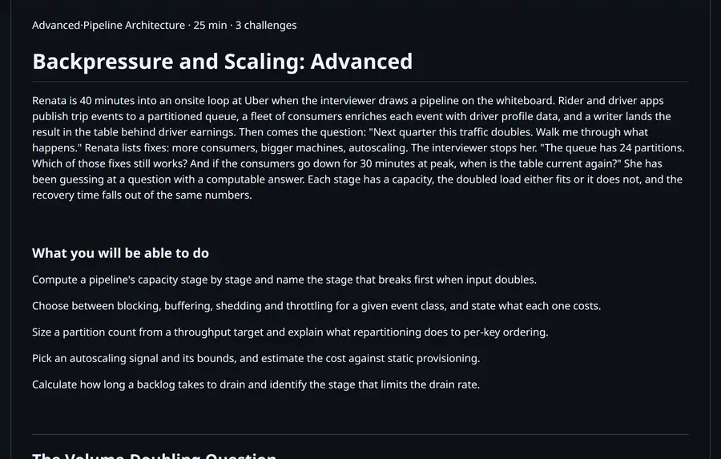

# data-eng-knowledge

Data engineering lessons in Markdown, with diagrams and animations, plus the tools I use to build them and an MCP server so an agent can answer from them.

 

  
  
  
  

  
   
  <a href="assets/demo-dark.mp4">Watch the full-quality video</a>

