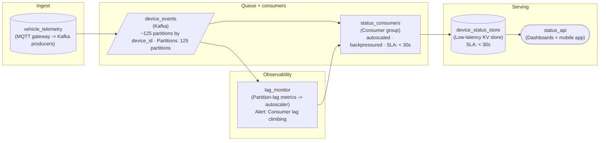
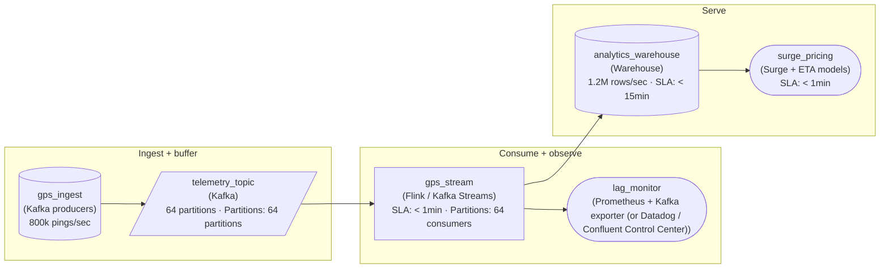
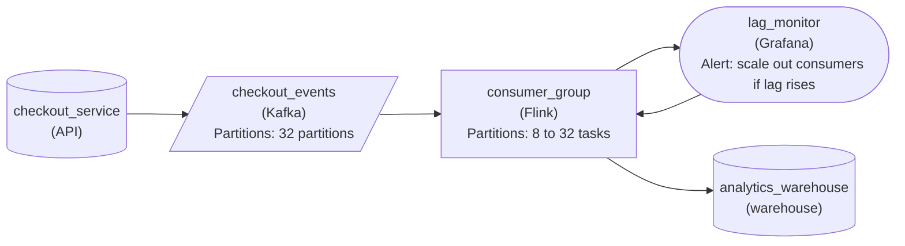

# Backpressure and Scaling: Advanced - Exercises

Lesson: [pa_pattern_backpressure_scaling.md](../pa_pattern_backpressure_scaling.md)

### Exercise 1 of 3

**● TASK**

A connected-vehicle platform ingests device-status telemetry from its fleet over Kafka, keyed by device_id, and a consumer group maintains each vehicle's live status. Overnight a product launch doubled the fleet to about a million vehicles, and this morning the on-call has watched partition lag climb without recovering. Redesign the ingest-to-serving path so it holds at the new sustained and peak rates, add partition-lag monitoring to drive autoscaling, and be explicit about where partitions and consumers have to grow together to clear the lag.

<strong>Solution</strong>

#### What this problem is really testing

This is a throughput-chain problem wearing an on-call incident. The fleet doubling is a distraction from the real question: WHERE does adding capacity actually help? The trap is to keep adding consumers to the group and watch the lag hold steady, because with 50 partitions the 51st consumer sits idle by definition. One partition is consumed by exactly one consumer in a group, so the partition count is the hard ceiling on parallelism, and until you raise it nothing you do downstream moves the lag.

Do the arithmetic before touching the canvas. A million vehicles reporting every 10 seconds is 100k events per second sustained; the morning commute and reconnect storms push it to ~250k. Each consumer is capped near 2k events per second, not by Kafka but by the serving-store upsert it does per record. So 50 consumers is a 100k per second wall, which is exactly the new sustained load with zero headroom. That is why the lag climbs at dawn and never recovers.

| Trick: The ceiling is the partition count, not the consumer count |
| --- |
| Adding consumers past the partition count wastes money and moves nothing. To carry ~250k/s at ~2k/s per consumer you need ~125 consumers, which means ~125 partitions FIRST. Partitions and consumers scale in lockstep; the partition count is the variable that actually raises the ceiling. |

#### Walk the requirements

1. **Pin the sustained and peak rate, and the binding link**

   State 100k/s sustained and ~250k/s peak, and name the sink as the constraint: each consumer is bounded by its `serving_store` upsert at ~2k/s, not by broker throughput. This is the number the whole design hangs on, because it converts a fuzzy 'we are behind' into a concrete consumer count.

2. **Raise partitions to the peak ceiling, then match consumers**

   Size the topic for peak once: ~125 partitions on `device_id` so parallelism can reach ~250k/s, and grow the consumer group to match. Partitions increase but do not cleanly decrease, and increasing them reshuffles `device_id` assignment, so you pick the peak number deliberately rather than nudging it during the incident.

3. **Bound the backlog with backpressure while it drains**

   Even sized correctly, a spike leaves a backlog. Cap in-flight records and pause the poll loop when the serving-store writer is saturated, so memory stays bounded and the group catches up instead of an out-of-memory crash making the outage worse. Backpressure does not add capacity; it keeps the system alive long enough for the added capacity to clear the lag.

4. **Autoscale consumers on lag, inside the fixed ceiling**

   Wire consumer-group autoscaling to partition lag: scale up fast (1-2 min) when lag climbs, scale down slow (15-30 min) to avoid thrash. Consumers are elastic; partitions are a one-way cost, so you over-provision partitions modestly for headroom and let consumers flex within that ceiling.

#### The shape that fits

*Partitions on `device_id` set the parallelism ceiling; consumers scale in lockstep to that ceiling, backpressure bounds the backlog, and lag metrics drive the autoscaler.*

| Interviewer: What a strong answer names out loud |
| --- |
| The specific numbers (100k/s sustained, ~250k/s peak, ~2k/s per consumer, so ~125 partitions), that the sink write is the binding link, that partitions are a one-way change sized for peak, and that backpressure bounds the backlog rather than adding throughput. |

| Pitfall: Adding consumers past the partition count |
| --- |
| The reflex during the incident is to scale the consumer group. Past 50 consumers on 50 partitions the extras idle and the lag does not budge, burning an hour before someone realizes the topic itself has to be repartitioned first. |

**Follow-up questions**

1. You bumped the topic to 125 partitions during the incident. What breaks for in-flight ordering, and how do you roll it out safely?\
   *Tests awareness that increasing partitions remaps `device_id`, so per-device ordering across the change is not guaranteed and the repartition should be planned, not done mid-spike.*
2. The serving store is now the bottleneck at 250k/s of upserts. What do you change without touching the consumer count?\
   *Tests whether the candidate follows the binding constraint downstream: batching writes, sharding the store, or relaxing per-record write latency, rather than adding more stalled consumers.*

 

### Exercise 2 of 3

**● TASK**

A ride-hailing platform streams vehicle-GPS pings from its driver fleet through Kafka into an analytics warehouse that feeds surge pricing and ETA models. Overnight the platform went live in a new metro and ping volume jumped from roughly 200k to 800k pings per second; on-call is watching consumer lag climb steadily and surge dashboards fall further behind. Design the source-to-warehouse path to absorb the spike: identify which component is the binding constraint using throughput analysis (calculate expected capacity at each stage), show partition count and consumer parallelism in your design for the constraint, and instrument consumer-group lag via Kafka-aware observability (Prometheus with Kafka exporter, Confluent Control Center, Datadog, or CloudWatch) to drive autoscaling.

<strong>Solution</strong>

#### What this problem is really testing

This is a throughput-chain problem wearing an incident costume. The pager says `consumer lag climbing`, and the tempting answer is `add servers`. The trick is that there is exactly one binding link in the source-to-warehouse chain, and until you name it, more hardware anywhere else is money set on fire. Here the producers went from 200k to 800k pings/sec while the consumer group stayed at 24 instances against 24 partitions. The constraint is the group's aggregate read throughput, and the fix is scaling partitions and consumers in lockstep, not scaling the warehouse the pings have not even reached yet.

| Trick: Find the link, then size only that link |
| --- |
| Walk the chain and put a number on each stage: producers at 800k/sec, topic partitions at 24, each consumer draining maybe 15k/sec so the group tops out near 360k/sec, warehouse sustaining 1.2M rows/sec. The one stage whose ceiling sits below 800k/sec is the binding link. It is the consumer group. Everything else already has headroom, so touching it is waste. |

#### Walk the requirements

1. **Keep the topic as the buffer so the spike is lag, not loss**

   The partitioned telemetry topic is the backpressure mechanism. When consumers fall behind, pings queue durably instead of overflowing producer memory or getting dropped. The lag you see IS backpressure working: the buffer is holding the line while you react. Remove the queue and the same spike becomes vanished vehicles on the ETA map.

2. **Scale partitions and consumers together**

   Each partition is read by exactly one consumer in the group, so throughput is capped at `partitions x per-consumer rate`. To clear 800k/sec with ~15k/sec consumers you need on the order of 64 partitions and 64 consumers. Adding consumers past the partition count leaves them idle; adding partitions without consumers just parks data. They move in lockstep or you have not actually scaled anything.

3. **Instrument consumer-group lag from the Kafka broker as the autoscaler trigger**

   Wire `consumer-group lag metrics` (offset lag from the Kafka broker, not data-quality checks on the telemetry itself) to the autoscaler: rising lag scales the group up within a minute or two, and scale-down waits 15 to 30 minutes so a brief dip does not trigger a rebalance storm or leave you short for the next metro launch. A tool like Prometheus + Kafka exporter, Confluent Control Center, or Datadog reads these offsets directly from the broker; Soda, Great Expectations, or dbt cannot. You scale based on what you can measure.

#### The shape that fits

*The topic absorbs the spike; partitions and consumers scale in lockstep from 24 to 64; consumer-group lag metrics from a Kafka-aware observability system drive the autoscaler. The warehouse already had headroom and is left alone.*

| Performance: Where the numbers land |
| --- |
| At 800k pings/sec and ~15k/sec per consumer you need roughly 64 partitions and 64 consumers to hold steady with margin. The warehouse at 1.2M rows/sec never blinks. The cost concentrates in the consumer fleet, which is exactly why over-provisioning it 24/7 for a rate you only hit during launches is the wrong default: autoscale it. |

| Pitfall: The answer that ships and fails review |
| --- |
| The common first miss is `add warehouse capacity` or `add more brokers` because those are the stages people instrument first. Neither is the binding link: the pings are stuck in the topic, upstream of both. The second miss is adding consumers without adding partitions, so the new instances sit idle and lag keeps climbing while the bill goes up. The third is picking a data-quality tool (Soda, Great Expectations, dbt) to monitor and scale on, because they do not expose Kafka offset lag at the broker level; you need a metrics system that reads consumer-group state directly from the broker. |

| Interviewer: What a strong candidate says out loud |
| --- |
| They put a throughput number on every stage before touching anything, confirm the key spreads evenly so it is not a hot-partition problem, and separate scale-up speed from scale-down speed. They name the binding link with a calculation, not a hunch. And they are explicit about instrumenting consumer-group lag metrics from a Kafka-aware observability system, not conflating it with data quality or ETL orchestration. |

**Follow-up questions**

1. If pings were keyed by metro instead of by `vehicle_id`, how would the new-metro launch change the failure mode?\
   *Tests whether they see that a coarse key concentrates the new metro onto one or two partitions, turning this into a hot-partition problem that adding consumers cannot fix without rekeying.*
2. The warehouse micro-batch loads start to lag a few weeks later as all metros grow. How do you tell that apart from this incident?\
   *Tests whether they re-run the throughput chain to find the constraint has moved downstream to the sink, rather than reflexively scaling the consumer group again.*

 

### Exercise 3 of 3

**● TASK**

A payments team is planning for the year's biggest shopping day. Checkout will emit 8.64 billion events over 24 hours (about 500 bytes each), with traffic cresting near 3 times the daily average during the evening rush. Design the event pipeline from checkout service into the analytics warehouse, sizing the event buffer's partitions, the consumer group, and the lag-driven autoscaling so the pipeline absorbs the peak without manual repartitioning mid-holiday.

<strong>Solution</strong>

#### Why this problem exists in real interviews

This is a capacity-planning problem wearing a system-design costume. The team hands you 2 numbers, a daily event count and an average record size, and the whole test is whether you can turn them into the numbers that actually govern the design: sustained events/sec, peak events/sec, and peak bytes/sec. The trap is sizing against the daily average. Traffic on a shopping holiday is not flat; it crests near 3x in the evening, so a pipeline sized for the average backs up exactly when it matters and there is no time to repartition `checkout_events` mid-rush.

The other half of the trap is building the buffer and the monitoring but forgetting the feedback loop. A lag monitor is telemetry, not control. The stronger design ties lag directly to consumer autoscaling: when lag rises during the crest, the group scales up before the backlog outruns the drain rate. The explicit feedback edge from monitoring to scaling is what separates a pipeline that barely survives the rush from one that handles it with headroom.

#### Do the throughput math first

1. **Turn the daily count into a sustained rate**

   8.64 billion events over 86,400 seconds is 100,000 events/sec sustained. At 500 bytes each that is 50 MB/sec sustained. This is the floor, not the design point.

2. **Apply the peak multiplier**

   The evening crest runs near 3x the daily average, so peak is about 300,000 events/sec and 150 MB/sec. You size the buffer and consumers for THIS number, because a queue that cannot drain at peak grows unbounded until the rush ends.

3. **Convert peak bytes into partitions, then add headroom**

   Against a safe sustained target of ~10 MB/sec per partition, 150 MB/sec needs about 15 partitions just to keep up. You never run partitions at their ceiling, so add headroom: roughly 30 to 32 partitions leaves each one at about half its safe rate during the peak, which is the headroom that means you never repartition on the busiest day of the year.

| Trick: Partitions are a build-time decision, consumers are a runtime one |
| --- |
| Repartitioning a live topic reshuffles keys and disrupts ordering, so you cannot do it during the rush. Set `checkout_events` to its headroom partition count up front (about 30-32), then let the consumer group scale its instance count from a low baseline up to the full partition count as lag rises. You provision partitions for the peak once; you pay for consumers only when traffic is actually there. |

#### The shape that fits

*The partitioned buffer absorbs the 3x crest (32 partitions at about 5 MB/sec each during peak). The consumer group scales from a low baseline up to the partition count as lag rises, and the lag monitor's feedback edge is what triggers that scale-up before events reach the warehouse late.*

| Performance: Where the cost sits |
| --- |
| The partitions are cheap; the consumers are the bill. Running 32 consumer instances for all 24 hours to serve a peak that lasts a few evening hours over-provisions by roughly 4x against the sustained load. Scale up fast (1-2 minutes) on rising lag so you never fall behind during the crest, and scale down slow (15-30 minutes) so a brief dip does not thrash the group. That asymmetry between scale-up and scale-down speed is the whole cost-vs-safety tradeoff. |

| Interviewer: What a strong candidate says out loud |
| --- |
| They name the binding constraint (is it partition byte-rate, consumer processing time, or warehouse write latency?), they justify the headroom multiplier and the partition count instead of guessing, they pick at-least-once with dedup on a checkout id rather than reaching for exactly-once, and crucially, they wire an explicit feedback edge from lag monitoring back to the consumer group so lag-driven autoscaling is visible in the design. |

| Pitfall: The mistake that ships |
| --- |
| Sizing to the 50 MB/sec daily average, provisioning ~10 partitions, adding a lag monitor, and calling it done. It passes the demo and survives the quiet morning, then the evening crest hits 150 MB/sec, `checkout_events` lag climbs faster than consumers can drain, and nothing in the design shows that lag triggers scale-up. A monitor that reports lag but does not drive autoscaling is just telemetry; the stronger answer makes the feedback loop explicit and observable in the canvas. |

**Follow-up questions**

1. Sustained load doubles next year to 200,000 events/sec. What changes, and what does not?\
   *Tests whether they see that partition count (a build-time ceiling) may need to be reset off-peak while consumer autoscaling absorbs growth up to that ceiling for free.*
2. During the rush the warehouse write latency, not the consumer, becomes the bottleneck. How do you find that and what do you do?\
   *Tests whether they can move the binding constraint downstream: micro-batching writes, a staging buffer, or a faster sink, rather than adding consumers that just pile up behind a slow warehouse.*

