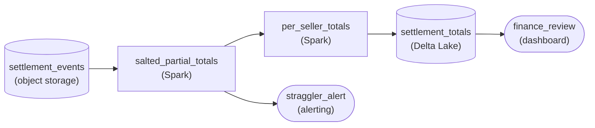
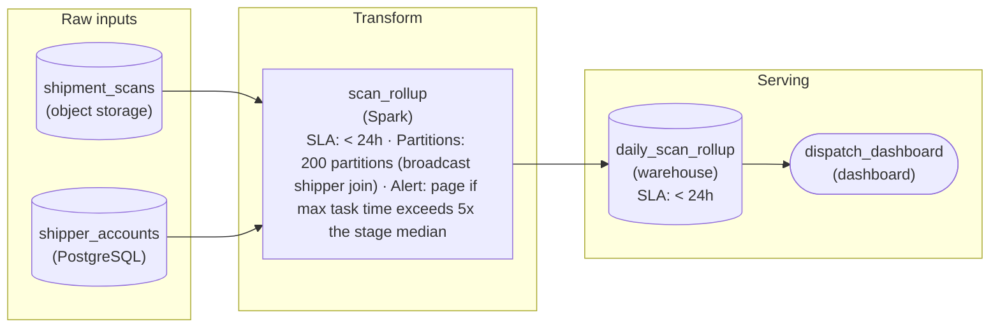

# The Spark Deep Dive: Intermediate - Exercises

Lesson: [pa_pattern_spark_deep_dive_intermediate.md](../pa_pattern_spark_deep_dive_intermediate.md)

### Exercise 1 of 2

**● TASK**

Every seller's settlement totals have to be exact to the cent by the time finance signs off each morning. Since one very large seller joined, the nightly Spark job that totals `settlement_events` per seller spends 45 minutes on a single task of that stage while the other 199 finish in seconds. Redesign the nightly pipeline so no one seller's volume can stall it, land the totals in the table finance reads, and make sure on-call is alerted when a straggler task shows up again.

<strong>Solution</strong>

#### What this really is

This is **data skew** wearing a finance deadline. One task at 45 minutes against 199 at seconds is the Spark UI's signature for one key owning a partition. `hash(seller_id)` sends every one of the whale's rows to the same reducer, and while it grinds the other executors sit idle. The first trap is the reflex fix: double the cluster or raise `spark.sql.shuffle.partitions`, then watch that one task stay exactly as slow, because more partitions still hash one key to one of them. The second trap is quieter: a fix that spreads the whale but counts its rows twice or hands finance partial rows, so the job gets fast and finance signs off on a wrong number.

#### Walk the evidence

1. **Read the task spread before touching config**

   In the Stages tab, sort by shuffle read and open the slow stage. The Tasks tab shows min, median and max duration and the shuffle read per task. A max of 45 minutes against a median of seconds, with one task reading a huge share of the shuffle bytes, means one key. Uniform slowness across all 200 tasks would point elsewhere: an undersized cluster, or thousands of small input files. This is not that.

2. **Name the key and measure its share**

   Count rows per `seller_id` on one night's `settlement_events`. The big seller owns roughly 40% of the rows, so one reducer does 40% of the stage's work alone. That number is the whole diagnosis. It also explains why the doubled cluster changed nothing: the 199 idle tasks already proved capacity was never the constraint.

3. **Salt the key, then total twice**

   In `salted_partial_totals`, give every row a random bucket 0..N-1 and total per (`seller_id`, `salt`). The whale's 40% now splits into N tasks instead of one. `per_seller_totals` then sums those partials per `seller_id`, a few thousand small rows. It is exact because settlement is plain sums, and sums re-add in any grouping: each row lands in exactly one bucket, so nothing is counted twice or dropped.

| ✕ Salt the key (the reference) | ✓ Isolate and union |
| --- | --- |
| Bucket every `seller_id`, total per (`seller_id`, `salt`), then total again per `seller_id`. Nobody has to know who the whale is, so the next one is spread too. The cost is a second, tiny shuffle for every seller. | Filter the known hot `seller_id` into its own path, total the rest on the original shuffle, and union the outputs. The isolated path still has to spread the whale's rows across many tasks itself, or the straggler has simply moved. The filters must be exact complements, and a seller missing from the hot list walks straight back into the old failure. |

4. **Alarm on the spread, not the runtime**

   A total-runtime alert fires after the damage. The Spark UI already showed the real signal: one task far outside its stage's median. Wire `salted_partial_totals` to `straggler_alert`, paging when the slowest task passes 10 times the stage median. That stage carries every row, so a whale too big for N buckets shows up there before 7am.

#### The reference design

*`salted_partial_totals` spreads every seller, the whale included, across N buckets. `per_seller_totals` re-adds the partials into one exact row per seller for finance, and the straggler alert watches the heavy stage.*

| Performance: A few thousand rows do not need 200 files |
| --- |
| The final per-seller totals are a few thousand rows coming out of a 200-partition shuffle. Written as-is, that drops 200 files of a few kilobytes each into `settlement_totals` every night. A year of nights is 73,000 tiny files that finance's morning query opens one by one. Coalesce to a handful of files before the write. |

| Interviewer: Quote the whale's share before choosing a fix |
| --- |
| The tell: before naming a remedy, the candidate asks how much of the night the big seller owns and says why it matters. At 40%, one reducer carries the stage; at 2%, the straggler is something else. Then they say out loud that more executors cannot help, because the 199 idle tasks already prove capacity is not the limit. |

| Pitfall: Salted partials are not a settlement |
| --- |
| The salted stage gets built, the job is fast, and its output goes straight into `settlement_totals`. Finance now sees up to N rows per seller, and a report that reads one of them understates every seller. The second total per `seller_id` is what makes the numbers exact, not an optional tidy-up. |

**Follow-up questions**

1. Two enterprise sellers sign next quarter, each larger than today's whale. Does your bucket count still hold, and what in this design tells you when it does not?\
   *Tests whether the candidate links the bucket count to the largest seller's share, and sees that the straggler alert on `salted_partial_totals` is the signal to raise N.*
2. Finance adds a unique-buyer count per seller to the settlement. Is your remedy still exact?\
   *Tests whether the candidate knows salting is exact only for aggregates that re-combine. Sums re-add across buckets, but unique buyers counted per bucket overcount a buyer who lands in two. The fix is to derive the bucket from the buyer id.*

 

### Exercise 2 of 2

**● TASK**

The nightly pipeline ingests shipment scans, joins them to a 40MB shipper accounts table, and lands the daily scan rollup in a table the dispatch dashboard reads at 5am. The on-call engineer sees the join stage's 200 tasks finish in about 30 seconds except one that runs 45 minutes, because this week one retailer owns a third of all scans under a single shipper ID. Redesign the pipeline so no single shipper can stall the run, and alert on the join stage so someone is paged when a task falls far behind the stage median.

<strong>Solution</strong>

#### What the stage summary is telling you

This is the lesson's slow-job question with the answer already printed in the stage summary: data skew, diagnosed from the Spark UI. 200 tasks at a 30-second median and one at 45 minutes is not a slow cluster, it is one partition holding a third of the night, because every scan for the new retailer hashes to the same `shipper_id` and lands on one task. The trap is the 40MB shipper table. It sits just above the 10MB default for `spark.sql.autoBroadcastJoinThreshold`, so Spark quietly chose a shuffle join and moved all 900 million scans by shipper. Add executors and that one task still runs on one core; the stage ends when it does.

| Trick: Make the hot key stop mattering |
| --- |
| If the side you match against is small, do not shuffle the big side at all. Broadcast `shipper_accounts` to every executor (raise the threshold above 40MB or add a `broadcast()` hint) and each scan finds its shipper locally, wherever it already sits. The retailer's third of the data is spread across all 200 tasks the way it was read, not piled into one. |

#### Walk the evidence to the fix

1. **Read shuffle and task spread before touching config**

   The debugging sequence starts in the Stages tab, sorted by shuffle. Here the Tasks view already shows min, median and max: a 90x gap between median and max, with the max task reading far more shuffle data, is the signature of one key, not of too little memory or too few cores.

2. **Name the key and why it arrived this week**

   Nothing in the code changed; the data did. One retailer now owns about a third of the scans under a single `shipper_id`. Hash partitioning sends every row with that id to the same partition, so one task inherits roughly 300 million rows while the other 199 split the rest.

3. **Check the small side against the broadcast threshold**

   The shipper table is 40MB and barely changes, 4 times the 10MB default. That is small enough to ship to every executor comfortably, which removes the shuffle on `shipper_id` entirely. When the small side really is small, broadcast beats salting: no extra stage, no key rewriting.

4. **Leave the cluster size alone**

   20 executors at 5 cores each is 100 slots for 200 tasks: 2 waves of 30-second tasks once the load is even. The cluster was never the constraint, and the lesson's sizing rule says the same thing: fix the work distribution first, then size for it.

#### The shape that fits

*The 40MB `shipper_accounts` lookup is broadcast into `scan_rollup`, so scans never shuffle by `shipper_id`; a skew alert on the stage pages before dispatch.*

| Performance: 40 megabytes per executor buys back 44 minutes |
| --- |
| Broadcasting costs 40MB of memory on each of 20 executors and one small collect on the driver. In exchange the scan side skips a 900-million-row shuffle and the straggler disappears: the stage returns to about 2 waves of 30-second tasks, and the run lands hours before the 5am read. |

| Interviewer: Median against max is the sentence they wait for |
| --- |
| Strong candidates quote the evidence back: 200 tasks, 30-second median, one 45-minute task with outsized shuffle read, therefore one hot key. Then they ask how big the other side is before choosing a fix. Candidates who jump straight to salting without checking whether a broadcast removes the shuffle entirely read as pattern-matching, not debugging. |

| Pitfall: More executors cannot split one task |
| --- |
| The reflex fix is doubling the cluster. It shortens the 30-second tasks nobody cares about and leaves the 45-minute task exactly where it was, because one partition is processed by one core. The bill goes up and the run still flirts with dispatch. |

| ✕ Broadcast the lookup | ✓ Salt the hot key |
| --- | --- |
| Works when the other side fits in executor memory, like the 40MB `shipper_accounts`. Removes the shuffle on `shipper_id` completely; nothing about the key needs rewriting. | The fallback when both sides are large. Append a random suffix to the hot `shipper_id` on the big side and replicate matching rows on the other, so the retailer spreads across many tasks. Costs an extra replication and a second combine. |

**Follow-up questions**

1. After a merger the shipper table grows to 2GB. Does broadcasting still hold, and what would you watch?\
   *Tests whether the candidate weighs executor memory and driver collect cost against the shuffle it saves, and knows when to switch to salting.*
2. A second retailer of the same size moves in next quarter. What does your skew alert show, and does your fix already cover it?\
   *Tests whether the candidate sees that a broadcast lookup is indifferent to how many hot keys exist, while a salt tuned for one key is not.*

