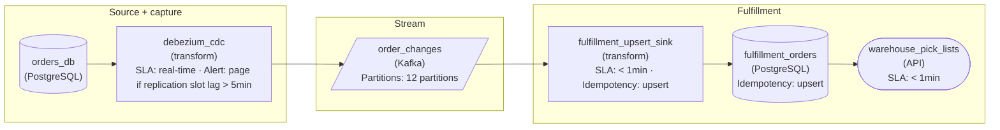
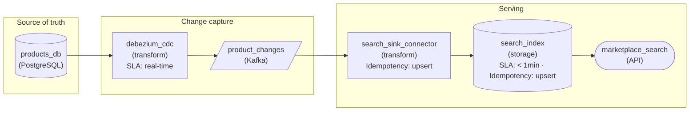

# CDC and Dual Writes: Advanced - Exercises

Lesson: [pa_pattern_cdc_dual_writes.md](../pa_pattern_cdc_dual_writes.md)

### Exercise 1 of 2

**● TASK**

How would you rebuild the path that carries orders to the warehouses, which today writes each order to PostgreSQL and publishes an 'order placed' message to Kafka from the same request handler, so that warehouses see exactly the orders that committed, within a minute, with every change to an order arriving in the order it committed? The fulfillment on-call engineer is seeing both failures at the 2,000-orders-per-minute peak (rolled-back orders on pick lists, confirmed orders that never show up), and no warehouse may ship the same order twice when the new pipeline restarts or replays.

<strong>Solution</strong>

#### What this problem really is

This is the dual-write problem in its purest form: one request handler writes PostgreSQL and publishes to Kafka, and nothing ties the two together. Everyone sees that one side can fail. The trap is the fix most candidates reach for: retry the publish, move it after the commit, or poll the `orders` table on `updated_at`. Each one trades a phantom order for a lost one, or a lost one for a skipped change, because any design where application code writes twice can finish half-done. **The only publisher that knows exactly what committed, and in what order, is the database's own log.**

| Trick: Delete the second write, don't harden it |
| --- |
| The service keeps one job: commit the order. A log-based CDC connector reads committed changes off the PostgreSQL replication slot and publishes them to Kafka. A rolled-back transaction never shows up as a committed change, and a committed one cannot be skipped, because the connector resumes from its position in the log after any crash. |

| ✕ Fix the publish in app code | ✓ Read what the database committed |
| --- | --- |
| Publish before the commit and a rollback leaves a phantom on the pick list. Publish after it and a crash between the two lines loses the order. Add retries and you now duplicate on timeouts. Every variant still has two writes that can disagree. | The order exists in Kafka exactly when it exists in the WAL. Debezium emits one event per committed row change, `op` 'c', 'u' or 'd', with before and after state, in log order. Only one system decides what happened. |

#### Walk the requirements

1. **Remove the Kafka call from the request handler**

   The service writes the order row and returns. Nothing else in checkout touches Kafka, so there is no window where one write has landed and the other has not. This is what fixes both symptoms at once: the rolled-back orders and the missing confirmed ones.

2. **Capture from the replication slot, not a query**

   Debezium attaches to a logical replication slot and reads the WAL. It sees each commit as it lands, including a cancel that deletes a row and two edits inside the same second, and freshness is seconds, well inside the one-minute budget. A poller on `updated_at` sees neither the delete nor the intermediate edit.

3. **Key the topic by `order_id`**

   Kafka only orders within a partition. Keying every change event by `order_id` puts an order's placement, edits and cancellation on one partition in commit order, which is the only ordering fulfillment needs. Global ordering across orders would cap you at one partition for no business reason.

4. **Upsert at the fulfillment sink**

   CDC is at-least-once: a connector restart replays from its last recorded offset, so the same change can arrive twice. The sink upserts into `fulfillment_orders` on `order_id`, and the pick list reads that table, so a replay rewrites the same row instead of cutting a second pick ticket.

#### The reference design

*The service only commits. Debezium reads the WAL into `order_changes` keyed by `order_id`; the sink upserts on `order_id` so replays converge.*

| Pitfall: Polling `updated_at` is a quieter dual write |
| --- |
| Query-based CDC looks like it removes the app publish, but it misses deletes, collapses several edits into one, and skips a row whose transaction committed after the poll with an older `updated_at`. That last one is exactly a confirmed order that never arrives. |

| Performance: The cost lives in the slot, not the volume |
| --- |
| 2,000 orders a minute with a few changes each is a trivial stream for one connector and a dozen partitions. The real risk is a stalled connector: PostgreSQL retains WAL for the slot until it is read, so a dead connector slowly fills the primary's disk. Alert on slot lag. |

| Interviewer: Seniority shows in the replay story |
| --- |
| Anyone can draw Debezium into Kafka. The strong answer says out loud that the connector is at-least-once, and moves exactness to an upsert on `order_id` at the sink instead of claiming the stream itself never duplicates. |

**Follow-up questions**

1. Fulfillment is new to this feed and needs every order that is already open, not just changes from today. How do you start it?\
   *Tests the connector's initial snapshot: rows emitted with `op` 'r' before streaming resumes from the slot position, landing through the same upsert.*
2. Warehouses complain the events expose internal columns that change whenever the checkout schema does. What would you change?\
   *Tests decoupling the event contract from the `orders` table, for example capturing a purpose-built table written in the same transaction.*

 

### Exercise 2 of 2

**● TASK**

Because the listing service saves each product to PostgreSQL and then calls the search index directly from the same request handler, the on-call search engineer keeps fielding seller tickets about delisted items that stay searchable for days and quick successive edits that surface in the wrong order. Redesign how catalog changes reach the index so it stays a faithful copy of the `products` table, deletes included, without putting extra query load on the catalog database.

<strong>Solution</strong>

#### What this problem really is

This is the **dual-write problem** wearing a search-relevance costume. The handler writes PostgreSQL, then writes the index, and nothing makes those two writes agree. A request that commits the delete and then times out on the index call leaves a ghost listing. Two edits racing on different app servers can commit in one order and reach the index in the other, so the stale edit wins. Both seller complaints are the same bug: the index is being told about changes by the application instead of learning them from the database.

The trap is the fix most candidates reach for next: pull the index call out of the handler and run a job that queries `products` for `updated_at > last_run`. It cures the race on paper and keeps the exact bug sellers reported. A hard-deleted row has no `updated_at` left to find, so every delisted product stays searchable forever, and the job adds a recurring scan to a database that is already busy.

| Trick: Let the database tell the index |
| --- |
| Make PostgreSQL the only thing the handler writes, and make the index a consumer of the database's own commit log. The WAL already records every insert, update and delete, in commit order, whether or not the application remembered to announce it. Log-based CDC turns that record into the index's feed. |

#### Walk the redesign

1. **Take the index out of the request handler**

   The handler commits to `products` and returns. It no longer knows the index exists. That single change removes the window where the database and the index disagree because one write succeeded and the other did not; there is now exactly one write, and the database commit decides what is true.

2. **Read changes from the WAL, not from the table**

   Debezium attaches to a replication slot and reads committed changes from the write-ahead log. No query touches `products`, so the busy primary pays nothing beyond the log it already writes. Crucially, a delete arrives as its own event with op 'd' and the row's `before` image, which is the one thing a timestamp query can never see.

3. **Publish one topic for the table, keyed by product**

   Debezium writes one Kafka topic per table, and each event's key is the row's primary key. Every change to one `product_id` therefore lands on the same partition in the order the database committed it. The race that reordered edits in the handler cannot happen here: the log has a single order and the topic preserves it per product.

4. **Apply events to the index as upserts and deletes on `product_id`**

   The sink reads the topic and, for ops 'c', 'u' and 'r', writes the document from the `after` image; for op 'd' it deletes the document named by the `before` key. Because every write is addressed by `product_id`, a redelivered event after a restart rewrites the same document to the same state. Replays converge instead of duplicating.

#### The reference design

*The listing service writes only `products_db`. Debezium reads the WAL into one topic keyed by `product_id`, and the sink upserts or deletes each document, so the index follows the table in commit order.*

| ✕ Handler writes both | ✓ Index follows the log |
| --- | --- |
| Two writes, no shared outcome. A timeout after the `products` commit strands a ghost; two concurrent saves can reach the index in the opposite order to their commits. | One write. The WAL fixes a single commit order, the topic keeps it per `product_id`, and a delete travels as an op 'd' event like any other change. |

| Pitfall: Polling looks like CDC until someone deletes a row |
| --- |
| The `updated_at > last_run` job is the answer that gets built first because it needs no new infrastructure. It misses every hard delete, misses two edits inside one polling interval, and scans `products` on a schedule. Sellers keep filing the same ghost-listing tickets, now with a nightly job to blame. |

| Performance: The replication slot is not free if nobody reads it |
| --- |
| Log-based capture costs the primary almost nothing while Debezium keeps up. If the connector stops, PostgreSQL retains WAL for the slot until it resumes, and at 2 million edits a day that disk fills. Alert on slot lag the same way you would alert on the index falling behind. |

| Interviewer: The existing ghosts need a one-time reset |
| --- |
| Strong candidates notice the index is already wrong and that new events alone will never remove a product deleted last month. Debezium's initial snapshot emits every current row as op 'r'; loading that into a fresh index and switching reads to it gives a clean baseline, and the change stream keeps it clean from that offset on. |

**Follow-up questions**

1. The sink connector is down for 6 hours during a deploy. What happens to the edits and delists made in that window, and to the catalog database?\
   *Tests whether the candidate knows the topic retains the events so the sink resumes from its offset, and that the real risk is WAL retention on the replication slot if capture itself stalls.*
2. Kafka compacts the `products` topic. How do you make sure a delete still reaches a sink that rebuilds from the start of the topic?\
   *Tests understanding of delete events plus tombstones on the product key, and that compaction eventually drops the tombstone, so a full rebuild should start from a fresh snapshot.*
3. Search now also needs each product's seller rating, which lives in a different table. Where does that join happen without bringing back a second write?\
   *Tests whether the candidate keeps capture per table and enriches downstream of the change stream rather than having the application write the rating into the index.*

