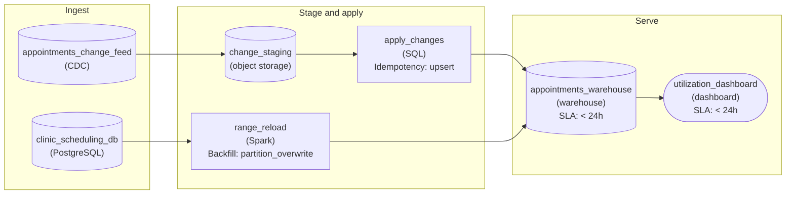
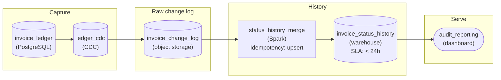

# Incremental Loading: Intermediate - Exercises

Lesson: [pa_pattern_incremental_loading_intermediate.md](../pa_pattern_incremental_loading_intermediate.md)

### Exercise 1 of 2

**● TASK**

Cancelled appointments are hard-deleted from the clinic scheduling database, leaving no trace in the table. The nightly full refresh of all 40 million appointment rows keeps cancellations off the operations managers' utilization dashboard, but no longer finishes before morning reporting starts. About 200,000 appointments are inserted, edited, or deleted daily: design an incremental pipeline that stages changes from the clinic database, applies them to the warehouse table by appointment so deletions take effect, and can reload a bounded date range directly from the clinic database if the nightly feed breaks.

<strong>Solution</strong>

#### What this problem really is

This is the incremental loading pattern with the one wrinkle that breaks the lazy version of it. The old `SELECT *` refresh was slow, but it had a property nobody wrote down: because it rebuilt the table from scratch every night, a cancelled appointment simply was not there the next morning. **The full refresh was your delete handling.** The moment you switch to pulling rows where `updated_at` is past the high-water mark, that property is gone, because a hard-deleted row has no `updated_at` left to compare. The dashboard keeps showing cancelled slots as booked, utilization looks better than it is, and nothing errors.

| Trick: Capture from the log, not from the table |
| --- |
| A query against the table can only return rows that exist. A delete is an absence, so the only place it is still visible is the database's change log. Read the log with log-based CDC and every insert, edit and cancellation arrives as an event with an operation type. Then stage those events and apply them by `appointment_id`, with 'd' events removing the row. |

#### Walk the requirements

1. **Say where the crossover sits before you say incremental**

   Full refresh costs the whole table every night: 40 million rows. Incremental costs the changed rows plus the merge overhead: about 200,000 rows, roughly half a percent. That gap is why the switch is worth it now. It was not always: when the table was small, a full copy finished in minutes, needed no state, and was obviously correct. The crossover is the point where the full copy stops fitting the window, and it moves back on nights like the annual roster reset, when most of the table changes and a full reload is the cheaper run.

2. **Pick the capture method that can see a cancellation**

   Timestamp CDC is the first thing everyone reaches for and it works for the edits here, since edits set `updated_at`. It cannot see deletes, and cancellations are exactly the rows managers care about. Log-based CDC reads the replication log on the primary, so each cancellation shows up as a delete event, and it puts no scan load on the scheduling database either.

3. **Stage the changes, then apply them by key**

   Land each night's change events in staging, keep only the latest event per `appointment_id`, and apply that set to `appointments` in one keyed step: matched and deleted removes the row, matched otherwise updates it, unmatched inserts it. Keyed and idempotent means a rerun of the same batch after a failure lands the same table, which is what lets you retry at 5am without thinking.

4. **Keep the full copy, but as a range tool**

   The full refresh does not die, it gets demoted. A reload path reads a chosen range of appointments straight from the source and overwrites that range in the warehouse, partitioned by appointment month. When the change feed drops a night or a bug corrupts a week, you reload those months instead of all 40 million rows.

#### The shape that fits

*Nightly: log-based change events are staged and applied by `appointment_id`, deletes included. Repair: `range_reload` overwrites chosen months straight from the source.*

| ✕ Timestamp CDC | ✓ Log-based CDC |
| --- | --- |
| Pulls rows where `updated_at` is past the last high-water mark. Cheap to build, catches every edit, and never sees a cancellation because the deleted row is not there to return. Also scans the live table every night. | Reads the replication log on the primary. Inserts, edits and deletes all arrive as events with an operation type, so a cancellation becomes a 'd' row the merge can act on. Needs log replication enabled and a stored log position instead of a timestamp. |

| Pitfall: The cancelled slot that stays booked |
| --- |
| The version that ships first swaps `SELECT *` for a `WHERE updated_at > last_run` pull and a merge that only updates and inserts. It runs in minutes and every check passes. A month later a manager notices a provider at 100% utilization on a day half their patients cancelled, and the warehouse holds thousands of appointments the source deleted weeks ago. |

| Performance: Half a percent of the table per night |
| --- |
| At 200,000 changed rows out of 40 million, the nightly run moves about 0.5% of what the old job moved, and the merge touches only the matching keys. The cost that remains is the reload path, which is why it works by month: a bad week costs one or two partitions, not the whole table. |

| Interviewer: The candidate who names what full refresh was doing |
| --- |
| Strong answers say out loud that the old job handled deletes by accident and that the new design has to handle them on purpose. They also put a number on the crossover and keep the full copy as a repair path instead of deleting it. |

**Follow-up questions**

1. The backend team adds a `telehealth_link` column to appointments on a Tuesday night. What happens to the change feed and the merge, and what do you want to happen?\
   *Tests schema evolution on an incremental pipeline: whether the new column is picked up, dropped silently, or crashes the apply step.*
2. Finance now wants to see how often appointments are rescheduled. What changes in the target table?\
   *Tests whether the candidate sees that overwriting in place destroys prior versions and reaches for keeping each version with validity dates, applied from the same change events.*

 

### Exercise 2 of 2

**● TASK**

How should the engineer who owns the nightly warehouse copy of the vendor invoice ledger rebuild it, now that re-copying all 420 million invoices from the operational Postgres database and replacing the warehouse table takes 5 hours against a 3-hour batch window, while only about 1.5 million invoices change on a typical day? Auditors also need to know what approval status any invoice held at any past moment, including an invoice that was approved and then put back on hold within the same day.

<strong>Solution</strong>

#### Incremental Loading, with an auditor in the room

This is the Incremental Loading pattern with an audit requirement attached, and the audit requirement is what decides the design. Choosing incremental is the easy part: 1.5 million changed rows out of 420 million is well under half a percent, and re-copying the other 99.6% every night is exactly why the job blew the window. The trap is the change capture most candidates reach for first. Poll on `updated_at` once a night and an invoice that went 'approved' at 10:00 and '`on_hold`' at 15:00 arrives as one row saying '`on_hold`': as far as the warehouse knows, the approval never happened. Then a plain `MERGE` overwrites yesterday's status with today's, and the auditor's question about March 3rd has no answer. 2 silent losses, and the job looks healthy the whole time.

1. **Admit the full refresh has run its course**

   Full refresh was the right call when the ledger was small: one `SELECT *`, one swap, nothing to get wrong. It stops being right when the cost scales with table size while the useful work scales with churn. At 5 hours against a 3-hour window and 0.36% daily change, the numbers make the case for you. Say that out loud before you draw anything; the interviewer wants the tradeoff reasoned, not assumed.

2. **Capture from the log, not from a timestamp**

   Log-based CDC reads the Postgres write-ahead log, so every committed change is its own event carrying its commit time. That catches the same-day approve-then-hold, it catches the legacy bulk-approval script that never touches `updated_at`, and it puts no scan load on the database the payables app lives on.

| ✕ Timestamp CDC, nightly | ✓ Log-based CDC |
| --- | --- |
| `WHERE updated_at > last_watermark` returns each changed invoice once, in its state at pull time. Intermediate statuses vanish, and any writer that skips `updated_at` is invisible. | Every committed change is an event in commit order, whoever wrote it. One invoice changing 3 times yields 3 events, each with the commit time the history needs. |

3. **Land the raw events before you interpret them**

   Write the captured events append-only to `invoice_change_log` in object storage before any merge logic touches them. The source only knows the current state, so this log is the one place history can be rebuilt from. When a merge bug corrupts 3 weeks of versions, the backfill replays those weeks from the log instead of asking the source for something it no longer has.

4. **Close the old version, open the new one**

   `invoice_status_history` keeps one row per status version: `invoice_id`, `status`, `valid_from`, `valid_to`, `is_current`. For each event, in commit order, the nightly merge sets `valid_to` on the open version and inserts the new one. An as-of query is then just `valid_from <= t AND (valid_to > t OR valid_to IS NULL)`.

#### The reference design

*`ledger_cdc` turns every committed change into an event, `invoice_change_log` keeps them for replay, and a rerunnable nightly merge versions them into `invoice_status_history`.*

| Pitfall: Deduplicating to the latest event erases the audit trail |
| --- |
| The standard incremental merge first reduces the batch to one row per key so `MERGE` does not hit the same target row twice. For an overwrite-latest table that is correct. For this history it quietly reproduces the timestamp-CDC loss: the 10:00 approval is dropped before it ever reaches the table. Apply every event per `invoice_id` in commit order. |

| Trick: Effective time is the source commit, not the load |
| --- |
| Stamp `valid_from` with the load time and every change looks like it happened at 02:00 the next morning, so an approval at 16:55 on quarter-end day lands in the wrong quarter. The commit time carried by the CDC event is the only clock the auditors mean. |

| Interviewer: A rerun must not mint a second version |
| --- |
| Key each version on `invoice_id` plus the event's commit position, and upsert on that key. A retried night then rewrites the same versions instead of appending duplicates with overlapping ranges, which would make every as-of query return 2 statuses. |

| Performance: Nightly cost now tracks churn, not table size |
| --- |
| The merge touches about 1.5 million events a night, around 4 million at quarter end, instead of 420 million rows. The price is growth: history adds a version per change, roughly 550 million rows a year, so cluster `invoice_status_history` by `invoice_id` and prune by `valid_from`. It also adds a CDC connector and a change log to operate, which is the honest cost of the audit trail. |

**Follow-up questions**

1. Payables engineering adds a `payment_terms` column to the ledger on a Tuesday night. What happens to `ledger_cdc`, `invoice_change_log` and the merge?\
   *Tests schema evolution: new columns flow through as nullable, the raw log keeps whatever arrived, and the merge does not crash or silently drop the field.*
2. A bug in `status_history_merge` closed versions with the wrong `valid_to` for 3 weeks. How do you repair `invoice_status_history`?\
   *Tests backfill: delete the affected invoices' versions for the window and replay the events from `invoice_change_log` in commit order through the fixed merge.*

