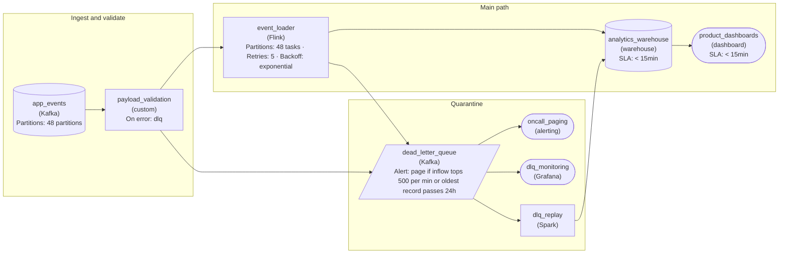
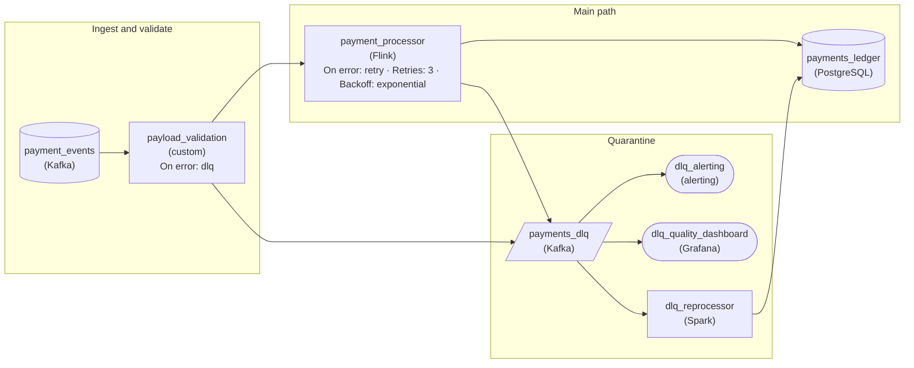

# Dead Letter Queue: Advanced - Exercises

Lesson: [pa_pattern_dead_letter_queue.md](../pa_pattern_dead_letter_queue.md)

### Exercise 1 of 2

**● TASK**

In-app events from the mobile app arrive on one event stream at about 30,000 per second, and since the latest release one event type carries a nested payload the consumer cannot parse, so the consumer crashes on that message, restarts, reads it again and crashes again while product dashboards go stale. Design the path from that stream into the analytics warehouse so ingestion resumes with dashboards back under 15 minutes of freshness, every malformed event is kept with the reason it failed and can be loaded once the parser is fixed, and the next bad release reaches on-call within minutes instead of stopping the flow. The warehouse also times out for a few seconds several times a day, and those writes must land on their own without piling in with the malformed events.

<strong>Solution</strong>

#### What this incident really is

This is a poison pill, and the answer is a dead letter queue, but first see what the crash loop actually is: an unbounded retry of a permanent error. The payload will be just as malformed on the thousandth read as on the first, so every restart buys nothing and holds back the 30,000 good events a second queued behind it. There is a tempting shortcut on each side. Skip the offset and the stream moves, but a whole event type from the new release quietly disappears from the numbers. Send every failure to the quarantine and the warehouse's few-second timeouts start filling it too, so on-call replays by hand records that would have landed on their own.

| Trick: Sort the failure first, then give it a lane |
| --- |
| Permanent errors go aside immediately with their context. Transient errors get a bounded retry. Neither one is allowed to stop the main consumer.  1. Validate before loading, and divert malformed payloads on an error path. 2. Retry only the write that can succeed later, and cap it. 3. Page on dead letter growth, and replay once the parser is fixed. |

#### Walk the requirements

1. **Classify each failure before deciding what to do**

   A parse failure on a nested payload is permanent: the bytes will never change. A warehouse write that times out for 4 seconds is transient: the same write succeeds a moment later. The question is not 'retry or not' but which lane each error class belongs in, and that decision has to be written into the pipeline, not made by on-call at 3am.

2. **Divert malformed events at the validation gate, context included**

   `payload_validation` parses and checks each payload before `event_loader` touches it. A failure goes down an error path into `dead_letter_queue` and the offset commits, so the next good event is read immediately. The record keeps the original payload untouched plus what triage and replay will need: error category and message, `event_type`, `app_version`, source partition and offset, first-failure time. A payload stored without its reason is a record nobody can act on.

3. **Retry the warehouse write, with a bound**

   `event_loader` retries timeouts with exponential backoff, 5 attempts, which covers a few-second blip with room to spare. Past that budget the batch goes to the same quarantine under a different error category instead of crashing the consumer. An unbounded retry is how this incident started; the bound is what turns a real warehouse outage into a visible backlog instead of a second freeze.

4. **Make the quarantine loud**

   `dead_letter_queue` pages through `oncall_paging` when inflow jumps past its baseline (a few dozen an hour normally, thousands a minute during this release) or when the oldest record is more than a day old. `dlq_monitoring` breaks volume down by error category, `event_type` and `app_version`, which is what tells the mobile team within minutes that one event type in one release broke its contract.

5. **Replay once the parser is fixed**

   `dlq_replay` reads the quarantined records, runs them through the fixed parser, and loads the repaired events into `analytics_warehouse`. Records that still fail are left in place with their attempt count raised. Close the loop by checking that dashboard totals for the affected hour now match what the app emitted.

#### The reference design

*`payload_validation` diverts malformed payloads to `dead_letter_queue`; `event_loader` retries warehouse timeouts and quarantines only what exhausts the budget; the quarantine pages, is monitored by category, and feeds `dlq_replay` after the fix.*

| ✕ Skip the bad offset | ✓ Divert to the dead letter queue |
| --- | --- |
| The stream resumes within a minute. Every event of the broken type from the new release is dropped without a trace, and that feature's numbers read low until someone compares them with the source weeks later. | The stream resumes just as fast. Each malformed event sits in `dead_letter_queue` with its reason, the page fires within minutes, and after the fix `dlq_replay` puts back the missing hour. |

| Performance: The backlog outlasts the fix |
| --- |
| An hour frozen at 30,000 events a second is about 108 million events waiting. Unblocking the consumer does not make dashboards fresh; draining the backlog does. With 48 tasks at 2x headroom the loader works through it at a net 30,000 a second, roughly an hour before freshness is back under 15 minutes. The quarantine itself is cheap: thousands a minute is a rounding error next to the main topic. |

| Interviewer: Name the crash loop as a retry policy |
| --- |
| A strong senior answer starts by calling the restart loop an unbounded retry of a permanent error. Then it lays out validation ahead of the loader, an error path that keeps context, a bounded retry only for the transient class, a page on dead letter growth, and a replay plan. 'We'll log the error and move on' is the phrase that ends the round. |

| Pitfall: A quarantine nobody watches is a graveyard |
| --- |
| The common design adds `dead_letter_queue` and stops there. The next bad release diverts thousands of events a minute, the stream stays green, nobody is paged, and the gap turns up a quarter later as a 3% shortfall against the source system. The alert and the replay path are what make it a dead letter queue rather than a bin. |

**Follow-up questions**

1. The fixed parser ships, but 2% of the quarantined events still fail on replay. What happens to them?\
   *Tests whether the candidate keeps attempt history on each record, separates still-broken records from new failures, and gives them an owner and a retention horizon instead of replaying in a loop.*
2. The warehouse is down for 40 minutes, not 4 seconds. Where do those events end up, and how do they come back?\
   *Tests whether exhausted retries land in the quarantine under a transient category, alert as a different signal from malformed payloads, and get a bulk replay once the warehouse recovers.*
3. 6 months of dead letter categories show the same producer breaking its payload on most releases. What do you do with that?\
   *Tests the data-quality-signal move: trend categories by producer and `app_version`, and push the fix upstream as a contract the producer checks before it ships.*

 

### Exercise 2 of 2

**● TASK**

Our payments consumer is stuck in a crash loop: one message with a corrupted payload kills it on every restart, blocking 200,000 queued payments, and the ledger write also times out for a few seconds under load. Design a pipeline where a record that fails to parse or fails ledger validation is separated from the flow without blocking the queue, where transient timeouts get retry chances, and where new failures trigger alerts so the team responds in minutes. Once the producer is fixed, those quarantined payments must be replayable into the ledger.

<strong>Solution</strong>

#### What this problem really is

This is the dead letter queue pattern with a payments ledger on the other end, and the crash loop is the easy half. Anyone can say 'skip the bad message.' The trap is that on a payments topic a skip is a delete: commit past the corrupt offset by hand, or wrap the parser in a catch that logs and moves on, and you unblock the consumer by quietly losing a payment that finance finds missing at the next reconciliation. The second trap hides in the ledger timeouts: route every failure into the same quarantine and the design starts setting aside perfectly good payments every time the database hiccups.

Why the loop exists at all: the consumer commits its offset only after a record succeeds, so a crash restarts it at the same offset, which crashes it again. Adding replicas changes nothing, because the corrupt message lives on one partition and whichever instance owns that partition dies. The fix has to turn a crash into a routed, recorded outcome.

| Trick: Classify first, then divert with a receipt |
| --- |
| Ask of every failure: can trying again ever fix it? A corrupt payload cannot, so it goes straight to `payments_dlq` and the offset is committed. A ledger timeout can, so it gets bounded retries with backoff first and joins the quarantine only when those run out. Either way the record leaves with its receipt: offset, rejecting stage, error, producer. |

#### Walk the requirements

1. **Put a validation gate in front of the ledger logic**

   Parsing and schema checks become the first stage, `payload_validation`. An unreadable payload is now a failed check, not an exception that kills the process: it takes the error path into `payments_dlq`, the offset advances, and the 200,000 payments behind it start draining at once.

2. **Give ledger timeouts a bounded second chance**

   `payment_processor` retries a timed-out write 3 times with exponential backoff, which covers a few-second load spike. When the retries run out, the payment diverts with stage '`ledger_write`' rather than retrying forever, because an unbounded retry on one record is the crash loop wearing a different costume.

3. **Make every quarantined record carry its receipt**

   Store the original bytes untouched, plus topic, partition and offset, the rejecting stage, the error class and message, the producer from the event header, the first failure time and the attempt count. The offset lets you find the record in the source; the stage tells you whose code to open.

4. **Alert on the quarantine, not on crashes**

   Crashes are gone now, so they can no longer be the alarm. Watch `payments_dlq` depth and inflow instead, and page through `dlq_alerting` when inflow rises above baseline. That is how the next bad batch reaches you in minutes rather than at month-end close.

5. **Read the quarantine as a producer report card**

   `dlq_quality_dashboard` breaks rejections down by producer and error class. One service's corrupt-payload count trending up is an upstream contract breaking, and the chart shows you whom to call before the ledger is short.

6. **Close the loop with a reprocessor**

   Once the producer ships a fix, `dlq_reprocessor` replays the quarantined payments through the same parsing code into `payments_ledger`. A record that fails again returns to the quarantine with a higher attempt count, never to the floor.

#### The reference design

*Corrupt payloads leave `payload_validation` on an error path straight into `payments_dlq`; ledger timeouts get 3 backed-off retries in `payment_processor` before they divert; the quarantine feeds an alert, is analyzed by producer, and is replayed into `payments_ledger` after the fix.*

| ✕ Skip the bad offset | ✓ Divert with a receipt |
| --- | --- |
| Unblocks the consumer in a minute. The payment is gone, nobody knows which producer sent it, and the next corrupt message starts the same loop because nothing in the design changed. | Unblocks the consumer just as fast. The payment sits in `payments_dlq` with its offset and rejecting stage, someone is paged, the producer is visible on a chart, and the payment reaches the ledger after the fix. |

| Interviewer: Naming the error class is the senior tell |
| --- |
| Weaker answers say 'send failures to a DLQ.' Stronger ones split transient from permanent before saying anything else, and then mention replay without being asked. The strongest note that the quarantine's inflow rate is now the health signal, because the consumer will never crash again to tell you something is wrong. |

| Pitfall: One quarantine route for every failure |
| --- |
| The design that ships first catches every exception and diverts it. It works until the first load spike, when thousands of healthy payments time out once and land in the quarantine beside the corrupt one. Retries before diversion are what keep the quarantine meaning 'actually broken.' |

| Performance: The backlog costs you, the quarantine does not |
| --- |
| At a handful of corrupt records a day, `payments_dlq` is tiny. The real load is the catch-up: 200,000 queued payments drain while new ones keep arriving, so the consumer needs headroom above its steady-state rate, not more quarantine capacity. |

**Follow-up questions**

1. The ledger is down for 20 minutes, not a few seconds. What happens to the payments that exhaust their retries, and is that what you want?\
   *Tests whether the candidate sees that bounded retries during a full outage would flood the quarantine with healthy payments, and whether they would alert on a sudden '`ledger_write`' spike and replay those payments once the ledger is back.*
2. The reprocessor replays a batch and half of it fails again with the same error. What does the design do with them?\
   *Tests the reprocessing workflow: records return to the quarantine with an incremented attempt count and stay visible on the producer dashboard instead of looping forever or being dropped.*

