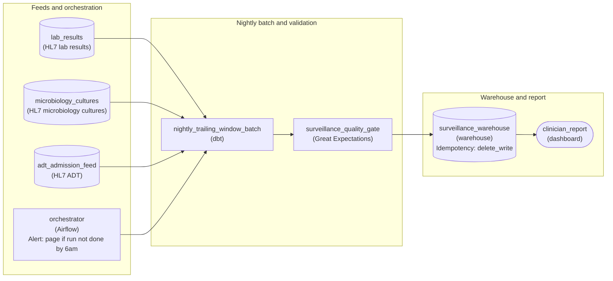
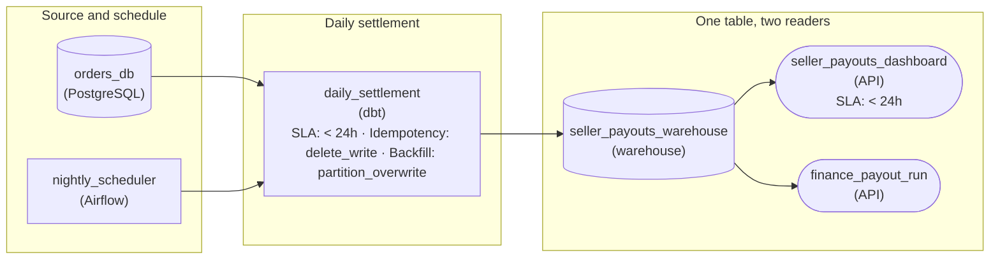

# Batch or Stream?: Intermediate - Exercises

Lesson: [pa_pattern_batch_or_stream_intermediate.md](../pa_pattern_batch_or_stream_intermediate.md)

### Exercise 1 of 2

**● TASK**

The infection-prevention lead noticed Monday's surveillance report undercounted infections: cultures collected over the weekend finalized 24 to 72 hours later and never made it onto the day they belonged to. The report is reviewed once a day on 7am rounds, so it must be validated and published by 6am, and a restarted or repeated run must never double-count an infection. Design the pipeline that builds it from the lab, microbiology and admission feeds.

**Starting canvas** (already placed for you):

- lab_results (source, HL7 lab results)
- microbiology_cultures (source, HL7 microbiology cultures)
- adt_admission_feed (source, HL7 ADT)

<strong>Solution</strong>

#### Why this problem exists in real interviews

This is the batch-or-stream decision wearing a lab coat. The stakeholder says 'real-time,' but the report is read once a day on 7am rounds and nobody touches it in between, so the real latency SLA is 'current as of yesterday, ready before 6am.' The trap is designing to the wish instead of the workflow: build a streaming stack and you pay several times the cost to shave latency nobody will ever observe. The subtler part is that batch here is not the easy answer either, because cultures finalize 24 to 72 hours late, so a naive 'compute yesterday' job silently misses real infections.

The default reach is to take 'real-time' literally: a message bus, a stream processor, a daily window closed at midnight, feeding a live dashboard. The first culture that finalizes at 12:03 AM lands after the window has closed and never appears on the report, so a genuine infection goes unflagged. The team then bolts reprocessing back on, which is the batch job they could have built for a fraction of the cost and operational load.

| Trick: Ask for the SLA before you draw anything |
| --- |
| The stakeholder said 'real-time'; the workflow says once a day at 7am. Pin the SLA to the decision, not the wish: current as of end of yesterday and finished before 6am, which rules out streaming. Then make batch earn its place. Reprocess a trailing three-day window so late cultures land on their collection day, and write each date partition as an overwrite so a rerun replaces a day instead of adding to it. |

#### Walk the requirements

1. **Pin the latency SLA to the decision cadence**

   The first question is 'what is the freshness SLA,' not 'do we want real-time.' The answer comes from when the data is acted on: 7am rounds. So the report needs to be current as of end of yesterday and land before 6am, and no intraday decision exists that a faster path would improve. That single fact takes streaming off the table. A streaming stack would cost far more to run and to keep someone on call for, and would buy latency the workflow cannot use.

2. **Reprocess a trailing window for late cultures**

   Late data usually comes up as the follow-up to a streaming design, but it bites batch too. A culture collected on Monday can finalize on Wednesday, so Monday's infection counts are not complete for about three days. Instead of recomputing only yesterday, the nightly job recomputes a trailing three-day window, which folds late-finalizing results back into the day they belong to. This is the batch equivalent of a watermark: decide how long a day stays open, and keep reprocessing it until it closes.

3. **Make the nightly write idempotent**

   Reprocessing a trailing window means the same day is written more than once, and a failed run gets restarted. If the job appended, every rerun would double-count infections. Write each date partition by deleting it and writing it fresh, keyed by date, so a rerun or backfill replaces the day instead of adding to it. That makes both the trailing-window reprocessing and any failure recovery safe, and the 6am numbers come out the same no matter how many times the job ran overnight.

#### The shape that fits

*Airflow triggers one nightly batch that reprocesses a trailing three-day window and pages if 6am is at risk; validated output is written to the warehouse by date overwrite, and the clinician dashboard reads it.*

| Performance: Where the cost actually is |
| --- |
| 40,000 results a day is trivial for a nightly warehouse job: it finishes in minutes even while reprocessing a three-day window. A streaming stack (a message bus, a stream processor, exactly-once sinks, and someone on call for all of it) would cost several times more to run and operate, and would shave latency no one observes because the report sits untouched until 7am. The money is in operational load, and this design keeps it near zero. |

| Interviewer: The SLA question comes before the diagram |
| --- |
| A strong candidate asks for the SLA before drawing anything, rules out streaming out loud with a reason tied to the rounds cadence, sizes a nightly batch that lands before 6am, reprocesses a trailing window so late cultures are not missed, and makes the write idempotent so a rerun is safe. Naming the tradeoff, correctness and cost over latency the workflow cannot use, is the tell of seniority. |

| Pitfall: A midnight window drops the late cultures |
| --- |
| The mistake is taking 'real-time' literally: a stream processor with a daily window closed at midnight. The first culture that finalizes at 12:03 AM lands after the window has closed and never reaches the report, so a real infection is missed on rounds. The fix the team eventually adds is trailing reprocessing, which is exactly the nightly batch they could have built first, without the streaming bill. |

**Follow-up questions**

1. The stakeholder now wants an alert the moment a patient's culture comes back positive for a resistant organism, not just on the daily report. Does that change your answer?\
   *Tests whether the candidate keeps the workflows separate: the daily surveillance report stays batch, while a genuine intraday alert becomes a small, separate streaming path justified by a real real-time decision. This is the batch-and-stream split, applied only where the SLA earns it.*
2. A nightly run fails halfway and is restarted at 5am. What guarantees the 6am report is correct?\
   *Tests idempotency and orchestration together: an overwrite keyed by date means the restart replaces the day instead of double-counting, and the orchestrator reruns the job and pages if the 6am SLA is at risk.*

 

### Exercise 2 of 2

**● TASK**

Design the pipeline behind a payouts view that shows each of the marketplace's 150,000 sellers what they are owed. The head of seller operations has asked for it to be 'real-time', and it is built from the roughly 3 million orders and refunds a day in the orders database. Finance pays sellers once a day from the same figures, so what a seller sees must match that payout to the cent, even when a failed run is retried or a refund lands after the day has closed.

<strong>Solution</strong>

#### The wish, the number, and the design

This is the **Batch or Stream?** decision dressed up as a product request. 'Real-time payouts' is a wish. The real number is hidden in finance's schedule: the amount a seller is owed only changes when the daily payout is computed. The trap is building exactly what was asked for: a queue, a stream processor, and a live balance that ticks up with every order. That balance is a figure finance never pays. The first time a refund lands after the day closes, the seller's screen shows one amount, the deposit shows another, and seller operations spends a quarter answering tickets about the gap.

| Trick: The payout clock sets the SLA |
| --- |
| Ask for the number before you draw anything. Owed money moves once a day, so the honest SLA is 'by the next morning', which is `< 24h`. Once that is said out loud, streaming is off the table. The real work is making one daily run exact: safe to rerun, and following the same late-data rule finance uses. |

#### Walk all four factors

1. **Turn 'real-time' into a number**

   Ask what the seller does with the figure. They check what they will be paid, and the payout fixes that number once a day. Live order activity already shows on the orders page. So this view's SLA is the next morning, `< 24h`, well past the lesson's line where anything over an hour favors batch.

2. **Size the volume**

   About 3 million orders and refunds a day across 150,000 sellers is a bounded daily slice, not a firehose. The records arrive all day, but nobody reads them all day. A nightly job reads one day's rows from `orders_db` and finishes on a cluster that exists only while it runs.

3. **Read the complexity**

   A payout is not a running sum. It joins orders to refunds, subtracts fees, and nets each refund against a sale that may be days old. That multi-pass work over the day's records plus history sits in the lesson's batch column. As a stateful stream job, it means holding every open order in state until its refund window closes.

4. **Price the always-on option**

   A streaming path needs a production queue, a stream processor running around the clock, checkpoint storage, and an on-call rotation that understands offsets. The lesson puts that at 3-10x the cost of batch. Here the extra spend only makes the number update faster than the money it describes. No dollar return offsets that cost.

| ✕ A live balance beside the payout | ✓ One nightly settlement, two readers |
| --- | --- |
| A stream path feeds the seller view and a nightly job feeds finance. Both codepaths carry the same fee and refund logic, and any drift between them shows up as a seller whose screen disagrees with their bank deposit. That is the lambda maintenance bill, paid to serve a wish. | `daily_settlement` writes one row per seller per `settlement_date` into `seller_payouts_warehouse`. The seller view and `finance_payout_run` read that same row, so they cannot disagree. One codepath, one number, and no always-on infrastructure. |

5. **Make a rerun replace, not add**

   Some night the run will fail, and on-call will rerun the whole day. If the job appends, the rerun doubles every seller's payout. `daily_settlement` writes with `delete_write` keyed on `settlement_date`: a rerun deletes that day's rows and rewrites them in one transaction, so any number of retries leaves exactly one payout per seller per day. This is the lesson's idempotent sink, in batch form.

6. **Put late refunds on finance's clock**

   A refund issued at 23:58 may not land until 00:40. Finance closes a day at 04:00 the next morning, so `nightly_scheduler` starts the run after that close. Anything landing later goes into the next day's payout as an adjustment and never rewrites money already paid. That is allowed lateness chosen as a business rule, not a config setting. When finance reopens a closed day, `partition_overwrite` recomputes only that `settlement_date`.

#### The reference design

*One run after finance's 04:00 close writes one row per seller per `settlement_date`; a rerun replaces the day, and the seller view and finance read the same row.*

| Performance: What batch saves, and what it gives up |
| --- |
| The whole system is one short job a night over a few million rows: no queue, no checkpoint storage, no cluster running 24/7. What it gives up is intraday movement in the owed figure, and the payout never moves intraday either. The heaviest step is joining refunds back to older orders. Partitioning by `settlement_date` keeps each run to one day plus the orders it references. |

| Interviewer: The SLA question comes first |
| --- |
| The strongest answers open with 'what freshness does the seller actually need?' and settle on a number before naming a tool. Then they walk all four factors out loud and still leave room for later: 'if sellers want intraday pending sales, that is a different view with its own SLA.' |

| Pitfall: A live balance is a second source of truth for money |
| --- |
| Candidates who add a queue and a stream processor 'just in case' end up with two answers to what a seller is owed. Late refunds then have no clean fix: a watermark on a live balance either drops the refund or takes back a number the seller already screenshotted. |

**Follow-up questions**

1. Seller operations comes back: sellers also want to see today's pending sales. What changes?\
   *Tests whether the candidate treats this as a new requirement with its own SLA: a separate pending view labeled as not yet owed, possibly refreshed more often, while the owed figure stays on the daily settlement.*
2. Finance moves to paying twice a day. Does the design still hold?\
   *Tests whether the SLA drives the design: the run moves to twice daily and the `delete_write` key widens to the settlement window. It stays batch, because 12 hours is nowhere near the streaming band.*
3. A fee bug overpaid sellers for the last 30 days. How do you correct it?\
   *Tests reprocessing: rerun each affected `settlement_date` with `partition_overwrite`, then have finance net the difference against the next payout instead of reversing money already sent.*

