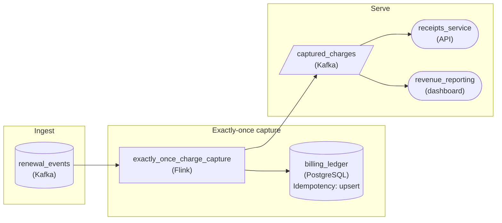
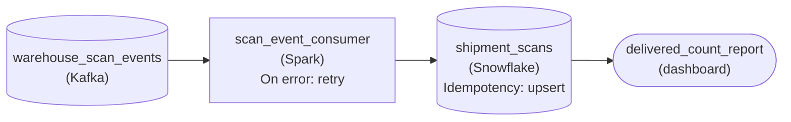

# Delivery Semantics: Advanced - Exercises

Lesson: [pa_pattern_delivery_semantics.md](../pa_pattern_delivery_semantics.md)

### Exercise 1 of 2

**● TASK**

Name the delivery guarantee the renewal charge-capture stream needed from the start, and change where its offset commit and its charge write sit so that a consumer crash and restart can never bill a customer twice for the same renewal, nor skip one. In the incident, the consumer read renewal events from a Kafka topic, wrote each charge to the billing ledger database, and crashed after the write but before its offset commit landed, so the restart re-read and re-charged those renewals. Every captured charge is also published to a second topic that receipts and revenue reporting read.

<strong>Solution</strong>

#### What this postmortem really is

This is the **delivery semantics** pattern dressed as an incident report, and the incident is at-least-once behaving exactly as designed. The consumer wrote the charge, crashed before the offset commit landed, and replayed from the last committed offset. At-least-once promised no renewal would be lost; it never promised the second charge would not happen. The trap is that the question sounds like it wants a new guarantee name. It actually wants a new write path: Kafka's exactly-once ends at the edge of Kafka, and the billing ledger sits outside it. Say 'exactly-once', enable transactions, leave the ledger as a plain `INSERT`, and the next restart bills the same customers twice again.

There are 2 tempting wrong fixes. The first moves the offset commit ahead of the charge write. Duplicates disappear, and a crash in the same gap now skips the renewal entirely: that is at-most-once, and the lesson's rule is blunt that financial data never gets it. The second turns on `enable.idempotence=true` and producer transactions and declares the problem solved, while the ledger write the incident actually duplicated sits untouched outside the transaction.

| Trick: Exactly-once here is a Kafka transaction plus an idempotent ledger |
| --- |
| The charge path needs exactly-once because a duplicate is catastrophic and a loss is not acceptable either. Inside Kafka, the capture stage publishes the captured charge and commits its offset in one transaction. Outside Kafka, the ledger write is an upsert keyed on `renewal_id`, so replaying a renewal rewrites the row it already wrote. Neither layer alone closes the incident. |

#### Walk the requirements

1. **Price the duplicate and the loss separately**

   A double charge means refunds, support tickets and a trust problem. A skipped renewal means lost revenue and a subscription that lapses on a paying customer. When both costs are catastrophic, at-least-once and at-most-once are both out, and saying why each fails is the answer to the first half of the question.

2. **Key the ledger write on `renewal_id`**

   Each renewal carries a `renewal_id`, one per subscription per billing period, and it is the same on redelivery. Upsert the charge on that key. Now the crash window that caused the incident (write done, offset not committed) replays into a no-op instead of a second row. This is the part Kafka cannot do for you, because the ledger is not a Kafka partition.

3. **Commit the offset in the same transaction as the publish**

   The capture stage reads the renewal, upserts the ledger, then in one Kafka transaction writes the captured charge to `captured_charges` and commits the input offset. Receipts and revenue reporting read with `isolation.level=read_committed`, so a transaction aborted by a crash is invisible to them and the retry's copy is the only one they ever see.

4. **Pay for exactly-once only on this path**

   Transactions cost roughly 15 to 20 percent throughput. At about 2 million renewals a day with brokers near 60 percent, that fits on the existing cluster. It would not fit if the same setting spread to every telemetry topic, where at-least-once plus a `MERGE` is the cheaper, correct answer.

| ✕ Commit before the charge write | ✓ Idempotent write, transactional commit |
| --- | --- |
| Crash after the commit, before the write: the renewal is gone and nobody is charged. Duplicates are fixed by losing money instead. This is at-most-once on financial data. | Crash after the ledger upsert, before the transaction commits: the restart re-reads the renewal, the upsert on `renewal_id` changes nothing, and the aborted publish never reaches `read_committed` readers. No loss, no duplicate. |

#### The shape that fits

*The capture stage upserts the ledger on `renewal_id`, then publishes to `captured_charges` and commits its offset in one Kafka transaction; downstream readers see only committed charges.*

| Performance: The transaction tax is affordable on one topic |
| --- |
| Exactly-once adds commit markers, coordinator round trips and consumer read latency, the 15 to 20 percent throughput cost the lesson quantifies. Two million renewals a day is a small stream with a first-of-month spike, and 60 percent broker utilization absorbs it. The ledger upsert costs one unique index on `renewal_id`, which billing wanted anyway. |

| Interviewer: Naming where Kafka's guarantee stops |
| --- |
| The senior signal is the boundary sentence: 'Kafka exactly-once covers the publish and the offset commit; the ledger is an external sink, so it needs its own idempotent write.' Candidates who stop at 'turn on EOS' describe a fix for a duplicate the incident did not have. Pairing each guarantee with how you would verify it (transaction abort rate on the capture stage, repeat writes to a `renewal_id` on the ledger) earns the rest. |

| Pitfall: Fixing duplicates by committing first |
| --- |
| Under postmortem pressure the one-line fix is to move the commit above the write. The duplicate tickets stop, and a month later finance finds renewals that were never charged, one for every consumer crash since the change. The incident did not go away; it changed sign. |

**Follow-up questions**

1. The payment processor call happens inside the capture stage, before the ledger upsert. What does a crash between the processor call and the upsert do, and what would you send the processor?\
   *Tests whether the candidate carries the EOS boundary one hop further: any external side effect outside the Kafka transaction needs its own idempotency, here a stable key derived from `renewal_id` passed to the processor.*
2. Product analytics wants to read the same renewal topic for a churn dashboard. Does that consumer need exactly-once too?\
   *Tests choosing semantics per consumer: a dashboard can take at-least-once with a `MERGE` on `renewal_id`, avoiding the transaction cost where a duplicate is cheap.*

 

### Exercise 2 of 2

**● TASK**

Explain why the shipments-delivered count came out inflated the morning after the warehouse scan-event consumer crashed, name the delivery guarantee the pipeline actually provides, and redesign it so a crash can never double-count a delivery again. The logistics analytics team's timeline shows the consumer writing a batch of about 40,000 scans from the `warehouse_scans` Kafka topic into the `shipment_scans` table in Snowflake, getting killed before it committed its offset, and writing that same batch again after the restart. Every scan carries the `event_id` the handheld stamped at the dock, and a lost delivered scan tells a customer their parcel is still out, so the fix cannot drop events.

<strong>Solution</strong>

#### What the timeline is really telling you

This is at-least-once delivery doing exactly what it promises, pointed at a sink that was never idempotent. The consumer wrote its batch into `shipment_scans`, died before the offset commit, and on restart Kafka handed it the same 40,000 scans again. That is the guarantee working as designed, not a bug in it. The trap is the 2 fixes that sound decisive. If you commit before writing, you have traded duplicates for loss: the next crash silently drops delivered scans and customers are told their parcel is still out. If you reach for exactly-once, you pay transactional overhead for a guarantee that stops at the broker, while the double insert happens in Snowflake.

| Trick: Keep the replay, make it harmless |
| --- |
| Leave the order of operations alone: write first, then commit. Change the write from an append to a `MERGE` keyed on `event_id`, so a replayed scan finds the row it already created and adds nothing. At-least-once delivery plus an idempotent sink gives exactly-once results in the table, without any of the transactional machinery. |

#### Walk the incident

1. **Name the guarantee from the order of operations**

   When the consumer processes first and commits second, every scan is written at least once and sometimes more. That is at-least-once. The scans at risk are the ones written since the last committed offset, which is why the inflation matched one batch and not a whole day. Name the guarantee before you propose anything. The review is really asking whether you can read a guarantee off a timeline.

2. **Refuse the commit-first fix**

   Moving the commit ahead of the write turns the pipeline into at-most-once. That is the right call for debug logs or sampled metrics, where losing an event costs nothing. Here a lost delivered scan means a customer believes the parcel is still on the truck, so losing a scan is worse than counting it twice.

3. **Let `event_id` absorb the replay**

   The handheld stamps `event_id` once, and every redelivery carries it unchanged, so it is a natural dedup key. A `MERGE INTO shipment_scans` matched on `event_id` inserts when the key is new and does nothing when the key already exists. Replaying the batch 10 times leaves the table exactly as a single delivery would.

4. **Leave exactly-once on the shelf**

   Kafka's exactly-once covers the read-process-write loop only when the write lands back in Kafka: an idempotent producer, transactions, and `read_committed` consumers. `shipment_scans` lives in Snowflake, outside that transaction, so the replay double-inserts anyway unless the sink is idempotent. Once the sink is idempotent, the transactions add throughput cost and nothing else.

#### The shape that fits

The topology barely changes, and that is the point. The fix is a property of one write, not a new stage. The consumer keeps reading from the topic, retries instead of skipping when a write fails, and commits only after it writes. Only the way it lands scans in `shipment_scans` changes.

*At-least-once from the topic, a `MERGE` on `event_id` into Snowflake, and a morning report that reads a table which can no longer double-count.*

| ✕ Append, then commit (today) | ✓ MERGE on `event_id`, then commit |
| --- | --- |
| A crash between the write and the commit replays the batch. Each replayed scan becomes a second row, and the morning count of 'delivered' scans rises by however many deliveries were in that batch. | Same crash, same replay. Each replayed scan finds its `event_id` already in `shipment_scans` and changes nothing. The count comes out right without touching the offset logic. |

| Performance: A MERGE over one batch of keys stays cheap |
| --- |
| At about 1.2 million scans a day, the `MERGE` only looks up the keys in the incoming batch, not the whole table. Clustering `shipment_scans` by scan date keeps that lookup to recent data. Kafka transactions, by contrast, add commit latency and coordinator round trips to every batch, for a sink they cannot reach. |

| Interviewer: Say the guarantee before the fix |
| --- |
| The strong answer opens with 'this pipeline is at-least-once, and the duplicates are the expected cost of that', and only then proposes the sink change. A candidate who jumps straight to exactly-once, or calls the replay a Kafka bug, is showing they cannot read a guarantee off the order of operations. |

| Pitfall: Dedup in the report is dedup too late |
| --- |
| A tempting patch is `COUNT(DISTINCT event_id)` in the morning report. It hides the symptom in one query while `shipment_scans` stays wrong for every other reader, and the next team that counts deliveries runs into the same incident. Fix the write, not the read. |

**Follow-up questions**

1. A correction arrives later with the same `event_id` but a different status. What should the `MERGE` do?\
   *Tests whether the candidate separates a replay (identical, so ignore it) from a genuine update, which needs a version or timestamp to decide which record wins.*
2. The consumer team wants to turn on Kafka transactions anyway, as belt and braces. What do you tell them?\
   *Tests whether the candidate knows exactly-once stops at the broker boundary and costs throughput, and that the idempotent sink already settles correctness.*
3. Another team wants a sampled scanner-health feed from the same topic. Which guarantee fits it?\
   *Tests matching a requirement to at-most-once when losing an event is acceptable and simplicity is worth more.*

