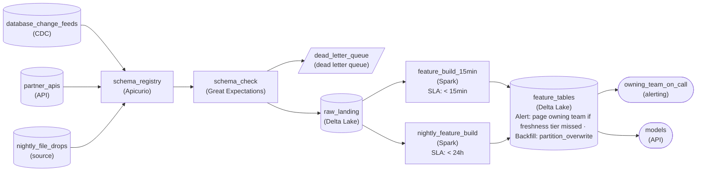
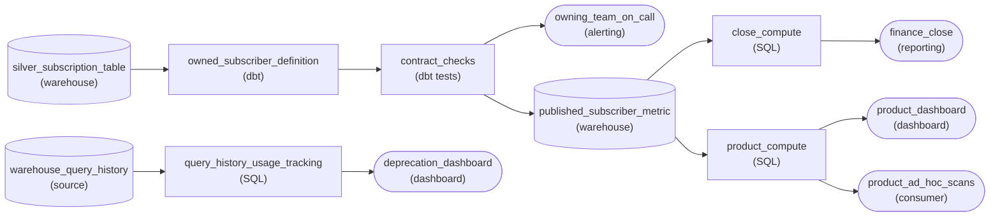
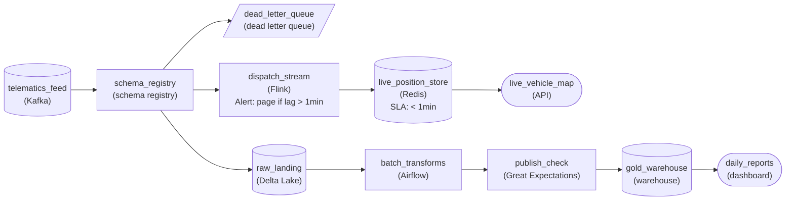
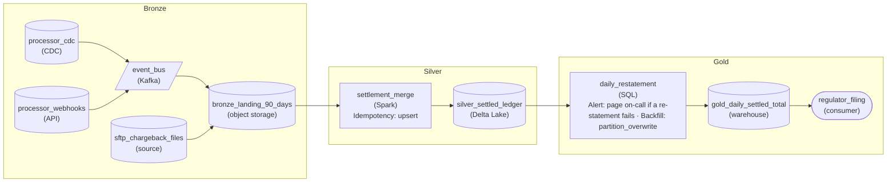

# Design a Pipeline - Exercises

Lesson: [pa_pattern_design_pipeline_advanced.md](../pa_pattern_design_pipeline_advanced.md)

### Exercise 1 of 4

**● TASK**

An ML engineer found that a changed feature definition left the marketplace's 9 models training on old history while serving computed the new values, and nobody was paged when features went stale. Design the feature platform: its 12 sources (4 database change feeds, 5 partner REST APIs whose payloads change without notice, 3 nightly file drops) onboard against a registered schema, and a payload that fails is held for replay rather than dropped or blocking the rest. Features refresh every 15 minutes, except those built from the nightly files, which carry a daily promise, and a changed definition must recompute the full history without duplicating it.

<strong>Solution</strong>

#### One promise per source type, one price per tier

This is the design-a-pipeline pattern in an ML costume: 9 models, 12 sources, one fifteen-minute number. Everyone draws change capture into a lake and a Spark job into a feature table. What separates candidates is that the gate differs by source type, the guarantees differ by tier, and the backfill path exists before the first definition change. Miss the gate and one partner's payload change blanks a feature for all 9 models. Miss the backfill and the models train on one definition while scoring on another, which is exactly the symptom the engineer found.

#### Break down the requirements

1. **Size it before you draw it**

   40 million changes a day is about 460 a second on average; the APIs add 2 million a day; the files are 30 GB a night. Nothing here needs record-at-a-time processing. A 15-minute micro-batch over landed data meets the promise at a fraction of the cost of a true stream, and saying that number out loud is what tells the interviewer you sized it.

2. **Set the schema policy per source type**

   Database feeds come with schemas their owning teams register; additive changes pass. Partner APIs are the dangerous class: every payload is checked against its registered version, failures go to a dead letter queue tagged with source and version, and the rest keep flowing. Files get a per-file check of header and row count before their partition is published.

3. **Tier the features and price each tier**

   The 15-minute tier gets the on-call page and the compute bill of 96 runs a day. The daily tier gets one run after the files land. Promising 15 minutes on data that arrives once a night buys 95 empty runs and a page every time the file is late, which is noise that trains the on-call to ignore real alerts.

4. **Build the backfill path first**

   Raw landing keeps the full two years. A definition change reruns the build over that history and overwrites the affected partitions of the feature tables, so a rerun replaces rows instead of appending them. Training and serving read the same tables, so after the backfill they agree by construction.

#### The reference architecture

All 3 source types enter through one onboarding gate. A schema registry holds each source's version and compatibility rule, and a Great Expectations check sends passing records to a Delta Lake raw landing zone and failures to a dead letter queue. Two Spark builds read the landing zone: one every 15 minutes for database and API features, one nightly for file features. Both write to Delta Lake feature tables that carry the backfill strategy and a freshness alert. When a tier is missed, that alert pages the owning team's on-call. The models read only those tables.

*Every source passes one gate, failures are held for replay, raw history is kept, and features run on two freshness tiers. Both training and serving read one set of `feature_tables`, and a missed tier pages the owning team.*

| Performance: The 15-minute tier is where the money goes |
| --- |
| At 460 changes a second the 15-minute build processes roughly 400,000 changes per run, small enough for a modest cluster. The cost concentrates in run count, not volume: 96 runs a day versus one. Moving the file features to the daily tier removes most of their compute. The bottleneck is the partner APIs' rate limits, which bound how fast a replay from the dead letter queue can catch up. |

| Interviewer: The contract has 5 parts, not one |
| --- |
| Most candidates describe the schema and stop. The contract the models read names the schema with its compatibility mode, the freshness tier with a measured SLA, what each feature means in words its model owner signs, the owning team with its on-call, and how a feature is deprecated. 3 of those show up as structure on the canvas: the registry, the tier settings and the page to the owning team. Say the other two out loud. |

| Pitfall: A backfill that appends is a second outage |
| --- |
| The common answer reruns the build and inserts the recomputed rows. Now each entity has two values per day, training averages them, and serving picks whichever landed last. Overwrite the affected partitions so a rerun of any length leaves exactly one value per entity and day. |

| ✕ Micro-batch every 15 minutes | ✓ Record-at-a-time stream |
| --- | --- |
| Meets the promise, reads landed data, reruns the same way a backfill does, and costs one scheduled job per tier. | Delivers seconds nobody asked for, needs state and checkpoints on every source, and gives the backfill a separate code path to drift from. |

**Follow-up questions**

1. The partner count grows from 5 APIs to 50. What changes in onboarding?\
   *Whether the gate is genuinely self-service: registration, compatibility and replay owned by the platform, not by a ticket per partner.*
2. A fraud model needs a feature within 200 ms of a purchase. Where does it go?\
   *Whether the candidate opens a new top tier with its own guarantees and price instead of tightening every feature to the fraud SLA.*

 

### Exercise 2 of 4

**● TASK**

Nine copies of `active_subscribers`, each computed by a different team from the same silver subscription table, let the Q3 close land 3.1 percent below the subscriber count the product dashboard showed all quarter. Redesign serving so the close and the product dashboard both read one owned definition that publishes only after passing its checks, a failed check pages the owning team, and the close runs on compute of its own that product's dashboard and ad hoc scans never share. The nine copies get retired only once 60 days of warehouse query history proves nobody still reads them.

<strong>Solution</strong>

This is a serving contract problem wearing a finance complaint. Nobody's SQL is wrong in a way a reviewer would catch. Nine teams each wrote a reasonable reading of 'active' against the same silver table, and nine reasonable readings disagree by 3.1 percent. The trap is treating it as a data bug. Candidates add a reconciliation job, or a tenth query that blends the others, and leave with one more definition than they started with. **The fix is ownership, published once and gated.** One team owns the metric and checks it before anyone reads it. That team hears first when it breaks, and the old copies go dark only when query history proves they are dead.

#### The reference design

*Silver stays shared. `owned_subscriber_definition` publishes through `contract_checks` into one gold table. The close reads it on `close_compute`, while the product dashboard and `product_ad_hoc_scans` read it on `product_compute`. Query history drives retirement.*

1. **Draw the ownership line above silver**

   The platform keeps owning bronze and silver: shared, conformed, nobody's metric. `active_subscribers` crosses into gold as a data product with one owning team, the subscriptions team, with finance signing the meaning of active. That line is the medallion-to-mesh move. Below it is infrastructure; above it, a definition someone answers for.

2. **Gate the publish, not the read**

   `contract_checks` sits between the definition and `published_subscriber_metric`. It checks things like a row count against yesterday, null plan keys, and a day-over-day move beyond tolerance. A failure stops the write, so readers keep yesterday's good number instead of a broken new one.

3. **Route the failure to the owner**

   The same check feeds `owning_team_on_call`. The point is who learns first: the team that can fix the definition, not a finance analyst three days into the close.

4. **Split the compute, share the table**

   `close_compute` serves only the close. `product_compute` serves the product dashboard and `product_ad_hoc_scans`. Both read the same gold table. One table keeps the number identical; 2 compute stages mean a product scan can never sit in front of the close in a queue. Pointing a BI tool straight at the published store collapses that split back into one shared pool.

5. **Measure the retirement**

   `warehouse_query_history` records who read which table. `query_history_usage_tracking` counts reads per old copy, and `deprecation_dashboard` shows each one trending to zero. A copy is switched off after 30 straight days without a read, which the 60-day history can prove.

| Pitfall: A reconciliation job is a tenth definition |
| --- |
| Comparing the nine copies nightly and flagging drift feels responsible, but it ships another reader of silver with its own logic. The gap shrinks on paper and the ownership question stays unanswered. |

| Interviewer: The contract names an owner and a meaning |
| --- |
| Most candidates describe the schema of `published_subscriber_metric` and stop. The answer that scores names the owning team with an on-call, and the semantics of active in words a finance analyst would sign. |

| ✕ Nine readers of silver | ✓ One owned gold product |
| --- | --- |
| Each team filters `silver_subscription_table` its own way, so every dashboard is internally consistent and they all disagree. A silver change breaks nine queries on nine schedules. | One definition reads silver, passes checks, and publishes. A silver change breaks one job, one team is paged, and every reader sees the same last good number. |

| Performance: Isolation is about queues, not table size |
| --- |
| Silver is about 40 million rows and the gold table is far smaller. The risk is not the cost of the close's own query. It is a product scan with silver-sized joins holding the shared pool during the three business days the close has. |

| Real world: Deprecation without a measurement never finishes |
| --- |
| Around 300 scheduled queries a week still read the old copies. Announce a sunset date without a usage count and someone's quarterly job breaks on the day it runs. The dashboard turns the switch-off into a fact you can show. |

**Follow-up questions**

1. Finance asks to restate last quarter after the definition changes. How do you do it without a second number appearing?\
   *Tests a backfill of the owned gold table that replaces partitions rather than appending.*
2. A tenth team wants active subscribers excluding trials. Do they get their own copy?\
   *Tests deriving a governed variant on top of the contract instead of forking from silver.*
3. The check fails on the morning of close day three. What does each reader see, and who acts?\
   *Tests that the last good snapshot stays published and freshness is visible to readers.*

Read the design back against the brief: one owned definition, an ownership line above silver, a measured retirement, and compute that keeps the close fast. Every stage on the canvas answers one of those, and nothing on it answers none.

 

### Exercise 3 of 4

**● TASK**

How do the 31 pipelines of an acquired fleet operator, spread over six Airflow instances, move onto one governed platform alongside its 2 TB a day telematics feed from 140,000 vehicles, whose firmware changes the message format every quarter? A format change must break no reader, every raw message is kept so any day can be rebuilt, and a message that fails its registered format is held for replay instead of lost. Only the dispatch team's live vehicle map needs data under a minute old, paging on-call when it lags; the other 30 are daily reports under one scheduler, each checked before it publishes.

<strong>Solution</strong>

#### One feed, two clocks

This is the lesson's platform pattern wearing an acquisition: size it, govern the gate, price each stage, tier the guarantees. The first trap is the one sub-minute reader. Candidates see 2 TB a day and a dispatch map that needs fresh positions, and they put all 31 pipelines on streaming, paying for around-the-clock stream compute and on-call for 30 reports read once a morning. The second trap is quieter: a firmware format nobody registered, so the first new-format message either breaks every reader or is silently dropped, and that day of history is gone for good.

#### Break down the requirements

1. **Size it before you draw it**

   140,000 vehicles reporting every 5 seconds is 28,000 messages a second at about 830 bytes each: 23 MB/s on average, near 70 MB/s at the morning peak. Thirteen months of raw history is about 790 TB as sent, roughly 100 TB in a compressed columnar format. The dispatch view is the opposite scale: the latest position of 140,000 vehicles is tens of megabytes. Those two numbers already say the expensive regime should touch one small projection, not the whole feed.

2. **Govern the format at the gate**

   Every message is checked against a registered version before any reader sees it. The policy: firmware may add optional fields with defaults, a retired field stays deprecated for a full quarter, and a retype ships as a new field. A rollout takes eight weeks, so two versions are live at once and readers must handle both. A message whose version is not registered goes to the dead letter queue with its version id and is replayed once the format is registered: held, never lost.

3. **Give one reader the fast path**

   Only the live map gets a stream processor, keyed by vehicle, writing the latest position into a key-value store with a sub-minute freshness contract. Everything else lands raw in a lakehouse table partitioned by event date, and the 30 reports become ELT models on one Airflow instead of six. Landing 28,000 messages a second makes small files by the minute, so the landing compacts them into files of a few hundred megabytes before the nightly runs scan them.

4. **Assign the tier, then its price**

   The dispatch path is tier 0: a page when lag passes one minute, around the clock, with checkpointed state. The 30 reports are tier 2: at-least-once delivery, a check before each publishes, a rerun that overwrites a date partition, and a next-business-day fix. Tier 1 stays empty until a reader earns it.

#### The reference architecture

One Kafka ingest feeds a registered format check that splits three ways: failures along an error path into the dead letter queue, valid messages into the Flink job for dispatch, and every valid message into the raw landing. Airflow runs the batch models from that landing, a quality gate stands between them and the warehouse, and the reports read only what passed. The raw landing is the replay source: when a firmware change needs a field re-derived, rerun the affected dates from it.

*One governed ingest, a sub-minute path for dispatch only, and one scheduled ELT path for the 30 daily reports.*

| Performance: Streaming pays for one reader, not 2 TB |
| --- |
| The stream job holds state for 140,000 keys and writes tens of megabytes, so a few task slots carry it even at the 70 MB/s peak. Cost concentrates in the raw landing (about 100 TB at full retention) and the nightly scans over roughly 250 GB of new compressed data, which date partitioning keeps to one day per run. The real bottleneck is the ingest gate at peak, and that is what sizes the Kafka partition count. |

| Interviewer: Registration happens before the firmware ships |
| --- |
| The tell is where a format change gets caught. A senior answer has the firmware team register the new version, and the registry refuse an incompatible one, before rollout begins. Catching it at the reader means the outage already happened. |

| Pitfall: A dead letter queue nobody replays is a slow delete |
| --- |
| Diverting bad messages without a way back means the first day of every new format never reaches the raw landing. Keep the version id with each held message, replay after registration, then rerun the affected date partitions downstream. |

| ✕ Streaming for all 31 | ✓ Streaming for dispatch only |
| --- | --- |
| Every report becomes an always-on job with checkpoints, a lag alert and an on-call rotation. Six Airflow instances turn into 31 stream jobs: the governance problem moves, it does not shrink. | One stream job carries tier 0. The 30 reports run on one scheduler over the raw landing at tier 2, checked before they publish and rebuildable from raw after any format change. |

**Follow-up questions**

1. Maintenance wants a harsh-braking alert within five minutes. Where does it attach, and what tier does it get?\
   *Whether a new reader reuses the governed stream at a middle tier instead of adding a second ingest.*
2. The fleet doubles to 280,000 vehicles and reporting moves to every 2 seconds. What resizes?\
   *Redoing the sizing: 140,000 messages a second, about 10 TB a day, partition counts, compaction and retention cost.*
3. A firmware bug sent speed in the wrong unit from half the fleet for three days. How do you repair history?\
   *Backfill from the raw landing by date partition without double counting downstream.*

 

### Exercise 4 of 4

**● TASK**

Chargeback files from the processor that delivers by SFTP arrive up to 45 days after their transactions settle, while the other 2 processors' CDC and webhook events stay in Kafka for only 7 days. Each chargeback re-states the regulator's daily settled total for its transaction's settlement day, replacing the original amount rather than adding to it, and reprocessing a file leaves a filed total unchanged. Design the correction path, starting with the 90 days of files on hand, keeping every feed replayable across the chargeback window and paging on-call when a re-statement fails.

<strong>Solution</strong>

#### Kafka cannot give you day 44 back

This is the lesson's tiered-guarantee pattern in a late-data costume. A regulator-facing settled total is the top tier on the platform, and the guarantee it buys is not latency: it is the ability to re-state a filed day correctly at any point inside a 45-day chargeback window. Everyone draws the SFTP source and a merge. The trap is the replay. Plan to re-derive a day from Kafka and you have 7 days of history for a 45-day problem. Append the chargeback as a new row and the first re-sent file debits the day twice, and that wrong number goes to the regulator.

#### Break down the requirements

1. **Size the replay window before the stages**

   The window is set by the slowest correction, not the fastest feed: chargebacks reach back 45 days, Kafka holds 7. So every feed, the CDC and webhook events included, lands raw in bronze and stays past 45 days. 90 days is the honest number: it covers the window, the 90 days of files on hand, and an amendment that lands on the window's last day.

2. **Key the correction on the original transaction**

   A chargeback carries the processor's transaction ID, the key the settlement row was written under. The silver merge matches on it and replaces the row's amount (`idempotencyStrategy` 'upsert'), so a re-sent file finds the row already corrected and changes nothing.

3. **Re-state the whole day, not the delta**

   Once silver is corrected, the gold job recomputes each affected settlement day and overwrites that day's partition (`backfillStrategy` '`partition_overwrite`'). Writing the whole day is what makes a filed figure reproducible; a correction delta added to the old total cannot be rerun safely. The 90 days on hand run through this same path as the first backfill.

4. **Give the re-statement to the tier that can own it**

   The streaming tier cannot re-state anything older than its retention, so the daily batch tier owns the correction: it reads bronze, writes gold, and carries the regulator dataset's tier 0 guarantee. That tier pages on a failed re-statement; it does not wait for a next-business-day fix.

#### The reference architecture

Both Kafka-borne feeds and the SFTP files land in one retained bronze store. `settlement_merge` replaces rows on the transaction key in `silver_settled_ledger`; `daily_restatement` overwrites each affected day in `gold_daily_settled_total`, which `regulator_filing` reads, and it pages on failure.

*Every feed lands in a 90-day bronze; the batch tier re-states settled days on the transaction key and pages on failure.*

| ✕ Replay from Kafka | ✓ Replay from bronze |
| --- | --- |
| Only the last 7 days of CDC and webhook events exist. A chargeback against day 30 has nothing to recompute against, so the day gets patched with a delta nobody can reproduce. | Every feed is kept 90 days. Any settled day inside the 45-day window is recomputed from raw records, and running it again yields the same total. |

| Performance: 90 days of raw files is the cheap part |
| --- |
| At about 4 million settlements a day, a day of compressed raw records is a few gigabytes, so 90 days is a few hundred gigabytes of object storage, small next to one wrong regulatory filing. The cost sits in recomputation: 2,000 chargebacks a day spread over 45 settlement days touch most of them, so re-state each affected day once per run, never once per chargeback. |

| Interviewer: Name the shared key before drawing the write |
| --- |
| Strong candidates say which column the correction and the original share before they draw the merge. The processor's transaction ID is that key; a surrogate minted at ingestion is not, because the chargeback file never sees it. |

| Pitfall: An appended chargeback double-counts on re-send |
| --- |
| Writing the chargeback as a negative row looks right the first day. When the processor re-sends the file after an outage, the day is debited twice and the filed total is off by the full amount. |

**Follow-up questions**

1. The regulator now wants every amended day to show the original total beside each amendment. What changes in gold?\
   *Whether the candidate keeps filed history instead of only overwriting.*
2. A fourth processor sends chargebacks up to 120 days late. What moves?\
   *Whether retention is derived from the correction window rather than copied.*
3. A chargeback names a transaction that has not reached silver yet. Where does it wait?\
   *Late-arriving keys handled with a holding path instead of a dropped record.*

