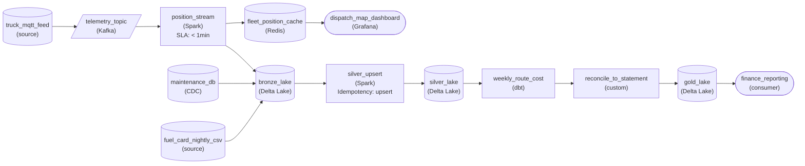
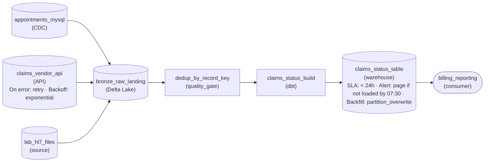
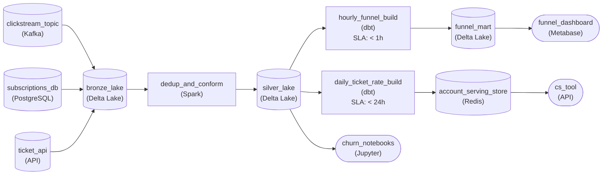
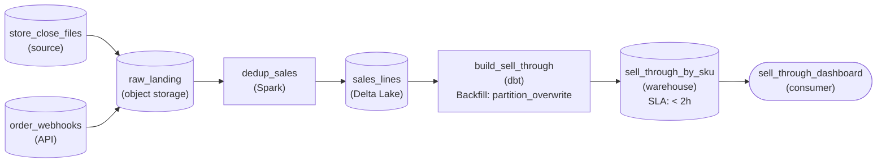

# Design a Pipeline: Intermediate - Exercises

Lesson: [pa_pattern_design_pipeline_intermediate.md](../pa_pattern_design_pipeline_intermediate.md)

### Exercise 1 of 4

**● TASK**

Design how our three fleet sources land in one lake and reach dispatch and finance: GPS and engine readings that 8,000 trucks publish over MQTT every 10 seconds, which we must be able to replay after a crash, maintenance records that mechanics edit in place in a SQL Server that cannot take extra query load, and the fuel card issuer's nightly CSV dropped on SFTP. Dispatch watches trucks per region on a map that may be at most 10 minutes stale. Finance reads weekly fuel cost per route, which must match the issuer's statement before it is published and must not double when a night's file is loaded twice.

<strong>Solution</strong>

#### Three sources, three answers, two readers

This is the lesson's pattern in its plainest form. There are three sources, and each one admits exactly one ingestion pattern once you ask what it can give. There are two readers who cannot share a serving path. The first trap is picking one cadence for everything. Stream all of it and you run a cluster all day to watch a CSV that arrives once a night. Batch all of it and the dispatch map runs a day behind, missing the 10-minute bar by two orders of magnitude. The second trap is quieter. Load the fuel file with a plain append, and the night the issuer resends a corrected file, finance's cost per route doubles. The statement check then fails every Monday until someone hand-deletes rows.

#### Break down the requirements

1. **Ask each source what it can give**

   The trucks push 800 readings a second over MQTT, and the broker keeps nothing once it delivers them. Bridge the readings into a Kafka topic: its retained offsets are what make 'replay after a crash' possible. The maintenance SQL Server edits rows in place and cannot take query load, so polling on `updated_at` fails on both counts. Log-based CDC reads the transaction log instead, and it sees deletes as well. The issuer can only drop a file, so the nightly CSV is a file ingestion problem: detect the file, land it whole, and never read one that is half-written.

2. **Size the map's freshness before picking the engine**

   10 minutes is generous. Record-at-a-time processing buys milliseconds nobody on the dispatch floor will notice. A Spark micro-batch on a 30-second trigger lands every position inside a minute. It writes only the latest reading per truck to Redis, which is 8,000 keys. The map counts trucks per region from that store and never queries the lake.

3. **Lay the lake out by how it is read**

   Bronze keeps every source as it arrived, append-only, in Delta Lake. Partition readings by `event_date`, fuel by `transaction_date`, and the gold table by week, because finance asks for one week at a time. The weekly rollup assigns each fuel purchase to the route on the truck's nearest reading, since every reading carries the truck's assigned route.

4. **Make the reload a no-op, then prove the totals**

   `silver_upsert` merges on the issuer's `transaction_id`, so loading the same night twice rewrites the same rows instead of appending them. After that, `reconcile_to_statement` compares the week's totals with the issuer's control totals. It sits in front of `gold_lake`, so a mismatch blocks the publish before anything reaches finance.

#### The reference architecture

The two serving paths split at the micro-batch job. One path keeps live positions in a key-value store for the map. The other lands raw readings in bronze next to the CDC changes and the nightly file. Finance reads only what has passed reconciliation.

*Readings flow through `telemetry_topic` into a 30-second micro-batch that feeds the map and bronze. CDC changes and the nightly file land beside them, and finance reads `gold_lake` only after `reconcile_to_statement` passes.*

| ✕ Readings partitioned by truck | ✓ Readings partitioned by day |
| --- | --- |
| Each 30-second batch writes into as many as 8,000 `truck_id` directories, which comes to over 20 million tiny files a day. Finance's weekly query still has to open every truck's directory to get one week. | With `event_date`, each day gets one directory of roughly 3 GB compressed. Finance's query prunes to 7 partitions, and a nightly compaction folds the day's micro-batch commits into right-sized files. |

| Performance: Sixty-nine million readings is a small lake |
| --- |
| 800 readings a second comes to 69.1 million a day. At about 300 bytes each that is roughly 21 GB raw, or close to 3 GB as compressed Parquet. Finance's query touches 7 date partitions. The real cost is the always-on micro-batch cluster plus small files: 2,880 commits a day on each bronze table until compaction folds them. |

| Interviewer: Every box earns a reason and a number |
| --- |
| The answer that scores gives each source the reason behind its pattern. MQTT keeps nothing, the shop's database cannot take queries, and the issuer can only drop a file. It also gives each source a number: 800 readings a second, a few thousand edits a day, one file a night. A box missing either reads as a tool you happen to know. |

| Pitfall: Serving the map from the lake |
| --- |
| The most common miss is pointing the dispatch map at the Delta tables. 40 screens polling a lake table every few seconds asks the lake to behave like a key-value store. It is slow and expensive, and every micro-batch commit adds to the small-file pile the map then has to scan. |

**Follow-up questions**

1. The fleet grows to 80,000 trucks. What changes first?\
   *Topic partition count, micro-batch sizing, and whether a 30-second trigger still clears the 10-minute bar comfortably.*
2. Trucks in dead zones send six hours of buffered readings when they reconnect. What happens to route attribution?\
   *Late data: upserts into older `event_date` partitions, reprocessing the affected week, and keeping stale readings out of the live map.*
3. The issuer adds a `merchant_category` column to the CSV without telling anyone. What breaks?\
   *Schema evolution at the bronze landing, and whether silver fails, drops the column silently, or carries it forward.*

 

### Exercise 2 of 4

**● TASK**

Appointments sit in MySQL, claim statuses come from a vendor REST API capped at 60 requests a minute, and lab results arrive as HL7 files over SFTP from 3 labs, one of which re-sends a week of files whenever its system restarts. From these, a daily claims-status table must be ready for billing by 08:00, and when a claim-status mapping bug surfaces four months after launch, every month since has to be recomputed by rerunning the pipeline over the data as it first landed. Throttled API calls, re-sent lab files and a late run each need a defined outcome in the design.

<strong>Solution</strong>

#### The rerun only exists if the raw does

This is the design-a-pipeline pattern with the recompute as the real question, and it hides one fact that decides everything: the vendor API answers only with a claim's status today. Anyone can draw MySQL, the API and SFTP flowing into a table for billing. What separates answers is noticing that the four months of history you need to recompute exist nowhere except in what your pipeline kept on the night each response arrived. **Map statuses on the way in and store only the result, and the bug is permanent**: the fix works going forward, the months already billed stay wrong, and there is nothing left to rerun.

*Three sources land raw in `bronze_raw_landing`; duplicates are removed on the way out; `claims_status_build` maps statuses into a month-partitioned `claims_status_table` that each rerun overwrites.*

#### Break down the requirements

1. **Pin each source to the pattern it admits**

   Appointments are edited in place when a visit is rescheduled or cancelled, so `appointments_mysql` is read as changes, not as a nightly full read. The claims API can only be called, so it is a paged pull with a saved cursor, paced under 60 requests a minute. The labs push files, so lab results are file ingestion. Say out loud which property of each source forced its choice.

2. **Land everything raw before mapping anything**

   `bronze_raw_landing` holds every change, every API response and every HL7 file exactly as received, append-only and duplicates included, partitioned by arrival date on a table format that commits atomically. The mapping bug lives in `claims_status_build`, downstream of this layer, and that is the point: the fix changes code, never the evidence.

3. **Make each month a replacement, not an addition**

   `claims_status_table` is partitioned by month and every run overwrites the partitions it computes. Rerunning January after the fix replaces January; it cannot append a second copy beside the first. Four months of recompute becomes four ordinary runs over the bronze partitions for those months.

4. **Give each failure a defined outcome**

   A throttle from the vendor is retried with exponential backoff, because at 60 a minute it is expected, not exceptional. A lab restart re-sends a week of files, so `dedup_by_record_key` keeps one row per lab and result id before the build reads it. A table not loaded by 07:30 pages someone, because otherwise billing finds out at 08:00.

#### The reference architecture

Three sources, one raw landing, one quality step, one dbt build, one table, one reader. This is ELT: raw lands untouched and the transformation runs inside the platform as SQL, which is exactly what lets a corrected mapping be applied to old data. The `< 24h` freshness on `claims_status_table` is the honest SLA for a reader who looks once a morning; anything fresher is cost nobody asked for.

| Performance: The rate limit sets the length of the night |
| --- |
| Twenty thousand open claims at 60 requests a minute is about 5.5 hours of calls, so the pull starts shortly after midnight with under 2 hours of margin before 08:00. Retries spend from that same budget, which is why backoff and the late alert belong together. The recompute is cheap by comparison: it reads bronze, not the vendor, so four months rerun without a single API call. |

| Interviewer: Say the API cannot replay before you are asked |
| --- |
| The follow-up is always: how do you get February's statuses back? The answer that scores is that the vendor returns only current status, so each nightly response stored in bronze is the only record of what that claim was on that day. |

| Pitfall: Deduplicating before landing erases the replay |
| --- |
| Candidates put the dedup in front of storage to keep bronze clean. Then bronze no longer holds what arrived, and a dedup bug joins the mapping bug as something no rerun can fix. Duplicates land; they are removed on the way out of bronze, keyed on the result id, never the file name. |

| ✕ Map on the way in | ✓ Land raw, map inside |
| --- | --- |
| Statuses are mapped before load and only the mapped value is kept. Quick to build, and the bug is permanent for every month already loaded: the vendor cannot hand the old raw statuses back. | Raw responses land in `bronze_raw_landing` and `claims_status_build` maps them in SQL. The fix ships as a code change, and four monthly reruns rebuild the history in place. |

**Follow-up questions**

1. Finance wants each claim's status as of any past date. What changes?\
   *Tests whether the stored nightly responses and the table format's history already answer it without a new pull.*
2. The vendor halves the limit to 30 requests a minute. Does 08:00 still hold?\
   *Tests whether the candidate redoes the budget: about 11 hours of calls no longer fits one night, so only changed claims can be checked.*
3. A lab starts sending an HL7 segment the parser does not know. What happens to those files?\
   *Tests schema evolution and a dead letter path for records that fail parsing instead of blocking the run.*

 

### Exercise 3 of 4

**● TASK**

Clickstream events reach Kafka at 200 million a day, a few of them twice, while each account's plan and seats sit in Postgres and its support tickets come from a paginated REST API. Three readers draw on that data: an hourly funnel by plan, a ticket rate per account refreshed daily in a tool that polls every 20 seconds across 300 accounts, and 18 months of events for churn modelling. Design the storage layout and the serving path for each reader.

<strong>Solution</strong>

#### Three readers, three clocks

Underneath the SaaS costume this is the lesson's serving pattern: one source of truth, then a separate serving path per reader, each with one reason and one number. Everyone draws Kafka into a lake. What separates answers is noticing that the three readers disagree on everything that matters: product wants an hour-old aggregate, customer success wants the same 300 numbers fetched 1.3 million times a day, and data science wants 18 months at full detail scanned a few times a week. Put all three on one gold table, or point the 20-second poll at the event history, and you pay scan prices all day for an answer that changes once.

#### Break down the requirements

1. **Pin each reader's clock**

   Hourly, daily, weekly. Nothing here is measured in seconds, so every path is batch. Kafka is the transport, not a reason to stream: a continuous job runs 24 hours a day to beat an hourly deadline nobody checks, and its constant small commits are where small-file trouble starts.

2. **Land raw, then remove the resends**

   Producer retries resend events under the same `event_id`. `bronze_lake` keeps them exactly as they arrived, append-only, alongside hourly copies of plans and the daily incremental ticket pull. `dedup_and_conform` keeps one row per `event_id` in `silver_lake`. Deduplicating on the way in looks cheaper and leaves nothing to rerun from when the rule turns out wrong.

3. **Size the history in bytes and dollars**

   200 million events at 1 KB is 200 GB a day of JSON. Columnar files with a compressing codec land near 20 GB a day, so 548 days is about 11 TB, roughly $250 a month on object storage; kept as JSON it would be 10 times that. Organise it by `event_date`: about 80 files of 256 MB a day, and a churn job over 6 months reads a third of the dates and only the columns it names.

4. **Precompute what the poll asks**

   300 accounts polled every 20 seconds is 300 x 3 x 1,440 = 1,296,000 reads a day, every one returning the same value until tomorrow. `daily_ticket_rate_build` computes tickets per seat once and writes 300 keyed rows to `account_serving_store`. Each poll becomes a sub-millisecond key lookup.

#### The reference architecture

All three sources land in `bronze_lake`, an open table format on object storage so writes commit atomically and a bad load can be rolled back. `dedup_and_conform` builds `silver_lake`, the 18-month history that `churn_notebooks` read directly. 2 gold paths hang off silver on their own clocks: `hourly_funnel_build` reads the closed hour (about 8.3 million events, under 1 GB compressed), joins the plan in force that hour and writes `funnel_mart` for the dashboard; `daily_ticket_rate_build` feeds the row-oriented lookup store the polling tool hits.

*Raw lands in `bronze_lake`, `dedup_and_conform` writes the 18-month `silver_lake`, and each reader gets its own path on its own clock.*

| Performance: 1.3 million polls, 300 answers |
| --- |
| The expensive reader is the one asking the smallest question. Answered from the lake, each poll is a query against ticket and seat history; answered from `account_serving_store` it is a key read on a 300-row dataset that fits in memory. The real cost of the whole design sits in `silver_lake` storage and the hourly scan, both a few hundred dollars a month. |

| ✕ Stream the funnel | ✓ Hourly batch over silver |
| --- | --- |
| A stream job reads Kafka all day, keeps state per plan, commits small files every minute and needs compaction behind it. It delivers a freshness product never asked for. | `hourly_funnel_build` reads one closed hour from `silver_lake`, under 1 GB, runs for minutes and overwrites that hour in `funnel_mart`. A rerun gives the same numbers. |

| Interviewer: Say the number before the box |
| --- |
| Strong candidates attach a figure to every store they draw: 20 GB a day and $250 a month for silver, 1,296,000 polls against 300 rows, 8.3 million events an hour. A box without a number reads as a tool you happen to know. |

| Pitfall: One gold table cannot serve three clocks |
| --- |
| The common miss is a single gold table read by the dashboard, the polling tool and the notebooks alike. It is too aggregated for churn modelling, too slow for a 20-second poll, and every refresh has to satisfy the strictest reader. |

**Follow-up questions**

1. The account count grows from 300 to 30,000 and polling moves to every 5 seconds. What changes?\
   *Whether the candidate sees the lookup store absorbs it unchanged while the daily build stays the same size of work.*
2. A tracking bug double-fired signups for 90 days. How do you restate the funnel?\
   *Backfill from immutable `bronze_lake` by overwriting the affected `event_date` values, with reruns producing identical results.*
3. Product now wants the funnel within 5 minutes. Which part of the design moves?\
   *Whether only the funnel path changes cadence, leaving the daily and churn paths batch.*

 

### Exercise 4 of 4

**● TASK**

Our sell-through by SKU runs high on nights a store re-sends its closing transaction file after a dropped connection, which happens about 20 times a night across 1,200 stores, and low on days whose online orders arrive by webhook after the day has closed. Stores upload as they close by 21:00, the day's sell-through must be on the dashboard by 23:00, returns that post most weeks have to correct the weeks they belong to, and every file and webhook is kept as it arrived. Design how each path lands and how each model refreshes, so a re-sent file counts once and a late order lands on its own day.

<strong>Solution</strong>

#### Two wrongs, one repair

Under the retail costume this is the design-a-pipeline pattern with the scoring turned onto correctness: every box needs a reason and a number, and here the numbers are 20 re-sent files, 1,200 stores and a two-hour window. Most candidates draw both paths fine. The trap is fixing the two errors with two mechanisms, a dedup bolted onto the store loader and a streaming job for the webhooks, then finding the returns need a third. A re-sent file, a late order and a posted return are the same event: data arriving for a day that already has a total. Treat them as one problem (keep raw as it arrived, clean by a stable key, recompute only the days touched) and the design closes. Miss it and 20 doubled stores inflate about 1.7% of tonight's store sales, with nobody able to say which SKUs.

#### Break down the requirements

1. **Pick each path's pattern from what the source gives**

   Stores push one closing file per business day: that is file ingestion, landing each file untouched in object storage. The online platform pushes one webhook per order and retries until acknowledged: accept it and append it raw. A 23:00 deadline two hours after the last close is a batch SLA, so streaming the webhooks buys nothing the dashboard can show.

2. **Let the key carry the dedup**

   A store file is identified by store and business date; an online order by its order id. Deduplicating on those keys in the clean layer collapses a re-send, a retried webhook and a rerun of the job to one row each. Dropping repeats at load time instead destroys the evidence that the re-send ever happened.

3. **Decide refresh per model from its history**

   The clean sales model is incremental: tonight's arrivals merge in by key, filed under the sale date, never the arrival date. Sell-through is incremental by partition: recompute every date a late order or a posted return touched and overwrite those partitions. Three years of history, about 2.6 billion lines, is why a nightly full refresh is not the answer.

#### The reference architecture

Both sources land in `raw_landing`, append-only, duplicates included. `dedup_sales` reads it, keeps one copy per store file and per order, and writes `sales_lines` keyed by sale date, with return lines filed under the sale they reverse. `build_sell_through` finds the dates tonight's rows touched, recomputes them and overwrites those partitions of `sell_through_by_sku`, which `sell_through_dashboard` reads by 23:00. A rerun at 22:40 rewrites the same partitions with the same numbers.

*Files and webhooks land raw; `dedup_sales` cleans by key; `build_sell_through` overwrites only the touched date partitions.*

| Performance: Three years of history is why the refresh is partial |
| --- |
| About 2.4 million store lines and 30,000 online orders arrive a night. Recomputing the dates they touch is a handful of partitions, and on a returns night up to 30 days back: small against three years. A full rebuild scans 2.6 billion lines inside a two-hour window to produce the same answer for every untouched day. The cost peaks on returns nights and is still bounded by how far returns reach. |

| Interviewer: Name the key and the rerun |
| --- |
| The tell at this level is naming the dedup key with its reason: store plus business date for files, order id for webhooks, and why a rerun leaves the totals identical. Say 'we dedup' without a key and the next question is 'on what', followed by 'and if the job runs twice'. |

| Pitfall: Filing late orders by arrival date |
| --- |
| Late webhooks are routinely filed under the night they arrived. The week still adds up, but tonight is inflated and last Tuesday is short, which is exactly the symptom in the prompt. File by order date and recompute the day the order belongs to. |

| ✕ Full refresh of sell-through | ✓ Overwrite touched partitions |
| --- | --- |
| Simple and always correct, but rereads 2.6 billion lines nightly and competes with the 23:00 deadline every night, returns or not. | Reads only the dates tonight's rows touched, absorbs late orders and returns with one mechanism, and gives the same result on a rerun. |

**Follow-up questions**

1. Merchandising moves the deadline to 21:30, 30 minutes after the last close. What changes?\
   *Tests whether the candidate moves to a micro-batch cadence for both paths and says what that costs, instead of jumping to record-at-a-time streaming.*
2. One night a store never uploads. How do you find out before merchandising does?\
   *Tests monitoring: an expected-file count per business date and an alert before 23:00, rather than a silently low total.*
3. The chain grows to 12,000 stores. Which box breaks first?\
   *Tests where the load concentrates: thousands of small raw files and the dedup scan, and whether compaction or partitioning by business date keeps the window.*

