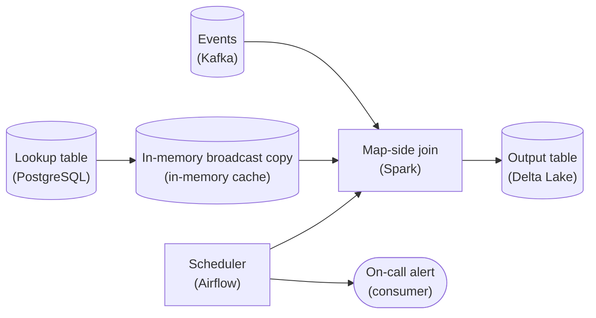
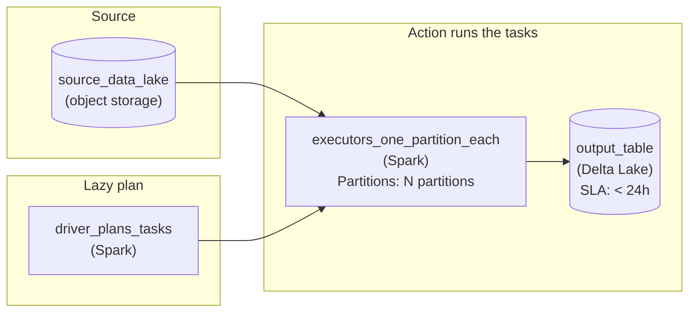
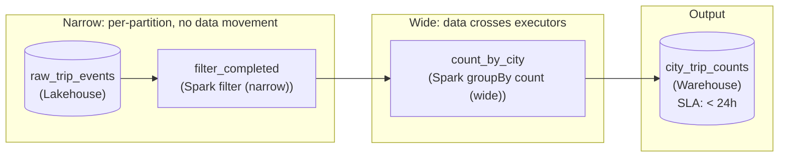
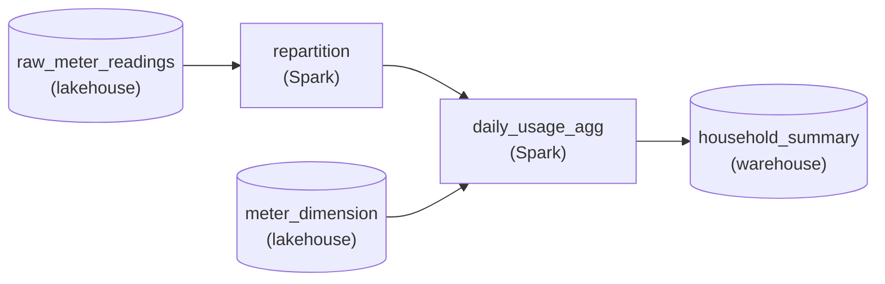
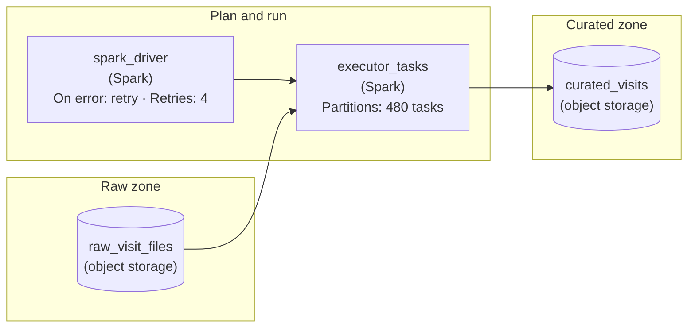
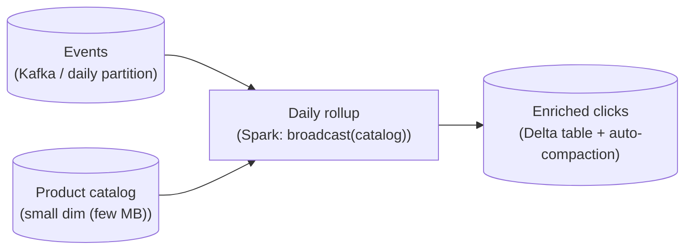

# Distributed Compute: Beginner - Exercises

Lesson: [pipeline_distributed_compute_beginner.md](../pipeline_distributed_compute_beginner.md)

### Exercise 1 of 6

**● TASK**

A daily Spark job joins a large event feed against a small lookup table for a report due each morning, but it now runs for hours because both sides get redistributed across the cluster on every run. The lookup side is small enough to hold in memory, so keep it in a fast in-memory store that the join reads from instead of redistributing it across the cluster, rather than fixing the slowdown by adding machines. Schedule the run against its morning deadline and page the on-call team when a run is running late.

**Starting canvas** (already placed for you):

- Events (source, Kafka)
- Lookup table (small) (source, PostgreSQL)
- Join (large + small side) (transform, Spark)
- Output table (storage, Delta Lake)

<details>
<summary><strong>Solution</strong></summary>

This is a shuffle you were never supposed to pay for, dressed up as a slow morning report. The lesson's name for it is the **broadcast join**: one side of the join is small enough to sit in memory on every executor, so it should be shipped there once and joined locally, never redistributed by key. The trap this instance sets is the reflex to add machines. More executors give you more parallelism for the shuffle, but the shuffle itself is the cost, so the job stays slow and now costs more per run. Get this wrong and you keep buying cluster to move a large event feed across the network every single morning to meet a lookup table that would fit in a laptop's RAM.

#### Why both sides move today

By default Spark plans this as a `SortMergeJoin`. To co-locate matching rows it hashes BOTH inputs by the join key and shuffles them across the cluster so equal keys land on the same partition. That's correct, but it means the entire large event feed gets serialized, sent over the network, and re-sorted every run. The small lookup being redistributed too is almost beside the point: the dominant cost is dragging the big side through a shuffle it never needed.

| Trick: Broadcast the small side, keep the large side still |
| --- |
| If one side fits in memory, ship a full copy to every executor and let Spark run a `BroadcastHashJoin`. Each executor probes its LOCAL partitions of the event feed against the in-memory lookup. The large side never leaves the node it was read on: zero shuffle, no re-sort, no network movement of the feed. That is why keeping the lookup in a fast in-memory store beats adding hardware, the design goal the scenario is pointing at. |



*The lookup is held as an in-memory broadcast copy on every executor; the event feed is joined in place and written to the output table. A scheduler runs the job against the morning deadline and alerts on-call when a run runs late.*

1. **Load the lookup into a broadcast copy, once per run**

   Read the small lookup and hand it to `broadcast()` (or let `spark.sql.autoBroadcastJoinThreshold` pick it up when the estimated size is under the threshold). Spark collects it to the driver, then sends one copy to each executor's memory. This is the only place the lookup travels, and it travels as a compact hash table, not a shuffle.

2. **Join in place so the event feed never shuffles**

   With the lookup resident on every executor, the plan flips to `BroadcastHashJoin`: each task probes the broadcast hash table with its own partition of the feed. No exchange stage on the large side means the runtime scales with how fast you can read the feed, not with network bandwidth, which is what was eating your hours.

3. **Anchor the schedule to the morning deadline, not a fixed clock**

   The report is due each morning, so schedule the run to start with enough margin to finish before that deadline. This is a daily batch job with a hard morning target, so the schedule is part of the design, not an afterthought.

4. **Page on-call when a run is running late, not just when it fails**

   A run that is still going past its expected finish is the signal that matters, because a late success still misses the morning report. Wire an alert that pages on-call while there is still time to intervene, rather than a post-mortem email after the deadline has already slipped.

**The join, made shuffle-free**

```python
from pyspark.sql.functions import broadcast

events = spark.read.format("kafka").load(...)      # large side, stays put
lookup = spark.read.jdbc(url, "lookup_table", ...)  # small side, fits in memory

enriched = events.join(
    broadcast(lookup),        # ship one copy to each executor
    on="lookup_key",
    how="left",
)

(enriched.write
    .format("delta")
    .mode("overwrite")
    .saveAsTable("report_output"))
```

*`broadcast()` forces the small side into every executor's memory; the large feed is joined in place.*

| ✕ Add machines | ✓ Broadcast the lookup |
| --- | --- |
| More executors split the shuffle into more tasks, but the large feed still crosses the network and re-sorts every run. You pay more per run for a smaller constant-factor win, and a `SortMergeJoin` exchange stage still gates the whole job. | The `BroadcastHashJoin` removes the exchange on the large side entirely. Runtime drops to the cost of one scan plus a local probe, and it holds even as the feed grows, because nothing about the feed's size triggers a shuffle. |

| Pitfall: Broadcasting something that isn't actually small |
| --- |
| The whole trick rests on the lookup being small. If it grows past what fits in executor memory, `broadcast()` either OOMs the driver during the collect or blows executor heap. Cap it with a realistic `spark.sql.autoBroadcastJoinThreshold`, and treat 'the lookup is small' as an assumption you monitor, not one you assume forever. |

| Interviewer: Changing the join beats buying cluster |
| --- |
| The tell is naming the shuffle as the cost and reaching for a `BroadcastHashJoin` before anyone mentions cluster size. Junior answers scale hardware; strong answers change the join strategy and can say why the large side no longer moves. Bonus points for pairing it with a deadline-anchored schedule and a page on a late run instead of only on a failed one. |

**Follow-up questions**

1. What if the lookup grows past what fits in memory next quarter?\
   *Tests whether they know broadcast has a size ceiling and can fall back to a bucketed or sort-merge join.*
2. How would you confirm the plan actually became a `BroadcastHashJoin` and not a `SortMergeJoin`?\
   *Looks for reading the physical plan via `explain()`, not trusting the config blindly.*
3. The morning run finishes on time but the numbers are stale by an hour, why?\
   *Separates job duration from source freshness and upstream Kafka lag.*

</details>


<br>

### Exercise 2 of 6

**● TASK**

A nightly Spark batch job reads the previous day's raw listening-event files from the data lake and rolls them up into a daily totals table the analysts open each morning, yet last night it finished in seconds having written nothing. Lay the job out on the canvas from the lake to that once-a-day output table, with the driver that turns the read and the roll-up into a plan of tasks kept apart from the executors that each process one partition in parallel, and wire the write so it is the step that sets that plan running.

<details>
<summary><strong>Solution</strong></summary>

#### Driver plans, executors execute, an action triggers

This is the Spark execution model question with a symptom attached, set inside a plain nightly batch job: one bounded day of files in the lake, one table out by morning. A job that 'finished in seconds having written nothing' did not fail: it only ever built its plan. Reading and rolling up the data are transformations, and transformations are lazy. They add steps to the DAG and move no rows. The trap is drawing one box labeled Spark. That answers 'how does Spark work' with a logo and hides exactly the split that explains the symptom. The whole model fits in one sentence: the driver plans the work and divides it into tasks, the executors each process one partition in parallel, and nothing runs until an action such as `.write()` fires.



*The lake feeds the executors directly. The driver only turns the read and the roll-up into a plan of tasks and hands them out. The `.write()` action sets those tasks running, one partition each, and lands the once-a-day output table.*

1. **Separate the coordinator from the workers**

   Draw the driver as its own stage. It reads the job, builds the plan and divides it into tasks, and it never processes rows itself. That is why its edge goes into the executors and not into the data path: it sends tasks, while the rows travel from the lake straight to the executors. Keeping the 2 stages separate is the whole answer to 'what is the difference between a driver and an executor?'

2. **Make the parallelism visible**

   The executors stage carries the partition count because the partition is the unit of work: one task per partition, many running at once. A night of roughly 10,000 files means roughly 10,000 tasks spread over the executors. An interviewer listens for 'each executor processes a partition', and on the canvas the stage says it for you.

3. **Hang the write off the executors**

   The job wrote nothing because nothing ever asked for a result. The edge from the executors into the output table is the action. Draw it as a real downstream flow, and the picture explains both why the fixed job runs and why the broken one did not.

4. **Stamp the output with its daily cadence**

   This is a batch job over a bounded day of files, not a stream. The output table carries a daily freshness because analysts read yesterday's totals each morning, and nothing fresher buys them anything. That tells the interviewer you know where this job sits: scheduled, bounded, run to completion, then idle until tomorrow night.

| Pitfall: The driver never touches partitions |
| --- |
| The common miss is one big Spark box. Worse is a driver sitting in the data path, as if it did the row processing. If the picture does not separate the planner from the workers, the interviewer cannot tell whether you know the difference. |

| Trick: A stranded output table is a plan that never ran |
| --- |
| Transformations like `.filter()` and `.join()` only add to the DAG. The action is what makes the driver ship tasks to the executors: here `.write()`, but `.count()` and `.collect()` are actions too. An output node with no incoming edge is exactly last night's job: planned, never triggered. |

| ✕ Transformation | ✓ Action |
| --- | --- |
| `.filter()`, `.join()`, a roll-up: each one returns instantly and adds a step to the plan. No executor does any work yet. | `.write()`, `.count()`, `.collect()`: the driver finalizes the plan and splits it into tasks, and the executors run them, one partition each. |

**Follow-up questions**

1. What happens if one executor dies partway through the job?\
   *Tests task reassignment: the driver hands the failed tasks to another executor, and a lost partition is recomputed from the lake files using the plan's lineage.*
2. The analyst adds a `.count()` before the `.write()`. How many times does Spark read the lake now?\
   *Tests that each action triggers its own run of the plan: 2 actions mean 2 executions unless the result is kept around.*

</details>


<br>

### Exercise 3 of 6

**● TASK**

A ride-hailing platform's daily batch job reads raw trip events from a lakehouse and writes a per-city count of completed trips to the operations warehouse. Roughly 2 billion events arrive each day, and under a tenth are completed trips. The current job groups all events by city first, then filters to completed trips, pushing the entire feed across the network before discarding most of it. Redesign the pipeline so data crosses between executors only once, carrying as little payload as possible.

<details>
<summary><strong>Solution</strong></summary>

#### What this problem is really about

This looks like 'write a Spark job to count trips per city,' but it is really a question about which operation forces data across the network and what you do before it. A `filter` is a narrow transformation: each executor works on its own partition and nothing crosses between executors. The per-city count is a wide transformation: every row for the same city has to end up on the same executor, so the data moves. The trap is the ordering. Count first and filter after, and all 2 billion events cross the network before you throw away the ~92% that were never completed trips. Filter first, and the crossing carries only the completed rows.

| Trick: The order is the whole answer |
| --- |
| Narrow before wide. `filter` costs no network, so run it while the data is still spread across partitions. The per-city count is the one step that pays the network bill, so hand it the smallest input you can. |

#### Build it in order

1. **Read the day's raw events in batch**

   The job runs once each morning off the prior day's events in the lakehouse. This is a batch read, not a stream; the freshness requirement is daily.

2. **Filter to completed trips first**

   Keeping only the 'completed' rows is narrow: each executor drops its own non-completed rows in place, no data moves. This is where the 2 billion events collapse to under 160 million, and it happens for free.

3. **Let the per-city count be the crossing**

   Counting per city is wide: rows for the same city are gathered onto one executor, which serializes data, sends it over the network, and reads it back. It is the most expensive step, so it should see only what survived the filter.

4. **Write the small result to the report store**

   One row per city is tiny. Land it in the warehouse the operations report reads from.

#### The shape that fits



*The read and `filter` stay on the per-partition side; the per-city count is the one crossing, and it sees only completed trips.*

| Performance: What the ordering buys |
| --- |
| Filter after the count and ~2 billion rows get shuffled. Filter first and the crossing carries under 160 million, roughly a tenth of the traffic and the disk spill that goes with it. Same result, a fraction of the network cost. |

| Interviewer: Narrow, wide, and lazy in one breath |
| --- |
| A strong junior answer names `filter` as narrow and the per-city count as wide, and adds that transformations are lazy: Spark builds the plan and does nothing until an action (a write here) triggers it, which is what lets the ordering be optimized. |

| Pitfall: Aggregate-first |
| --- |
| The common mistake is grouping first because that is how the report reads, then filtering the output. It gives the right numbers and the wrong bill: the whole feed crosses the network before most of it is discarded. |

**Follow-up questions**

1. A teammate says Spark's optimizer pushes the filter down on its own, so the ordering does not matter. Are they right?\
   *Tests whether the candidate knows predicate pushdown often does exactly this, but that reasoning about the narrow-before-wide order is still how you design and verify the plan, not something to leave to chance.*
2. Which of these also force a crossing: `distinct`, `select`, `join`, `withColumn`?\
   *Narrow vs wide recall: `distinct` and `join` are wide (they shuffle); `select` and `withColumn` are narrow (per-partition).*

</details>


<br>

### Exercise 4 of 6

**● TASK**

We run the metering platform for an energy utility, and a nightly Spark job reads about 2 billion raw smart-meter readings from the lakehouse and rolls them up into a daily per-household usage table that billing reads by 6am. The job keeps dying with out-of-memory errors, and the executor logs show heavy spill-to-disk during the aggregation, which joins a cached meter-dimension table that sits pinned in memory. Design the batch pipeline so the rollup finishes inside each executor's memory budget and still lands the summary in the warehouse on time.

<details>
<summary><strong>Solution</strong></summary>

#### What this problem is really testing

An out-of-memory error reads like 'give the cluster more RAM', and that is the trap. The real question is where each executor's fixed memory is going. It splits between storage (cached data) and execution (shuffles, joins, sorts). Here 2 things eat it at once: the readings arrive in too few partitions, so a single partition is larger than an executor's 8GB, and a `cache()`d dimension table is pinned in storage memory, leaving execution nothing to work in. The aggregation spills to disk, then dies. Adding memory just delays the same failure.

Spill-to-disk is the warning sign the interviewer wants you to name. It means execution memory ran out and Spark is writing intermediate shuffle data to disk, which is far slower; when the disk fills too, the executor is killed. Read the spill in the logs and it tells you which lever to pull: more, smaller partitions, or less pinned cache.

#### Walk the fix

1. **Repartition into smaller chunks**

   Two billion readings landing in a few dozen partitions makes each one far larger than an executor can hold. Repartition to create many more, smaller chunks so each fits comfortably inside the 8GB budget with room to shuffle. This is the single move that removes the spill: the section's rule is more partitions means smaller per-partition memory.

2. **Stop caching what does not need caching**

   The meter-dimension table is read once per run, yet it sits pinned in storage memory through the whole aggregation, crowding out execution. `unpersist()` it, or broadcast it as the small table it is. That hands the reclaimed storage memory back to the shuffle, which is where the pressure actually is.

3. **Land the summary where billing reads it**

   The daily per-household rollup writes to the warehouse before 6am. Keep the output a clean batch write; the memory work all happens upstream, at the repartition and the aggregation, not at the sink.

#### The shape that fits



*The readings are repartitioned into thousands of smaller chunks before the shuffle. The meter dimension is read straight into the aggregation with nothing pinned in cache, and the daily summary lands in the warehouse.*

| Interviewer: Split before you scale |
| --- |
| A strong candidate names the storage-versus-execution split and reads spill-to-disk as the symptom BEFORE reaching for more memory. They diagnose which lever applies: `repartition()` for oversized partitions, `unpersist()` for cache crowding execution. Reaching straight for a bigger executor without that reasoning is the tell of someone who has not looked at the memory model. |

| Pitfall: More RAM hides the leak, briefly |
| --- |
| The reflex fix is a bigger executor. It works for one run, then the next day's volume spills again and the bill is higher. The partition is still too large and the cache is still pinned; nothing structural changed. The section's fix is partition sizing and cache hygiene, not a memory upgrade. |

| Performance: Where the memory goes |
| --- |
| At 8GB per executor and 2 billion readings, a few dozen partitions put well over 8GB of data behind a single task, so it spills from the first pass. Thousands of partitions keep each task's working set small, and reclaiming the cached dimension gives execution the headroom to finish the shuffle in memory. |

**Follow-up questions**

1. How would you decide how much memory to give each executor, and how many cores?\
   *Tests the 5-core rule (5 cores per executor, each processing a partition) and starting from the 4-8GB default, then raising memory or partition count when spill appears.*
2. What is the difference between `persist()` and `cache()`, and which would you use for the dimension table here?\
   *Tests that `cache()` is memory-only while `persist()` picks a storage level, and that the right move here is to unpersist or broadcast rather than pin it in memory.*

</details>


<br>

### Exercise 5 of 6

**● TASK**

60 gigabytes of patient visit records sit in the lake's raw zone as 480 Parquet files, and a notebook's chain of filter and derived-column cells over them returned instantly while the single cell writing the result to the curated zone ran for an hour. Midway through that write one executor died, yet the output still completed with every row, because each task gets up to four attempts before the job gives up. Draw the batch job so the process that plans the work and the workers that run it are separate stages, and so it is visible how the dead executor's share was redone from the untouched raw files.

<details>
<summary><strong>Solution</strong></summary>

#### What the notebook was really showing

This is the Spark execution model, all of it, dressed up as a notebook that looks haunted. It has lazy transformations, one action, a driver handing tasks to executors under a bounded retry budget, and lineage rebuilding what a dead executor lost from the lake's raw zone. Anyone can define a transformation and an action. The trap is believing the story the notebook tells: that the filter cells were fast, the write was slow, and the job got lucky when an executor died. None of that is true. The filter cells did nothing, the write did everything, and the survival was designed. Explain it as a slow write and you will reach for a bigger cluster or a checkpoint, and the interviewer hears that you do not know when Spark actually runs.

| Trick: The hour belongs to every cell, not the last one |
| --- |
| Charge the hour to the whole chain. `filter()` and `withColumn()` only add steps to a plan on the driver; `.write()` is the action that finally executes read, filter, columns and write together. A dead executor costs only the tasks it was running, because the driver still holds the recipe for each of them and has attempts left to spend. |

#### Walk the timeline

1. **Read the instant cells as a plan, not work**

   Every `filter()` and `withColumn()` cell is a transformation. The driver records it in the DAG and returns immediately, without opening one of the 480 files. That is why the cells felt instant: there was nothing to wait for yet.

2. **Find the action that pulled the trigger**

   `.write()` is the action. The driver turns the DAG into stages. Filters and new columns are narrow, meaning each partition is handled on its own and no data moves between executors, so the whole chain collapses into ONE stage with no shuffle: 480 tasks, one per file. Twenty executors with four cores is 80 slots, so the tasks run in about 6 waves. That is the hour.

3. **Follow the dead executor's tasks back to the driver**

   When an executor stops heartbeating, the driver marks the tasks it was running as failed and schedules them again on the survivors. A task is only given up on after four failed attempts (`spark.task.maxFailures`, default 4), so one lost machine spends one attempt per task, not the job.

4. **Rebuild the lost partition from lineage**

   Nothing was cached, so no copy of those in-flight partitions existed anywhere. It did not need to. The driver knows each partition's lineage: read these file splits, apply this filter, add these columns. The retried task re-reads the same splits from the raw zone, which this job never modifies, and replays the steps. Tasks that had already finished and written their files to the curated zone are not redone.

#### The reference design



*`spark_driver` plans the lazy chain and retries failed tasks up to four attempts each; `executor_tasks` run all 480 tasks as one narrow stage straight from `raw_visit_files` to `curated_visits`.*

| ✕ What the notebook seemed to say | ✓ What actually happened |
| --- | --- |
| The `filter()` cells were fast, `.write()` was slow, and the job survived the executor loss by luck or because the data was replicated somewhere. | The `filter()` cells built a plan, `.write()` ran the entire plan as 480 tasks, and the driver retried the dead executor's tasks by re-reading their raw input files and replaying the steps. |

| Performance: Recovery is cheap when the stage is narrow |
| --- |
| The dead executor held four task slots, so roughly four tasks of 480 were lost: about 512 MB to re-read and refilter, well under 1% of the job. Had a `groupBy` sat before the write, that executor's shuffle output would have been lost too, and upstream tasks would need rerunning as well. |

| Interviewer: Saying lineage out loud is the tell |
| --- |
| A junior says the job retried. A stronger answer says who retried it (the driver), how many times it would try (four attempts per task), what was redone (only the failed tasks), and where the rows came from (lineage back to the untouched raw files, no cache required). That answer is what the screen is listening for. |

| Pitfall: Checkpointing a job that never needed it |
| --- |
| The reflex after an executor scare is to add `cache()` or a checkpoint between the filters and the write. On a single narrow stage that only adds a second pass and extra storage. The raw zone already is the recovery point. |

**Follow-up questions**

1. If the notebook added a `groupBy` on `site_id` before the write, what would the executor loss cost then?\
   *Tests whether the candidate sees that a shuffle splits the job into 2 stages and that lost shuffle files force upstream tasks to rerun, not just the in-flight ones.*
2. The analyst adds a `count()` cell before the write to check the filter. How long does that cell take now, and does the write get faster?\
   *Tests that every action re-executes the lineage from the source unless something is cached, so the chain now runs twice.*
3. One raw file is corrupt and fails to decode every time. What does the retry budget do with it?\
   *Tests that the retry budget is per task: a bad input file fails the same way on every attempt and ends the job after the fourth.*

</details>


<br>

### Exercise 6 of 6

**● TASK**

A distributed Spark job rolls up each day's clickstream events against a small product catalog, but it runs slow and lands its results as thousands of tiny files that downstream readers crawl through. Run the day's events in a single batch pass that enriches them against the small catalog without dragging the full dataset across the cluster, then land the output as a managed table that keeps merging its writes into right-sized files.

**Starting canvas** (already placed for you):

- Events (source, Kafka)
- Spark job (transform, Spark)

<details>
<summary><strong>Solution</strong></summary>

#### What this really is

Strip the clickstream-rollup costume and this is 2 classic Spark tuning problems stacked on one job: a **join that must not shuffle**, and a write that must not spray tiny files. The `Events` table is huge and the product catalog is a few megabytes, so the whole fight is deciding which side moves across the cluster. Anyone can write `events.join(catalog, "product_id")` and get correct numbers. The trick is recognizing that a default join sort-merges both sides, which drags every day's clickstream over the network by `product_id` before a single row is enriched. Get that wrong and the job is network-bound for no reason: the tiny catalog was sitting right there, cheap to copy everywhere.

The second half is the symptom you were handed: thousands of tiny files. That is not a mystery, it is arithmetic. Each write task emits at least one file per output partition, so high parallelism times partitions equals a file explosion, and every downstream reader pays a per-file listing and open cost before it reads a byte. The fix is to land into a managed table format that keeps merging writes into right-sized files, not raw parquet you compact by hand.



*One batch pass: read the day's partition once, `broadcast` the small catalog so only the catalog travels, write into a managed table that compacts.*

#### Why the join is the whole game

A sort-merge join shuffles both inputs: Spark hashes every row by the join key and repartitions it across executors so matching keys land together. That is fine when both sides are large, but here it drags the entire clickstream over the wire to meet a catalog that would fit in a browser tab. A broadcast join inverts it: Spark ships one copy of the small `product_catalog` to every executor and each task joins its local slice of `Events` against the in-memory copy. Zero shuffle of the big side, and the catalog moves once.

| Trick: Broadcast the small side, never shuffle the big one |
| --- |
| Wrap the dim in `broadcast(catalog)` so the planner picks a broadcast-hash join. Spark will also do this automatically when the estimated size is under `spark.sql.autoBroadcastJoinThreshold` (10MB default), but an explicit `broadcast()` hint survives bad size estimates from a table without fresh stats. The catalog must genuinely fit in executor memory, that is the one guardrail. |

**The single-pass batch rollup**

```python
from pyspark.sql.functions import broadcast

# Read only today's partition, not the whole history
events = (spark.read.table("raw_events")
          .where("event_date = '2026-09-17'"))
catalog = spark.table("product_catalog")  # small dim, a few MB

# Broadcast the small side: only the catalog crosses the cluster
enriched = events.join(broadcast(catalog), "product_id")

(enriched
    .write
    .format("delta")
    .mode("overwrite")
    .partitionBy("event_date")
    .option("replaceWhere", "event_date = '2026-09-17'")
    .saveAsTable("enriched_clicks"))
```

*`replaceWhere` overwrites just today's partition idempotently; `broadcast` keeps the big side pinned in place.*

#### The tiny-files tax

Even with a perfect join, a naive write leaves you with the exact problem you started with. If the enriched frame carries 200 shuffle partitions and you write raw parquet, you get 200 files per output partition, most of them kilobytes. Downstream readers then spend more time listing and opening files than scanning rows. A managed table format solves this at the table layer instead of the job layer.

| Performance: Let the table format right-size files, not the job |
| --- |
| Delta with `delta.autoOptimize.optimizeWrite = true` coalesces output to ~128MB target files as it writes, and a periodic `OPTIMIZE enriched_clicks` bin-packs the small files an incremental load still leaves behind. Iceberg gives the same via `write.target-file-size-bytes` plus a `rewrite_data_files` maintenance call. Going from thousands of 20KB files to a handful of 128MB files is the difference between a read that lists 5,000 objects and one that lists 8. |

| ✕ Naive job | ✓ Tuned job |
| --- | --- |
| Sort-merge join shuffles the full clickstream by `product_id`; write emits one file per shuffle partition as raw parquet. Slow (network-bound) and leaves thousands of tiny files. | `broadcast(catalog)` ships only the dim, big side never shuffles; write lands in a Delta/Iceberg table with `optimizeWrite` + `OPTIMIZE` compacting into ~128MB files. Fast pass, cheap reads. |

| Pitfall: Over-partitioning turns one problem into two |
| --- |
| Do not `partitionBy` a high-cardinality column like `product_id` or `user_id` to "speed things up": you get a directory per value and the small-files problem gets catastrophically worse. Partition by `event_date` only (it matches how the day's batch and downstream readers slice the data), and let compaction handle file size within each date. |

| Interviewer: Naming the shuffle before it happens |
| --- |
| The tell that separates a mid from a senior here is talking about the join strategy unprompted: "the catalog is small, so I'll broadcast it and skip the shuffle entirely." A candidate who says that has an execution-model mental picture, not just DataFrame API syntax. Bonus signal: mentioning that broadcast fails if the dim is actually large, so it's a size-bounded optimization, not a free lunch. |

**Follow-up questions**

1. What happens if the product catalog grows past the broadcast threshold, say to 2GB?\
   *Tests whether they know broadcast has a memory ceiling and when to fall back to a shuffle or a bucketed join.*
2. The upstream `raw_events` is itself thousands of small Kafka-landed files. Does broadcasting the catalog help read performance?\
   *Separates the join-side small-files problem from the read-side one; the answer is compaction upstream, not the join.*
3. How would you make the daily write safe to re-run after a partial failure?\
   *Probes idempotency: `replaceWhere` / partition overwrite and the table format's atomic commit versus append duplicates.*

</details>
