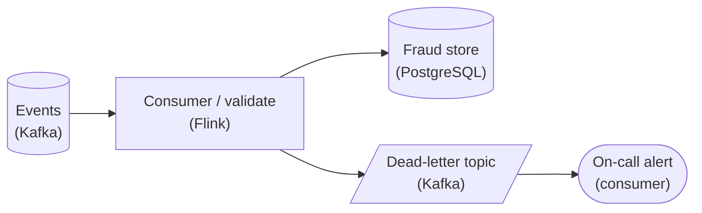
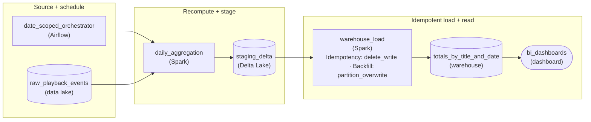
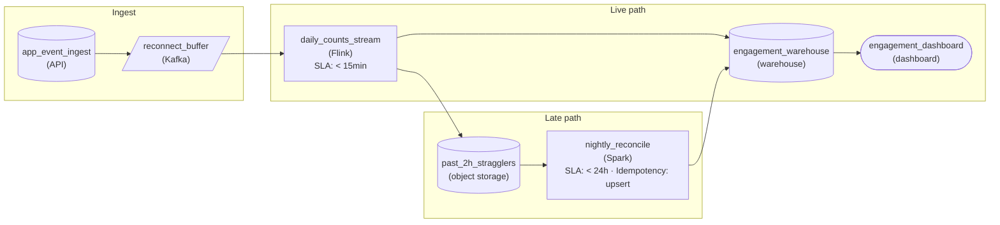
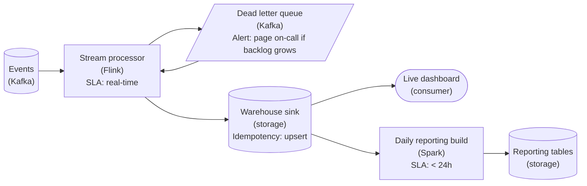

# How Data Moves: Advanced - Exercises

Lesson: [pipeline_how_data_moves_advanced.md](../pipeline_how_data_moves_advanced.md)

### Exercise 1 of 4

**● TASK**

A streaming consumer throws on a malformed event, restarts, replays the same poison record, and throws again, so the whole fraud pipeline wedges behind one bad message. Route the failing events down a side path so the good ones keep flowing, and make sure a rising pile of failures reaches someone instead of growing unwatched.

**Starting canvas** (already placed for you):

- Events (source, Kafka)
- Consumer (wedges on bad event) (transform, Flink)
- Fraud store (storage, PostgreSQL)

<strong>Solution</strong>

#### What this really is

This is the **poison pill** wearing a fraud-detection costume. Strip the story away and it's the oldest failure mode in stream processing: a consumer with at-least-once delivery hits one event it can't parse, throws, and never advances its offset. Kafka hands it the exact same record on restart, it throws again, and the whole partition stops behind message N while N+1, N+2 pile up unread. The lesson here is the dead-letter queue: the fix isn't to parse harder, it's to give the failing event somewhere else to go so the good ones keep flowing. The trap is that a naive `try/catch` that just logs and moves on quietly drops fraud signals on the floor, and nobody notices until an analyst asks where a transaction went.

*Good events flow straight to the `Fraud store`; parse failures branch to a `Dead-letter topic`, and an `On-call alert` wired off it means a rising pile reaches a human instead of growing unwatched.*

#### The design, decision by decision

1. **Wrap the parse, not the whole loop**

   The throw has to be caught at the boundary where you deserialize/validate a single event, so a failure is scoped to that one record. If the `try` wraps the whole poll-process batch, one bad event still fails everything around it. Catch narrowly, classify the failure, and decide per-record: commit-and-route, or retry.

2. **Retry the transient, dead-letter the permanent**

   Not every failure is poison. A timeout writing to the `Fraud store` is transient and deserves a bounded retry with backoff. A malformed payload is permanent: retrying it a thousand times just rebuilds the wedge more slowly. Give retries a hard ceiling (say 3 attempts), and once a record exhausts it, treat it as dead-lettered, not as something to keep replaying.

3. **Route the failure with its context to a side topic**

   Publish the failing event to a `Dead-letter topic` carrying the original bytes plus WHY it failed: the exception, the source `partition`/`offset`, and a timestamp. That payload is what lets someone replay or fix it later. A DLQ that stores only 'this broke' is a graveyard; one that stores the raw event is a repair queue.

4. **Commit the offset AFTER the record is safely handled**

   The moment that breaks the loop: only advance the consumer offset once the event has either landed in the `Fraud store` or been accepted by the `Dead-letter topic`. Now the poison record is durably parked elsewhere and the consumer moves to N+1. Skip this ordering and you either re-poison on restart (commit too late) or lose events (commit too early).

| Pitfall: Logging is not routing |
| --- |
| The mistake real candidates make is `catch (e) { log.error(e); }` and calling it done. That unwedges the pipeline, so it looks fixed, but every malformed fraud event now vanishes with no durable copy and no count. 6 weeks later someone asks why a flagged account slipped through and there is nothing to replay. A log line is not a dead-letter queue: the failed event must survive somewhere you can read it back. |

| Interviewer: A bounded retry that ends in a DLQ |
| --- |
| The tell of a senior answer is that retries and dead-lettering are the same mechanism, not 2 ideas. Juniors add `retry` and stop, and reinvent the infinite loop with extra steps. Strong candidates say it in one breath: bounded retries for the transient case, and exhausting the retry budget is exactly what promotes a record into the `Dead-letter topic`. That single sentence tells the interviewer you have run one of these in production. |

| ✕ Crash and replay | ✓ Route and continue |
| --- | --- |
| Consumer throws on the bad event, offset never commits, Kafka redelivers the same `offset` on restart, throws again. Throughput for the whole partition goes to zero behind one message; lag climbs until an SLA breaks. | Consumer catches at the parse boundary, ships the record to the `Dead-letter topic`, commits the `offset`, and reads N+1. Good events keep flowing at full rate; the one bad message is parked for a human, not blocking the stream. |

| Real world: The DLQ that fills silently is the second outage |
| --- |
| In production the failure mode isn't the first bad event, it's the fiftieth. An upstream schema change starts dead-lettering 5% of traffic and, because the pipeline no longer wedges, nobody looks. That's why the alert is part of the design, not an afterthought: page on `Dead-letter topic` depth or fill rate crossing a threshold, so a rising pile reaches on-call while it's still 50 events and not 5 million. |

| Performance: The side path costs nothing on the happy path |
| --- |
| Dead-lettering is cheap because it's rare: at a healthy 0.01% failure rate, 99.99% of events never touch the `try/catch` slow path or the `Dead-letter topic`. You're adding one branch and one produce call only on failure, so steady-state throughput is unchanged. The design buys you availability (one bad record can't stop the stream) essentially for free, which is why it's the default for every serious streaming platform. |

**Follow-up questions**

1. How do you get the dead-lettered events back into the pipeline once the bug is fixed?\
   *Tests whether the DLQ is a replay queue (re-produce to the source topic) or just a graveyard.*
2. What threshold should page on-call, and should it be `Dead-letter topic` depth or dead-letter rate?\
   *Probes monitoring design: absolute pile vs percentage-of-traffic, and why a slow trickle and a sudden spike need different alarms.*
3. What happens if the write to the `Dead-letter topic` itself fails?\
   *Forces reasoning about the failure-of-the-failure-path: do you block, retry, or drop, and how offset commit ordering protects you.*

 

### Exercise 2 of 4

**● TASK**

Right now a second run over a date adds to the numbers already there, so our daily watch-time and revenue totals per title drift every time on-call retries a failed run or an analyst backfills an arbitrary past date, which happens several times a week. We recompute those totals in a daily batch from about 900M raw playback events, landing one row per title and date in the analytics warehouse that finance and content dashboards read. Design the pipeline, from scheduling through the warehouse load, so that running any date once or five times leaves that table exactly as a single clean run would.

<strong>Solution</strong>

#### What this problem is really testing

This is an **idempotency** problem in a revenue-reporting costume. The job already computes the right daily numbers. What breaks is the SECOND run. The naive load appends its output, so a retry or a backfill over a date that already has rows adds a second copy of that date, and the totals drift. The skill being probed is whether you make the WRITE replace-on-rerun instead of add-on-rerun. Say 'just wrap it in a transaction' and you have missed the point: a transaction makes one run atomic, but it does nothing to stop the next run from stacking a fresh copy on top.

The definition to keep in your pocket: an idempotent pipeline produces the same result whether it runs once or five times on the same input. For a daily batch aggregate, every rerun over a date must leave the warehouse exactly as a single clean run would.

#### The 3 patterns, and which fits here

1. **Pin the grain you replace on**

   The warehouse holds one row per title per date, and a run always targets a single date. That grain decides everything: it is the unit a rerun deletes and rewrites. Name the table after it (`totals_by_title_and_date`) so anyone reading the design sees what a replace overwrites. Without a stable key or partition, 'replace this date' means nothing and you are back to appending.

2. **Make the write replace, not append**

   A full daily recompute produces the ENTIRE partition for a date, so the cheapest safe pattern is partition REPLACE: delete the date's partition, then write the fresh one. An upsert keyed on title and date is the alternative, and it only wins when a run touches a sparse slice of an existing date instead of rebuilding the whole day. Either way, running a date twice converges to one clean copy.

3. **Make the replace atomic per date**

   A load that dies mid-write must not leave a half-replaced date visible. Stage the recomputed partition first, then swap it in as one commit. Finance then reads either the old date or the fully new one, never a torn mix, and that is what keeps retries safe.

4. **Scope reruns through orchestration**

   A date-scoped orchestrator (Airflow) owns when and which date is recomputed. A rerun or backfill for date D triggers the same pipeline with D as its only input, and the load's `partition_overwrite` backfill strategy rewrites only D. When an analyst backfills 90 days, the orchestrator fans it out into 90 single-date runs, and each one is independently safe.

| Trick: Recompute the whole date, don't diff it |
| --- |
| The job rebuilds a date from that date's raw partition, so you never need to reconcile against what is already in the warehouse. Delete the date and write it again. That is why a delete-then-write of the date (`delete_write` on the load) beats a row-by-row `MERGE` here: the recompute already IS the full delta for the date. |

#### The shape that fits

*The orchestrator runs any single date through the same path. The load deletes and rewrites that date's partition of the title-and-date table from the staged partition, so one run or five converge to one clean copy.*

| Interviewer: Name the replace unit before the tool |
| --- |
| A strong candidate names the replace unit BEFORE choosing a tool: 'one row per title per date, so a rerun overwrites that date's partition.' They also say retries and backfills go through the same date-scoped load, so an analyst replaying an old date can only rewrite that date. That answer shows they have been paged at 3am over a double-counted dashboard. |

| Pitfall: A transaction does not stop the second copy |
| --- |
| Wrapping the append in a transaction makes a single run all-or-nothing. It does nothing about the second run stacking another full copy of the date. The double-count is not a partial-write bug; it is an append-versus-replace bug. Transactions give the swap its atomicity, not the pipeline its idempotency. |

**Follow-up questions**

1. MERGE is slow on a billion-row title-history table. What do you do?\
   *Tests the curveball. Partition REPLACE is faster than a full-table MERGE: delete the date's partition and write fresh data. Or stage the delta and MERGE only against the affected partition instead of the whole table.*
2. An analyst backfills 90 days at once. How does that stay safe?\
   *Tests whether the replace stays date-scoped. The backfill fans out into 90 single-date runs, each overwriting its own partition, so no date corrupts another and any one date can be rerun independently.*

 

### Exercise 3 of 4

**● TASK**

An offline-first mobile app holds events on the phone while it has no signal and flushes them on reconnect, so ingestion sees about 60M events a day with commute-hour spikes near 20x the average, and although 99% of events arrive within 2 hours, a tail trickles in up to 7 days late. The product analyst needs each day's engagement counts on a dashboard within 15 minutes, so a day cannot wait on the slowest phone, yet no spike may drop events and every straggler must still land in the day it happened. Design the pipeline so late events are durably stored until the nightly job folds them back, and the counts end up exact even when the job is rerun.

<strong>Solution</strong>

#### What this really is

This is the late-arriving-data pattern with every piece on the table at once: a buffer that soaks up reconnect bursts, a watermark read off the arrival curve, a side output for whatever misses it, and a batch merge that folds the side output back in. Anyone draws Kafka into Flink into a warehouse. What separates answers is what happens to the event that shows up 6 days late, and what happens the second time the nightly job runs. Drop it and every day with an offline phone quietly undercounts; add it onto the existing total and the first rerun doubles every correction the analyst already reported.

| Trick: 2 paths split on one number |
| --- |
| Read the allowance off the arrival curve, not off the worst phone.  1. 99% of events arrive within 2 hours, so the stream holds each day open until its end plus 2 hours, then closes it. 2. Anything later, roughly 600k events a day, leaves the stream on a side output into the lake instead of being dropped. 3. A nightly batch job merges those stragglers into their own event day, keyed on `event_id`, and rewrites the correction instead of adding to it. |

#### Walk the requirements

1. **Put a buffer between the phones and the counter**

   At 700 events a second on average and close to 14,000 during the reconnect wave, a stream processor wired straight to the ingest API either drops events or falls over. A partitioned Kafka topic in front of it turns the spike into lag: the consumer reads at the pace it can sustain, lag climbs for 15 minutes, then drains. Sizing the consumer for 20x would mean paying for peak all day to avoid a queue that clears on its own. The subtle part: that delay is processing lag, not lateness. An event that waited 10 minutes in `reconnect_buffer` is still on time for its day, because the day is keyed on when it happened on the phone.

2. **Pick the allowance from the arrival curve**

   The watermark is a bet about how late data can be, and the distribution prices the bet. At 2 hours the stream captures 99% of events and the running count on `engagement_dashboard` stays inside the 15-minute freshness the analyst asked for; the day simply keeps accepting updates until 02:00 UTC. At 10 minutes the side path swallows several percent of traffic and the nightly correction becomes a second pipeline. At 7 days the stream holds a week of state and the analyst never sees a settled number.

3. **Send stragglers down their own path**

   An event that arrives after its day closed is not broken, so it does not belong in a dead letter queue beside malformed payloads. The stream emits it on a side output to `past_2h_stragglers`, at event grain, carrying its `event_id` and its event timestamp. Nothing is lost and nothing holds the live path open.

4. **Make the correction a rewrite, not an increment**

   `nightly_reconcile` merges stragglers into a ledger keyed on `event_id`, so a phone that re-sent its batch, or a job that ran twice, lands each event once. It then recomputes each touched day's late count from that ledger and overwrites the value. The stream's count and the late count live side by side and the dashboard shows their sum. Rerun it and the merge matches every key, the recompute returns the same numbers, and the analyst's report does not move.

#### The shape that fits

*Kafka absorbs the reconnect wave; Flink counts by event day with a 2-hour allowance and sends later events to `past_2h_stragglers` in object storage; a nightly Spark job merges them into the warehouse on `event_id`, safe to rerun.*

| Interviewer: The allowance has to come from the data |
| --- |
| The tell at this level is where the lateness number comes from. 'Two hours, because 99% of events arrive by then, and the last 1% goes to the side path' is reasoning from the distribution. 'Five minutes, it's the default' is not. The second tell is explaining why the merge survives a rerun instead of just asserting that it does. |

| Pitfall: Late is not broken |
| --- |
| The design that ships routes past-allowance events into the same dead letter queue as malformed payloads, or lets the default late-data policy drop them. Both look fine in week one because the gap is 1%. A month later a release drives up offline usage, the undercount stops being small, and the dropped events are gone for good. |

**Follow-up questions**

1. A phone re-sends its whole batch inside the 2-hour allowance because the first upload wasn't acknowledged. What keeps the live count from doubling?\
   *Tests whether the candidate sees that the ledger only covers stragglers; the live path needs its own dedup on `event_id` within the day, or a sink that upserts at event grain.*
2. A new app release doubles offline usage and the share of events past 2 hours climbs from 1% to 8%. What do you change?\
   *Tests whether the allowance is treated as a measured choice: watch the side-path share, then weigh a wider allowance (more state, slower settling) against a bigger nightly merge.*

 

### Exercise 4 of 4

**● TASK**

Every backfill and on-call replay re-runs the same Kafka events through this stream, so the warehouse sink has to land each event once no matter how many times it sees it. Malformed and late events can't stall the stream: park the bad ones where they can be inspected and later fed back through the stream once fixed, and page on-call when that backlog grows. Not every consumer needs second-fresh data, so serve the live dashboard and the daily reporting tables at the freshness each one actually requires.

**Starting canvas** (already placed for you):

- Events (source, Kafka)
- Stream processor (transform, Flink)

<strong>Solution</strong>

#### What this really is

This is the lesson's depth probes stacked on one stream: what happens when it runs twice, what happens to an event that can't be processed, and which reader is worth paying real-time prices for. Everyone draws `Kafka` into `Flink` into a warehouse. The trap is the replay sentence. Candidates lean on the engine's exactly-once checkpointing, append to the sink, and call it done. Then the first backfill re-adds every event it touches: **a day replayed twice doubles every metric downstream**, and the engine never noticed, because its guarantee stops at its own state.

*The two starter nodes grow an upsert sink, a dead letter queue that pages on backlog and replays into the processor, and a daily build for the reporting tables.*

#### The idempotent sink

1. **Give every event a stable key**

   Use the producer's `event_id` if it exists, else a business key plus `event_time`. The key must be deterministic from the payload, so a replayed event maps to the same row. A key built from processing time or an auto-increment is not a key: it mints a new row every run.

2. **Write with an upsert, never an append**

   The sink runs a `MERGE` (or `INSERT ... ON CONFLICT (event_id) DO NOTHING`) on that key. At-least-once delivery plus a conflict-absorbing write gives an exactly-once effect in the warehouse, and re-running the whole topic changes nothing that already landed.

| Trick: Make the sink idempotent and let delivery repeat |
| --- |
| Backfills and replays guarantee the same event crosses the wire more than once, so stop fighting it. The upsert on a stable key is the whole fix; checkpointing in `Flink` protects the engine's state, not your warehouse rows. |

#### Bad and late events step out of line

Malformed payloads and events that arrive behind the watermark go to the `Dead letter queue` while the processor keeps moving. Nothing is dropped: once the parser or the upstream is fixed, the queue is drained back through the `Stream processor`. A late event replayed this way still carries its `event_time`, so it lands in the right day, and the upsert sink makes the replay safe by construction.

| Pitfall: Retrying a poison event in place stalls the partition |
| --- |
| Retry a malformed record inline and every event behind it waits. Lag climbs, the consumer falls behind, and one bad byte becomes an outage. The dead letter queue exists so a bad event leaves the line instead of holding it. |

The page sits on the queue's backlog, not on single dead letters. A steady trickle is normal; a growing backlog means an upstream schema changed or a producer broke. Paging per message trains on-call to ignore the pager.

#### Pay for freshness only where it is read

| ✕ Live dashboard | ✓ Reporting tables |
| --- | --- |
| Reads the warehouse rows the stream writes, seconds behind. It is the only reader that justifies the `real-time` path, so it gets it. | Rebuilt once a day by a batch job over the deduplicated warehouse. A `< 24h` refresh is all a daily report needs, and by then replayed late events have landed too. |

| Interviewer: Real-time is a price, not a default |
| --- |
| Real-time runs roughly 3-5x the cost of batch for the same throughput, most of it in on-call burden and debugging. Pricing each reader separately, the dashboard on the stream and the reports on a daily job, is what tells an interviewer you have paid that bill. |

**Follow-up questions**

1. The events have no `event_id`. How do you build a key you trust across replays?\
   *Tests whether the key is a deterministic function of the payload: a business key plus `event_time`, or a content hash.*
2. The `Daily reporting build` runs twice for the same day. What keeps the `Reporting tables` from double-counting?\
   *Checks that idempotency is carried to the second write, for example by replacing the day's partition.*
3. How do you drain the `Dead letter queue` after a parser fix without re-poisoning the stream?\
   *Probes replay through the same processor, reliance on the upsert sink, and sending still-bad records back to the queue.*
4. Volume grows 10x and the processor can't keep up. What happens to the stream, and what do you change?\
   *Tests backpressure reasoning: buffering in the topic, scaling consumers, and never silently dropping data.*

