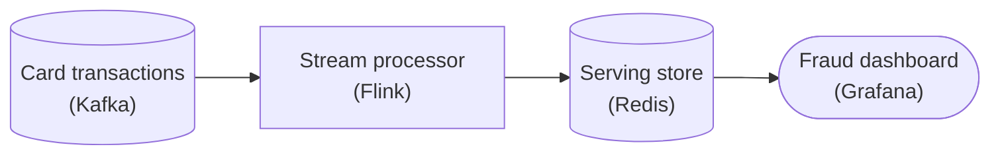
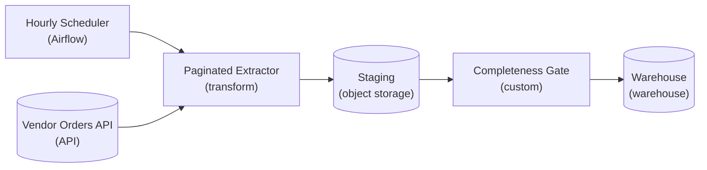
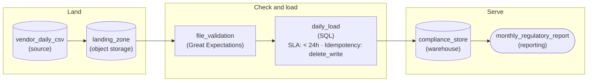
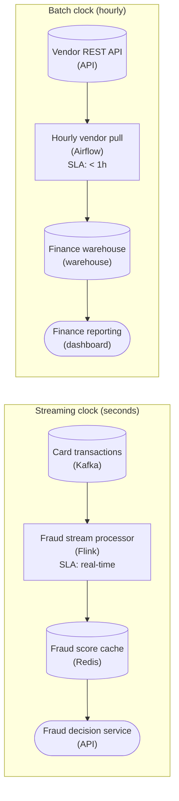

# How Data Moves: Beginner - Exercises

Lesson: [pipeline_how_data_moves_beginner.md](../pipeline_how_data_moves_beginner.md)

### Exercise 1 of 4

**● TASK**

A fraud team currently sees transactions only in tomorrow's batch report, which is too late to block anything. Design a path that surfaces each transaction to the fraud dashboard within seconds of it happening.

**Starting canvas** (already placed for you):

- Card transactions (source, Kafka)
- Nightly batch (too late) (transform, Spark)
- Fraud dashboard (consumer, Grafana)

<strong>Solution</strong>

#### The trap: latency is a model, not a knob

Strip the fraud costume off and this is the batch-versus-streaming decision in its purest form: a bounded nightly job is being asked to deliver an unbounded, never-ending flow of events with seconds of latency. The whole point is recognizing that end-to-end latency is a property of the processing MODEL, not a dial you turn on the existing `Spark` job. The trap almost everyone reaches for first is keeping the batch and just running it more often. Shrink the schedule to every 5 minutes and the fraud team still watches a stolen card clear 4 and a half minutes before the report refreshes, and you eat a full job cold-start on every run. A `< 24h` SLA and a 'within seconds' requirement are not near neighbors you can close by tuning; they are 2 different architectures.

*The event already arrives as a stream on Kafka. Keep it a stream all the way to the dashboard instead of freezing it into a nightly file.*

Notice the source never changed. `Card transactions` was already landing on `Kafka` as an unbounded stream; the nightly batch was the piece that DAMMED it, accumulating a day of events and releasing them in one delayed flush. The redesign removes the dam. A long-lived stream job (`Flink`, or `Spark` Structured Streaming, or `Kafka` Streams) consumes each transaction as it arrives, scores it, and writes to a low-latency `Serving store` the dashboard reads from. No job scheduling, no batch window, no waiting for tomorrow.

1. **Consume the stream continuously, do not re-poll it**

   Point a continuously-running consumer at the `Card transactions` topic. This is the load-bearing change: a batch job STARTS, reads a bounded slice, and STOPS, so its latency floor is the schedule interval plus startup. A stream job never stops; it advances its `Kafka` offset per record and processes on arrival. Latency drops from 'next batch' to 'milliseconds after the event lands'.

2. **Do the fraud scoring in flight, keep state in the operator**

   Whatever the nightly batch computed per transaction, the stream job now computes per event. Anything that needs history (rolling spend per card, velocity over the last minute) lives in the stream processor's keyed state, keyed by card, updated incrementally as events flow. That is the part a naive micro-batch can't fake cheaply: it would recompute the window from scratch every run.

3. **Land results in a store the dashboard can read at seconds latency**

   The stream job writes scored transactions to a `Serving store` (`Redis`, `Postgres`, or a real-time OLAP store) that supports low-latency point and range reads. `Grafana` queries THAT, not the raw topic. Skip this and you have fast processing bottlenecked behind a slow read path, which quietly reintroduces the delay you just removed.

| Pitfall: The micro-batch mirage |
| --- |
| The most common wrong answer is 'run the `Spark` batch every minute.' It feels like streaming and it is not. You still pay per-run startup, you still see latency equal to the interval (never seconds), and windowed features get recomputed each run instead of maintained. Shrinking a batch interval asymptotically approaches streaming cost without ever reaching streaming latency. |

| Interviewer: Interviewers watch for |
| --- |
| The tell of seniority is naming WHY the batch can't be tuned into compliance: bounded versus unbounded processing, and the fact that a `< 24h` freshness SLA and a seconds SLA are different architectures, not different settings. Bonus signal: mentioning the serving layer unprompted, because most candidates stop at the processor and forget `Grafana` needs somewhere fast to read from. |

| ✕ Nightly batch | ✓ Stream processor |
| --- | --- |
| Bounded job over a day of accumulated events. Latency floor = schedule interval. Windowed fraud features recomputed from scratch each run. Meets a `< 24h` freshness SLA and nothing tighter. Cheap per byte, useless for blocking. | Unbounded job over a live `Kafka` topic. Latency = time-to-process one event (milliseconds). Windowed features held in keyed state and updated incrementally. Meets a seconds SLA. Costs an always-on process, which fraud blocking justifies. |

| Real world: In production, both usually live |
| --- |
| You rarely delete the batch. The stream path serves the fraud dashboard in seconds; the nightly `Spark` job stays for backfills, model retraining, and reconciled reporting where correctness beats freshness. That is the everyday lambda-style split: streaming for the decision that has to happen now, batch for the complete, replayable record. |

**Follow-up questions**

1. A transaction arrives late or out of order on `Kafka`. How does your windowed scoring stay correct?\
   *Tests event-time versus processing-time and watermarks, the thing micro-batch hand-waves.*
2. The stream job crashes mid-stream. How do you avoid double-scoring or dropping a transaction?\
   *Checkpointing and offset commits, exactly-once versus at-least-once.*
3. Traffic spikes 20x on a holiday. What in this design scales, and what becomes the bottleneck?\
   *Partition-level parallelism on the topic and the serving store's write throughput.*

 

### Exercise 2 of 4

**● TASK**

A vendor exposes order data through a paginated REST API, and the analysts who rely on it only refresh their reports once an hour. Pull the orders on that hourly cadence and confirm each load is complete before it reaches the warehouse, so a half finished pull never surfaces in a report.

**Starting canvas** (already placed for you):

- Vendor Orders API (source, API)
- Warehouse (storage, Snowflake)

<strong>Solution</strong>

#### What this really is

This is **pull-based API ingestion**, the side of the pull versus push split where the pipeline owns the clock. The vendor never tells you a batch is finished; you decide that by draining the cursor to its end and checking the result before anyone can read it. Everyone gets the pagination loop right. The trap is publishing page by page: wire the extractor straight into the warehouse and the moment page 7 of 12 times out, an analyst refreshing at the top of the hour reads a half-loaded hour that looks exactly like a slow sales day.

The fix is a boundary the API never gives you. Land every page somewhere analysts cannot see, prove the pull is complete there, and only then write the hour into the warehouse in one step. Completeness is a fact about the whole hour, so it is checked after the last page and before downstream sees the first.

*The scheduler fires hourly, the extractor drains every page into staging, and the gate proves the pull is whole before the hour is written to the warehouse.*

#### Building it

1. **Let a scheduler own the hourly clock**

   Put an orchestrator such as Airflow in front of the extractor, not a long-lived poller. The analysts read hourly, so a run per hour is all the freshness anyone uses. A scheduled run has a defined start and end, which is what lets you say 'this hour is complete' at all, and a failed hour reruns as one unit.

2. **Drain every page into staging, not the warehouse**

   The `Paginated Extractor` follows the vendor's cursor (`next_cursor` or page tokens) until it is exhausted, backing off with jitter when the rate limit pushes back, and writes each page to `Staging`. Staging is invisible to analysts, so a crash mid-pull leaves only scratch data the next run overwrites.

3. **Prove completeness before you publish**

   The `Completeness Gate` checks the whole staged batch: did the cursor reach its documented end, do the page and row counts match what the API reported? Only a batch that passes advances. No single API response can answer this, because completeness belongs to the hour, not the page.

4. **Write the hour in one step**

   Move the validated batch into `Warehouse` as a single swap: load a fresh partition and swap it in, or run one `INSERT ... SELECT` inside a transaction. Readers see this hour or the previous one, never a half-written table.

| Trick: Staging gives the check a place to run |
| --- |
| Extract, validate and publish are separate stages precisely so the warehouse write is gated on a check that has already passed against the whole hour. |

| ✕ Extractor writes the warehouse directly | ✓ Stage, check, then swap |
| --- | --- |
| Each page is appended to the live `Warehouse` table as it arrives. A timeout on page 7 leaves 6 pages visible, analysts read a partial hour with no error signal, and a retry double-loads what already landed. | Pages land in `Staging`, the `Completeness Gate` passes only a whole pull, and one swap publishes it. A mid-pull failure is invisible downstream, and the rerun simply overwrites staging. |

| Interviewer: Volunteer the publish boundary unprompted |
| --- |
| The tell of someone who has run API pulls in production: they say where completeness is verified and how the hour becomes visible all at once. 'Loop the pages and load them' is the toy answer. |

| Pitfall: Retries fix failures, not visibility |
| --- |
| Adding retries to the extractor while still appending straight to `Warehouse` leaves pages 1 through 6 exposed while page 7 retries, and can duplicate rows when the pull resumes. |

| Real world: Key every run by its hour |
| --- |
| Key the staging location and the published partition by the run's hour (an `ingest_hour` or `load_id`). Reruns become overwrites, history becomes a replay of hours, and you get a natural place to record how many rows each hour loaded. |

**Follow-up questions**

1. The vendor API has no reliable total count. How does the `Completeness Gate` decide the pull is whole?\
   *Tests leaning on cursor exhaustion plus sanity bounds when an exact count is unavailable.*
2. Halfway through the hour the vendor starts returning 429s. What does the extractor do, and what happens to that hour?\
   *Probes backoff with jitter against the rate limit, and that an unfinished pull fails the gate instead of publishing.*
3. You need the last 2 years of orders. Do you page through them with the same hourly job?\
   *Checks the lesson's backfill answer: a bulk export for history, the API for incremental pulls going forward.*

 

### Exercise 3 of 4

**● TASK**

Design how a vendor's daily CSV, dropped on a cloud bucket, reaches the monthly regulatory report, given that the compliance officer has asked for it to be made real-time. Some days the same file arrives twice and some days a file comes in short of rows, and neither may reach the filing.

<strong>Solution</strong>

#### What the officer actually asked for

This is the batch vs streaming question wearing a compliance badge. The officer said 'real-time', so run the one-hour-stale test: if this data landed an hour late, or even a day late, who loses anything? The filing goes out once a month, so nobody does. The trap is spending the whole answer on the word the officer used and never touching the 2 things that can put a wrong number in front of a regulator: a file delivered twice and a file delivered short. A streaming path fixes neither. It just carries the double-count and the missing rows into the report faster, and bills you around the clock for it.

| Trick: Freshness is already solved; correctness is not |
| --- |
| Answer the real-time ask in one sentence by naming the reader's cadence, then spend the design on the file itself. Land it untouched, check it against its own trailer count before it counts, and make a second delivery of the same file a no-op. That is what the officer meant by trustworthy, even if they said fast. |

#### Walk the requirements

1. **Run the one-hour-stale test out loud**

   The report reads a month of data a few days after month-end. A daily load with freshness under 24 hours on `daily_load` is already weeks ahead of the only reader. Say that to the officer plainly: streaming buys the regulator nothing, because the regulator never sees the data before the filing date anyway.

2. **Land the file untouched in the bucket**

   The vendor already drops the CSV on a bucket, so that bucket is the `landing_zone`. Nothing edits the file there. When a load goes wrong you rerun it from the original instead of emailing the vendor for a resend, and an auditor asking what arrived on a given day gets the exact bytes.

3. **Check the file before it counts**

   `file_validation` sits between the landing zone and the load. It confirms the header has the expected columns and that the number of data rows matches the trailer line's record count. A short file is held, never loaded, so a partial day can't quietly shrink the filing's totals.

4. **Make a second delivery a no-op**

   Record a checksum for every file the load has accepted. A file whose checksum is already recorded is skipped. The load also replaces that date's rows rather than appending (`delete_write`), so even a corrected resend for the same day swaps the rows instead of stacking them.

#### The shape that fits

*The file lands untouched in `landing_zone`, `file_validation` holds anything short of its trailer count, and `daily_load` skips a repeat checksum and replaces the day's rows. The report reads monthly, so no chip is needed on it.*

| ✕ Stream the drop | ✓ Load it daily, checked |
| --- | --- |
| A watcher pushes rows into an always-on job the moment the CSV appears. The report still runs once a month. The duplicate file streams in twice and the short file streams in short, and now there is a running job to pay for and get paged on. | A scheduled `daily_load` runs after the file lands, checks the trailer count, skips any checksum it has already seen, and replaces that day's rows. Same filing date, a fraction of the cost, and both real defects are handled. |

| Performance: Always-on compute for a once-a-month reader |
| --- |
| About 200,000 rows a day is roughly 6 million a month: a daily load finishes in minutes and the compute sits idle the rest of the day. A streaming job keeps workers running every hour of every day to serve a reader who opens the data 12 times a year. |

| Interviewer: Push back with the reader's cadence, not a flat no |
| --- |
| The strong answer doesn't just refuse streaming. It names who reads the data and how often, then asks what 'real-time' was supposed to fix. Almost always the answer is trust in the numbers, which is exactly what the validation step and the idempotent load deliver. |

| Pitfall: Removing duplicate rows is not removing duplicate files |
| --- |
| A tempting fix for the double delivery is to drop identical rows after loading. But 2 identical rows can both be real, like 2 equal payments on the same day, and that fix silently deletes one. The duplicate is a whole file, so catch it at the file: by checksum, before the rows ever land. |

**Follow-up questions**

1. The vendor resends a corrected Tuesday file with a different checksum. What happens to Tuesday's rows?\
   *Tests that the checksum only stops exact repeats, and that replacing the day's rows (`delete_write`) is what keeps a corrected file from stacking on the original.*
2. It's 6am and today's file hasn't landed. Who finds out, and how urgent is it?\
   *Tests matching the alert to the reader: a late file warrants an alert, but with a monthly filing it only becomes urgent as month-end close approaches.*

 

### Exercise 4 of 4

**● TASK**

A payments company runs every card transaction through a fraud check that has to flag bad charges within seconds, while a vendor order API gets pulled once an hour to feed the finance team's reporting. Design both ingestion paths on one platform, each sized to the freshness its consumer actually needs.

**Starting canvas** (already placed for you):

- Card transactions (source, Kafka)
- Vendor REST API (source, REST API)

<strong>Solution</strong>

#### What this is really asking

This looks like a payments system-design question. It is really **batch versus streaming, decided per consumer**: for each reader, how stale can the data get before someone loses money? Fraud loses money in seconds. Finance loses nothing in an hour. The trap is reading 'one platform' as 'one pipeline' and putting both consumers on the same clock.

A single clock fails both ways. Stream everything and you pay several times the compute and on-call burden for freshness finance never reads. Batch everything hourly and fraud lets bad charges clear for up to 60 minutes. The strong answer refuses that choice: two consumers, two freshness budgets, two paths on shared infrastructure.

*One platform, two clocks: a real-time fraud path and a < 1h finance path that never share a freshness budget.*

#### The decision, made twice

1. **Ask the money question per consumer**

   If this data were an hour old, would anyone lose money or make a bad call? Fraud: yes, instantly. Finance: no. That one question sorts each path into streaming or batch before you draw a box. Ask it per consumer, never once for the whole platform.

2. **Put fraud on the stream**

   Card transactions already arrive as events on Kafka, and the decision must land before authorization. A stream processor scores each event as it arrives and writes the score to a low-latency cache the fraud service reads in milliseconds. The source being event-based makes streaming the natural fit, not a stretch.

3. **Put finance on a schedule**

   The vendor exposes a REST API and finance reads hourly. So an orchestrated job pulls once an hour, pages through results, respects the rate limit, and loads the hour's orders into the warehouse for reporting. Hourly is the budget, so hourly is the clock. Streaming money spent here buys nothing.

| Trick: Let the freshness budget pick the tool |
| --- |
| Do not design 'the platform' first. Write down each consumer's freshness budget, then let the budget choose batch or streaming. Two budgets means two paths; 'one platform' means shared infrastructure and a team, not a shared clock. |

| Pitfall: One clock sinks the design |
| --- |
| Candidates either stream the vendor pull, paying a premium for an hour of freshness finance throws away, or batch the fraud check, opening a sixty-minute window where bad charges clear. Either one is a single sentence that ends the round. |

| ✕ Fraud path | ✓ Finance path |
| --- | --- |
| Source is already an event stream. Staleness costs revenue immediately. Budget: seconds. Choice: streaming, a processor scoring each event into a fast read store. | Source is a pull-based REST API. An hour stale costs nothing. Budget: one hour. Choice: a scheduled batch pull that pages the API, handles the rate limit, and loads the warehouse. |

| Interviewer: Say why freshness has to earn streaming |
| --- |
| Streaming costs several times more to build and run, so name the default out loud: 'batch unless stale data costs money, and here it only costs money on the fraud side.' A candidate who says that sentence has already passed the question. |

| Real world: Faster finance means micro-batch first |
| --- |
| When finance asks for 'real-time' during month-end close, the usual answer is a five-minute pull, not a rewrite to true streaming. Tighten the schedule before you bolt a stream processor onto a source that was never event-driven. |

**Follow-up questions**

1. Finance now wants five-minute freshness during month-end close. Do you make the finance path streaming?\
   *Tests reaching for micro-batch before true streaming when the source is not event-based.*
2. The hourly vendor pull sometimes runs longer than an hour. What breaks, and how do you stop two runs overlapping?\
   *Tests batch scheduling judgment: run-level locking and idempotent loads.*
3. The fraud stream processor crashes mid-stream. What do you lose and how do you recover?\
   *Tests awareness of checkpointing, offsets and ordering, the recovery costs streaming carries and batch does not.*

