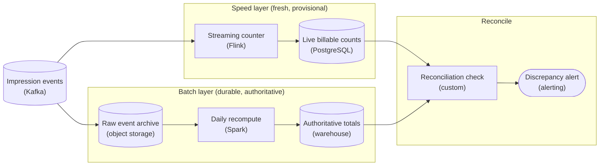
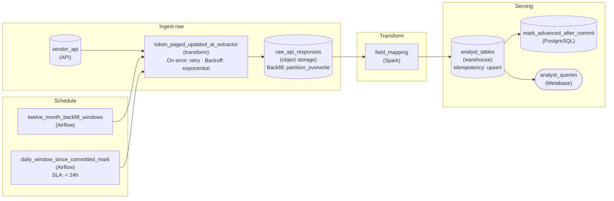
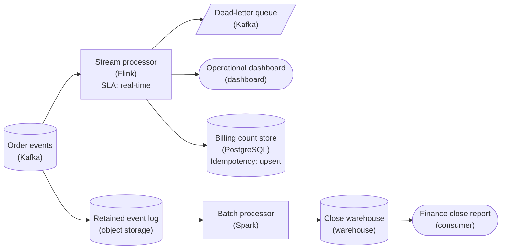

# How Data Moves: Intermediate - Exercises

Lesson: [pipeline_how_data_moves_intermediate.md](../pipeline_how_data_moves_intermediate.md)

### Exercise 1 of 3

**● TASK**

An ad platform bills advertisers from a real-time count of impression events, but when the streaming job restarts it replays from the last offset and the live count drifts above the true number. Keep that count fresh for advertisers while persisting every raw impression event durably, so the platform always has an accurate record to fall back on. Run a daily pass that recomputes the authoritative totals from those stored events and brings them together with the live count, so any disagreement is surfaced rather than billed silently.

**Starting canvas** (already placed for you):

- Impression events (source, Kafka)
- Counter (replays on restart) (transform, Flink)
- Billable counts (storage, PostgreSQL)

<strong>Solution</strong>

#### The pattern under the costume

This is **Lambda architecture** in an ad-billing costume. A fast, approximate speed layer handles freshness. A slow, exact batch layer handles truth. A reconcile step brings the two together. The trap here is idempotency. The `Flink` counter is at-least-once, so on restart it replays from the last committed offset and adds impressions it already counted. The live number in `billable_counts` drifts upward, and nobody notices because nothing checks it. Miss this and you invoice advertisers for impressions that never happened.

*The starter is only the top row. The fix forks at the source: every impression also lands in object storage, a daily Spark pass recomputes the truth, and one quality gate receives both numbers.*

#### Why the live count cannot be the ledger

A streaming aggregate trades correctness for latency on purpose. A running sum in the counter's state is not idempotent: replay offsets 900 to 1000 after a crash and those 100 impressions count twice. The speed layer is doing its job. The fatal move is stopping at the top row and treating `billable_counts` as the books. It is a cache of an estimate.

| Pitfall: The drift only goes up |
| --- |
| Each restart replays uncommitted offsets, and without a dedup key the counter increments twice. Nothing ever corrects downward, so error compounds with every bounce. Persist raw events before aggregating: the archive is the only thing that can prove the count wrong. |

#### The 3 pieces you add

1. **Fork every event into a durable archive at the source**

   Tee `Impression events` from `Kafka` straight into `Raw event archive`, unaggregated and keyed by each event's own id. It must not depend on the streaming state, so a replayed counter can never poison the record you fall back on.

2. **Recompute totals from scratch every day**

   `Daily recompute` reads the archive and writes `Authoritative totals` as a full recompute over the day, deduping by event id. Rerun the same day and you get the same number. That is correctness the stream cannot offer.

3. **Route both numbers into one gate**

   `Reconciliation check` receives `Live billable counts` and `Authoritative totals`, compares them per advertiser per day, and fires `Discrepancy alert` when the delta crosses a threshold. The batch figure is what you bill; the live one stays provisional.

| Trick: Recompute, never accumulate |
| --- |
| The speed layer is non-idempotent by nature; the batch layer is idempotent by construction (full recompute plus dedup over an immutable archive). Make the batch job incremental and stateful and it inherits the replay bug, leaving no ground truth to reconcile against. |

| ✕ Speed layer | ✓ Batch layer |
| --- | --- |
| `Flink` running sum, seconds fresh, at-least-once. Answers 'roughly how many now?' Writes provisional `billable_counts`. Drifts on every restart. | `Spark` recompute over the object-storage archive, hours stale, deduped by event id. Answers 'exactly how many yesterday?' Writes the authoritative totals to the warehouse. This is what you invoice. |

| Interviewer: The archive sits before the counter |
| --- |
| The senior tell is teeing raw events at the source, ahead of the counter, and calling the batch pass idempotent because it recomputes. A batch job that reads the streaming state, or a reconcile with no archive behind it, shows the candidate missed why the drift exists. |

| Real world: Finance trusts the nightly true-up |
| --- |
| Ad networks and usage-metered billing run exactly this: a live estimate for the dashboard and a nightly true-up for the invoice. The reconcile delta is a monitored metric; a sudden gap usually means a replay or a lagging `Kafka` partition, and you page on it rather than mail it to a customer. |

**Follow-up questions**

1. Correcting an over-bill now waits a full day. How do you shrink the window without giving up idempotency?\
   *Shorter batch cadence that keeps full-recompute semantics, not an incremental hack.*
2. How would you make the streaming counter itself less wrong so the delta stays small?\
   *Dedup by event id in the stream, transactional offsets, exactly-once sinks.*
3. An advertiser was already billed from the live count before the gap surfaced. What happens to that money?\
   *Whether `Authoritative totals` feed a credit or correction path, not only an alert.*

 

### Exercise 2 of 3

**● TASK**

How do we get a year of history out of a vendor's rate-limited REST API into tables our analysts query, and then keep those tables current every day? Records move between pages while we crawl, and the response fields have changed twice this year and will change again. A multi-hour vendor outage must not cost us a day of records or load any record twice.

<strong>Solution</strong>

#### What this problem really is

This is API ingestion wearing a marketing-ops badge, and it only stands up when incremental batch mechanics and idempotency hold it from underneath. Anyone draws vendor, extractor, warehouse. The trap is that 3 quiet choices each lose data with no error: page by number while records move and rows slide past you; parse the JSON on the way in and the next field rename strands a year of history you cannot cheaply re-fetch; advance the **high-water mark** on a run the outage killed and that day is simply gone.

The default design crawls page 1 to page N, flattens each response into typed columns, inserts them, and stamps today as done. It demos fine. Then a record updated mid-crawl jumps pages and is never read, a rename turns a column into nulls for half the year, and a six-hour run of '503' responses gets logged as a short but successful day.

| Trick: 3 memories, each in the right place |
| --- |
| The pipeline has to remember 3 things, and each belongs somewhere different. Its position within a crawl lives in the vendor's next-page token. Its position across days lives in `mark_advanced_after_commit`, an `updated_at` value written only after the tables commit. Everything the vendor ever said lives in `raw_api_responses`, untouched, so the mapping can change without a re-crawl. |

#### Walk the requirements

1. **Page by cursor, not by page number**

   Records updated during the crawl re-sort. Page 40 now is not page 40 a minute from now: a record that moves toward the front is skipped, one that moves back is read twice. `token_paged_updated_at_extractor` asks for changes with a modified-since filter ordered by `updated_at` and follows the vendor's next-page token, which pins its position to the data instead of to an offset.

2. **Land every response untouched before parsing**

   The extractor writes each response exactly as returned into `raw_api_responses`, partitioned by extraction window. Only then does `field_mapping` read it, translating every shape the vendor has used (old field name, new field name, old nesting, new nesting) into one stable column set. The next rename is a mapping change plus a replay from object storage, not six hours of re-crawling against a rate limit.

3. **Feed the backfill through the same extractor, one window at a time**

   There is no bulk export, so history comes through the same door as the daily run. `twelve_month_backfill_windows` hands the same extractor bounded slices (a day or a week of `updated_at` each), and every slice writes its own raw partition with partition overwrite. A slice that dies re-runs alone and replaces only itself; backfill and daily load share one code path, so they cannot disagree.

4. **Move the mark only after the load commits**

   `daily_window_since_committed_mark` asks for everything changed since the mark stored in `mark_advanced_after_commit`. When the vendor returns '503' for hours, the extractor retries with exponential backoff, then fails loudly; because the mark is written only after `analyst_tables` commits, it stays where it was. Tomorrow's run starts from the old mark and re-reads some records it already saw; the upsert on the vendor record id makes that overlap harmless.

#### The reference design

*Backfill windows and the daily window drive one token-paged extractor; untouched JSON lands in `raw_api_responses`, `field_mapping` upserts into `analyst_tables`, and only then does `mark_advanced_after_commit` move.*

`analyst_tables` is a columnar warehouse, which is the right home for analysts who filter a year of records down to a campaign or a week: they read the few columns they touch, not whole rows. The raw zone stays row-shaped JSON on purpose, because its job is fidelity, not query speed.

| Performance: Six hours of history, one minute a day |
| --- |
| Two million changed records at 100 per page is 20,000 requests; at 60 a minute that is about 5 and a half hours of pure crawling, so the backfill runs as windows across a night or 2 rather than one heroic job. The daily load is about 6,000 records, 60 requests, one minute. Replaying all of `raw_api_responses` through `field_mapping` after a rename costs warehouse compute, zero vendor requests. |

| Interviewer: The mark is a promise about what committed |
| --- |
| The tell is when the candidate says the mark moves. 'After the tables commit' means they understand an outage as a delay. 'At the end of the extraction' means a crash between extract and load quietly drops a day. Strong candidates also name the overlap this creates and hand it to the `upsert` in the same breath. |

| Pitfall: Parsing on the way in burns the history |
| --- |
| The version that ships first flattens JSON into typed columns inside the extractor. It works until the vendor renames a field, then the new column is null for every record before the rename and the old column is null after it. With no raw copy, the only fix is re-crawling a year under the rate limit, and records the vendor has since overwritten come back in their current state, not the state analysts reported on. |

| ✕ Page numbers, parse on extract | ✓ Token paging, raw first |
| --- | --- |
| Fast to write. Records that move mid-crawl are skipped or doubled, a rename corrupts history, and a failed run that stamped itself done leaves a silent gap. | Position lives in the vendor's token and the committed `updated_at` mark, history lives in `raw_api_responses`, and the `upsert` makes every rerun safe. An outage is a late day, never a missing one. |

**Follow-up questions**

1. The vendor starts deleting records, and a deleted record simply stops appearing in the modified-since results. How do deletions reach `analyst_tables`?\
   *Tests whether the candidate sees that a change-field mark only catches updates, and reaches for a periodic full id reconciliation or a vendor deletion feed.*
2. Marketing now wants the tables refreshed hourly, but the rate limit stays at 60 requests a minute. What changes, and what does not?\
   *Tests whether the candidate recognizes the same mark, token paging and upsert work at a shorter cadence, and budgets hourly requests against the limit alongside any running backfill window.*

 

### Exercise 3 of 3

**● TASK**

Billing has been counting some orders twice every time the stream consumer restarts, and finance will not sign a close built from the same live numbers the operations team watches. Design the order-event pipeline so operations sees orders within seconds, every billable order counts exactly once, the financial close is computed exactly in batch, and malformed events are set aside without stalling the stream.

**Starting canvas** (already placed for you):

- Order events (source, Kafka)
- Stream processor (transform, Flink)

<strong>Solution</strong>

#### The pattern under the costume

Strip the business language off this and it is **Lambda Architecture**, plain and named: a fast, approximate speed layer and a slow, exact batch layer computing the same order facts 2 different ways. The lesson taught you the shape; this problem sets the specific trap. The 4 deliverables do not all live on the same path, and candidates who route them all through `Flink` fail. A live operational view wants the stream's low latency and tolerates its approximation. An exact financial close cannot: it wants the batch layer replaying the complete history. And the billable count is the nastiest one, because it rides the stream for speed but demands exactly-once, which the stream does not hand you for free. Wire that count to the stream's at-least-once delivery and you bill every customer twice on the first consumer restart.

*One `Kafka` source, 2 readers: `Flink` for the seconds-fresh view and the upserted billing count, `Spark` over the retained events for the exact close.*

#### One log, 2 readers

What makes Lambda work is a single immutable source. `Kafka` carries the order events, and every event also lands in object storage, so the batch layer always has the complete history. The speed layer (`Flink`) consumes the tail and feeds the operational dashboard in seconds. The batch layer (`Spark`, nightly) replays the retained events for the accounting period and writes the close to the warehouse exactly, with no approximation and every late event present. Same input, 2 guarantees: operations watches fresh but provisional numbers, and finance reads the authoritative close.

| Trick: The batch layer is the source of truth |
| --- |
| In production nobody closes the books off the stream. The stream is the dashboard; the batch close is what finance signs. Keeping them separate is the whole point: a bug in `Flink` then costs you a stale dashboard, not a wrong close. If your design lets the seconds-fresh path be the authoritative number, you have collapsed Lambda back into one layer and lost the exactness the close requires. |

#### The billable count is where idempotency earns its keep

Exactly-once is not a delivery mode you switch on; it is at-least-once delivery plus idempotent processing. Give every order event a stable business key, `order_id`, and make the count a keyed upsert into the billing store rather than a blind increment. If the same event replays after a consumer crash, the upsert is a no-op and the count holds. An `INCREMENT` on redelivery double-counts; a `PUT order_id` does not. That single design choice is the difference between a count you can bill on and a count that drifts.

| Pitfall: At-least-once means redelivery, not maybe-delivery |
| --- |
| Candidates hear 'exactly-once' and reach for a config flag. But the stream redelivers on every failover by design, and the only durable fix is a dedup key the processing owns. Skip it and your billable count creeps upward every single time a `Flink` task restarts, which under real load is often. |

#### Bad events cannot stop the world

One malformed order, a bad schema or a null where a price should be, will throw inside the stream operator and, without a plan, wedge the consumer: it retries the poison event forever and the whole live view goes stale. The **dead-letter queue** is the release valve. Validate at the edge of the operator, and on failure route the event to a dead-letter topic with its error context instead of throwing. The stream keeps moving; a repair job or a human drains the queue later.

| Interviewer: Naming the poison-pill failure mode |
| --- |
| What separates a senior answer is saying out loud what happens without the dead-letter queue: head-of-line blocking, one bad event freezing every downstream consumer. Interviewers listen for whether you treat bad data as an exception to log-and-crash or as a routing decision designed into the topology up front. |

| ✕ Speed layer (stream) | ✓ Batch layer (nightly) |
| --- | --- |
| Reads the `Kafka` tail with `Flink`. Latency in seconds, powers the operational dashboard and the upserted billing count. Approximate for the view, treats late data as provisional. Guarantee: fast and eventually corrected. | Replays the retained events with `Spark`. Latency in hours, powers the financial close in the warehouse. Complete, deterministic, every late event included. Guarantee: exact and authoritative. |

**Follow-up questions**

1. Where does the exactly-once dedup state on `order_id` live, and what bounds its size?\
   *Tests whether they know keyed dedup state grows without bound unless a retention window or TTL is applied.*
2. At 11pm the batch close and the stream's running total disagree. Which do you show, and how would a serving layer reconcile them?\
   *Probes the serving-layer merge: provisional speed values overwritten by authoritative batch results.*
3. Your dead-letter queue holds 10k events after a bad deploy. What is your replay story?\
   *A dead-letter queue with no drain-and-reprocess path is just a slower way to lose data.*

