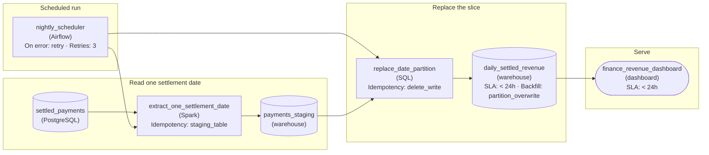
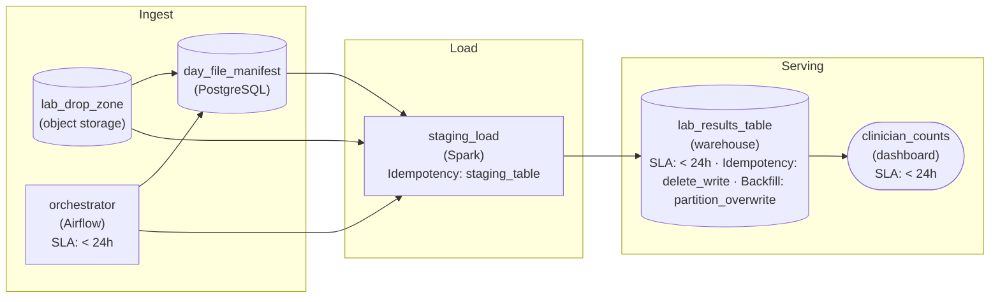

# Idempotency: Advanced - Exercises

Lesson: [pa_pattern_idempotency.md](../pa_pattern_idempotency.md)

### Exercise 1 of 2

**● TASK**

Re-running the nightly settlement load must never move a day's revenue, yet after on-call re-triggered a failed run, the finance team's totals for that settlement date doubled. Today the job reads settled payments using a window counted back from whenever it starts and appends them to a reporting table partitioned by settlement date. Redesign how it reads and writes so a replay of any settlement date, tonight or months from now, lands exactly the same rows, and show how you would prove it.

<details>
<summary><strong>Solution</strong></summary>

#### What the doubled night really was

This is the idempotency proof walkthrough with 2 components broken at once, dressed up as a finance escalation. Everyone spots the append. The trap is fixing only the append. Swap it for a partition replacement but keep the `NOW()`-relative window, and a re-run at 09:40 overwrites the day with a window shifted 7 hours forward: the early settlements drop out and today's get pulled in. The totals stop doubling and start drifting, which is worse, because nobody notices drift until quarter close.

| Trick: Pin the read and the write to the same date |
| --- |
| Idempotency has two halves, and this job breaks both. The read decides which rows a run sees; the write decides what happens to them. A replay is safe only when the run's settlement date fixes the input and the output replaces exactly that date's slice. Fix one half and the other still moves the number. |

#### Walk the requirements

1. **Let the scheduler hand the run its settlement date**

   A filter like `settled_at > NOW() - INTERVAL '24 hours'` makes the input depend on the wall clock, so no 2 runs agree. Replace it with `settlement_date = :run_date`, where `:run_date` is the date the scheduler's run covers. The on-call re-trigger and a backfill for last March pass the same parameter. Key it on the date the processor stamps, never on load time. Because the processor closes a date before the run, the same date reads the same rows forever.

2. **Land the date in staging before touching what finance reads**

   `extract_one_settlement_date` clears `payments_staging` and refills it with that one date. The original job failed after it had already written. Here, a failure touches nothing the dashboard reads, and a retry simply starts from a clean slate.

3. **Replace the date's partition in one transaction**

   `replace_date_partition` deletes the `settlement_date = :run_date` slice of `daily_settled_revenue` and inserts the staged rows, all inside one transaction. Readers see the old day or the new day, never an empty one, and 5 runs leave the same partition as one.

**The swap, for one settlement date**

```sql
BEGIN;

DELETE FROM daily_settled_revenue
WHERE settlement_date = :run_date;

INSERT INTO daily_settled_revenue (payment_id, settlement_date, amount, currency)
SELECT payment_id, settlement_date, amount, currency
FROM payments_staging
WHERE settlement_date = :run_date;

COMMIT;
```

*DELETE-INSERT scoped by `:run_date`: the date owns its slice, and the transaction makes the replacement all or nothing.*

| ✕ MERGE by payment id | ✓ Replace the date's partition |
| --- | --- |
| Idempotent once the input is fixed: a re-run updates the same `payment_id` rows. But it only ever adds or updates. The partitions the old job loaded hold neighbors' rows that its trailing window dragged in, and a `MERGE` backfill leaves every one of them in place. | `DELETE` then `INSERT` for `settlement_date = :run_date` rebuilds the slice from scratch, so the backfill clears out the misfiled rows along the way. It is the default for a table partitioned by date. `MERGE` earns its place when rows have no clean partition to own. |

#### The shape that fits



*The scheduler passes one settlement date to both steps. The extract reads only that date into staging, and the swap replaces exactly that partition of `daily_settled_revenue` in one transaction.*

#### Proving it

4. **Walk every component under a second run**

   Read: bounded by `:run_date`, with no `NOW()` anywhere, and the date is closed before the run, so the input is identical. Write: staging is rebuilt per date and the partition is replaced, never added to. Retry: the scheduler's 3 retries now repeat a safe operation. Then show it: run the same date twice back to back, compare the partition's `COUNT(*)` and `SUM(amount)` to each other and to `settled_payments` for that date, and repeat for a date from last month.

| Interviewer: Name the component that would break, then show it cannot |
| --- |
| Saying 'it's idempotent' is worth nothing here. The strong answer goes node by node and says what a second run does at each one. It starts with the read, because that is the half most candidates never mention. Then it offers a check someone else could run, not a promise. |

| Pitfall: Replacing the partition does not rescue a drifting input |
| --- |
| The moment candidates say 'overwrite the partition', they stop. Suppose the partition is picked from the run date but the rows still come from a trailing window. Then payments settled at 01:00 today land in yesterday's slice, and every re-run at a different hour replaces the day with a different set of rows. |

| Performance: Replacing a day costs one day |
| --- |
| At about 4 million rows and 2 GB per date, the swap rewrites one partition and nothing else. The quarter-long backfill is 90 independent, retry-safe runs. To run them in parallel, give `payments_staging` a `settlement_date` column and clear only the run's own date. Otherwise concurrent runs overwrite each other's staging. |

**Follow-up questions**

1. The processor starts sending corrections for dates it had already closed. What changes?\
   *Tests whether the candidate sees that identical totals only hold for a fixed input. Once a closed date can change, a replay legitimately moves the number, so the design needs a signal that re-runs the affected dates, not a guarantee that nothing moves.*
2. The job also posts the day's revenue to a finance channel when it finishes. What does a re-run do to that?\
   *Tests whether the walkthrough covers effects outside the table. Partition replacement makes the data safe, but a second run still posts a second message unless the notification is keyed to the date and sent once.*
3. Settlements move to a stream of events instead of a nightly table. Where does re-run safety live now?\
   *Tests the batch versus streaming split. There is no partition to replace per run, so safety comes from committing consumer offsets together with the output and deduplicating on `payment_id`.*

</details>


<br>

### Exercise 2 of 2

**● TASK**

The object-storage folder where partner labs drop lab-result files never stops filling, and last night's load died after writing about half of the day's files into the data warehouse. Design the nightly load so that this morning's re-run leaves that day's result counts on the clinicians' dashboard exactly as one clean run would have: no result counted twice, none missed.

<details>
<summary><strong>Solution</strong></summary>

#### What this problem really is

This is idempotency with both halves exposed at once. The crash left a half-written day in the results table, and the folder kept filling while the job sat dead. So the re-run faces a moved input AND a dirty output. Most candidates fix one side. Replace the day but list the folder again, and the re-run quietly counts files that landed at 6am. Pin the file list but append, and the first half of yesterday is counted twice. Either way a clinician's count for yesterday moves on a re-run, which is the one thing the design exists to prevent.

The default reach is 'just rerun the job'. It lists the folder, sees every file there now, and appends what it reads. The 200 files the crashed run already wrote go in a second time, plus 30 that arrived this morning and belong to today. Yesterday's count jumps, and tonight's run counts those 30 again.

| Trick: Freeze the read, replace the write |
| --- |
| A day is a fixed list of files plus a whole-day write. Record which files a day owns once, in `day_file_manifest`, keyed by `run_date`. Every run of that day reads the list, never the folder. Then the write replaces the `run_date` slice of `lab_results_table` instead of adding to it. Same list in, same day out, however many times on-call presses the button. |

#### Walk the re-run

1. **Decide what a day is before reading anything**

   A file belongs to the day it landed. At the day's close, write the names of that day's files into `day_file_manifest` under `run_date`, once. The manifest plays the role an offset plays for a stream: it bounds the read. Without it, 'yesterday's files' means 'whatever the listing returns right now', and that answer changes every minute.

2. **Drive the run from its date, not the clock**

   The `orchestrator` hands each run its scheduled `run_date`. The load looks up its files in the manifest for that date, never through `NOW()` or 'files since the last run'. Re-triggering last night's run this morning gets exactly the list last night would have used.

3. **Swap the day in, never append it**

   `lab_results_table` is partitioned by day. Once staging holds the full list, the write replaces the `run_date` partition: delete the day and write it, or overwrite the partition. The half day the crash left disappears in the same step that lands the complete one, so there is no cleanup script to forget.

#### The shape that fits



*`day_file_manifest` pins what a day reads, `staging_load` loads the whole list, and `lab_results_table` has the day replaced as a unit. A re-run lands the same counts.*

| ✕ List the folder and append | ✓ Pin the list and replace the day |
| --- | --- |
| The re-run reads every file in the folder right now and adds its rows. The crashed half is counted twice, this morning's files are pulled into yesterday, and tonight counts them again. Each re-run moves the number. | The re-run reads the files `day_file_manifest` holds for `run_date` and replaces that day in `lab_results_table`. The crashed half is overwritten, late files stay with their own day, and a tenth re-run matches the first. |

| Performance: A re-run costs one day, not the table |
| --- |
| A day is about 400 files and a few million rows. Replacing the `run_date` partition rewrites that slice and nothing else, and the manifest adds only a few hundred rows a day. Recovery takes as long as one normal night's load. A three-month backfill is 90 independent days that can run side by side, because each owns its own list and partition. |

| Interviewer: Say what the second run reads |
| --- |
| The strong answer walks the re-run out loud. Read: bounded by the manifest for `run_date`, so it cannot see this morning's files. Write: replaces the day, so the crashed half cannot survive. Visibility: staging then swap, so clinicians never see a partial day. Candidates who only say 'overwrite the partition' get the follow-up about files that arrived overnight, and stall. |

| Pitfall: An overwrite cannot rescue a moving input |
| --- |
| Replacing the day feels like the whole fix, so the loader keeps listing the folder. The first re-run looks fine. The next time a day is re-run, the listing includes files from a later day. Those rows land in the wrong day, and the later day counts them too. The write was repeatable; the read was not, and the counts drift anyway. |

**Follow-up questions**

1. A lab sends a corrected file for last Tuesday. How do you get it into Tuesday's count without breaking anything?\
   *Tests whether the candidate treats the manifest as the controlled way to change a day: add the file to Tuesday's list on purpose, then re-run Tuesday, which replaces its partition. The change is recorded, not hidden inside a fresh folder listing.*
2. A parsing bug was live for 3 months. How do you backfill, and can the days run in parallel?\
   *Tests whether the candidate sees that each day is self-contained: its own file list in, its own partition out. Days can run in any order or at the same time, and re-running a failed day is safe.*

</details>
