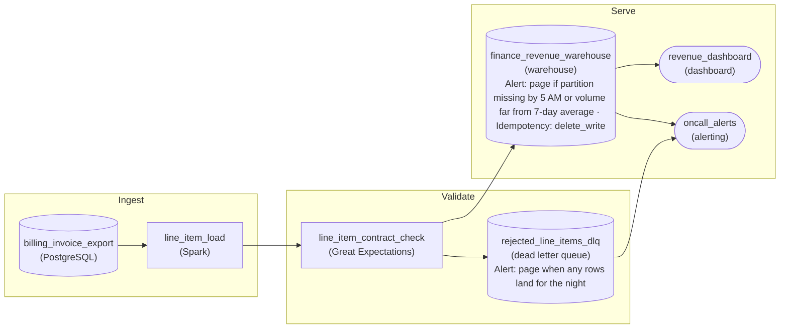
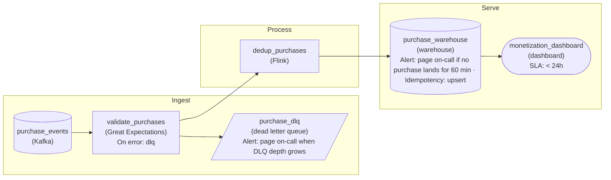

# Make It Reliable: Intermediate - Exercises

Lesson: [pa_pattern_make_it_reliable_intermediate.md](../pa_pattern_make_it_reliable_intermediate.md)

### Exercise 1 of 2

**● TASK**

About 3 million billing-system invoice line items arrive each night, each belonging to one invoice date, and land in a date-partitioned warehouse table that the finance revenue report reads at 7 AM. Design the nightly load so that rerunning any night leaves its revenue unchanged, rows failing validation are held aside for billing to correct rather than reaching the report, and on-call is paged before 7 AM when a night goes wrong.

<strong>Solution</strong>

#### What the incident is really asking

This is the lesson's whole reliability surface wearing a postmortem: an idempotent partition load, a quality gate that diverts failures to a dead letter store, and monitoring that pages before a human reader does. The trap is fixing only the sentence in the writeup. Put a dedup view over the doubled day and the dashboard looks right again, but a half-loaded night still reaches the controller, rejected rows still vanish, and the next surprise is still found by finance. **The interviewer is grading whether you see 3 missing guarantees, not one.**

| Trick: Make the night's partition the unit of truth |
| --- |
| Every night owns exactly one `invoice_date` partition. The load deletes and rewrites that partition inside one transaction, so running it once, twice or 5 times leaves the same rows. Idempotency lives in the write, not in the on-call engineer remembering to clean up first. |

#### Build it in order

1. **Replace the append with a partition rewrite**

   The failed run wrote part of the night, and the rerun appended the full night on top of it. Make the load own its `invoice_date` partition instead: delete that date's rows and write the fresh set in one transaction (`delete_write`), or overwrite the partition outright. The second run then produces the table the first run should have, and billing's corrected re-export of a past day lands through the same door with no special path.

2. **Put the contract check in front of finance**

   The finance-facing table is what the controller signs, so nothing reaches it unchecked. A quality gate sits between the load and the warehouse and tests the contract first (the columns and types billing promised), then the values: an `invoice_id` present, a non-negative `quantity`, a currency billing actually issues. Only rows that pass continue into the partition.

3. **Divert failures, never drop them**

   A rejected row is still revenue someone billed. Route failures to a dead letter store keyed by night, tagged with the rule they broke, so billing can correct them and the night can be rerun. Because the load is idempotent, that replay is the same boring operation as any other rerun.

4. **Page on what the scheduler cannot see**

   The scheduler saw nothing wrong last month: the rerun succeeded. What catches that night is a volume check on the landed partition against its recent average, which a 2x day trips immediately. Add a freshness alert for a partition missing well before 7 AM and a page whenever rows arrive in the dead letter store, all landing in on-call alerting.

| ✕ Append the night | ✓ Rewrite the night's partition |
| --- | --- |
| `INSERT INTO` adds rows every time it runs. A partial failure leaves a fragment and the rerun stacks a full copy on it. Correctness depends on someone cleaning up by hand, at 3 AM. | Delete and write the `invoice_date` partition in one transaction. Any number of runs converge on one copy, a failed run leaves the previous state intact, and a corrected re-export is just another run. |

#### The reference design

*The gate stands between the load and `finance_revenue_warehouse`; failures divert to `rejected_line_items_dlq`; the warehouse rewrites each `invoice_date` partition with `delete_write`, and both stores page on-call.*

| Pitfall: A dedup view hides the double, it does not remove it |
| --- |
| The tempting patch is a `ROW_NUMBER()` over `line_item_id` in the reporting layer. The dashboard turns right while the table stays wrong, and every new consumer (the month-end close, the tax export) has to know to read the view. Deduplication is the right tool when the source sends a row twice; it is the wrong tool for a load that writes the same night twice. |

| Interviewer: Idempotency is the first word, not the last |
| --- |
| Strong candidates open with 'every rerun of a night must produce the same partition' before naming a single tool, then hang the gate, the reject path and the alerts off that guarantee. Weak ones start with the scheduler and add retries, which is exactly what doubled the revenue: a retry of a non-idempotent write is the bug. |

| Performance: Rewriting one night is cheap |
| --- |
| At about 3 million line items and 1.5 GB a night, rewriting a single `invoice_date` partition touches one slice of the table, not its history, so a rerun costs the same as the original load. The gate adds one pass over the night's rows. The expensive thing here was never compute; it was the controller finding the error first. |

**Follow-up questions**

1. Billing starts sending the same `line_item_id` twice inside one night's export. Does the partition rewrite protect you?\
   *Tests whether the candidate separates 2 failure modes: the rewrite makes reruns safe but faithfully copies whatever the export contains, so in-export duplicates need a dedup step keyed on `line_item_id` before the gate.*
2. Two hundred rows sit in the dead letter store and billing has fixed them. How do they reach the numbers?\
   *Tests replay through idempotency: rerun that night's load with the corrected rows included instead of appending the fixes, so the partition converges on one correct copy.*
3. The volume alert fires on the last day of the quarter because invoicing genuinely spikes. What changes?\
   *Tests alert tuning: compare against the same period's seasonality or a known close calendar rather than silencing the check.*

 

### Exercise 2 of 2

**● TASK**

Our mobile app publishes about 2 million in-app purchase events a day onto a message bus that delivers at least once, so a retry can hand us the same purchase twice, and some payloads arrive truncated or missing fields. Design the path from the bus to a warehouse table of per-day purchase totals that stays correct when we reprocess a day, keeps every bad payload where someone can fix and replay it, and pages on-call within the hour if purchases stop arriving.

<strong>Solution</strong>

#### What this really is

This is the lesson's **reliability surface** assembled on a live stream: a quality gate at the front, a dead letter queue beside it, dedup on a stable key, an idempotent load, and monitoring that watches for silence. Every piece is familiar. The trap is that at-least-once delivery attacks the totals from 2 directions at once, and the failure that costs the most makes no noise. A pipeline that only alerts on errors sits green through an afternoon when an app release stopped publishing purchases, and that day's numbers look plausible, just low.

The default design reads the bus, drops anything that fails to parse, sums by day, and appends. Each shortcut breaks a different promise: the parse failures were real sales and are gone, a redelivered purchase adds its amount twice, and the first time someone reprocesses a day to pick up late retries, the day doubles.

| Trick: Guard both ends, then watch for silence |
| --- |
| 2 things go wrong on an at-least-once bus: the same purchase arrives more than once, and some arrive broken. A third goes wrong that nobody sees.  1. Gate every payload on the contract; failures go to a dead letter queue, never the floor. 2. Collapse repeats on `purchase_id`, the id a retry keeps. 3. Load with an upsert so reprocessing a day replaces it. 4. Page on silence: freshness and volume, not just errors. |

#### Walk the requirements

1. **Validate against the contract before anything counts**

   Truncated payloads and missing fields are a contract problem, so the check sits at the front: `validate_purchases` asserts that `purchase_id`, amount, currency and purchase time are present and typed before a record moves on. Content checks (a negative amount, an unknown currency) belong here too. A half-record let through does not fail loudly; a null amount simply vanishes from the sum.

2. **Quarantine bad payloads, never drop them**

   A payload that fails the gate is still somebody's purchase. Send it to `purchase_dlq` and keep the main path draining, so one broken client build cannot stall the day. The DLQ gets its own depth alert, because a queue nobody watches is just a slower way to drop data. Once the cause is fixed, the records replay through the same gate and land in the same totals.

3. **Collapse redeliveries on `purchase_id`**

   Retries resend the same `purchase_id`, so that is the key. `dedup_purchases` remembers the ids it has seen over a window wider than the retry horizon: retries can land a day late, so hold 48 hours, and drop repeats before they reach the table.

4. **Make the load replace, not add**

   Late retries mean a closed day gets reprocessed, and DLQ replays mean yesterday can grow after the fact. `purchase_warehouse` upserts on `purchase_id` and the daily totals are recomputed from that set, so running any day twice produces the same number. The upsert is also the backstop for a repeat that slipped past the stream window, including a DLQ replay of a purchase whose clean retry already landed.

5. **Alert on silence, not only on errors**

   Errors, DLQ depth and failed jobs all require something to happen. A feed that has gone quiet produces none of them. A freshness check on `purchase_warehouse` pages on-call when no purchase has landed for an hour, and a volume check against the same hour last week catches the partial outage where one platform stops and the other keeps going.

#### The shape that fits

*Validate first, divert bad payloads to `purchase_dlq`, collapse redeliveries on `purchase_id`, upsert into the warehouse, and page on-call when the DLQ grows or purchases stop landing.*

| ✕ Drop on parse failure | ✓ Dead letter queue |
| --- | --- |
| The main path stays fast and green. The dropped purchases were real sales, the day's total is short by exactly their amount, and nothing records which ones or why. | The main path stays fast and green as well. Every rejected payload sits in `purchase_dlq` with its reason, its depth pages on-call, and once the client bug is fixed the records replay through the gate into the same totals. |

| Performance: The dedup window is cheap at this volume |
| --- |
| 2 million purchases a day is about 23 a second on average, a few hundred at peak. Holding 48 hours of `purchase_id` values is roughly 4 million keys, a few hundred MB of keyed state at most: small enough to live in the stream processor. The expensive part is recomputing a day's totals on reprocess, and that touches one day, not the table. |

| Interviewer: Silence is the tell of an operator |
| --- |
| Most candidates name validation and dedup. The one who has run a pipeline in production says, unprompted, that the scariest failure produces no error: the feed just stops. Naming freshness and volume checks alongside the DLQ depth alert, and saying which failure each one catches, is what reads as experience. |

| Pitfall: Deduping on the envelope instead of the purchase |
| --- |
| The first version hashes the whole message to find repeats. It works until a client retries with a refreshed `sent_at`, or a truncated message is fixed and replayed from the DLQ: the bytes differ, the hash differs, and the same purchase counts twice. The key has to be the identity the business assigns, `purchase_id`, not the envelope it arrived in. |

**Follow-up questions**

1. A new app release starts sending `amount` in cents instead of dollars. Every payload passes the field checks. What catches it?\
   *Tests the third quality layer: presence and type checks pass, so only a distribution check (average purchase value jumping 100x against last week) flags it, and it should hold the load, not just log.*
2. The DLQ holds 40,000 records from a two-hour client bug, and 30,000 of them were later retried cleanly. What happens when you replay the queue?\
   *Tests that replay runs through the same gate and the upsert on `purchase_id`: the 30,000 collapse onto rows already landed and only the 10,000 genuinely missing purchases add to those days' totals.*

