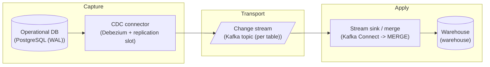
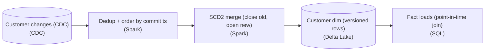
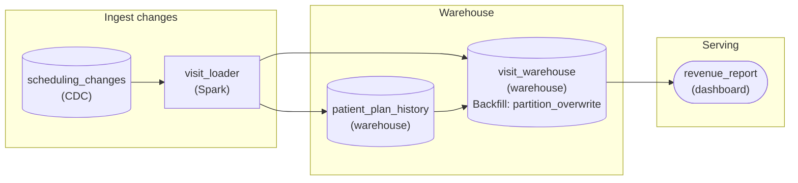
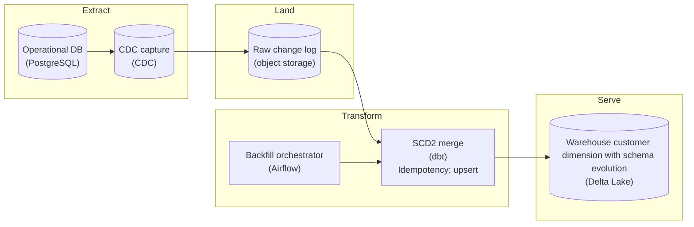

# Keeping Data Fresh: Beginner - Exercises

Lesson: [pipeline_keeping_data_fresh_beginner.md](../pipeline_keeping_data_fresh_beginner.md)

### Exercise 1 of 4

**● TASK**

A nightly job re-copies the entire 500M-row orders table from production Postgres into the warehouse, running for hours and straining the live database even though only a few thousand orders change each day. Orders also get cancelled and hard-deleted, and the table has no reliable last-updated column to scan, so a timestamp-based incremental pull would silently miss both the deletes and the rows that change between 2 runs. Redesign the load to read inserts, updates, and deletes straight from the database's own commit log and carry that change stream onward continuously, so the warehouse stays current without the nightly full reload.

**Starting canvas** (already placed for you):

- Operational DB (source, PostgreSQL)
- Full nightly copy (hours) (transform, Spark)
- Warehouse (storage, Snowflake)

<details>
<summary><strong>Solution</strong></summary>

#### The trap: a full reload dressed up as freshness

Beneath the business story this is Change Data Capture (CDC), the exact pattern the lesson named: instead of re-reading state, you read the database's own commit log and replay its inserts, updates, and deletes downstream. The costume is 'the warehouse feels stale'; the real problem is that a full nightly copy re-ships 500M rows to move a few thousand that actually changed. Everyone reaches for the obvious fix, an incremental pull filtered on a `last_updated` column, and that is the trap. This table has no reliable modified-at, rows get **hard-deleted**, and a `WHERE updated_at > last_run` scan can only ever see rows that still exist and still carry a bumped timestamp. Deletes vanish and any row that changes twice between runs slips through. Get that wrong and the warehouse quietly accumulates orders that were cancelled months ago.

| Key insight: A delete leaves no row to SELECT |
| --- |
| This is why the load has to come off the log, not the table. A timestamp scan reads the table's current state, and a hard-deleted row is absent from current state, so there is nothing for the query to return. Only the commit log records that the row used to exist and is now gone. Deletes are the litmus test that separates a real CDC design from an incremental `SELECT`. |

#### The shape that works



*The nightly full copy becomes a continuous log tail: capture from the WAL, buffer the change stream, apply upserts and deletes into the warehouse.*

1. **Capture from the write-ahead log, not the table**

   Point a CDC connector (Debezium) at a Postgres logical replication slot. It reads the WAL, the same ordered log Postgres already writes for durability and replication, so every `INSERT`, `UPDATE`, and `DELETE` arrives as an event with a before-image and an after-image. Crucially this puts near-zero query load on the live database: you are tailing a log it already produces, not running an hours-long full scan against production tables.

2. **Buffer the change stream in a durable log**

   Land the events on a Kafka topic keyed by primary key. This decouples capture from apply: if the warehouse is slow or down, the connector keeps reading the WAL and Kafka retains the backlog, so you never lose an event or force Postgres to hold WAL forever. The topic is the durable, replayable spine that makes the whole thing a stream instead of a fragile point-to-point pipe.

3. **Apply upserts and deletes into the warehouse**

   A sink consumes the topic and turns each event into a warehouse operation: insert/update become a `MERGE` on primary key, and a delete event becomes an actual delete or a soft-delete flag. Because events are keyed and ordered per key, applying them in offset order converges the warehouse to the source's current state, cancellations included. This is the step the timestamp approach can never do, because it never receives a delete.

4. **Run it continuously, checkpoint the offset**

   The connector persists its WAL position and the sink commits its Kafka offset, so a restart resumes exactly where it left off, no re-scan, no gap. The warehouse trails production by seconds to minutes instead of a day, and the nightly full reload is deleted outright rather than merely shrunk.

| Trick: Let the log be the source of truth |
| --- |
| The insight that cracks this is refusing to re-derive changes from table state at all. The database already computed the exact change set once, when it committed each transaction to the WAL. CDC just reads that log. Every hard problem here, deletes, double-updates, load on production, dissolves the moment you stop querying the table and start replaying its log. |

| ✕ Nightly full + timestamp incremental | ✓ CDC change stream |
| --- | --- |
| Batch. A full `SELECT` (or a `WHERE updated_at > last_run` filter) re-reads current table state on a schedule. Cannot see hard `DELETE`s, misses rows that change twice between runs, and hammers production with a long scan. Freshness capped at the batch interval, here 24h. | Streaming. Tails the WAL, so every `INSERT`/`UPDATE`/`DELETE` is an ordered event with a before-image. Deletes and repeat-updates are first-class, load on the source is negligible, and freshness drops to seconds because there is no window to wait for. |

| Interviewer: Say the word delete before they do |
| --- |
| Plenty of candidates propose 'incremental load on a timestamp' and stop there, satisfied they avoided the full copy. The tell of seniority is naming, unprompted, that a timestamp scan silently drops hard deletes and same-window double-updates, and reaching for the commit log to fix it. If you say `DELETE` out loud before the interviewer asks, you have shown you understand what incremental actually costs. |

| Real world: A dead connector fills the production disk |
| --- |
| A logical replication slot makes Postgres retain WAL until the consumer acknowledges it. If the connector dies and nobody notices, WAL piles up and can fill the production disk, the classic CDC outage. Monitor slot lag, alert on it, and treat the connector as a tier-1 service. This is the operational tax you accept in exchange for never running the full copy again. |

**Follow-up questions**

1. How do you seed the warehouse with the 500M existing rows before the stream takes over?\
   *Tests the snapshot-then-stream handoff: an initial consistent snapshot, then switch to WAL events from the snapshot's log position with no gap or double-count.*
2. The connector was down for 6 hours. What happens, and does the warehouse lose data?\
   *Probes durability: WAL retention via the slot plus Kafka backlog mean events replay from the checkpointed offset on restart.*
3. How do you guarantee correctness if the same event is delivered twice?\
   *Tests idempotency: keyed `MERGE` on primary key plus offset ordering makes reprocessing converge to the same state.*
4. When would a nightly batch load actually be the right call over CDC?\
   *Checks judgment: low freshness needs, no delete tracking required, or a source that exposes no usable log make the streaming machinery unjustified overhead.*

</details>


<br>

### Exercise 2 of 4

**● TASK**

A customer's address changes. The current pipeline overwrites it, so a report run for last quarter now shows the new address and the historical numbers are wrong. Design the dimension load so history is preserved.

**Starting canvas** (already placed for you):

- Customer changes (CDC) (source, CDC)
- Overwrite loader (transform, Spark)
- Customer dim (overwrites) (storage, Snowflake)

<details>
<summary><strong>Solution</strong></summary>

#### What this really is

Strip the costume and this is the lesson's pattern by name: a CDC stream feeding a **slowly changing dimension, Type 2**. The current pipeline is Type 1. It does an in-place `UPDATE` of `address` on `customer_dim`, so the moment a customer moves, every historical fact that points at them reads the new address. Anyone can draw a dimension table. The trap is that preserving history is not one change. It is 2 coupled writes (close the old version, open the new one) plus a join rule on the fact side. Get any one of the 3 wrong and last quarter's report is silently wrong again.

| Trick: A row is a version, not the customer |
| --- |
| Add `effective_from`, `effective_to` and `is_current`, and give each version its own surrogate `customer_sk`. A change never overwrites: you close the open version (`effective_to = change_ts`, `is_current = FALSE`) and insert a new one. History survives because the old row still exists under its own key. |



*CDC feeds an SCD2 merge into a transactional store; facts bind to the `customer_sk` current at the event's timestamp, not to `customer_id`.*

#### Why overwrite loses history

| ✕ Type 1 (today, broken) | ✓ Type 2 (the design) |
| --- | --- |
| One row per `customer_id`. A move updates `address` in place. Facts join on the natural key `customer_id`, so they always resolve to the single surviving row. Nothing ever recorded the old address. | Many rows per `customer_id`, one per version, each with its own `customer_sk` and a `[effective_from, effective_to)` window. A move closes the current version and inserts a new one. Facts carry the `customer_sk` valid at transaction time, so last quarter re-runs correctly. |

1. **Land and order the change stream**

   CDC can deliver duplicates and, across partitions, out of order. Dedup on `(customer_id, commit_ts)` and order by the source commit time, not arrival time. Version in the wrong order and you close the wrong window, leaving overlapping intervals.

2. **Detect a real attribute change**

   Compare the tracked columns against the current version via `row_hash`. If nothing tracked changed, write nothing. This stops a heartbeat update or an untracked-column edit from spawning a spurious version.

3. **Close and open in one statement**

   Closing the current row and inserting the new one must commit together, or a reader between them sees a customer with no current version. A single `MERGE` gives you that atomicity, which is why the store must be transactional.

4. **Bind facts to the point-in-time key**

   The step candidates forget. When a fact loads, resolve `customer_sk` from the version whose window contains the event: `event_ts >= effective_from AND event_ts < effective_to`. Store that key on the fact, and old facts stay pinned to the address true when they happened.

**SCD2 upsert as a single MERGE**

```sql
/* union: the raw changes plus a synthetic row that forces
   the matching current version to be closed */
MERGE INTO customer_dim tgt
USING (
  /* open a new version for every real change */
  SELECT customer_id, customer_id AS merge_key, address, change_ts
  FROM staged_changes
  UNION ALL
  /* close the currently open version of a changed customer */
  SELECT customer_id, NULL AS merge_key, address, change_ts
  FROM staged_changes
) src
ON tgt.customer_id = src.merge_key
AND tgt.is_current = TRUE

WHEN MATCHED AND tgt.row_hash <> sha2(src.address, 256) THEN UPDATE SET
  tgt.effective_to = src.change_ts,
  tgt.is_current   = FALSE

WHEN NOT MATCHED THEN INSERT
  (customer_sk, customer_id, address, row_hash,
   effective_from, effective_to, is_current)
VALUES
  (uuid(), src.customer_id, src.address, sha2(src.address, 256),
   src.change_ts, TIMESTAMP '9999-12-31 00:00:00', TRUE);
```

*Rows keyed by `merge_key` match the open version and close it when the hash differs; the copies with a `NULL` `merge_key` never match, so they fall through to the INSERT and open the new version.*

| Pitfall: 3 ways to lose history anyway |
| --- |
| Joining facts on `customer_id` instead of `customer_sk`, which quietly recreates the Type 1 bug. Closing and opening in separate transactions, leaving no `is_current = TRUE` row for a moment. Stamping `effective_from` with load time instead of the CDC `commit_ts`, so version boundaries drift from when the change really happened. |

| Interviewer: Name the surrogate key and the join together |
| --- |
| A junior answer stops at 'add effective dates'. The senior tell is explaining why the fact must carry `customer_sk` rather than `customer_id`: Type 2 is a contract between the dimension and the facts, not a table trick. |

| Real world: Filter the insert branch to real changes |
| --- |
| As written, the `NULL`-keyed half of the `USING` set inserts a row for every staged change. In production, restrict that branch to customers whose incoming `sha2(address, 256)` differs from the current `row_hash` (or who have no current row), and chain intervals when one `customer_id` changes twice in a batch, so no-op events never spawn duplicate current versions. |

**Follow-up questions**

1. What changes if 2 updates for the same `customer_id` arrive in one batch?\
   *Tests chaining windows inside the batch instead of opening 2 current rows.*
2. A change arrives with a `commit_ts` earlier than the current version's `effective_from`. How do you handle it?\
   *Probes interval maintenance under out-of-order CDC.*
3. How would you answer 'what was this customer's address on 2026-03-31' from the dimension alone?\
   *Confirms they can query by the effective-date window.*
4. Which columns are Type 2 versus Type 1 here, and how do you load a mixed dimension?\
   *Tests that they don't version every column blindly.*

</details>


<br>

### Exercise 3 of 4

**● TASK**

Our warehouse visit totals never go down when the clinic's scheduling database hard-deletes a cancelled appointment, and every visit is credited to the patient's current insurance plan instead of the plan they held on the visit date. Design how the warehouse copy keeps up with those deletes and plan switches from now on, and how the months already reported shed the cancelled visits they still count.

<details>
<summary><strong>Solution</strong></summary>

#### What this really is

This is 3 of the lesson's answers stacked on one visit table. The totals that never shrink are a **CDC** problem: a copy that asks the scheduling database what rows exist, or what changed since a timestamp, cannot see a row that is gone, so a cancelled appointment stays counted forever. The wrong plan is an SCD Type 2 problem: overwrite the patient's plan and every past visit quietly moves to it. The months already published are a backfill problem, because fixing the pipeline from today leaves every old total inflated. Miss any one and revenue is still right to distrust the numbers.

| Trick: A delete is an event, not an absence |
| --- |
| You cannot find a deleted row by looking for it. The only place a hard delete survives is the database's own change log, so the pipeline has to read that log and treat a delete as an instruction to remove the visit from the warehouse. |

#### Walk the requirements

1. **Read deletes from the change log**

   `scheduling_changes` captures every insert, update and delete the scheduling database writes. The `visit_loader` applies each one: a new appointment lands, an update overwrites, a delete removes the visit. This is incremental loading that actually sees cancellations, which a last-updated filter never will.

2. **Keep every plan a patient has held, with dates**

   When a plan change arrives, the loader closes the patient's current row in `patient_plan_history` by setting `valid_to`, then inserts the new plan with a fresh `valid_from`. A visit is credited to the row whose range contains its visit date, so a switch in June leaves March's visits under March's plan.

3. **Re-run the months already reported**

   The fix from step 1 only protects the future. The visit table is partitioned by visit month and carries `partition_overwrite`, so re-running a past month reloads it from the source, which no longer holds the cancelled rows. Overwriting makes the rerun safe to repeat; appending would double the month instead.

#### The shape that fits



*The change log carries deletes into `visit_loader`, plan switches become dated rows in `patient_plan_history`, and `visit_warehouse` overwrites a month's partition whenever a past month is re-run.*

| ✕ Overwrite the plan | ✓ Keep plan history |
| --- | --- |
| One row per patient in the plan table. The day a patient switches, `plan_id` changes and every past visit reports under the new plan. Last quarter's revenue by plan shifts without anyone touching it. | One row per plan per patient, bounded by `valid_from` and `valid_to`. A switch closes one row and opens another, and each visit keeps the plan whose range covers its date. Old reports stay stable. |

| Pitfall: A last-updated filter cannot see a deleted row |
| --- |
| The common first fix is to load rows where `updated_at` is later than the last run. It catches new and edited appointments and still misses every cancellation, because a deleted row has no `updated_at` left to compare. The totals keep growing exactly as before. |

| Performance: The extra state is small next to what it fixes |
| --- |
| The loader now handles 3 kinds of event instead of one, and plan history gains a row per switch. At about 40,000 appointments a month the nightly change set is a few thousand rows, and correcting a past month rewrites one partition, not the whole table. |

| Interviewer: Name the plan as of when |
| --- |
| The tell is a candidate who asks whether the source keeps old plans before promising history. It does not, so plan history starts the day capture starts, and they say so instead of claiming the backfill fixes plan attribution too. |

**Follow-up questions**

1. A patient switched plans a year ago, before `patient_plan_history` existed. Which of their visits can you attribute correctly, and which can't you?\
   *Tests whether the candidate sees that history begins when capture begins: the source only ever held the current plan, so earlier switches are lost unless another system recorded them.*
2. The clinic adds a `referral_source` column to appointments next week. What happens to this pipeline?\
   *Tests schema evolution: an added column is additive and should flow through automatically, while a rename or drop is breaking and needs a migration plan.*
3. The rerun of last March overlaps with tonight's load. What keeps March from being counted twice?\
   *Tests backfill safety: overwriting the month's partition replaces it wholesale, so a rerun is repeatable, and tonight's load writes a different partition.*

</details>


<br>

### Exercise 4 of 4

**● TASK**

The operational PostgreSQL customers table holds 40 million rows, about 200,000 of which change each day with deletes included, and the source team adds a column every few months, so only changed rows may move and a new column must never break the load. Design the pipeline behind the analytics team's warehouse customer dimension so it can say which tier and region a customer held on any past date, and so one corrected day of changes can be reprocessed without reloading the rest or duplicating a version.

**Starting canvas** (already placed for you):

- Operational DB (source, PostgreSQL)

<details>
<summary><strong>Solution</strong></summary>

#### What this really is

Take off the warehouse costume and this is a **CDC-fed SCD2 dimension**: you turn a stream of row-level changes into a versioned history of each customer, not a fresh snapshot of today. The 4 parts the lesson named (CDC, SCD2, schema evolution, backfill) are not 4 stages. Each one depends on the others. The trap is picking the simplest tool at every step: a nightly full reload, an in-place overwrite, a hand-written `ALTER TABLE`, a merge you can only re-run by wiping the table. Any one of those quietly rules out the other three.



*CDC lands only changed rows in a raw log partitioned by `extract_date`. The repeatable merge versions them into a Delta Lake dimension with schema evolution on, so a new source column is added on write. The orchestrator re-drives one partition when a day needs correcting.*

| ✕ Nightly full reload | ✓ CDC plus incremental merge |
| --- | --- |
| `TRUNCATE dim_customer` and re-select the whole source. Cost grows with table size instead of change volume, it scans the operational DB every night, and the truncate throws away every prior version. SCD2 cannot exist under it. | CDC reads the log and emits only rows that changed, deletes included, so merge cost follows change volume. Because the dimension carries history, incremental is not just the faster choice. It is the only choice that keeps that history. |

1. **Land changes before transforming them**

   Append CDC events to the raw log, partitioned by `extract_date`. Do not merge straight from the stream. A day of changes then becomes an immutable partition you can replay without touching the source. Partitioning is what makes backfill cheap later.

2. **Detect real change with `row_hash`**

   CDC fires on no-op writes too. Hash the tracked attributes in `stg_customer_changes` and open a new version only when `d.row_hash <> s.row_hash`. Without the hash, the dimension fills up with versions that differ only by a timestamp, and a replayed day would stack duplicates.

3. **Expire, then insert**

   Close the current row (`effective_to = s.change_ts`, `is_current = FALSE`), then insert the new current version. 2 plain statements are easier to read and audit than one clever `MERGE`, and re-running them over the same partition changes nothing. That is what lets the orchestrator backfill one day safely.

**The SCD2 merge**

```sql
/* 1. Expire the current row wherever a tracked attribute changed */
UPDATE dim_customer d
SET    effective_to = s.change_ts,
       is_current   = FALSE
FROM   stg_customer_changes s
WHERE  d.customer_id = s.customer_id
  AND  d.is_current
  AND  d.row_hash <> s.row_hash;

/* 2. Insert a new current version for brand-new and changed customers */
INSERT INTO dim_customer (
    customer_id, name, tier, region, row_hash,
    effective_from, effective_to, is_current
)
SELECT s.customer_id, s.name, s.tier, s.region, s.row_hash,
       s.change_ts, NULL, TRUE
FROM   stg_customer_changes s
LEFT   JOIN dim_customer d
       ON d.customer_id = s.customer_id AND d.is_current
WHERE  d.customer_id IS NULL          /* never seen this customer */
   OR  d.row_hash <> s.row_hash;       /* or an attribute changed */
```

*Expire changed current rows, then insert a fresh version for new and changed customers.*

| Pitfall: 2 statements need one transaction |
| --- |
| If the job dies between the `UPDATE` and the `INSERT`, a changed customer is left with no `is_current` row. That is why the dimension sits on an ACID table format (Delta Lake): run both statements in one transaction and a crash commits neither. Plain files in object storage cannot give you that guarantee. |

| Pitfall: An in-place update is SCD1 |
| --- |
| `SET tier = 'gold' WHERE customer_id = 42` answers which tier the customer is in now. The warehouse usually asks which tier they were in when they placed an order, and the overwrite has already erased that answer. |

| Key insight: Old versions should stay `NULL` for a new column |
| --- |
| When the source gains a column, a table format with schema evolution turned on adds it on write and the merge selects it by name. Do not pause the pipeline and reload to fill in the past. Older versions never had that attribute, so `NULL` is the accurate history, not a gap. |

| Interviewer: Show how the constraints depend on each other |
| --- |
| Senior candidates link the pieces: the partitioned log makes backfill cheap, the hash makes the merge idempotent, and keeping history rules out a full reload. Candidates who list the 4 terms one at a time sound like they are reciting a glossary. |

**Follow-up questions**

1. How do you handle a hard delete in the operational DB?\
   *Close the current version with `effective_to` instead of deleting it, so the history survives.*
2. 2 changes for one `customer_id` land in the same partition. Which version wins?\
   *Ordering by `change_ts` within each key so versions chain correctly.*
3. What breaks if an `extract_date` partition arrives late?\
   *Whether idempotency and the single `is_current` invariant survive out-of-order replay.*

</details>
