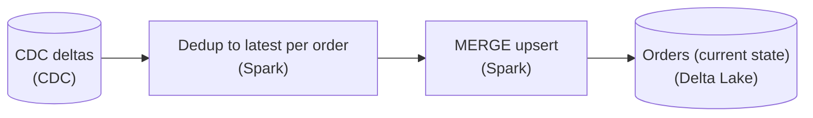
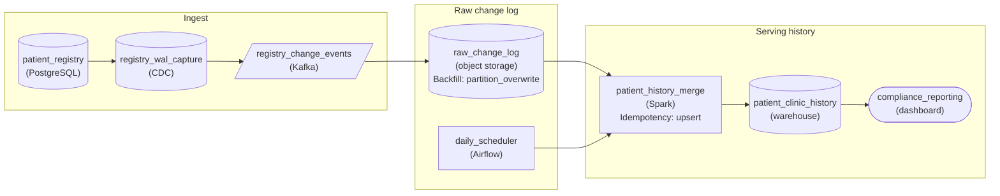
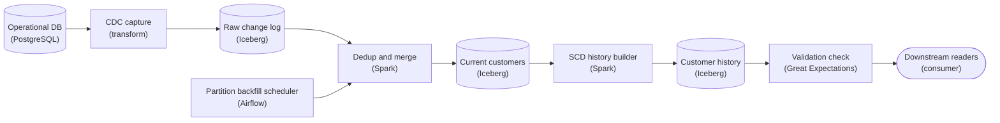

# Keeping Data Fresh: Intermediate - Exercises

Lesson: [pipeline_keeping_data_fresh_intermediate.md](../pipeline_keeping_data_fresh_intermediate.md)

### Exercise 1 of 3

**● TASK**

Finance's daily order totals keep coming in high: each night's CDC changes for orders are only ever appended to the order table, so an edited order sits there twice, its stale version beside the new one. Rework the load so every nightly batch folds into the existing table and the newest version of each order replaces the prior one in place.

**Starting canvas** (already placed for you):

- CDC deltas (source, CDC)
- Append-only loader (transform, Spark)
- Orders (append-only) (storage)

<details>
<summary><strong>Solution</strong></summary>

#### What this actually is

This is a merge-strategy question wearing a duplicate-orders costume. The CDC feed hands you **change events**, and the append-only loader inserts every one, so an order edited on Tuesday now lives twice: the old row and the new row, side by side, both counted in the daily total. A full nightly reload of `orders` would also clear the duplicates, but it rewrites the whole table to apply a sliver of change. The incremental answer is to load only the delta and upsert it on the order's key, so the newest version REPLACES the prior one in place. The trap in this instance is not the `MERGE` itself, it is the batch: one order can be edited twice in a single night, so the delta holds 2 rows for the same `order_id`, and if you feed both to a `MERGE` it either errors on multiple matches or overwrites with whichever version the engine happened to touch last.



*The append-only loader becomes 2 Spark stages: collapse each batch to one row per `order_id`, then `MERGE` it into a Delta Lake `orders` table keyed on `order_id`.*

#### Building the correct load

1. **Collapse the batch to one row per `order_id`**

   Before anything touches the target, rank the night's CDC rows with `ROW_NUMBER() OVER (PARTITION BY order_id ORDER BY change_ts DESC, cdc_seq DESC)` and keep `rn = 1`. This is what makes the `MERGE` legal: a `MERGE` source must have at most one row per join key, and CDC gives you 2 whenever an order is edited twice in the window. The tie-break on `cdc_seq` matters because 2 edits can share a `change_ts` to the second.

2. **`MERGE` the deduped delta into the current-state table**

   Join the deduped delta to `orders` on `order_id`. `WHEN MATCHED` updates the row in place; `WHEN NOT MATCHED` inserts the brand-new order. Guard the update with `src.change_ts >= tgt.change_ts` so a late or replayed batch carrying an OLDER version can never stomp a newer one already landed. That one predicate turns a correct-once load into a correct-every-time load.

3. **Make re-running the batch a no-op**

   Because the target holds one row per order and the update is version-guarded, replaying the same night's batch changes nothing: matched rows fail the `>=` check or write identical values, and unmatched rows are already present. That is idempotency, and it is the property that lets you retry a failed run without hand-deleting rows or inflating the totals a second time.

**Deterministic dedup, then version-guarded MERGE**

```sql
/* Stage 1: keep only the newest CDC row per order in this batch */
CREATE OR REPLACE TEMP VIEW orders_delta AS
SELECT order_id, op, total_amount, status, change_ts
FROM (
    SELECT
        order_id, op, total_amount, status, change_ts,
        ROW_NUMBER() OVER (
            PARTITION BY order_id
            ORDER BY change_ts DESC, cdc_seq DESC
        ) AS rn
    FROM cdc_orders_raw
    WHERE batch_date = CURRENT_DATE
) ranked
WHERE rn = 1;

/* Stage 2: replace each order in place, guarded against stale replays */
MERGE INTO orders AS tgt
USING orders_delta AS src
  ON tgt.order_id = src.order_id
WHEN MATCHED AND src.op = 'DELETE' THEN DELETE
WHEN MATCHED AND src.change_ts >= tgt.change_ts THEN UPDATE SET
    total_amount = src.total_amount,
    status       = src.status,
    change_ts    = src.change_ts
WHEN NOT MATCHED AND src.op <> 'DELETE' THEN INSERT
    (order_id, total_amount, status, change_ts)
    VALUES (src.order_id, src.total_amount, src.status, src.change_ts);
```

*The design the canvas encodes: `ROW_NUMBER()` to one row per order, then an idempotent `MERGE` into the Delta Lake `orders` table.*

| Trick: The `MERGE` is easy; the dedup is the exam |
| --- |
| Everyone reaches for `MERGE` on "replace in place." What separates a passing design is remembering that CDC can emit several changes per key per batch, so you must collapse to `rn = 1` FIRST. Skip it and Delta Lake refuses the `MERGE` because multiple source rows matched the same target row. Engines that don't check silently apply an arbitrary version. |

| Pitfall: Ordering by `change_ts` alone loses same-second edits |
| --- |
| 2 edits to one order inside the same second share a `change_ts`, so `ORDER BY change_ts DESC` picks a non-deterministic winner and your "newest version" is a coin flip. Always carry the change log sequence (`cdc_seq`) as the tie-break. It is the only monotonic thing you actually trust. |

| ✕ Append-only loader (the bug) | ✓ Dedup + MERGE (the fix) |
| --- | --- |
| Every CDC event becomes an `INSERT`. An order edited twice yields 3 rows and `SUM(total_amount)` triple-counts it. Reruns pile on more copies, so the load is not idempotent and totals drift on every retry. | One row per `order_id` survives the batch and `MERGE` overwrites in place. `SUM(total_amount)` sees each order once, and the `change_ts >= tgt.change_ts` guard makes a rerun a no-op. Current state is exact and retries are safe. |

| Interviewer: The version guard is the seniority tell |
| --- |
| A mid-level answer stops at dedup-plus-`MERGE`. The tell an interviewer waits for is the `src.change_ts >= tgt.change_ts` predicate: it proves you thought about out-of-order and replayed batches, not just the happy path. Say the words "late data" out loud: a batch can arrive carrying a version older than what already landed, and this is the line that survives it. |

| Performance: Under 100M rows, a keyed `MERGE` beats a full reload |
| --- |
| A 50M-row `orders` table with a 200K-row nightly delta sits at half the lesson's 100M-row line, where a keyed `MERGE` is straightforward and correct. A full reload would rewrite 250 times more data than changed. Keep the `MERGE` cheap by clustering `orders` on `order_id` (Z-ordering in Delta Lake) so file pruning reads only the files the delta touches. Past 100M rows, switch to replacing the affected date partitions instead. |

**Follow-up questions**

1. The order table grows past a few hundred million rows and the `MERGE` gets slow. What do you change?\
   *Tests the size-based switch from a keyed `MERGE` to deleting and reinserting only the date partitions the delta touches, in one transaction.*
2. How do you handle a CDC `DELETE` for an order that was never loaded?\
   *Tests whether the `WHEN NOT MATCHED` branch correctly ignores deletes rather than inserting a tombstone.*
3. The nightly batch fails halfway and you rerun it. What guarantees the totals don't double?\
   *Idempotency: one row per key plus the version guard make a replay a no-op.*

</details>


<br>

### Exercise 2 of 3

**● TASK**

Asked which clinic a patient belonged to on any past date, our compliance analysts can only get today's answer: the Postgres patient registry holds its 4 million patients as they are right now, and front-desk address corrections, clinic reassignments and deletions of duplicate records all overwrite in place. Design the path from that registry to a new warehouse history table that answers the clinic-on-any-date question, takes changes without adding query load to the registry, and can rerun any single day without leaving duplicate history behind.

<details>
<summary><strong>Solution</strong></summary>

#### Why this problem exists in real interviews

This is a Type 2 slowly changing dimension fed by WAL-based change capture, and the capstone lives in the seam between the two. Anyone can draw a log reader, a queue and a warehouse. The trap is where the dates come from. Stamp `valid_from` with load time and a patient reassigned at 4pm on the 14th still shows the old clinic until the next morning's run; rerun that day and every version moves again. Drop the delete events and a merged-away duplicate stays `is_current` forever, answering audit questions for a patient who no longer exists.

| Trick: 3 sections, one table |
| --- |
| The history is only as good as 3 decisions under it. Capture from the write-ahead log, so deletes and every intermediate edit arrive in commit order at zero query cost. Version on the registry's commit time, so the new row's `valid_from` and the old row's `valid_to` are the same commit instant. Key each version on `patient_id` plus commit time and land raw changes by commit day, so a rerun of any day rewrites the same rows instead of adding new ones. |

#### Walk the requirements

1. **Read the log, not the tables**

   The registry is hot from 7am to 7pm and the DBA will not add load. A log reader tails committed changes the database already writes, so the front desk feels nothing. It is also the only option that sees a delete at all: a deleted duplicate leaves no row for a query to find. Put the events on `registry_change_events` so the warehouse side can fall behind or restart without the capture losing its place.

2. **Land every change by commit day**

   Write the raw events to `raw_change_log`, partitioned by the day the registry committed them, and keep them. That partition is the unit of rerun: a bad day means overwriting one partition and replaying it, never re-extracting from the registry. At roughly 50,000 edits a day, each partition is tiny and cheap to keep for years.

3. **Close the old version, open the new one**

   For each change, `patient_history_merge` ends the patient's current row with `valid_to` set to the commit time and inserts a new current row starting at that same instant. An address fix and a clinic move both version the row; compliance filters on the clinic. A delete event ends the current row and opens nothing, so the duplicate is visible up to the moment it was removed and absent after.

4. **Make the rerun a no-op when nothing changed**

   Key each version on `patient_id` plus the commit timestamp and write it as an upsert. Replaying a day produces the same keys, so the rows are overwritten in place, not appended. Derive the surrogate key from that same pair (a hash) rather than a sequence, or a rerun mints new keys and breaks every downstream join. `daily_scheduler` owns the nightly run and the one-day rerun.

#### The shape that fits



*The log reader takes every committed edit and delete off the registry at no query cost; `raw_change_log` holds them by commit day; `patient_history_merge` upserts dated versions to `patient_clinic_history`, rerunnable one day at a time.*

| ✕ Nightly query of the registry | ✓ Reading the write-ahead log |
| --- | --- |
| A `SELECT` on `updated_at` scans the registry while it is busy, never sees a deleted row, and collapses a patient moved twice in one day to a single change, so the first clinic never existed as far as the history knows. | Every committed insert, update and delete arrives in commit order with its commit timestamp. 2 moves in a day are 2 versions, a delete is an event, and the registry does no extra work. |

| Pitfall: Load time is not when it happened |
| --- |
| The version that ships first sets `valid_from` to `now()` inside the merge. It looks right on day one. Then a load runs late, or a day is rerun 3 weeks later, and every version it touches jumps to the rerun date. Compliance asks where a patient was on the 14th and gets an answer that depends on when the pipeline last ran. Carry the commit timestamp from the log all the way through. |

| Interviewer: Rerunnable is a key, not a flag |
| --- |
| Strong candidates say what makes the rerun safe: a version key of `patient_id` plus commit time, a surrogate key derived from it, and a partition of raw changes to replay. Weak ones say "we make it idempotent" and stop. The follow-up is always "what exactly gets written twice?" |

| Performance: Four million rows is merge territory |
| --- |
| At 4 million patients and about 50,000 edits a day, the history grows by tens of thousands of rows nightly. A keyed merge on the patient is well under the size where you would reach for partition swaps on the dimension itself; the partitioning that matters is on `raw_change_log`, where it makes a one-day rerun a small, isolated job. |

**Follow-up questions**

1. A bad load on the 3rd is found on the 20th, after later days already versioned the same patients. What does rerunning the 3rd have to get right?\
   *Tests whether the candidate sees that a reinserted version must close at the next existing version's `valid_from`, not stay current, so the replay respects versions that already follow it.*
2. The registry team renames `clinic_id` to `home_clinic_id` without warning. What breaks, and where do you absorb it?\
   *Tests schema migration: map the rename at the capture or landing layer so `patient_clinic_history` keeps one stable column, and old change partitions still replay.*

</details>


<br>

### Exercise 3 of 3

**● TASK**

Change events reach us at least once and sometimes out of order, and a corrected day has to be replayable without duplicating a single customer row. From our Postgres change capture, design the pipeline that lands those changes in a transactional table, keeps each customer's attribute history, survives upstream column changes without breaking readers, and reprocesses one partition at a time through a scheduler and a validation check.

**Starting canvas** (already placed for you):

- Operational DB (source, PostgreSQL)
- CDC capture (transform)

<details>
<summary><strong>Solution</strong></summary>

#### 4 hats, one discipline

Strip the freshness costume and this is the whole lesson wearing one discipline: **idempotent writes keyed on identity plus version**. Change data capture dedup, SCD history, schema evolution and partition backfill are 4 places the same question gets asked: if a change event arrives twice, late, or out of order, does the table still land in exactly one correct state? Candidates wire each stage as a happy path and demo it alone; what separates them is seeing where the stages touch.

The trap lives at those seams. A backfill that replays old change events can re-open every closed history row, and a column change that renames the merge key silently turns upserts into inserts. Get either wrong and the customer dimension quietly doubles overnight while every dashboard still reads green. The design below gives ordering, versioning and reprocessing exactly one owner each.



*Change events land append-only, are ordered and merged by `lsn` into a transactional table, are versioned into customer history, then pass validation before any reader sees them. The scheduler re-enters backfills at `Dedup and merge`, never at the readers.*

1. **Order the change stream before you merge**

   Log-based capture delivers at least once, so `Raw change log` is append-only and full of duplicates and out-of-order events. Never merge on arrival order. Dedup by primary key keeping the highest `lsn`, then `MERGE INTO` `Current customers` on that key. That is what makes the pipeline replay-safe: run the same batch twice and the highest-`lsn` winner is identical, so the second merge is a no-op.

2. **Version current state into history**

   The `SCD history builder` reads merged current state and closes and opens rows in `Customer history`. Only when a tracked attribute changes do you stamp the old row's `effective_to` and insert a new row with `is_current = true`. Compare against the current version, never blindly append, or a re-delivered unchanged event spawns a phantom version. Done right, an unchanged record produces zero new rows.

3. **Let the table format absorb column changes**

   Both tables are Iceberg, so an added column lands as nullable with a default and existing readers keep reading the columns they know. The rule on top is backward compatibility: never rename or retype the merge key in place. A rename is a two-phase move: add the new column, dual-write, migrate readers, then retire the old one.

4. **Backfill one partition at a time, behind the check**

   When a day is wrong, the Airflow `Partition backfill scheduler` re-runs `Dedup and merge` for that one partition from `Raw change log`, one task per day, and overwrites the partition atomically rather than deleting rows. Because it re-enters at the merge, it rides the same ordering and history logic as live traffic, so a backfilled day matches a live one. The `Validation check` runs its expectations before readers see the corrected partition.

| Trick: One idempotency key rules all 4 stages |
| --- |
| Every write is keyed on natural key plus a version token. Dedup keys on PK plus `lsn`; history keys on PK plus `effective_from`; backfill keys on partition. Once every stage is a deterministic function of its input keyed this way, re-running any stage, or the whole pipeline, converges to the same table. That one property lets backfill and live traffic share a single code path. |

| Pitfall: A replay must not re-open closed history |
| --- |
| The classic failure: the backfill replays historical change events, the history builder treats them as fresh changes, and re-opens rows you already closed, exploding version history and breaking `is_current` uniqueness. The builder must diff against existing history and no-op on versions it has already seen. If it cannot survive a full replay, it is not idempotent yet. |

| ✕ Dedup on arrival order | ✓ Dedup on lsn |
| --- | --- |
| Taking the last-arrived row per key means a redelivery of an OLD event overwrites newer state. The table flickers backward, and the bug only surfaces under retry storms, so it passes every calm-day demo. | Keeping `MAX(lsn)` per key makes the winner independent of arrival order and delivery count. Re-run the batch, replay the log, or backfill: the merged row is identical. Order-independence is the whole point of change data capture done right. |

| Interviewer: The backfill arrow points at the merge |
| --- |
| The tell of a senior answer is drawing the backfill edge into `Dedup and merge`, not into the readers. Juniors bolt on a second pipeline that writes history directly, then spend the interview reconciling 2 paths that drift. Pointing backfill at the same merge, so it inherits ordering, history and validation for free, signals you have run one of these for real. |

**Follow-up questions**

1. How do you handle a hard delete in the source, where the row vanishes from `Operational DB`?\
   *Tests whether they know capture emits a delete operation and the history builder closes the row with `is_current = false` rather than physically removing history.*
2. A late event arrives with an `lsn` older than a version you have already closed in history. What happens?\
   *Probes out-of-order handling and whether the version diff is robust to non-monotonic arrival.*
3. You need to add a tracked attribute to the dimension. How do you backfill history for it without re-opening every existing row?\
   *Combines schema evolution and partition backfill: an additive column plus a bounded, idempotent reprocess.*

</details>
