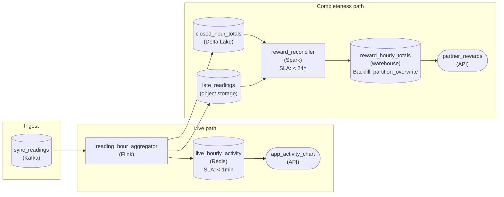
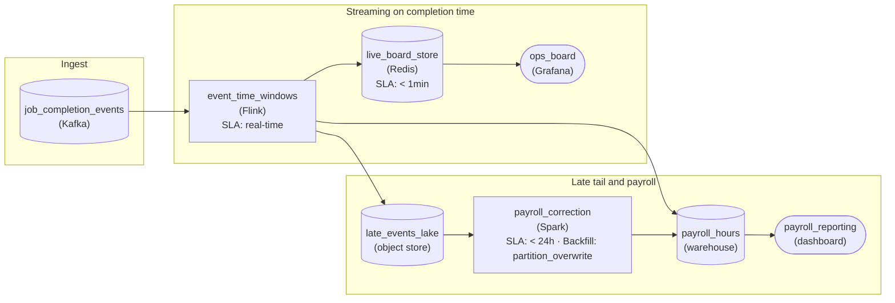

# Late Data and Watermarks: Advanced - Exercises

Lesson: [pa_pattern_late_data_watermarks.md](../pa_pattern_late_data_watermarks.md)

### Exercise 1 of 2

**● TASK**

Step and heart-rate readings sync in bursts, sometimes a full day after they're taken. Today's bucketing by ingest-receipt time breaks analytics: a reading taken at 7am but syncing at 8pm lands in the 8pm hour. Redesign the aggregation to bucket by event time, streaming hourly totals to a live activity chart within a minute, routing late arrivals to durable storage, and running nightly batch reconciliation so monthly rewards eventually count every reading.

<strong>Solution</strong>

#### The design: split the load

Event-time bucketing: readings go into the hour they were taken. Streaming feeds the chart within a minute. Late readings route to durable storage. Batch reconciliation runs nightly.

#### Why this pattern works

| Key insight: One grace period cannot serve both needs |
| --- |
| Charts and rewards tolerate different lateness. A single grace period forces a trade-off: stretch it and stream state balloons; tighten it and late readings never reach rewards. This design decouples: stream routes overdue data to storage; batch reads both sources and folds by hour. |

#### The shape that fits

*Event-time bucketing feeds 2 paths: live chart within a minute, batch reconciliation by true hour before payout.*

| Pitfall: Never drop late data |
| --- |
| Route late data to durable storage. Never let it vanish. |

**Follow-up questions**

1. If a reading syncs after rewards are paid, how does it count?\
   *Partition overwrite.*
2. If a partition goes idle, what happens to watermarks?\
   *Idle source handling.*

 

### Exercise 2 of 2

**● TASK**

Most of our technicians' job-completion events upload within a few minutes, but phones working in basements and rural sites hold them offline until signal returns, sometimes a full day later. Design the pipeline that keeps the operations board showing hourly completions current within a minute, routing late-arriving events to an object store so payroll can fold them back under the hour the work was done, with no job missed or counted twice.

<strong>Solution</strong>

#### What this problem really is

This is late data and watermarks with two consumers who want opposite things from the same watermark. The board wants each hour closed within minutes; payroll wants it closed only after the last basement phone has synced, a day or more later. Nearly everyone gets event time right, because the prompt all but says it. The trap is choosing **one watermark for both**. Size it for the 26-hour straggler and the board freezes a day behind. Size it for the ten-minute upload and every offline job is either dropped or, if the design leans on arrival time, paid for a shift nobody worked.

The resolution is to stop asking the watermark to be the payroll deadline. A tight watermark serves the board, a short grace period absorbs ordinary stragglers, the offline tail leaves through a side output, and a daily reconciliation folds that tail into payroll under the hour the work happened.

#### Build it in order

1. **Key every hour on the completion timestamp**

   The phone stamps the moment the job closes. That value never changes across retries, which is exactly why it is the only honest key. Upload time and broker time move every time a technician walks out of a basement, so an aggregation keyed on either credits Tuesday's work to Wednesday.

2. **Size the watermark to the online population**

   99 percent of completions land within ten minutes. Bound the out-of-orderness to that, not to the offline tail, and the board's hours close a few minutes after they end. Letting the slowest devices set the watermark is how a handful of rural phones hold the whole board hostage.

3. **Grace period for stragglers, side output for the tail**

   Allowed lateness of a few minutes lets a slightly late completion update its hour on the board. Anything later than that goes out of `event_time_windows` as a side output into `late_events_lake`, not onto the floor. The board stays provisional by design; operations staffs the current shift and does not care that yesterday's 2pm count gains 3 jobs tomorrow.

4. **Reconcile payroll by rewriting the hour**

   `payroll_correction` runs daily, reads the side output, and rewrites each affected hour in `payroll_hours` from its on-time total plus the late arrivals, deduplicated on `job_id`. Overwriting the hour partition instead of appending means a rerun, or a phone that resent the same completion, cannot credit a job twice. Payroll locks two days after the day ends, well past the 26-hour tail.

#### The reference design

*`event_time_windows` closes hours on a tight watermark for `ops_board`; the offline tail leaves as a side output to `late_events_lake`, and `payroll_correction` rewrites each affected hour in `payroll_hours`.*

| ✕ One watermark sized for payroll | ✓ Tight watermark plus side output |
| --- | --- |
| Out-of-orderness set to 26 hours so nothing is late. Payroll is exact, but no hour on the board closes until the next afternoon, and the stream holds a day of open state for 15,000 technicians. | Out-of-orderness set to ten minutes. The board closes hours minutes after they end; the 1 percent that arrive later exit to `late_events_lake` and reach payroll through `payroll_correction` before the two-day lock. |

| Trick: The watermark is not the payroll deadline |
| --- |
| The watermark decides when the board commits. Payroll's completeness comes from the side output plus reconciliation. Once those are separate, each gets the latency it actually needs. |

| Pitfall: Dropping late events looks like working |
| --- |
| Streaming frameworks discard records behind the watermark by default. The board looks fine, the test data has no offline phones, and the first sign of trouble is a technician asking why a rural job never got paid. |

| Interviewer: Say where the offline jobs land |
| --- |
| Strong candidates trace a single day-late completion end to end without being asked: past the watermark, out through the side output into `late_events_lake`, rewritten into its original hour in `payroll_hours`, deduplicated on `job_id`. |

| Performance: The expensive part is the small part |
| --- |
| At 120,000 jobs a day, the side output carries roughly 1,200 records. The daily correction reads a tiny slice of `late_events_lake` and overwrites only the hours those records touch, while the stream keeps minutes of state instead of a day's. |

**Follow-up questions**

1. A batch of phones has clocks drifted several hours ahead. What happens to the watermark, and how do you contain it?\
   *Tests whether the candidate sees that future timestamps can drag a watermark forward and make on-time events look late, and reaches for clamping or per-source bounds.*
2. Payroll moves its lock from two days to 12 hours. What breaks, and what do you change?\
   *Tests whether the candidate notices the 26-hour tail now outlives the deadline, and names the tradeoff: a later correction cycle, provisional pay with adjustments, or a payroll policy change.*
3. Operations now wants the board's past hours to reflect late arrivals too. Where does that correction flow?\
   *Tests whether the candidate can route the reconciled hours back into `live_board_store`, or explain why a longer allowed lateness on the live path is the cheaper lever.*

