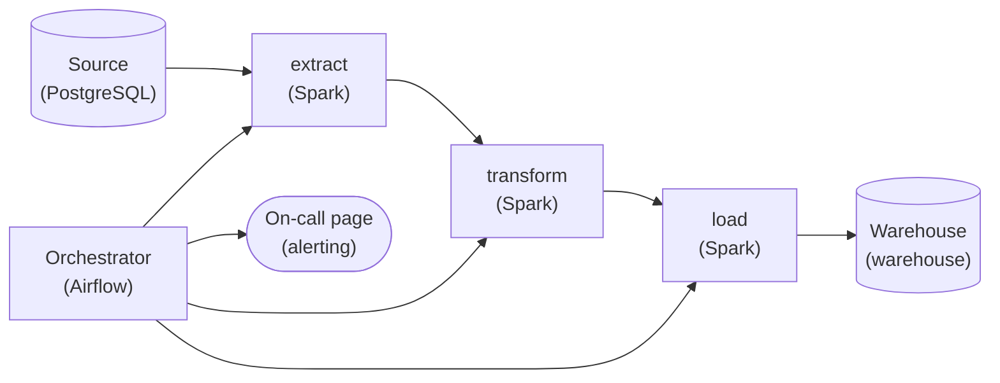
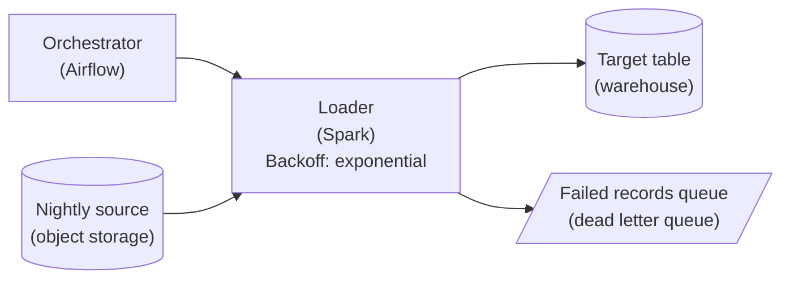
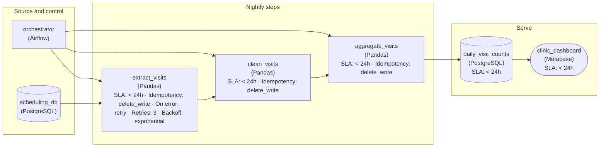
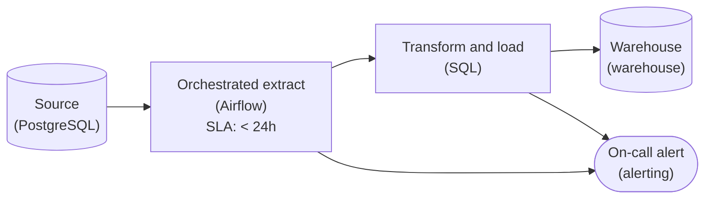

# Making It Repeatable: Beginner - Exercises

Lesson: [pipeline_making_it_repeatable_beginner.md](../pipeline_making_it_repeatable_beginner.md)

### Exercise 1 of 4

**● TASK**

Three jobs (extract, transform, then load into the warehouse) each fire on their own cron, so when extract runs late the transform quietly reads yesterday's data and the warehouse ships stale numbers. Redesign the flow so each step starts only after the one before it has finished, and so a run that misses its daily deadline pages on-call instead of failing silently.

**Starting canvas** (already placed for you):

- Source (source, PostgreSQL)
- Extract (cron) (transform, Spark)
- Transform (cron) (transform, Spark)
- Warehouse (storage, Snowflake)

<strong>Solution</strong>

Strip the costume: this is not a data-quality bug, it is a **race condition** between three schedulers that have never been introduced to each other. Time-based `cron` says 'run `transform` at 02:00' and hopes `extract` finished first. Hope is not a dependency. This is DAG orchestration wearing an ETL-freshness disguise, and the trap is that everyone's instinct is to widen the gap between crons. That is the one move that never converges: the day `extract` runs 40 minutes late, `transform` still reads yesterday's partition and the warehouse ships stale numbers with a green checkmark.

#### Why staggering the crons never closes the gap

Each job's runtime is a distribution, not a constant. Pick a fixed offset big enough for the slowest `extract`, and on a normal day you burn hours of latency for nothing; on the bad day the source is slow, the distributions overlap, and your buffer is gone. Worse, nothing tells you the bet failed: the three jobs succeed independently, so the pipeline is green while the answer is wrong. You need `transform` to start because `extract` finished, not because a clock ticked.

| ✕ Time-triggered (cron) | ✓ Completion-triggered (DAG) |
| --- | --- |
| Three crons, three independent clocks. `transform` fires at a fixed time and reads whatever partition exists. A late `extract` is invisible downstream; failure is silent and the warehouse looks fresh. Tuning means guessing a bigger offset. | One DAG keyed by `execution_date`. `extract >> transform >> load`: each task starts only on upstream success, so a slow `extract` simply delays the run instead of corrupting it. A deadline on the whole run turns 'late' into a page, not a guess. |

#### The redesign

*One Airflow DAG schedules the chained tasks, each starting on upstream success, and pages on-call when the daily deadline is missed.*

1. **Bind the three jobs into one `execution_date`-keyed DAG**

   Replace the three crons with a single scheduled DAG and wire the dependency: `extract >> transform >> load`. Now `transform` cannot start until `extract` reports success for the same `execution_date`, so a slow `extract` delays the run instead of feeding `transform` yesterday's partition. The whole day is one logical unit with one run id, which is what lets the orchestrator show you the state of the entire pipeline at a glance.

2. **Let a failure stop the chain, not corrupt it**

   When `transform` fails, `load` does not run: Airflow marks it upstream failed, so the warehouse keeps yesterday's clearly dated numbers instead of half-built ones. Give each task a small number of retries so a transient PostgreSQL hiccup heals on its own; when it does not, on-call fixes the failed task and re-runs it, and the DAG picks up from that point rather than from the beginning.

3. **Put the deadline on the run and make a miss page on-call**

   Declare a deadline for the batch (say, warehouse fresh by 06:00) on the DAG and attach an `sla_miss_callback` that fires the on-call alert. The clock covers the end-to-end run, not one task, so a run where every task succeeds but retries eat the morning still surfaces as a page instead of a quiet late refresh.

| Trick: Trigger on completion, alert on the deadline |
| --- |
| The whole problem collapses once you separate 2 concerns cron fuses together: **ordering** and timeliness. The DAG's `>>` edges give you ordering (start on upstream success); a deadline on the run gives you timeliness (page when the end-to-end run is late). Cron pretended a single clock could do both, and did neither. |

| Pitfall: Failure alerts alone miss the slow green run |
| --- |
| Candidates wire `extract >> transform >> load`, add an on-failure alert, and stop. But the incident in this prompt is not a failure: every job succeeded, just late. Only a deadline on the whole run catches a pipeline that is healthy task by task and still misses the morning. |

| Interviewer: Naming what cron cannot do is the answer |
| --- |
| Asked 'why not just use cron?', the strong answer is precise: cron can schedule a job, but it cannot manage dependencies between jobs, retry a failed task, or show the state of the whole pipeline at a glance. Name all three, then point at the stale-data incident as the cost of the first. |

| Real world: Green pipelines that ship the wrong number |
| --- |
| The expensive incidents are rarely red pipelines; they are green ones serving stale data to a dashboard an exec trusts. A completion-triggered DAG plus an end-to-end deadline converts 'silently wrong' into 'loudly late', and 'loudly late at 06:00' is a page you can act on before the morning numbers go out. |

**Follow-up questions**

1. The `transform` step now takes 3 hours and keeps blowing the 06:00 deadline. What do you change before you move the deadline?\
   *Tests whether they look at the slow task rather than hiding the problem by relaxing the deadline.*
2. `transform` fails at 03:00 and you fix the bug at 09:00. What state is `load` in, and where does the re-run start?\
   *Tests that downstream tasks are marked upstream failed and the re-run resumes from the failed task, not from `extract`.*
3. Another team's DAG now needs this warehouse table before it can start. How do you express a dependency that crosses 2 DAGs?\
   *Probes the DAG of DAGs problem: cross-DAG dependencies are harder than dependencies inside one DAG.*

 

### Exercise 2 of 4

**● TASK**

The nightly load into the warehouse has no real recovery plan: a brief network blip kills the task halfway, and the next morning an engineer reruns the whole job by hand. Put the load under a scheduler that owns the run and retries a failed task on its own with growing gaps between attempts, instead of waiting for a person. And because one malformed record currently fails every retry forever, send those repeatedly-failing records aside for review so they stop stalling the load.

**Starting canvas** (already placed for you):

- Nightly source (source, S3)
- Loader (transform, Spark)
- Target table (storage, Snowflake)

<strong>Solution</strong>

#### The trap: 2 failures that look the same and aren't

This is safe retries dressed up as a nightly load. Beneath the business words there are exactly 2 ways this job dies, and the whole problem is refusing to treat them alike. A network blip is **transient**: nothing is wrong with your data, the world will be fine in 30 seconds, so the right move is to retry the task. A malformed record is permanent: it will fail identically on attempt 1 and attempt 1,000, so retrying it is an infinite loop that starves every good record behind it. Anyone can bolt `retries=3` onto a task. The skill probed is seeing that retry cures the first failure and poisons the second, then wiring a scheduler that applies each remedy to the right one.

Get this wrong and you fail in one of 2 loud ways. Retry the poison record and the job never drains: the same 3 a.m. page every night on the same one bad row. Send the network blip to the side and you silently drop a good night's data. The starter pipeline (source to `Spark` loader to warehouse table) has neither guard, which is why a human is the recovery plan.

*The scheduler owns the run and retries the `Loader` with exponential backoff; records that fail every attempt go to a dead letter queue instead of stalling the load.*

#### How a strong answer builds it

1. **Give the run an owner, not a person**

   Put the load under an orchestrator (Airflow, or any scheduler that persists task state). The DAG owns 'did tonight's run succeed?' as durable state, so a mid-task death is a task the scheduler knows has failed and can act on, not a silence a human notices at 9 a.m. That is the difference between a script and a pipeline: the run's status lives somewhere the machine can query.

2. **Retry the transient failure with growing gaps**

   On the `Loader` task set bounded retries with exponential backoff, for example 3 attempts at 1 minute, 5 minutes and 30 minutes, with a little jitter. Backoff matters because the thing that failed you (the network, the warehouse) is often recovering, and hammering it every second delays its recovery and yours.

3. **Make the retry safe to run twice**

   A retry reruns the whole task, so if the first attempt half-loaded the batch before the blip, attempt 2 must not double-insert. Load idempotently: `MERGE` on a business key, or overwrite the run date's partition rather than appending. Without this, 'retry on failure' quietly becomes 'duplicate rows on every network hiccup'.

4. **Set the poison record aside instead of dying on it**

   Catch the per-record failure instead of throwing it. Write the offending record plus its error to a dead letter queue and keep processing the rest of the batch. The load finishes, the bad rows wait for a human on their schedule, and one broken record can no longer stall the other million.

| Pitfall: A blanket retry turns a poison pill into an outage |
| --- |
| The most common wrong answer wraps the entire batch in `retries` and stops there. That fixes the network blip, and it converts the one malformed record into a job that fails, retries, fails identically, and exhausts every attempt, every night. Retry count is a ceiling on transient failures, never a cure for permanent ones. |

| ✕ Retry (transient) | ✓ Set aside (permanent) |
| --- | --- |
| Failures that fix themselves: a dropped connection, a throttled warehouse, a brief storage 503. Same input, different outcome next time. Bounded `retries` with exponential backoff, and an idempotent load so rerunning cannot duplicate. | Failures that never fix themselves: a row that won't parse, a schema violation. Same input, same failure forever. Catch it per record, send it to the dead letter queue with its error, continue the batch. Retrying here is an infinite loop. |

| Interviewer: Naming idempotency before you're asked |
| --- |
| A junior says 'add retries.' A senior says 'add retries with backoff, and because the retry replays the whole task I'll load with `MERGE` so a half-finished attempt can't double-count, and bad records go to a dead letter queue.' Linking retry to correctness is the signal the interviewer listens for. |

| Real world: The dead letter queue is one you must actually drain |
| --- |
| A failed-records queue is not fire-and-forget. It needs an alert on depth (a sudden spike usually means an upstream schema change, not scattered bad rows) and a person or backfill process that reprocesses or discards. A queue nobody watches is just a slower data-loss bug. |

| Performance: Cap the retries so a real outage fails loudly |
| --- |
| Backoff is bounded on purpose. 3 attempts at 1, 5 and 30 minutes spends about half an hour riding out a blip, then gives up and pages the on-call. Unbounded retries mean that when the warehouse is down for hours the task sits 'running' and hides the incident instead of surfacing it. |

**Follow-up questions**

1. The nightly file is late one night and the run fires before it lands. How do you keep that from counting as a failure?\
   *Tests whether they wait on data availability rather than burning retries on an input that has not arrived.*
2. 10% of tonight's rows land in the dead letter queue because upstream changed a column type. What should the pipeline do differently than on a normal night?\
   *Tests queue-depth alerting and the instinct to stop the load, versus quietly setting aside a tenth of the data.*
3. The retry succeeds on attempt three, but attempt one had already written half the batch. Show why the target still has correct counts.\
   *Forces a concrete idempotency mechanism (`MERGE` key or partition overwrite), not just a claim that the load is safe.*

 

### Exercise 3 of 4

**● TASK**

A clinic network's nightly patient-visit rollup is three crontab entries an hour apart: extract from the scheduling database, clean, then aggregate into daily visit counts. When extract runs long, aggregate still fires on half-loaded data and the counts come out low. Make each step wait for the one before it to succeed, and let a brief connection drop to the scheduling database clear up without anyone stepping in. When a step truly fails, the on-call engineer re-runs from that step, not from extract, and the visit counts must match a clean night.

<strong>Solution</strong>

#### What this really is

This is **DAG orchestration** dressed up as a crontab cleanup. The three jobs already have an order; cron just never knew it, so the only thing keeping extract, clean and aggregate apart is a guess about how long each one takes. Anyone will say 'put it in Airflow.' What separates answers is the second half of the question: what the night looks like after a step fails. Widen the cron gaps and you only move the half-loaded morning to a slower night. Bolt retries onto steps that append and a single recovered blip counts every visit twice.

| Trick: Finished, not scheduled, is the trigger |
| --- |
| Three moves, each from a different section of the lesson:  1. Dependencies are edges: `clean_visits` starts when `extract_visits` succeeds, not at 2am. 2. A transient failure retries with exponential backoff before a human gets involved. 3. Every step replaces its night's output instead of adding to it, so a retry or a manual re-run from the failed step lands the same counts as a clean night. |

#### Walk the requirements

1. **Replace the clock with edges**

   The crontab encodes an order the scheduler cannot see. Move the three steps into one orchestrator-owned workflow where `extract_visits`, `clean_visits` and `aggregate_visits` are joined by edges. The only thing scheduled is the start of the run; every later step begins the moment its upstream succeeds, whether extract took 20 minutes or 2 hours.

2. **Let a failure stop the chain**

   With edges, a failed `clean_visits` means `aggregate_visits` never starts: it is waiting on a success that did not happen. That is exactly what the managers want. A missing number on the dashboard gets a question at 8am; a low number gets believed and quoted. Cron cannot give you this at any spacing, because it never knew clean existed.

3. **Retry the blip, with growing waits**

   The scheduling database dropping a connection a few times a week is the textbook transient failure. Put a retry policy on `extract_visits`: a few attempts, each waiting longer than the last. A two-minute blip clears on the second or third try, and a database that is genuinely down does not get hammered by instant retries.

4. **Make every step safe to run twice**

   A retry and an on-call re-run both mean running a step a second time. If `clean_visits` or `aggregate_visits` appends, the second run adds the night's visits again. Give each writing step a '`delete_write`' strategy scoped to the night being processed, and 'run it again' becomes a safe instruction. That is what lets the on-call resume from the failed step instead of re-extracting from scratch.

#### The shape that fits

*One start time, then success-driven edges: `extract_visits` retries its own blips, and every step replaces its night's output so a re-run from the failed step is safe.*

| ✕ Three crontab entries | ✓ One orchestrated workflow |
| --- | --- |
| Start times are guesses: extract at 1am, clean at 2am, aggregate at 3am. A slow extract means aggregate reads half a night. A failure anywhere is silent, and the next job fires anyway. Recovery means re-running everything by hand, in order, hoping nothing appends twice. | One start time; everything after it follows success. A failed step holds back only what depends on it. `extract_visits` retries its own blips. Each step replaces its night's rows, so the on-call resumes at the failed step and the counts match a clean night. |

| Pitfall: Retries on an append double the night |
| --- |
| The most common answer adds a `retryCount` and stops. It looks complete on the canvas, and it is worse than cron on the night extract dies at 90% loaded: the retry loads the whole night again and `clean_visits` sees most visits twice. Retries are only safe on top of writes that replace, which is why the lesson teaches the 2 together. |

| Interviewer: The re-run is the real question |
| --- |
| Every candidate draws the arrows. The follow-up that sorts them is 'clean failed at 3am, what does the on-call do?' The strong answer: fix the cause, re-run `clean_visits`, and let `aggregate_visits` follow on its own. No re-extract, because that night's extract output is still there, and every write replaces rather than adds. |

| Real world: Why the clock looked like it worked |
| --- |
| Cron gaps survive for months because extract usually finishes in 40 minutes, well inside its hour. The failure only shows on the slow nights, and it shows as numbers that are plausible but low, which is the worst kind of wrong: nobody notices until a manager asks. |

**Follow-up questions**

1. The scheduling system stops allowing a direct connection and instead drops a nightly export file at an unpredictable time. How does the workflow know when to start?\
   *Tests sensors from the dependency section: the run waits on a signal (the file exists) rather than a start time, the same move as the edges, one level up.*
2. A change to the cleaning rules ships next week. How do you know it will not drop visits before it touches the real counts?\
   *Tests environments and CI: run the change against a recent snapshot in staging and compare its counts with production before release.*

 

### Exercise 4 of 4

**● TASK**

How would you make the daily PostgreSQL-to-warehouse pipeline repeatable, with each step starting only after the step it depends on has succeeded? The on-call engineer who owns it wants to be paged whenever a step fails or misses its daily SLA.

**Starting canvas** (already placed for you):

- Source (source, PostgreSQL)
- Orchestrated extract (transform, Airflow)

<strong>Solution</strong>

#### What this really is

This is DAG orchestration wearing a "just run it every morning" costume. The pattern the lesson taught is dependency-ordered scheduling: each step fires because the step it needs has **finished and succeeded**, not because a clock struck a time you hoped was late enough. The trap here is exactly that clock reflex: wire the extract to 2am, wire the load to 3am, and hope the extract is done. The day the source is slow, the load reads yesterday's data or a half-finished extract, lands it in the warehouse, and nobody pages. Repeatable means the pipeline notices that itself.

*Each edge is a dependency the orchestrator enforces, not a time you scheduled. Both tasks route a failure or an SLA miss to the on-call alert.*

#### Why this shape

1. **Make `Transform and load` depend on the extract, not on a clock**

   The edge from `Orchestrated extract` to `Transform and load` is the whole point. Inside the same Airflow DAG, the load has an upstream dependency on the extract, so the scheduler releases it only when the extract's state is `success`. Delete that edge and schedule both by time, and you have 2 independent jobs that happen to run near each other. That is the failure the question asks you to design out.

2. **Wait for a complete day before extracting**

   The extract has an upstream of its own: the source's day must be closed. If another pipeline fills that day, a sensor on the extract polls for the signal (the day's rows committed, the partition populated) before it reads. Downstream then only ever sees complete input, and a late source delays the run instead of corrupting it.

3. **Write the warehouse idempotently, keyed on the run date**

   The day's output lands in the `Warehouse` as a delete-then-insert (or `MERGE`) scoped to that run date, never a blind `INSERT`. A retry of a load that half-ran the first time therefore does not double-count. Repeatable is a property of the write, not only of the schedule: running today's task twice must leave the warehouse identical to running it once.

4. **Give each task bounded retries before it counts as failed**

   Each task gets `retries` with exponential backoff for the transient case, such as a source blip or a warehouse timeout. Because step 3 made the write idempotent, a retry has no side effects. The retry budget keeps a five-second network hiccup from waking a human at 3am, and it works only because the step it protects is safe to repeat.

5. **Page on failure AND on SLA miss, not just on exceptions**

   Both task nodes carry an edge to `On-call alert`, and 2 distinct triggers feed it. A task that exhausts its retries fires an on-failure callback. A run that has not reached `success` by the freshness deadline trips an SLA miss: that is the starter's `< 24h` target. A pipeline that alerts only on thrown exceptions goes silently stale the day a task just hangs.

| Trick: The edge is the dependency |
| --- |
| The one move that cracks this: in a DAG, the arrow between `Orchestrated extract` and `Transform and load` IS the ordering guarantee. You never write "wait 20 minutes" or "run at 3am". You declare the edge and let the scheduler hold the downstream task until the upstream's state is `success`. The retries, the idempotent write and the SLA all hang off getting that one idea right. |

| Pitfall: Retries without idempotency inflate the day |
| --- |
| The most common half-right answer adds `retries` but writes the warehouse with a plain `INSERT`. Attempt one inserts half the rows and fails; attempt 2 succeeds and inserts all of them. The daily total is inflated, and no error is ever raised. Retries are safe only on top of the run-date-keyed write from step 3. |

| ✕ Clock-scheduled (the trap) | ✓ Dependency-triggered (the answer) |
| --- | --- |
| Extract at 2am, `Transform and load` at 3am, as 2 independent schedules. This works until the extract runs 70 minutes; then the load reads a half-finished extract and writes it to the `Warehouse`. There is no dependency, so there is no failure signal. | `Transform and load` declares an upstream edge on the extract. A slow extract simply delays the load, which still reads the complete day. If the extract never finishes, the load never starts, and the `< 24h` SLA miss pages on-call. |

| Interviewer: What signals seniority here |
| --- |
| The tell is whether you alert on the SLA miss separately from the exception. Junior designs page on `raise`; the freshness deadline against `< 24h` catches the far nastier case, a task that is stuck rather than crashed. Mentioning idempotent re-runs unprompted is the second tell. |

**Follow-up questions**

1. The source drops yesterday's rows late, after today's run already loaded the `Warehouse`. How does a re-run fix that day without manual cleanup?\
   *Tests whether the run-date-keyed idempotent write turns a backfill into a plain re-run of one day.*
2. Every retry of the load re-reads the production database. Where would you keep the extracted day so that a re-run replays it instead of re-fetching it?\
   *Probes landing raw data in object storage between extract and load as the next step toward safe replay.*
3. The extract succeeds but lands zero rows. Should that page on-call, and where do you put the check?\
   *Probes a data-quality check as its own task edge, versus treating empty output as success.*
4. You now need this hourly instead of daily. What in the DAG changes, and what stays exactly the same?\
   *Tests whether the candidate sees the schedule interval and the partition granularity as the only knobs, with dependency ordering and idempotency untouched.*

