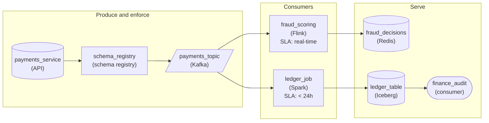
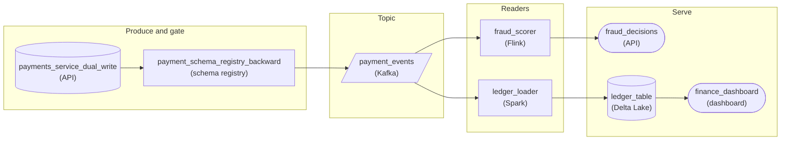

# Schema Evolution: Advanced - Exercises

Lesson: [pa_pattern_schema_evolution.md](../pa_pattern_schema_evolution.md)

### Exercise 1 of 2

**● TASK**

A payments topic has two readers: a daily finance ledger job and a fraud-scoring consumer that scores each payment within seconds. The payments team is changing that topic's `amount` field from string to decimal, and every schema published to it is checked against full compatibility, a guarantee that stays on through this change. Design how the change reaches production so neither consumer breaks mid-migration and the ledger table auditors query picks up the decimal amount without its history being rewritten.

<strong>Solution</strong>

#### What this really is

This is expand-contract under a guarantee you are not allowed to touch. String to decimal is not a widening: to the registry it is a different type, so a subject held to full compatibility rejects the in-place edit, correctly. Everyone knows what the new type should be. What separates candidates is whether they keep the check on and route the change around it: add `amount_decimal` beside `amount`, let each consumer move on its own clock, and only then retire the string. The trap is the one-line fix: flip the subject to `NONE`, register the new type, flip it back. The fraud consumer, still resolving events against its old reader schema, fails on the next payment, and the org's guarantee on `amount` was off for exactly the deploy that needed it.

| Trick: A type change is two additions and a deletion |
| --- |
| You never change `amount`. You add a field, move the readers, then delete a field.  1. Expand: register `amount_decimal`, nullable with a null default. Full compatibility passes it both ways. 2. Migrate: the producer writes both; fraud and the ledger switch on their own release calendars. 3. Contract: give the string a default, then drop it once both readers confirm. |

#### Walk the migration

1. **Add `amount_decimal`, optional, defaulting to null**

   The expand step is a pure addition: a decimal field with two places, nullable, null by default. Under full compatibility it survives both directions: a new reader of old events fills null, an old reader of new events ignores a field it never asked for. The registry accepts it with the compatibility setting untouched, which is the whole point.

2. **Dual-write both fields from the producer**

   Payments fills `amount` and `amount_decimal` from the same value on every event. From this moment any consumer can switch whenever its own release allows, and nobody has to coordinate a flag day across teams that ship on different calendars.

3. **Move the readers on their own clocks**

   Fraud ships weekly, so it switches to `amount_decimal` first. The ledger job moves on finance's monthly release, and `ledger_table` gains the column as a metadata change: Iceberg tracks columns by ID, so existing files stay untouched and simply read the new column as null. History stays as recorded.

4. **Contract only after both confirm**

   Dropping `amount` is a deletion, and under full compatibility a field can only be removed if old readers have a default to fall back on. So one registered version gives the string a default, and the next drops it, gated on both consumers confirming they read the decimal, not on a date.

#### The shape that fits

*Every schema passes the registry before it reaches `payments_topic`, which carries `amount` and `amount_decimal` side by side through the overlap; fraud scores in seconds and the Iceberg `ledger_table` takes the new column without a rewrite.*

| ✕ Relax the check for one deploy | ✓ Expand, migrate, contract |
| --- | --- |
| Set the subject to `NONE`, register `amount` as decimal, restore `FULL`. One deploy, and every reader still on the old schema fails resolution on the next event. Fraud goes dark within seconds; the ledger fails at its next run. | Register `amount_decimal` alongside `amount` under the unchanged `FULL` setting, dual-write, move each reader when its release allows, then default and drop the string. Slower on the calendar; nothing breaks at any step. |

| Performance: Two fields cost bytes, not compute |
| --- |
| Carrying both representations adds a few bytes per event for about a month, and Iceberg adds the ledger column without touching a data file. The real cost is calendar time: the overlap lasts as long as the slowest reader's release cycle, here finance's monthly one. |

| Interviewer: Ask who else reads the topic |
| --- |
| Strong candidates name the directions the change must survive: forward for fraud still on the old reader, backward for the new ledger replaying old events. Stronger ones ask who else subscribes. If any team can read without telling payments, compatibility has to hold against every prior version, not just the latest one. |

| Pitfall: A fresh topic resets the guarantee |
| --- |
| The other common miss mints `payments_v2` with a decimal `amount` and points consumers at it on a date. Without a dual-published overlap it is a flag day with extra steps, and the first schema on a new subject has nothing to be checked against, so the org's guarantee on `amount` quietly starts over. |

**Follow-up questions**

1. Fraud's release slips a month and payments wants `amount` gone on schedule. What stops the contract step from shipping?\
   *Tests whether retirement is gated on confirmed reader migration rather than a date, and whether the candidate knows the drop needs a defaulted version first.*
2. Auditors now want the decimal amount on every `ledger_table` row, including those written before the change. How do you give it to them without rewriting history?\
   *Tests read-time derivation (a view that falls back to a cast of the string for old rows) versus a backfill that rewrites files, and the audit implications of each.*
3. A replay of last quarter's payments runs through the migrated ledger job. What does it see in `amount_decimal`, and is that correct?\
   *Tests backward compatibility in practice: old events resolve the new field to its null default, so the ledger job must fall back to the string for pre-change events.*

 

### Exercise 2 of 2

**● TASK**

A staging replay of the payments topic with `amount` sent as a decimal instead of today's string crashed the ledger loader and blanked the finance dashboard's revenue tiles, and nothing refused those events before they landed on the topic. The fraud scorer reads that topic as payments arrive, the ledger loader appends to a ledger table holding years of audited history that the finance dashboard reads, and none of the three can switch to the new type on the same day. Design how the payments team's type change reaches all three without any of them breaking, so that a change shipped the way this one was is refused before it reaches the topic and the ledger table takes the new amount without rewriting its history.

<strong>Solution</strong>

#### What this really is

This is expand-contract wearing a payments costume. A string-to-decimal switch on `amount` is a breaking type change, and the reflex is to change the field in place and coordinate a cutover day. There is no cutover day here: three readers ship on three schedules, and the fraud scorer replays a week of old-shape events every time it redeploys. The trap is treating the registry's rejection as an obstacle to route around (flip the subject to compatibility NONE, force the new schema through) instead of the signal that the change must be split into a safe add now and a safe removal later. Force it and the ledger loader dies on the first decimal, the dashboard goes blank, and the fraud scorer's next replay chokes on strings its new schema can no longer read.

| Trick: One breaking change is two safe ones |
| --- |
| A string-to-decimal switch cannot be one compatible change, so make it two.  1. Expand: add an optional `amount_decimal` and write both fields on every event. 2. Migrate: each reader moves when its own team ships. 3. Contract: drop `amount` only after the last reader moves and every string-only event has aged out of the seven-day replay. |

#### Walk the change through

1. **Pin where the in-place change dies**

   Put a schema registry in front of the payments topic with the subject in backward compatibility: every new schema must read the data already written. A schema declaring `amount` a decimal cannot read the strings already on the topic, so registration fails and the producer's serializer refuses to send. That is where the shipped change would have been caught: at registration, before one event lands, not in the ledger loader's stack trace an hour later.

2. **Expand: add `amount_decimal` beside `amount`**

   The new field goes in as optional with a null default, an additive change the registry accepts. The payments service writes both fields on every event from then on. Nothing downstream has changed and nothing breaks: old readers ignore a field they do not know, and the string `amount` is still there for them.

3. **Move each reader on its own schedule**

   The fraud scorer switches first, reading `amount_decimal` and falling back to parsing `amount` for pre-expand events it replays. The ledger loader adds an `amount_decimal` column to the Delta table: an added column is a metadata change, while an in-place string-to-decimal change is exactly the rewrite of audited history the format will not do for you. The dashboard moves last, reading the decimal where it exists and the cast string for rows written before the expand.

4. **Contract after the last reader and the replay window**

   Stop writing `amount` only once the dashboard has moved and every pre-expand event is older than the topic's seven days. Removing the field is its own registry check, and under backward it passes. Contract a day early and the fraud scorer's next replay meets events carrying only a string it no longer reads, with no decimal to fall back on.

#### The reference design

One producer stage that writes both shapes, one registry every schema passes through on its way to the topic, and three readers that migrate independently. The fraud path stays streaming the whole time, the ledger lands in Delta Lake so the new amount is an added column rather than a rewrite, and the dashboard reads the ledger table, never the topic.

*`payments_service_dual_write` sends both amounts through `payment_schema_registry_backward` to `payment_events`; three readers migrate independently, and `ledger_table` on Delta Lake takes the new column without a rewrite.*

| ✕ Change it in place | ✓ Expand, migrate, contract |
| --- | --- |
| Register `amount` as a decimal on a coordinated day. The registry rejects it under backward, so someone flips the subject to NONE. The ledger loader crashes on the first decimal, the Delta table refuses the type change, the dashboard shows blanks, and the fraud scorer's next replay cannot read last week's strings. | Add optional `amount_decimal`, write both, let each reader switch when its team ships, then drop `amount` after the last reader moves and the string-only events age out. Every step is a change the registry accepts, and no reader is ever handed a shape it cannot parse. |

| Performance: Two amounts for a season |
| --- |
| Dual-writing adds a second amount to all 40 million daily events for the migration window, and the ledger keeps both columns forever because audit forbids rewriting history. Readers carry fallback logic until the contract lands. That is the price of never needing a cutover day across three teams that do not share a release train. |

| Interviewer: Name the rejection, then refuse to override it |
| --- |
| The strong answer says exactly where the shipped change dies (registration under backward compatibility, before the topic) and then treats that rejection as correct. A candidate who proposes relaxing the subject to NONE just for this release has described how the staging crash in the prompt happens. |

| Pitfall: Contracting the day the last reader ships |
| --- |
| The dashboard moves, everyone relaxes, and `amount` is dropped that afternoon. Two days later the fraud scorer redeploys, replays events written before the expand, finds a string it no longer reads and no `amount_decimal`, and scores them with a null amount. The contract waits on retention, not on the migration ticket closing. |

**Follow-up questions**

1. Audit wants every historical payment shown with a decimal amount, but the ledger's history cannot be rewritten. How do you serve that?\
   *Tests read-time reconciliation: coalesce `amount_decimal` with a cast of `amount` for older rows instead of rewriting audited files.*
2. A fourth consumer owned by another org reads `payment_events` and nobody can find its owner. When is it safe to contract?\
   *Tests whether the candidate sees that contract depends on knowing every reader: consumer-group inventory, a published deprecation date, and watching for readers still touching `amount`.*

