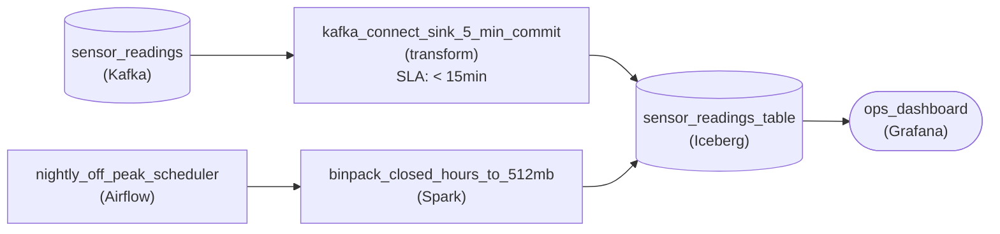
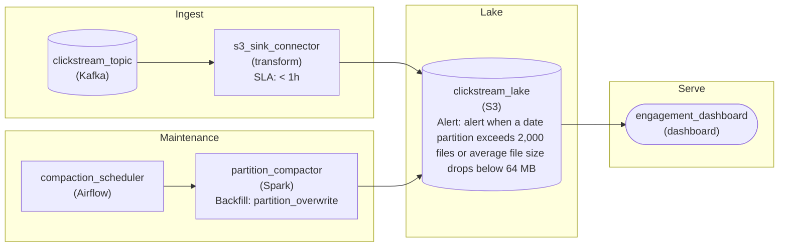

# Small Files and Compaction: Advanced - Exercises

Lesson: [pa_pattern_small_files.md](../pa_pattern_small_files.md)

### Exercise 1 of 2

**● TASK**

The 15-minute freshness bound is non-negotiable for the operations dashboard, yet the Kafka Connect sink committing every 10 seconds into hourly partitions writes 4,300 files per hour, and six months of small-file backlog now slows trend queries. Design the pipeline the analysts need: lengthen the sink's commit interval to minutes-scale, compact the backlog off-peak, and sustain the 15-minute freshness bound.

<strong>Solution</strong>

#### What this problem really is

This is the small-files problem dressed as a dashboard complaint, and the shape of the symptom gives it away: the queries never changed, only the calendar did. 12 sink tasks committing every 10 seconds write about 4,320 files into every hourly partition, each a few hundred kilobytes, so the since-launch trend charts now open nearly 19 million files and spend their time listing, reading footers and scheduling one task per file instead of reading sensor values. The trap is pulling only one lever. Lengthen the commit interval alone and six months of history stays slow; schedule compaction alone and it chases a sink that is still minting 104,000 files a day.

| Trick: Fix the source, then repair the history |
| --- |
| 2 changes, one at each end of the table. At the source, the sink commits every few minutes instead of every 10 seconds, which the 15-minute bound comfortably allows, so a new hour lands as about 144 files instead of 4,320. In storage, a scheduled job bin-packs each closed hourly partition into a handful of large files overnight, which is the only way the months already written ever get fast again. |

#### Walk the requirements

1. **Trace the slowdown to per-file overhead**

   Before proposing a fix, say why the file count is the cost. Each file is an entry the planner walks in Iceberg's manifests, a Parquet footer the engine opens before it reads any data, and, at a few hundred kilobytes, a task of its own. The since-launch charts add about 104,000 of those every day, which is why the slowdown is a slope rather than a cliff: nothing broke, the per-file overhead just kept compounding.

2. **Lengthen the commit to what 15 minutes allows**

   The sink's `iceberg.control.commit.interval-ms` is the dial. At 10 seconds each of the 12 tasks writes 360 files an hour; at 5 minutes it writes 12, so an hour lands as 144 files of about 12 MB instead of 4,320 of about 400 KB. 5 minutes rather than fifteen, because the bound is end to end: a commit firing at minute 14 leaves no room for the dashboard's own refresh. This stops the damage, but 12 MB is still far under the 128 MB to 1 GB target, and the history is untouched.

3. **Bin-pack closed hours off-peak**

   `nightly_off_peak_scheduler` (Airflow) triggers `binpack_closed_hours_to_512mb` (Spark) at night, running Iceberg's `rewrite_data_files` with the 'binpack' strategy and a 512 MB target, filtered to hours past the 20-minute straggler window. About 1.7 GB an hour becomes roughly 4 files. Bin-pack rather than sort, because the goal is fewer files, not a new layout. The first run faces six months of backlog, so it takes a bounded slice of days per night instead of all 18 million files at once.

#### The shape that fits

*`kafka_connect_sink_5_min_commit` commits every 5 minutes into the Iceberg table the dashboard reads; beside it, Airflow triggers a nightly Spark bin-pack of closed hourly partitions toward 512 MB files.*

| ✕ Commit interval only | ✓ Compaction only |
| --- | --- |
| New hours land as 144 files instead of 4,320 and the slope flattens. But the six months already written still hold about 18 million small files, and the since-launch charts keep opening every one of them. Nothing gets faster; it just stops getting worse. | The nightly job merges each closed hour into 4 files, but the sink still writes 104,000 new ones a day, so the job's workload never shrinks and every hour stays slow until the night after it lands. You are paying to clean up a mess the config keeps making. |

| Performance: From 19 million files to about 17,000 |
| --- |
| Six months at a 10-second commit is roughly 18.7 million files. The 5-minute commit alone cuts a new day from about 104,000 files to 3,456. Bin-packing closed hours to a 512 MB target leaves about 4 files an hour, around 17,000 for the same six months, and steady-state the rewrite touches only 40 GB a night, which a modest Spark cluster finishes well inside the quiet window. |

| Interviewer: Name the per-file cost before the fix |
| --- |
| The senior tell is explaining why small files are slow (manifest planning, footer reads, one task per file) before reaching for a tool, then pulling both levers with numbers attached. A candidate who says 'add compaction' and never touches the sink config has described a job that will run forever against a problem it cannot catch up with. |

| Pitfall: Rewriting an hour that is still open |
| --- |
| Readings for an hour keep trickling in for about 20 minutes after it ends. Compact an hour too early and the sink's late commits refragment it, so the next night rewrites the same hour again and you pay twice. Filter the job to hours past the late-arrival window; a nightly schedule gives you that almost for free. |

**Follow-up questions**

1. The analysts now want readings within 1 minute. What happens to the file count, and what changes in the maintenance job?\
   *Tests the tradeoff: a 1-minute commit brings back 720 files an hour, so the rewrite has to run hourly on just-closed partitions instead of nightly.*
2. How would you know this is coming back before the analysts notice?\
   *Tests treating file count and average file size per partition as a pipeline health metric, with an alert threshold that fires before queries slow down.*
3. Why not rely on the table format to handle this automatically?\
   *Tests knowing which formats compact on write and which leave it to a scheduled procedure, and that automatic compaction does not clear a backlog written before it was turned on.*

 

### Exercise 2 of 2

**● TASK**

Why would a daily engagement dashboard over date-partitioned Parquet on S3 take minutes today when it took seconds last month, if clickstream volume has held flat at about 40 GB a day while a Kafka Connect sink lands those events every 10 seconds? Design the pipeline that stops the damage where the sink writes, repairs the partitions already on S3 on a schedule, and raises an alarm per partition before the dashboard feels it again.

<strong>Solution</strong>

#### What this really is

This is the small-files problem filed as a slow-dashboard ticket. Bytes are flat and latency climbed, and that pairing has one usual suspect: the same 40 GB a day now arriving as roughly 200,000 objects instead of a few hundred. Anyone can say 'add compaction'. The trap is stopping there. A nightly compactor behind a sink that still flushes every 10 seconds is a treadmill: it rewrites the same 40 GB forever, and the first night it fails, the morning dashboard is back to minutes.

#### Walk it from symptom to fix

1. **Diagnose from file count, not the query plan**

   The Kafka Connect sink writes one file per topic partition per flush, so 24 partitions times 8,640 flushes a day is 207,360 files averaging about 190 KB. Each one costs a slice of an S3 `LIST` (1,000 keys a page), a `GET`, a Parquet footer read and a task for the engine to schedule. A month is over 6 million objects for data that fits in a few thousand. Flat bytes plus a rising object count is the whole diagnosis; say those 2 numbers before touching the design.

2. **Fix the writer before the cleanup**

   The dashboard reads yesterday, so landing events every 10 seconds buys nothing. Rotate files on time or size, whichever comes first: an hourly `rotate.schedule.interval.ms` with a cap near 128 MB. Each topic partition carries about 70 MB an hour, so a day becomes 576 files averaging 70 MB, a 360x drop. The lesson's 5-minute floor is a minimum, not a target: at 5 minutes you still write 6,912 files a day averaging 6 MB. The consumer's real freshness decides how far past the floor to go.

3. **Compact closed partitions on a schedule**

   Prevention covers tomorrow. The 35 days already on S3, and any night the sink misbehaves, need a safety net. An Airflow DAG triggers a Spark job after midnight that rewrites yesterday's `dt=` partition into 256 MB to 1 GB files. The job writes to a staging prefix and then replaces the partition, so an ad hoc query never sees half a day. It only touches partitions that are closed and over a file-count threshold, and running the same job across the backlog is the one-time repair.

4. **Make file count a health metric**

   This regression took a month to surface because nobody watched the one number that moved. Alert when a partition exceeds 2,000 files or its average file size drops below 64 MB. The next config edit that shortens the flush pages the team the same day, before the dashboard does.

#### The reference design

*Hourly rotation in `s3_sink_connector` keeps files large, `compaction_scheduler` triggers a Spark rewrite of each closed `dt` partition in place, and a file-count alert on `clickstream_lake` catches the next regression.*

| ✕ Plain Parquet on S3 | ✓ Delta Lake or Iceberg |
| --- | --- |
| The compactor is yours: a Spark job that reads a closed partition, writes large files to staging, and swaps them in. Readers are protected only by that swap, so the job must never touch the partition the sink is still writing. | `OPTIMIZE` (Delta) or `rewrite_data_files` (Iceberg) rewrites files under an atomic commit, and auto-compaction absorbs steady-state writes. The 6 million files already written still need one manual run, and file count still deserves an alert. |

| Pitfall: Compacting the partition the sink still writes |
| --- |
| The tempting cron runs hourly over today's partition. It races the sink: a file that lands mid-rewrite is either dropped by the swap or left beside the merged copy and counted twice. On plain Parquet, compact only closed partitions; on a table format, let the commit protocol arbitrate. |

| Interviewer: Flat volume is the clue, not the noise |
| --- |
| Seniors hear 'data barely grew' and go straight to object count and average file size per partition. The mid-level answer asks for a bigger query cluster, which runs 200,000 tiny reads in parallel and changes nothing about why there are 200,000 of them. |

| Performance: Pay for the rewrite once a night, not on every query |
| --- |
| Compaction reads and writes 40 GB once a day, which takes minutes on a small Spark cluster. Leaving files small makes every dashboard refresh and every ad hoc query pay for 200,000 opens again. With the sink fixed, the nightly job merges 576 files instead of 207,360, so a missed night is a nuisance, not an outage. |

**Follow-up questions**

1. Product now wants today's numbers on the dashboard within 15 minutes. What changes, and what must the compactor start avoiding?\
   *Tests the tension between freshness and file size: the sink rotation tightens toward the 5-minute floor, files shrink, and compaction must stay off the open partition or move to a table format whose commits keep readers consistent.*
2. The compaction job fails three nights in a row. How do you find out, and what does the dashboard feel?\
   *Tests layering: the file-count alert fires independently of the job's own status, and because the sink is fixed each missed night adds 576 files rather than 207,360, so prevention is what lets the safety net fail gracefully.*
3. You migrate the lake to Iceberg. Which parts of this design can you delete?\
   *Tests when manual compaction is still needed: auto-compaction covers steady state, but the existing backlog needs a one-time `rewrite_data_files`, the sink cadence still matters, and file count per partition stays a health metric.*

