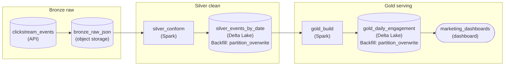
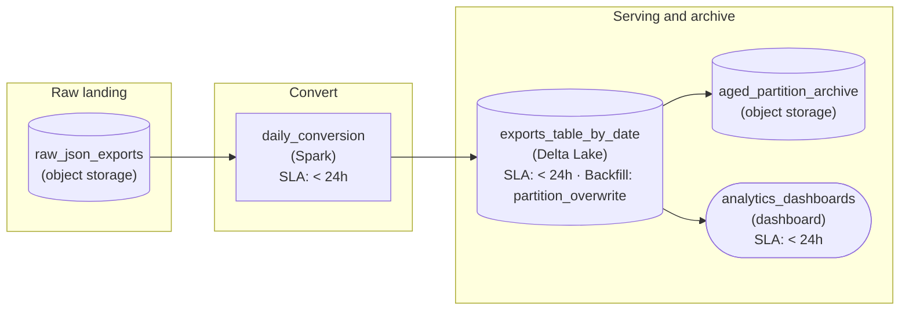

# The Storage Question: Intermediate - Exercises

Lesson: [pa_pattern_storage_question_intermediate.md](../pa_pattern_storage_question_intermediate.md)

### Exercise 1 of 2

**● TASK**

Redesign the storage behind the marketing analytics team's clickstream dashboards so that a query for one day and a handful of fields reads only that, and the monthly bill starts falling instead of climbing. Today roughly 400 GB of raw JSON events a day lands unsorted in one object-storage bucket, kept for two years, and every dashboard query scans all of it; carry that data through bronze, silver and gold without moving it off object storage. When the tracking team reissues a day's events after a bug fix, the corrected day must cleanly replace the old one.

<strong>Solution</strong>

#### What this really is

This is **The Storage Question** in an inherited-mess costume: a physical layout that has never met the queries run against it. Dashboards ask for one day and six fields; the bucket answers by opening two years of eighty-field JSON. The trap is fixing only half. Convert to Parquet but leave the files unsorted by day, and every query still reads six columns across roughly 290 TB. Organize by `event_date` but keep JSON, and a single day still costs 400 GB of parsing. The bill only falls when both levers move together, and when bronze stops sitting on the query path.

| Trick: Layout follows the query, twice |
| --- |
| Two questions decide the whole design. What do the dashboards filter on? One event day, so organize silver and gold by `event_date` and a one-day query skips the other 729 days. What do they read? Six of eighty fields, so store silver and gold in a columnar format and a query touches six columns, not eighty. Bronze stays as the raw record, compressed and out of the way. |

#### Walk the requirements

1. **Pick the key from the filter, not the habit**

   Every dashboard picks a single event day; some narrow to a campaign; none look up a user. That makes `event_date` the key for silver and gold. Organizing by user because it sounds like the natural identity of clickstream data splits each day into millions of tiny files and helps no query anyone runs.

2. **Keep bronze, but take it off the query path**

   The raw JSON in `bronze_raw_json` is still worth keeping: it is what you reprocess from when tracking ships a bug. It is not worth querying. Compress it, let it age into a cheaper storage tier, and make sure the only thing that reads it is the job that builds silver.

3. **Rebuild silver as a columnar table by day**

   `silver_conform` parses the JSON once and writes `silver_events_by_date` as a Delta Lake table: Parquet underneath, so columns compress well and read independently, and ACID on top, so a reissued day is overwritten as one transaction. Plain Parquet files cannot do that swap safely; without the table format a mid-write dashboard sees half a day or both versions.

4. **Serve the morning dashboards from a gold day table**

   `gold_daily_engagement` holds the rollup the dashboards actually chart, also by day. Marketing reviews yesterday each morning, so a daily build is enough; nothing here needs a stream.

#### The shape that fits

*Raw JSON stays in the bronze bucket on object storage; silver and gold are Delta Lake tables organized by `event_date`, so a reissued day is overwritten atomically and dashboards read one day's columns.*

| ✕ Every dashboard query today | ✓ After the redesign |
| --- | --- |
| Opens every JSON file in the bucket: two years at about 400 GB a day is close to 290 TB, parsed row by row to pull six fields out of eighty, to answer a question about one day. | Goes straight to one `event_date` slice of `gold_daily_engagement` or `silver_events_by_date`, then reads only the columns it names: around 50 GB of Parquet for the whole day, and roughly 4 GB of that for six columns. |

| Performance: Where the bill actually drops |
| --- |
| Two years of raw JSON is about 290 TB, roughly $6,700 a month on S3 Standard before a single query runs. Gzipped bronze shrinks around 5x and, since nobody rereads it after the first week, can age into an infrequent-access tier at about half the price. Silver in Parquet lands near 50 GB a day, around 36 TB over two years. Storage falls to well under half, and the per-query scan falls by 4 orders of magnitude, which is the part the team feels every morning. |

| Interviewer: The key comes from a question you ask |
| --- |
| The strong answer does not open with a date key; it opens with what do the dashboards filter on, and how many fields do they read. Candidates who name the key before asking are guessing, and the interviewer notices even when the guess is right. |

| Pitfall: Parquet alone is not the fix |
| --- |
| The common first cut rewrites the bucket to Parquet and declares victory. Columns shrink, but the files are still organized by upload time, so a one-day query reads six columns across all 730 days. The second common cut organizes by `user_id`, which no dashboard filters on and which buries each day in tiny files. |

**Follow-up questions**

1. Marketing now wants campaign views across a whole quarter. Do you change how silver is organized?\
   *Tests whether the candidate reasons from query share: the daily key still serves most queries, and a gold rollup by campaign and day answers the quarter view without splitting every day into campaign folders of tiny files.*
2. Two years in, most of `bronze_raw_json` has never been reread. What do you do with it?\
   *Tests storage-tier economics: keep it for reprocessing, but move data older than the reissue window into a colder, cheaper tier and set retention so the raw record stops growing the bill.*

 

### Exercise 2 of 2

**● TASK**

A daily job lands about 250 GB of wide JSON exports in one object-storage bucket, every file kept forever in the standard tier, and finance wants to know why that bill climbs every month. Redesign the storage so each day's export costs far less to keep and to scan and aged data drops to cheaper tiers, while the analytics team's dashboards, which read the last 90 days of the same table, keep working unchanged.

<strong>Solution</strong>

#### What this really is

This is **the storage question** in a finance costume, and it has 3 levers: columnar format with compression, a layout by date, and age-based tiering. Most candidates pull one lever and stop. The trap is the lifecycle rule written against the bucket instead of the layout: tier objects by age while the dashboards still read every file, and the first refresh after the rule fires either errors on archived objects or runs up retrieval fees that eat the savings. The 3 levers only work together.

Size the problem before touching it. Four years at 250 GB a day is about 365 TB, all at roughly $0.023 per GB-month: around $8,400 a month, growing by about $170 every month as another 7.5 TB lands. The bill climbs because nothing ever leaves and nothing ever shrinks.

#### Walk the levers

1. **Convert the retained copy to compressed columnar files**

   Wide JSON repeats every field name on every record and compresses poorly. A daily Spark job rewrites each export into Parquet with zstd or snappy inside a Delta Lake or Iceberg table, typically 8 to 10 times smaller for wide exports. That cuts bytes stored, and because the dashboards use about 12 of 200 fields, columnar reads skip roughly 94% of the columns on every query.

2. **Lay the table out by export date**

   The dashboards filter on the last 90 days, so export date is the partition key. `exports_table_by_date` writes one date partition per run with `partition_overwrite`, which makes a rerun safe and turns a 90-day query into a read of 90 folders. It is also what the lifecycle rule needs: age becomes a property of a whole folder, not of scattered files.

3. **Tier by age, cut at the query window**

   Keep the last 90 days in standard storage, move 90 days to a year into infrequent access, and push older dates into an archive class that audits can wait hours for. The cut sits just past the dashboard window, never inside it. Separately, expire the raw JSON landing after 30 days: the exporter can resend a month, so the columnar table is the only copy worth keeping.

4. **Keep the dashboards on the same table**

   The dashboards read the table, not file paths. Because the table format tracks which files belong to it, swapping JSON for Parquet underneath is invisible to them, and date pruning keeps every 90-day query inside the standard tier. Point them at `exports_table_by_date` once, backfill the history, and nothing else changes.

#### The reference design

*JSON lands and expires after 30 days; a daily Spark job writes compressed Parquet into `exports_table_by_date`; dates past 90 days move to the archive tier; dashboards read only the table.*

| Performance: 10 times smaller before any tiering |
| --- |
| At 10x compression the 365 TB becomes about 36.5 TB. Tiered: 2.25 TB standard (about $52), 6.9 TB infrequent access (about $86), 27 TB in an archive class (roughly $30 to $100 depending on class). The bill lands in the low hundreds instead of $8,400, and each new month adds cents, not $170. |

| Pitfall: Tiering what the dashboards still read |
| --- |
| The shipped mistake is a 30-day lifecycle rule on the raw bucket with the dashboards still scanning JSON by prefix. Day 31, a 90-day chart hits archived objects: either the query fails or every refresh pays retrieval. The cut must sit past the query window, and the query must prune by date so it never touches archived files. |

| Interviewer: The window comes before the rule |
| --- |
| Strong candidates ask how far back the dashboards look before proposing any day count. The lifecycle thresholds are derived from the 90-day window and the audit latency, not picked from a pricing page. |

| ✕ Lifecycle on the raw bucket | ✓ Lifecycle on the dated table |
| --- | --- |
| Wide JSON archived by object age; dashboards scan every file, hit archived objects, and the bytes stored are still the uncompressed JSON. | Compressed Parquet in `exports_table_by_date`; whole date partitions move once past 90 days, and dashboard queries prune to the standard-tier dates only. |

| Key insight: Small files make the archive expensive |
| --- |
| Archive classes charge per object on transition and carry per-object overhead. A daily job writing thousands of tiny Parquet files makes tiering cost more than it saves; aim for files in the hundreds of MB so each date is a handful of objects. |

**Follow-up questions**

1. An auditor needs one day from 3 years ago. What happens when they query `exports_table_by_date`, and how would you serve them?\
   *Tests whether the candidate knows archived objects must be restored before reading, and plans a restore of just that date partition rather than the table.*
2. The dashboard window grows from 90 days to 13 months. What changes in the layout and the bill?\
   *Tests whether the lifecycle thresholds move with the query window and whether the candidate re-costs the standard and infrequent-access slices.*
3. Analysts start filtering by region as often as by date. Would you change the partition key?\
   *Tests the partitioning trade-off: adding region as a partition level risks small files, and date must stay the outer key for age-based tiering to work.*

