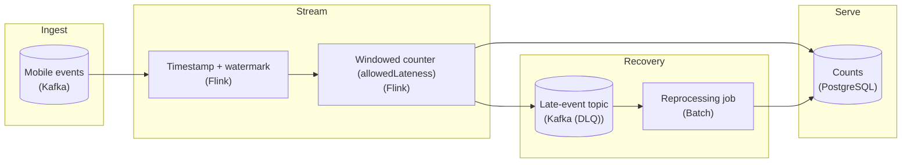
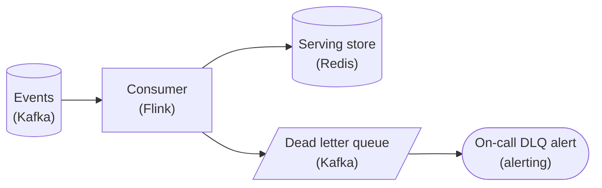
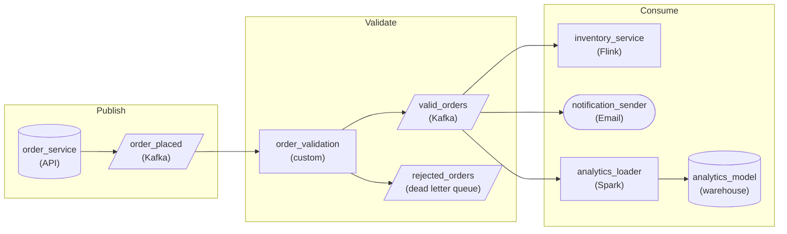
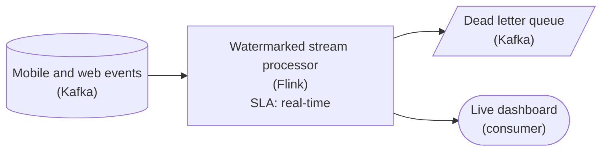

# Streaming Systems: Beginner - Exercises

Lesson: [pipeline_streaming_systems_beginner.md](../pipeline_streaming_systems_beginner.md)

### Exercise 1 of 4

**● TASK**

Mobile clients buffer events offline and upload them hours later, long after the 1-minute window they belong to has closed. Some arrivals are only slightly late and should still update the window they belong to, while others are so far behind that no reasonable waiting threshold will catch them. Design the stream so the slightly-late events still reach the right window and the events past the threshold are captured for reprocessing instead of being silently dropped.

**Starting canvas** (already placed for you):

- Mobile events (source, Kafka)
- Windowed counter (drops late) (transform, Flink)
- Counts (storage, PostgreSQL)

<strong>Solution</strong>

Strip the mobile-analytics costume and this is **event-time windowing over a bimodal lateness distribution**. There are 2 crowds of stragglers: events a few minutes behind, and events hours behind because a phone was in a tunnel. The starter's `Windowed counter (drops late)` firing on real-time freshness treats both crowds the same way it treats normal traffic, so anything arriving after the window closes is silently discarded. The trap is thinking one knob fixes it: crank `allowedLateness` high enough to catch the hours-late crowd and you pin every 1-minute window's state in memory for hours. Get this wrong and your counts are quietly low forever, and nobody sees an error, they just see numbers that never reconcile.

#### Why one threshold can't win

A streaming window closes when the watermark passes its end. `allowedLateness` extends how long the window keeps its state alive so a straggler can re-fire it. That is exactly right for the slightly-late crowd. But `allowedLateness` is bought with retained state: every open 1-minute window holds its accumulator until now minus watermark exceeds the lateness bound. Size it for the hours-late tail and you hold tens of thousands of windows open at once. The insight is that the far-late events don't need low latency at all, they need to not be lost, and that is a different requirement served by a different mechanism.

| Trick: 2 mechanisms, split by how late |
| --- |
| A modest `allowedLateness` (minutes) folds the slightly-late crowd back into their real window; a **side output** routes everything past that bound to a durable late-event topic for offline reprocessing. The split is the answer: one path optimizes freshness, the other optimizes never dropping data. |

#### The target shape

*`allowedLateness` re-fires the window for near-late events; the side output captures far-late events for `Reprocessing job` to merge back into `Counts`.*

1. **Assign event time, not arrival time**

   Extract the client's event timestamp and assign the watermark from it, with a bounded-out-of-orderness of a few minutes. Assigning off arrival time would make every buffered upload look on-time and put it in the wrong window, which is the whole failure mode you are fixing. The watermark is what defines late here, so it has to ride the event's own clock.

2. **Set allowedLateness to the near-late tail, not the max**

   Pick `allowedLateness` from where the slightly-late distribution actually ends (say 2 to 5 minutes), measured, not guessed. Within that grace the window re-fires and emits an updated count. Beyond it, the window finalizes and frees its state, so bounded lateness is what keeps memory flat regardless of how deep the hours-late tail runs.

3. **Side-output the far-late events, never drop them**

   Capture events past `allowedLateness` via a side output into a durable `Late-event topic`. This is the dead-letter queue: it turns a silent drop into a recorded, replayable fact. The topic is the seam that lets the slow path run on its own schedule without back-pressuring the live stream.

4. **Make the sink idempotent so updates and reprocessing merge**

   Write `Counts` as an upsert keyed by window, so a re-fired window and a later batch merge from `Reprocessing job` both correct the same row instead of double-counting. Idempotency is what makes both the near-late re-fire and the offline replay safe to apply more than once.

| ✕ allowedLateness | ✓ Late-event topic (DLQ) |
| --- | --- |
| Handles the minutes-late crowd inline. Re-fires the window and upserts `Counts` with low latency. Costs retained window state, so it must stay bounded. | Handles the hours-late crowd out of band. Durable, replayable, decoupled from the live stream. Costs freshness (reprocessing runs on a batch cadence) but guarantees zero silent loss. |

| Pitfall: A dropped event raises no alarm |
| --- |
| The most common mistake is leaving late data to the default drop and calling it handled. There is no exception, no log line, just counts that run low. Real candidates set a huge `allowedLateness` to compensate and then blow up window-state memory. Bounded grace plus a side output is the only shape that neither loses data nor unbounds state. |

| Interviewer: Naming the distribution as bimodal |
| --- |
| The tell of a senior answer is calling out that lateness here is bimodal and refusing to serve both crowds with one knob. Anyone can say the word watermark. Splitting the requirement into a freshness path and a never-lose path, and justifying `allowedLateness` from measured data, is what signals you have run this in production. |

| Real world: The reprocessing job is the reconciliation ledger |
| --- |
| In production the `Late-event topic` doubles as your audit trail: when analysts ask why yesterday's counts moved, the answer is the replay that merged buffered mobile uploads. Keep the topic retained long enough to cover your worst offline-buffer window, and alert on its lag so a growing far-late tail is visible instead of silent. |

**Follow-up questions**

1. What happens to `Counts` if the same window is corrected by both an `allowedLateness` re-fire and a later batch merge?\
   *Tests whether the sink is genuinely idempotent and keyed by window rather than append-only.*
2. How would you choose the `allowedLateness` value, and how do you revisit it as mobile behavior shifts?\
   *Probes for measuring the near-late distribution instead of picking a round number.*
3. How do you keep window-state memory bounded when a spike of offline devices reconnects at once?\
   *Checks the understanding that the side output, not a bigger grace, absorbs the far-late surge.*

 

### Exercise 2 of 4

**● TASK**

One malformed event makes the stream consumer crash-loop, blocking every good event behind it. Design the consumer so unparseable events are set aside while the good ones keep flowing, and so on-call is paged when the bad events start piling up.

**Starting canvas** (already placed for you):

- Events (source, Kafka)
- Consumer (crash-loops) (transform, Flink)
- Serving store (storage, Redis)

<strong>Solution</strong>

#### The costume comes off

Strip the story away and this is the **poison-pill** problem, and the fix is the pattern the lesson named: a dead-letter queue. A single malformed event is not a data-quality problem, it is an availability problem, because in an ordered partition the bad record sits at the head of the line and every good event behind it waits. The trap is that everyone reaches for a `try`/`catch` around the parse and thinks they are done. They are not. The real question the interviewer is probing is what you do with the offset. Catch the exception, log it, and move on without deciding the offset story and you have either an infinite retry loop or silent data loss. Get that wrong and you either keep crash-looping on the same record forever, or you skip it, tell no one, and quietly drop customer data.

So the design has 3 jobs, not one: isolate the bad event off the hot path, advance past it so the good events keep flowing, and make the bad events loud enough that a human gets paged before the pile becomes an incident. Miss any one of the 3 and you have only half a solution.

*Good events never leave Events to Consumer to Serving store; an unparseable one forks to the dead letter queue, whose depth pages on-call.*

#### Why the crash-loop happens at all

The consumer reads a record, fails to deserialize it, and the exception propagates up and kills the task. The stream framework does exactly what it is designed to do on an uncaught failure: it restarts the task from the last committed offset, which is still pointing at the poison pill. It reads the same bad record, throws the same exception, restarts again. That is the loop. Nothing downstream advances because the offset never advances. The bad event is not just failing itself, it is holding the partition hostage.

1. **Put the parse behind a boundary that cannot kill the task**

   Wrap only the deserialize-and-validate step in a `try`/`catch`. This is not error-swallowing, it is a routing decision: a parse failure is a normal, expected outcome of consuming untrusted upstream data, not an exceptional one. Everything that succeeds continues down the pipeline toward `Redis`; everything that throws gets handed to step 2 instead of crashing the consumer.

2. **Produce the bad record to a dead-letter topic before you commit**

   Publish the raw bytes to `events.dlq` along with metadata you will need later: the original partition, offset, timestamp, and the exception message. This is the whole point of the pattern. The bad event leaves the hot path but is not lost, so you can inspect it, fix the producer or the schema, and replay it. Do the produce first and confirm it, because the ordering with step 3 is what makes this safe.

3. **Commit the offset past the poison pill**

   Only after the record is safely in `events.dlq` do you commit the offset for the original event. This is the line that actually ends the crash-loop, and it is the one candidates forget. If you commit before the DLQ produce succeeds you can lose the event on a crash in between; if you never advance the offset you are back to the loop. The invariant is: an event is either applied downstream, or parked in the DLQ, and only then is its offset committed.

4. **Alert on DLQ depth, not on the individual failure**

   Emit a counter as records land in `events.dlq` and let the metrics system watch the rate. A single bad event a day is noise; a schema change upstream that suddenly dead-letters thousands per minute is an incident. A rule like `rate(dlq_records[5m]) > threshold` pages on-call. This closes the loop the problem asked for: the good events keep flowing AND a human finds out when the bad ones start piling up.

| Trick: The offset commit is the fix, not the try/catch |
| --- |
| The `try`/`catch` is the obvious half. The insight that cracks this is that ending the crash-loop is an offset-progress problem: the task restarts from the last committed offset, so the loop only breaks when you commit past the bad record. The DLQ is what lets you commit past it without dropping data on the floor. |

| ✕ Catch and continue (looks fine, isn't) | ✓ Dead-letter and commit |
| --- | --- |
| `try`/`catch` around the parse, log the error, `continue`. The offset advances, so the loop stops and good events flow. But the bad event is gone forever, its content lives only in a log line nobody reads, and there is no signal when the failure rate spikes. You have converted a loud crash into silent data loss. | Same parse boundary, but the caught record is produced to `events.dlq` with its metadata, the offset is committed only after that succeeds, and a counter feeds an alert. Nothing is lost, everything is replayable, and a schema break pages someone instead of vanishing. |

| Pitfall: Retrying a parse failure only slows the loop |
| --- |
| A tempting middle path is to retry the failing record a few times before giving up. Retrying a genuinely unparseable event never succeeds, it just slows the crash-loop down. Bounded retry belongs on transient failures (a `Redis` timeout, a downstream 503), not on a deserialize error. Route deterministic parse failures straight to the DLQ; only retry the things that might succeed on a second try. |

| Interviewer: Produce then commit, said out loud |
| --- |
| Naming the ordering constraint out loud, produce-to-DLQ then commit, is the tell. Junior answers stop at "wrap it in try/catch". Strong answers treat the DLQ as a real topic with retention and a replay story, and they alert on `dlq_depth` rate rather than on each failure. Mentioning that the DLQ needs an owner is the senior flourish. |

| Real world: The DLQ is where you learn your upstream lied |
| --- |
| Most dead-letters are not corrupt bytes, they are a producer team that shipped a schema change without telling you, or an optional field that went missing. Because the raw record and its exception sit in `events.dlq`, on-call can read the first few, identify the offending producer, and replay the parked events through the fixed consumer once the schema is patched. |

**Follow-up questions**

1. What retention do you set on `events.dlq`, and what happens if nobody drains it?\
   *Tests whether they treat the DLQ as durable-but-bounded, and whether a filling DLQ has an owner and an alert of its own.*
2. How do you replay from the DLQ without re-processing events that already succeeded?\
   *Probes idempotency on the `Redis` write path.*
3. A downstream `Redis` write times out. Does that event go to the DLQ too?\
   *Separates deterministic parse failures from transient downstream faults; the latter want bounded retry, not dead-lettering.*

 

### Exercise 3 of 4

**● TASK**

A notification outage must never stall checkout, and an order arriving with a malformed payload or a negative amount has to be set aside without holding up the valid orders behind it. The order service currently calls inventory, notifications and analytics directly: redesign it so each placed order is announced once as an order-placed event that every team picks up on its own schedule, including the analytics team, which needs to replay last week's orders into a new model.

<strong>Solution</strong>

#### What this problem really is

This is event-driven architecture wearing a checkout incident: the order service has to stop calling its neighbours and start announcing orders to a durable event log that each team reads at its own pace. Almost everyone puts Kafka on the canvas. What separates answers is the bad order. Validate by letting the reader throw, and one negative amount crash-loops the consumer while every valid order behind it waits: the same stall you were asked to remove, moved one hop downstream.

| Trick: One announcement, many readers, one side door |
| --- |
| Three moves solve it. The order service writes one order-placed event and forgets about its readers. Each team reads the log with its own position, so a slow or broken team only hurts itself, and retention lets analytics rewind a week. A validation step sends bad orders out a side door, the dead letter queue, and keeps reading. |

#### Walk the requirements

1. **Cut the call chain at the order service**

   Checkout stalls today because the order service waits on three calls, and the slowest or deadest one sets the pace. Replace all three with a single write to `order_placed`. Once that write succeeds, the order is placed; nobody downstream can make checkout wait again.

2. **Give every team its own place in the log**

   Inventory, notifications and analytics each read `valid_orders` independently. Kafka tracks each reader's position separately, so when notifications go down their backlog simply grows and they catch up later. Inventory keeps reserving stock the whole time. Chaining one consumer behind another brings back the coupling you just removed.

3. **Replay from retention, not from the order database**

   Orders stay on the log for two weeks, so analytics rewinds its own position to last Monday and rereads into the new model. Nobody asks the order team for an export, and the other readers never notice. Pulling history from the order database instead turns a data job into a load problem for the service that runs checkout.

4. **Set bad orders aside before they reach anyone**

   `order_validation` reads every event from `order_placed`. A malformed payload or a negative amount goes to `rejected_orders` with the reason attached, and the validator moves on to the next order. Valid orders flow to `valid_orders`. Support works the dead letter queue each morning; the main path never waits for them.

#### The reference design

*The order service writes once to `order_placed`. Validation sets bad orders aside in a dead letter queue, and three teams read `valid_orders` independently, analytics rewinding a week when it needs to.*

| ✕ Calls in a chain | ✓ One order-placed event |
| --- | --- |
| The order service calls inventory, then notifications, then analytics. If any one of them is slow or down, checkout waits. Adding a fourth team means changing the order service again. | The order service writes to `order_placed` and returns. Each team reads at its own pace, a dead reader only builds its own backlog, and a new team subscribes without anyone touching checkout. |

| Performance: Inventory streams, analytics can batch |
| --- |
| At 3,000 orders a minute, a dozen partitions leave plenty of headroom. Inventory has to reserve stock within seconds, so it earns true per-event processing in `inventory_service`. Analytics can trail by an hour, so a micro-batch `analytics_loader` is cheaper and entirely good enough. |

| Interviewer: The order service should know nothing about its readers |
| --- |
| The tell is how you answer 'a fifth team wants orders.' A strong answer is 'they subscribe to the topic,' with no change to the order service and no new call. If your design needs the order service redeployed to add a reader, the coupling is still there. |

| Pitfall: A crash is not a way of rejecting an order |
| --- |
| The first cut often throws on a bad payload and lets the consumer restart. It rereads the same bad order, crashes again, and every valid order behind it waits forever. Route the bad order to `rejected_orders`, move on, and let support work that queue on its own time. |

**Follow-up questions**

1. Analytics starts replaying last week's orders. Does inventory slow down?\
   *Tests whether the candidate knows each reader keeps its own position: the replay is a separate read of the retained log, so inventory keeps its place and its pace.*
2. Support fixes a rejected order and resubmits it. How do you stop analytics counting it twice?\
   *Tests whether the candidate keys on the order id: the fixed order carries its original id, so readers can recognise it and overwrite rather than add.*

 

### Exercise 4 of 4

**● TASK**

Mobile and web click events land on an event platform, and some of them arrive late or malformed. Process them in real time, using watermarks so late clicks still count, routing poison events to a dead letter queue, and feeding a live, low-latency dashboard from the processed stream.

**Starting canvas** (already placed for you):

- Mobile + web events (source, Kafka)
- Stream processor (transform, Flink)

<strong>Solution</strong>

Strip the costume and this is a **loss-free event-driven streaming pipeline**, exactly the pattern the lesson built up to. "Nothing gets lost" is not a slogan. It is the whole spec, and it points at the 2 ways a naive stream quietly leaks data. A late click arrives after its window closed and a careless window drops it. A malformed event hits your parser and the whole `Flink` job crashes or, worse, silently skips it. Anyone can draw `Kafka` to processor to dashboard. What separates candidates is knowing that watermarks save the late click and a dead letter queue saves the poison event. Leave either one out and your "real-time" numbers are wrong, and nobody notices until finance asks why the totals don't reconcile.

*The reference design: `Kafka` carries the clicks, `Flink` windows them on event time behind a watermark, poison events divert to a dead letter queue, and finished windows feed the live dashboard.*

#### Why streaming, and which kind

The requirement is a live dashboard, so the design is event-driven from the source out. `Kafka` holds the events as an append-only, partitioned log, and the processor reacts as they land. A batch job that reruns every 15 minutes would leave every reader up to 15 minutes stale. You would still have to solve late data and bad records, because batch doesn't make those go away; it just hides them behind the interval. Inside streaming there is one more fork. A micro-batch engine such as Spark Structured Streaming refreshes every few seconds, which is often good enough. A record-at-a-time processor like `Flink` handles each click as it arrives and treats event-time watermarks as first-class, which is why it sits at the center here.

#### Watermarks: late clicks still count

Events don't arrive in the order they happened. A phone goes through a tunnel, buffers 3 clicks, and flushes them 40 seconds late. A watermark is the processor's promise about time: "I believe I've now seen everything up to timestamp T." You window by **event time**, not arrival time, and the watermark lags real time by a bounded amount (say 30-60s), so a straggler inside that grace still lands in its correct window. Set the lag too tight and you drop the tunnel's clicks. Set it too loose and the dashboard's latest bucket takes longer to finalize. That tension between completeness and freshness is the knob, and naming it out loud is the tell.

| Pitfall: Windowing on arrival time silently undercounts |
| --- |
| The mistake real candidates make is to aggregate on processing time and never mention watermarks. It looks correct in the demo because the demo has no network. In production the late clicks land after their window emitted and get dropped, and your counts run a few percent low, consistently and invisibly. Window on event time with a watermark, and decide explicitly what happens to events later than the grace period: drop them, or side-output them, which is the same idea as the `DLQ` below. |

#### Poison events and the dead letter queue

The other leak is the malformed event: a truncated JSON blob, a null where a user id should be, a schema from an app version you retired last year. When the processor can't handle a record, it should neither crash the job nor silently swallow the record. It routes that record, with its error, to a **dead letter queue** on its own `Kafka` topic. The main stream stays healthy and fast, and the bad records are parked where you can inspect, fix and replay them. "Nothing gets lost" means the poison event is quarantined, not discarded.

| ✕ No DLQ | ✓ With DLQ |
| --- | --- |
| One malformed record either throws and takes down the `Flink` job, stalling the whole pipeline while it restarts, or a broad `try/except` swallows it and the event vanishes with no trace. Either way you get paged, or your numbers are wrong and you don't know it. | The bad record is side-outputted to the dead letter topic with its parse error attached, and the main stream never stalls. Later you read the `DLQ`, find the retired-schema bug, patch the parser and replay the parked records. No data is lost and nobody is paged at 3am. |

| Interviewer: A DLQ is only half an answer without replay |
| --- |
| Interviewers listen for what you do with the `DLQ` after it fills. Routing bad events there is table stakes. The senior signal is saying you'll watch its depth, because a rising `DLQ` is a schema regression alarm, and that each record carries enough context (raw payload plus error) to be reprocessed once the bug is fixed. A dead letter queue nobody reads is just a slower way to lose data. |

#### Feeding the dashboard

The dashboard reads what the processor emits, not raw events. As each event-time window closes under the watermark, the processor publishes that window's finished counts, so every refresh reads a small set of pre-aggregated numbers instead of recounting raw clicks. Keep the dashboard downstream of the processor and never of the raw topic, or it will show numbers that ignore both the late-data handling and the poison-event filtering.

**Follow-up questions**

1. How do you pick the watermark lag, and what breaks if a whole region's events arrive 5 minutes late?\
   *Tests the freshness-vs-completeness trade-off and allowed lateness as a tuned parameter, not a constant.*
2. The `DLQ` depth just spiked 100x in 10 minutes. What happened, and what do you do?\
   *Probes operational instinct: a new app release with a schema change, and the replay-after-fix workflow.*
3. Marketing wants yesterday's exact totals recomputed after a bug fix. Does this streaming design help or hurt?\
   *Opens the case for the log's retention as a replay path.*

