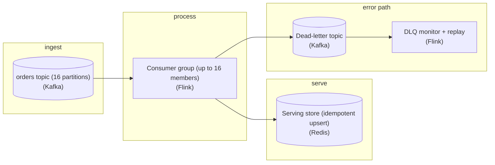
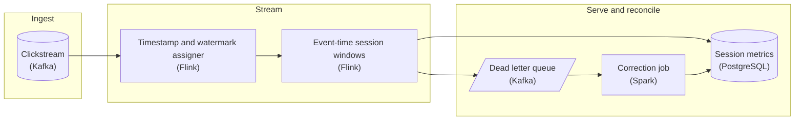
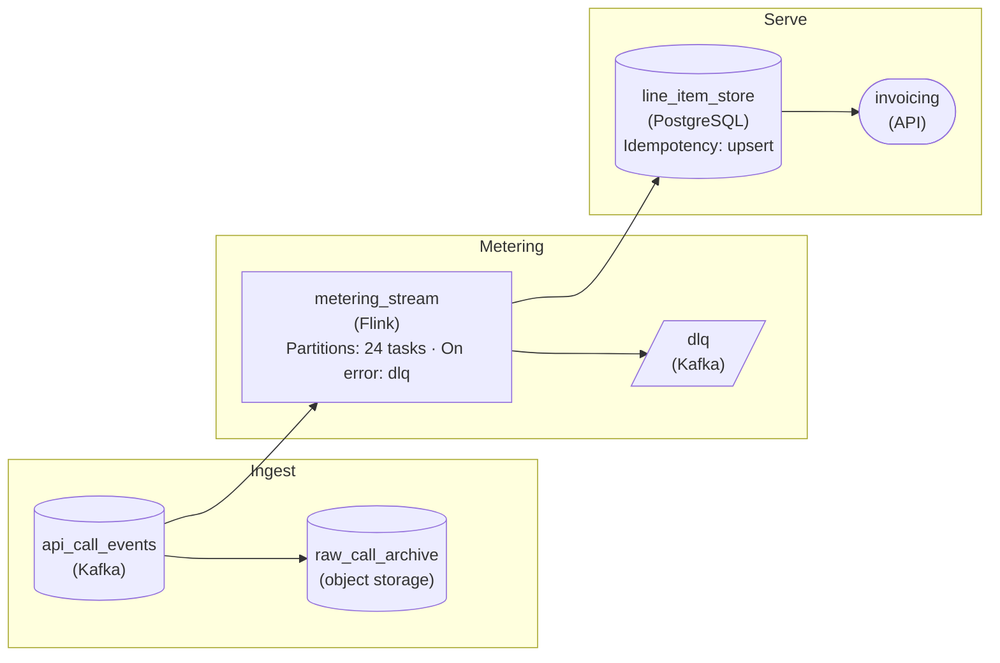
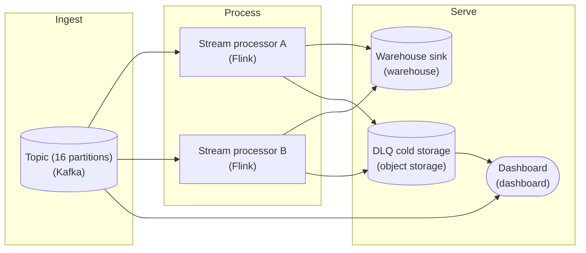

# Streaming Systems: Intermediate - Exercises

Lesson: [pipeline_streaming_systems_intermediate.md](../pipeline_streaming_systems_intermediate.md)

### Exercise 1 of 4

**● TASK**

A single consumer can't keep up with a 16-partition topic and lag is growing. Running 2 copies naively makes both read everything and double-process, and right now a single event that fails to parse stalls its whole partition. Design consumption that scales horizontally with committed offsets so a restart resumes cleanly, and route failed events aside so one bad record never blocks the partition or gets silently dropped.

**Starting canvas** (already placed for you):

- 16-partition topic (source, Kafka)
- Single consumer (lagging) (transform, Flink)
- Serving store (storage, Redis)

<details>
<summary><strong>Solution</strong></summary>

#### What this really is

Strip the 'lag is growing' costume and this is a partitioning problem: your one consumer isn't slow because it's underpowered, it's the only member draining all 16 partitions single-threaded. The trap is right there in the prompt. Launch a second copy the naive way and it reads the topic from the beginning too, so both process every event and Redis gets written twice. The move that actually scales is a **consumer group**: give every consumer the same `group.id` and Kafka assigns each of the 16 partitions to exactly one member. Partition count is your ceiling on parallelism. What separates a real answer from a diagram-drawer is the next 2 things nobody puts on the whiteboard until asked: what you commit and when, and what happens to the one record that won't parse.



*One consumer group replaces the lone consumer; failed records fork to a dead-letter topic instead of blocking their partition.*

#### Scaling with a consumer group

1. **Put every consumer in one group**

   Give all consumers a shared `group.id`. Kafka's group coordinator now owns partition assignment: it hands each of the 16 partitions to exactly one live member and rebalances when a member joins or dies. This is the single line that turns 'two copies double-process everything' into 'two copies split the work', the difference between the naive fix and the correct one is literally whether they share a group.

2. **Size the group against the partition count, not the CPU**

   16 partitions means at most 16 members do useful work; a 17th sits idle because a partition is never split across 2 consumers. If lag is still growing at 16 consumers, you don't add a 17th, you repartition the topic to a higher count. Partitioning is the unit of parallelism here, so the partition count is a capacity decision you make upstream, at topic-creation time.

3. **Commit offsets after you process, never before**

   Commit the offset only once the event is safely in Redis. On restart or rebalance the new owner resumes from the last committed offset, so nothing between the crash and the last commit is lost. Turn off `enable.auto.commit` (which commits on a timer regardless of whether your write succeeded) and commit explicitly after the write. Commit-after-process is at-least-once, which sets up the next requirement.

| Trick: The whole thing hinges on offset timing |
| --- |
| Commit-before-process loses data on a crash (silent drop). Commit-after-process replays the in-flight batch on a crash (duplicates). There is no free lunch, you pick your failure mode. Pick at-least-once and make the sink idempotent, because silent loss in a serving store is the one you can't detect after the fact. |

At-least-once means the same event can hit Redis twice, so the write has to be **idempotent**, replaying it produces the same state. A keyed upsert like `SET order:{id} {state}` is naturally idempotent; a `INCR` counter is not, because a replayed event double-counts. If your logic genuinely needs counters, dedupe first by tracking a seen `event_id` per key, or move the count to a store that lets you write the derived total instead of an increment. This is why idempotency and committed offsets are one design, not two: the commit strategy is what forces the sink to be replay-safe.

| Pitfall: Auto-commit is the silent-loss factory |
| --- |
| With `enable.auto.commit=true` the client commits the latest polled offset every few seconds, even for events your handler is still processing or that just threw. Crash in that window and those offsets are already committed, the restarted consumer skips right past them. It looks fine in every demo and quietly drops records under real failure. Own the commit. |

| ✕ 2 copies, no shared group | ✓ One consumer group |
| --- | --- |
| Each consumer independently subscribes and reads all 16 partitions from its own offset. Every event is processed twice, Redis is written twice, and a `INCR` counter doubles. Throughput does not go up, you just paid for 2 machines to do the same work and corrupt the serving store. | All consumers share `group.id`; Kafka splits the 16 partitions across members, each event processed once. Add a member and the group rebalances to share load; lose one and its partitions reassign. Throughput scales linearly up to 16, and committed offsets make a restart resume cleanly. |

#### The poison message

Offsets within a partition are strictly ordered, so a consumer can't advance past record N until it's done with record N. One event that won't parse leaves you 2 bad options: block forever (that partition's lag climbs while the other 15 look healthy, a partial stall that's miserable to diagnose) or swallow the exception and move on (silent drop). The **dead-letter queue** is the third door: catch the failure, publish the raw record plus its error and metadata to a separate dead-letter topic, then commit the offset and keep going. The good partition keeps flowing, the bad record is preserved for inspection, and nothing is lost.

| Real world: A DLQ you never read is just a slow drop |
| --- |
| Routing to a dead-letter topic isn't the finish line, an unwatched DLQ is silent loss with extra steps. Alert on dead-letter depth, keep the original partition/offset and error on each dead-lettered record, and have a replay path that re-injects fixed records after you ship the parser change. The `DLQ monitor + replay` node exists so the error path closes the loop instead of accumulating forever. |

| Interviewer: What signals you've actually run this |
| --- |
| Anyone can say 'add more consumers.' The tells that you've operated a stream: you name the partition count as the parallelism ceiling, you say when you commit relative to the write, you make the sink idempotent because you chose at-least-once, and you give the poison message somewhere to go that is neither blocking nor `/dev/null`. Miss any one and the design silently corrupts or stalls under the first real failure. |

**Follow-up questions**

1. You add a 17th consumer to the group and throughput doesn't move. Why?\
   *Tests that partition count, not consumer count, is the ceiling on parallelism.*
2. One key gets 10x the traffic and its partition is hot while others idle. Do more consumers help?\
   *Tests understanding that partition-key skew, not consumer count, is the bottleneck.*
3. Your serving logic is a running total via `INCR`. How do you keep it correct under at-least-once redelivery?\
   *Tests idempotency when the sink operation isn't naturally replay-safe.*
4. How does a record get out of the dead-letter topic and back into normal processing without replaying the poison version forever?\
   *Tests that the DLQ has a closed loop: triage, fix, replay.*

</details>


<br>

### Exercise 2 of 4

**● TASK**

A clickstream sessionization job buckets events by processing time, so when ingestion lags the events land in the wrong session and the metrics jump around. Rework the windowing so session assignment stays correct no matter when an event is processed. A handful of events still arrive hours after their window has closed, far past any sane cutoff, and those stragglers must be captured for a later correction instead of silently dropped.

**Starting canvas** (already placed for you):

- Clickstream (source, Kafka)
- Processing-time windows (transform, Flink)
- Session metrics (storage, PostgreSQL)

<details>
<summary><strong>Solution</strong></summary>

#### What this really is

This is the **late-data pattern** dressed up as sessionization: event-time windows with a watermark, and a dead letter queue behind them. The starter windows on processing time, so session membership depends on Kafka lag rather than on what the user did. Everyone swaps in `EventTimeSessionWindows` and a watermark. The trap is stopping there. A watermark decides when a window fires. It does not decide what happens to the click that arrives 3 hours later. Flink drops that click by default, so session counts drift low and nothing tells you.



*Event-time sessions feed the metrics. Stragglers past the lateness cutoff go to a Kafka dead letter queue, and a correction job replays them from there.*

#### Building it

1. **Assign event time and a bounded watermark**

   Read `event_time_ms` from the payload instead of trusting the ingestion clock, and pair it with `for_bounded_out_of_orderness` set to 30 seconds. That bound is your promise about ordinary jitter. Set it too tight and windows fire before normal stragglers arrive. Set it too loose and every metric goes stale.

2. **Key by session, window on event-time gaps**

   Apply `key_by` on `session_key`, then `EventTimeSessionWindows.with_gap` with a 30-minute gap. The gap is measured in event time, so a lagged click merges back into its true session. It does not open a phantom new one.

3. **Re-fire for the tardy, dead-letter the rest**

   `allowed_lateness` of one hour keeps window state alive, so a tardy click re-fires the window with a corrected aggregate. Anything later goes through `side_output_late_data` to a side stream. That stream lands in a durable dead letter queue that a correction job replays.

**PyFlink: event-time sessions with a late-data side output**

```python
watermarks = (
    WatermarkStrategy
    .for_bounded_out_of_orderness(Duration.of_seconds(30))
    .with_timestamp_assigner(lambda event, _: event.event_time_ms)
)

late_events = OutputTag("late-events", event_type_info)

sessions = (
    clickstream
    .assign_timestamps_and_watermarks(watermarks)
    .key_by(lambda event: event.session_key)
    .window(EventTimeSessionWindows.with_gap(Time.minutes(30)))
    .allowed_lateness(Time.hours(1))
    .side_output_late_data(late_events)
    .aggregate(SessionMetricsAggregator())
)

# happy path: correct, watermark-driven session metrics
sessions.sink_to(postgres_metrics_sink)

# stragglers past the 1h cutoff -> dead letter queue for later correction
sessions.get_side_output(late_events).sink_to(dead_letter_sink)
```

*The watermark absorbs jitter, `allowed_lateness` re-fires for the tardy, and the side output feeds the dead letter queue.*

| Trick: 3 bands of lateness, 3 dials |
| --- |
| The watermark decides when a window fires. `allowed_lateness` decides how long a fired window still accepts corrections. `side_output_late_data` catches only what falls past both. Each dial covers its own band: seconds of jitter, minutes of tardiness, and the rare event that is hours late. |

| ✕ Processing-time windows | ✓ Event-time windows plus DLQ |
| --- | --- |
| Session assignment depends on ingestion lag. A Kafka backlog splits or merges sessions at random, and no event is ever recognized as late. | Assignment follows `event_time_ms`, so a click always lands in its true session. Lateness has a precise definition, and the truly late events go to a queue instead of being dropped. |

| Pitfall: A huge `allowed_lateness` is not a DLQ |
| --- |
| Some candidates set `allowed_lateness` to many hours so nothing is ever late. That pins state for every keyed window across the whole horizon, so RocksDB balloons and checkpoints crawl on a high-cardinality `session_key`. Keep the window open for minutes and send the hours-late events to the side output, where they cost no window state. |

| Interviewer: Name who drains the dead letters |
| --- |
| Weak answers route stragglers to `dead_letter_sink` and stop there. A senior answer names the consumer: a correction job replays the queue, re-aggregates the affected sessions, and upserts by `session_key`, so a rerun cannot double-count. |

| Real world: A rising DLQ rate is an ingestion alarm |
| --- |
| Stragglers are rarely random. Usually it is a phone that buffered events offline, or a regional mirror that fell hours behind. If you alert on the dead-letter rate, you see the upstream problem before the dashboards visibly go wrong. |

**Follow-up questions**

1. How do you choose the watermark bound and `allowed_lateness` without guessing?\
   *Checks whether they measure the actual out-of-order distribution instead of picking round numbers.*
2. The correction job rewrites a session already in `session_metrics`. How do you avoid double-counting?\
   *Idempotent upserts versus at-least-once delivery.*
3. One Kafka partition goes silent and the watermark stalls. What breaks, and how do you detect it?\
   *Watermark idleness handling.*

</details>


<br>

### Exercise 3 of 4

**● TASK**

What does a usage-metering pipeline need so that growing its consumer group on the 24-partition API call topic, or a consumer dying mid-batch, never bills a call twice or drops one? The billing engineer on call wants the per-customer invoice line items it writes to survive exactly that, keep flowing past a malformed call without losing it from the bill, and stay recomputable from the original calls when a customer disputes an invoice months later.

<details>
<summary><strong>Solution</strong></summary>

#### What this problem really is

This is the consumer-group offset lifecycle wearing a finance hat. Every consumer in the group reads a batch, writes it, then commits, and a crash or rebalance can land between any 2 of those steps. The design question is which gap you can afford. Commit before the write and a crash drops calls you already acknowledged: silent under-billing. Commit after the write and a crash replays them, which is correct only if replaying a call rewrites the same line item instead of adding another. Anyone can say 'exactly-once'. The candidates who pass say where the commit sits and what makes the write safe to repeat, and the answer is the call's `request_id` as the line item's key.

| Trick: Commit last, write by key |
| --- |
| At-least-once delivery plus an idempotent sink is exactly-once in effect.<br><br>1. Read, write the line items, then commit the offset. A crash can only cause a replay, never a gap.<br>2. Key each line item on `request_id` and upsert, so the replay is a no-op.<br>3. Park bad records in a DLQ and keep the raw calls somewhere that outlives the topic. |

#### Walk the requirements

1. **Commit the offset only after the line items land**

   Adding a consumer triggers a rebalance: partitions move, and the new owner resumes from the last committed offset, not from where the old owner actually stopped. Whatever the old owner wrote after its last commit gets processed again. So the order is read, write, commit. Flink snapshots the source offsets in the same checkpoint as its operator state; Spark Structured Streaming logs a micro-batch's offsets before running it and marks the batch committed after the sink finishes. Either engine replays the uncommitted tail after a failure, and with invoices closing daily, micro-batch latency is no obstacle. Neither engine can stop your sink from counting that tail twice. That part is yours.

2. **Key every line item on `request_id`**

   The gateway stamps each call with a `request_id`, and a retried call reuses it. Make that the primary key of the line-item row and write with an upsert: a replayed batch rewrites rows that already exist, identically. The same key absorbs duplicates that reach the topic before any consumer sees them, when the gateway re-sends after a timeout. The per-customer total is computed at invoice close by summing those rows, never kept as a running counter the stream increments.

3. **Park malformed calls without skipping them**

   A record that fails to parse fails on every retry. If the processor throws, it never commits, the partition stalls, and every customer on that partition stops being metered. Send it to `dlq` with the original payload, the error, the retry count and the timestamp, then keep going. Skipping it is the opposite failure: that call never reaches the bill. Once the parser is fixed, the DLQ is replayed through the same upsert path, so reprocessing a call twice is harmless too.

4. **Keep the raw calls longer than the topic does**

   Disputes arrive up to 90 days later and the topic keeps seven. Land the raw calls in `raw_call_archive`, an object store written straight off the topic as an immutable log, untouched by pricing logic. A disputed invoice is then a replay: read that customer's calls for the period, price them again, and diff against what was billed. Line items are a projection of the calls; the calls are the record.

#### The shape that fits



*`api_call_events` feeds `metering_stream`, which upserts line items keyed on `request_id` and commits offsets only after the write; bad records go to `dlq`, and `raw_call_archive` keeps the calls in object storage for dispute replay.*

| ✕ Commit, then write | ✓ Write, then commit |
| --- | --- |
| A crash after the commit but before the write loses the batch: the new owner starts past it. Calls vanish from the bill and nothing ever replays them. | A crash after the write but before the commit replays the batch. With line items upserted on `request_id`, the replay rewrites the same rows, so the bill comes out exactly once. |

| Performance: A rebalance costs replay, not correctness |
| --- |
| At about 300 million calls a day across 24 partitions, each partition carries roughly 145 calls a second. With a 10-second commit interval, a rebalance replays around 1,500 calls per moved partition, all of them no-op upserts. Commit more often and you pay more commit traffic; commit less and each rebalance replays more. Neither choice changes the bill. Past 24 consumers, extra instances sit idle: a partition has exactly one owner in a group. |

| Interviewer: Where the commit sits is the whole answer |
| --- |
| Strong candidates say the sequence out loud: read, write keyed on `request_id`, commit, then name what a crash does at each gap. They also know a group that rebalances every few seconds (usually a consumer blowing its poll interval on a slow write) is a symptom to fix, not load to scale through. Saying 'Kafka has exactly-once' without naming the sink is the tell of someone who has never run billing. |

| Pitfall: A running total cannot be replayed |
| --- |
| The version that ships first keeps a counter per customer and increments it for every call. It passes every test until the first rebalance, when the replayed tail increments the same counters again and every customer on a moved partition is overcharged by a few hundred calls. Nothing errors. Finance finds it at month end when invoices disagree with the gateway's own logs. Store the calls, key them, and sum at close. |

**Follow-up questions**

1. The gateway team wants to pack several calls into one event to cut volume. What breaks in this design?\
   *Tests whether the candidate keeps the key at call grain: the processor must unpack the event and key each call by its own `request_id`, or one bad call sends the whole event to `dlq` and its good calls go unbilled.*
2. Pricing changes mid-month and finance wants the month rebilled at the new rate. How do you do it without double-counting?\
   *Tests the event-log view: replay `raw_call_archive` for the period into a fresh version of the line items and swap it in, rather than pushing old calls back through the live topic.*

</details>


<br>

### Exercise 4 of 4

**● TASK**

Our windowed totals from the 16-partition event topic come out doubled whenever a processor restarts, and last week one malformed event stalled its partition for an hour. We need consumption spread across a group of streaming processors that window on event time with watermarks and land output in a transactional warehouse, bad events parked in a DLQ backed by cold storage, and a dashboard showing consumer lag and DLQ depth.

**Starting canvas** (already placed for you):

- Topic (16 partitions) (source, Kafka)
- Stream processor group (transform, Flink)

<details>
<summary><strong>Solution</strong></summary>

#### What you actually just drew

Strip the marketing off and this is the horizontal-scaling problem for a stateful stream consumer: how do you add a second processor to a consumer group reading the same topic **without double-counting a window or losing one on a rebalance**. Anyone can drop a second Flink box on the canvas and draw an edge from the topic. What separates people who have run this in production is knowing that the second processor is only safe because the group commits offsets and the sink is transactional. Get those two wrong and a rebalance replays a partition, your windowed totals get counted twice, and the dashboard that was supposed to catch it is reading the same corrupted numbers.



*The consumer group splits the 16 partitions across A and B. Both write windowed output to the transactional warehouse and send bad events to the cold-storage DLQ. The dashboard reads consumer lag off the topic and DLQ depth off the store.*

#### Why a group of two, not one bigger box

Partitions are the unit of parallelism. A consumer group hands each of the 16 partitions to exactly one member, so two processors split them 8/8, and you can keep adding members up to 16 before partitions become the ceiling. A single fat processor can't parallelize past its own cores and gives you zero failover: when it dies, everything stops. The group model is what lets you scale reads and survive a node loss at the same time.

| Interviewer: Processor count is bounded by partition count |
| --- |
| The tell of someone who has operated this: they tie the number of processors to the 16 partitions, not to a round number. A 17th member just sits idle. If you want more parallelism than 16, you repartition the topic first, and that is a real, disruptive operation, not a slider. |

1. **Add processor B to the same consumer group**

   B must share the group id so the coordinator assigns it a disjoint set of partitions. Put it in a different group and it gets all 16: a second full copy of your pipeline, not more throughput. Because offsets are committed per group, a rebalance re-hands a partition to whoever picks it up starting at the last committed offset, so no event is skipped.

2. **Land windows in a transactional warehouse sink**

   Exactly-once means the offset commit and the row write happen as one atomic unit, either through two-phase commit or a `MERGE` keyed on the window id. That is also your idempotency: a replayed partition upserts the same window key instead of appending a duplicate. Most people draw this edge carelessly, and it is where the double-count bug lives.

3. **Route bad events to a cold-storage DLQ**

   A parse or schema failure must not block its partition, because one poison event stuck at the head stalls every event behind it. Divert it to a dead letter store on cheap cold storage, with the error and retry count alongside, for later replay and audit. The rule: never silently drop a bad record, and never let one halt the stream.

4. **Feed a dashboard consumer**

   Monitoring reads two numbers: consumer lag (topic head minus committed offset, per partition) and DLQ depth. Lag climbing steadily means you are under-provisioned, so add a member. DLQ depth spiking almost always means upstream schema drift. Without this view you are blind to the two failure modes this whole design exists to contain.

| Pitfall: At-least-once delivery plus an appending sink double-counts |
| --- |
| Kafka gives you at-least-once by default: on a rebalance or replay, a partition's events are re-delivered from the last commit. If your sink just appends windowed rows, every replay inflates the totals. Committing more often does not fix this. Make the write idempotent (upsert on the window key) or transactional so the replay is a no-op. |

| Key insight: Watermarks bound both correctness and memory |
| --- |
| Event-time windows use watermarks to decide when a window is complete and can flush. That is what makes late data explicit: events past the allowed lateness go to a side output or the DLQ instead of silently corrupting a closed window. It is also your memory story, because the watermark is what lets the processor release window state. Skip it and window state grows unbounded until the processor runs out of memory. |

| ✕ True streaming | ✓ Micro-batch |
| --- | --- |
| Per-event processing (Flink here) commits on a continuous checkpoint boundary at the lowest latency, and the transactional sink ties each checkpoint to an offset commit. This is the right default when lag and DLQ depth must be watched in real time. | Micro-batch groups events into small intervals before writing. Exactly-once is simpler (one transaction per batch), but it adds latency equal to the batch interval. It is fine when the warehouse prefers larger commits and seconds of freshness are acceptable. |

**Follow-up questions**

1. A processor crashes mid-window and the group rebalances. Walk me through why the reassigned partition does not double-count.\
   *Tests whether they connect committed offsets to the transactional or idempotent sink, rather than just reciting 'consumer group'.*
2. Consumer lag is flat but DLQ depth is climbing fast. What is your first hypothesis?\
   *Separates lag (a throughput signal) from DLQ depth (a data quality or schema drift signal).*
3. The topic is repartitioned from 16 to 32. What breaks for a keyed window, and how do you replay safely?\
   *Probes whether they see that key-to-partition mapping and window state are coupled to partition count.*

</details>
