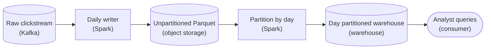
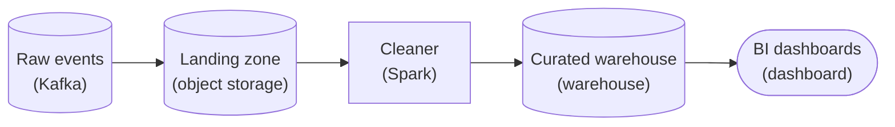
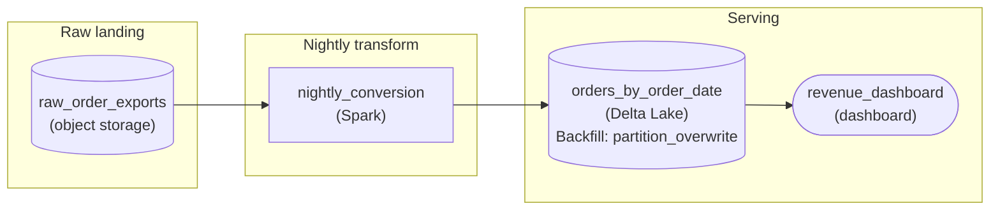
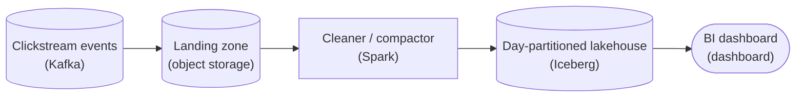

# Where Data Lives: Beginner - Exercises

Lesson: [pipeline_where_data_lives_beginner.md](../pipeline_where_data_lives_beginner.md)

### Exercise 1 of 4

**● TASK**

A daily batch lands the raw clickstream as one giant Parquet file in cheap object storage, which stays the cheap source of truth. Analysts almost always pull a single day at a time, yet every one of those queries scans the whole table today. Stand up a query-optimized warehouse copy organized by day, so a single-day query reads only that day's data instead of the entire file.

**Starting canvas** (already placed for you):

- Raw clickstream (source, Kafka)
- Daily writer (transform, Spark)
- Unpartitioned Parquet (storage, S3)

<details>
<summary><strong>Solution</strong></summary>

#### What this really is

Strip the costume off and this is **partitioning for partition pruning**, nothing more. Analysts filter by day, but the physical file is one undivided blob, so the engine has no way to skip anything: every query opens the whole thing and throws away 364/365 of what it read. The fix is not a faster engine or a wider cluster, it is physical layout: lay the warehouse copy out as one directory per day so the predicate `event_date = '...'` maps to a folder the planner can open and the rest it can ignore. The trap on THIS instance is thinking Parquet already solved it because Parquet is columnar. Columnar buys you column pruning (read only the columns you select); it does nothing for skipping rows across days when all days live in one file. Miss that distinction and you 'optimize' by adding compute to a scan that was never going to shrink.



*The raw Parquet stays the cheap source of truth; a daily job rewrites it into a warehouse copy partitioned by `event_date`, and analysts query that copy.*

| Trick: Partition on the column the analysts filter on |
| --- |
| The one move that cracks this: the partition key must be the predicate. Analysts filter by day, so partition by `event_date`. That writes one physical path per day (`event_date=2026-09-17/`), and the engine turns `WHERE event_date = '2026-09-17'` into 'open exactly one directory'. Partition on anything the queries don't filter on and you pay the write cost of partitioning with none of the read benefit. |

| ✕ One giant file | ✓ Partitioned by day |
| --- | --- |
| All days interleaved in a single Parquet object. A single-day query has no directory to prune to, so the engine scans the entire table, decodes every row group, and filters `event_date` in memory. Cost scales with total history, not with the day requested. | One directory per day under `event_date=`. `WHERE event_date = '2026-09-17'` prunes to that folder before any bytes are read. Cost scales with one day's volume and stays roughly constant as history grows. Same Parquet, same columns; only the physical layout changed. |

#### Building it without breaking what works

1. **Leave the raw landing zone exactly as it is**

   The unpartitioned Parquet in object storage is the cheap source of truth, and it stays. You are adding a derived copy, not migrating. If the partitioned copy ever gets corrupted or you change the layout, you rebuild it from raw. Rewriting the source of truth in place is how a layout experiment turns into data loss.

2. **Add a batch job that writes the data partitioned by day**

   Read raw with Spark, then `write.partitionBy("event_date")`. The `partitionBy` is the whole point: it puts `event_date` into the storage path instead of only inside the file. Do a `repartition("event_date")` first so each day's rows land together and you don't emit a smear of tiny files, one per input partition per day.

3. **Register the partitions so the engine can prune**

   Writing `event_date=` folders is not enough: the table's metastore has to know each partition exists (an `MSCK REPAIR TABLE` or an explicit add-partition after every run). The query engine only prunes partitions the catalog lists. Skip this and every query silently falls back to a full scan, which looks fine in dev and quietly costs money in prod.

**The daily partition job**

```python
raw = spark.read.parquet("s3://lake/raw/clickstream/")

# One physical directory per day: s3://warehouse/clickstream/event_date=2026-09-17/
(raw
    .repartition("event_date")     # shuffle so each day lands as a few big files
    .write
    .partitionBy("event_date")     # the key goes into the path, not just the file
    .mode("overwrite")
    .parquet("s3://warehouse/clickstream/"))

```

*Same Parquet, same columns; only the physical layout changes.*

| Pitfall: Right column, wrong granularity |
| --- |
| The subtle miss is partitioning too finely. Day is correct here because analysts pull 'a single day at a time'. Partition by hour and you get 24x the directories and a small-files problem (thousands of sub-128MB objects, each with fixed open and metadata overhead that swamps the scan). Partition by `user_id` and you get millions of directories and a metastore that chokes. Match partition granularity to the query grain, not to the finest timestamp you happen to have. |

| Interviewer: The tell: naming the read pattern before touching layout |
| --- |
| A strong answer starts with 'analysts query one day, so partition by day' and derives the design from the access pattern. A weak answer jumps to 'add Parquet / add a bigger cluster / add caching' without connecting the layout to the predicate. Saying out loud that raw stays untouched and the day-partitioned copy can always be rebuilt is the second tell. |

| Performance: Why the plan stays cheap as history grows |
| --- |
| With one file, a single-day query over 3 years scans ~1000 days of data to return one. Partitioned by `event_date`, the same query prunes to one directory and reads ~1/1000th of the bytes, and that ratio holds no matter how many years accumulate: cost is a function of the day requested, not of total history. Many engines bill by bytes scanned, so pruning is a direct line on the invoice, not just latency. |

| Real world: The copy is a contract, not a one-off |
| --- |
| Once the day-partitioned copy exists, dashboards depend on each day's partition appearing on schedule. Registering partitions after every run, and handling a day that arrives 2 days late, become real operational concerns, not footnotes. |

**Follow-up questions**

1. A day's data arrives 48 hours late. How does your job add just that `event_date=` partition without rewriting the others?\
   *Tests overwriting a single partition instead of rewriting the whole table.*
2. Analysts start filtering by both day and country. Do you add `country` as a second partition column?\
   *Tests multi-column partitioning against partition count and small files.*
3. Within a single day the files are still thousands of tiny objects. What do you change in the write?\
   *Tests file sizing, targeting roughly 128MB-1GB per partition.*
4. A teammate proposes partitioning by hour 'for finer pruning'. What do you tell them?\
   *Tests the over-partitioning pitfall: pruning gains versus per-file overhead.*

</details>


<br>

### Exercise 2 of 4

**● TASK**

Raw events land cheaply in object storage, but the BI team needs fast SQL aggregations over the cleaned data. Keep the raw data in cheap storage while giving BI a fast query surface to read from.

**Starting canvas** (already placed for you):

- Raw events (source, Kafka)
- Landing zone (storage, S3)
- Cleaner (transform, Spark)

<details>
<summary><strong>Solution</strong></summary>

#### 2 tiers, 2 jobs

Under the costume this is the lake-plus-warehouse split. Raw stays in the cheap data lake as the source of truth, and BI reads a **separate, cleaned, query-optimized copy**. The trap is treating it as one decision. Some candidates point the dashboards straight at the raw landing prefix, so every chart is a full scan of row-oriented JSON. Others load everything into the warehouse and drop the landing zone, which means paying warehouse rates for raw history nobody queries and losing the ability to replay. Miss it and BI waits minutes per chart, or the storage bill grows faster than the data does.



*Raw data lands in object storage and stays there. A batch `Spark` job writes cleaned, columnar tables into the warehouse, and BI reads only the warehouse.*

#### Why not just query the raw?

| ✕ BI reads the raw landing zone | ✓ BI reads the curated warehouse |
| --- | --- |
| Every `SUM(amount)` reads every byte of every column of every JSON event, then decompresses and reparses the text. There is no columnar layout and nothing to prune. Cheap to store, brutal to ask. | The table is columnar, so `SUM(amount)` touches only `amount` and skips the other 40 columns. Only the cleaned slice pays warehouse storage; raw history stays at object-storage prices. |

1. **Land raw cheaply and keep it**

   The event stream writes into object storage as-is, schema-on-read. That landing zone is your replayable record. You never delete it and never point BI at it. Its job is durability, plus the ability to reprocess when the cleaning logic changes.

2. **Batch-clean into a structured copy**

   A scheduled `Spark` job cleans the day's raw files and loads them into the warehouse, where the schema is enforced on write. BI aggregates tolerate a daily refresh, so a streaming job would buy freshness nobody asked for. The switch from JSON to columnar is the single biggest query win.

3. **Partition on what BI filters by**

   Partition the curated table by `event_date`, because dashboards filter by time range and pruning skips every partition outside it. Partitioning by `user_id` instead explodes into millions of tiny partitions and recreates the small-files problem.

| Trick: The lake is the truth, the warehouse is a materialization |
| --- |
| Neither tier alone is the answer. The lake holds everything cheaply and flexibly. The warehouse materializes only the hot, cleaned queries BI runs every day. Say both halves, and say why each exists. |

| Pitfall: Columnar and partitioned still crawls with tiny files |
| --- |
| Wiring the `Cleaner` to emit one small file per run looks fine on day one. Within weeks each `event_date` partition holds thousands of files, and every query pays a fixed open cost per file. Size the batch output so each partition holds a few large files. |

| Interviewer: Say why raw survives the warehouse |
| --- |
| The junior answer drops the landing zone once the warehouse exists. The senior tell is saying, without being asked, that raw stays in object storage for cost and replay, while the warehouse holds only cleaned data for BI. |

| Performance: Terabytes scanned become gigabytes |
| --- |
| With 40 columns, a one-month `SUM(amount)` drops from about 2TB of raw JSON to a few GB. Column pruning removes roughly 95% of the bytes, and partition pruning drops 11 of 12 months. Minutes become seconds, and the scan bill falls with them. |

**Follow-up questions**

1. BI now wants data less than 15 minutes old instead of daily. What changes?\
   *Batch vs streaming judgment, and how shorter intervals multiply small files.*
2. A late event arrives for an `event_date` 3 days ago. How does it land?\
   *Why date partitioning turns late data into a rewrite of one partition.*
3. The cleaning logic had a bug all last week. How do you fix the warehouse?\
   *Why keeping raw data is load-bearing: reprocess from the lake instead of patching the serving copy.*

</details>


<br>

### Exercise 3 of 4

**● TASK**

An analyst's weekly revenue dashboard uses six of the roughly one hundred columns in the nightly order export and only the last 7 order dates, yet every query scans the entire flat folder of CSV files the finance job dumps into object storage. Redesign where and how those orders are stored so her queries read only the columns and order dates they ask for, and so a nightly load that dies halfway never shows her a partial day.

<details>
<summary><strong>Solution</strong></summary>

#### Why this problem exists in real interviews

This is the whole lesson in one folder. 3 separate storage questions hide behind one complaint: the file format decides which columns get read, the folder layout decides which days get read, and the table format decides whether a half-written night is visible. The trap is answering one and calling it done. Converting the CSVs to Parquet in the same flat folder cuts the columns but still opens every day since the job started. Splitting folders by the night the export landed cuts nothing, because the dashboard filters on `order_date`, not on load date. Miss either and the scan bill barely moves.

| Trick: 3 layers, 3 separate savings |
| --- |
| Columnar format skips the 94 columns nobody reads. A daily `order_date` layout skips the days nobody asked for. A table format like Delta Lake makes each nightly load land all at once or not at all. Each fix is invisible to the other two, so a strong answer names all three. |

#### Walk the requirements

1. **Stop reading columns the dashboard never uses**

   CSV is row-oriented: to get `net_amount` the engine reads every row end to end, all hundred fields. Parquet stores each column together, so a query for six columns reads six. Same-typed values packed together also compress far better, and a fast codec such as Snappy or Zstd keeps decompression cheap for an interactive dashboard.

2. **Lay the table out by `order_date`, one folder per day**

   Partition pruning lets the engine skip every date folder outside the filter, so a seven-day query opens 7 folders. Key it on `order_date`, because that is what the dashboard filters on and late orders arrive in later exports. At about 2 GB a night, daily is the right grain; hourly would only multiply tiny files.

3. **Put a table format on top of the files**

   Raw Parquet in a folder has no transaction guarantee: a job that dies after writing half its files leaves half a day visible. Delta Lake or Iceberg commits a load through a transaction log, so readers see the previous night until the new one is complete.

4. **Keep the raw exports, point the dashboard elsewhere**

   The CSV folder stays as the cheap lake copy for audits and reprocessing. The nightly job converts it into `orders_by_order_date`, and that curated table is the only thing the dashboard reads.

#### The shape that fits



*Raw CSVs stay cheap in `raw_order_exports` on object storage; `nightly_conversion` writes a Delta table split by `order_date`; the dashboard reads only `orders_by_order_date`.*

| ✕ Today: one flat CSV folder | ✓ Redesign: Delta table by order date |
| --- | --- |
| Every query reads all hundred columns of every row of every night ever exported. A load that fails halfway leaves stray files the dashboard happily sums. | A query reads six columns from 7 `order_date` folders, compressed. A failed load never commits, so the dashboard keeps showing the last complete night. |

| Performance: Under one percent of the old scan |
| --- |
| Six of a hundred columns is about 6% of the column data. 7 days out of a year of history is about 2% of the folders. Multiplied, that is roughly 0.1% of what the CSV scan reads, before compression shrinks the columnar files several times further. |

| Interviewer: Order date, not arrival date |
| --- |
| The strong candidate asks which date the dashboard filters on before choosing the folder key. Laying files out by load date looks tidy and prunes nothing, since last week's orders are scattered across every night that carried a late one. |

| Pitfall: Hourly folders for a daily question |
| --- |
| Over-partitioning trades one problem for another: 2 GB a night split by hour, or by `order_date` and store, becomes thousands of tiny files, and listing them costs more than reading them. The dashboard never asks below a day, so the layout should not either. |

**Follow-up questions**

1. Analysts start filtering by store region as well as `order_date`. Do you add region as a second folder key?\
   *Tests the over-partitioning instinct: a second key multiplies folders and shrinks files, so date stays the folder key unless region is low-cardinality and in nearly every query.*
2. Finance restates last Tuesday's orders and sends a corrected export. How does the table take it without the dashboard seeing a mix of old and new rows?\
   *Tests using the table format: rewrite only Tuesday's `order_date` partition and commit it as one transaction, so readers see either the old day or the corrected one.*

</details>


<br>

### Exercise 4 of 4

**● TASK**

Put it all together: design end-to-end storage for a clickstream platform. Raw events must land cheaply, the cleaned data must be partitioned for day-scoped queries, and BI needs a fast warehouse surface with reliable table semantics for concurrent writers.

**Starting canvas** (already placed for you):

- Clickstream events (source, Kafka)
- Landing zone (storage, S3)
- Cleaner / compactor (transform, Spark)

<details>
<summary><strong>Solution</strong></summary>

Strip the costume off and this is the **raw lake with a lakehouse on top** you just learned, sized down to one page. The words 'end-to-end storage' make it sound like one decision; it is three, because no single storage choice satisfies 'land cheaply', 'query by day', and 'reliable concurrent writes' at once. The trap is treating the object-storage landing zone as the thing BI queries. It lands as thousands of tiny row-oriented files, so pointing a query engine at it means full scans over unindexed JSON and, worse, readers seeing half-written partitions. Get the tiering wrong and the demo works on a day of data and falls over at a month.



*Raw JSON lands in object storage, a batch job rewrites it as day-partitioned Parquet under Iceberg, and BI reads the lakehouse table.*

#### The 3 decisions, in order

1. **Land raw cheaply from the stream**

   `Kafka` is a stream; the landing zone is not. You sink micro-batches into object storage as append-only, row-oriented files (JSON or Avro), with no cleaning and no reshaping. The point of this tier is durability and cheapness: keep the untouched bytes so you can reprocess when a downstream bug surfaces. This is where **batch and streaming meet**. You ingest continuously, but you do NOT try to clean per event.

2. **Compact and convert to columnar in batch**

   The `Spark` job earns its place by doing 2 things the landing zone cannot. First it compacts: the stream sink produced thousands of tiny files, so it coalesces them into a handful of right-sized ones. Second it rewrites row JSON into columnar `Parquet` and partitions by `event_date`, so a day-scoped BI query reads one partition of a few large, column-pruned files instead of scanning the month. Batch is the right tool because compaction and rewrite are throughput jobs, not low-latency ones.

3. **Serve through a table format, not a directory of files**

   Clean `Parquet` is still not a table; it is files in prefixes. 'Reliable table semantics for concurrent writers' is the phrase that forces `Iceberg` (or `Delta`). Its metadata layer gives an atomic commit and snapshot isolation, so a BI reader never sees a half-finished compaction and 2 writers do not clobber each other's partition. That is what turns the curated lake into a lakehouse: a warehouse surface BI can trust, still sitting on cheap object storage.

| Trick: The small-files problem is the whole reason step 2 exists |
| --- |
| A stream sink writing every few seconds produces one small file per micro-batch. Query engines pay a fixed open-list-read cost per file, so a partition of 10,000 tiny files is dramatically slower than the same bytes in 10 files. The compactor's job is not cosmetic: coalescing small files is often the single biggest query speedup in the whole pipeline. |

| Pitfall: Partitioned Parquet directories are not atomic |
| --- |
| The tempting shortcut is to skip the table format and point BI at the partitioned `Parquet` prefixes. It reads fine in a demo and corrupts under concurrency: a reader hitting a partition mid-rewrite sees a mix of old and new files, and 2 writers to the same partition have no commit protocol. Directories give you layout; only a table format gives you `MERGE`, snapshot isolation, and safe concurrent writes. |

| ✕ Landing zone (raw) | ✓ Curated lakehouse (served) |
| --- | --- |
| Row-oriented JSON/Avro on object storage, append-only, no schema enforcement, tiny files, partitioned little or not at all. Optimized for cheap durable capture and reprocessing. | Columnar `Parquet` under `Iceberg`, partitioned by `event_date`, compacted, ACID commits. Optimized for day-scoped BI scans and safe concurrent writers. |

| Interviewer: Naming why each layer's format differs signals seniority |
| --- |
| Anyone can draw the boxes. The tell is explaining WHY the format changes at each hop: row format lands cheap and reprocessable, columnar `Parquet` prunes columns for analytics, and the table format adds the commit protocol. A candidate who says 'store everything as `Parquet` everywhere' has missed that raw capture wants row-oriented append and that files alone are not a table. |

| Performance: Partition on the column the queries filter |
| --- |
| Partitioning by `event_date` means a 'last 7 days' dashboard touches 7 partitions, not the full history; the engine skips the rest before reading a byte. Partition by a high-cardinality column like `user_id` and you recreate the small-files problem with millions of one-row partitions. Match the partition key to the dominant query predicate, which for clickstream BI is almost always the day. |

**Follow-up questions**

1. BI now wants freshness under an hour, not daily. What changes?\
   *Tests whether they add more frequent commits into the table format without abandoning the batch cleanup tier.*
2. Late-arriving events land 2 days after their `event_date`. How does the curated table stay correct?\
   *Tests understanding of table-format `MERGE`/upsert and partition rewrites versus naive append.*
3. Why keep the raw landing zone at all once data is curated?\
   *Tests the reprocessing and replay argument for a cheap immutable raw tier.*

</details>
