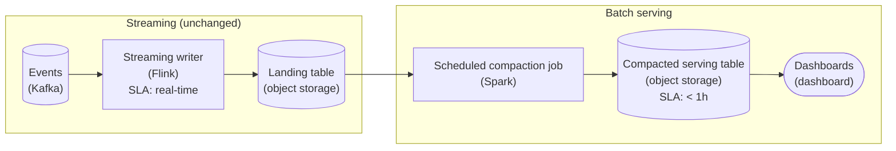
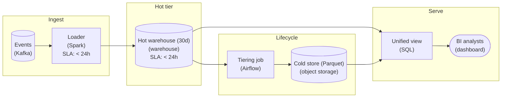
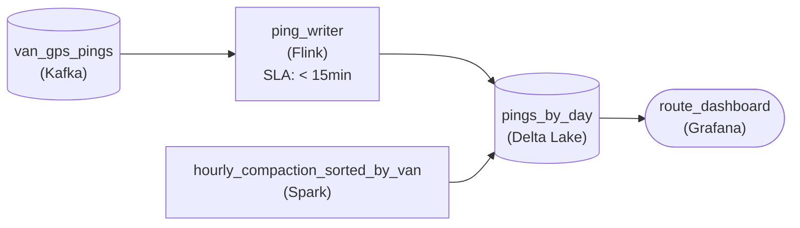
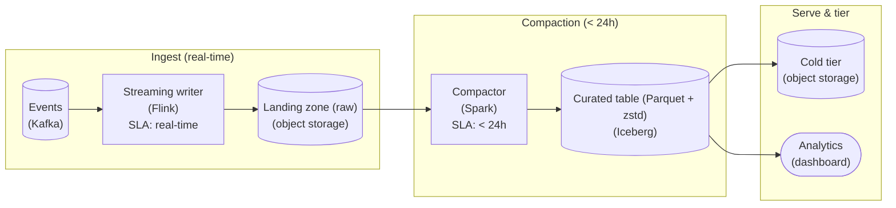

# Where Data Lives: Intermediate - Exercises

Lesson: [pipeline_where_data_lives_intermediate.md](../pipeline_where_data_lives_intermediate.md)

### Exercise 1 of 4

**● TASK**

A real-time writer lands a new 4 KB Parquet file every few seconds, and after a month the landing table holds millions of tiny files, so every dashboard query burns its time opening files instead of reading them. Keep the streaming ingest into that landing zone exactly as it is, and add a scheduled job that rolls the tiny files into a handful of right-sized ones in a separate serving table. Point the dashboards at that compacted serving table so they read far fewer, larger files while the live ingest keeps flowing.

**Starting canvas** (already placed for you):

- Events (source, Kafka)
- Streaming writer (transform, Flink)
- Tiny files table (millions of 4 KB Parquet) (storage, S3)
- Dashboards (consumer, Tableau)

<strong>Solution</strong>

#### The pattern in disguise

Strip the slow-dashboard costume off and this is the **small-files problem**, straight out of the lesson. Your streaming writer is doing exactly what you asked: seal a durable file every few seconds so events are queryable in near real-time. But every sealed file carries fixed overhead the reader pays again on every scan (open the object, read the Parquet footer, decode row-group metadata), so a `landing` table of millions of 4 KB files is a per-file overhead tax, not a data-volume problem. The bytes are tiny; the bookkeeping is enormous. The skill being probed: can you keep the low-latency write path AND give readers a scan-friendly layout, without letting one job stomp the other?

The trap is where the 2 jobs meet. The obvious fix, rewrite the tiny files into big ones in place, quietly puts your compaction job in a foot-race with a writer that is still appending to that same table this second. The move this problem forces is to split write-optimized from read-optimized: leave `landing` alone as the streaming sink, and stand up a second `serving` table that a scheduled batch job rebuilds from it. 2 tables, 2 owners, one direction of data flow.

*The streaming writer keeps landing small files for freshness; an hourly batch job rewrites sealed partitions into few large files in a separate serving table, and the dashboards read only that side.*

#### Partition on time, and never compact the open one

The whole design hinges on partitioning `landing` by ingest time, say `dt` and `hour`. That gives you a clean seam: at any moment the writer is appending only to the current hour's partition, and every earlier partition is **sealed**, no more writes coming. Your compaction job walks sealed partitions only. It never opens the hour that is still live, so there is no race with the streaming writer at all, by construction, not by locking.

| Pitfall: Compacting the hot partition races the writer |
| --- |
| The mistake real candidates make is compacting up to `now()`. The streaming writer is mid-flight in the current hour; if your job reads that partition, rewrites it, and swaps it, you either drop the files that landed during your run or clobber the writer's next commit. Cut the job off at the last CLOSED partition (`hour < date_trunc('hour', now())`, with a small grace for late arrivals). Leave the live edge to the streaming side. |

1. **Scope the run to sealed partitions**

   List partitions in `landing` where the hour is strictly before the current hour (minus a lateness grace). Each such partition is a self-contained unit of work: all its files, and only its files, get rewritten. No cross-partition shuffle, so the job scales with new data, not total history.

2. **Rewrite each partition into a handful of large files**

   Read every tiny file in the partition and write it back coalesced toward the 128 MB to 1 GB target, sized as `total_bytes / target_file_size`. You are re-packing rows, not transforming them, so the job is I/O-bound and cheap. At a few files a minute, an hour holds only megabytes, so each hour becomes a single file; that is your cue to make the serving table's partition grain daily.

3. **Publish by atomic partition swap, idempotently**

   Write the compacted files to the matching partition in `serving` and swap them in as one atomic operation (`INSERT OVERWRITE` on that partition, or an Iceberg or Delta commit). Because the unit is a whole sealed partition and the publish is overwrite-not-append, a retried or double-fired run produces the identical result, not a double-count.

| Trick: Idempotency is the partition overwrite, not a dedup pass |
| --- |
| Make the compaction of a sealed partition a pure function of that partition's input. `INSERT OVERWRITE` on a `serving` partition replaces its contents wholesale, so the output never depends on how many times the job ran. That is what lets the scheduler retry on failure, backfill a week, or fire twice on a hiccup without corrupting the serving table. Append-based compaction duplicates rows the first time a task retries. |

| ✕ Full recompaction every run | ✓ Incremental, sealed-partition only |
| --- | --- |
| Recompact the entire `serving` table on every run. Correct and trivially idempotent, but you rewrite all of history to fix the few new partitions. Cost and runtime grow with total data, not new data. Fine for the first week, a budget fire by month three. | Compact only partitions that closed since the last run (track a high-water mark of processed hours). Each run touches a bounded slice, cost is flat per hour of ingest, and because each publish is an idempotent overwrite you keep the full rebuild's safety at the incremental price. This is the full-versus-incremental call you should make out loud. |

| Performance: Fewer opens, not fewer bytes |
| --- |
| A month of a file every few seconds is roughly a million 4 KB objects in `landing`: a dashboard query over it spends nearly all its wall-clock opening objects and parsing footers, and LIST/GET requests dominate the bill. The same month in `serving` is a few hundred files. Request counts drop by about 1000x and reads turn sequential. You did not read less data; you stopped paying per-file overhead a million times. |

| Interviewer: Name who owns the live edge |
| --- |
| The tell that separates a senior answer: you volunteer that the streaming ingest is untouched and name the exact boundary between the 2 jobs (the last sealed partition). Candidates who say 'just have the writer flush bigger files' missed that real-time freshness needs small, frequent commits; candidates who compact in place missed the race. 'Streaming stays as-is, the batch side serves reads, they meet only at closed partitions' is the whole point. |

**Follow-up questions**

1. How do you handle late events that arrive for an `hour` partition you already compacted?\
   *Tests lateness handling: a grace window before sealing, or a targeted re-overwrite of that one partition, safe because the publish is idempotent.*
2. The dashboards want data no more than 5 minutes stale, but compaction runs hourly. What do you do?\
   *Tests the read-merge: union the compacted `serving` partitions with the live tail of `landing`, or shorten the compaction cadence and weigh its compute cost.*
3. Who deletes the tiny files in `landing` after they are compacted, and when is that safe?\
   *Tests retention ordering: expire a `landing` partition only after its `serving` counterpart is committed, so no data is lost between the 2 tables.*

 

### Exercise 2 of 4

**● TASK**

Two years of event history sits in one hot warehouse table. 95% of queries touch the last 30 days, but the team pays hot-storage prices for all of it. Design tiered storage that keeps recent data fast and old data cheap, still queryable.

**Starting canvas** (already placed for you):

- Events (source, Kafka)
- Loader (transform, Spark)
- Hot warehouse (2 yrs) (storage, Snowflake)

<strong>Solution</strong>

#### What this really is

Under the cost-cutting framing this is **partition lifecycle management**, the partitioning pattern applied to storage tiers. Reads are skewed, with 95% hitting the last 30 days, but storage is flat: every row of two years sits at hot-warehouse prices. The fix is to make the storage tier follow the access curve. Keep the recent slice hot, age the rest to object storage, and present both as one queryable surface. The trap is the partition key. Partition on `event_date` and the tiering job, the hot queries and the cold scans all prune on the same boundary. Partition on anything else and the job that saves money scans the whole table every night to find what aged out.

*The warehouse holds a rolling 30 days. A nightly job ages older date partitions to Parquet on object storage, and a view unions both tiers so queries never see the boundary move.*

#### Why the key is the event date

1. **Shrink the hot table to a rolling window**

   Keep only the last 30 days in the warehouse, clustered on `event_date`. That is where 95% of queries land, so it stays fast, and you now pay hot prices for about 4% of the rows instead of all of them.

2. **Age whole partitions nightly**

   A scheduled job unloads partitions where `event_date < current_date - 30` to object storage as `event_date=YYYY-MM-DD/` folders, verifies the write, then drops them from the hot table. Copy, verify, drop, in that order, so a failed export never loses data.

3. **Expose one surface over both tiers**

   Put an external table over the Parquet and a view `events_all` that does `UNION ALL` of `events_hot` and `events_cold`. A last-week query touches only hot partitions; the rare two-year report reaches into cold and pays object-store scan rates, which is the trade you want.

| Trick: One column, 3 payoffs |
| --- |
| `event_date` is at once the tiering predicate, the hot-query pruning key and the cold folder layout. Align all 3 on it and tiering is nearly free to run; miss it and every layer full-scans. |

| Pitfall: Drop partitions, never DELETE rows |
| --- |
| Ageing data with `DELETE FROM events WHERE event_date < ...` on a two-year table is a lock-heavy rewrite that churns storage blocks and can cost more than the storage you meant to save. Drop whole partitions after a verified export. |

| ✕ Hot tier, last 30 days | ✓ Cold tier, 30 days to 2 years |
| --- | --- |
| The warehouse, clustered on `event_date`. Serves the month-back queries. Expensive per TB, but a tiny fraction of the rows. | Parquet on object storage under `event_date=` folders, read via an external table. Roughly 10 times cheaper per TB, slower per scan, and rarely read. |

| Performance: The bill drops by about 85% |
| --- |
| If 30 days is about 4% of a 24-month table and object storage is about 10x cheaper per TB, moving the other 96% cuts storage cost by roughly 85 to 90%. Hot latency is untouched, because those queries never read old partitions. |

| Real world: The window is an SLA you monitor |
| --- |
| This is how warehouse external tables and lake query engines get used in practice. Size the hot window to real query recency, keep the tiering job idempotent so reruns are safe, and track how often queries reach cold: if that climbs, the window is too short. |

**Follow-up questions**

1. A late event arrives with an `event_date` 3 months back, after that partition went cold. Where does it land?\
   *Out-of-order and backfilled data across the tier boundary.*
2. An analyst runs `SELECT * FROM events_all` with no date filter. How do you stop a two-year cold scan?\
   *Pruning guards and default date filters on the view.*
3. Marketing wants sub-hour freshness on the last day. What changes?\
   *Adding a streaming slice without moving the tiering boundary.*

 

### Exercise 3 of 4

**● TASK**

Pings have to reach the ops team's route dashboard within 15 minutes, and every dashboard query already filters on a date range, yet the dashboard keeps getting slower on a lake table where 4,000 delivery vans each land a GPS ping every 5 seconds, filed into a separate folder for every van and every hour. Lay out how that table should be written, sized and periodically rewritten so the dashboard recovers and stays fast as months of pings accumulate.

<strong>Solution</strong>

#### What this really is

This is the **small file problem** wearing a dashboard complaint. The date filter is working fine: it prunes to 7 days. The trap is that each day has been shredded into 96,000 van-hour folders, and with a writer committing every minute that is about 5.8 million files a day of a kilobyte or 2 each. A one-week query opens roughly 40 million files, and the open, read footer, close overhead dwarfs the few GB of actual pings.

The reflex fixes miss. Bigger cluster: still 40 million opens. Write once an hour instead: files get bigger, but the 15-minute freshness promise is gone. The answer has to keep writes frequent AND end up with big files, which means the layout, the write size and a periodic rewrite all change together.

| Trick: Fresh writes are allowed to be small, briefly |
| --- |
| Split the job in two. The stream writer commits small files every few minutes into day folders so dispatchers see pings in time. A rewrite job runs every hour and folds those files into 128 MB to 1 GB files ordered by `van_id`. Small files exist for an hour, never for a month. |

#### Walk the fix

1. **Collapse the folders to one per day**

   A day of pings is about 1 GB compressed. Splitting it into 96,000 folders guarantees every file is tiny no matter what else you do. Partition on `ping_date` only: the dashboard's date range still prunes whole days, and each day is now big enough to hold a few properly sized files.

2. **Keep the writer inside the 15-minute budget**

   The stream writer commits every 5 minutes with a handful of tasks: a few thousand files per day at most, each already far larger than today's one-minute van-hour slivers, and every ping visible well inside 15 minutes.

3. **Rewrite each hour into large files**

   An hourly Spark job compacts the current day in `pings_by_day` into files in the 128 MB to 1 GB band. A settled day ends up as one to eight files, so a week-long query opens under 60 files instead of 40 million.

4. **Sort by `van_id` while rewriting**

   Van left the folder path, so the one-van filter needs another way to skip data. Ordering rows by `van_id` during compaction gives each row group a tight min/max on `van_id`, so pushdown skips every row group for other vans. It also makes the `van_id` column dictionary encode and run-length compress to almost nothing.

#### The shape that fits

*The writer lands pings every 5 minutes into `pings_by_day`, split by `ping_date` only; `hourly_compaction_sorted_by_van` rewrites each day into 128 MB to 1 GB columnar files sorted by `van_id`; the dashboard reads the compacted table.*

| ✕ Folder per van per hour | ✓ Folder per day, sorted by van |
| --- | --- |
| 96,000 folders a day, about 5.8 million files of a kilobyte or two. The `ping_date` filter prunes correctly, then opens 40 million files for a week. | 7 folders for a week, each holding one to eight large files. `ping_date` prunes the days, `van_id` min/max statistics skip row groups inside them. |

| Performance: The cost is an hourly rewrite |
| --- |
| Compaction reads and rewrites about 1 GB per day, a few times over as the day grows. That is cheap next to 40 million file opens per dashboard query, and it is the only way to keep 15-minute freshness without living with small files. |

| Interviewer: The diagnosis comes before the fix |
| --- |
| Strong candidates notice the filter already prunes and ask how many files a day holds before proposing anything. Counting 4,000 vans times 24 hours of folders out loud is the moment the interviewer relaxes. |

| Pitfall: Compacting once is not a fix |
| --- |
| A one-off compaction makes the dashboard fast on Monday and slow again by Friday, because the writer never stopped producing small files. Keeping van-hour folders and compacting inside them also fails: a van-hour holds about 1 MB, so no rewrite can ever reach a 128 MB file. |

**Follow-up questions**

1. New van firmware adds a `battery_level` field to every ping. What happens to the files already compacted?\
   *Tests schema evolution: adding a nullable column is safe, old files read it as `NULL`, and compaction does not need to rewrite history.*
2. Finance wants 2 years of pings kept, but dispatchers only look at the last 7 days. Where should the old days live?\
   *Tests storage tiering: recent compacted days stay hot, older days move to cheaper object storage tiers without changing the dashboard's path.*

 

### Exercise 4 of 4

**● TASK**

At two billion events a day arriving every few seconds, a naive writer buries the lake in tiny files, and upstream teams add new fields without warning. Design storage for the analytics team's event lake where files stay right-sized, a query filtered by date reads only the files it needs, data older than 90 days sits on cheap object storage while recent data stays fast, and new fields never force a rewrite of history.

**Starting canvas** (already placed for you):

- Events (source, Kafka)
- Streaming writer (transform, Flink)
- Compactor (transform, Spark)

<strong>Solution</strong>

#### What this really asks

Strip the 4 asks and it is one decision: how bytes land in object storage. This is the compaction-plus-columnar pattern from the lesson; the hinge is where you compress. The trap is heavy `gzip` at the streaming writer: it fossilizes thousands of tiny non-splittable files no scan can prune, and every requirement fights the storage layer.

*2 write tiers: streaming buys latency; compaction owns codec, file size and column layout.*

1. **Keep the streaming writer dumb and fast**

   The `Flink` writer is graded on time-to-visible, so let it write for latency: small files, a cheap splittable codec like `snappy` or none. Skip `zstd` at max level in the hot path; those files are throwaway anyway.

2. **Make the compactor the rewrite boundary**

   The `Spark` compactor rewrites each window of tiny files into large 128-512 MB `Parquet` files with `zstd`, sorted on the filter columns. Small files die here; min/max stats are born here.

| Trick: Split the codec across the 2 tiers |
| --- |
| The move that cracks this: `snappy` or none on the way in for write latency, `zstd` on the way to rest for bytes scanned and stored. `zstd` matches gzip at several times the decode speed and stays splittable inside `Parquet`; its CPU is paid once but read thousands of times. |

| Pitfall: Whole-file gzip kills parallelism |
| --- |
| A `.json.gz` object is not splittable: the engine hands the whole file to one task, so a 1 GB file gets no parallelism. `zstd` inside `Parquet` compresses per row group, so the file still splits. Whole-file `gzip` is a storage knob mistaken for a scan-plan decision. |

One rewrite pays off all 4 asks. Pushdown rides on the columnar container: sorted `Parquet` with tight per-row-group min/max stats lets row-group skipping actually skip. Tiering ages a few big objects to cheap archival storage, not per-object tax on small files. `Iceberg` tracks columns by ID, so a new nullable field is metadata, not a rewrite.

**Follow-up questions**

1. Compaction runs daily, but a team needs sub-minute freshness on the newest events. How do you serve both?\
   *Tests whether they union raw landing with the curated table at read time.*
2. Your `zstd` level 19 job starts missing its `< 24h` SLA as volume grows. What do you trade?\
   *Tests that compression level is a CPU-vs-ratio dial to lower or parallelize.*

