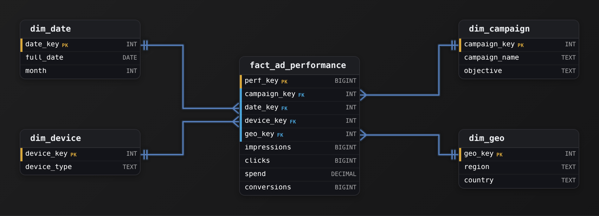
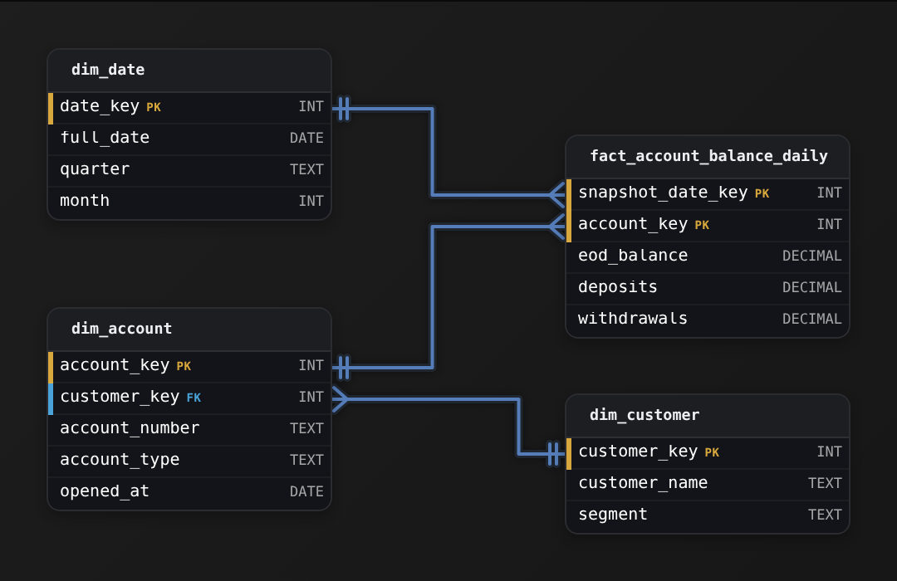
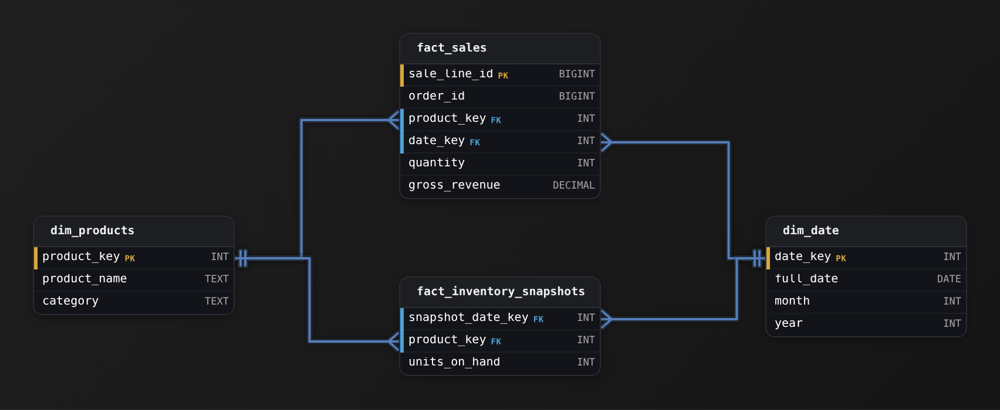
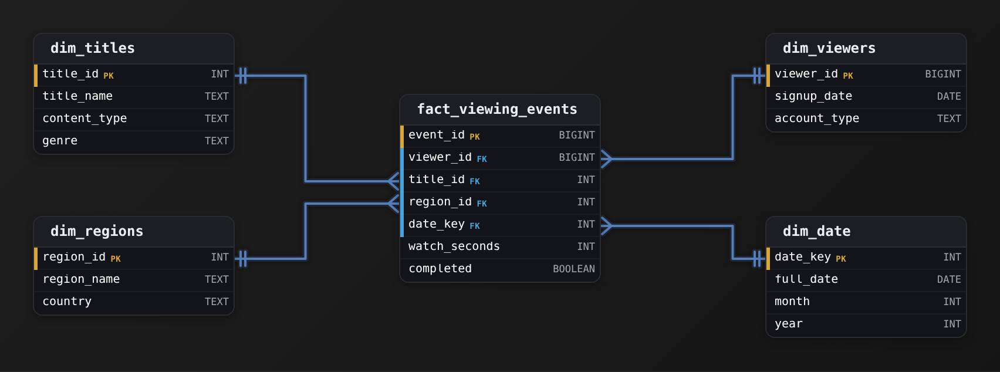

# Additive Measures: Advanced - Exercises

Lesson: [dm_pattern_additive_measures.md](../dm_pattern_additive_measures.md)

### Exercise 1 of 4

**● TASK**

A digital advertising platform is building the reporting table behind its campaign performance dashboards, where analysts slice results by campaign, day, device type, and region in any combination. Every rate they read (click-through rate, cost per click, conversion rate) has to reconcile whether they are looking at one campaign on a single day or the whole account over a quarter. Design the fact table and its dimensions so that the product team's proposed measures (impressions, clicks, spend, conversions, click-through rate, cost per click, conversion rate) roll up correctly along every dimension.

<details>
<summary><strong>Solution</strong></summary>

#### What this problem is really testing

This is a measure-additivity classification wearing a dashboard-build costume. The product spec handed you seven numbers, and the trap is treating all seven as columns because they were all asked for. 4 of them (`impressions`, `clicks`, `spend`, `conversions`) sum cleanly along every dimension. The other three (`click_through_rate`, `cost_per_click`, `conversion_rate`) are ratios, and a ratio does not survive a rollup: the quarter's click-through rate is not the sum of the daily rates, nor their average. Store the ratios and the first time an analyst widens the date range, the dashboard quietly lies.

| Trick: Run the SUM test on every measure |
| --- |
| For each proposed number, ask: if I SUM this across all dimensions, does the result make business sense? `clicks` summed across days, devices, and regions is a real total, so it stays. `click_through_rate` summed across three days gives a number over 100 percent, which is nonsense, so it cannot be stored. Keep what passes; decompose what fails into the parts that do. |

#### Work it measure by measure

1. **Declare the grain first**

   One row is the counts for a single campaign, on one day, for one device type, in one region. Every measure you keep must be additive at exactly this grain, and this grain must be fine enough to support the slicing analysts asked for.

2. **Keep the 4 additive counts**

   `impressions`, `clicks`, `spend`, and `conversions` all pass the SUM test on every dimension. They are the atomic, fully additive measures and they belong on the fact as-is.

3. **Refuse the three ratios, keep their ingredients**

   `click_through_rate` is `clicks / impressions`, `cost_per_click` is `spend / clicks`, `conversion_rate` is `conversions / clicks`. None can be stored. But notice their numerators and denominators are already the 4 counts from step 2, so you store nothing extra: the components are on the fact, and the ratio is computed after aggregation.

4. **Conform the 4 dimensions**

   campaign, date, device, and region each become a dimension table joined by a surrogate key. That is what lets an analyst pivot on any combination without the fact carrying redundant descriptive text.

#### The reference model



*Only the 4 additive counts sit on `fact_ad_performance`; the three rates are derived downstream from those counts.*

| Interviewer: The line that reads as senior |
| --- |
| Saying out loud: 'I would not store `conversion_rate`; I would store `conversions` and `clicks` and let the BI tool divide after aggregation' is the strong-hire signal. It shows you design for correct rollups, not for whatever the spec happened to list. |

| Pitfall: Averaging an average |
| --- |
| The classic wrong turn is storing `click_through_rate` per row and then AVG-ing it in the dashboard. A day with 10 impressions and a day with 10,000 impressions get equal weight, so the rolled-up rate is meaningless. The only correct rate is `SUM(clicks) / SUM(impressions)` over the counts. |

| ✕ Store the ratio | ✓ Store the components |
| --- | --- |
| `click_through_rate` lives on the fact.<br><br>* Reads look convenient at the base grain<br>* Any rollup across days or devices is wrong<br>* The number can exceed 100 percent once summed<br>* Unrecoverable: the components are gone | `clicks` and `impressions` live on the fact.<br><br>* Every rollup is exact at any level<br>* The rate is one division in the BI layer<br>* No extra columns needed, the parts were already there<br>* The dashboard and the detail report always reconcile |

**Follow-up questions**

1. The team now wants `unique_users_reached` on the same dashboard. Where does that measure fit in the additive classification?\
   *Tests whether the candidate recognizes a distinct count as non-additive and does not blindly SUM it across dimensions.*
2. Finance wants a `daily_budget_remaining` number shown per campaign. How would you treat it differently from `spend`?\
   *Probes recognition of a snapshot-style measure that does not sum across time, without requiring the full semi-additive handling.*
3. If most rate computations are the same three divisions, would you ever precompute them, and where?\
   *Tests the boundary between the additive fact and a downstream aggregate or view layer that is still recomputed from stored counts.*

</details>


<br>

### Exercise 2 of 4

**● TASK**

A retail bank records every account's end-of-day balance in a daily snapshot, one row per account per day, alongside the deposits and withdrawals that posted that day. The reporting team needs a proper fact table for this snapshot and a rule for reporting each account's figures across a full quarter, because their current quarter numbers come out about 90 times too large. Design the fact table, and for every measure state how it should roll up to a quarter.

<details>
<summary><strong>Solution</strong></summary>

#### What this problem really is

This is a stock-versus-flow classification problem wearing a time-rollup costume. The table hands you 3 numbers that all look like ordinary money, and the whole test is whether you notice that `eod_balance` behaves differently from `deposits` and `withdrawals` the moment you cross the date dimension. The ninetyfold blowup is the tell: someone wrote `SUM(eod_balance)` over a quarter and added 90 days of the same money that was only ever there once. Add up `deposits` the same way and you are correct; add up `eod_balance` and you have invented cash that never moved.

| Trick: The balance is a level, not an amount that piles up |
| --- |
| A `deposits` value is money that CHANGED hands that day, so days accumulate. An `eod_balance` value is the money SITTING there at day's end, a photograph of a level. You can add photographs across accounts on one day (whole-bank balance), but adding them across days is nonsense. That single asymmetry is the entire problem. |

#### Break down the requirements

1. **Declare the snapshot grain**

   One row per account per day, keyed by `account_key` and `snapshot_date_key`. Because every open account gets a row every day whether or not it moved money, this is a periodic snapshot, and that regular heartbeat is exactly what makes summing the balance so tempting and so wrong.

2. **Keep the flows as plain accumulating measures**

   `deposits` and `withdrawals` add cleanly across every dimension: across accounts, across days, across the quarter. They are the easy, fully-summable case, and leaving them on the fact as raw amounts is correct.

3. **Mark the balance as point-in-time**

   `eod_balance` sums correctly across accounts but must never be summed across the date dimension. A quarter's balance is the balance on the quarter's last day (`LAST_VALUE` ordered by date), or the average daily balance (`AVG`) if the team wants a representative level. Encode that expectation in a naming convention or a documented rollup rule so the next analyst cannot fall into `SUM`.

4. **Refuse to store ratios and averages**

   Do not add an `avg_balance` or `savings_rate` column. A figure computed once for the quarter cannot be re-aggregated to a month or a region. Store the raw ingredients and compute the ratio at read time.

#### The reference model

A periodic-snapshot fact keyed on account and day, with the level and the flows sitting side by side but classified differently. The dimensions (`dim_account`, `dim_customer`, `dim_date`) let the team slice by segment and period without ever changing how each measure rolls up.



*Periodic snapshot at one row per account per day. `eod_balance` is a level (never SUM across days); `deposits` and `withdrawals` accumulate.*

#### The rollup that tells the truth

**Quarter figures per account**

```sql
SELECT
    f.account_key,
    SUM(f.deposits)                                   AS quarter_deposits,
    SUM(f.withdrawals)                                AS quarter_withdrawals,
    AVG(f.eod_balance)                                AS avg_daily_balance,
    (ARRAY_AGG(f.eod_balance ORDER BY d.full_date DESC))[1] AS quarter_end_balance
FROM fact_account_balance_daily f
JOIN dim_date d ON d.date_key = f.snapshot_date_key
WHERE d.quarter = '2026-Q1'
GROUP BY f.account_key
```

*Flows are summed; the balance is averaged or taken at quarter close. `SUM(f.eod_balance)` here would be the ninetyfold bug.*

| ✕ The dashboard that lies | ✓ The correct rollup |
| --- | --- |
| `SUM(eod_balance)` grouped by quarter. Adds ~90 daily photographs of the same money, so a $10k account reports a ~$900k balance. Passes every unit test because the number is a plausible-looking large figure. | `AVG(eod_balance)` for a typical level, or the last day's balance for quarter close. `SUM(deposits)` and `SUM(withdrawals)` for the flows. Each measure rolls up by its own rule, so filtering by month AND segment stays correct. |

| Interviewer: Grain first, then classify every measure |
| --- |
| A strong candidate states the snapshot grain out loud, then walks each measure and says how it rolls up before drawing a single arrow. Saying the words 'this balance is a level, the deposits accumulate' is the exact signal of seniority here. |

| Pitfall: Storing `avg_balance` to be helpful |
| --- |
| The most common well-meaning mistake is precomputing an `avg_balance` or `savings_rate` column so analysts don't have to. That figure is frozen at one grain; the moment someone filters to a single month or a region it is silently wrong, and no rollup can rescue it. Store `eod_balance`, `deposits`, `withdrawals` and let the ratio be a query. |

| Performance: How it scales |
| --- |
| At a few million accounts times ~90 days a quarter, the fact is hundreds of millions of rows. Partition by `snapshot_date_key` so a quarter read prunes to its own range, and the AVG and last-value rollups stay a single grouped scan. The wrong SUM is not just incorrect, it also invites full-history scans to 'reconcile' a number that never made sense. |

**Follow-up questions**

1. Compliance wants the average daily balance for interest, but marketing wants the balance on the statement date. Does the fact table change?\
   *Tests that both are read-time rollups of the same `eod_balance`, not 2 stored columns.*
2. The team asks you to add `overdraft_rate` (days in overdraft over days in quarter). Where does it live?\
   *Tests non-additive handling: store an `is_overdrawn` flag or the raw days, compute the rate at query time.*
3. An account opens mid-quarter, so it has fewer daily rows than the others. Does that break either rollup?\
   *Tests that AVG over present days and SUM of flows both stay correct, while a naive SUM of balance gets even more distorted.*

</details>


<br>

### Exercise 3 of 4

**● TASK**

An e-commerce dashboard reports revenue, units sold, average order value, and inventory on hand, and its monthly totals never match the detail report. Design the fact and dimension tables so every one of those measures aggregates correctly: classify each measure's additivity and store it, or its ingredients, at a grain that makes a wrong rollup impossible.

<details>
<summary><strong>Solution</strong></summary>

#### The classification does the design work

Every measure on that dashboard belongs to one of the 3 additivity classes, and the class tells you exactly where it lives. Revenue and quantity are fully additive: SUM them by product, category, month, or any combination and the answer is right, so they sit as plain columns on the transaction-grain sales fact. Inventory on hand is semi-additive because it is a level, not a flow: it gets its own periodic snapshot fact, where summing across products on one date is meaningful and summing across dates is nonsense. Average order value is non-additive: a stored ratio is destroyed by the very first rollup, so you store its ingredients (gross revenue plus the order identifier that supports a distinct count) and divide at query time. Once each measure is classified, the two-fact design is not a choice, it is a consequence.



*2 facts at 2 grains, sharing conformed dimensions. AOV has no column; it is derived from `gross_revenue` and `order_id`.*

| Key insight: Why 2 facts |
| --- |
| Putting `units_on_hand` on the sales fact is the exact bug in the prompt: the balance repeats once per order line, so any monthly SUM multiplies it by the number of sales. Separating the snapshot fact means the only way to read inventory is date-pinned, which is the only correct way to read a semi-additive measure. Month-end inventory is the last snapshot of the month, never the sum of 30 snapshots. |

| Pitfall: The stored ratio |
| --- |
| The tempting wrong version stores `avg_order_value` as a column and averages it upward. Averaging averages weights every group equally regardless of order volume, so a category with 3 orders moves the number as much as one with thirty thousand. That is precisely why the dashboard total never matched the detail report. Store clicks-and-impressions style ingredients, here `gross_revenue` and `order_id`, and the ratio is correct at every slice. |

**AOV derived at query time, correct at any slice**

```sql
SELECT
    p.category,
    SUM(f.gross_revenue) / COUNT(DISTINCT f.order_id) AS avg_order_value
FROM fact_sales f
JOIN dim_products p ON p.product_key = f.product_key
JOIN dim_date d ON d.date_key = f.date_key
WHERE d.year = 2026 AND d.month = 3
GROUP BY p.category
```

**Follow-up questions**

1. Finance wants monthly inventory reported as an average level across the month instead of month-end. What changes?\
   *Extends the semi-additive concept: AVG across snapshot dates is a legitimate read of a level, and it is a query-time choice, not a schema change.*
2. A new dashboard tile needs distinct purchasing customers per month. Where does that measure live?\
   *Extends the non-additive concept: distinct counts do not sum across months, so the fact stores `customer_id` and the count is computed at query time for each slice.*

</details>


<br>

### Exercise 4 of 4

**● TASK**

A streaming service wants a reporting model for monthly active viewers: how many distinct people watched at least one title in a month, sliceable by title, by region, and by any combination of the two. The same person watches many titles in a month and often streams from more than one region while travelling. Design the schema an analyst queries for these active-viewer counts alongside total watch time, at daily, monthly, title, and region grain.

<details>
<summary><strong>Solution</strong></summary>

#### Why this problem exists in real interviews

This is a **non-additive measure hiding inside a KPI request**. The ask sounds like revenue reporting, but 'monthly unique active viewers' is a distinct count, and distinct counts do not sum. The trap is a fact table with a `monthly_unique_viewers` column: it reads cheap and looks additive, so the analyst sums it across regions to get a national number. The frequent traveller who streamed from 3 regions gets counted 3 times, and your active-viewer total is silently inflated. The interviewer is watching whether you catch that before you draw the column.

| Trick: A distinct count is a property of the raw set, not of its parts |
| --- |
| You cannot reconstruct `COUNT(DISTINCT viewer_id)` for a month from per-title or per-region distinct counts, because the buckets overlap. The only inputs that survive a rollup are the atomic events with the `viewer_id` on every row. Keep the grain, and the distinct count is always recomputable; store the count, and you have thrown the overlap information away. |

#### Break down the requirements

1. **Classify each metric before you place it**

   Total `watch_seconds` and play count are fully additive and sum across every dimension. The active-viewer count is a distinct count, which is non-additive: it breaks on any rollup where an entity can appear in more than one bucket. Sort the measures into these two buckets first; that decision drives the whole model.

2. **Declare the atomic grain**

   `fact_viewing_events` is one row per viewer per title per viewing session, carrying `viewer_id`, `title_id`, `region_id`, `date_key`, and `watch_seconds`. Because the viewer key rides on every row, an analyst can compute distinct viewers for any title, region, month, or combination without a pre-aggregate lying to them.

3. **Store the additive companion, drop the non-additive one**

   Put `watch_seconds` on the fact so it sums correctly. Do NOT put a unique-viewer count anywhere in the stored measures. If a fast path is needed, that is a query-time or sketch decision, not a summable column.

4. **Conform the rollup dimensions**

   `dim_titles`, `dim_regions`, and `dim_date` hang off the fact so active viewers roll up by title, by region, and by any combination. These dimensions are what turn 'filter by region AND month' into a correct query instead of a reconciliation meeting.

#### The reference model

One defensible design: an atomic event fact with fully additive measures and conformed dimensions. The active-viewer count is never stored; it is computed with `COUNT(DISTINCT viewer_id)` over the grain, scoped by whatever dimensions the analyst filters on.



*`fact_viewing_events` keeps `viewer_id` on every atomic row; the active-viewer count is derived, never stored as a summable measure.*

**Monthly active viewers by title, computed correctly**

```sql
SELECT
    t.title_name,
    d.year,
    d.month,
    COUNT(DISTINCT f.viewer_id) AS active_viewers,
    SUM(f.watch_seconds) AS total_watch_seconds
FROM fact_viewing_events f
JOIN dim_titles t ON t.title_id = f.title_id
JOIN dim_date d ON d.date_key = f.date_key
GROUP BY t.title_name, d.year, d.month
```

| ✕ Stored uniques (the trap) | ✓ Atomic events (correct) |
| --- | --- |
| A rollup fact with `monthly_unique_viewers` per title per region.<br><br>* Reads are cheap<br>* Summing across regions double-counts travellers<br>* The overlap is gone forever, so the number cannot be corrected downstream | `fact_viewing_events` at viewer-title-session grain.<br><br>* `COUNT(DISTINCT viewer_id)` is correct at any grain<br>* `watch_seconds` still sums cleanly<br>* Cost of the distinct scan is the price of correctness |

| Performance: When exact distinct is too expensive, sketches merge |
| --- |
| At 4 billion events a month an exact `COUNT(DISTINCT viewer_id)` rescans the fact for every query. Precompute a per-day, per-title, per-region HyperLogLog sketch; sketches MERGE across days, titles and regions to give an approximate distinct count without touching the raw rows. A sketch is mergeable where a stored integer count is not, which is exactly what makes it a legitimate additive-style structure and a raw uniques column a lie. |

| Interviewer: Classify the measure out loud |
| --- |
| Strong candidates name the measure as non-additive before drawing anything and say they will not store it. They separate the fully additive `watch_seconds` from the distinct count, and they only reach for sketches after explaining why summing a stored count is wrong. |

| Pitfall: Distinct-of-distincts does not add up |
| --- |
| The most common miss is treating unique viewers like revenue: storing it per bucket and summing. Summing per-region monthly uniques over-counts anyone who streamed from two regions, and summing daily uniques into a month over-counts anyone who watched on two days. Neither error is recoverable once the raw grain is dropped. |

**Follow-up questions**

1. The dashboard needs monthly active viewers across all titles for a region in under a second. How do you serve that without a summable count?\
   *Tests whether the candidate reaches for daily mergeable sketches or a query-time distinct over a pruned partition rather than a stored total.*
2. Product now wants a 90-day rolling active-viewer count. What changes?\
   *Tests that the candidate keeps the atomic grain (or overlapping sketches) rather than summing 3 monthly numbers.*
3. How would you let the model answer average watch time per active viewer at the category level?\
   *Tests decomposition into a stored additive numerator (`watch_seconds`) and a distinct-count denominator computed at query time, never a stored ratio.*

</details>
