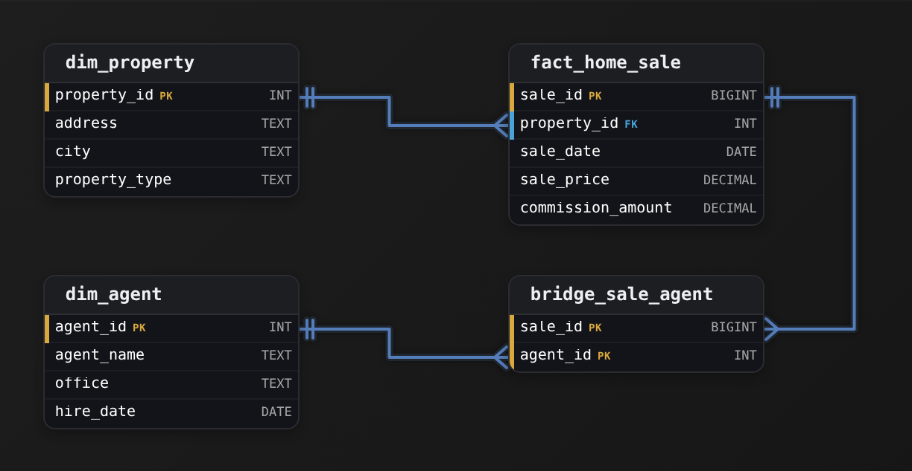
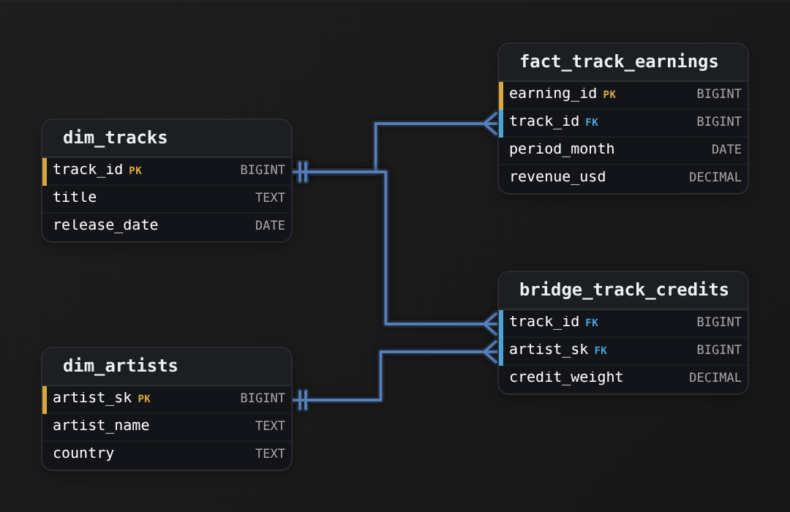
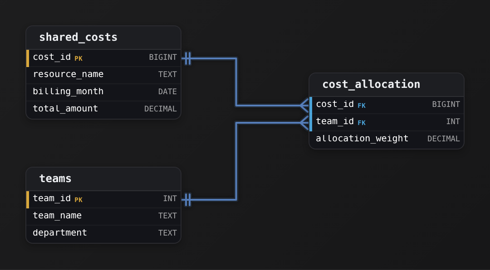
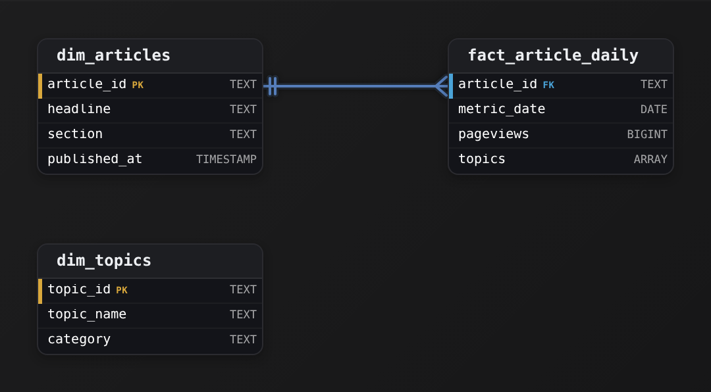
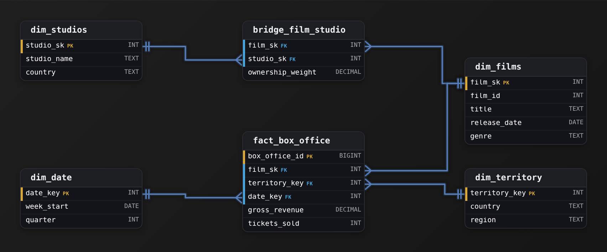
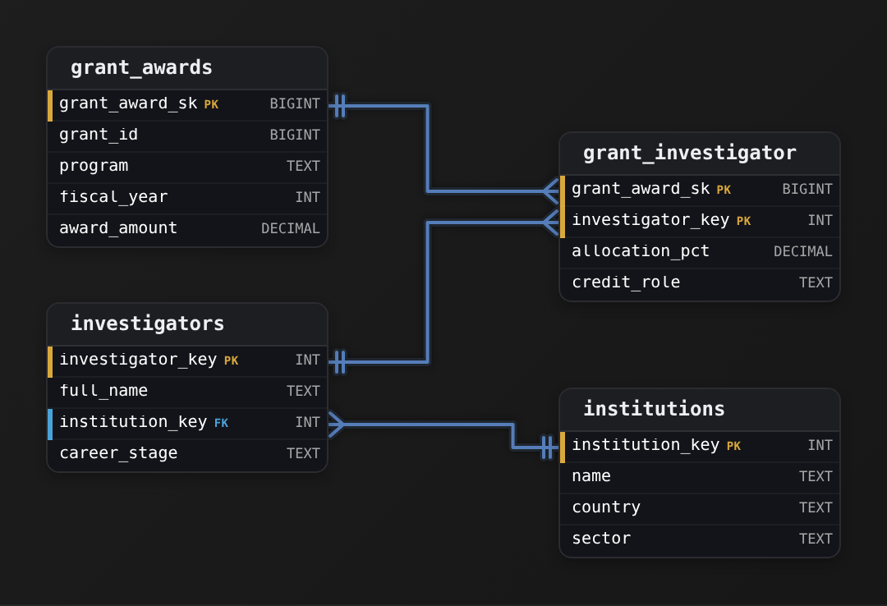
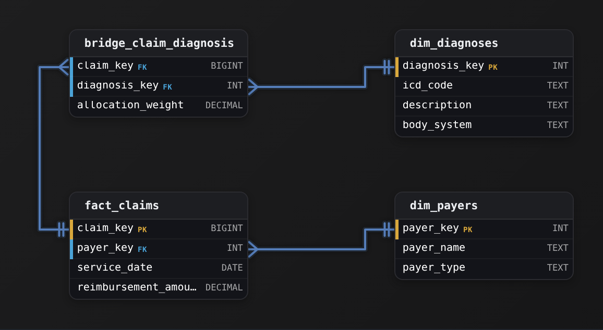

# Bridge Tables: Advanced - Exercises

Lesson: [dm_pattern_bridge_tables.md](../dm_pattern_bridge_tables.md)

### Exercise 1 of 7

**● TASK**

A residential brokerage tracks every home sale and the commission it earns. Co-listings are routine here: one sale is frequently credited to several agents, and every agent works many sales across a season. Model this so the analytics team can report commission by agent while a company-wide commission total still ties out to what the brokerage actually earned.

<details>
<summary><strong>Solution</strong></summary>

#### What this problem really is

Strip the commission-reporting story away and this is a many-to-many between one fact and one dimension: a home sale connects to several agents, and each agent connects to many sales. The reflex trap is to hang an `agent_id` on `fact_home_sale`. The moment two agents co-list a deal that single column cannot hold both, and the candidate who 'fixes' it by joining a flat sale-to-agent list watches an $18,000 commission become $54,000 the instant 3 agents share the sale. Get the grain wrong here and every per-agent revenue report overstates the brokerage.

| Trick: Name the cardinality before you draw anything |
| --- |
| Say it out loud: one sale maps to many agents, and one agent maps to many sales. Both directions are 'many'. That is the tell that no foreign key on either table can carry the relationship, and the link has to move into a table of its own. |

#### Work through it

1. **Fix the fact grain first**

   One row of `fact_home_sale` is one sale, and it stores `commission_amount` exactly once. That grain is the thing you must protect: the whole design is judged on whether the sale's commission survives a join without multiplying.

2. **Refuse the column on the fact**

   An `agent_id` on `fact_home_sale` can only name one agent. Adding `agent_id_1`, `agent_id_2`, `agent_id_3` is worse: it caps the co-listing size and turns 'commission per agent' into an unmaintainable set of OR joins. The relationship does not belong on the sale row.

3. **Give the relationship its own table**

   Introduce `bridge_sale_agent` with `sale_id` and `agent_id`, one row per sale-and-agent pairing. A solo sale contributes one row, a three-way co-listing contributes three. Now agents attach to a sale without ever touching the sale's grain.

#### The reference model

The link table sits between the fact and the agent dimension. `fact_home_sale` keeps its measure once, `dim_agent` stays a clean list of agents, and `bridge_sale_agent` holds only the pairing. Its composite key (`sale_id`, `agent_id`) is what pins the grain to one row per pairing.



*`bridge_sale_agent` carries the many-to-many; `fact_home_sale` still holds `commission_amount` exactly once.*

| Interviewer: The tell that you understand grain |
| --- |
| A strong candidate states the inflation problem before being asked: 'A sale credited to three agents would triple in a naive SUM.' Then they keep the commission on the fact at one row per sale and move the agent links out. Interviewers listen for that sentence. |

| Pitfall: Multiple agent columns is the same mistake, dressed up |
| --- |
| Widening the fact to `agent_id_1..agent_id_3` looks like it dodges the linking table, but it hard-codes a maximum, wastes columns on solo sales, and makes 'commission by agent' a query nobody wants to write. It is still a foreign key on the fact, just repeated. |

#### Why the fact grain matters

**The inflation a naive join creates**

```sql
/* One sale, three co-listing agents, $18,000 commission. */
/* Joining the sale straight to its agent links multiplies the measure: */
SELECT SUM(s.commission_amount) AS reported_commission
FROM fact_home_sale s
JOIN bridge_sale_agent b ON b.sale_id = s.sale_id;
/* reported_commission = 54000, not 18000. */

/* The company total stays honest only when you sum at the sale grain: */
SELECT SUM(commission_amount) AS company_commission
FROM fact_home_sale;
```

*The linking table resolves the relationship; keeping the fact at one row per sale is what keeps the total correct.*

| Real world: Recognition first, allocation next |
| --- |
| Right now the goal is recognizing the many-to-many and giving it a home without corrupting the fact grain. Deciding how much of the $18,000 each agent actually earned is a separate step you build on top of this structure later; you cannot allocate a relationship you have not modeled yet. |

**Follow-up questions**

1. How would you report total commission per agent from this model without overstating any single sale?\
   *Tests whether the candidate keeps the sale-grain SUM separate from per-agent slicing through the linking table.*
2. What changes if the brokerage later wants to know each agent's share of a co-listed deal?\
   *Opens the door to allocation on the link rows, the natural next step after recognizing the many-to-many.*
3. A sale is recorded with zero agents attached during data entry. How does your model behave?\
   *Tests whether the fact can stand alone and whether missing bridge rows silently drop the sale from agent reports.*

</details>


<br>

### Exercise 2 of 7

**● TASK**

A music streaming service records each track's earnings monthly, storing one row per track per month. Artist credits are stored separately, with most tracks crediting multiple collaborators. A naive join-and-sum by artist inflates the totals: a track earning $1,000 credited to three artists appears as $3,000 across those artists. Design a bridge table with allocation weights that splits each track's earnings across its credited artists, so per-artist totals reconcile to actual earnings.

<details>
<summary><strong>Solution</strong></summary>

#### What this problem really is

This is a **many-to-many attribution** wearing a royalty-report costume: one track's dollars have to reach several artists, and one artist collects from many tracks. Anyone can join `fact_track_earnings` to the artist credits, and that join is exactly the trap. Fan a $1,000 track out to its three credited artists and a plain sum reports $3,000, because the revenue row is repeated once per credit. The fix is a bridge table with an allocation `credit_weight`, and the tell of a senior answer is that the weights for one track sum to 1.0.

#### Break down the requirements

1. **Declare the two grains**

   `fact_track_earnings` is one row per track per month, carrying `revenue_usd`. The relationship between a track and its artists is separate and coarser: it does not change month to month. Two grains means two tables, not one wide row.

2. **Build the bridge with a share**

   `bridge_track_credits` holds only `track_id`, `artist_sk`, and `credit_weight`. Grain is one row per track-artist pair, keyed by the composite of both foreign keys. The `credit_weight` is the whole point: it is neither a track fact nor an artist attribute, so it can only live here.

3. **Attribute by scaling before summing**

   Join earnings to the bridge on `track_id`, then to `dim_artists` on `artist_sk`, and sum `revenue_usd * credit_weight`. Because a track's weights sum to 1.0, the attributed dollars add back up to the track's actual revenue instead of a multiple of it.

#### The reference model



*The composite key on `bridge_track_credits` is (`track_id`, `artist_sk`); its `credit_weight` values sum to 1.0 per `track_id`.*

**Attributed revenue per artist**

```sql
SELECT
    a.artist_name,
    SUM(e.revenue_usd * b.credit_weight) AS attributed_revenue
FROM fact_track_earnings e
JOIN bridge_track_credits b ON b.track_id = e.track_id
JOIN dim_artists a ON a.artist_sk = b.artist_sk
GROUP BY a.artist_name
ORDER BY attributed_revenue DESC
```

*For a $1,000 track split 0.5 / 0.3 / 0.2, this returns $500, $300, $200: total $1,000, not $3,000.*

| Interviewer: The sum-to-one check is the signal |
| --- |
| A strong candidate volunteers the invariant unprompted: `credit_weight` per `track_id` must sum to 1.0, and they would enforce it upstream because the schema alone cannot. Say it out loud and walk the math on a sample track; that is the depth the interviewer is probing for. |

| Pitfall: Weights without the constraint still lie |
| --- |
| Adding a `credit_weight` column but never asserting it sums to 1.0 is the subtle failure. Weights of 0.5 / 0.5 / 0.5 across three artists quietly attribute $1,500 of a $1,000 track. The column is necessary but the invariant is what makes the totals honest. |

#### Trade-offs

| ✕ Naive join, no weight | ✓ Weighted bridge |
| --- | --- |
| Join `fact_track_earnings` straight to a credits table and `SUM(revenue_usd)`.<br><br>* One line of SQL<br>* Every multi-artist track inflates by its credit count<br>* The number looks plausible, which is why it ships and then fails an audit | Route the join through `bridge_track_credits` and `SUM(revenue_usd * credit_weight)`.<br><br>* Totals reconcile to actual revenue by construction<br>* Costs one numeric column and an upstream sum-to-one check<br>* Extends cleanly to per-country or per-month attribution |

| Real world: Money math gets audited |
| --- |
| Royalty numbers land in artist statements and tax filings, so an inflated aggregate is not a cosmetic bug: it is a payout that does not tie out. Modeling the split as data on the bridge, rather than baking dollars onto it, means a restated month reprices every artist automatically the next time the query runs. |

**Follow-up questions**

1. A label wants earnings attributed by both artist and country of streaming. How does the model change?\
   *Tests whether the candidate adds a second bridge or a conformed dimension without duplicating the weight logic.*
2. A track's split is renegotiated retroactively. How do you keep historical statements reproducible?\
   *Tests versioning the bridge (effective dates) versus overwriting weights in place.*
3. How would you enforce that weights per track sum to 1.0 if the schema itself cannot?\
   *Tests moving the invariant to an upstream validation or a scheduled reconciliation check.*

</details>


<br>

### Exercise 3 of 7

**● TASK**

A platform engineering group receives one monthly bill per infrastructure resource, split among the product teams that use it. Design the schema with allocation weights for each cost and team pair, where weights for any one cost sum to 1.0. A team's allocated cost is the billing amount times their weight, and the allocated shares reconcile to the invoice instead of inflating it.

<details>
<summary><strong>Solution</strong></summary>

#### What this problem is really about

Beneath the finance framing this is a **metric additivity** problem across a many-to-many. One `shared_costs` row meets many `teams`, so the moment you join `total_amount` through a plain junction the cost is copied onto every team row and `SUM(total_amount)` reports a multiple of the invoice. The fix is not a bigger join; it is a fractional `allocation_weight` on the bridge that splits the one cost into shares that add back to the whole. Miss it and finance sees infrastructure spend inflated by the number of teams, then spends a day hunting a bug that lives in your grain.

#### Break down the requirements

1. **Fix the fact grain**

   One row in `shared_costs` is one resource for one billing month, and `total_amount` lives there exactly once. Repeating the amount anywhere else is what invites double-counting later.

2. **Bridge the many-to-many**

   `cost_allocation` sits between `shared_costs` and `teams` at the grain of one row per (`cost_id`, `team_id`), with a composite key and foreign keys to both sides. This much you already know from the earlier sections.

3. **Put the weight on the bridge**

   Add `allocation_weight` to `cost_allocation`: the fraction of that cost's amount this team carries. It belongs on the bridge, not on the team, because the split is a property of the cost-to-team pairing and it drifts month to month as usage shifts.

4. **Make the shares reconcile**

   For any single `cost_id` the weights across its teams must sum to 1.0. That invariant is what guarantees the allocated shares add back to `total_amount`, and stating the validation check unprompted is the senior tell here.

#### The reference model

`shared_costs` holds the invoice once, `teams` is the dimension, and `cost_allocation` is the weighted bridge. Each team's share is `total_amount * allocation_weight`, which stays additive across the many-to-many; a plain `SUM(total_amount)` through the join never does.



*`cost_allocation` carries `allocation_weight`; per `cost_id` the weights sum to 1.0 so shares reconcile to `total_amount`.*

| Trick: The weight is what makes SUM safe again |
| --- |
| A junction alone answers who uses what. Adding `allocation_weight` turns the bridge into an allocation model: `SUM(total_amount * allocation_weight)` grouped by team is additive and reconciles to the invoice, because the weights for each cost sum to 1.0. |

| Pitfall: AVG is not a weighted average |
| --- |
| Asked for average allocated cost, candidates reach for `AVG(total_amount * allocation_weight)`. That averages the shares, not the amounts. The weighted average is `SUM(total_amount * allocation_weight) / SUM(allocation_weight)`. |

| Interviewer: Reconciliation stated before the query |
| --- |
| The strong answer opens with the double-counting problem, designs weights that sum to 1.0, and mentions the per-cost weight validation check without being asked. Reaching straight for a plain junction, with no weight and no reconciliation, is the fail. |

**Follow-up questions**

1. The split percentages change every month as usage shifts. Does your bridge still work?\
   *Tests time-varying allocation: weights already live per `cost_id` on the bridge, so monthly drift is captured naturally rather than as a static team attribute.*
2. For one cost nobody has agreed on the split yet. How do you allocate its amount?\
   *Tests the unknown-allocation case: a default even split (1/n) or an unallocated bucket, while keeping the per-cost sum at 1.0.*
3. How would you catch a cost whose team weights do not add up to 1.0 before finance sees it?\
   *Tests the validation instinct: a check that groups the bridge by `cost_id` and flags any sum that is not 1.0.*

</details>


<br>

### Exercise 4 of 7

**● TASK**

A news publisher on BigQuery tracks daily article metrics, with each article tagged at publish with one to six topics, each carrying a static prominence weight. Model topic membership as a nested array on the fact row pairing topic ID with prominence weight (not a bridge table), so analysts can attribute daily pageviews proportionally; maintain separate dimensions for stable topic attributes and keep the fact grain at one row per article per day.

<details>
<summary><strong>Solution</strong></summary>

#### Why this problem exists in real interviews

Strip the newsroom framing and this is one decision: when a many-to-many is small, frozen, and read by a single fact, does it still deserve its own bridge table? On a columnar warehouse, it does not. The relationship here caps at six topics, the weights are set once and never move, and nothing else reads the mapping, which is exactly the profile where a nested `ARRAY<STRUCT>` on the fact row beats a junction table. The trap is reflex: a candidate who just learned bridge tables builds `article_topic_bridge` out of habit, multiplying the row count and adding a join for a relationship that never needed to leave the fact.

| Trick: 4 signals flip the decision |
| --- |
| Nesting wins when all 4 hold: cardinality is low (at most six per row), the weights are static, the mapping is used by one fact only, and the engine supports arrays (BigQuery, Snowflake, Databricks). Flip any one of those and the bridge table is back in play. State the checklist out loud before you draw anything. |

#### Break down the requirements

1. **Read the cardinality and volatility signals**

   Six topics maximum, weights fixed at publish, one consumer. Each of those is a reason NOT to pay for a separate table. A bridge earns its keep when relationships grow unboundedly or their weights drift over time; neither is true here.

2. **Nest the membership on the fact**

   Put a repeated `topics` column on `fact_article_daily`. The many-to-many now lives inside the row it describes, so adding a new topic to the taxonomy touches `dim_topics`, never the metrics table.

3. **Keep the weight paired with each topic ID**

   The prominence weight belongs to the article-topic pairing, not to the topic globally, so it travels with the topic ID in each element. That is what lets you split a day's pageviews additively once the array is exploded.

4. **Flatten with UNNEST at query time**

   `UNNEST(topics)` produces one row per article-topic pair on demand, the same shape a bridge join would give you, but the fact at rest stays compact. The relationship is materialized only for the queries that need it.

#### The reference model

One fact, 2 dimensions, no bridge. The topic membership rides inside `fact_article_daily.topics` as a repeated struct pairing topic ID and weight; `dim_topics` holds the stable attributes so a topic rename never rewrites a fact row.



*Topics are nested inside `fact_article_daily` as an `ARRAY<STRUCT>` holding topic ID and prominence weight together; `dim_topics` supplies stable attributes and is queried after `UNNEST`.*

#### The analysis pattern

**Weighted pageviews per topic, today**

```sql
SELECT
    dt.topic_name,
    SUM(f.pageviews * topic.prominence) AS weighted_pageviews
FROM fact_article_daily f,
     UNNEST(f.topics) AS topic
JOIN dim_topics dt ON dt.topic_id = topic.topic_id
WHERE f.metric_date = CURRENT_DATE()
GROUP BY dt.topic_name
ORDER BY weighted_pageviews DESC
```

*UNNEST flattens the array into rows, then `dim_topics` supplies the names.*

| Performance: The fact never fans out |
| --- |
| With a bridge, six topics per article turn one metrics row into six, so a table that should scan N rows scans up to 6N and every topic query pays a join. Nested, the fact stays exactly one row per article per day; `UNNEST` only expands the rows a given query touches, and columnar storage keeps the array cheap to skip when a query ignores topics. |

| Interviewer: Name both, then choose |
| --- |
| The senior tell is that you describe BOTH options and the switch conditions, not that you pick nesting and stop. Say it plainly: nested `ARRAY<STRUCT>` for low-cardinality static relationships on an array-capable engine, a bridge table the moment weights change over time, the mapping is reused across facts, or the query has to run on an engine without arrays. |

| Pitfall: The name outlives the row |
| --- |
| Denormalizing `topic_name` into the struct feels convenient until a topic is renamed and you have to rewrite every fact row that ever referenced it. Store only `topic_id` and `prominence` in the struct and join `dim_topics` for the label, so the mutable attribute lives in exactly one place. |

#### Trade-offs and alternatives

| ✕ Nested ARRAY on the fact | ✓ Separate bridge table |
| --- | --- |
| Membership and weight live inside the row.<br><br>* Fact stays one compact row per article per day<br>* New topics need no schema change to the metrics table<br>* Needs `UNNEST` and only runs on modern columnar warehouses<br>* Awkward when the same mapping must feed a second fact | `article_topic_bridge` with explicit weight columns.<br><br>* Standard joins, works on every engine<br>* One mapping reusable across many facts<br>* Handles weights that change over time, versioned by date<br>* Row count grows with relationships and every topic query pays a join |

**Follow-up questions**

1. Editors start revising prominence weights every week. Does your model still hold?\
   *Tests whether the candidate recognizes that changing weights break the static assumption and push toward a bridge with a validity window.*
2. A new video-plays fact needs the same article-to-topic mapping. Now what?\
   *Tests the cross-fact-reuse trigger: a mapping read by more than one fact belongs in a shared bridge, not duplicated in 2 nested columns.*
3. This pipeline also has to run on Postgres. How does the design change?\
   *Tests whether the candidate ties the nesting choice to engine support and falls back to a bridge table where arrays are unavailable.*

</details>


<br>

### Exercise 5 of 7

**● TASK**

A film distribution company records box office results, storing one row per film per territory per week with that week's gross revenue and tickets sold. Most titles here are co-productions: several studios back a single film and split its economics by an agreed ownership share, while each studio backs many films. Design a dimensional model that reports each studio's attributed share of box office revenue without letting a film's gross count more than once.

<details>
<summary><strong>Solution</strong></summary>

#### Why this problem exists in real interviews

Underneath the box office framing this is a weighted many-to-many between films and studios, and the whole problem is refusing to let one film's gross count more than once. Anyone can drop a `studio_sk` onto the fact or join `dim_films` to `dim_studios`; the moment you do, a co-production with 3 backers reports triple its real gross. The skill being probed is putting the split in a bridge that carries an `ownership_weight`, and narrating why before you draw it.

| Trick: Narrate it in five moves |
| --- |
| Name the many-to-many, state the inflation risk, introduce the weighted bridge, show the `SUM(gross * weight)` query, then volunteer the sum-to-one check. That sequence hits every rubric item and takes about a minute out loud. |

#### Break down the requirements

1. **Name the many-to-many**

   Say it plainly: one film is backed by several studios and one studio backs many films. Neither side owns the other, so `dim_films` cannot carry a `studio_sk` and `dim_studios` cannot carry a `film_sk`.

2. **State the aggregation risk**

   Join a film to its studios and every box office row repeats once per backer, so `SUM(gross_revenue)` overcounts by the number of studios on the film. Name that inflation before you fix it; interviewers wait to hear it said.

3. **Introduce the weighted bridge**

   Create `bridge_film_studio`: one row per film-and-studio pairing carrying `ownership_weight`, the agreed fraction of that film's economics. The weights for a single film total exactly 1.0.

4. **Show the query pattern**

   Attributed revenue is `SUM(gross_revenue * ownership_weight)` grouped by studio. Each studio collects only its share, and the shares of one film sum back to that film's true gross.

5. **Mention the validation**

   Add a data quality check: `ownership_weight` summed per `film_sk` must equal 1.0. A film totalling 0.8 has a missing backer; one totalling 1.2 has a duplicate pairing. Volunteering this is what reads as senior.

#### The reference model

Keep `fact_box_office` at its natural grain of one row per film per territory per week; it never gains a studio column. The bridge sits between the fact's `film_sk` and `dim_studios`, so per-studio attribution is a join through the bridge rather than a fan-out of the fact itself.



*`fact_box_office` holds one gross per film per territory per week; `bridge_film_studio` carries `ownership_weight` summing to 1.0 per `film_sk`.*

| Key insight: The weight lives on the bridge |
| --- |
| Not on the fact, not on the dimension. That is what lets one physical box office row serve every studio at once while each studio reads only its `ownership_weight` fraction of the gross. |

| Interviewer: Grain and validation, unprompted |
| --- |
| A strong candidate names the many-to-many, calls out the double-count, then reaches for the weighted bridge without being pushed, and volunteers the sum-to-one check before being asked for data quality. |

| Pitfall: The studio column on the fact |
| --- |
| Putting `studio_sk` directly on `fact_box_office` looks additive and passes a smoke test on solo titles, then silently triples revenue the first time a three-studio co-production lands. |

#### The query pattern

**Attributed revenue per studio**

```sql
SELECT
    s.studio_name,
    SUM(f.gross_revenue * b.ownership_weight) AS attributed_revenue
FROM fact_box_office f
JOIN bridge_film_studio b ON b.film_sk = f.film_sk
JOIN dim_studios s ON s.studio_sk = b.studio_sk
GROUP BY s.studio_name
```

*The `ownership_weight` multiplier is what keeps the co-production's gross from counting more than once.*

| ✕ Weighted bridge | ✓ `studio_sk` on the fact |
| --- | --- |
| `bridge_film_studio` holds `ownership_weight`; the fact stays one row per film-week.<br><br>* Gross is never duplicated<br>* `SUM(gross * weight)` gives each studio its share<br>* Splits validate with a sum-to-one check | Every box office row is stamped with one studio.<br><br>* A co-production needs many rows or a duplicated row<br>* `SUM(gross_revenue)` triples the real total<br>* No place for a fractional share to live |

**Follow-up questions**

1. A studio sells its stake mid-run and the ownership split changes partway through the year. How does the model capture a weight that changes over time?\
   *Tests whether the candidate versions the bridge with effective dates rather than overwriting a single weight.*
2. How would you attribute `tickets_sold`, which is a count, the same way?\
   *Tests that the weighting generalizes to any additive measure, and whether fractional tickets are acceptable for reporting.*
3. Finance wants attributed revenue per studio per quarter and per territory. Where do those grains enter without disturbing the bridge?\
   *Tests joining through `dim_date` and `dim_territory` on the fact while the split stays anchored on the bridge.*

</details>


<br>

### Exercise 6 of 7

**● TASK**

A national science funder records one row per grant award: the funding program, the fiscal year, and the total dollars awarded. Every grant is credited to several principal and co-investigators, each based at one institution, and each investigator carries a documented share of the credit. Model this so the finance team can report total funding attributed to each institution in a fiscal year without any dollar being counted twice, see how many grants each investigator is credited on, and read the true average award size across grants. Decide how an investigator's share of a grant is represented and where it lives so institution totals always reconcile back to the sum of awards.

<details>
<summary><strong>Solution</strong></summary>

#### Why this problem exists in real interviews

Strip the funding story away and this is a **weighted many-to-many** between `grant_awards` and `investigators`, dressed up as a finance report. Anyone can see a grant has several investigators. The trap is the rollup: join `grant_awards` to the credits and every `award_amount` fans out to one copy per investigator, so `SUM(award_amount)` grouped by institution counts the same dollars two, three, 5 times. The fix is a weight on the bridge. Each credit carries an `allocation_pct`, the shares sum to 1.0 per grant, and you attribute `award_amount * allocation_pct`. Miss it and a five-investigator grant reports 500% of its own funding.

| Trick: The weight lives on the bridge, not the fact |
| --- |
| The moment a grant credits more than one investigator, the split cannot sit on `grant_awards` (which investigator's share would it be?) and cannot sit on `investigators` (it changes per grant). It belongs on the row that represents the pairing: the bridge. Put `allocation_pct` there, constrain it to sum to 1.0 per grant, and every downstream total reconciles. |

#### Break down the requirements

1. **Declare the fact grain and leave it alone**

   `grant_awards` is one row per grant per fiscal year, carrying the full `award_amount`. That grain is what makes average award size and the total awards ledger trivial. Do not shred it to one row per investigator: the moment you do, the one true award figure is gone.

2. **Model the credit as a bridge**

   `grant_investigator` is one row per (grant, investigator), with a composite key of `grant_award_sk` and `investigator_key`. This is the junction that resolves the many-to-many without repeating investigator columns on the fact or duplicating grants on the dimension.

3. **Put the weight on the bridge and make it additive**

   Add `allocation_pct` to the bridge. Attribution becomes `SUM(award_amount * allocation_pct)`. Because the shares sum to 1.0 per grant, the attributed dollars sum back to exactly the award total: additive, reconcilable, no double count.

4. **Roll investigators up to one institution**

   Each investigator sits at exactly one institution, so `investigators.institution_key` is a plain FK. Institution funding is the weighted attribution grouped through that FK, and because the weight already de-fanned the dollars, the rollup stays clean.

#### The reference model

A classic star with a weighted bridge in the middle. `grant_awards` holds the dollars, `grant_investigator` holds the shares, and `investigators` snowflakes out to `institutions` so credit rolls up one hop.



*`allocation_pct` on `grant_investigator` sums to 1.0 per grant, so `award_amount` * `allocation_pct` reconciles to the award total.*

| Performance: The bridge stays small, the fact stays clean |
| --- |
| With a few million grants and an average of 3 credits each, `grant_investigator` is a slim two-key table the optimizer joins on integer keys. Attribution is one hash join and a grouped sum. Nothing scans the wide fact twice, and the ledger reconciliation is a single `SUM(award_amount)` against `SUM(award_amount * allocation_pct)`. |

| Interviewer: Say the words: weighted allocation, reconciles to the total |
| --- |
| Strong candidates name the many-to-many out loud, put the weight on the bridge unprompted, and state that the shares sum to 1.0 so attribution is additive. They also volunteer the `AVG` trap before being asked: average award size is computed over `grant_awards`, never over the joined credit rows. |

| Pitfall: Averaging the fanned-out rows |
| --- |
| The subtle failure is not the SUM (people usually weight that). It is `AVG(award_amount)` computed after joining the bridge: a grant with 6 investigators contributes its amount 6 times, so big-team grants dominate the mean. Compute averages on the un-joined fact, or `SUM(weighted) / COUNT(DISTINCT grant_id)`. |

#### Bridge or a nested array?

| ✕ Weighted bridge table | ✓ ARRAY of credit structs on the fact |
| --- | --- |
| `grant_investigator` with `allocation_pct`.<br><br>* Filters and aggregates by investigator with a plain join<br>* Joins credits to `institutions` for the rollup<br>* Reconciliation is one grouped sum<br>* Costs an extra table to maintain | A repeated `credits` column of (investigator, share) on `grant_awards`.<br><br>* One row per grant, no join to read a grant's credits<br>* Needs UNNEST before any per-investigator or per-institution aggregate<br>* Institution attributes still require a join after unnest<br>* Fine on BigQuery or Snowflake for read-mostly, credit-with-the-grain access |

**Follow-up questions**

1. An investigator changes institutions mid-year. How do you attribute a grant they were credited on before the move?\
   *Tests whether the candidate reaches for an SCD Type 2 on investigators or captures institution on the bridge at credit time.*
2. A grant's shares were never recorded. What does your model report for it?\
   *Tests a sane default (equal split across credited investigators) that keeps institution totals reconciling, plus an imputed flag.*
3. Finance now wants funding split by both institution and program without any total exceeding the ledger. Does your design already support it?\
   *Tests that the weighted attribution composes across dimensions because the weight lives on the bridge, not on a single rollup.*

</details>


<br>

### Exercise 7 of 7

**● TASK**

A hospital revenue-cycle team needs to report reimbursement dollars per diagnosis, but each insurance claim pays one lump sum and covers multiple diagnoses. Clinical coders assign each diagnosis a severity-based share (shares sum to the full claim); model the schema with the reimbursement measure on the claim fact table and allocation shares on the bridge, so per-diagnosis totals reconcile to the claim ledger without double-counting.

<details>
<summary><strong>Solution</strong></summary>

#### What this problem really is

Strip the hospital costume and this is a **weighted bridge table** that must reconcile to a control total. A claim pays a lump `reimbursement_amount` but covers several diagnoses, so claim-to-diagnosis is many-to-many. The trap: fan `fact_claims` out to one row per diagnosis and `SUM(reimbursement_amount)` counts each dollar once per code, so a four-diagnosis claim reports 4 times its cost.

1. **Name the many-to-many**

   A claim lists many diagnoses and a diagnosis appears on many claims. Resolve it with its own table, never `diagnosis_1`/`diagnosis_2` columns and never by joining `dim_diagnoses` onto the fact.

2. **Declare the bridge grain**

   `bridge_claim_diagnosis` is one row per claim per diagnosis, keyed on `(claim_key, diagnosis_key)`, both foreign keys. The dollars stay on `fact_claims` at one row per claim.

3. **Put the severity share on the bridge**

   `allocation_weight` is a diagnosis fraction of the claim. It lives on the bridge, not `dim_diagnoses`, because the same diagnosis carries a different weight on every claim. Constrain a claim's weights to sum to 1.0.



*`reimbursement_amount` lives once on `fact_claims`; `allocation_weight` on `bridge_claim_diagnosis` sums to 1.0 per claim.*

| Trick: The weight is a partition of the dollar |
| --- |
| Because a claim's `allocation_weight` values sum to 1.0, `SUM(reimbursement_amount * allocation_weight)` across its diagnoses equals that claim's own `reimbursement_amount`, so the rollup ties back to the ledger. |

| Pitfall: The AVG trap and the raw SUM |
| --- |
| `SUM(reimbursement_amount)` across the bridge counts each dollar once per diagnosis and overstates cost. `AVG(reimbursement_amount)` silently assumes equal weights and ignores severity. Only the weighted sum is correct. |

**Reimbursement by diagnosis**

```sql
SELECT
    d.icd_code,
    d.description,
    SUM(c.reimbursement_amount * b.allocation_weight) AS allocated_reimbursement
FROM fact_claims c
JOIN bridge_claim_diagnosis b ON b.claim_key = c.claim_key
JOIN dim_diagnoses d ON d.diagnosis_key = b.diagnosis_key
GROUP BY d.icd_code, d.description
ORDER BY allocated_reimbursement DESC
```

| ✕ Weighted bridge table | ✓ Array column on the fact |
| --- | --- |
| `allocation_weight` on the bridge, summing to 1.0 per claim: rollups reconcile and severity is honored. | A diagnoses array on `fact_claims` adds no table, but rollups need `UNNEST` plus the same weight math, and the sum-to-one rule is harder to enforce. |

**Follow-up questions**

1. Finance wants reimbursement by body system, not individual ICD code. Does the allocation change?\
   *Rolling up through `dim_diagnoses` is a `GROUP BY` change; the weighted sum stays additive.*
2. How would you enforce that each claim's `allocation_weight` values sum to 1.0 at load time?\
   *Tests a validation aggregate check, since the schema cannot express a cross-row `CHECK`.*

</details>
