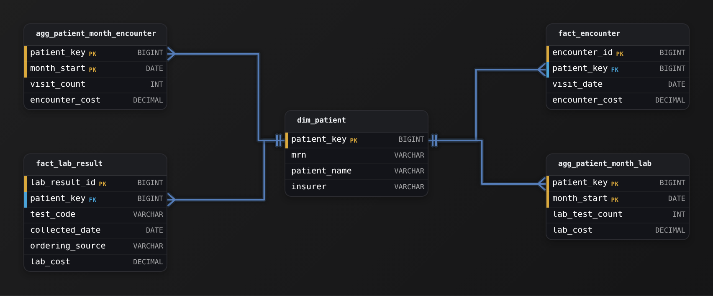
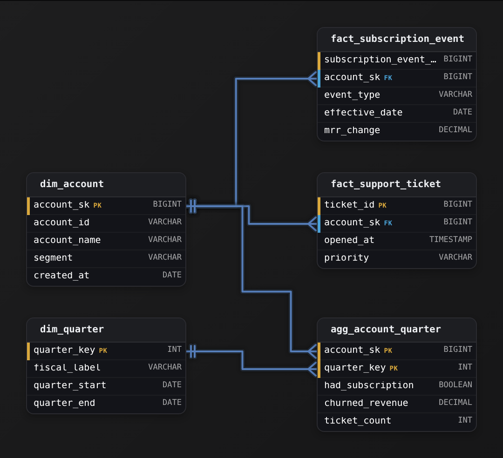
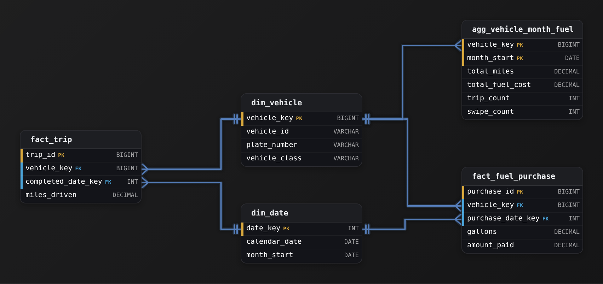
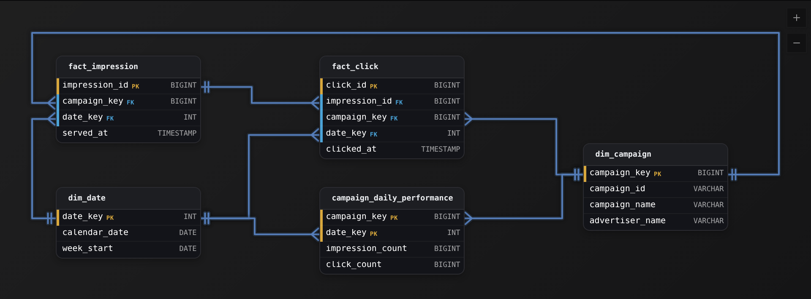

# Grain and Fan Traps: Advanced - Exercises

Lesson: [dm_pattern_grain_fan_traps.md](../dm_pattern_grain_fan_traps.md)

### Exercise 1 of 4

**● TASK**

Model the monthly cost-per-patient report so encounter cost and lab cost sit side by side and lab cost matches the lab vendor's invoice, instead of the roughly fourfold lab total produced now by combining a fact with one row per visit and a fact with one row per lab test through the patient dimension. Each figure has to reach one row per patient per month, backed by a key that proves it, before the 2 meet. A patient whose tests were ordered by an outside clinic, with no visit that month, still shows their lab cost.

<details>
<summary><strong>Solution</strong></summary>

#### 2 fans meeting at one patient

This is a fan trap wearing a reconciliation costume. `fact_encounter` and `fact_lab_result` both hang one-to-many off `dim_patient`, so the report pairs every visit with every test for the same patient: v visits and t tests become v times t rows. Anyone can see the number is high. What separates a senior answer is stating the factor per key and per measure: lab cost is multiplied by the patient's visit count, encounter cost by their test count. The CFO only caught the first because only lab cost has a vendor invoice to check it against. **The encounter figure is just as wrong and nobody has noticed.**

#### Break down the requirements

1. **State each grain and its key**

   Before touching the query, say it out loud: `fact_encounter` is one row per visit, unique on `encounter_id`; `fact_lab_result` is one row per resulted test, unique on `lab_result_id`. Both carry `patient_key`, so both are one-to-many from `dim_patient`. 2 one-to-many branches off one shared dimension, combined in one query, is the fan trap shape, and you can name it from the grains without running anything.

2. **Name the factor and the measure it hits**

   For a patient-month with v visits and t tests the combined rows number v times t. Each test row repeats once per visit, so `SUM(lab_cost)` is multiplied by v; each visit row repeats once per test, so `SUM(encounter_cost)` is multiplied by t. A fourfold lab total means lab spend sits mostly on patients averaging about four visits a month: the dialysis and oncology regulars.

3. **Collapse each fact to patient-month first**

   Build `agg_patient_month_encounter` and `agg_patient_month_lab`, each one row per (`patient_key`, `month_start`), with that composite as the primary key. Cost is additive across tests and visits, so summing is safe here. Carry `visit_count` and `lab_test_count` too: an average cost per visit is not additive and must be recomputed from the sums, never averaged again.

4. **Combine without dropping one-sided patients**

   The 2 rollups now meet one-to-one on (`patient_key`, `month_start`), so no fan is possible. An inner match would silently drop outside-clinic patients with tests and no visit, and their cost would vanish from a total being reconciled to the invoice. Take every key from either side and fill the missing measure with zero.

5. **Prove it with row counts**

   Run 3 checks every load. Grouping each rollup by (`patient_key`, `month_start`) returns no count above 1. `SUM(lab_cost)` in the lab rollup equals the same sum over `fact_lab_result` for the month, which is what the invoice reconciles to. The report's row count equals the unique patient-months across both rollups. The first proves the grain, the second no inflation, the third no chasm.

#### The reference model

Keep the 2 atomic facts as they are: they are correct at their own grain, and the bug was never in them. Add one rollup per fact at the report's grain, each keyed on (`patient_key`, `month_start`) and pointing back to `dim_patient`. The report reads only the rollups, so the only combination that ever happens is one-to-one, and the shared patient dimension lets finance slice either figure by insurer and get the same patient set.



*2 atomic facts, each rolled up to (`patient_key`, `month_start`) before the report combines them.*

**The report as it stands**

```sql
SELECT p.patient_key,
       DATE_TRUNC('month', e.visit_date) AS month_start,
       SUM(e.encounter_cost) AS encounter_cost,
       SUM(l.lab_cost) AS lab_cost
FROM dim_patient p
JOIN fact_encounter e ON e.patient_key = p.patient_key
JOIN fact_lab_result l
  ON l.patient_key = p.patient_key
 AND DATE_TRUNC('month', l.collected_date) = DATE_TRUNC('month', e.visit_date)
GROUP BY 1, 2;
```

*Both facts reach `dim_patient` in one pass, so every visit meets every test, and lab-only patients drop out.*

| Performance: The rollups are smaller than the fan |
| --- |
| At about 2 million visits and 9 million tests a year across 600,000 patients, each rollup holds at most one row per active patient-month, a few hundred thousand rows a month. The fan materialises v times t rows per patient-month before grouping: 5 visits and 40 tests produce 200 rows to compute 2 sums. The fix is cheaper as well as correct. |

| Interviewer: Say the factor per measure, not just that it is high |
| --- |
| The senior sentence is: lab cost is multiplied by visits per patient-month, encounter cost by tests per patient-month. Saying the query duplicates rows does not show which number is wrong by how much, and finance needs both factors to restate prior months. |

| Pitfall: `DISTINCT` hides the symptom, not the cause |
| --- |
| The reflex fix is `SUM(DISTINCT lab_cost)`. It collapses 2 different tests that happen to cost the same, so the total now drifts below the invoice by an amount nobody can explain. Change the grain before combining; never deduplicate values after. |

| ✕ Fixing it in each report | ✓ Fixing it in the model |
| --- | --- |
| Every analyst writes their own subqueries to pre-sum both facts. The next report that adds radiology cost reintroduces the fan, because nothing in the model stops it. | Patient-month rollups with a composite primary key are the published source for both measures. Any report reading them meets one row per key on each side, and the key, not memory, enforces the grain. |

**Follow-up questions**

1. A test collected on 30 March is resulted on 3 April after March has closed. Which month owns its cost, and what happens to the published March rollup?\
   *Late-arriving facts against a closed period: restate the rollup or book an adjustment, and say which reconciles to the invoice.*
2. Finance now wants average lab cost per visit by month. How do you serve it from this model?\
   *Metric additivity: the ratio is recomputed from summed `lab_cost` and summed `visit_count`, never averaged across patients.*
3. Radiology cost arrives as a third fact, one row per imaging study. What changes?\
   *Whether the candidate adds a third rollup at the same grain instead of a third branch in the query.*

</details>


<br>

### Exercise 2 of 4

**● TASK**

Churned revenue in last quarter's churn-against-tickets report for customer success comes out at half the figure finance published. Subscription events and support tickets both hang off the account, many accounts raised no tickets, and some accounts raising tickets are trials with no subscription yet. Model the combined result so every account appears once per quarter with its churned revenue, its ticket count and whether it held a subscription that quarter, because a trial with nothing to churn must never read as an account that stayed.

<details>
<summary><strong>Solution</strong></summary>

#### A chasm trap that hides behind a conservative number

This is a chasm trap dressed up as a customer success report. The first draft matched subscription events to tickets through the account and kept only accounts present on both sides, so every churned account that never called support vanished. Churners who leave quietly are most churners, which is why the total landed at half. The low number is the dangerous kind: nobody audits a figure that looks conservative. The second trap waits for whoever fixes it by widening the match: keep both facts at their raw grain, line them up per account, and every cancellation row meets every ticket row. The total flips from half of finance's figure to several times it. Grain first is the only way out.

#### Break down the requirements

1. **State the output grain**

   One row per account per fiscal quarter, unique on (`account_sk`, `quarter_key`). Say the violation in the same breath: grouping by those 2 columns and finding any count above 1 means the table no longer holds the fact it claims. That second sentence is what turns the grain from a label into a checked contract.

2. **Collapse each fact to that grain on its own**

   Sum churned revenue from `fact_subscription_event` per account and quarter. Count tickets from `fact_support_ticket` per account and quarter. Each rollup is now 1 row per key, so when the 2 meet nothing multiplies. Raw cancellation rows never see raw ticket rows.

3. **Start from every account, not from either fact**

   The spine is `dim_account` for each quarter. Both rollups attach to it and neither is allowed to filter it. The account that churned without a ticket stays, and so does the trial that raised tickets without a subscription. That spine is what puts finance's missing half back.

4. **Decide what absence means, measure by measure**

   `ticket_count` missing is 0: tickets log completely, so no row means none raised, and a count summed across accounts stays right. `churned_revenue` is 0 for a subscribed account that kept paying and NULL for a trial, because churn does not apply to revenue that never existed. `had_subscription` makes the line explicit, so an average churn per account never counts trials as loyal customers.

#### The reference model

The 2 source facts stay at their natural grain: 1 row per subscription event, 1 row per ticket, both keyed to `dim_account` by `account_sk`. The answer is `agg_account_quarter`, a rollup whose composite key (`account_sk`, `quarter_key`) is the grain statement made physical. It carries `churned_revenue`, `ticket_count` and `had_subscription`, built from every account in `dim_account` for every quarter in `dim_quarter`, so its row count is accounts times quarters regardless of what either fact holds.



*Both facts keep their own grain; `agg_account_quarter` is 1 row per account per quarter, unique on (`account_sk`, `quarter_key`).*

| Performance: Accounts times quarters, never events times tickets |
| --- |
| 40,000 accounts across 4 quarters is 160,000 rows a year. The fanned version would have held cancellations multiplied by tickets per account, millions of rows for a busy enterprise book. Finance reconciles with a plain `SUM(churned_revenue)` over 40,000 rows and never reads a ticket. |

| Interviewer: Grain and null policy in one sentence |
| --- |
| The senior tell is saying it in one sentence: 1 row per account per quarter, unique on (`account_sk`, `quarter_key`), tickets 0 when absent, churn NULL for accounts with no subscription. That is the sentence the semantic layer enforces and finance quotes back. |

| Pitfall: Widening the match trades half for several times |
| --- |
| Swapping the dropped-row match for one that keeps every account, while both facts are still raw, cures the chasm and opens a fan. An account with 2 cancellation rows and 30 tickets reports churn 30 times over. Collapse first, then combine. |

| ✕ Materialized account-quarter rollup | ✓ Drill-across at query time |
| --- | --- |
| Best when the grain is fixed and the number is governed: finance reconciles one quarterly figure and wants it identical every time it is read. Late tickets mean a rebuild of the affected quarter. | Best when readers slice freely by month, segment or region: query each fact separately to the shared grain over conformed `dim_account` and date, then merge the result sets. Nothing goes stale, and no fixed grain has to anticipate every question. |

**Follow-up questions**

1. Customer success now wants the same view by month and by segment. Do you add rows to `agg_account_quarter` or change approach?\
   *Whether the candidate sees that a fixed rollup cannot serve open slicing, and reaches for drill-across or a separate month grain.*
2. Tickets for last quarter keep arriving after the quarter closes, migrated from an acquired helpdesk. How does the rollup stay right?\
   *Late-arriving facts against a pre-aggregated table: rebuilding closed quarters and telling finance when a reconciled number can move.*
3. A trial converts in week 6 of the quarter and cancels in week 11. What does its row say?\
   *Whether `had_subscription` is a quarter-level fact rather than a current account attribute, and how that keeps history honest.*

</details>


<br>

### Exercise 3 of 4

**● TASK**

Completed trips are stored one row per trip with the vehicle and miles driven, and fuel card swipes one row per swipe with the vehicle and amount paid, yet one fill-up powers several trips and some trips burn fuel bought the week before. Cost per mile, first requested as a fuel cost column on each trip, is reported per vehicle per calendar month from stored monthly totals of fuel cost and miles that reconcile exactly to the swipe and trip records. Every table's model description states what one row of it represents.

<details>
<summary><strong>Solution</strong></summary>

#### A column with no row to live in

This is the lesson's grain question in its most casual disguise: add one column. `fact_trip` is one row per completed trip, unique on `trip_id`. `fact_fuel_purchase` is one row per card swipe, unique on `purchase_id`. Fuel cost is a fact about the swipe, and swipes relate to trips only through the vehicle, many to many. Anyone can say "connect them on the vehicle." The trap is that this is a **fan trap**: both facts hang one-to-many off the same vehicle, so every trip meets every swipe, and a cost stamped onto trips either repeats one fill-up across 6 trips or quietly drops the fuel bought last week. Get it wrong and fleet cost per mile lands at several times the fuel invoice, and finance notices before you do.

#### Break down the requirements

1. **State both grains as contracts**

   Say each grain with its key and its violation: `fact_trip` is one row per completed trip, unique on `trip_id`; `fact_fuel_purchase` is one row per swipe, unique on `purchase_id`. A count above 1 on either key means the table no longer holds what it claims. Now ask what `fuel_cost` would mean on a trip row. There is no single swipe it belongs to, so the column has no honest value at that grain.

2. **Find the grain both facts share**

   Trips and swipes meet only on vehicle and time. The coarsest grain the reader needs is vehicle per calendar month, and it is the finest one where both measures are true without guessing. That is where cost per mile lives.

3. **Total each side alone, then combine**

   Sum miles from `fact_trip` and fuel cost from `fact_fuel_purchase` separately to vehicle-month, then put the 2 totals side by side. Keep every vehicle present on either side: a vehicle that drove on last month's fuel has miles and zero cost, and dropping it is the chasm trap on the other side of the same mistake.

4. **Decide on allocation out loud**

   Nothing measures fuel burned per trip, so a per-trip cost would be an estimate. Say so and decline it for this ask. If billing later needs one, it is a separately named allocated measure with its rule written down, never a column that looks like a fact.

#### The reference model



*Both facts keep their own grain; `agg_vehicle_month_fuel` is the one place they meet.*

Both facts keep their native grain and keys and point at `dim_vehicle` and `dim_date`. The new table, `agg_vehicle_month_fuel`, is one row per vehicle per calendar month, unique on the composite (`vehicle_key`, `month_start`). It stores `total_miles` and `total_fuel_cost` as sums, both additive across vehicles and months, and never the ratio: cost per mile is non-additive, so a quarter is `SUM(total_fuel_cost) / SUM(total_miles)`, not an average of monthly ratios. `trip_count` and `swipe_count` make reconciliation checkable: summed across months they equal the row counts of the 2 facts.

| Performance: 2 narrow passes beat one wide product |
| --- |
| At 40,000 trips and 9,000 swipes a day the facts grow by about 18 million rows a year, while the summary grows by 2,000 vehicles times 12 months: 24,000 rows. Each month is 2 single-pass totals keyed on vehicle and month, never a trip-by-swipe pairing whose size is trips times swipes per vehicle. A swipe that posts three days late rebuilds one vehicle-month, not history. |

| Interviewer: The description sentence is the deliverable |
| --- |
| Write it the way an analyst will read it: 'One row per vehicle per calendar month, unique on (`vehicle_key`, `month_start`). Fuel cost counts in the month of the swipe, not the month it was burned, so cost per mile is valid per vehicle-month and coarser, never per trip.' The second clause is the one being scored: it names the question the table refuses to answer. |

| Pitfall: A fill-up repeated is a fill-up paid twice |
| --- |
| The usual move pairs `fact_trip` with `fact_fuel_purchase` on `vehicle_key` and the trip's week, then sums `amount_paid`. A $300 fill-up shared by 6 trips is counted 6 times. Tighten the window to stop it and the trips burning last week's fuel lose their cost entirely: the inflated number and the missing number are one design mistake. |

| ✕ Fuel cost on the trip row | ✓ Vehicle-month summary |
| --- | --- |
| `fact_trip` gains `fuel_cost` with no swipe that owns it. Either the cost repeats across trips and sums inflate, or one trip is picked and the rest read zero. The grain statement silently becomes false. | Each fact keeps one grain. Cost and miles meet at (`vehicle_key`, `month_start`), where both are true, both reconcile to their source, and the ratio is computed from sums. |

**Follow-up questions**

1. Operations now wants cost per mile per driver, and drivers swap vehicles mid-week. What changes?\
   *Whether the learner sees that driver is not on the swipe grain, so the shared grain moves or an allocation rule becomes unavoidable.*
2. Billing asks for a fuel cost on each trip to charge customers. How do you add it without breaking `fact_trip`?\
   *An explicitly named allocated measure, its rule stated, summing back to the vehicle-month total.*
3. A March 30 swipe posts on April 2, after March is published. What does the summary do?\
   *Late-arriving facts: rebuild the affected vehicle-month and say in the description when a month is final.*

</details>


<br>

### Exercise 4 of 4

**● TASK**

Design the tables behind an analyst's daily campaign report: every served ad and every click kept as its own event, each naming its campaign and when it happened, plus one row per campaign per day carrying that day's impressions and clicks so click-through comes straight off it. A campaign can be served all day without a single click, and both daily figures must match a straight tally of the raw events.

<details>
<summary><strong>Solution</strong></summary>

#### 2 facts, one row, no shared grain

This is the fan trap and the chasm trap in ad-tech clothing, and the whole answer is one sentence: 1 row of `campaign_daily_performance` is 1 campaign on 1 calendar date. Impressions and clicks are 2 facts at 2 different grains that share only a campaign and a day. Match clicks to impressions on `campaign_id` and every click meets every impression of its campaign: 40,000 impressions and 300 clicks become 12 million of each. Patch that with an inner match through the day and the quieter fault arrives: a campaign served all day with zero clicks vanishes, and **a missing row draws far less suspicion than a huge one**.

#### Break down the requirements

1. **State the grain of each source**

   `fact_impression` is 1 row per served ad, unique on `impression_id`; `fact_click` is 1 row per click, unique on `click_id`. The target is coarser than both: 1 row per campaign per date, unique on (`campaign_key`, `date_key`). Say the check out loud: counting the target by those 2 columns must never return anything above 1.

2. **Read the three drafts by their grain**

   Draft 1, clicks matched to impressions on `campaign_id`, has no grain you can state: a row is an impression-click pair from the same campaign, so each count is multiplied by the other side's rows. Draft 2, one row per (campaign, date) holding both counts, is the right grain. Draft 3 puts a day's click count on every `fact_impression` row: summing it multiplies clicks by impressions, and a day with clicks but no new impressions has no row to carry them.

3. **Conform campaign and date**

   Draft 2 is buildable only because both facts point at the same `dim_campaign` and `dim_date`. Count impressions per (`campaign_key`, `date_key`) and clicks per (`campaign_key`, `date_key`) separately, then line the 2 small results up on those shared keys, keeping members present on either side and writing a missing count as 0. Without conformed keys the sides cannot be lined up, and someone reaches for draft 1.

4. **Store counts, define the rate once**

   `impression_count` and `click_count` add up across campaigns and days; click-through rate does not. Store the counts and define the rate in the semantic layer as `SUM(click_count) / SUM(impression_count)`, so a weekly rollup never averages 7 daily rates.

#### The reference model

2 atomic facts keep their own grain and point at 2 conformed dimensions. `fact_click` also carries `impression_id` to its served ad, but dates on its own `date_key`, so a late click lands on the day it happened. `campaign_daily_performance` is the pre-aggregated rollup: its composite key is the 2 dimension keys, and its only measures are the 2 additive counts.



*`campaign_daily_performance` is unique on (`campaign_key`, `date_key`); both facts conform to `dim_campaign` and `dim_date`.*

| Performance: Billions in, fifty thousand out |
| --- |
| About 2 billion impressions and 20 million clicks a day collapse to roughly 50,000 rows in `campaign_daily_performance`, about 18 million a year. The 90-day dashboard reads 90 rows per campaign. Draft 1 would have to build billions of pairs per campaign before the first number appears. |

| Interviewer: The click owns its own date |
| --- |
| Strong candidates say unprompted that a click reports on its own `date_key`, not its impression's, and that late mobile clicks mean the last 2 days of the rollup get rebuilt each run. That one sentence shows they see grain and late arrival as the same contract. |

| Pitfall: Counting unique ids hides the fan, it does not fix it |
| --- |
| Candidates rescue draft 1 with `COUNT(DISTINCT impression_id)`. The counts come out right, so the fan looks gone, but the first summed measure added later (spend, revenue) is multiplied again, and the query still builds every pair before deduplicating. Fix the grain, not the count. |

| Key insight: The grain sentence is the metric contract |
| --- |
| Write it where analysts read it: one row per campaign per calendar date, counts only. The semantic layer then refuses to average a rate across rows, and finance can reconcile `click_count` against `fact_click` by date in one query. |

**Follow-up questions**

1. Marketing adds conversions, one event per purchase attributed to a click. Where do they go?\
   *Whether a third fact gets counted to the same (campaign, date) grain on its own instead of being matched through clicks.*
2. An analyst wants impressions and clicks by ad placement too. Does `campaign_daily_performance` absorb that?\
   *Whether the candidate sees a new dimension as a new grain and builds a separate rollup rather than widening this one.*

</details>
