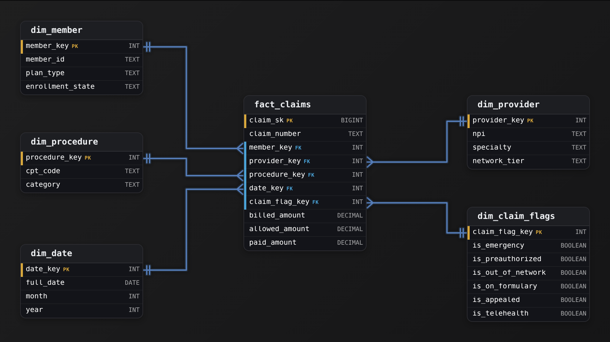
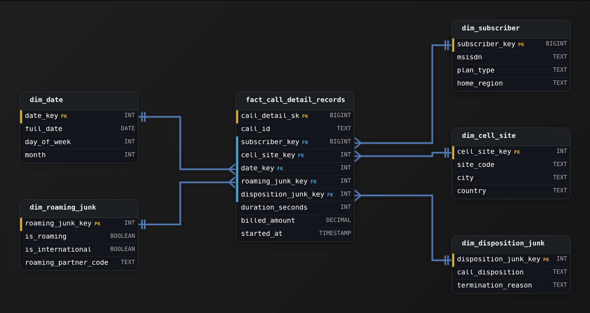
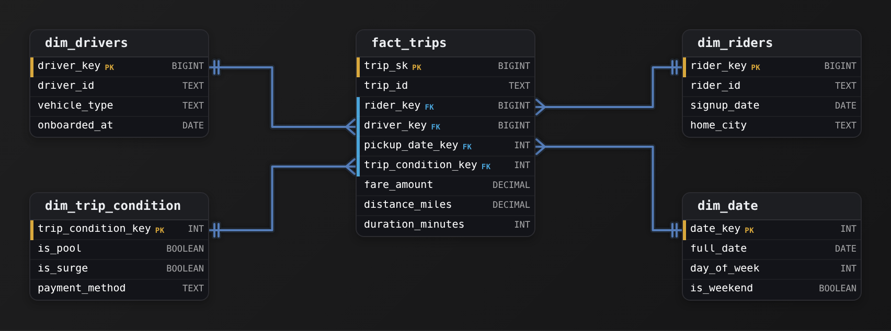

# Junk and Degenerate Dimensions: Advanced - Exercises

Lesson: [dm_pattern_junk_degenerate_dims.md](../dm_pattern_junk_degenerate_dims.md)

### Exercise 1 of 3

**● TASK**

A health-insurance analytics team runs a claims warehouse where every claim carries six yes/no attributes: whether it was an emergency, whether it was pre-authorized, whether it went out-of-network, whether the drug was on formulary, whether it was appealed, and whether it was delivered via telehealth. A prior team gave each flag its own dimension table, and analysts now bolt six extra joins onto every query and complain about the cost. Redesign the model so those flags stop multiplying the join count, and decide where each claim's identifier belongs given that it is unique to one claim and carries nothing else worth storing.

<strong>Solution</strong>

#### What this problem is really testing

Beneath the insurance framing this is the dimension-explosion clean-up: a prior team treated every yes/no flag as if it deserved its own `dim_` table, so a claim now drags six one-column dimensions behind it and every query pays six joins for six booleans. The skill being probed is recognizing that a low-cardinality flag is neither a measure nor a real dimension, and that the right home for a pile of them is ONE junk dimension. The trap sits on the other side: the claim identifier looks like it wants a table too, and a candidate who reflexively normalizes it builds `dim_claim_number` keyed one-to-one with the fact. That table adds a join that hands back the exact value already on the fact row and describes nothing.

| Trick: Two homes, decided by what the column carries |
| --- |
| Ask one question per orphan column: does it have a small set of repeating values shared across rows, or is it unique per row with nothing to describe? Repeating low-cardinality flags collapse INTO a junk dimension. A per-row identifier with no attributes stays ON the fact as a degenerate dimension. Six flags go one way, `claim_number` goes the other. |

#### Working it out

1. **Name the anti-pattern out loud**

   Six dimensions that each hold a single boolean is the dimension-explosion smell. A `dim_emergency` table with two rows ('yes' and 'no') earns nothing over a boolean, and it forces a join. The fix is consolidation, not another round of the same.

2. **Fold the flags into one junk dimension**

   Build `dim_claim_flags` with one surrogate key and all six boolean columns. Each row is a distinct COMBINATION of the six values. The fact loses six foreign keys and gains one: `claim_flag_key`. Six joins become one.

3. **Leave the identifier on the fact**

   `claim_number` is unique to one claim and carries no further attributes, so a table for it would be keyed one-to-one with the fact and describe nothing. Keep it as a plain column on `fact_claims` with no surrogate: that is a degenerate dimension, and it is the correct home.

4. **Protect the real dimensions**

   Member, provider, procedure and date are genuine descriptive dimensions with many attributes. Consolidation is a tool for orphan flags only; do not let the clean-up sweep real dimensions into the junk table.

#### The reference model

`fact_claims` sits at one row per claim. It keeps foreign keys to the 4 real dimensions plus a single `claim_flag_key` into the junk dimension, holds the additive measures, and carries `claim_number` inline as a degenerate dimension. `dim_claim_flags` holds the six booleans behind one surrogate key.

*Six flag dimensions collapse into `dim_claim_flags`; `claim_number` rides on `fact_claims` as a degenerate dimension.*

| Performance: Sixty-four is the ceiling, twenty is the reality |
| --- |
| Six booleans can produce at most 2^6 = 64 rows in `dim_claim_flags`, and in practice only the ~20 combinations that actually occur ever get loaded. Every claim query drops from six flag joins to one join against a table that fits in a single page of memory. The join count falls; the plan gets cheaper on every query, not just the flag-heavy ones. |

| Interviewer: The identifier decision is the tell |
| --- |
| Strong candidates state the grain first, name the six flags as a junk dimension, and then explicitly refuse to build a table for `claim_number`, calling it a degenerate dimension. Volunteering WHY a per-row attribute-less identifier stays on the fact is the senior signal; drawing the junk dimension without addressing the identifier leaves the interviewer's real question unanswered. |

| Pitfall: Normalizing the identifier |
| --- |
| The most common miss is minting `dim_claim_number` with a surrogate key mapped one-to-one to the fact. It stores nothing the fact does not already hold and adds a mandatory join to retrieve a value that was already sitting on the row. Unique-per-row plus no attributes is the exact signature of a degenerate dimension, not a table. |

#### When one junk dimension stops being enough

| ✕ Keep one junk dimension | ✓ Split into two flag dimensions |
| --- | --- |
| Six flags, and even the two or three more product wants, keep the realistic combination count in the dozens against a 64-to-few-hundred ceiling. One table, one join, trivial to load. | Once the realistic combinations climb into the thousands, or one cluster of flags churns far more often than another, split them: for example clinical flags in one dimension and adjudication flags in another. Two small joins beat one bloated dimension. |

**Follow-up questions**

1. Product adds three more yes/no flags next quarter. Does your junk dimension survive?\
   *Tests whether the candidate reasons about the combinatorial ceiling and names a split threshold rather than assuming one table scales forever.*
2. One new flag is not boolean but a four-value status code. Does it still belong in `dim_claim_flags`?\
   *Tests that junk dimensions absorb low-cardinality codes too, and that the candidate re-checks the row-count math when a column has more than two values.*
3. Analysts want to filter claims by `is_out_of_network` without touching the fact. How does the junk dimension help?\
   *Tests understanding that consolidated flags remain independently queryable through the single dimension join.*

 

### Exercise 2 of 3

**● TASK**

A mobile carrier is building a warehouse over its call-detail records, one row per completed call. Every record carries two stable yes/no attributes, whether the call roamed off the home network and whether it crossed an international boundary, alongside two codes that keep expanding as partners are onboarded: the roaming-partner code and the call-disposition code. Each record also holds a globally unique call identifier that dispute agents look up but that carries no other attributes. Model the star so the network and outcome attributes get a home, the call identifier is stored without its own lookup table, and the design absorbs new partner and disposition codes without the flag combinations exploding into an unmanageable table.

<strong>Solution</strong>

#### Why this problem exists in real interviews

This is a junk-dimension design where the twist is **cardinality you cannot bound**. Anyone can sweep four orphan columns into one junk dimension. The real skill being probed is what you do when two of those columns (`roaming_partner_code`, `call_disposition`) keep growing forever as new carriers onboard. Put all four in one table and its row count is the product of every cardinality, so it balloons every quarter. The trap is treating the flag space as fixed: the candidate who cross-joins two flags with a growing partner list and a growing disposition list ships a dimension that is unmaintainable within a year, and who then tries to pre-populate every combination discovers there is no full list to pre-populate.

| Trick: Additive beats multiplicative |
| --- |
| The insight that cracks it: group the orphan attributes by subject area so the fact carries two SMALL junk keys instead of one huge one. Network attributes (`is_roaming`, `is_international`, `roaming_partner_code`) go in one dim, call-outcome codes (`call_disposition`, `termination_reason`) in another. Total rows become the SUM of two dims, not their product, and each dim absorbs a new code with a single new row loaded on demand. |

#### Break down the requirements

1. **Name the grain and sort the orphans**

   One row per completed call. Walk the columns: `duration_seconds` and `billed_amount` are measures; `subscriber`, `cell_site`, and `date` are real dimensions; the two flags and two codes are neither, so they are junk candidates; `call_id` is unique per row with no attributes, so it is a degenerate dimension.

2. **Do the combinatorial math before you draw a table**

   A single junk dim is `2 x 2 x partners x dispositions`. At 200 partners and 15 dispositions that is 12,000 rows, and both factors keep climbing. Splitting by domain gives `2 x 2 x partners` (about 800) plus `dispositions x termination_reasons` (about 120): roughly 920 rows, additive, with each factor growing on only one side.

3. **Load the junk dims insert-on-demand**

   You cannot enumerate the partner or disposition codes up front, so during the fact load you look up each observed combination and insert a junk row only when it first appears. The dims then hold only combinations that actually occurred, and a brand-new partner or code costs exactly one row.

4. **Leave the call identifier in the fact**

   `call_id` is unique per call and has no descriptive attributes. A lookup table would carry one row per fact row and add a join that buys nothing. Keep it as a degenerate dimension: a plain column on the fact, no surrogate key, filtered directly on dispute lookups.

#### The reference model

The star below carries the real dimensions plus two domain-grouped junk dimensions and the degenerate `call_id`. The anchor decision is that `dim_roaming_junk` and `dim_disposition_junk` are separate tables loaded on demand, which is what keeps the flag space bounded as carriers onboard.

*`call_id` is a degenerate dimension inside the fact; `dim_roaming_junk` and `dim_disposition_junk` are domain-grouped and loaded insert-on-demand.*

| Performance: How the split holds at scale |
| --- |
| Combined, the junk dim is `2 x 2 x partners x dispositions x termination_reasons`, growing multiplicatively on two unbounded axes. Split, `dim_roaming_junk` tops out near `4 x partners` and `dim_disposition_junk` near `dispositions x termination_reasons`, and insert-on-demand means each only ever holds combinations that actually occurred. Onboarding a new carrier adds one row to one dim, not a new slice of a cross product. |

| Interviewer: The growth question is the real test |
| --- |
| A strong candidate volunteers the multiplicative-versus-additive math before being pushed, names insert-on-demand loading by its behavior, and refuses to promote `roaming_partner_code` to its own dimension while it is a bare code. Stating grain first and classifying `call_id` as degenerate without prompting are the other tells. |

| Pitfall: One junk dim, pre-populated |
| --- |
| The common failure is a single `dim_call_junk` holding all four attributes, then trying to pre-build every combination. There is no full list of partner or disposition codes to enumerate, so the cross product is both impossible to seed and unbounded in growth. Giving `call_id` its own table is the sibling mistake: a lookup with one row per fact row. |

#### The design fork

| ✕ One combined junk dimension | ✓ Domain-grouped junk dimensions |
| --- | --- |
| All four attributes in `dim_call_junk`.  * Fewer FKs on the fact * Row count is the product of every cardinality * Two unbounded axes make it grow forever * Cannot be pre-populated, no full code list exists | Network attributes and outcome codes split into two dims.  * Row counts are additive, not multiplicative * Each unbounded axis lives in one dim only * Insert-on-demand keeps each dim to seen combinations * One extra FK on the fact, a cheap trade |

**Follow-up questions**

1. The business adds 3 more network flags next quarter. Which dimension changes and by how much?\
   *Tests whether the candidate can reason about adding columns to a junk dim versus its effect on row cardinality, and whether new flags belong with the stable network group.*
2. Roaming partners now arrive with a country and a settlement rate. Does anything move out of the junk dimension?\
   *Tests the boundary between a bare code (junk) and a real conformed dimension once descriptive attributes appear.*
3. How would you keep the junk-dimension lookup fast during a high-volume fact load?\
   *Tests insert-on-demand implementation detail: caching seen combinations, a unique constraint on the attribute set, avoiding duplicate junk rows under concurrency.*

 

### Exercise 3 of 3

**● TASK**

We run a ride-hailing marketplace and are building a warehouse over completed trips, one row per finished trip, each with a rider, a driver, a pickup timestamp, and the fare. Three attributes analysts filter on constantly ride on every trip: whether it was a pooled ride, whether surge pricing applied, and how the rider paid. Every trip also carries its own confirmation code, trip_id, unique to that single row. Design the dimensional model, and be ready to defend where trip_id lives and how the three low-cardinality attributes get a home.

<strong>Solution</strong>

#### Why this problem exists in real interviews

This is two homelessness problems wearing a ride-hailing costume, and the interviewer's suggestion is the trap. `trip_id` is a unique identifier with zero descriptive attributes; the flags `is_pool`, `is_surge`, and `payment_method` are attributes that are neither measures nor keys. The tell of seniority is refusing both bad homes the interviewer floats: a dedicated `dim_trips` (a one-to-one dimension, one row per fact row, joined to nothing) and parking `trip_id` in `dim_riders` (which silently changes the rider grain to one row per trip). Get either wrong and every rider-level rollup double counts.

| Trick: The unique ID stays put; the orphans move together |
| --- |
| A column that is unique per fact row and has no attributes is a **degenerate dimension**: it lives in the fact table with no key and no table. The scattered low-cardinality flags do the opposite, they collapse into one junk dimension so the fact keeps a single narrow FK instead of three wide columns. |

#### Break down the requirements

1. **Sort every column into measure, key, or orphan**

   Fare, distance, and duration are additive measures. Rider, driver, and pickup date are dimension keys. What is left is `trip_id` (a unique identifier) and `is_pool`, `is_surge`, `payment_method` (low-cardinality attributes). The orphans are the whole exam.

2. **Give `trip_id` a degenerate home**

   `trip_id` stays in `fact_trips` as an ordinary column, no surrogate, no table. A `dim_trips` would have exactly one row per trip and nothing to describe, so the join buys nothing and doubles the storage. Name it out loud: this is a degenerate dimension.

3. **Reject the rider-dimension parking spot**

   Putting `trip_id` in `dim_riders` is worse than a wasted table. The rider dimension is one row per rider; hanging a per-trip identifier on it forces one row per trip, so every rider attribute repeats per ride and a distinct-rider count breaks. Wrong grain, not just wrong place.

4. **Consolidate the flags into one junk dimension**

   `is_pool`, `is_surge`, and `payment_method` go into `dim_trip_condition`, keyed by a surrogate, one row per observed combination. `fact_trips` carries a single `trip_condition_key` instead of three raw columns, and analysts filter every combination from one small table.

#### The reference model

The anchor is that `trip_id` is a degenerate dimension inside the fact, while the three orphan attributes share one junk dimension. The rider, driver, and date dimensions stay conformed at their own natural grain.

*`trip_id` is a degenerate column on `fact_trips` with no FK and no table; `is_pool`, `is_surge`, and `payment_method` live once in `dim_trip_condition`.*

| Performance: The junk dimension is tiny and stays tiny |
| --- |
| Row count is the cross product of cardinalities: `is_pool` (2) times `is_surge` (2) times `payment_method` (4) caps at 16 rows. Even after next quarter's `is_scheduled` and `is_business_ride` flags it is 64. Split into two junk dimensions only when the combinations balloon or go sparse; group attributes that vary together. |

| Interviewer: They want the words, not the boxes |
| --- |
| The signal here is the defense, not the diagram. A strong candidate says **degenerate dimension** for `trip_id` unprompted, explains why a one-to-one dimension is dead weight, and catches that the rider-dimension suggestion changes the grain. Naming the pattern is the pass. |

| Pitfall: The one-to-one dimension |
| --- |
| Building `dim_trips` keyed by `trip_id` feels tidy and is the most common miss. It produces one dimension row per fact row, joined to describe nothing, doubling storage and adding a join to every query. A unique identifier with no attributes never earns a table. |

#### Trade-offs and alternatives

| ✕ `trip_id` as a degenerate dimension | ✓ `trip_id` as its own dimension |
| --- | --- |
| `trip_id` sits in `fact_trips` as a plain column.  * No extra table, no extra join * Still fully available for lookups and dedup * You must name it a degenerate dimension so reviewers know it is intentional | A `dim_trips` keyed by `trip_id`.  * One dimension row per fact row, describing nothing * A mandatory join on every query for zero benefit * Storage roughly doubles as the fact scales |

**Follow-up questions**

1. Product adds `is_scheduled` and `is_business_ride` next quarter. Does the junk dimension change shape?\
   *Tests whether the candidate understands junk dims absorb new flags by adding combination rows, not new tables, and knows the split threshold.*
2. Analysts want to dedup replayed trip events by `trip_id`. Does keeping it degenerate still support that?\
   *Tests that a degenerate dimension is fully queryable despite having no table.*
3. A new requirement adds a free-text driver note per trip. Does that belong in the junk dimension?\
   *Tests the low-cardinality boundary: high-cardinality or free-text attributes break the junk-dim row-count bound.*

