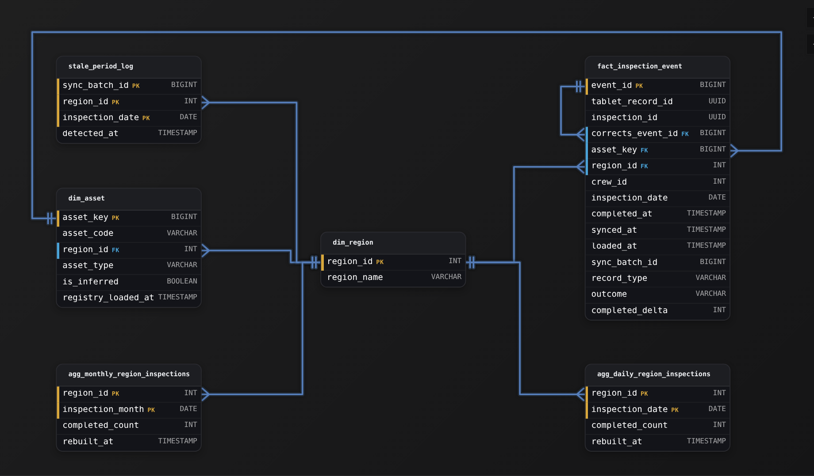
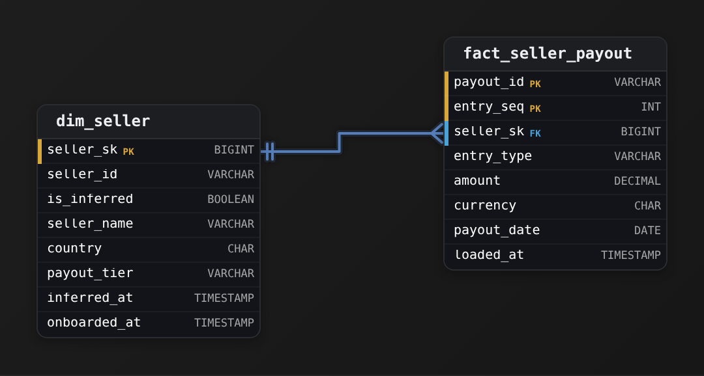

# Late-Arriving Data: Advanced - Exercises

Lesson: [dm_pattern_late_arriving.md](../dm_pattern_late_arriving.md)

### Exercise 1 of 2

**● TASK**

Utility crews save inspections on offline tablets out of signal, syncing them days later; interrupted syncs resend. The analyst who owns the per-region daily and monthly counts published on the operations dashboard needs each inspection to count on its actual date, deduplicated by tablet record ID, with region directly on every fact row; if the asset isn't registered yet, create a placeholder asset marked as inferred so the fact loads without waiting; corrections and voids arrive as new rows with a delta value linked to the original. The sync log captures (region, inspection_date) pairs with a composite key, the aggregates are keyed on (region, inspection_date) and (region, inspection_month) with a rebuild timestamp, and rebuilds overwrite only stale periods so the pipeline is fully replayable from scratch.

<strong>Solution</strong>

#### 2 clocks and a number already published

This is the late-arriving data pattern with every branch firing at once: facts that land days after the day they describe, an asset that does not exist in the dimension yet, edits to rows already counted, and a published number that has to move. Almost everyone remembers to store `inspection_date`. The trap is what the rebuild is keyed on. A pipeline that recomputes only today, or slots each sync into the day it landed, credits a Tuesday inspection to Friday. Tuesday stays short forever, Friday runs high, and a crew that spent the week at a remote site looks idle.

#### Build it in order

1. **Key the fact on the day the work happened**

   `fact_inspection_event` holds one row per synced version of an inspection, and `inspection_date` comes from the tablet's `completed_at`, never from the load. `synced_at` and `loaded_at` sit beside it as processing time. 2 clocks on one row answer both 'how many inspections happened Tuesday' and 'what did we know on Tuesday'.

2. **Give a missing asset a placeholder**

   When a crew inspects an asset the registry has not loaded, the load inserts a `dim_asset` row with `is_inferred` true and only the `asset_code` from the tablet, then points the fact at its `asset_key`. When the registry catches up, that row is filled in and the flag flips. The fact never waits and never needs rewriting, because it holds the surrogate key.

3. **Append every edit as a pair of rows**

   An edit arrives as 2 new rows: one cancelling the original with `completed_delta` of -1 and `corrects_event_id` pointing at it, and one carrying the amended version at +1. A void is the cancelling row alone. The count is `SUM(completed_delta)`, so it nets out, and every version an auditor might ask about survives.

4. **Record which days each sync touched**

   Every load appends one `stale_period_log` row per region and `inspection_date` present in its batch. That table is the recompute queue: it says the north region's Tuesday is stale because batch 8812 carried Tuesday rows, which is precisely the fact a load-date pipeline throws away.

5. **Rebuild only what went stale**

   The rebuild picks periods whose log `detected_at` is later than the aggregate's `rebuilt_at`, overwrites those `agg_daily_region_inspections` rows from the fact, then rebuilds the containing `agg_monthly_region_inspections` months from the daily table. Every step overwrites by region and date instead of incrementing, so running it twice, or from an empty warehouse, lands on the same numbers.

#### The reference model

*`fact_inspection_event` is append-only and keyed on event time; `stale_period_log` lists the region-days each sync touched, driving overwrite rebuilds of the daily and monthly aggregates.*

| ✕ Increment the published count | ✓ Overwrite the stale period |
| --- | --- |
| Adding each late row's +1 onto `agg_daily_region_inspections` is fast until a resent sync adds it twice or a rerun adds it again. The count drifts and nothing in the model says by how much. | Recomputing a stale region-day as `SUM(completed_delta)` from the fact makes the aggregate a pure function of the fact. A resend is stopped at `tablet_record_id`, and a rerun lands on the same total. |

| Pitfall: Region cannot depend on the asset row |
| --- |
| Deriving region by joining through `dim_asset` looks tidy, but an inferred asset has no registry region yet. Those inspections vanish from every regional count until the registry loads. Carry `region_id` on the fact, taken from the work order. |

| Interviewer: A rebuild from empty must match what was published |
| --- |
| The closing question is always whether you can drop every aggregate and rebuild. An append-only fact, a replay-safe `tablet_record_id`, and aggregates that overwrite by region and date make the answer yes. The senior answer names which piece guarantees which property. |

| Performance: A sync touches a handful of days, not the year |
| --- |
| At 40,000 inspections a day across 30 regions, a batch usually spans three or 4 `inspection_date` values, so a rebuild rewrites roughly a hundred region-day rows and one or two months. Scanning the fact for only those dates stays cheap when it is laid out by `inspection_date`. |

| Real world: Show managers why the number moved |
| --- |
| Once a published count can change, surface `rebuilt_at` on the dashboard. A manager who saw 212 on Monday and 238 on Thursday should see that Thursday's sync restated Monday, not suspect a bug. |

**Follow-up questions**

1. Regulators ask what the dashboard showed for a region on a past date. What does the model need?\
   *Tests as-of reporting from `loaded_at` on an append-only fact, and whether aggregate history is retained.*
2. The registry reveals an inferred asset sits in a different region than the work order said. Which rows change?\
   *Tests correcting via appended cancel-and-replace pairs plus a `stale_period_log` entry for both regions.*
3. Finance closes the month on the 3rd. How do June inspections that sync on July 10 get handled?\
   *Tests separating the operational count from a frozen reporting snapshot without editing the fact.*

 

### Exercise 2 of 2

**● TASK**

Design the seller dimension and payout fact so that payouts count in today's totals immediately, even when the seller hasn't onboarded yet. The dimension must have a business key (seller_id), a surrogate key the facts reference, and a boolean flag marking inferred placeholders; when onboarding data arrives, populate attributes on that surrogate-keyed row without changing the key. Never update payout amounts; instead, append entries to the fact table using source identifiers (payout_id and entry_sequence) as the natural key, with an entry_type column distinguishing originals, reversals, and restatements. Build every key from source data so replaying from any date produces identical rows.

<strong>Solution</strong>

#### Paid before the seller exists

This is the **inferred member pattern**, and the capstone twist is that three sections of the lesson have to hold at once. The trap is the reflex fix for a missing seller: park the payout until onboarding lands, or point it at one shared 'Unknown' row. Parking it breaks finance's rule that today's totals are complete today. The shared row looks fine until the seller onboards, and then every one of their payouts has to be re-keyed from the bucket to the real row: an in-place fact update, and a rerun that can land differently each time. Mint a placeholder per `seller_id` on first sighting and the fact never has to move.

#### Break down the requirements

1. **Mint the seller row on first sighting**

   When the payout loader meets a `seller_id` with no row in `dim_seller`, it inserts one: a fresh `seller_sk`, the `seller_id`, `is_inferred` set to true, and 'Unknown' in the descriptive columns. The payout loads in the same run against that key. Nothing waits on the onboarding batch.

2. **Land real attributes on the same row**

   When onboarding delivers the seller, the loader finds the row by `seller_id`, fills `seller_name`, `country` and `payout_tier`, and flips `is_inferred` to false. `seller_sk` never changes, so every payout already loaded reports under the real attributes without a single fact row being touched. The placeholder is overwritten, not versioned: it never described anyone.

3. **Append corrections, never edit**

   A finance correction becomes new rows in `fact_seller_payout` under the same `payout_id`: a reversal at the next `entry_seq` carrying the negated amount, then the restated amount after it. Summing `amount` gives the corrected total; `entry_seq = 0` is the original the analyst still has to see. A second correction repeats the pair.

4. **Key everything off the source**

   `seller_id` carries a unique key, so a rerun that meets the same unknown seller finds the placeholder it already made instead of minting a twin. The fact key is (`payout_id`, `entry_seq`), both from the source, so reloading a day rewrites the same rows rather than stacking copies stamped with a new load id.

#### The reference model

*Every payout entry points at `seller_sk`, which exists from the first payout onward and never changes when onboarding fills the row.*

Two tables. `dim_seller` holds one row per seller, keyed by `seller_sk`, with `seller_id` as the unique business key and `is_inferred` marking rows still waiting on onboarding. `fact_seller_payout` holds one row per payout entry, the original and every reversal or restatement, keyed by `payout_id` and `entry_seq`. `payout_date` puts the money in the day finance totals; `loaded_at` records when the row actually arrived.

| ✕ One shared Unknown row | ✓ A placeholder per seller |
| --- | --- |
| Every orphan payout points at `seller_sk` -1. Totals are complete today, but the fact no longer says whose money it is, and onboarding means finding those payouts and rewriting their key in place. | Each unknown `seller_id` gets its own row with `is_inferred` true. Payouts load against the key they keep forever; onboarding changes one dimension row and every past payout follows. |

| Performance: Placeholders cost one row per stranger |
| --- |
| At two million payouts a day and a few thousand new sellers, the late-seller cost is a few thousand `dim_seller` rows, not payout rewrites. Partition `fact_seller_payout` on `payout_date` and the daily total reads one partition; a correction appends two rows and never rewrites a file. |

| Interviewer: `is_inferred` is the senior tell |
| --- |
| Juniors mint the placeholder and stop. Seniors add the flag and say why: the onboarding loader needs it to know which rows it may overwrite, and the analyst needs it to report how much of today's money sits with sellers still showing 'Unknown'. |

| Pitfall: Editing the amount erases the audit trail |
| --- |
| The tempting correction is `UPDATE fact_seller_payout SET amount = ...`. The total comes out right and the original is gone, along with the basis of every report already sent. Reversal plus restatement keeps both, and a rerun replays them in the same `entry_seq` order. |

**Follow-up questions**

1. Finance now wants payouts reported under the `payout_tier` in force at payout time. What changes?\
   *Versioning `dim_seller` while the first real arrival still overwrites the placeholder instead of adding a version.*
2. A rebuild from scratch reissues every `seller_sk`. How do you keep reruns identical then?\
   *Deriving the surrogate key deterministically from `seller_id`, the reprocessability rule.*
3. A payout arrives dated to last week, after that day's totals were published. Where does it land?\
   *Late-arriving facts: `payout_date` versus `loaded_at`, and inserting into a closed partition.*

