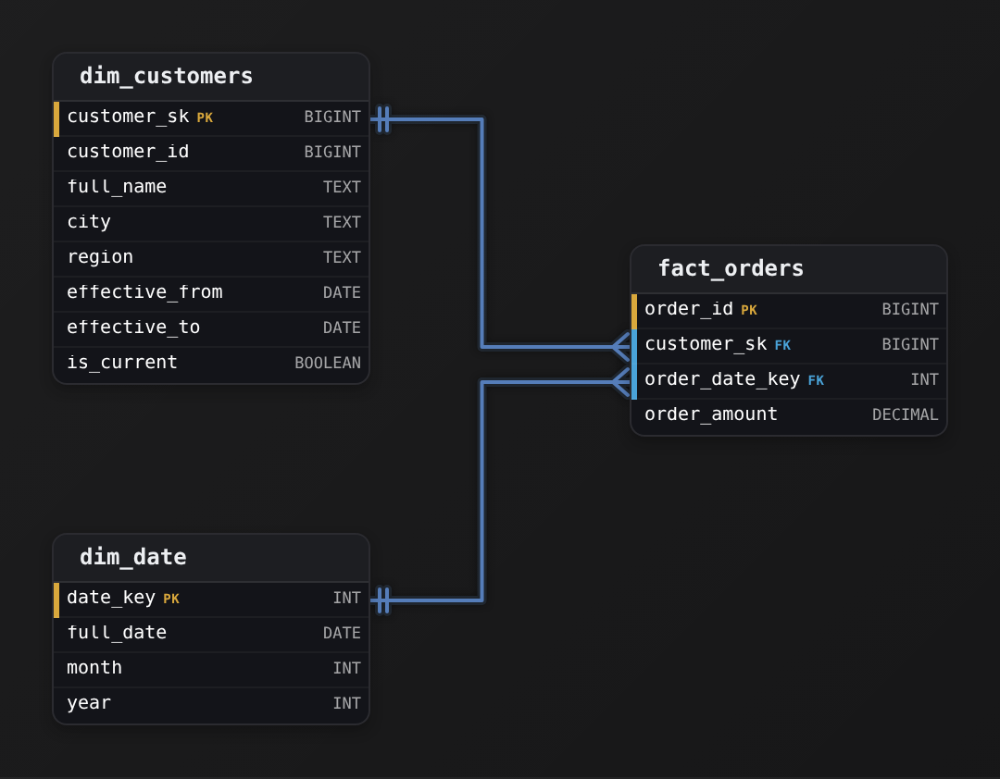
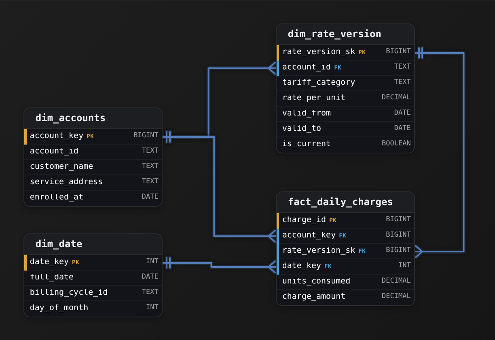
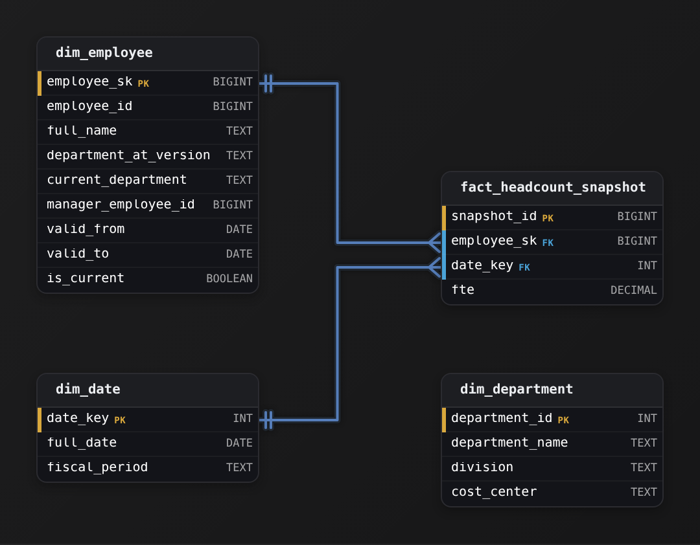
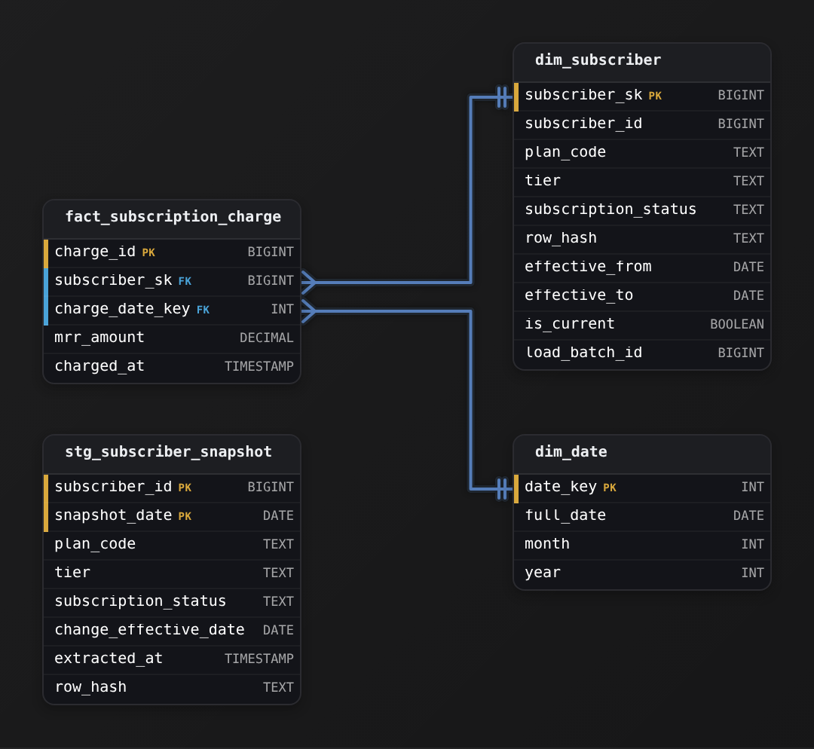

# SCD Strategy: Advanced - Exercises

Lesson: [dm_pattern_scd_strategy.md](../dm_pattern_scd_strategy.md)

### Exercise 1 of 4

**● TASK**

A retail company's finance team builds a regional profit-and-loss report, and customers relocate between cities over the years. Every past order must attribute to the region where that customer lived on the day the order was placed, never to where they live now. Design the customer dimension and the orders fact so a relocation never shifts a completed order's region.

<strong>Solution</strong>

#### Why this problem exists in real interviews

This is a Type 2 slowly changing dimension wearing a finance costume. The real decision is where purchase-time truth lives, and the trap is joining `fact_orders` to the customer by natural key or to the current-state row. Do that and the day a customer moves from Denver to Austin, every order they ever placed silently jumps from the Mountain region to the Southwest region, and last spring's closed P&L no longer reconciles. The skill being probed: can you make a completed order remember the region that was true when it happened, even after the customer changes?

| Trick: Freeze the region onto the version, not the customer |
| --- |
| As soon as the requirement says 'the region they lived in at purchase time', the customer dimension has to keep history. Version the customer with `customer_sk`, stamp each order with the `customer_sk` that was current on its `order_date`, and the region falls out of a plain surrogate-key join. No as-of date logic in the query. |

#### Break down the requirements

1. **Name the as-of requirement out loud**

   The finance report is read as-of purchase time: a March total pulled today must equal the March total pulled a year ago. That single sentence rules out Type 1. Overwriting `city` and `region` in place would rewrite the answer to every historical question the moment someone relocates.

2. **Version the customer with a surrogate key**

   `dim_customers` becomes one row per version of a customer, keyed by a surrogate `customer_sk`. Keep the natural `customer_id` so versions of the same person are linkable, and add `effective_from`, `effective_to`, and `is_current`. A relocation closes the old row (sets `effective_to`) and opens a new one, so each version owns a contiguous window.

3. **Stamp the fact with the version, not the person**

   `fact_orders` carries `customer_sk`: the version that was current on `order_date`. This is the whole game. The region attribution is now a static property of the row, resolved by `JOIN dim_customers ON fact_orders.customer_sk = dim_customers.customer_sk`. There is no as-of BETWEEN filter at query time, because the surrogate already encodes the point in time.

4. **Scope what triggers a version, and load incrementally**

   Only city and region drive attribution, so only those changes need a new version; email or phone churn can overwrite in place. At 80M customers with tens of thousands of daily moves, process the change feed incrementally (close and open only the touched customers) rather than rebuilding the whole dimension nightly.

#### The reference model

A Type 2 customer dimension joined to the orders fact on the version surrogate key. `region` lives as a versioned attribute on `dim_customers`, so purchase-time region is whatever version the order points at. `dim_date` lets finance roll the report up by month and year.

*`fact_orders`.customer_sk points at the `dim_customers` version current on `order_date`; region attribution is a static surrogate-key join.*

| Performance: Incremental beats full rebuild at 80M rows |
| --- |
| Tens of thousands of daily moves against 80M customers means the change set is a rounding error of the table. An incremental load closes and opens only the touched customers off the change feed; a full nightly rebuild rewrites all 80M rows to express a few thousand relocations. `is_current` plus a partial index keeps the hot 'current version' lookups cheap while history stays queryable. |

| Interviewer: The tell is the fact key, not the SCD lecture |
| --- |
| Anyone can recite Type 1 versus Type 2. The senior signal is putting `customer_sk` on `fact_orders` and saying the region join needs no as-of date filter because the surrogate already froze the point in time. Candidates who keep `customer_id` on the fact and then bolt on a BETWEEN join have not actually solved the attribution problem. |

| Pitfall: Joining to `is_current` re-attributes history |
| --- |
| The classic miss: `fact_orders` holds `customer_id`, and the report joins to `dim_customers WHERE is_current = TRUE`. Every past order now reads the customer's latest region, so the day someone moves, closed periods change under finance's feet. The bug is invisible until an auditor asks why last quarter's regional totals no longer match. |

#### The fork you are being tested on

| ✕ Type 1 (overwrite) | ✓ Type 2 (version) |
| --- | --- |
| Update `city` and `region` in place on one row per customer. Cheap storage, trivial pipeline. Fatal here: a relocation rewrites the region for every past order, so as-of P&L is impossible. Correct only when history genuinely does not matter. | One row per version keyed by `customer_sk`, with `effective_from` / `effective_to` / `is_current`. Facts join the surrogate, so purchase-time region is frozen. Costs more storage and a versioning load step, and that cost is exactly what the as-of requirement is paying for. |

**Follow-up questions**

1. Marketing now wants each customer's current region on the same dimension without a version walk. How do you serve both as-of and current-state reads?\
   *Tests whether the candidate reaches for a Type 6 hybrid: a versioned `region` plus a `current_region` column stamped onto every version of that customer.*
2. A relocation feed arrives 3 days late, after orders in that window already loaded. How do the effective windows and the already-stamped `customer_sk` values get corrected?\
   *Tests late-arriving dimension handling and whether facts need re-keying against the corrected version boundaries.*
3. Finance later reorganizes which cities belong to which region. Should that restate historical P&L or not, and how does the model express each choice?\
   *Separates a versioned customer attribute from a conformed region hierarchy, and forces a stance on whether a mapping change is history-preserving.*

 

### Exercise 2 of 4

**● TASK**

A regulated utility bills each account on a monthly cycle, but an account's rate and tariff category can change partway through a cycle, and regulators can later demand proof of exactly which rate applied on any given day going back years. Design the schema that stores metered charges alongside rate history so the effective rate for any past date is reconstructable, even when the rate changed mid-cycle.

<strong>Solution</strong>

#### What this problem really is

This looks like a billing schema, but it is a **point-in-time audit** problem wearing a utility bill. The real decision is the fact grain: a rate that changes on the 12th means no single row can honestly represent a whole month's charge, so a whole-cycle fact silently blends 2 rates into one number and the audit trail is gone before an auditor ever asks. Model the charge at the daily grain, bind each day to the `dim_rate_version` row that was current that day, and 'what rate applied on March 12' becomes a lookup instead of a forensic reconstruction.

| Trick: Grain below the change frequency |
| --- |
| The version can change on any day, so the fact grain must be at least as fine as a day. Put `fact_daily_charges` at one row per account per day and a mid-cycle change stops being a special case: the days before the change carry the old `rate_version_sk`, the days after carry the new one, and the monthly bill is just their sum. |

#### Break down the requirements

1. **Choose the SCD type**

   Auditors need the rate as it stood on a past date, so overwriting (Type 1) is disqualifying: it erases the very thing they ask for. This is a Type 2 dimension, one row per rate version with effective dates. Reach for Type 6 only if you also need the current rate glued onto every historical row for fast 'as-is vs as-was' reporting; name the added storage and pipeline cost when you do.

2. **Version the rate with effective dates**

   `dim_rate_version` gets a surrogate key `rate_version_sk` per version, the stable natural `account_id`, the `tariff_category` and `rate_per_unit` on each version, and `valid_from` / `valid_to` plus `is_current`. A rate change closes the open version (`valid_to` set, `is_current` false) and appends a new one. All versions for one account share the natural key, so history groups cleanly.

3. **Lock the version onto the fact**

   Each `fact_daily_charges` row carries the `rate_version_sk` that was current on its `usage_date`, resolved at load time. That is what makes attribution immutable: a rate correction filed next year appends a new version and never rewrites yesterday's charge. Point-in-time reconstruction is then a join on the surrogate key, with the `valid_from`/`valid_to` range as the backstop lookup for any date not yet materialized in the fact.

4. **Keep it incremental at scale**

   Only a sliver of accounts change rate on a given day, so version maintenance closes and opens rows only for those accounts, never a full rebuild of a tens-of-millions-row dimension. Partition `fact_daily_charges` by date so seven years of retained charges stay prunable.

#### The reference model

`dim_rate_version` is the Type 2 spine; `fact_daily_charges` locks each day to the version in effect, so the whole audit answer lives on the fact plus one join.

*`fact_daily_charges` is one row per account per day; `rate_version_sk` is locked at load time, and `dim_rate_version` keeps every version by `valid_from`/`valid_to`.*

| Performance: Why the audit stays a lookup |
| --- |
| At tens of millions of accounts, only a small fraction change rate per day, so `dim_rate_version` grows slowly and version maintenance touches only changed rows. Partitioning `fact_daily_charges` by `date_key` keeps a seven-year retention window prunable, and 'what rate on this date' resolves as an equality join on `rate_version_sk`, never a range scan across full history. |

| Interviewer: The grain is the tell |
| --- |
| Strong candidates state the fact grain out loud before drawing anything and immediately connect the mid-cycle change to a daily grain. They say the words 'effective dating' and 'point in time', and they explain that binding `rate_version_sk` at load time is what makes past charges immutable under later corrections. |

| Pitfall: The whole-cycle fact |
| --- |
| The common miss is a fact at one row per billing cycle with a single rate reference. The first time a rate moves on the 12th, that row has to average 2 rates or pick one, and the auditor's exact-date question can no longer be answered. Overwriting the rate in place (Type 1) fails the same audit for the same reason. |

#### 2 grains, one audit

| ✕ Daily-grain fact | ✓ Cycle-grain fact |
| --- | --- |
| `fact_daily_charges` at one row per account per day, each locking `rate_version_sk`.  * A mid-cycle change is just a different key on later days * Any date's rate is an equality join * Slightly more fact rows | One row per billing cycle referencing a single rate.  * Fewer rows * A rate change inside the cycle forces averaging or a wrong pick * The exact-date audit is unanswerable from the fact |

**Follow-up questions**

1. A regulator files a retroactive rate correction effective 3 months ago. How does the model absorb it without rewriting already-billed charges?\
   *Tests whether corrections append a new version (or an adjustment fact) rather than mutating locked history.*
2. Reporting needs both the rate that applied on each day and the account's current tariff on the same row. What changes?\
   *Tests knowing Type 6 exists and its storage/pipeline cost versus a plain Type 2 join.*
3. A rate-change event for yesterday arrives 2 days late. How do you close and open versions so no day is left uncovered or double-covered?\
   *Tests late-arriving change handling and `valid_from`/`valid_to` contiguity.*
4. At seven years of daily charges across tens of millions of accounts, how do you keep the audit query and the nightly load fast?\
   *Tests date partitioning of the fact and incremental version maintenance versus full rebuild.*

 

### Exercise 3 of 4

**● TASK**

A large employer just reorganized its departments and redrew reporting lines, and the workforce analytics team needs a headcount model that survives the churn. Design the schema so that for any historical headcount snapshot, a single dim_employee row contains both the department the employee was assigned to when that snapshot was recorded and the department that same employee is assigned to today. Employees move between departments repeatedly; the model must preserve every historical assignment and allow both 'department then' and 'department now' to be read from the same versioned employee row without additional joins.

<strong>Solution</strong>

#### What this problem is really asking

Beneath the reorg story, this is a **hybrid SCD** (Type 6) forced into the open by one sentence: the same row must show the department an employee sat in THEN and the department they sit in NOW. That sentence quietly rules out both of the easy answers. Overwrite the department (Type 1) and 'then' is gone forever. Version it with effective dates (Type 2 alone) and 'then' is cheap but 'now' costs you a self-join from every historical row back to that employee's current row, on the dashboard's hottest path. The move that satisfies both is to put TWO department columns on `dim_employee`: one frozen per version, one overwritten across all versions.

| Trick: Two columns, two lifetimes |
| --- |
| Keep `department_at_version` (the value in effect during that row's `valid_from`..`valid_to` window, never touched again) and `current_department` (rewritten to today's department on EVERY row for that employee whenever they move). The fact points at one version; both answers fall out of that single row with no self-join. |

#### Break down the requirements

1. **Declare the dimension grain**

   One row in `dim_employee` is one version of one employee: valid from the day an assignment took effect until the day it changed. Multiple rows per `employee_id` coexist, so a surrogate key `employee_sk` identifies the version and the natural key `employee_id` identifies the person.

2. **Split the department into two columns**

   `department_at_version` is Type 2: it is stamped when the version is created and frozen forever. `current_department` is Type 1: it holds the employee's present department and is overwritten on every one of their rows when they move. The pairing is exactly what makes 'then and now on one row' possible.

3. **Attribute the fact to the version that was current then**

   `fact_headcount_snapshot` is a periodic snapshot: one row per active employee per `snapshot_date`, joined to `dim_employee` on `employee_sk`. Because the surrogate key resolves to the version live on that date, the snapshot reads 'department then' from `department_at_version` and 'department today' from `current_department` of the very same row.

4. **Keep the current column honest under change**

   A department move expires the open version (set `valid_to`, clear `is_current`), inserts a new version, and issues one bulk overwrite of `current_department` across all of that employee's prior rows. Only the current column moves; the point-in-time column on old rows stays frozen.

#### The reference model

`dim_employee` is the Type 6 dimension carrying both department columns. `dim_department` stays a simple overwrite lookup for descriptive attributes (`division`, `cost_center`). `fact_headcount_snapshot` joins the surrogate key so every snapshot resolves to its point-in-time version, and `dim_date` conforms the calendar.

*`dim_employee` is Type 6: `department_at_version` is frozen at each version's validity window, `current_department` is overwritten across every version of the employee.*

| Interviewer: The tell is the second department column |
| --- |
| A strong candidate reaches for two department attributes the instant they hear 'then AND now on one row', and names the maintenance rule: the current column is rewritten across the employee's whole history, the versioned column never is. Candidates who have only read about Type 2 offer a single versioned column and then hand-wave the 'today' lookup. |

| Pitfall: Solving 'now' with a self-join |
| --- |
| Keeping only `department_at_version` and computing 'today' by joining each row back to the employee's `is_current` row looks clever and collapses at scale: the dashboard self-joins a tens-of-millions-row dimension on every tile. The overwritten `current_department` column is what buys the constant-time read the second column exists for. |

| Performance: Why the overwrite still scales |
| --- |
| At ~400k employees the nightly load touches only movers: expire one row, insert one row, overwrite the current column for that employee's handful of history rows. Work is proportional to daily change, not to accumulated history, so the incremental load stays flat while the dimension grows into the tens of millions. |

**Follow-up questions**

1. Finance reissues a report from last year and needs the OLD department names that were later renamed in the reorg. What changes?\
   *Tests whether the candidate moves `dim_department` to its own versioned form, or resolves labels through the point-in-time column already on `dim_employee`.*
2. Reporting lines also moved: some employees kept their department but got a new manager. Does that trigger a new version?\
   *Tests whether the candidate treats manager as a tracked Type 2 attribute versus an overwrite, and whether a non-department change should create a new row.*
3. How would you support 'department two moves ago', not just then and now?\
   *Tests the limits of the two-column hybrid and whether the candidate recognizes that arbitrary prior states come from the versioned history, not more overwrite columns.*

 

### Exercise 4 of 4

**● TASK**

With 40 million subscribers and roughly 800k of them changing plan, tier or standing each night, how should the subscriber dimension and its nightly load be shaped so every historical charge attributes to the account version that held the plan and tier on its charge date? Changed subscribers are found from a hash of the tracked attributes, or an equivalent change indicator, on each staged row so nightly work tracks change volume rather than the full base, and corrected billing records that arrive days late carry the real change date, which is what version dates must come from. The design covers the staging snapshot, the versioned subscriber dimension with full history, and the fact table that ties charges to account versions.

<strong>Solution</strong>

#### Why this problem exists in real interviews

This is a Type 2 slowly changing dimension dressed as a churn problem, with 2 twists that separate seniors from people who have only read the wiki page. First, the nightly load must be **incremental**: at 40M subscribers you cannot re-version the whole base every night, so you gate on a change hash and touch only the accounts that actually moved. Second, corrections arrive backdated, so each version's effective range must be stamped from the source's change date, never from tonight's load date. Miss that second point and a correction filed today silently rewrites the attribution of every charge that happened before it.

| Trick: The load date is not the change date |
| --- |
| Keep a `change_effective_date` on the staging feed and build `effective_from` from it. A record that arrives late but happened last Tuesday then splits the account's history at last Tuesday. Pair that with a `row_hash` on `stg_subscriber_snapshot`, compared against the current version's hash, and the load both stays proportional to change volume and lands corrections in the right slot. |

#### Break down the requirements

1. **Split the nightly feed from the version history**

   `stg_subscriber_snapshot` holds one row per subscriber per night, keyed by `subscriber_id` and `snapshot_date`, straight from billing. `dim_subscriber` holds one row per subscriber per version. Conflating them forces you to rebuild the dimension from scratch every night, which is exactly the cost the prompt forbids.

2. **Version with effective dates and a current flag**

   Each version carries `effective_from`, `effective_to` and `is_current`, and is keyed by a surrogate `subscriber_sk`. The natural `subscriber_id` repeats across versions; the surrogate is unique per version, and it is what the fact points at.

3. **Detect change with a hash so the load stays proportional**

   Store a `row_hash` of the tracked attributes (plan, tier, status) on both staging and the current dimension version. A subscriber whose staged hash equals its current hash is unchanged and skipped, so the night's writes track the roughly 800k that moved, not the full 40M.

4. **Date versions by the source change date**

   A backdated correction carries `change_effective_date` from the source. Build `effective_from` from that column and split the surrounding version, rather than appending a new current row, so charges before the change keep their original attribution.

5. **Reconcile with a periodic full rebuild**

   The incremental delta can drop a change if a snapshot is late or malformed. A monthly full rebuild from source history, compared against the incremental dimension, surfaces that drift so it can be repaired.

#### The reference model

One defensible design: a staging snapshot feeding a Type 2 `dim_subscriber`, with `fact_subscription_charge` referencing the surrogate key so every charge is pinned to the version in force at the time. Staging is a load input, not a parent of the dimension, so it carries its own nightly grain and no foreign key into the model.

*`stg_subscriber_snapshot` (one row per subscriber per night) feeds the load into the Type 2 `dim_subscriber`; `fact_subscription_charge` references `subscriber_sk`, pinning each charge to the version in force on its charge date.*

| Performance: Nightly cost tracks change, not size |
| --- |
| With a `row_hash` gate, the load writes the roughly 800k accounts that changed instead of touching all 40M, so runtime scales with churn. The monthly full rebuild is the expensive job, run off-peak. Its only purpose is to prove that the cheap nightly deltas have not drifted from source truth. |

| Interviewer: Source-dated ranges, not load-dated |
| --- |
| Strong candidates say the load is incremental and hash-gated, name late-arriving dimension handling, and stamp `effective_from` from `change_effective_date`. They also volunteer the full-rebuild reconciliation without being asked, because they know a delta pipeline drops rows. |

| Pitfall: Stamping `effective_from` with today's date |
| --- |
| The classic failure is to set `effective_from` to the load date and always append the new version as `is_current`. A correction that actually happened last week then gets this week's date. Every charge between the real change and the load re-attributes to the wrong plan, and last month's finance report quietly changes. |

#### Trade-offs and alternatives

| ✕ Incremental nightly load | ✓ Periodic full rebuild |
| --- | --- |
| A hash-gated delta writes only the changed accounts, so its cost is proportional to churn, not base size, and it fits a tight nightly window. Its weakness: it can silently drop a change if a snapshot is late or corrupt. | Reconstructs the dimension from source history. It is ground truth that catches drift and dropped versions, but it is expensive, so it runs monthly rather than nightly. It repairs the incremental dimension; it does not replace it. |

**Follow-up questions**

1. A subscriber downgrades, and the source resends the identical downgrade the next night. How do you keep the load from creating a duplicate version?\
   *Tests idempotency: the `row_hash` on staging matches the current version's hash, so the row is skipped.*
2. Which subscriber attributes would you make overwrite-in-place instead of versioned, and why?\
   *Tests the Type 1 versus Type 2 tradeoff: attributes that never feed a historical report do not need version history.*
3. The monthly full rebuild disagrees with the incremental `dim_subscriber` for 3,000 subscribers. How do you decide which is right and repair it?\
   *Tests reconciliation reasoning: the rebuild is source-derived truth, so the incremental rows are corrected to match and the gap is investigated.*
4. At 40M rows, closing out the prior version by setting its `effective_to` is the slow step of the load. How do you keep it cheap?\
   *Tests scale awareness: restrict the update to the current versions of changed keys rather than the whole table.*

