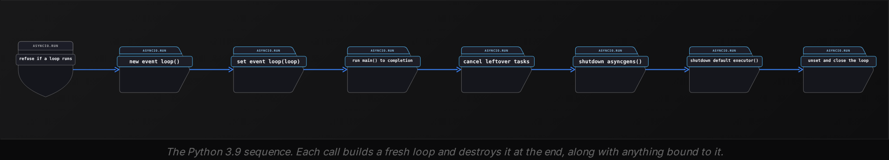
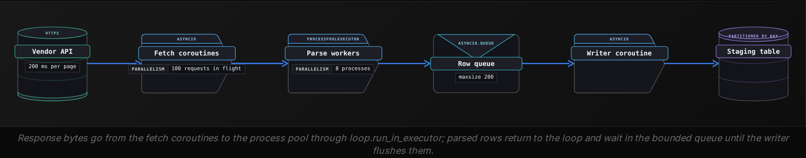

# Async Python for Data Engineers: Advanced

Priya is 40 minutes into a data engineering loop at Instagram when the interviewer pastes a 30-line backfill script onto the shared screen. It starts a coroutine per hourly partition with `asyncio.gather`, calls a sync row-count helper that wraps `asyncio.run`, bumps a shared counter from worker threads, and ships with tests that mock the warehouse client using a plain `Mock`. The prompt is short: "Partition 9 failed at 02:00. Walk me through everything that is now wrong, in the order you would fix it." Priya spots 4 bugs living in one file: orphaned writes, a loop that refuses re-entry, a race the GIL does not prevent, and tests that never ran. A complete answer explains each mechanism, then asks whether this job should be async at all.


<br>

### What you will be able to do

Replace gather with TaskGroup semantics, on 3.11 or hand-rolled on 3.9, so a single failure cancels every sibling

Read a loop-related RuntimeError as a statement about which loop exists in which thread, and fix its cause

Write pytest-asyncio tests with AsyncMock that prove cancellation, partial failure and pipeline termination

Pick asyncio, threads, processes or Spark from a measured CPU-to-wall ratio, memory per worker and data size

Name the exact point where shared state needs a lock, and choose between asyncio.Lock and threading.Lock


<br>

---

## asyncio.TaskGroup vs gather

The question usually arrives as a failure story: a loader fans out 24 hourly partition writes for a single day, partition 9 hits a schema error, and the job exits red. What does the target table hold now? With `asyncio.gather`, the answer is uncomfortable. Gather propagates the first exception to whoever awaited it and does nothing else: the other 23 tasks keep running, keep holding connections, and keep writing rows after the caller has logged the day as failed.

The animation below runs both shapes on Python 3.9, which predates `TaskGroup`. The first half uses plain `gather`. The second half hand-rolls the TaskGroup contract with `asyncio.wait` and `FIRST_EXCEPTION`: wait for the first failure, cancel every task still pending, wait for those cancellations to land, then re-raise. Predict the 4 printed lines before you play it.

https://github.com/user-attachments/assets/abaa039f-4743-4ba5-9ebb-e089a6a4bfaa

`b wrote rows` prints after `gather raised`: the orphan finished its write while the caller sat in its error handler. In the group version, `d cancelled` prints before `group raised`, because the group refuses to return until every child has stopped. That ordering is the contract: by the time the error reaches you, nothing from the batch is still running.


<br>

### Three failure contracts, side by side

| Construct | When a child fails | Its siblings | The caller receives |
| --- | --- | --- | --- |
| `gather(\*aws)` | Exception propagates immediately | Keep running, awaited by no one | The first exception only |
| `gather(\*aws, return_exceptions=True)` | Stored as that child's result | Run to completion | A list mixing values and exceptions |
| `asyncio.TaskGroup` (3.11+) | The group cancels the rest | Cancelled, then awaited | An `ExceptionGroup` of every failure |

*One asymmetry catches people: cancelling the outer gather does cancel its unfinished children. Only a child's own failure leaves its siblings running.*


<br>

### The 3.11 version and what it raises

```sql
import asyncio


async def load_day(client, day, partitions):
    try:
        async with asyncio.TaskGroup() as tg:
            tasks = [
                tg.create_task(client.write_partition(day, p))
                for p in partitions
            ]
    except ExceptionGroup as eg:
        detail = "; ".join(repr(e) for e in eg.exceptions)
        raise RuntimeError(f"{day} failed: {detail}") from eg
    return sum(t.result() for t in tasks)
```

Two details belong in the answer. The group raises `ExceptionGroup` even when exactly 1 child failed, so an `except ValueError` written for the gather version stops matching without any warning; Python 3.11 added `except*` to match inside a group by type. And if a second partition fails before its cancellation lands, both errors appear in `eg.exceptions`, where gather would have raised the first and discarded the second.


<br>

### Cancellation is a request, and written rows stay

Cancelling a task throws `CancelledError` into it at its next `await`. Code between awaits still finishes, so a partition that has flushed 40,000 of its 100,000 rows leaves those 40,000 in the table. A coroutine that catches `CancelledError` and carries on keeps writing after the group asked it to stop, and the group waits for it. Since Python 3.8 the exception subclasses `BaseException`, so `except Exception` lets it pass, while a bare `except:` swallows it. Cleanup belongs in `finally` or `async with`, both of which still run during cancellation.

> Making the cancel safe for the table
>
> - Write each partition to staging, then publish the whole day in a single step after the group exits cleanly.
> - Key every write by (table, day, partition) and overwrite, so a rerun replaces the 40,000 stray rows.
> - Re-raise `CancelledError` after any cleanup that catches it.
> - Acquire connections with `async with` so a cancelled child returns its connection to the pool.


<br>

### When gather is still the right call

| ✓ TaskGroup: all or nothing | ✗ gather with return_exceptions: best effort |
| --- | --- |
| • The 24 partitions of one day's load<br><br>• Pages of an API export that must be complete<br><br>• Any batch whose consumers expect the whole set | • Enriching 500 user IDs where 3 misses are acceptable<br><br>• Health checks across 40 independent sources<br><br>• Any batch where partial success is the product |


<br>

### Follow-ups the question usually takes

- Partition 9 fails after 40,000 rows: what is in the table? With staging, nothing until the publish step.
- Python 3.9 only: hand-roll it with asyncio.wait and FIRST_EXCEPTION, then cancel and await the rest.
- Two partitions fail at once: TaskGroup reports both, while plain gather raises one and drops the other.
- A child swallows CancelledError: the group waits on it, so look for a bare except before blaming the loop.

> **TIP**
>
> Open with the contract question: is a partial batch useful, or poison for whoever reads it? The answer picks the construct, and it shows you are reasoning about the table's state rather than the API.


<br>

---

## Event Loop Internals

Most async incidents that reach a code review arrive as a `RuntimeError` whose message mentions the event loop. Each message maps to a lifecycle rule, and the fix follows from the rule, so the skill is reading the message as a statement about which loop exists, in which thread, and whether it is already running.


<br>

### What asyncio.run does, in order



Three rules fall out of that sequence. Each thread runs at most one loop at a time, and `asyncio.run` refuses to start in a thread whose loop is running. Only the main thread gets a loop on demand from `asyncio.get_event_loop()`; elsewhere the call raises. Locks, queues and client sessions belong to one loop: on 3.9 they bind at construction to the thread's current loop, running or not, and from 3.10 to the running loop on first use.


<br>

### Four messages and the rule each one breaks

| Message | Where it shows up | Rule broken | Fix |
| --- | --- | --- | --- |
| `asyncio.run() cannot be called from a running event loop` | A sync helper that wraps `asyncio.run` is called from async code or a notebook | One running loop per thread | Make the helper `async` and `await` it |
| `There is no current event loop in thread 'ThreadPoolExecutor-0_0'.` | Code submitted to a `ThreadPoolExecutor` calls `get_event_loop()` | Non-main threads start with no loop | Use `asyncio.run` in that thread, or send the coroutine to the main loop |
| `got Future ... attached to a different loop` | A lock, queue or client built under one loop is awaited under another | Futures belong to a single loop | Create those objects inside the coroutine `asyncio.run` starts |
| `Event loop is closed` | A client cached from an earlier `asyncio.run` call is reused | `asyncio.run` closes its loop on exit | Scope the client with `async with` inside one run |

When the symptom is slowness rather than an error, run with `asyncio.run(main(), debug=True)`. Debug mode logs every callback or task step that holds the loop longer than 100 ms, which points at the blocking call, and it raises when a loop method that is not thread-safe is called from another thread.


<br>

### Predict the output: a sync wrapper in async code

```sql
import asyncio


async def fetch_count(table):
    await asyncio.sleep(0.01)
    return 1200


def row_count(table):
    return asyncio.run(fetch_count(table))


async def validate(tables):
    return {t: row_count(t) for t in tables}


print(row_count("orders"))
asyncio.run(validate(["orders", "refunds"]))
```

The first `print` shows `1200`: called from sync code, the wrapper builds a loop and tears it down. The second call fails inside the comprehension with `RuntimeError: asyncio.run() cannot be called from a running event loop`. Because `fetch_count(table)` was evaluated before `asyncio.run` checked for a running loop, a `RuntimeWarning` that the coroutine was never awaited follows once it is garbage collected. The traceback points at `row_count`, yet the cause is the caller's context. A helper that works in a script and fails once a caller wraps it in async code is the usual disguise of this question.


<br>

### Crossing between a thread and a loop

Threads enter async pipelines through `asyncio.to_thread`, `run_in_executor`, and sync SDKs that fire callbacks on their own threads. Code in such a thread cannot `await`, and `get_event_loop()` raises there. Two bridges are correct, and they point in opposite directions.

```sql
import asyncio


async def write_batch(rows):
    await asyncio.sleep(0.01)
    return len(rows)


def on_records(loop, rows):
    future = asyncio.run_coroutine_threadsafe(write_batch(rows), loop)
    return future.result(timeout=5)


def isolated_job(rows):
    return asyncio.run(write_batch(rows))


async def main():
    loop = asyncio.get_running_loop()
    sent = await asyncio.to_thread(on_records, loop, [1, 2, 3])
    print("via main loop:", sent)


asyncio.run(main())
print("own loop:", isolated_job([4, 5]))
```

It prints `via main loop: 3`, then `own loop: 2`. `run_coroutine_threadsafe` schedules the coroutine on a loop owned by another thread and returns a `concurrent.futures.Future` the thread can block on, so the main loop stays the single owner of its connections. `asyncio.run` gives the calling thread a private loop: right for a self-contained job, wrong when the job needs a client the main loop owns. Calling `future.result()` from the loop's own thread deadlocks, because the loop would be blocked waiting on work only it can run.

> **TIP**
>
> Patching the loop so `run_until_complete` becomes reentrant makes the first error vanish and trades it for ordering bugs that surface later. Name the real fix instead: async all the way up from the entry point, one loop per thread, and an explicit bridge at every thread boundary.


<br>

---

## Testing Async Code

An async loader has 3 behaviours worth a test: the result when every call succeeds, the state it leaves when a call fails, and whether it terminates at all. The third is the one teams skip, and its absence turns a bug into a CI job that hangs until the runner kills it. The tests below use pytest with the pytest-asyncio plugin and replace the network with `unittest.mock.AsyncMock`.


<br>

### Why the mock has to be awaitable

```sql
from unittest.mock import AsyncMock, Mock

import pytest


async def total_rows(client, tables):
    counts = [await client.count(t) for t in tables]
    return sum(counts)


@pytest.mark.asyncio
async def test_total_rows_sums_counts():
    client = Mock()
    client.count = AsyncMock(side_effect=[1200, 300])
    assert await total_rows(client, ["orders", "refunds"]) == 1500
    client.count.assert_awaited_with("refunds")
    assert client.count.await_count == 2


@pytest.mark.asyncio
async def test_with_plain_mock():
    client = Mock()
    client.count = Mock(return_value=1200)
    assert await total_rows(client, ["orders"]) == 1200
```

The first test passes. The second fails with `TypeError: object int can't be used in 'await' expression`: a plain `Mock` returns 1200 directly, and `await` needs an awaitable. Leave the method unconfigured on a `MagicMock` and the message names `MagicMock` instead. `AsyncMock` returns a fresh coroutine on every call, records awaits separately from calls, and treats a list `side_effect` as one value per await.

The marker matters as much as the mock. Without `@pytest.mark.asyncio`, or the plugin's auto mode, pytest calls the test function, receives a coroutine object, and never runs it; depending on the pytest version, the test is skipped with a warning or reported as a failure. A green suite whose async tests never executed is worth catching in review.


<br>

### Testing the partial failure

```sql
import asyncio
from unittest.mock import AsyncMock, Mock

import pytest


async def load_partitions(client, partitions):
    tasks = [asyncio.create_task(client.write(p)) for p in partitions]
    await asyncio.wait(tasks, return_when=asyncio.FIRST_EXCEPTION)
    for t in tasks:
        if not t.done():
            t.cancel()
    results = await asyncio.gather(*tasks, return_exceptions=True)
    errors = [r for r in results if isinstance(r, Exception)]
    if errors:
        raise errors[0]
    return sum(results)


@pytest.mark.asyncio
async def test_failure_cancels_slow_partitions():
    cancelled = []

    async def write(p):
        if p == 2:
            raise ValueError("schema drift in partition 2")
        try:
            await asyncio.sleep(10)
        except asyncio.CancelledError:
            cancelled.append(p)
            raise
        return 100

    client = Mock()
    client.write = AsyncMock(side_effect=write)
    with pytest.raises(ValueError, match="partition 2"):
        await asyncio.wait_for(load_partitions(client, [1, 2, 3]), timeout=1)
    assert cancelled == [1, 3]
```

Three choices make this test worth having. The fake `write` is an async function, so `AsyncMock` awaits it: partition 2 fails at once while partitions 1 and 3 sit in a 10-second sleep. The final assertion checks the cancellations, the property that separates this loader from plain `gather`; a gather version passes the `pytest.raises` check and fails only on that list. And `wait_for(..., timeout=1)` bounds the test, so a regression that waits for every partition fails after 1 second instead of 10.


<br>

### Testing a producer-consumer pipeline

```sql
import asyncio
from unittest.mock import AsyncMock

import pytest


async def run_pipeline(source, sink, workers=2, maxsize=4):
    queue = asyncio.Queue(maxsize=maxsize)

    async def consume():
        while True:
            batch = await queue.get()
            try:
                await sink.write(batch)
            finally:
                queue.task_done()

    consumers = [asyncio.create_task(consume()) for _ in range(workers)]
    async for batch in source:
        await queue.put(batch)
    await queue.join()
    for c in consumers:
        c.cancel()
    await asyncio.gather(*consumers, return_exceptions=True)


async def batches(n):
    for i in range(n):
        yield [i] * 3


@pytest.mark.asyncio
async def test_every_batch_reaches_sink():
    sink = AsyncMock()
    await asyncio.wait_for(run_pipeline(batches(10), sink), timeout=2)
    assert sink.write.await_count == 10
    written = sorted(c.args[0][0] for c in sink.write.await_args_list)
    assert written == list(range(10))
```

This passes. Now inject a failure with `sink.write.side_effect = [None, ConnectionError('sink down')] + [None] * 8` and it still passes. The second batch raises inside a consumer, `finally` calls `task_done`, and that consumer's loop ends; the survivor drains the remaining 8 batches, and `gather(..., return_exceptions=True)` swallows the error. The count is still 10 because `AsyncMock` records the failed await too. A batch was lost and the suite is green. Make it 2 failures and both consumers die, `queue.put` blocks forever on the full queue, and `wait_for` turns the hang into `asyncio.TimeoutError` after 2 seconds. The pipeline needs to watch its consumers while it waits on `queue.join()` and raise the first real error; the suite needs a test that injects a failure and expects `pytest.raises(ConnectionError)`.

| ✓ Do | ✗ Don't |
| --- | --- |
| • Mock every awaited method with AsyncMock and check it with assert_awaited_once_with<br><br>• Wrap each async test in asyncio.wait_for so a deadlock fails in seconds<br><br>• Inject a single failure per test and assert both the raise and the cancellations<br><br>• Build clients inside the test or a function-scoped fixture | • Patch an awaited method with a plain Mock or MagicMock<br><br>• Order events with real multi-second sleeps<br><br>• Share a client across tests that each get a fresh event loop<br><br>• Assert only await counts: a swallowed exception still counts as an await |

*By default pytest-asyncio gives every test function its own event loop, so a client created once and shared across tests hits the 'attached to a different loop' error from the loop internals section.*


<br>

---

## Choosing a Concurrency Model

Asked whether a job should use asyncio, threads, processes or Spark, a strong answer starts from 3 measurements before naming a model: how much of each unit's wall time is spent waiting, how much CPU the whole job needs, and whether the data fits on one machine. Each model removes a bottleneck and pays a specific cost for doing so.


<br>

### Measure the wait ratio first

```sql
import time


def profile_unit(fn, *args):
    wall_start = time.perf_counter()
    cpu_start = time.process_time()
    fn(*args)
    wall = time.perf_counter() - wall_start
    cpu = time.process_time() - cpu_start
    return round(cpu / wall, 2)


print(profile_unit(time.sleep, 0.2))
print(profile_unit(sum, range(10_000_000)))
```

On a typical machine the first line prints a value near `0.0`, since sleeping uses no CPU, and the second prints a value near `1.0`. Run the same profile on a real unit of work, a single API page or file. A ratio near 0 means the unit waits on a socket or a disk, and overlapping those waits helps. A ratio near 1 means it computes, and in the default CPython build only one thread executes Python bytecode at a time because of the global interpreter lock, so overlapping it on threads does not help.


<br>

### Four workloads, worked through

| Workload | Measured | Model | Wall time |
| --- | --- | --- | --- |
| Fetching 50,000 API pages | Waits 200 ms, parses 2 ms per page | asyncio, 100 in flight | About 100 s, then parsing caps it |
| Calling a sync-only vendor SDK 2,000 times | Blocks 300 ms per call | Threads, 32 workers | About 19 s |
| Parsing 400 JSON files held in memory | Uses 4 s of CPU per file, ratio 0.98 | Processes, 16 cores | About 100 s, plus pickling |
| Joining 2 TB of events to a 500 GB dimension | Working set larger than one machine's RAM | Spark | Set by cluster size and shuffle |

Workload 1 hides the interesting part. Serially it takes 50,000 x 0.2 s = 10,000 s. With a semaphore at 100, the waits overlap: 50,000 / 100 x 0.2 s = 100 s. Parsing, however, costs 50,000 x 2 ms = 100 s of CPU, and all of it runs on the loop's single thread. Raising the semaphore to 500 cuts the waiting to 20 s and leaves wall time near 100 s, because the loop is now busy parsing while finished responses sit in buffers. The fix is a hybrid: fetch on the loop, parse in a process pool.



With 8 parse processes, the 100 s of parsing CPU becomes about 12.5 s of wall time, so the fetches set the pace again: 100 s at 100 in flight, and roughly 20 s at 500 in flight if the API's rate limit allows that many.

Workload 2 is I/O-bound, yet asyncio cannot help directly: the SDK blocks inside its own socket calls, and calling it from `async def` would stall the loop for 300 ms per call. Threads fit, because a blocked thread releases the GIL while it waits. With 32 workers, 2,000 / 32 x 0.3 s is about 19 s. Thirty-two is the cap on `ThreadPoolExecutor`'s default size, `min(32, os.cpu_count() + 4)`, which is also the pool `asyncio.to_thread` uses. Each thread reserves its own stack, 8 MB of virtual address space under the usual Linux default, so 5,000 threads is a memory and scheduling problem where 5,000 coroutines are not.

Workload 3 is CPU-bound, so only separate interpreters run it in parallel. Its 400 x 4 s = 1,600 s of CPU spread over 16 processes is about 100 s. The cost is serialization: every argument and return value crosses the process boundary as a pickle. Send each worker raw bytes it parses itself, and return a row count or a small summary. Returning each file's parsed rows as millions of Python objects can spend more time pickling than parsing.

Memory per worker is the criterion most answers forget. Every process imports its own libraries and holds its own copy of whatever it loads, so 16 workers each building a 2 GB lookup table need 32 GB before parsing a single row. Coroutines and threads share one copy, which can make threads the right choice for moderately CPU-heavy work against a large in-memory reference set, provided the heavy part runs in a C extension that releases the GIL.

Workload 4 leaves the single-machine models behind. A join of 2 TB to 500 GB needs both sides partitioned by key and shuffled across machines, and no in-process concurrency fixes a working set larger than RAM. Spark pays for this with seconds to minutes of scheduling, serialization and shuffle cost per job, which is why it is the wrong tool for the 50,000-page API job: that job is latency-bound, and a cluster adds machines that would mostly wait.


<br>

### The decision as a checklist

| Criterion | asyncio | Threads | Processes | Spark |
| --- | --- | --- | --- | --- |
| CPU-to-wall ratio per unit | Near 0 | Near 0 | Near 1 | Any |
| Libraries involved | Async-native clients | Blocking SDKs | Pure-Python compute | DataFrame or SQL logic |
| Practical fan-out per host | Thousands of tasks | Tens to low hundreds | About one per core | Thousands of cluster tasks |
| Data size | Fits one machine | Fits one machine | Fits one machine | Exceeds one machine |
| Main cost | Every call must be async | GIL contention, stack memory | Pickling, memory per worker | Cluster overhead, shuffles |

> The answer shape this question rewards
>
> 'Each page waits 200 ms and parses for 2 ms, so I overlap the waits on asyncio at 100 in flight. At that point parsing becomes a 100-second floor on a single core, so I move it to a process pool and raise the concurrency.' Measured inputs, a named bottleneck, and where the bottleneck moves next.


<br>

---

## Shared State and Async Safety

Pure asyncio gives one guarantee, and every safety argument rests on it: a coroutine can only be suspended at an `await`, an `async with` or an `async for`. Between those points it runs alone on the loop's thread. A read-modify-write with no suspension point inside it cannot be interleaved by another coroutine, so it needs no lock. Put an await between the read and the write and the guarantee no longer covers it.

Predict the 3 totals. In each run, 2 coroutines add 100 and 200 to the same counter: first with no await between the read and the write, then with one, then with an `asyncio.Lock` around the read, the await and the write.

https://github.com/user-attachments/assets/abf7dd8a-44c0-4c73-a61e-be8c1894dba6

The middle run prints 200. Both coroutines read 0, both yield at `asyncio.sleep(0)`, and the second write overwrites the first, so 100 rows vanish from the count. In production code that await is a metadata lookup, a write or a metrics call sitting between reading a watermark and storing the new one. The lock restores 300 because the second coroutine waits at `async with lock` until the first has written.

The same rule explains a traceback that looks unrelated to concurrency. A coroutine runs `for table in watermarks: await refresh(table)` while another coroutine adds a key to `watermarks`. The insert happens during an await, and when the loop resumes the iteration it raises `RuntimeError: dictionary changed size during iteration`. Iterating over `list(watermarks)`, a snapshot taken before the first await, removes the switch point from the iteration.


<br>

### Where the guarantee ends: a second thread

That guarantee covers coroutines on one loop and says nothing about threads. Once a function runs through `asyncio.to_thread`, `run_in_executor` or a callback from a threaded SDK, the interpreter can switch to or away from that thread between any 2 bytecodes, with no await involved. `rows_loaded += n` compiles to a load, an add and a store, and a switch between the load and the store loses an update exactly as the await did. The Python FAQ lists single operations such as `L.append(x)` and `D[x] = y` as atomic in CPython, and lists `D[x] = D[x] + 1` as unsafe: a read followed by a write is never covered.

| Who touches the state | Where a switch can happen | Safe without a lock when |
| --- | --- | --- |
| Coroutines on one loop | Only at `await`, `async with`, `async for` | No suspension point sits between read and write |
| Coroutines plus worker threads | Between any 2 bytecodes in a thread | Only one side ever touches the object |
| Worker threads only | Between any 2 bytecodes | Each access is a single atomic built-in operation |


<br>

### Picking the lock

`asyncio.Lock` is a queue of futures that belongs to one loop. It offers no protection against threads, and a thread could not use it anyway, since acquiring it requires an await. `threading.Lock` stops threads, but its `acquire` blocks the calling OS thread, and inside a coroutine that thread is the loop's, so every coroutine stops with it. If a coroutine holds a `threading.Lock` across an await and a second coroutine on the same loop tries to acquire it, the loop thread blocks on a release that only the loop can run: a deadlock that prints nothing.

```sql
import asyncio
import threading


class Progress:
    def __init__(self):
        self._lock = threading.Lock()
        self.rows = 0
        self.files = 0

    def add(self, rows=0, files=0):
        with self._lock:
            self.rows += rows
            self.files += files


def parse_blob(blob, progress):
    rows = blob.count(b"\n")
    progress.add(rows=rows)
    return rows


async def fetch(i):
    await asyncio.sleep(0.01)
    return b"a\nb\nc\n" * (i + 1)


async def handle(i, progress):
    blob = await fetch(i)
    await asyncio.to_thread(parse_blob, blob, progress)
    progress.add(files=1)


async def main():
    progress = Progress()
    await asyncio.gather(*(handle(i, progress) for i in range(4)))
    print(progress.rows, progress.files)


asyncio.run(main())
```

It prints `30 4`. Worker threads from `to_thread` and the loop thread both call `add`, so `Progress` takes a `threading.Lock`. Calling it from a coroutine is acceptable for one reason: the critical section is 2 integer additions with no await and no I/O, so the loop thread holds the lock for microseconds. A critical section that awaits or does I/O while holding the lock must stay on the asyncio side under `asyncio.Lock`, or be restructured so the thread hands its result back through the loop.

| Situation | Use | Never |
| --- | --- | --- |
| Coroutines only, await inside the critical section | `asyncio.Lock` | `threading.Lock`, which blocks the loop thread |
| Coroutines only, no await inside | No lock | Adding an await later without adding a lock |
| Loop and worker threads share a counter or dict | `threading.Lock`, held briefly, never across an await | `asyncio.Lock`, which threads cannot acquire |
| A thread hands data to coroutines | `loop.call_soon_threadsafe(queue.put_nowait, item)` | `queue.put_nowait(item)` called from the thread |
| A thread needs a coroutine run on the main loop | `asyncio.run_coroutine_threadsafe` | `asyncio.run`, which builds a second loop |

The fourth row is the one interviewers probe. `asyncio.Queue` is not thread-safe: calling `put_nowait` from a worker thread can store the item without waking the consumer parked in `get`, because the wake-up is scheduled with `call_soon` on a loop the thread does not own, and that loop may stay asleep in its selector. `call_soon_threadsafe` queues the call for the loop thread and writes a byte to the loop's internal wake-up socket, so a sleeping loop wakes and runs it.

> **TIP**
>
> When asked whether a piece of shared state is safe, list the switch points: every await between a read and its write, then every thread that can touch the same object. None of either means no lock; awaits only means `asyncio.Lock`; any thread means `threading.Lock` or a handoff to the loop.


<br>

---

## Putting It All Together

A food-delivery marketplace reconciles courier payouts every night: 1.2 million deliveries, tip adjustments fetched from a payments API that answers in about 250 ms per page of 500, a sync-only tax SDK, and a final join against 3 TB of delivery history before finance closes the books at 06:00.

- The 2,400 API pages are waiting-dominated, so they fan out on asyncio behind a semaphore, while each tax SDK call runs on a thread pool through asyncio . to_thread and its result comes back when the coroutine awaits it.
- Each night's payout partitions load inside a TaskGroup and publish from staging, so a failed partition leaves yesterday's numbers intact instead of half of today's.
- The 3 TB history join exceeds one machine and goes to Spark; the async job only produces the night's small delta.
- The progress counter shared by the loop and the SDK threads takes a threading . Lock ; call_soon_threadsafe is needed only if the SDK fires callbacks on its own threads into an asyncio . Queue .
- Tests mock the payments client with AsyncMock , inject a failed page, and assert the run raises and cancels within a wait_for bound.
- The CLI entry point calls asyncio . run once and every helper below it is async , so no nested-loop error can surface when the scheduler invokes it.


<br>

---

## Key Takeaways

- Plain gather raises the first failure and leaves siblings running; TaskGroup , or asyncio . wait with FIRST_EXCEPTION on 3.9, cancels and awaits them before raising.
- Cancellation stops a task at its next await and rolls back nothing, so all-or-nothing loads need staging or keyed overwrites.
- Loop errors are lifecycle statements: one running loop per thread, no loop in non-main threads, futures bound to a single loop.
- Async tests need AsyncMock , a marker, a wait_for bound, and an injected failure whose effects are asserted rather than only counted.
- Choose the model from the CPU-to-wall ratio, memory per worker and data size, then ask where the bottleneck moves once the first one is gone.
- Coroutines switch only at awaits and threads switch anywhere: asyncio . Lock covers the first, threading . Lock or a loop handoff covers the second.
