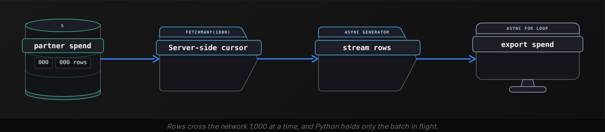

# Async Python for Data Engineers: Beginner

Ines is in the fourth round of a data engineering loop at Instagram. The interviewer shares a script: an `async def` job that pulls yesterday's ad metrics from 50 partner APIs, each answering in about 200 ms. 'It uses asyncio everywhere,' he says, 'so why does it take 10 seconds a run, the same as the old synchronous version?' Ines scans the code and finds `requests.get` inside the coroutine. She explains that the event loop gets control back only at an `await`, so a call that waits without awaiting freezes every other fetch. The interviewer nods, then pushes: which part of this job would async never speed up, how would you fan the calls out, and what happens when 3 partners fail? This lesson builds the model behind each of those answers.


<br>

### What you will be able to do

Explain how a single-threaded event loop switches between coroutines at await and why one blocking call stalls all of them

Classify a workload as I/O-bound or CPU-bound from where its time goes, and pick asyncio or multiprocessing to match

Find blocking calls hidden inside async def functions and replace each with its async-native equivalent

Fan out coroutines with asyncio.gather and separate successes from failures with return_exceptions=True

Stream database rows in fixed-size batches with async with and async for instead of loading the whole result set


<br>

---

## The Model: Cooperative Multitasking

An asyncio program runs every coroutine on a single thread, driven by an **event loop**. The loop keeps a list of tasks that are ready to run. It picks one and runs it until the task reaches an await on something that has not finished: a socket with no reply yet, a timer that has not fired. At that point the task hands the thread back. The loop parks it, records what it is waiting on, and runs the next ready task. When the reply lands, the parked task rejoins the ready list.

This is **cooperative multitasking**: a task gives up the thread only when it chooses to, and the only place it can choose is an await. The loop has no way to interrupt a coroutine that is running. Operating system threads work the other way: the OS can pause a thread at almost any instruction and switch to another, which is **preemptive** multitasking. The consequence for asyncio: a coroutine that runs a long stretch without an await takes the thread from every other task for that whole stretch.

| ✓ Cooperative: asyncio | ✗ Preemptive: OS threads |
| --- | --- |
| • Switches tasks only at an await the running task reaches<br><br>• A single thread, so 2 coroutines never execute Python at the same instant<br><br>• A task that never awaits keeps the thread until it returns<br><br>• A waiting task is a small Python object, so thousands can wait at once | • The OS can switch threads at almost any instruction<br><br>• Each thread reserves its own stack, 8 MB of address space by default on Linux<br><br>• A thread stuck in a slow call does not stop the others being scheduled<br><br>• Shared data needs locks, because a switch can land mid-update |


<br>

### Watch the loop switch tasks

The program below runs 2 fetches together twice: once waiting with `await asyncio.sleep(0.05)`, which stands in for a network call, and once with `time.sleep(0.05)`, which waits without awaiting. `asyncio.gather` hands both coroutines to the loop at once; section 3 covers it in depth. Before you play it, write down the order of the 4 log entries in each run.

https://github.com/user-attachments/assets/671d6334-2a33-4d20-afd7-f5af4e345cbc

*Same 2 fetches, 2 runs: only the awaiting run overlaps the waits.*

In the awaiting run, A reaches its `await`, the loop parks it and starts B, and both requests are in flight together: send, send, response, response. In the blocking run, `time.sleep` holds the thread for the full 50 ms without an `await`, so B cannot send its request until A already has its response. Both programs are valid Python and both produce the same 4 entries; only the first one lets the loop overlap the waits.


<br>

### Tick by tick: 3 partner calls

Scale the same picture up to the partner job, where each call spends about 200 ms waiting on the network and roughly 0.3 ms running its own Python. The table follows the loop through a run of 3 calls when every wait is awaited.

| Time | On the thread | Parked | What the loop does |
| --- | --- | --- | --- |
| 0.0 ms | `fetch(p1)` builds its request | none | p1 sends, reaches `await`, is parked |
| 0.3 ms | `fetch(p2)` builds its request | p1 | p2 sends, reaches `await`, is parked |
| 0.6 ms | `fetch(p3)` builds its request | p1, p2 | p3 sends and is parked; ready list empty |
| 0.9 to 200.3 ms | nothing | p1, p2, p3 | waits on all 3 sockets at once |
| 200.3 ms | `fetch(p1)` parses its reply | p2, p3 | p1's reply arrived, so p1 resumes |
| 200.6 ms | `fetch(p2)` parses its reply | p3 | p2's reply arrived, so p2 resumes |
| 200.9 ms | `fetch(p3)` parses its reply | none | p3 resumes; all 3 done by 201.2 ms |

*The 0.3 ms per call is the request-building and parsing Python runs on the thread; the 200 ms is time on the wire and on the partner's servers, which costs this process nothing while it waits.*

Swap the `await` for a blocking call and the second row cannot start until p1's 200 ms wait is over: 3 calls take about 600 ms. At 50 partners the same arithmetic gives about 0.2 seconds for the awaited version against 10 seconds for the blocking one, which is the gap the interviewer was pointing at. The loop overlaps a wait only when that wait is an `await`.

> **TIP**
>
> Read an `async def` as a series of stretches between `await` points. Each stretch runs to the end with every other task on the loop frozen, so the longest stretch sets the worst delay any other task can see.

> Interview prompts on the event loop
>
> - 'Why is this async job no faster than the sync one?' Look for a wait with no `await` in front of it.
> - 'What does `await` do?' It suspends this coroutine and gives the thread back to the loop until the result is ready.
> - 'Can 2 coroutines run at the same instant?' On a single loop they overlap their waiting while their Python code takes turns.


<br>

---

## I/O-Bound vs CPU-Bound Work

A workload is **I/O-bound** when most of its wall-clock time goes to waiting on something outside the process: an HTTP reply, a disk read, a database query. It is **CPU-bound** when usually goes to executing instructions on the thread: parsing, hashing, compressing, aggregating in Python loops. The split decides the tool, because asyncio overlaps only the time a task spends parked at an await. A CPU-bound coroutine never parks, so 8 of them on a single loop run in sequence, exactly as 8 plain function calls would.


<br>

### Measure where the time goes

Reading the code is an unreliable guide, since a line like `json.loads(payload)` costs microseconds on a small payload and seconds on a large one. Measure with 2 clocks: `time.perf_counter()` counts wall-clock time, everything that passed, while `time.process_time()` counts only the CPU time this process spent executing.

```sql
import time


def profile(step, *args):
    wall_start = time.perf_counter()
    cpu_start = time.process_time()
    result = step(*args)
    wall = time.perf_counter() - wall_start
    cpu = time.process_time() - cpu_start
    print(f"{step.__name__}: wall {wall:.2f}s, cpu {cpu:.2f}s, cpu share {cpu / wall:.0%}")
    return result
```

Read the CPU share. Near 100 percent, the thread was busy for the whole step and the step is CPU-bound. A small fraction means the thread sat idle waiting, so the step is I/O-bound. Run synchronously, the partner job's fetch step reports around 10 seconds of wall time and under half a second of CPU, a share under 5 percent: the profile asyncio was built for.

| Workload | Where the time goes | Bound by | Fits |
| --- | --- | --- | --- |
| Call 50 partner APIs at 200 ms each | Waiting for HTTP replies | I/O | asyncio |
| Run 30 queries against a reporting database | Waiting for the server to answer | I/O | asyncio |
| Parse 4 million JSON lines already in memory | Decoding each line in Python | CPU | multiprocessing |
| Hash 20 million emails with SHA-256 | Computing digests | CPU | multiprocessing |
| Download 200 files, then decompress each | Waiting, then computing | Both | asyncio for downloads, processes for decompression |
| Sum a column with a pure-Python loop | Bytecode for every row | CPU | multiprocessing, or push the sum into SQL |


<br>

### Why threads do not fix CPU-bound Python

The standard CPython build has a global interpreter lock, the GIL, which lets a single thread execute Python bytecode at a time. Threads still help with I/O, because blocking calls in the standard library release the lock while they wait. A Python parsing loop split across 4 threads, though, takes turns on the lock and finishes no sooner than 1 thread would. `multiprocessing` sidesteps the lock by starting separate interpreter processes, each with its own GIL, so 4 worker processes can keep 4 cores busy.

*Python 3.13 added an optional free-threaded build without the GIL; the default build still has it, and the reasoning above applies to that build.*

| ✓ asyncio | ✗ multiprocessing |
| --- | --- |
| • Overlaps waiting on a single thread and core<br><br>• Thousands of idle tasks fit in a single process<br><br>• Tasks share memory directly<br><br>• Speeds up nothing that never reaches an await | • Runs Python in parallel, a process per core<br><br>• Each worker is a full interpreter with its own memory<br><br>• Arguments and results are pickled and copied between processes<br><br>• Gains nothing on a step that spends its time waiting |


<br>

### Splitting a mixed job

Most real pipelines mix the 2 kinds. The partner job fetches 50 payloads, then flattens each into rows. Keep the fetches on the event loop, and if the profile shows flattening dominates, hand the parsed payloads to a process pool.

```sql
from concurrent.futures import ProcessPoolExecutor


def flatten(payload):
    return [
        (payload["partner"], event["id"], event["spend_cents"])
        for event in payload["events"]
    ]


def flatten_all(payloads):
    with ProcessPoolExecutor(max_workers=4) as pool:
        batches = list(pool.map(flatten, payloads, chunksize=8))
    return [row for batch in batches for row in batch]


if __name__ == "__main__":
    payloads = [
        {"partner": f"p{i}", "events": [{"id": j, "spend_cents": 25 * j} for j in range(3)]}
        for i in range(50)
    ]
    print(len(flatten_all(payloads)))
```

`flatten` sits at module level because the pool pickles it by name to send it to the workers, and `chunksize=8` ships payloads 8 at a time, so 50 payloads cost 7 round trips instead of 50. The pool pays off only when each chunk's compute outweighs that copying. Flattening 3 events per payload, as here, runs faster in the parent process; the profile is what tells you which side of that line a step falls on.

> **TIP**
>
> Classify out loud from the bottleneck: 'Each call waits 200 ms and computes under 1 ms, so it is I/O-bound and asyncio fits.' A tool named without the measurement behind it sounds like a guess.

> Trap answers
>
> - 'Use asyncio to speed up the transform.' A loop with no `await` gains nothing from the event loop.
> - 'Use threads for the CPU step.' The GIL lets only a single thread execute Python bytecode at any moment.
> - 'Use multiprocessing for the API calls.' It works, but pays a full interpreter per worker to sit and wait.


<br>

---

## The Blocking Call Trap

A blocking call waits on I/O, or burns CPU, without giving the loop a turn. Inside `async def` it raises no error and, by default, no warning: the job runs, writes the right rows, and lines up every other task on the loop behind it. That is why blockers survive code review, since a reader sees `async def` at the top and assumes the body overlaps.


<br>

### The calls that block

| Blocking call in async def | What it waits on | Async-native replacement |
| --- | --- | --- |
| `time.sleep(0.5)` | A timer, while holding the thread | `await asyncio.sleep(0.5)` |
| `requests.get(url)` | An HTTP reply on a socket | `await client.get(url)` on an async HTTP client |
| `cursor.execute(query)` from a sync driver | The database server | `await conn.execute(query)` from an async driver |
| `subprocess.run(cmd)` | A child process to exit | `await asyncio.create_subprocess_exec(\*cmd)`, then `await proc.wait()` |
| `sock.recv(4096)` on a blocking socket | Bytes from the peer | `await reader.read(4096)` on a stream from `asyncio.open_connection` |
| `json.loads` on a 300 MB payload | Nothing: it is pure CPU | Smaller payloads, or the parse moved to a process pool |

Most rows share a shape. The sync call and its async counterpart do the same work, but the async version returns an awaitable, and the `await` in front of it is where the loop takes the thread back. A call with no `await` in front, made inside a coroutine, finishes all its work before the next line runs. If that work means waiting on the network or disk, or computing, for longer than a few milliseconds, the call is a blocker.


<br>

### Spot the blockers

The coroutine below loads a single partner's spend events into the warehouse, and the job runs 50 copies of it on the same loop. Before reading on, find every line that stops the other 49.

```sql
import time

import requests


async def load_partner(partner_id, warehouse):
    url = f"https://partners.example.com/{partner_id}/spend"
    resp = requests.get(url, timeout=10)
    rows = [(partner_id, e["id"], e["spend_cents"]) for e in resp.json()["events"]]
    time.sleep(0.5)
    warehouse.insert_rows("partner_spend", rows)
    return len(rows)
```

There are 3. `requests.get` waits on the socket for about 200 ms. `time.sleep(0.5)`, added as a polite pause between partners, holds the thread for half a second. `warehouse.insert_rows` belongs to a sync client that waits on the database. Each copy holds the thread for at least 700 ms, so the 50 copies run back to back for at least 35 seconds while the loop never gets the chance to start the next fetch.

```sql
import asyncio


async def load_partner(partner_id, client, warehouse):
    url = f"https://partners.example.com/{partner_id}/spend"
    resp = await client.get(url, timeout=10)
    rows = [(partner_id, e["id"], e["spend_cents"]) for e in resp.json()["events"]]
    await asyncio.sleep(0.5)
    await warehouse.insert_rows("partner_spend", rows)
    return len(rows)
```

Every wait is now an `await`. While partner 1 waits, partners 2 through 50 send theirs, so all 50 finish in about the 0.7 seconds 1 copy needs, plus the warehouse's insert time. The 50 half-second pauses now overlap, so they space nothing apart: pacing calls needs a cap on concurrency, a separate tool; otherwise delete the sleep. Flattening stays sync, costing well under a millisecond.


<br>

### Catching blockers you did not write

Blockers also hide inside helper functions and third-party SDKs, where reading your own coroutine will not find them. asyncio has a debug mode for this. Start the job with `asyncio.run(main(), debug=True)` and the loop logs a warning for any single step of a task, from an `await` to the next, that holds the thread longer than `loop.slow_callback_duration`, which defaults to 0.1 seconds. A `requests.get` that takes 200 ms shows up as a log line naming the task and reporting about 0.2 seconds.

| ✓ Do | ✗ Don't |
| --- | --- |
| • Put await in front of every network, database and timer wait in async def<br><br>• Choose libraries whose I/O methods are coroutines<br><br>• Run each new async job once with debug=True and read the slow-step warnings<br><br>• Keep every stretch between await points to a few milliseconds | • Call time.sleep in a coroutine, even for a short backoff<br><br>• Assume a function never blocks because its caller is async def<br><br>• Wrap a sync call in async def and expect it to stop blocking<br><br>• Parse a huge payload inline on the loop's thread |

> **TIP**
>
> Wrapping is the classic wrong fix. `async def get(url): return requests.get(url)` defines a coroutine that still blocks, because the blocking happens inside it. The `await` has to reach all the way down to a call that suspends.

*The opposite slip, calling a coroutine function without await, blocks nothing and runs nothing: it creates a coroutine object, and Python warns coroutine ... was never awaited when that object is garbage-collected.*

> Interview prompts on blocking calls
>
> - 'This async job is slow. Find the bug.' Scan for I/O calls with no `await` in front of them.
> - 'Is `async def` enough to make a function non-blocking?' Only awaiting a call that suspends gives the loop a turn; the keyword on the outer function changes nothing.
> - 'A sync SDK has no async version. What do you say?' That it blocks the loop for as long as each call takes, which you measure before choosing a fix.


<br>

---

## Fanning Out with asyncio.gather

`asyncio.gather(*coros)` wraps each coroutine in a task, schedules all of them on the loop at once, and returns a single awaitable. Awaiting it suspends the caller until every task has finished, then hands back a list of results in the order the coroutines were passed, whatever order they finished in. That ordering is what lets you zip the results back to the inputs that produced them.

```sql
import asyncio


async def run_partners(partner_ids, client, warehouse):
    coros = [load_partner(pid, client, warehouse) for pid in partner_ids]
    row_counts = await asyncio.gather(*coros)
    return dict(zip(partner_ids, row_counts))
```

*gather(\*coros) unpacks the list into separate arguments; passing the list itself as one argument raises TypeError, because a list is not awaitable.*

- **10 s** — 50 fetches awaited one at a time
- **0.2 s** — the same 50 fetches through gather

The fanned-out run tracks the slowest single call plus a little loop overhead per task, provided the partners answer independently. If all 50 calls hit the same rate-limited endpoint, the server queues them and the gain shrinks. `gather` also starts every coroutine it is given with no cap on how many run at once, which is fine at 50 and a problem at 50,000.


<br>

### One failing partner hides the rest

By default `return_exceptions=False`. The first exception raised in any task is re-raised to the code awaiting `gather`, and no results list comes back. The other tasks keep running in the background, uncancelled, and whatever they return is lost to the caller. In this run initech fails at 20 ms; predict the 3 printed lines before you play it.

https://github.com/user-attachments/assets/4d068422-f487-4991-88b7-6b6da15884e3

*Initech fails at 20 ms; acme keeps running after the caller has given up.*

The caller reaches `except` at 20 ms holding nothing but initech's error. Globex had already finished at 10 ms, and acme still finishes at 40 ms, yet neither result reaches a variable the caller can read. In the partner job, a single failing partner hides the outcome of every partner that succeeded, and rerunning the job re-fetches all 50.


<br>

### Collecting partial failures

With `return_exceptions=True`, an exception raised in a task is stored in the results list at that task's position, as an ordinary value, and `gather` returns normally once every task is done. The caller splits the list into successes to load and failures to retry. This run has 4 partners finishing in a scrambled order, 1 of them failing.

https://github.com/user-attachments/assets/88d31588-1aa2-419e-ab4a-de1d32f0b4b8

*Failures come back as values, in argument order.*

Completion order

| Time | Partner | Outcome |
| --- | --- | --- |
| 10 ms | globex | 45 rows |
| 20 ms | initech | ConnectionError |
| 30 ms | umbrella | 300 rows |
| 40 ms | acme | 120 rows |

results list

| Index | Partner | Value |
| --- | --- | --- |
| 0 | acme | 120 |
| 1 | globex | 45 |
| 2 | initech | ConnectionError('initech: HTTP 503') |
| 3 | umbrella | 300 |

Completion order was globex, umbrella, acme, yet `results` follows argument order with the exception sitting in the third slot, so `zip` pairs each value with the right partner. The check is `BaseException` on purpose. Since Python 3.8, `asyncio.CancelledError` subclasses `BaseException`, and with `return_exceptions=True` a child task that was cancelled appears in the list as a `CancelledError` instance, which an `Exception` check would file as a success.

| Behaviour | return_exceptions=False | return_exceptions=True |
| --- | --- | --- |
| One task raises | The exception is re-raised to the caller | The exception object is stored at its index |
| Other tasks | Keep running; their results are unreachable | Keep running; their results are returned |
| `await gather(...)` gives | Nothing: it raises | A list as long as the input |
| The caller's job | Catch, then decide whether to rerun everything | Check each item's type before using it |
| Fits | All-or-nothing steps | Independent sources retried individually |

The retry pass follows from the ordering. Zip the first results to the partner ids, keep the ids whose value is an exception, and gather again on those alone, so a 3-partner outage costs 3 extra calls instead of 50.

```sql
async def load_all(partner_ids, client, warehouse):
    results = await asyncio.gather(
        *(load_partner(pid, client, warehouse) for pid in partner_ids),
        return_exceptions=True,
    )
    outcomes = dict(zip(partner_ids, results))
    failed = [pid for pid, r in outcomes.items() if isinstance(r, BaseException)]
    if failed:
        retried = await asyncio.gather(
            *(load_partner(pid, client, warehouse) for pid in failed),
            return_exceptions=True,
        )
        outcomes.update(zip(failed, retried))
    return outcomes
```

> **TIP**
>
> With `return_exceptions=True`, a bug such as a `KeyError` in your parsing turns into a quiet entry in the failure list. Log every failure with its partner and exception type, and fail the run when the failure count crosses a threshold you chose in advance.

> Interview follow-ups
>
> - 'Are results in completion order?' They follow argument order, every time.
> - 'Does one failure cancel the rest?' Under either setting the other tasks run to completion.
> - 'What if a partner fails twice?' Report it with its exception and let the run's failure threshold decide.


<br>

---

## async with and async for

Reading 5 million rows of partner spend with `fetchall()` puts the whole result set in Python memory at once: at about 200 bytes a row as tuples, around 1 GB for a single query, and no row is available until the last one has arrived. Streaming needs 2 pieces of syntax: `async with` to open the cursor and close it whatever happens, and `async for` to pull rows from it a batch at a time.

```sql
async def export_spend_all(pool, sink):
    async with pool.acquire() as conn:
        async with conn.cursor(SPEND_QUERY) as cursor:
            rows = await cursor.fetchall()
    for row in rows:
        await sink.write(redact(row))
    return len(rows)
```


<br>

### async with: setup and teardown that can wait

A regular `with` block calls `__enter__` and `__exit__`, both plain methods. Opening a connection, or returning one to a pool, is network I/O, so an async resource defines `__aenter__` and `__aexit__` as coroutines, and `async with` awaits each of them; other tasks run while the connection opens. `__aexit__` runs whether the block finishes, raises or is cancelled, so the cursor closes and the connection goes back to the pool every time.


<br>

### async for: one batch per await

An `async def` function that contains `yield` is an async generator. Each turn of an `async for` loop awaits the generator's `__anext__`, which runs its code up to the next `yield`, and that code may `await` along the way. Put a `fetchmany` call inside, yield the rows of each batch, and the consumer sees a plain row-by-row loop while memory holds a single batch. The animation streams 7 orders in batches of 3: predict how many times `fetchmany` runs.

https://github.com/user-attachments/assets/03807ae3-d694-4408-a870-6571838898a9

*Streams 7 rows in batches of 3 through a cursor that async with closes.*

`fetchmany` ran 4 times: batches of 3, 3 and 1, then a 4th call that came back empty and ended the generator with `return`. The cursor closed at row 7 as the `async with` block exited, before the total printed. `ORDERS` plays the server here. A real async driver can keep the result on the database side behind a server-side cursor and send each batch over the network when `fetchmany` asks, and that wait is the `await` the loop overlaps with other work.

fetchall()

| Measure | Value |
| --- | --- |
| Rows in Python memory | 5,000,000 |
| Memory at about 200 bytes a row | about 1 GB |
| First row usable | after the last row arrives |
| Peak memory grows with | table size |

async for over fetchmany(1000)

| Measure | Value |
| --- | --- |
| Rows in Python memory | 1,000 |
| Memory at about 200 bytes a row | about 200 KB |
| First row usable | after the first batch arrives |
| Peak memory grows with | batch size |

Batch size is the dial. Each batch costs a network round trip, so 5 million rows at 1,000 per batch is 5,000 round trips; at 100 per batch it is 50,000, and the memory saved is small next to the extra waiting. Sizes between 1,000 and 10,000 rows keep both round trips and memory modest for rows of this size.




<br>

### Nesting the 2 blocks

A real export step wraps a pool connection, a cursor and the generator. The query it streams selects 4 columns for a single day of partner spend.

```sql
SELECT
  partner_id,
  event_id,
  spend_cents,
  contact_email
FROM partner_spend
WHERE event_date = DATE '2026-10-24'
```

```sql
async def export_spend(pool, sink):
    written = 0
    async with pool.acquire() as conn:
        async with conn.cursor(SPEND_QUERY) as cursor:
            async for row in stream_rows(cursor, batch_size=1000):
                await sink.write(redact(row))
                written += 1
    return written
```

The connection is acquired first and released last, so the cursor, which lives on that connection, closes before the connection goes back to the pool. The `async for` sits inside both blocks. If `redact` raises on row 3,000,001, the exception unwinds through the cursor's `__aexit__` and then the connection's, and no half-read cursor is left holding a result open on the server.

> **TIP**
>
> Keep the `async for` inside the `async with` that owns the cursor. A loop that breaks early leaves the generator suspended mid-batch, but the enclosing block still closes the cursor; a generator carried outside the block outlives its cursor, and its next `fetchmany` fails on a closed connection.

> Interview prompts on streaming
>
> - 'Stream a 5-million-row table without running out of memory.' Server-side cursor, `fetchmany` in an async generator, `async for` to consume.
> - 'Why `async with` instead of `with`?' Opening and closing the resource are network calls that must be awaited.
> - 'What sets peak memory here?' The batch size, independent of table size.
> - 'Does `async for` make the query faster?' The server does the same work; what changes is when rows arrive and how many sit in memory.


<br>

---

## Putting It All Together

A social app's ads team runs a nightly job that calls 50 measurement partners' spend APIs at about 200 ms each, flattens each payload into rows, loads them into the warehouse, then exports the day's 5 million spend rows, with contact emails redacted, to the finance system.

- Cooperative multitasking explains why the fetch step speeds up and the flatten step does not: only the fetches reach an await .
- The CPU-share profile decides whether flattening stays in the parent process or moves to a process pool, separately from the fetches.
- A single leftover time . sleep backoff in load_partner would serialise all 50 calls, so the job runs once in debug mode before it ships.
- gather with return_exceptions = True keeps the partners that answered and retries only the ones that failed.
- The export reads the spend table through a server-side cursor inside async with , so memory follows batch size while the loop keeps other work moving.


<br>

---

## Key Takeaways

- An event loop runs coroutines on a single thread and switches only at await , so any stretch without one stalls every task on the loop.
- Profile wall time against CPU time: a small CPU share means I/O-bound and asyncio; a share near 100 percent means CPU-bound and processes.
- time . sleep , requests . get and sync drivers block inside async def ; their async-native versions put an await where the wait is.
- gather returns results in argument order, and return_exceptions = True turns failures into values you can zip back to inputs and retry.
- async with closes resources through awaited teardown, and an async generator over fetchmany holds a single batch in memory whatever the table size.
