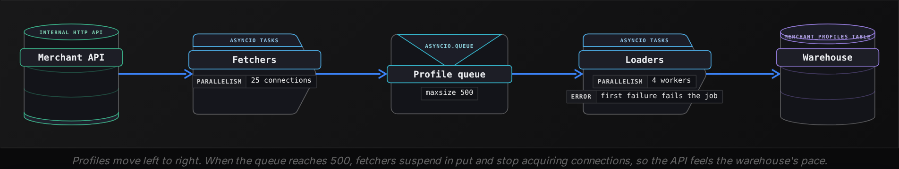

# Async Python for Data Engineers: Intermediate

Ines is 40 minutes into a data engineering onsite at Stripe when the interviewer pastes a stub: `async def backfill(merchant_ids)`. The job pulls 50,000 merchant profiles from an internal API and lands them in the warehouse overnight. Her first version is a single `gather` over every id, and it passes the 5-row test. Then the follow-ups start. The API answers 429 above 25 open connections, so how does the job stay under that? The warehouse loader writes slower than the API returns, so where do the waiting profiles live? About 1 request in every 1,000 never returns; what stops it from holding the job open? And why would `requests.get` inside that function turn the whole run serial without raising anything? Every follow-up asks the same thing about a different resource: what bounds it, and what that bound costs in throughput.


<br>

### What you will be able to do

Size an asyncio.Semaphore from an API's connection cap with Little's law, and state the job's wall time from it

Build a bounded asyncio.Queue pipeline whose memory stays flat, and stop a dead consumer from hanging the producer

Combine per-request wait_for timeouts with a wall-clock deadline that covers retries and slot waits

Stream millions of rows through an async generator at batch-sized memory, bridging blocking drivers with asyncio.to_thread

Choose between httpx and aiohttp from a throughput number, and explain what requests.get does to an event loop


<br>

---

## Semaphore-Bounded Fetching

The one-line `gather` draft from the backfill question schedules every fetch at once. With 50,000 merchant ids, `gather` wraps each coroutine in a task, and the event loop runs every task up to its first `await` before any response comes back, so the API receives 50,000 connection attempts in a single burst. It answers with 429s and connection resets. When each fetch opens its own connection, your own process can fail first: many Linux hosts set a soft limit of 1,024 open file descriptors, and connect calls past it raise `OSError: [Errno 24] Too many open files`.


<br>

### What the semaphore counts

`asyncio.Semaphore(25)` is a counter that starts at 25, plus a line of waiting coroutines. Entering `async with sem:` decrements the counter and leaving the block increments it. A coroutine that arrives while the counter reads 0 suspends on a future, and each release wakes the longest-waiting one. The semaphore caps how many coroutines are inside a single block of code at once, whatever that code does, so its effect depends entirely on where the block sits. Put it around the code that holds the scarce resource, which in the backfill is an open request to the API.

Try it before playing the run below. The 6 pages share a `Semaphore(2)`, and page `p` sleeps `0.1 * p` seconds to stand in for network latency. Predict which page starts third, what every `in flight` count reads after the first 2 starts, and what the last line prints.

https://github.com/user-attachments/assets/3be00020-caab-4cb3-a751-42b897bdb47f

*Semaphore(2) over 6 pages: the in-flight count never passes 2.*

Page 3 starts third: page 1 finishes first, at 0.1 s, and leaving `async with` hands its slot to the oldest waiter. Every later start reads `in flight 2` because a finishing page decrements `stats["in_flight"]` before its slot passes on, so the count never reaches 3 and `peak in flight: 2` closes the run. `gather` returns `[10, 20, 30, 40, 50, 60]` in argument order whatever the finish order. The run takes 1.2 s, set by page 6, which gets a slot at 0.6 s and then sleeps 0.6 s.


<br>

### Turning the API's limit into a slot count

Interviewers expect a number here, and Little's law supplies it: requests in flight equal throughput multiplied by latency. Rearranged, throughput is concurrency divided by latency. The internal API tolerates 25 open connections and answers in 250 ms on average, so a semaphore set to the connection cap fixes both the rate the backfill sustains and the time it needs for the whole id list.

- **100 req/s** — sustained rate at 25 in flight
- **500 s** — wall time for all 50,000 profiles

The same law shows where a semaphore stops being the right tool. It bounds concurrency, while many APIs publish their limit as a rate, and the two agree at only one latency. Suppose the contract were 80 requests per second and latency fell to 40 ms during a quiet hour: 25 slots would then push 625 requests per second into a 429 storm. Sizing for that fast case means 3 slots, which crawl at 12 per second once latency returns to 250 ms. A rate contract wants a pacer on request starts, such as a token bucket, with the semaphore kept as the cap on open connections.


<br>

### Placing the async with block

```sql
import asyncio


async def fetch_profile(client, sem, merchant_id):
    async with sem:
        response = await client.get(f"/merchants/{merchant_id}")
    response.raise_for_status()
    return parse_profile(response.json())


async def backfill(client, merchant_ids):
    sem = asyncio.Semaphore(25)
    tasks = [fetch_profile(client, sem, m) for m in merchant_ids]
    return await asyncio.gather(*tasks, return_exceptions=True)
```

The slot covers the request and nothing after it. Status checks and parsing run once the block exits, so the slot frees as soon as the body has arrived, and the next waiter connects while this coroutine parses. Moving `parse_profile` inside the block would hold a connection slot for CPU work the API never sees, pulling real concurrency below 25 with no benefit to the target. What the semaphore leaves unbounded is the task list. `gather` still creates all 50,000 tasks up front, each a suspended coroutine frame waiting in `acquire`. That is affordable at 50,000 and runs to gigabytes at 50 million ids, where a fixed set of workers pulling ids from a queue bounds the task count as well.

> **TIP**
>
> On Python 3.9, build the semaphore inside the coroutine that `asyncio.run` starts. A `Semaphore` created at import time binds to the loop `get_event_loop()` returned then, and its first contended `acquire` under `asyncio.run` fails with a future attached to a different loop.


<br>

---

## Backpressure with asyncio.Queue

Fetching is half of the backfill. The loader that writes profiles to the warehouse finishes 40 per second, because every insert waits on a commit, while the fetchers deliver 100. Connect the two through `asyncio.Queue()` with no `maxsize` and the fetchers never wait: the queue absorbs the gap of 60 profiles per second, and each waiting profile sits in process memory as a parsed dict of about 8 KB.

| Moment in the run | Unbounded queue | Queue(maxsize=500) |
| --- | --- | --- |
| 60 s in, 50,000 ids | 3,600 queued, 29 MB | 500 queued, 4 MB |
| 300 s in, 50,000 ids | 18,000 queued, 144 MB | 500 queued, 4 MB |
| 500 s in, 50,000 ids | 30,000 queued, 240 MB | 500 queued, 4 MB |
| 50,000 s in, 5 million ids | 3,000,000 queued, 24 GB | 500 queued, 4 MB |

The unbounded column grows for as long as fetching outpaces loading, and nothing in the program notices until the kernel kills the process for memory. The bounded column is flat in every row because queue depth, rather than input size, sets its memory.


<br>

### How a full queue pushes back

`asyncio.Queue(maxsize=500)` changes the behaviour of a single method. `await queue.put(item)` returns immediately while the queue holds fewer than 500 items; at 500 it suspends the caller until a consumer's `get` frees a place. That pause slows fetching only when the fetch side is a fixed pool: 25 worker tasks that each take an id, fetch it, `await queue.put(profile)` and only then take the next id. Section 0's `gather` over 50,000 tasks defeats it. Each task releases its semaphore slot before it calls `put`, so the waiting tasks keep acquiring slots and fetching while finished profiles pile up in tasks suspended in `put`, and memory grows as in the unbounded column. With the fixed pool, a suspended worker starts no new request, so the fetch rate drops to the loader's rate and memory stops growing at 500 items. The pressure travels upstream through `await` with no extra code: fewer fetches start, fewer workers reach the semaphore, and the API sees its load fall the moment the warehouse slows down.

Predict this run before playing it. The queue holds 2 items, the producer puts the numbers 1 to 6 and then a `None` sentinel, and the consumer spends 0.1 s on each item before appending it to `written`. What does each `put` line report for `written`?

https://github.com/user-attachments/assets/2461b3b5-5479-4e20-bbcb-5b65634e92d7

*A queue of 2 paces the producer to the consumer's speed.*

The first 2 puts return without suspending, because `put` on a queue with room never yields to the loop. The third put suspends, and the consumer's first `get` releases it, so `put 3` reports `written 0`: item 1 has left the queue but sits unfinished in the consumer's hands. From then on each put waits for exactly 1 get, `put 4` reports 1 written, `put 6` reports 3, and the producer never runs more than 3 items ahead: 2 queued plus 1 in progress. In general, unfinished items peak at `maxsize` plus 1 per consumer.

Backpressure relocates the waiting into the fetchers. With the queue capped at 500, they spend about 60% of their time suspended in `put`, and the backfill finishes at the loader's pace: 1,250 s for 50,000 profiles. Extra loaders or larger insert batches shorten that; a deeper queue leaves it unchanged.


<br>

### Workers, shutdown and the dead-loader hang



```sql
import asyncio


async def loader(queue, warehouse):
    while True:
        profile = await queue.get()
        try:
            await warehouse.insert(profile)
        finally:
            queue.task_done()


async def produce(queue, fetch_profiles):
    async for profile in fetch_profiles():
        await queue.put(profile)
    await queue.join()


async def run(fetch_profiles, warehouse):
    queue = asyncio.Queue(maxsize=500)
    loaders = [asyncio.create_task(loader(queue, warehouse)) for _ in range(4)]
    producer = asyncio.create_task(produce(queue, fetch_profiles))
    done, _ = await asyncio.wait(
        [producer, *loaders], return_when=asyncio.FIRST_COMPLETED
    )
    for task in [producer, *loaders]:
        task.cancel()
    await asyncio.gather(producer, *loaders, return_exceptions=True)
    for task in done:
        task.result()
```

`task_done` sits in `finally` because `join` returns only when every `put` has a matching `task_done`; one skipped call and `join` waits forever. The producer awaits `join` before it finishes, so its completion means every profile was handed off and processed. Loaders loop forever and can end only by raising, which is why `FIRST_COMPLETED` is the right wait: it returns when the producer is done or when the first loader dies. That second case is the hang interviewers probe. Without the `wait`, a failing `insert` kills each loader in turn, its exception stored in a task nobody awaits; once all 4 are gone the queue fills to 500, the producer suspends in `put`, and the job sits silent forever. An unbounded queue fails loudly by running out of memory, while a bounded one with unwatched workers hangs. `task.result()` re-raises the loader's exception, so the job fails with the real cause.

> **TIP**
>
> Size `maxsize` from both directions. Memory sets the ceiling: at 8 KB per profile, a depth of 500 holds 4 MB. Starvation sets the floor: loaders drain 40 profiles per second, so 500 queued profiles keep them busy through a 12.5 s fetch stall. Depth past the floor costs memory and buys no throughput.


<br>

---

## Request Timeouts and Deadlines

The third follow-up was the request that never returns. A server that accepts the TCP connection and then stalls leaves the coroutine suspended at its `await` with no error to catch. Inside `async with sem:` that coroutine holds its slot for the life of the process. At a hang rate of 1 in every 1,000 requests, the 25 slots fill with hung calls after about 25,000 requests on average, halfway through the backfill, and from that moment the job makes no progress and logs nothing.


<br>

### Per-request timeouts with wait_for

`asyncio.wait_for(coro, timeout=5)` wraps the coroutine in a task and waits at most 5 seconds for it. On expiry it cancels that task, waits for the cancellation to finish, and raises `asyncio.TimeoutError` in the caller. Cancellation arrives as a `CancelledError` raised at whatever `await` the task is suspended on, so every `async with` and `finally` it sits inside runs on the way out. That is what returns the slot: the hung request's `async with sem:` exits through the cancellation and wakes the next waiter. On Python 3.9, catch `asyncio.TimeoutError` by that name; it became an alias of the built-in `TimeoutError` only in 3.11, so `except TimeoutError` lets it through on older interpreters.


<br>

### A deadline that covers retries

A per-request timeout bounds a single attempt, and retries multiply it. With a 5 s timeout, 3 attempts and backoff sleeps of 1 s and 2 s, a single profile can take 18 s, a number nobody upstream chose. A deadline is a fixed point on the loop's clock, `loop.time() + budget`, and every step receives only the time left before that point. Python 3.11 added `async with asyncio.timeout(budget):`, which cancels whatever the block is awaiting when the budget runs out and raises `TimeoutError` at the block's edge. On 3.9 the same behaviour comes from computing the remaining budget before each step and handing it to `wait_for`, as below with a 12 s budget per profile.

```sql
import asyncio


BACKOFF = [1.0, 2.0]


async def fetch_with_deadline(client, sem, merchant_id, budget=12.0):
    loop = asyncio.get_running_loop()
    deadline = loop.time() + budget
    for attempt in range(len(BACKOFF) + 1):
        try:
            async with sem:
                left = deadline - loop.time()
                return await asyncio.wait_for(
                    client.get(f"/merchants/{merchant_id}"),
                    timeout=min(5.0, left),
                )
        except asyncio.TimeoutError:
            if attempt == len(BACKOFF):
                break
            if deadline - loop.time() <= BACKOFF[attempt]:
                break
            await asyncio.sleep(BACKOFF[attempt])
    raise asyncio.TimeoutError(f"merchant {merchant_id} spent its {budget} s budget")
```

That code makes 3 choices worth defending in an interview. The slot is taken inside the retry loop and released before the backoff sleep, so a failing merchant never holds a connection while it waits. `left` is measured after `acquire`, so time spent queued for a slot comes out of the same 12 s. The loop also breaks when the next backoff would leave nothing to spend, so the worst case is 2 attempts in 11 s: 5 s, a 1 s pause, 5 s, then a stop because the 2 s pause would land on the deadline.

On Python 3.11 and later, `asyncio.timeout` takes over that bookkeeping. The `deadline` and `left` variables disappear: the context manager holds the end point, and when it passes it cancels whatever the block is awaiting, whether a request, a slot wait or a backoff sleep. Inside the block that cancellation arrives as `CancelledError`, which the per-attempt `except TimeoutError` does not catch; it becomes `TimeoutError` only at the block's edge, where the outer handler adds the merchant id. `wait_for` still caps each attempt at 5 s.

```sql
import asyncio


BACKOFF = [1.0, 2.0]


async def fetch_with_deadline(client, sem, merchant_id, budget=12.0):
    try:
        async with asyncio.timeout(budget):
            for attempt in range(len(BACKOFF) + 1):
                try:
                    async with sem:
                        return await asyncio.wait_for(
                            client.get(f"/merchants/{merchant_id}"), timeout=5.0
                        )
                except TimeoutError:
                    if attempt == len(BACKOFF):
                        raise
                    await asyncio.sleep(BACKOFF[attempt])
    except TimeoutError:
        raise TimeoutError(f"merchant {merchant_id} spent its {budget} s budget")
```

Run the idea at small scale. Each job below gets at most 1.0 s per call, and all 5 share a 2.5 s budget that is charged the time each call actually ran. Job `b` stands in for a hung request and sleeps 5 s. Predict the 5 printed lines: which jobs time out, which succeed, and which never start?

https://github.com/user-attachments/assets/4df6f621-8744-4c64-a70a-e83a435c1ef5

*Each call gets the smaller of 1.0 s and the budget left; a cut-off call is charged its full limit.*

Job `b` hits the 1.0 s per-call cap. Job `d` hits the deadline instead: it starts at 2.0 s with 0.5 s remaining, so `min(1.0, remaining)` hands `wait_for` the smaller number. Job `e` is skipped without a call, because a request launched with no budget left can only fail late. Both long sleeps are cancelled, so the run ends at 2.5 s although the sleeps add up to 9.5 s.

| ✓ Per-request timeout | ✗ Deadline |
| --- | --- |
| • Bounds a single attempt<br><br>• Frees the semaphore slot a hung request holds<br><br>• Sized from the API: a few times its p99 latency<br><br>• Any version: asyncio.wait_for(coro, timeout=...) | • Bounds the whole operation, retries and slot waits included<br><br>• Lets the caller promise an end time<br><br>• Sized from the caller's SLA, then split across steps<br><br>• 3.11 and later: async with asyncio.timeout(budget):; on 3.9, the remaining budget passed to wait_for |

> **TIP**
>
> A timeout turns a hang into a cost you can price. The backfill meets about 50 hung requests; at 5 s each they burn 250 slot-seconds out of the run's 12,500, a 2% slowdown. Without the timeout, 25 of those hangs are enough to fill every slot and stop the job.


<br>

---

## Streaming with Async Generators

After the profiles land, a reconciliation job reads the warehouse's `charges` table back out to compare totals per merchant: 20 million rows. `rows = cursor.fetchall()` asks for all of them as a single Python list. At roughly 500 bytes per row once each value becomes a Python object inside a tuple, that list needs roughly 10 GB before the first comparison runs, and a worker with 8 GB of memory is killed partway through the fetch.


<br>

### An async generator yields a batch at a time

An `async def` function that contains `yield` is an async generator. Calling it returns an object without running the body, and `async for` drives that object. Each iteration resumes the body until the next `yield`, and the body may `await` along the way, which is where the next `fetchmany` round trip happens. Between iterations the generator sits suspended at its `yield`, so the database is asked for batch 2 only after the consumer has finished with batch 1. Peak memory is a single batch plus whatever the consumer chooses to keep.

In the run below, `FakeCursor` serves 10 rows and the batch size is 4. Before playing it, predict the order of the `fetched` and `loaded` lines, the size of the last batch, and the total.

https://github.com/user-attachments/assets/496fe159-59aa-422b-8640-0b76ddeee742

*Only 1 batch of at most 4 rows exists at a time while 10 rows stream through.*

The lines alternate because the generator pauses at `yield` until `async for` asks for more, so no batch is fetched while the previous one is being loaded. The third batch holds 2 rows, and the fourth `fetchmany` returns an empty list, which ends the generator through `return` and stops the loop. That lockstep is the generator's built-in backpressure, and also its cost: fetch time and load time add up instead of overlapping. When they should overlap, or several consumers share one source, put the batches on a bounded `asyncio.Queue`, and memory becomes `maxsize` batches rather than a single batch.


<br>

### Choosing the batch size

Batch size trades memory against round trips. Take 2 ms as the cost of a `fetchmany` round trip, network plus driver overhead, and 500 bytes per row, and the 20 million rows price out like this.

| Batch size | Round trips | Round-trip time | Peak batch memory |
| --- | --- | --- | --- |
| 1,000 | 20,000 | 40 s | 0.5 MB |
| 10,000 | 2,000 | 4 s | 5 MB |
| 100,000 | 200 | 0.4 s | 50 MB |

Beyond 10,000 rows per batch, saving a few seconds of round trips costs tens of megabytes on a job that runs for minutes anyway. One driver detail decides whether the table holds at all. A client-side cursor transfers the entire result set during `execute`, so `fetchmany` slices a list that already fills memory; streaming needs a server-side cursor, which keeps the rows on the database until each fetch requests them.


<br>

### Bridging a blocking driver with asyncio.to_thread

Some databases offer only a synchronous driver. Calling its `fetchmany` directly inside `async def` blocks the event loop for the whole round trip, freezing every other coroutine in the process. `asyncio.to_thread(func, *args)`, added in Python 3.9, runs the call on the loop's default thread pool and returns an awaitable, so the loop keeps serving other tasks while a thread waits on the socket. That pool holds `min(32, os.cpu_count() + 4)` threads by default, which caps how many blocking calls can be in progress at once across the whole process.

```sql
import asyncio


async def stream_charges(conn, batch_size=10_000):
    cursor = await asyncio.to_thread(conn.cursor)
    await asyncio.to_thread(
        cursor.execute, "SELECT charge_id, merchant_id, amount FROM charges"
    )
    try:
        while True:
            rows = await asyncio.to_thread(cursor.fetchmany, batch_size)
            if not rows:
                return
            yield rows
    finally:
        await asyncio.to_thread(cursor.close)


async def reconcile(conn):
    batches = stream_charges(conn)
    try:
        async for rows in batches:
            if any(amount < 0 for _, _, amount in rows):
                return "negative charge found"
        return "clean"
    finally:
        await batches.aclose()
```

The cleanup happens in 2 places. The generator's `finally` closes the cursor however iteration ends. `reconcile` returns early from inside `async for` when it finds a negative charge, which leaves the generator suspended at `yield` with its cursor still open, because leaving a loop does not close an async generator. The explicit `await batches.aclose()` throws `GeneratorExit` in at that `yield` and runs the `finally` now, instead of whenever garbage collection or the loop's shutdown hook reaches it. On Python 3.10 and later, `contextlib.aclosing` wraps the same call in an `async with`.


<br>

---

## Choosing an Async HTTP Client

The last follow-up in the backfill question was `requests.get` inside `async def`. The call is synchronous: it holds the thread until the response arrives, and the event loop runs on that thread, so no other coroutine moves during the wait. Wrapped in `gather` behind a `Semaphore(25)`, the 50,000 fetches run in sequence, because each one blocks before the next can reach its socket.

- **12,500 s** — backfill wall time with requests.get
- **500 s** — same backfill on an async client

`requests` also has no default timeout, so a single hung response stalls the loop itself, along with heartbeats, queue consumers and every other job sharing the process. `asyncio.to_thread(requests.get, url, timeout=5)` works as a stopgap, with concurrency capped by the default pool's thread count and a whole thread spent on every call in progress. Native async clients exist so the waiting happens inside the event loop's socket polling instead.


<br>

### httpx and aiohttp, side by side

Both clients keep a connection pool per client object, reuse keep-alive connections and stream response bodies on request. The choice turns on the 5 properties below.

| Property | httpx | aiohttp |
| --- | --- | --- |
| Sync and async use | Both, through `Client` and `AsyncClient` with one interface | Async only, on asyncio only |
| HTTP/2 | Optional, with the `http2` extra installed | HTTP/1.1 client only |
| HTTP/1.1 parsing | Pure Python, through `h11` | C-accelerated parser |
| Default timeout | 5 s each for connect, read, write and pool wait | 5 minutes total per request |
| Default pool | 100 connections, 20 kept alive | 100 connections, no per-host cap |


<br>

### Deciding from the throughput number

Start from the requirement, because at moderate rates the network sets the pace. The backfill runs 100 requests per second against a 25-connection cap; each response spends 250 ms in flight, and parsing 100 responses per second takes a small fraction of a core in either client. At that rate httpx wins on what surrounds the fetch: the same code runs in a synchronous script or test, HTTP/2 can multiplex many requests over a single connection when the server offers it, and the 5 s default timeout ends a hung request without extra code. That changes when a single process must sustain thousands of small responses per second. Per-request CPU becomes the ceiling, and aiohttp's C parser does less Python work per response. Measure requests per second per core at your target concurrency on your own payloads before committing either way.

| ✓ Pick httpx when | ✗ Pick aiohttp when |
| --- | --- |
| • The same fetch code also runs in sync scripts or tests<br><br>• The server speaks HTTP/2 and connections are capped<br><br>• Rates sit in the hundreds per second, where latency dominates<br><br>• Every request should carry a finite timeout by default | • A single process must sustain thousands of requests per second<br><br>• Profiling shows response parsing as the CPU hot spot<br><br>• The service is asyncio-only and also serves HTTP itself<br><br>• HTTP/1.1 is all the target offers anyway |


<br>

### One client per job, sized to the semaphore

```sql
import asyncio

import httpx


async def backfill(merchant_ids):
    sem = asyncio.Semaphore(25)
    limits = httpx.Limits(max_connections=25, max_keepalive_connections=25)
    async with httpx.AsyncClient(
        base_url="https://merchants.internal",
        limits=limits,
        timeout=httpx.Timeout(5.0),
    ) as client:
        tasks = [fetch_profile(client, sem, m) for m in merchant_ids]
        return await asyncio.gather(*tasks, return_exceptions=True)
```

This wiring reuses `fetch_profile` from the first section, and the semaphore and the pool cap match on purpose. Without the semaphore, all 50,000 requests would queue inside the client's pool, where the wait counts against the 5 s timeout: at 100 completions per second, any request queued more than 500 deep waits past 5 s and fails with `httpx.PoolTimeout` while the API is perfectly healthy. The semaphore keeps that wait outside the client, where no timer runs. The client is created once per job because a new client opens fresh connections: a TCP handshake plus TLS 1.3 costs 2 round trips before the request is sent, 100 ms at a 50 ms round-trip time, paid on every request when the client lives inside `fetch_profile`.

> A complete answer, in order
>
> - `requests.get` blocks the loop's thread, so the fan-out runs serially, and a hang with no timeout freezes every coroutine in the process.
> - At 100 requests per second the API's latency sets throughput, so either async client meets the rate.
> - Pick httpx for sync reuse, HTTP/2 and a finite default timeout; pick aiohttp when per-core parsing CPU is the limit.
> - Either way: a single client per job, its pool sized to the semaphore, and a timeout on every request.

| ✓ Do | ✗ Don't |
| --- | --- |
| • Create a single client per job and share it across every fetch<br><br>• Match the semaphore to the client's connection cap<br><br>• Give aiohttp sessions an explicit timeout; the default allows 5 minutes<br><br>• Route unavoidable blocking calls through asyncio.to_thread | • Call requests.get inside async def<br><br>• Open a new client inside each fetch coroutine<br><br>• Queue 50,000 requests on a pool whose wait has a 5 s timeout<br><br>• Choose a client from benchmark headlines instead of your own rate |


<br>

---

## Putting It All Together

A payments company runs a nightly job that refreshes 50,000 merchant profiles from an internal API capped at 25 open connections, loads them into the warehouse at 40 per second, then reconciles 20 million charge rows against the new profiles before a 06:00 finance report.

- The semaphore sets the fetch rate at 100 per second, and the bounded queue lowers it to the loader's 40, so the API never carries more load than the warehouse can absorb.
- Timeouts keep semaphore slots circulating: without them, about 25 hung requests freeze every slot halfway through the 50,000 fetches.
- The 12 s budget per profile and the 06:00 report use the same idea: a budget fixed in clock time, split across steps that each receive only what is left.
- The reconciliation stream applies the queue's lesson from the pull side: the async generator fetches the next 10,000 rows only when the consumer asks, so memory stays flat whatever the table size.
- The client choice follows from the numbers: at 100 requests per second latency dominates, so httpx with a 25-connection pool and a 5 s timeout fits, while requests . get would stretch the fetch from 500 s to 12,500 s.


<br>

---

## Key Takeaways

- A semaphore caps the coroutines inside a block; size it from the connection cap with Little's law, and pace request starts separately when the contract is a rate.
- A bounded queue holds memory at maxsize plus 1 item per consumer and moves the waiting into the producer; watch the workers, or a dead consumer becomes a silent hang.
- wait_for frees a hung request's slot through cancellation, and a deadline bounds the whole call, retries and slot waits included.
- An async generator streams at a single batch of memory only behind a server-side cursor; call aclose when you leave the loop early.
- At a few hundred requests per second either async client keeps up, so pick on sync reuse, HTTP/2 and timeouts, and measure per-core throughput before choosing aiohttp for speed.
- requests . get inside async def runs the whole fan-out serially: 12,500 s against 500 s for the backfill.
