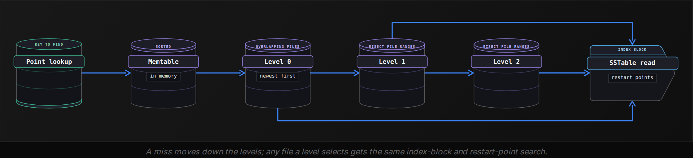
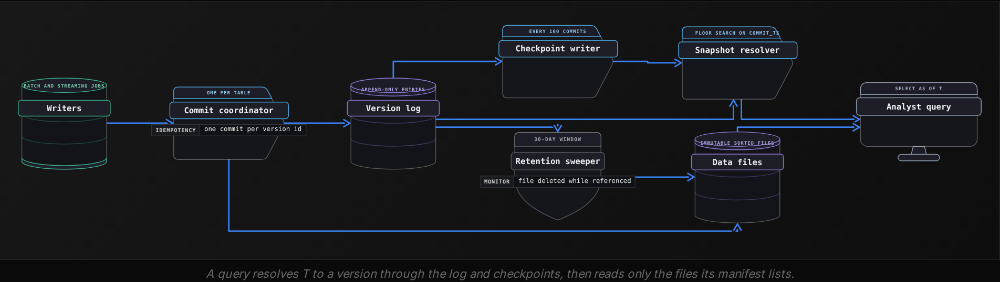

# Binary Search: Advanced

Ines is 40 minutes into a storage infrastructure interview at Google, and the interviewer has skipped the warm-up array problems. Instead she draws 3 boxes: a sorted file of 1 billion keys split into 4 KB blocks, a small index holding the first key of each block, and an append-only log of table versions with commit timestamps. The question has 2 parts. First, how does a point lookup touch only 1 data block? Second, extend the design so an analyst can ask what any row looked like at 09:14 last Tuesday, including when that moment predates the table. Ines recognizes the shape: every part of the answer is a search for the boundary where a yes/no condition flips, applied at a different grain. What remains is choosing the condition and the grain for each part, and knowing what breaks when the condition stops being monotonic.


<br>

### What you will be able to do

Reduce any binary search question to a monotonic predicate with a stated invariant, and spot a predicate that is not monotonic

Run many offline searches in lockstep with parallel binary search, and compute when it beats searching each query alone

Build fractional cascading pointers and explain where search-once-then-follow-pointers appears in index design

Trace a point lookup through B-tree pages, LSM levels, an SSTable's index block and its restart points

Design a time-travel query system on a version log with checkpoints and a retention window, and explain why commit timestamps must rise monotonically


<br>

---

## Search on Monotonic Predicates

Every binary search question reduces to one function: given an ordered domain and a predicate that is False on a prefix and True on the rest, return the first True point. The domain might be a sorted array or a range of candidate answers; it might also be a commit history or a run of log offsets. `a[i] >= x` is one such predicate, and `fits(capacity)` and `totals_wrong(d)` are others. The loop never changes, so the thinking goes to 2 places: proving the predicate is monotonic, and stating what `lo` and `hi` mean before the first iteration.


<br>

### One loop, held together by an invariant

The loop keeps one invariant: pred(lo) is False and pred(hi) is True. Each pass picks a mid strictly between them and moves the end that agrees with it, stopping at hi - lo == 1, where hi is the first True point with no +1 or -1 to choose. The ends may sit 1 step outside the domain: lo = -1 is an imaginary False before index 0 and hi = len(a) an imaginary True past the end. Neither reaches pred, since mid never equals an end, and a returned hi equal to the upper sentinel means no point qualified.

```sql
def first_true(lo, hi, pred):
    while hi - lo > 1:
        mid = (lo + hi) // 2
        if pred(mid):
            hi = mid
        else:
            lo = mid
    return hi


def lower_bound(a, x):
    return first_true(-1, len(a), lambda i: a[i] >= x)


def upper_bound(a, x):
    return first_true(-1, len(a), lambda i: a[i] > x)


def last_at_or_before(stamps, ts):
    return first_true(-1, len(stamps), lambda i: stamps[i] > ts) - 1
```

`lower_bound` and `upper_bound` reproduce `bisect_left` and `bisect_right` by choosing `>=` or `>`. The third covers every 'last element at or before a target' question: find the first element past the target and step back 1. That step back is where floor searches break: when nothing qualifies it returns -1, a valid list index in Python.


<br>

### Searching the space of answers

Searching a range of candidate answers is the same `first_true`, with a feasibility check as `pred`, and the part to say aloud is the bracket. Below, 5 shipments must leave in 2 days. One below the heaviest shipment is provably infeasible, since no day could carry that shipment, and the total weight is provably feasible, since it ships in 1 day, so both ends hold the invariant before any check runs.

https://github.com/user-attachments/assets/a398b578-d631-44d8-9e39-c071b12a7204

*lo stays infeasible and hi stays feasible until they sit 1 apart.*

The bracket starts at 9 and 32. The first probe, 20, fits. Probes at 14 and 17 fail before 18 fits, and the gap closes after 4 checks, so the work is 4 times the cost of walking 5 weights. Monotonicity holds because a packing that fits a smaller capacity also fits a larger one.


<br>

### The pattern in disguise

| The question says | Domain | Predicate | Monotonic? |
| --- | --- | --- | --- |
| Which deploy first broke the daily totals? | Deploy index | `totals_wrong(d)` | Yes, if no later deploy in range reverted the change |
| Smallest worker memory at which the join stops spilling | Memory in GB | `no_spill(m)` | Yes, for a fixed plan and input |
| First log offset whose event time is at or after 09:00 | Offset | `event_ts(o) >= t` | Only if events were appended in event-time order |
| Fewest hash buckets so no bucket exceeds 2 GB | Bucket count | `max_bucket(b) <= 2 GB` | No: with bucket = key mod b, keys 0 and 6 share bucket 0 at b = 6 but land in buckets 0 and 2 at b = 4 |
| Batch size with the lowest p99 latency | Batch size | `lat(b + 1) > lat(b)` | Yes, when the latency curve has a single valley |

The last row turns an optimization into a predicate: the discrete slope is False while latency falls and True once it rises, so the first True batch size is the minimum. With 2 valleys the slope flips twice and the search returns either one.


<br>

### What a broken predicate returns

Predict what this program prints. Both ends obey the invariant: 0 is False and 10 is True. Between them the predicate is True on 3 and 4 and False on 5 and 6 before turning True again.

```sql
true_at = {3, 4, 7, 8, 9, 10}
lo, hi = 0, 10
while hi - lo > 1:
    mid = (lo + hi) // 2
    if mid in true_at:
        hi = mid
    else:
        lo = mid
print(hi)
```

It prints 7. The first midpoint is 5 and the next is 7; stepping back to 6 brackets the flip between 6 and 7, and the search never looks at 3. Nothing raises: with more than 1 flip, the loop returns whichever flip its midpoints bracket. The code cannot detect this, so the monotonicity proof comes before the loop, said out loud: *if a capacity of 18 ships everything in 2 days, 19 does too, because every day's load still fits under the higher limit*.

- **30** — calls to search 1 billion candidates
- **10 hours** — if each call is a 20-minute backfill

> **TIP**
>
> With an expensive predicate, cache every evaluated point, since a restarted search revisits the same midpoints. Make the check deterministic: one that flakes 1 run in 20 can flip any halving and land on the wrong commit, so rerun it until it agrees with itself.


<br>

---

## Parallel Binary Search

An identity team keeps an append-only log of 1,000,000 link events, each saying 2 account IDs belong to the same person; links are never removed. Fraud review sends 100,000 account pairs and asks, for each, after which event the 2 accounts first landed in the same cluster. One pair alone is a predicate search over event indexes for 'connected after replaying events 0 through t', monotonic because adding a link never separates 2 accounts.

The trouble is the price of 1 call: answering 'connected after event t' builds a union-find over the first t + 1 events, replaying up to the whole log. A forward sweep that checks every open pair after every event avoids the replays but pays per pair instead.


<br>

### Run every search in lockstep

Every pair's search sits at its own midpoint, but all midpoints are positions on the same log, and 1 forward sweep passes all of them. A round of parallel binary search buckets unfinished pairs by midpoint, resets the union-find and replays the log once. After event t it answers every pair waiting at t and moves that pair's `lo` or `hi`. Each round halves every bracket, so about log2 of the log length rounds close them all.

https://github.com/user-attachments/assets/5d912321-5c13-4d57-b987-8a41ec95170c

*Each round rebuilds the union-find once and answers every pair at its own midpoint.*

With 4 links and 3 pairs, brackets start at -1 and the sentinel 4, one past the last event, so round 1 asks all 3 pairs at event 1. Only (2, 3) is joined by then: its `hi` drops to 1 and the other 2 raise `lo` to 1. Round 2 asks (2, 3) at event 0 and the others at event 2, closing (2, 3) and (0, 3); (0, 4) is still apart, so round 3 asks it at event 3. The final answers are 2 and 1 for the first 2 pairs and 3 for the last, and a pair left at `hi == 4` never linked.

The reset is the detail whiteboard versions miss: a sweep that continues from the previous round's union-find answers every question against the wrong prefix of the log.

| Strategy | Time | Memory |
| --- | --- | --- |
| Independent search per pair | Q × log T × T | One union-find, rebuilt per call |
| Sweep, checking all open pairs per event | T × Q | One union-find |
| Snapshot after every event, then bisect | Q × log T | T copies of the union-find |
| Parallel binary search | log T × (T + Q) | One union-find plus 2 integers per pair |

At T = 1,000,000 events and Q = 100,000 pairs, the counts below come from the first 2 rows and the fourth. The snapshot row fails on memory first, holding a full union-find per event.

- **2 × 10^12** — operations, independent searches
- **1 × 10^11** — operations, sweep checking all pairs
- **2.2 × 10^7** — operations, parallel binary search

Each round reads the log once, roughly 20 times here. In memory that is cheap; for a 50 GB log in object storage, 20 passes scan a terabyte, so load it once into a compact local file before round 1.


<br>

### The 4 conditions it needs

- **Offline queries** *When questions arrive*\
  Every question is known before round 1; a pair arriving mid-run waits for the next batch.
- **One shared axis** *What the answers share*\
  Every answer is a position on the same ordered sequence, so 1 sweep visits all midpoints.
- **Monotonic per query** *What the predicate does*\
  Once a pair's predicate turns True it stays True. A log that can unlink accounts breaks this, and the search silently returns a wrong event.
- **Prefix state rebuilt, not stored** *What the state costs*\
  Replaying the prefix once per round is affordable; a copy per event is not.


<br>

### When to use something else

| ✓ Parallel binary search fits | ✗ Reach for something else |
| --- | --- |
| • Connectivity over links that are only ever added<br><br>• A nightly batch over a fixed event log<br><br>• A check that needs the whole accumulated state, not 1 key's total | • A running total per key: 1 sweep with a dict answers every key exactly<br><br>• Online questions with latency targets: bisect periodic snapshots<br><br>• Removable links: the predicate stops being monotonic in time<br><br>• A single question: lockstep and independent search cost the same |

> **TIP**
>
> The signal is a second dimension on a solved search: now there are 100,000 pairs. Say the searches share an axis and give the round count and the cost per round. Then name what breaks the approach, usually online arrival or deletions.


<br>

---

## Fractional Cascading

A query needing its key's position in many sorted lists pays per list: with 8 sorted runs of 1,000,000 keys, independent searches repeat the same work 8 times. Fractional cascading searches once and finds every later position through a stored pointer and at most 1 comparison.

Independent searches store nothing extra and cost k × log n. One merged catalog, with each entry storing its successor's position in all k lists, needs 1 search but k positions per entry. Fractional cascading sits between them: 1 search, constant work per list, and at most twice the original space.


<br>

### Promote every other key one level up

Build from the last list backwards. The last augmented list, M2, is L2 itself; each earlier one merges its own list with every second key of the one below, so M1 holds L1 plus 2 of M2's 4 keys, and M0 holds L0 plus 2 of M1's 5 keys. Each entry stores 2 numbers: its position in its own original list and in the augmented list below. Taking at most half of each level beneath keeps an augmented list under twice its original's length when the lists are similar in size.

| M0 key | Came from | Position in L0 | Down pointer into M1 |
| --- | --- | --- | --- |
| 10 | L0 | 0 | 0 |
| 30 | L0 | 1 | 1 |
| 35 | M1 | 2 | 1 |
| 50 | L0 | 2 | 3 |
| 60 | M1 | 3 | 3 |
| 70 | L0 | 3 | 4 |

The down pointer is approximate on purpose: it names the first M1 key at or above the M0 key the query landed on. The true M1 answer is that target or the key right before it, because promotion took every other key, so no run of M1 keys missing from M0 is longer than 1. One comparison decides.

https://github.com/user-attachments/assets/dfa45338-b6cd-4217-baee-6a249783019f

*One bisect on M0; after that, each level costs a pointer and at most 1 step back.*

For 38, the only full binary search runs over M0 and lands on 50, so L0's answer is position 2. The pointer says 3, which is 60 in M1, but the key before it, 40, is also at least 38, so the walk steps back and reads L1's answer, 1. From 40 the pointer says 2, which is 55 in M2; the key before it, 35, is too small, so L2's answer is 2. For 72, M0 has no key that large, so L0's answer is 4, which is past its end. The walk then starts past the end of M1, and the step back pulls it onto 75. In L1 that gives position 3, again past the end; in L2 it gives position 3, which holds the key 75.


<br>

### Where the idea shows up in index design

Textbook fractional cascading is uncommon in storage engines. What transfers is its move: search once at the top, then carry a position downward instead of searching each structure from scratch.

- **B-tree separators.** Each interior key copies a boundary in the level below, so the child pointer chosen on one page confines the next search to a single page.
- **Pointers between LSM levels.** A miss in one level normally bisects the next level's file boundaries from scratch. Storing, for sampled keys, the file and block offset in the next level turns that into a pointer and a short scan, but compaction must rewrite the pointers whenever it rewrites a level.
- **Layered range trees.** A 2-dimensional range query on (event_time, user_id) walks an outer tree on time whose nodes each hold a list sorted by user. Searching every node's list costs (log n)^2; cascading pointers into the children's lists cut that to log n plus the output size.


<br>

### What it costs

- **160** — comparisons, 8 independent searches
- **29** — comparisons with cascading pointers

Those counts assume 8 runs of 1,000,000 keys and an M0 up to twice that size. In memory a comparison that misses cache costs about 100 nanoseconds, so the saving is real but small; it grows when each step is a page read. The larger costs are up to double the space and pointers that go stale when any lower list changes, so cascading pays off on structures built in a batch and read many times, the shape of the next section's immutable files.


<br>

---

## Binary Search in Index Structures

Disk-oriented indexes are binary search reorganized around the unit of I/O. The comparison count barely changes; what changes is how many comparisons each read resolves, and that ratio is the number to quote in an interview.


<br>

### B-tree: about 9 comparisons per page read

Take 1 billion keys in 16 KB pages of about 500 entries each. The leaves need 2,000,000 pages and the level above them 4,000. Those 4,000 fit under 8 pages with a root on top of them, for 4 levels. Each page costs about 9 comparisons, since log2 of 500 is roughly 8.97, so 36 in all, close to a flat search's 30. The difference is locality: all interior pages together take around 64 MB, small enough to stay in memory.

- **1** — disk read per B-tree point lookup
- **21** — page reads, flat-file binary search

```sql
from bisect import bisect_left, bisect_right


class Node:
    def __init__(self, keys, children=None, values=None):
        self.keys = keys
        self.children = children
        self.values = values


def search(node, key):
    while node.children is not None:
        node = node.children[bisect_right(node.keys, key)]
    i = bisect_left(node.keys, key)
    if i < len(node.keys) and node.keys[i] == key:
        return node.values[i]
    return None
```

The 2 levels use different searches on purpose. An interior page with separators [k1, k2] sends keys below k1 to child 0, keys from k1 up to k2 to child 1, and the rest to child 2, so a key equal to a separator belongs to the right child and bisect_right picks it. A leaf needs the exact key, so it uses bisect_left plus an equality check. Swap the 2 and every key equal to a separator becomes unreachable. Real pages hold variable-length records, so the search runs over a slot array of offsets kept in key order.


<br>

### SSTable: index block, then restart points

An SSTable is an immutable sorted file: data blocks of about 4 KB, an index block with 1 entry per data block, and usually a bloom filter. Inside a block each key stores the length of the prefix it shares with the previous key plus the rest, so a mid-block key cannot be read without decoding forward from a full key. A common layout writes a full key every 16 entries. Each full key is a restart point, and the block's end stores their offsets. A lookup bisects the index block, reads 1 block, bisects its restart points and scans at most 16 entries.

https://github.com/user-attachments/assets/8d135fbe-31c6-4238-beaf-adefbf6aba9a

*Bisect the index, bisect the restart keys, then scan at most 1 restart interval.*

The toy writes a restart point every 3 keys. For `kite`, the index puts it in block 1, which has `lark` as its last restart key and `fig` and `ibis` before it; the search lands on `ibis` and scans 3 entries to reach position 5. For `cow`, block 0's restarts start the scan at `ant`, and it passes `bat` and reaches `cat` without finding the key. For `aardvark`, the key sorts before every block and no block is read.


<br>

### LSM tree: choosing which files to search

Writes land in a memtable, a sorted structure in memory, flushed to level-0 SSTables whose key ranges can overlap, so a lookup checks each level-0 file, newest first. Compaction merges files into deeper levels that do not overlap, so in each a bisect over the files' smallest keys picks at most 1 file. The lookup stops at the first hit, since newer data sits higher, and bloom filters skip most files that lack the key.




<br>

### Predict the output

Index blocks store either the first or the last key of each data block, and each choice comes with its own search. Predict all 3 lines.

```sql
from bisect import bisect_left, bisect_right

last_keys = ["apple", "grape", "melon", "plum"]
first_keys = ["apple", "cherry", "lemon", "peach"]

print(bisect_right(first_keys, "aardvark") - 1)
print(first_keys[bisect_right(first_keys, "aardvark") - 1])
print(last_keys[bisect_left(last_keys, "zucchini")])
```

The first line prints -1, since aardvark sorts before every first key. The second prints peach: Python reads index -1 as the last element, so the lookup silently opens the block that starts at peach. The third raises IndexError: list index out of range, since no last key reaches zucchini. Both are one condition, a key outside the file's range, and the silent one is worse. Check the key against the file's smallest and largest keys before bisecting, as an LSM level already does to pick the file.


<br>

---

## Design a Time-Travel Query System

The question usually arrives as a product request: analysts want any table as it stood at any moment in the last 30 days, and auditors want an account's balance at a past instant. Pin down 4 things first: snapshot or row grain, how long versions are kept, who assigns commit timestamps, and what an instant outside the window returns.


<br>

### A table-level search and a row-level search

At table level, each commit appends an entry to a version log. The entry holds a version id with its commit timestamp, and it points to a manifest of that version's data files. A query as of T reads the last version committed at or before T, the floor search from the first section. At row level, each key keeps a history sorted by when each version became valid, and the value at T is again the last entry at or before T.




<br>

### Checkpoints bound the replay

Storing each commit as a delta keeps writes small, but rebuilding version v from nothing replays v deltas. A checkpoint every K commits holds the full state at that version, so resolving v becomes a floor search over checkpoint versions plus at most K - 1 deltas. This is the previous section's restart-point trade at a coarser grain: a full record at a fixed interval, compressed records between.

https://github.com/user-attachments/assets/a08f31b4-e89d-43a3-83ad-a3b0f4d5b7a7

*A floor search on commit_ts, a floor search on checkpoints, then a short replay.*

Checkpoints land every 3 commits, so full state sits at versions 2 and 5. A query as of 300 resolves to version 3: checkpoint 2 plus 1 delta. As of 500 it resolves to version 5, itself a checkpoint, with nothing to replay. Time 99 predates the first commit, so the resolver raises rather than return the oldest version, which would silently describe a table that did not yet exist.

At a commit every 5 minutes, a 30-day window holds 8,640 versions. With a checkpoint every 100 commits, locating a version is nearly free and fetching the deltas after the checkpoint dominates.

- **14** — comparisons to locate a version
- **86** — checkpoints in the window
- **99** — deltas replayed, worst case


<br>

### Commit timestamps must never go backwards

The floor search is valid only while commit timestamps rise with version ids, the first section's monotonic requirement in a new place. If 2 writers stamp commits with their own clocks, one 3 seconds behind, version 41 can carry a later timestamp than version 42, and a search for a T between them can return a version holding changes committed after T. The fix is a single commit point per table that assigns version id and timestamp in 1 atomic step, taking the larger of the wall clock and the previous timestamp plus 1 millisecond.


<br>

### The tie that crashes

This shortcut for floor searches over a log of `(timestamp, value)` tuples is common. Predict what it prints.

```sql
from bisect import bisect_right

log = [(100, "v0"), (220, "v1"), (300, "v2")]
i = bisect_right(log, (220, float("inf"))) - 1
print(log[i])
```

It raises TypeError: '<' not supported between instances of 'float' and 'str'. The first midpoint is (220, "v1"); the timestamps tie, so Python compares inf with "v1". A query for 250 never ties and returns the right row, so tests that pick timestamps between commits pass and production fails on the first query naming an exact commit time. Python 3.9's bisect takes no key argument, which arrived in 3.10, so search a parallel list of timestamps: bisect_right(stamps, 220) - 1 returns 1.


<br>

### Row-level history in SQL

```sql
SELECT
  account_id,
  MAX_BY(balance, valid_from) AS balance_as_of
FROM balance_history
WHERE valid_from <= TIMESTAMP '2026-03-01 00:00:00'
GROUP BY account_id
```

For the auditor's single account, add a filter on `account_id`. If `balance_history` is sorted by `account_id` then `valid_from`, with each file's smallest and largest `account_id` in metadata, the engine reads only files whose range covers that account, and within its run the qualifying rows form a prefix ending at the floor of the instant. Metadata does the coarse search over files; the sort order does the fine one.

| Decision | Choice | What it costs |
| --- | --- | --- |
| Version storage | Deltas, plus a checkpoint every 100 commits | Up to K - 1 delta reads per resolve, plus a checkpoint file per interval |
| Retention | 30 days, older instants rejected | Files only expired versions list are deleted, so older instants are unanswerable |
| Timestamp source | One commit coordinator per table | Commit throughput per table is bounded by that serialization point |
| Out-of-window instants | Explicit error | Callers must handle 'too old' apart from 'not found' |
| Row history | Sorted by key, then valid_from | Each update appends a row; a query filtered by time alone scans every account |

> Order of the answer in the interview
>
> - Pin down the grain and the retention window first, then ask which clock supplies commit timestamps and what a query outside the window should return.
> - Name both floor searches: the version log and each key's history.
> - Bound the replay with checkpoints; give the worst-case delta count.
> - State why commit timestamps stay monotonic.
> - End with garbage collection: never delete a file a retained manifest lists.


<br>

---

## Putting It All Together

A payments company must answer a regulator's request for every merchant's balance as it stood at the close of each quarter, and also report, for 200,000 pairs of merchant accounts, the first ledger event after which each pair was linked to the same owner.

- Each quarter-close balance is a floor search: the snapshot resolver bisects commit timestamps, then each merchant's history is searched for the last entry at or before the close.
- Those searches are correct only because the commit coordinator keeps timestamps monotonic, the same requirement every predicate search depends on.
- The 200,000 ownership pairs share 1 event axis, so parallel binary search answers them in a number of sweeps that grows with the logarithm of the log's length, instead of 1 search per pair.
- Every resolved snapshot reads its data through sorted immutable files, where an index block and restart points turn each point read into a single block read.
- Asking for the 'too old' quarter before the retention window returns an explicit error, the same out-of-range check that stops a floor search from wrapping to index -1.


<br>

---

## Key Takeaways

- Every binary search is first_true over a monotonic predicate, with lo held False and hi held True; the loop stays fixed, and the effort goes into proving monotonicity.
- A predicate with more than 1 flip fails silently, returning whichever flip the midpoints bracket, so prove monotonicity before writing the loop.
- Parallel binary search answers many offline searches on a shared axis in about log T sweeps, holding a single copy of the state.
- Fractional cascading searches once and carries the position down through stored pointers, which suits structures built in batches and read often.
- B-trees and SSTables arrange binary search so each page read resolves many comparisons, and LSM levels follow the same plan; floor searches need explicit range checks because -1 is a valid index.
- Time travel is 2 floor searches, one over the version log and one over row history. Checkpoints bound the replay, and the scheme is valid only while commit timestamps rise.
