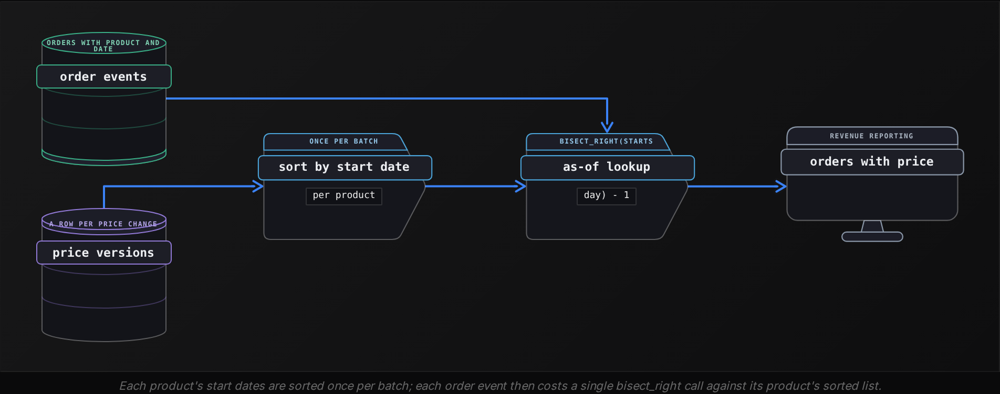

# Binary Search: Beginner

The candidate is 40 minutes into a data engineering interview at Google when the interviewer pastes 9 event timestamps in ascending order and asks for the position of the first event at or after 10:15. She writes a loop in under a minute. Then the follow-ups arrive: what if no event qualifies, what if 4 events share the exact timestamp, and what if the list was copied out of a ring buffer and now starts in the middle? Her loop returns a middle copy on the second and reports -1 on the third for a timestamp that is present. Nothing about the question changed except the boundaries, and the boundaries are where binary search is graded. This lesson builds the invariant behind every version of that question, so each follow-up becomes a one-line change you can defend out loud.


<br>

### What you will be able to do

Write the closed, half-open and neighbour-pair loops and name the invariant each keeps

Predict where bisect_left and bisect_right land for a duplicate value and for a missing one, even outside the list's range, and where insort places it

Return the first and last index of a repeated value with 2 logarithmic searches

Search a rotated sorted array by deciding on every pass which half is sorted

Recognize window counts, as-of lookups and row routing as boundary searches over sorted values


<br>

---

## Three Binary Search Templates

Every binary search keeps 2 indexes, `lo` and `hi`. It also keeps a promise about them: if the answer exists, it lies inside the range they describe. Each pass compares the middle element with the target and discards the half that cannot hold the answer, so 1,000,000 sorted elements shrink to a single candidate in 20 passes. The comparison barely changes between versions. What changes is what `lo` and `hi` mean, and that meaning fixes the loop condition, the 2 update lines and the return value. Get it wrong by a single position and the search either skips the answer or never stops.


<br>

### Template 1: closed interval, exact match

The closed form treats both ends as live: the answer, if present, is one of nums[lo] through nums[hi] inclusive. That range holds at least 1 element while lo <= hi, which becomes the loop condition. When nums[mid] is too small, mid itself is ruled out, so lo moves to mid + 1; when it's too large, hi moves to mid - 1. Use this form when the question is whether an exact value is present and where.

```sql
def search(nums, target):
    lo, hi = 0, len(nums) - 1
    while lo <= hi:
        mid = (lo + hi) // 2
        if nums[mid] == target:
            return mid
        if nums[mid] < target:
            lo = mid + 1
        else:
            hi = mid - 1
    return -1
```

Trace it on `nums = [3, 8, 15, 22, 29, 36, 41]`. Target 29 matches on the third pass. Target 30 follows the same first 2 passes, then the third pass sets `lo = 5`, leaving the empty range [5, 4], and the function returns -1.

| Pass | lo | hi | mid | nums[mid] | Decision, target 29 |
| --- | --- | --- | --- | --- | --- |
| 1 | 0 | 6 | 3 | 22 | 22 < 29, so lo = 4 |
| 2 | 4 | 6 | 5 | 36 | 36 > 29, so hi = 4 |
| 3 | 4 | 4 | 4 | 29 | match, return 4 |


<br>

### Template 2: half-open interval, first qualifying index

The half-open form keeps hi at the first position past the live range: the answer is somewhere in nums[lo:hi], and hi starts at len(nums), a slot no element occupies. That extra slot makes 'after every element' a legal answer. The loop runs while lo < hi and never stops early on equality, because it hunts a boundary: the first index where nums[i] >= target. If nums[mid] is below the target, the boundary lies to the right, so lo = mid + 1. Otherwise mid could be the boundary itself, so hi = mid keeps it in range. At exit lo == hi, and both name the boundary.

https://github.com/user-attachments/assets/1bf41622-46af-41f7-85c1-f7b9c668336b

*Each pass halves nums[lo:hi]. The first 2 calls print 1 and 5; the last prints 7.*

The last call returns 7, which equals `len(nums)`: every element is smaller than 30. Code that then reads `nums[7]` raises `IndexError`, so a caller compares the returned position with the length before reading the element.


<br>

### Template 3: finish with 2 neighbours

The third form loops while lo + 1 < hi, so at least 1 index sits strictly between them. Each update assigns mid directly: one branch sets lo = mid, the other hi = mid. That is safe because mid falls strictly between lo and hi whenever their gap is 2 or more. The loop exits with the pair adjacent, and a final comparison picks between them. It fits questions answered by comparing neighbours, such as the value closest to a target, where you want both candidates in hand at the end.

```sql
def closest(nums, target):
    lo, hi = 0, len(nums) - 1
    if target <= nums[lo]:
        return lo
    if target >= nums[hi]:
        return hi
    while lo + 1 < hi:
        mid = (lo + hi) // 2
        if nums[mid] <= target:
            lo = mid
        else:
            hi = mid
    if target - nums[lo] <= nums[hi] - target:
        return lo
    return hi
```

| Property | Template 1 | Template 2 | Template 3 |
| --- | --- | --- | --- |
| Answer lives in | nums[lo..hi], both ends included | nums[lo:hi], hi excluded | between nums[lo] and nums[hi] |
| Starting hi | len(nums) - 1 | len(nums) | len(nums) - 1 |
| Loop runs while | lo <= hi | lo < hi | lo + 1 < hi |
| Updates | lo = mid + 1, hi = mid - 1 | lo = mid + 1, hi = mid | lo = mid, hi = mid |
| Exits with | a match, or lo = hi + 1 | lo == hi | hi == lo + 1 |
| Returns | an index or -1 | a position from 0 to len(nums) | lo or hi after a final check |
| Fits | exact match | first position meeting a condition | closest value, neighbour comparisons |


<br>

### The bug interviewers watch for

Loops break when parts of 2 templates get mixed. Pair template 2's lo < hi with lo = mid in place of lo = mid + 1. Take lo = 4 and hi = 5: then mid is (4 + 5) // 2 = 4. If the comparison sends the search right, lo is set to 4 again and the identical pass repeats forever. Floor division rounds mid down toward lo, so in any 2-element range mid == lo, and an update that fails to move past mid makes no progress. Run every branch by hand on a 2-element range and confirm the range shrinks.

> **TIP**
>
> Before you trust a loop, run 4 inputs by hand: an empty list, a 1-element list, a target below every element and a target above every element. Most boundary bugs surface in one of those 4.


> Try it before reading on
>
> Run template 2 by hand on `nums = [2, 2, 2]` with target 2, then with target 3. Which index does each call return, and how many passes does each take?

*Target 2 returns 0 after 2 passes, with hi going 3, 1, 0. Target 3 returns 3, which is len(nums), after 2 passes, with lo going 0, 2, 3.*


<br>

---

## The bisect Module

The standard library ships template 2 as the bisect module, implemented in C in the standard interpreter. Write the loop by hand only when the interviewer asks for one, or when the test is something other than comparing list elements with x. The module offers 2 searches and 2 inserts, and all 4 revolve around an insertion point: the index where x could go with the list still sorted.


<br>

### Two insertion points for one value

bisect_left(a, x) returns the first index i with a[i] >= x, so everything in a[:i] is strictly less than x. bisect_right(a, x) returns the first index with a[i] > x, so everything in a[:i] is at most x. For an absent x the calls agree. For a present x, bisect_left lands on its first copy and bisect_right lands one position past its last copy, so their difference counts the copies. bisect.bisect is another name for bisect_right.

```sql
from bisect import bisect_left, bisect_right

a = [10, 20, 20, 20, 30]
print(bisect_left(a, 20), bisect_right(a, 20))
print(bisect_left(a, 25), bisect_right(a, 25))
print(bisect_left(a, 5), bisect_right(a, 99))
print(bisect_right(a, 20) - bisect_left(a, 20))
```

| Call | Returns | Why |
| --- | --- | --- |
| bisect_left(a, 20) | 1 | only a[0] = 10 is below 20 |
| bisect_right(a, 20) | 4 | a[:4] holds 10 and all 3 copies of 20 |
| bisect_left(a, 25) | 4 | 25 is absent, so both calls agree |
| bisect_right(a, 25) | 4 | a[4] = 30 is the first value above 25 |
| bisect_left(a, 5) | 0 | every element is at least 5 |
| bisect_right(a, 99) | 5 | every element is at most 99, so len(a) |
| bisect_right - bisect_left for 20 | 3 | the number of 20s |


<br>

### Checking membership without an IndexError

An insertion point says where x belongs; whether x is present takes a second check, i < len(a) and a[i] == x, with the length test first. Drop the length test and the code works for every value up to the maximum, then fails on any value above it, whose insertion point is len(a). Predict what this loop prints before reading the answer under it.

```sql
from bisect import bisect_left

a = [10, 20, 30]
for x in [20, 25, 40]:
    i = bisect_left(a, x)
    print(x, i, a[i] == x)
```

It prints `20 1 True` and `25 2 False`, then stops with `IndexError: list index out of range` on 40, whose insertion point is 3 in a 3-element list. No line prints for 40, because Python evaluates `a[i]` before `print` receives its arguments.


<br>

### Narrowing the search with lo and hi

Both functions take optional lo and hi arguments that confine the search to a[lo:hi] without copying it. Building that slice copies its k elements, which costs O(k) time and memory and erases the logarithmic gain on a large list; the arguments keep the cost at O(log k). The returned index is a position in the whole of a. A frequent use is the second search of a pair: once bisect_left(a, x) returns i, the right edge for the same x cannot come before i, so bisect_right(a, x, i) skips the part already ruled out.


<br>

### insort: cheap search, expensive insert

insort_left(a, x) and insort_right(a, x), with insort as another name for the right one, find the insertion point and then call a.insert(i, x). The search is O(log n), but the insert is O(n): a Python list keeps its elements in a single contiguous array, and every element after i shifts by a slot to make room. Inserting at the front of a 1,000,000-element list moves all 1,000,000 references. Building a sorted list of n items with n calls to insort costs O(n^2) in the worst case, against O(n log n) for appending everything and sorting once.

https://github.com/user-attachments/assets/0aa07f95-9485-4cad-ae2b-8a21fd4d9edb

*Each arrival lands in sorted position, and larger values shift right to make room.*

| ✓ insort on every arrival | ✗ Append all, sort once |
| --- | --- |
| • Sorted after every insert<br><br>• Each insert shifts up to n elements<br><br>• Suits a stream queried between arrivals<br><br>• O(n^2) worst case for n inserts | • Sorted only after the final sort<br><br>• Each append is O(1) amortized<br><br>• Suits a batch loaded fully before any query<br><br>• O(n log n) in total |


<br>

### Mapping values to buckets

bisect_right over a list of boundaries turns a value into a bucket index, replacing a chain of if and elif tests. Take the boundaries [100, 250, 500]. Their 4 labels are fast, ok, slow and critical, and a latency of exactly 250 ms gets index 2 and lands in slow, because bisect_right puts a value equal to a boundary in the bucket above it. Switch to bisect_left and 250 lands in ok. Choosing between the 2 functions is choosing whether each boundary belongs to the bucket above or below it.

```sql
from bisect import bisect_right

bounds = [100, 250, 500]
labels = ['fast', 'ok', 'slow', 'critical']
for ms in [40, 100, 250, 499, 900]:
    print(ms, labels[bisect_right(bounds, ms)])
```

*Output: 40 fast, 100 ok, 250 slow, 499 slow, 900 critical. Before Python 3.10 the bisect functions took no key argument, so this lesson searches records through a separate list of their sort keys.*


<br>

---

## First and Last Occurrence

The interview version: given nums sorted ascending, possibly with duplicates, return [first, last], the indexes of the first and last copy of target, or [-1, -1] when it is absent, in O(log n) time. For nums = [2, 4, 4, 4, 4, 7, 9] and target 4 the answer is [1, 4]; for target 5 it is [-1, -1].


<br>

### Find-one-then-scan is linear in the worst case

A common first answer runs the exact-match loop, lands on some copy of the target and walks outward in both directions until the value changes. On distinct values the walk is short. On a list where every element equals the target it visits every element, so the worst case is linear, the cost the question forbids. Interviewers pick that input on purpose: a sorted column of HTTP status codes where almost every row reads 200.

- **1,000,000** — steps to walk an all-match 1M list
- **40** — maximum passes to find both ends


<br>

### Two boundary searches

Both ends of the run are boundaries. The first copy sits at bisect_left(nums, target), the first position holding a value at least as large as the target. The last copy sits at bisect_right(nums, target) - 1, just before the first position holding a larger value. What remains is the absence test on the left result, because an absent target gives both calls the same insertion point. The right search can also start at first instead of 0.

```sql
from bisect import bisect_left, bisect_right


def search_range(nums, target):
    first = bisect_left(nums, target)
    if first == len(nums) or nums[first] != target:
        return [-1, -1]
    last = bisect_right(nums, target, first) - 1
    return [first, last]


print(search_range([2, 4, 4, 4, 4, 7, 9], 4))
print(search_range([2, 4, 4, 4, 4, 7, 9], 5))
print(search_range([], 4))
```

It prints `[1, 4]`, `[-1, -1]` and `[-1, -1]`. The order of the 2 tests in the `if` matters: `first == len(nums)` runs first, so `nums[first]` is never read past the end, which is why the empty list returns `[-1, -1]` instead of raising `IndexError`.


<br>

### Writing it without the library

When the interviewer rules out bisect, the closed-interval loop handles both ends with a single flag. On a match it records mid as the best answer so far and keeps going instead of returning. For the first copy it continues left with hi = mid - 1; for the last copy it continues right with lo = mid + 1. The loop ends when the range is empty, and the recorded index is the extreme copy, because each later match sat further toward the chosen side.

https://github.com/user-attachments/assets/eac081f6-f4e4-41d2-b99b-993d968db312

*The flag picks which way to keep searching after a match; the 2 calls print 1 and 4.*

| Leftmost pass | lo | hi | mid | nums[mid] | found after pass |
| --- | --- | --- | --- | --- | --- |
| 1 | 0 | 6 | 3 | 4 | 3 |
| 2 | 0 | 2 | 1 | 4 | 1 |
| 3 | 0 | 0 | 0 | 2 | 1 |


<br>

### Counting and the edge cases interviewers test

The number of copies is last - first + 1, or bisect_right(nums, target) - bisect_left(nums, target) with no absence test, since an absent value gives 0. Run these inputs against nums = [2, 4, 4, 4, 4, 7, 9] before calling the solution done.

- **Empty list** *nums = []*\
  bisect_left returns 0, which equals len(nums), so the code returns [-1, -1] without indexing.
- **Target below the minimum** *target 1*\
  bisect_left returns 0 and nums[0] = 2 fails the equality test.
- **Target above the maximum** *target 10*\
  bisect_left returns 7, equal to len(nums), and the length test catches it.
- **Single copy** *target 7*\
  first and last are both 5.
- **Every element equal** *nums = [4, 4, 4]*\
  Returns [0, 2]; the flag loop finds each end in 2 passes.

> Try it before reading on
>
> On `nums = [1, 3, 3, 5, 5, 5, 8]`, predict `search_range(nums, 5)` and `search_range(nums, 4)`. Then predict how many 3s `bisect_right` minus `bisect_left` reports.

*Answers: [3, 5]; [-1, -1], because bisect_left returns 3, where a 5 sits; and 2.*

> **TIP**
>
> Say the invariant aloud while coding the leftmost flag loop: everything left of `lo` is below the target, everything right of `hi` is at least the target, and `found` holds the best match so far. The sentence tells you which update line to write.


<br>

---

## Search in Rotated Sorted Array

Move the last few elements of a sorted list to its front and you get a rotated sorted array: [3, 6, 9, 12, 15, 18, 22] with its last 3 elements moved becomes [15, 18, 22, 3, 6, 9, 12]. The exact-match loop now goes wrong. Looking for 18, it reads the middle value 3, which is smaller than 18, so it moves right and misses 18 at index 1. The question still demands O(log n) on distinct values, so each pass needs some other way to tell which half to drop.


<br>

### The invariant: one half is always sorted

A rotated list has a single drop, the only place where a large value is followed by a small one. Split [lo, hi] at mid and the drop lands in at most 1 half. At least one of nums[lo..mid] and nums[mid..hi] is therefore sorted, and often both are. A sorted half answers membership by its endpoints alone: the target is inside it exactly when it lies between them. Each pass asks 2 questions in order. Which half is sorted? Does the target fall within that half's endpoints? Yes sends the search into that half, and no sends it into the other.

| Test | Sorted half | Target inside it when | Inside | Outside |
| --- | --- | --- | --- | --- |
| nums[lo] <= nums[mid] | left | nums[lo] <= target < nums[mid] | hi = mid - 1 | lo = mid + 1 |
| otherwise | right | nums[mid] < target <= nums[hi] | lo = mid + 1 | hi = mid - 1 |

https://github.com/user-attachments/assets/36899fc1-6597-41db-a03f-815a7c8c7139

*Each pass finds the sorted half, then checks the target against its endpoints; the calls print 1, 4 and -1.*

The search for 18 is the case that broke the plain loop. At `mid = 3`, `nums[0] = 15` is greater than `nums[3] = 3`, so the right half `[3, 6, 9, 12]` is the sorted one. Since 18 lies outside 3 to 12, the search drops the right half and finds 18 at index 1 on the next pass. The search for 10 returns -1 after 3 passes.


<br>

### Why the left-half check uses <=

In a 2-element range mid equals lo, so the left half is the single element nums[lo]. A single element is sorted, and nums[lo] <= nums[mid] reports that because both sides are the same value. With < in its place, that half counts as unsorted and the code takes the right-half branch, whose endpoints do not bracket a sorted run. On [3, 1] with target 1, the < version finds 3 < 1 <= 1 false and sets hi = -1, so it returns -1 for a value sitting at index 1.

> **TIP**
>
> Run any rotated-array solution on a 2-element rotated list such as `[3, 1]`, searching for both values. That input exercises the `mid == lo` case, the source of most wrong answers to this question.


<br>

### Finding the rotation point

A frequent follow-up asks for the index of the minimum, which also equals how many elements were moved to the front. Compare nums[mid] with nums[hi]. If nums[mid] > nums[hi], the drop lies right of mid and mid cannot be the minimum, so lo = mid + 1; otherwise the minimum is at mid or left of it, so hi = mid. The loop ends with lo on the minimum. Here hi starts at the last index, because the comparison reads nums[hi]. The same comparison handles an unrotated list: on [3, 6, 9], nums[mid] > nums[hi] is never true, so the search walks left to index 0.

```sql
def rotation_point(nums):
    lo, hi = 0, len(nums) - 1
    while lo < hi:
        mid = (lo + hi) // 2
        if nums[mid] > nums[hi]:
            lo = mid + 1
        else:
            hi = mid
    return lo


print(rotation_point([15, 18, 22, 3, 6, 9, 12]))
print(rotation_point([3, 6, 9]))
```

| Pass | lo | hi | mid | nums[mid] vs nums[hi] | Update |
| --- | --- | --- | --- | --- | --- |
| 1 | 0 | 6 | 3 | 3 vs 12 | hi = 3 |
| 2 | 0 | 3 | 1 | 18 vs 3 | lo = 2 |
| 3 | 2 | 3 | 2 | 22 vs 3 | lo = 3, loop ends |

It prints 3 and 0. With the rotation point `k` known, an alternative runs an ordinary search on a single sorted piece: positions `k` to the end if the target lies between `nums[k]` and `nums[-1]`, otherwise positions 0 to `k - 1`. Passing those bounds as `lo` and `hi` to `bisect_left` avoids copying a slice. It costs 2 logarithmic searches instead of 1 and has fewer branches to get wrong under time pressure.

*Duplicates break the invariant. In [2, 2, 2, 0, 2] the value at mid equals both endpoints, 2, and no comparison reveals which half holds the 0. Solutions then shrink the range by a single position per pass, and the worst case becomes O(n).*

> Where rotated order shows up
>
> - A circular buffer of hourly checkpoints, read from slot 0 instead of from the slot after the write pointer
> - Sorted ring positions in consistent hashing, read starting from an arbitrary node instead of the smallest position


<br>

---

## Binary Search in Data Engineering

Much pipeline data arrives already sorted: partitions by date, log records by arrival time, price histories by effective date, file manifests by row range. When sorted data answers many questions, binary search replaces a full scan per question with around 24 comparisons per question on 10 million rows. In an interview the prompt rarely says 'binary search'. It says 'how many in this window', 'as of this date' or 'which file holds this row'.


<br>

### Counting events in a time window

For a half-open window [start, end) over sorted timestamps, the first row inside sits at bisect_left(ts, start) and the first row past the end sits at bisect_left(ts, end). Their difference is the count, and the slice between them holds the rows. Using bisect_left on both ends makes the window half-open: a row stamped exactly end belongs to the next window, so back-to-back windows count every row exactly once. A closed window [start, end] uses bisect_right for the end.

```sql
from bisect import bisect_left

ts = [1000, 1030, 1030, 1100, 1145, 1200, 1200, 1230]


def window(ts, start, end):
    i = bisect_left(ts, start)
    j = bisect_left(ts, end)
    return j - i, ts[i:j]


print(window(ts, 1030, 1200))
print(window(ts, 1200, 1300))
print(window(ts, 1300, 1400))
```

`(4, [1030, 1030, 1100, 1145])` comes back from the first call, and `(3, [1200, 1200, 1230])` and `(0, [])` from the next 2. The 2 rows stamped 1200 fall in the second window only.


<br>

### As-of lookups: the version in effect

A price history stores a row per change with the date it took effect, sorted by that date. Pricing an order needs the latest version that started on or before the order date, which is bisect_right(starts, day) - 1: bisect_right counts the versions that started on or before day, and the last of them is the one in effect. A result of -1 means the order predates every version. Code must treat that as missing, because prices[-1] is legal Python and returns the newest price without complaint.

```sql
from bisect import bisect_right

starts = ['2024-01-01', '2024-03-15', '2024-07-01']
prices = [19.99, 17.49, 21.00]


def price_as_of(day):
    i = bisect_right(starts, day) - 1
    if i < 0:
        return None
    return prices[i]


for day in ['2023-12-31', '2024-03-15', '2024-06-30', '2025-02-01']:
    print(day, price_as_of(day))
```

It prints `None` and `17.49` first, then `17.49` and `21.0`, since the literal `21.00` prints as `21.0`. A version that starts on the order date applies to that order, which is why 2024-03-15 gets 17.49; `bisect_left` would return 19.99 there. ISO `YYYY-MM-DD` strings compare in date order, so comparing them as strings is safe, while a format like `3/15/2024` compares wrongly and needs parsing first.




<br>

### Routing a global row number to its file

A dataset split across files is often addressed by global row number. Store each file's cumulative end in ends = [400000, 1100000, 1500000, 2300000]. Counting rows from 0, the file holding global row r is bisect_right(ends, r), and the local position is r minus the previous file's end. Row 1,250,000 maps to file 2 at local row 150,000. The edges decide the function: row 400,000 is the first row of file 1. bisect_right returns file 1 for it, while bisect_left is off by a file.

| File | Global rows held | ends[i] |
| --- | --- | --- |
| 0 | 0 to 399,999 | 400,000 |
| 1 | 400,000 to 1,099,999 | 1,100,000 |
| 2 | 1,100,000 to 1,499,999 | 1,500,000 |
| 3 | 1,500,000 to 2,299,999 | 2,300,000 |


<br>

### When sorting first pays off

Binary search needs sorted input, and sorting costs O(n log n). For a single lookup on unsorted data, a linear scan at O(n) beats sorting then searching. The balance flips when the same data answers many questions. Sorting 10 million timestamps takes about 10 million times 24 comparisons, and each lookup it enables saves a scan of 10 million, so the sort is repaid after about 24 lookups. Data that already arrives in order, such as a log appended in arrival order and searched by arrival time, skips the sort.

| ✓ Do | ✗ Don't |
| --- | --- |
| • Sort once per batch and reuse the sorted list for every lookup<br><br>• Keep a key list aligned by index with the records it describes<br><br>• Store dates as ISO strings or numbers so comparison follows time order<br><br>• Check for -1 and len(a) before indexing a bisect result | • Build a large sorted list with insort in a loop<br><br>• Bisect a list that late-arriving rows may have left out of order<br><br>• Read prices[i] when i is -1; Python returns the last element<br><br>• Sort data that will be searched only once |

> How the prompt is phrased
>
> - 'How many requests arrived between 10:00 and 10:15?' is 2 `bisect_left` calls on sorted timestamps.
> - 'What rate applied when this payment cleared?' is an as-of lookup, `bisect_right` minus 1.
> - 'Which file holds row 1,250,000?' is `bisect_right` over cumulative row counts.
> - 'Which latency band is this request in?' is `bisect_right` over band boundaries.


<br>

---

## Putting It All Together

A payments company reconciles 10 million card transactions each night. Each transaction needs the exchange rate in effect when it cleared, the clearing timestamps come out of a ring buffer that the export reads from slot 0, and finance wants transaction counts for every 15-minute window.

- The ring buffer export is a rotated sorted array: the nums [ mid ] > nums [ hi ] loop finds where the oldest timestamp sits, and the 2 sorted pieces are searched with lo and hi bounds.
- Each transaction's rate is bisect_right ( starts , cleared_at ) - 1 over that currency pair's sorted change times, with -1 treated as a missing rate rather than read as rates [ - 1 ] .
- Window counts are 2 bisect_left calls per window, half-open so a transaction at exactly 10:15 is counted in a single window.
- Sorting the timestamps once makes each window edge cost about 24 comparisons instead of a 10 million row scan.
- Every call here uses the half-open boundary search, and its invariant is the first thing to check when a count comes out off by a row.


<br>

---

## Key Takeaways

- Once you decide what lo and hi mean, the loop condition follows from that meaning, and so do the updates and what the search returns.
- Closed [ lo , hi ] finds an exact match, half-open [ lo , hi ) finds the first qualifying position, and lo + 1 < hi leaves 2 neighbours to compare.
- bisect_left lands on the first copy and bisect_right one position past the last; their difference counts copies, and a result of len ( a ) or -1 is checked before indexing.
- insort keeps a list sorted at O(n) per insert; a batch load appends and sorts once.
- In a rotated array at least 1 half is always sorted, and the nums [ lo ] <= nums [ mid ] test, with <= , says which.
- Time windows, as-of lookups and row routing are boundary searches over sorted values, worth a sort when the same data answers many lookups.
