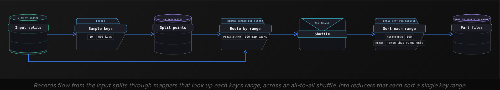

# Custom Sorting: Advanced

Ines is 40 minutes into her Google onsite when the interviewer writes a prompt on the whiteboard: every day, 2 TB of ad click events arrive keyed by a 32-bit advertiser ID, and analysts want them sorted. She starts with `sorted()` and a tuple key. The interviewer nods and keeps pushing, asking about fixed-width integer keys, then a day of clicks too big for one machine, then sorted files that get read 400 times for every time they are written. Each follow-up moves the question away from picking an algorithm and toward naming the constraint that decides it. By the end she has covered radix passes, a range-partitioned shuffle, row-group statistics, branchless sorting kernels, and a dollar figure for whether the sort pays for itself. The interviewer underlines that last figure.


<br>

### What you will be able to do

Recognize when a small key range or a fixed key width lets counting or radix sort beat n log n, and when it does not.

Design a sample-based, range-partitioned distributed sort with no coordinator merge, and handle both sampling error and hot keys.

Assign partition columns, a sort key and Bloom filters to the query patterns each one serves.

Explain why sorting networks on vector registers outrun branchy comparison sorts inside columnar engines.

Decide whether to sort a table by comparing daily write cost against read savings summed over its workloads.


<br>

---

## Counting Sort and Radix Sort

Every comparison sort, Timsort included, needs at least log2(n!) comparisons in the worst case, about n\*log2(n) - 1.44\*n. The bound comes from counting outcomes: n records have n! possible orderings, and each comparison can at best halve the set of orderings still in play. Getting under it means no longer comparing. When a key's value tells you where its record belongs, sorting becomes arithmetic on the key, and this kind of question turns on spotting keys with that shape.

- **18.5M** — minimum comparisons for 1M keys
- **2M** — counting sort steps, 1M hour keys


<br>

### Counting sort for a small key range

Counting sort applies when every key is an integer in a known range of K values, with K no bigger than a small multiple of n: hour of day (24 values), star rating (5), priority level (4), day of year (366). It makes 3 passes. The first counts how many records carry each key. The second turns the counts into start offsets with a running total. The third walks the input again, writes each record at its key's current offset, and increments that offset. Time and extra space are both O(n + K). Because the third pass walks the input front to back, records with equal keys leave in the order they arrived, and radix sort is built on that stability.

https://github.com/user-attachments/assets/3f516813-fce8-4f18-ae4e-450d10f5e87a

*Priority levels 0 to 3: count, prefix-sum into offsets, then place each event at its key's next free slot.*

The counts come out as `[1, 2, 1, 2]`, and the running total turns them into starts of `[0, 1, 3, 4]`, so the 2 priority-1 events own slots 1 and 2 and the 2 priority-3 events own slots 4 and 5. Event e2 takes slot 1 ahead of e6 because e2 comes first in the input, and e1 precedes e3 for the same reason. Now change the data: give the 6 events keys spread across the 32-bit range. The counts array would need over 4 billion entries to sort 6 records. Counting sort's cost follows K, so a sparse key range takes it off the table.


<br>

### Radix sort for fixed-width keys

A 32-bit `advertiser_id` has over 4 billion possible values, far too many for a single counting pass, but it is also exactly 4 bytes. Least-significant-digit radix sort runs a stable counting sort on one digit at a time, lowest digit first. With 8-bit digits each pass has 256 buckets, and 4 passes cover the key. Correctness rests on stability: after the pass on digit d, records are ordered by their lowest d digits, and the pass on digit d + 1 keeps that order among records that tie on the new digit. The animation uses base 10 and 3-digit keys so every pass fits on screen.

https://github.com/user-attachments/assets/bbea7c53-804e-474b-9e5a-263cf4c22034

*Each pass buckets by one decimal digit, ones first; appending to buckets keeps every pass stable.*

After the ones pass, 457 still precedes 657: both end in 7 and 457 arrived first. The tens pass gathers 355, 457 and 657 into one bucket in that order, and the hundreds pass separates them for good. An unstable pass would be free to scramble records that tie on its digit, discarding the order the earlier passes built.

| Key shape | Example | Reach for | Work |
| --- | --- | --- | --- |
| Integers in a small range K | hour 0 to 23, rating 1 to 5 | Counting sort | n + K |
| Fixed-width integers | 32-bit `advertiser_id` | LSD radix, 8-bit digits | 4 passes of n + 256 |
| 64-bit integers | microsecond timestamps | LSD radix if n is large | 8 passes of n + 256 |
| Floats | prices | Reinterpret bits as an integer: flip the sign bit if non-negative, all bits if negative, then radix | As for integers of the same width |
| Composite keys | (region, cost descending) | Encode into one fixed-width key, then radix | Depends on the encoded width |
| Variable-length strings | URLs, email addresses | Comparison sort, or MSD radix on prefixes | n log n comparisons of uneven cost |


<br>

### Costs the asymptotics hide

Big-O hides 3 costs that decide real runs. First, in CPython a counting sort written as a Python loop pays interpreter overhead on every record, while sorted() on integers runs its comparisons in C, so the pure-Python version often loses until the loop moves into compiled engine code. Second, each radix pass reads and writes every record and scatters its writes across 256 destinations, so 4 passes over 1 GB of keys move 8 GB through memory, and memory bandwidth sets the speed. Third, below a few thousand records the fixed cost of the buckets dominates. Timsort makes the same trade at its own scale, sorting runs shorter than its minrun of 32 to 64 elements with binary insertion sort.

> The same question in other clothes
>
> - 'Sort 500M page views by hour of day': K = 24, a single counting pass.
> - 'Order users by age for a cohort report': K is about 130, counting sort.
> - 'Sort 1B rows by a 32-bit ID on one machine': radix, 4 passes of 8 bits.
> - 'Report p99 latency, capped at 10,000 ms': count into 10,001 buckets, then walk the running total to 99%.
> - 'Sort log lines by URL': variable-length strings, so a comparison sort stays the right call.

> **TIP**
>
> State the bound before you beat it: comparison sorts need about n log n comparisons, the key's small range or fixed width lets you stop comparing, and below a few thousand records or with sparse keys you would fall back to `sorted()`. That last clause shows the choice was weighed.


<br>

---

## Distributed Sorting with TeraSort

The clicks table takes in 2 TB a day across 100 workers, and the job must write it out in a single global `advertiser_id` order. The design that comes to mind first is the single-machine external merge sort stretched across a cluster: every worker sorts its slice, and a coordinator runs a k-way heap merge over the 100 sorted streams. The local sorts parallelize, but the coordinator is a funnel. Every byte crosses its network link, and every record passes through its merge heap on a single core.

- **1,600 s** — coordinator receive time at 10 Gbit/s
- **16 s** — per-worker receive time, 100 workers


<br>

### Range partitioning removes the merge

TeraSort fixes both funnels by deciding, before any data moves, which key range each reducer owns. A driver samples keys from the input, sorts the sample, and picks R - 1 split points from it. Every mapper routes each record to partition i by binary search over the split points, so partition i holds only keys between split i - 1 and split i. Each reducer sorts its own range. Reading the reducers' outputs in partition order already gives the global order, so the final merge is gone, and the shuffle becomes all-to-all: every worker sends and receives about 1/R of the data, where the coordinator design had one machine receive all of it.




<br>

### The sample decides the balance

The program below runs the whole design on 18 keys with 3 reducers and a deliberately small sample of 6, taken as every third key. Predict the split points and the size of each partition before you play it.

https://github.com/user-attachments/assets/18e340fb-1eae-4fe5-8270-4a7b7f0cfd33

*Sample, choose split points, route by binary search, sort each partition; the concatenation matches a global sort.*

The split points come out as `[255, 701]` and the partitions hold 4, 9 and 5 keys. The last line confirms that concatenating the partitions equals a full sort, so the output is correct, but the middle reducer carries 1.5 times its fair share of 6, and a job finishes when its slowest reducer does. The sample of 6 missed how dense the keys are between 255 and 701. The standard fix is oversampling: draw tens to hundreds of sample keys per partition, so 100 reducers might sample 10,000 keys. Sorting 10,000 keys on the driver takes milliseconds against a shuffle measured in minutes, which makes the sample the cheapest place in the job to spend.


<br>

### Skew a sample cannot fix

Now suppose one advertiser produces 30% of all clicks. Range partitioning on `advertiser_id` alone must send every record with that key to the same reducer, because a split point can only fall between distinct keys. That reducer holds at least 30% of the data however good the sample is, which with 100 reducers is 30 times the average load. The fix is to partition and sort on a composite key such as `(advertiser_id, click_id)`. Split points can now land inside the hot advertiser's run and spread it over about 30 reducers, and the output stays in `advertiser_id` order because `click_id` only orders records within a tie. Hash salting, the usual answer to skew in joins, scatters a key's records without regard to order and so destroys the global order a sort exists to produce.

| ✓ Coordinator merge | ✗ Range-partitioned sort |
| --- | --- |
| • Every byte crosses one network link<br><br>• A single k-way heap merges 100 runs on one core<br><br>• One process writes the whole output<br><br>• More workers speed up only the local sorts | • Each worker receives about 1/R of the bytes<br><br>• No merge: partition order is output order<br><br>• R reducers write R files in parallel<br><br>• More workers shrink every phase until sampling or skew limits it |

Sizing the job

- Reducer count R: enough that each range sorts in one worker's memory; 2 TB over 100 reducers is 20 GB each.
- Sample size: tens to hundreds of keys per partition, small enough to sort on the driver.
- Split lookup: binary search over R - 1 boundaries costs about log2 R comparisons a record, 7 for R = 100.
- Retries: a failed reducer reruns only its own range, because no partition depends on another.

> **TIP**
>
> Draw the 3 phases (sample, shuffle, local sort) and name what breaks each one: a sample too small to balance the ranges, a hot key no split point can divide, a range too large for one reducer's memory. Naming those before the interviewer asks shows you have run one.


<br>

---

## Sorting as a Storage Layout Choice

Sorting the clicks once leaves a longer-lived decision: which order the files keep on disk, and which queries skip bytes because of it. The running table is `clicks`, landing at 2 TB a day with columns `click_date`, `region` (8 values), `advertiser_id`, `click_id` and `cost_micros`. It is stored as columnar files whose row groups of about 128 MB each record per-column min and max statistics. The table serves 3 workloads, each filtering a different way.

| Workload | Filter | Runs per day |
| --- | --- | --- |
| Fraud review | `advertiser_id` = ? on 1 day | 400 |
| Regional dashboard | `region` = ? on 1 day | 20 |
| Support lookup | `click_id` = ? on 1 day | 2,000 |


<br>

### 3 layers, 3 ways to skip

| Layer | Column | What it skips | Fits when the column is |
| --- | --- | --- | --- |
| Partition | `click_date` | Whole directories, before a file is opened | Low cardinality and in almost every filter |
| Sort key | `advertiser_id` | Row groups whose min/max range excludes the value | Filtered by range or equality, high cardinality |
| Bloom filter | `click_id` | Row groups that cannot contain the value | Looked up by equality but scattered by the sort |

Each column goes to the layer that matches its shape. Partitioning on `advertiser_id` would create a directory per advertiser per day, millions of small files that cost more to list and open than they save, while `click_date` yields 365 directories a year. Sorting on `click_id` would let support lookups prune perfectly, but each lookup fetches a single row, while each of the 400 daily fraud reviews would otherwise scan a whole day; the sort key goes to the workload whose skipped bytes add up to the most. That choice leaves `click_id` random within every row group, so each group's `click_id` min and max span nearly the full range and the statistics rule nothing out. That gap is what the Bloom filter fills.

https://github.com/user-attachments/assets/3669c1cd-f1f5-43fd-afc7-9fd2327b85ee

*Advertiser IDs in row groups of 3: count the groups whose min/max range overlaps 40 to 49, first unsorted, then sorted.*

Unsorted, every row group spans a wide range: `[15, 72]`, `[31, 90]`, `[12, 66]` and `[25, 83]` all overlap 40 to 49, so the filter reads 4 of 4 groups to find 2 matching rows. Sorted, the ranges become `[12, 25]`, `[31, 44]`, `[47, 66]` and `[72, 90]`, and only the middle 2 overlap. On the real table the same effect shrinks a fraud review from a whole 2 TB day to the stretch of row groups that holds one advertiser's clicks.


<br>

### Sizing the Bloom filter

A Bloom filter is a bit array kept per row group, set by k hash functions for each value, that answers a lookup with 'definitely absent' or 'possibly present'. With m bits holding n values, its false positive rate is about (1 - e^(-k\*n/m))^k. At 10 bits per value and 7 hash functions that comes to about 0.8%. A day of clicks fills about 16,000 row groups, so a support lookup reads the 1 group that holds its click_id plus about 130 false positives, where it would otherwise read all 16,000. The filters cost 10 bits per click_id, about 0.6% of a table whose rows average 200 bytes.

```sql
SELECT
  click_id,
  advertiser_id,
  cost_micros
FROM clicks
WHERE click_date = DATE '2026-10-01'
  AND click_id = 'c-8f31a07e'
```


<br>

### 2 filters competing for the sort order

Suppose the regional dashboard grows from 20 runs a day to 400 and now matters as much as fraud review. A sort on `(region, advertiser_id)` gives `region` tight ranges, and because `region` has only 8 values, each advertiser's rows sit in at most 8 contiguous stretches, one per region. Fraud review then reads up to 8 short stretches instead of 1. The reverse order, `(advertiser_id, region)`, would leave `region` spread through every row group. A low-cardinality column can lead a compound sort key at small cost to the column behind it, while a high-cardinality leader hides the second column almost completely. When both are high cardinality, no single compound order serves both well, and a multi-dimensional clustering layout is the usual compromise.

| ✓ Do | ✗ Don't |
| --- | --- |
| • Partition on a low-cardinality column that almost every query filters on<br><br>• Give the sort key to the workload whose skipped bytes add up to the most<br><br>• Lead a compound sort key with the lower-cardinality filter column<br><br>• Put Bloom filters on equality-lookup columns the sort scatters | • Partition on a column with millions of distinct values<br><br>• Add a Bloom filter to the leading sort column, which min/max already prunes<br><br>• Expect a high-cardinality second sort column to prune on its own<br><br>• Assume a layout stays sorted after late data is appended |


<br>

---

## Sorting Networks and SIMD

Inside a columnar engine, the speed of sorting a batch of a few million 32-bit keys is set by the CPU pipeline. Quicksort's partition step and a merge sort's merge both branch on each comparison result. On random keys the branch predictor guesses right about half the time, and each wrong guess discards roughly 15 to 20 cycles of speculative work, several times the cost of the comparison itself.


<br>

### Sorting networks have no data-dependent branches

A sorting network is a fixed list of compare-exchange steps on fixed positions: for each pair (i, j), the smaller value goes to slot i and the larger to slot j. The list never depends on the data, so every input runs the same instructions, and a compare-exchange is a min and a max, which CPUs compute without branching. Networks pay for that with extra comparisons. The 4-input network takes 5 comparators in 3 layers, and the smallest 8-input network uses 19 comparators across 6 layers, where a branchy sort of 8 keys needs about 16 comparisons.


<br>

### Vector lanes run many networks at once

SIMD instructions apply one operation to every lane of a vector register. A 256-bit register holds 8 32-bit integers, and a vector min or max produces 8 lane-wise results in one instruction. Load 8 registers and run the 8-input network across them, register against register, and the 19 comparators become 38 instructions that sort 8 independent groups of 8 keys, one group per lane. The animation shrinks this to 4 registers of 4 lanes with the 5-comparator network. Each register is a row; read the result down each column.

https://github.com/user-attachments/assets/bc20eefd-8bf1-486c-8e61-6f75d6d83c78

*Rows are registers and columns are lanes; each comparator is one lane-wise min and one lane-wise max.*

Lane 0 starts as 7, 3, 5, 2 and ends as 2, 3, 5, 7, and the other 3 lanes come out sorted too, though no step ever branched on which value was larger. A real engine then transposes the registers so each sorted column becomes a contiguous run, merges pairs of runs with bitonic merge networks while they still fit in registers, and hands longer runs to an ordinary merge in cache.


<br>

### A 15x kernel, 5x to 10x end to end

| Per 8-key block | Branchy comparison sort | Vector network |
| --- | --- | --- |
| Comparisons | About 16 | 19, always |
| Branch misses on random keys | About 8, at 15+ cycles each | None |
| Instructions | About 16 compares plus branches | 38 vector ops shared by 8 blocks, about 5 each |
| Transpose | Not needed | About 3 shuffles per block |
| Rough cycles | About 150 | About 8 to 10 |

That kernel ratio is about 15x, but the kernel only builds runs of 8. The bitonic merges that follow do more total comparisons than a merge sort, need more shuffle instructions per comparison as runs grow, and once a batch outgrows the cache both designs wait on memory bandwidth. End to end, a full in-memory sort of 32-bit keys keeps roughly 5x to 10x of the kernel's advantage. The ratio tracks lane count: 64-bit keys fit 4 to a 256-bit register, which roughly halves the kernel's edge, and 512-bit registers double the lanes again.


<br>

### Normalized keys feed the fast path

Vector min and max work on fixed-width integers, and so does radix sort. A query ending in `ORDER BY region, cost_micros DESC` supplies a string and a descending column, so engines normalize: they encode the whole sort key into one fixed-width value whose plain integer or byte order matches the requested order. Descending columns are inverted against their maximum, and strings contribute a fixed-length prefix, with ties on the prefix settled by comparing the full strings.

```sql
def normalize(region_id, cost_micros):
    return (region_id << 32) | (0xFFFFFFFF - cost_micros)

rows = [(2, 500), (1, 900), (2, 1200), (1, 300)]
print(sorted(rows, key=lambda r: normalize(*r)))
```

The program prints `[(1, 900), (1, 300), (2, 1200), (2, 500)]`: region 1 before region 2, and within each region the higher cost first. Here `region_id` is the region string after order-preserving dictionary encoding, and every key is now a single 64-bit integer, the input both a radix pass and a vector network accept. A cost above `0xFFFFFFFF` would turn the low field negative and corrupt the order, so the encoding must size each field to the column's real range.


> **TIP**
>
> Asked why a columnar engine out-sorts a textbook quicksort, name 3 mechanisms in order: no data-dependent branches, 8 comparisons per vector instruction, and fixed-width normalized keys that make both possible.


<br>

---

## Framing a Sort as a Cost Decision

The question usually arrives as 'should we sort this table?', and every algorithm in the sections above lowers one number in the answer. The decision itself is a cost comparison. A sort is paid once per write and recovered on every read that skips bytes because of it, so the test is daily write cost against daily read savings, summed over every workload that shares the layout.

> The numbers to ask for
>
> - Write volume per day, and the extra compute to sort it
> - Each workload's runs per day
> - Bytes each workload scans under each candidate layout
> - The price of a scanned TB or a core-hour
> - How fast late data erodes the order, and what compaction costs


<br>

### Pricing candidate layouts

Return to the clicks table: 2 TB a day, with scans priced at an assumed $5 per TB. Sorting each day by `advertiser_id` adds about $120 of compute. Sorting by `region` costs around $90. It still range-partitions on a composite key such as `(region, click_id)`, since 8 distinct values alone would load 8 of the 100 reducers with 250 GB each, and the $30 saving comes only from the shorter local key: one counting pass over 8 regions where a 32-bit key needs 4 radix passes. Without a sort, fraud review and the dashboard scan the full day. Sorting by `advertiser_id` cuts each fraud review to 0.05 TB, and sorting by `region` cuts each dashboard run to roughly 0.3 TB, a bit over its 1/8 share because regions differ in size. Each support lookup reads its 131 row groups, about 0.0168 TB, under every layout, since the `click_id` Bloom filters stay in all 3.

https://github.com/user-attachments/assets/e4e4d788-659d-4b67-aa04-2a601127bf6d

*Daily cost of each candidate layout: read spend across all 3 workloads plus the cost of the sort.*

With no sort the table costs $4,368 a day, and fraud review accounts for $4,000 of it. Sorting by `advertiser_id` brings the total to $588: $3,900 of fraud scanning disappears for $120 of sorting. Sorting by `region` saves the dashboard $170 for $90 of sorting, a net gain of $80. Support lookups add $168 to every total and save nothing from either sort, because the Bloom filters already prune them. The workload that dominates the bytes picks the key, and the cheaper sort loses because it serves the smaller workload.


<br>

### The break-even run count

For a single workload the test reduces to a ratio. If a layout costs C dollars a day to maintain and saves s dollars on each run, it pays for itself once the workload runs N = C / s times a day. For fraud review under the advertiser_id sort, s is 1.95 TB times $5. For the dashboard under the region sort, s is 1.7 TB times $5.

- **12.3** — fraud runs per day to repay $120
- **10.6** — dashboard runs per day to repay $90

Run counts near break-even make an answer fragile: if the dashboard dropped from 20 runs a day to 10, the `region` sort would stop paying. Fraud review clears its threshold more than 30 times over, so that sort survives large errors in every estimate.


<br>

### Decay changes the write cost

The $120 assumes each day is sorted once. Clicks arrive late, and if 10% of each day trickles in over the following 3 days, the appended files carry min and max ranges that overlap the sorted ones, so pruning weakens with every batch. Keeping the order means re-sorting each of the last 3 days every night as well, which makes the steady-state write cost 4 sorts a day: $480 for `advertiser_id` and $360 for `region`. The `advertiser_id` sort still saves $3,900 a day. The `region` sort now spends $360 to save $170, a loss, unless late clicks go into small side files that get compacted once a week.

| ✓ Sort on write | ✗ Sort per query |
| --- | --- |
| • Cost paid once, then amortized over every read<br><br>• Wins when reads repeat the same filter<br><br>• Decays as late data lands and needs compaction<br><br>• Commits the table to one leading key | • Cost paid on every run that needs the order<br><br>• Wins when the order is needed rarely or changes by query<br><br>• Always current, so no compaction<br><br>• Each query picks its own key |

> A complete answer, in order
>
> - Name the workloads and how many times a day each runs.
> - Estimate bytes scanned per run under each candidate layout.
> - Price the sort, including the re-sorts that late data forces.
> - Compare daily totals, then check how far each workload sits from break-even.
> - Say what change in the workload mix would flip the decision.

> **TIP**
>
> The earlier sections each move one term: radix passes and vector kernels shrink the cost of a sort, range partitioning lets it run in parallel, and layout choices set the bytes a run can skip. Name which term your design changes.


<br>

---

## Putting It All Together

An ad platform lands 2 TB of click events a day. Fraud analysts review single advertisers 400 times a day, a regional dashboard refreshes 20 times, and support staff look up individual clicks by ID. The team must decide how the nightly job sorts and lays out each day's partition, and whether to keep re-sorting as late clicks arrive.

- The nightly job range-partitions on (advertiser_id, click_id), so hot advertisers spread across reducers and no coordinator merges the output.
- Each reducer sorts its range with radix passes over normalized fixed-width keys run by vector kernels, which keeps the $120 sort cost low.
- The output lands partitioned by click_date, sorted by advertiser_id, with Bloom filters on click_id, so each workload gets the layer that lets it skip bytes.
- The cost model shows the advertiser_id sort saving $3,900 a day and surviving the re-sorts late data forces, while a region sort would not.


<br>

---

## Key Takeaways

- Comparison sorts need about n log n comparisons; counting and radix sort stop comparing when keys have a small range or a fixed width, and lose when the range is sparse or the data is small.
- A range-partitioned sort samples keys, routes records by binary search over split points, and sorts each range locally, so the output needs no merge and the shuffle spreads across every worker.
- Oversampling fixes uneven split points; a composite key with a tiebreaker fixes a hot key, because split points can only fall between distinct keys.
- Partition on low-cardinality filters, sort on the column whose skipped bytes add up to the most, and put Bloom filters on the equality lookups the sort scatters.
- Sorting networks trade extra comparisons for zero data-dependent branches, vector lanes run many networks at once, and normalized fixed-width keys open that path to multi-column orders.
- Whether to sort is a daily cost comparison: write cost, including re-sorts forced by late data, against read savings summed over every workload.
