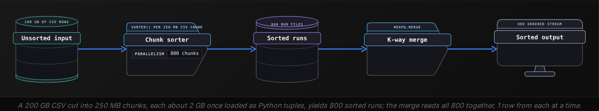

# Custom Sorting: Beginner

Maya is 40 minutes into a data engineering loop at Spotify when the interviewer pastes a list of weekly play records into the shared editor. Each record is a dict holding a track name, an artist, a stream count and a release date. The ask sounds small: return the 10 tracks with the most streams, break ties by track name from A to Z, and leave the original list untouched because another function reads it afterwards. Maya types `records.sort(key=lambda r: r['streams'], reverse=True)` and returns `records[:10]`. The interviewer nods, then asks 3 follow-ups. Did that line change the caller's list? In what order do tied tracks come out? And what changes when the list holds 400 million rows instead of 40? Each follow-up is a sorting decision with a precise answer.


<br>

### What you will be able to do

Choose sorted() or .sort() from whether the caller still needs the original list, and predict the None that .sort() returns

Build one tuple key that orders rows by several fields in mixed directions, including fields with missing values

Use sort stability to chain single-field passes and to keep the latest record per key when deduplicating

Estimate a dataset's in-memory size before sorting it, and name the external merge sort that takes over past RAM

Replace a full sort with heapq.nlargest or heapq.nsmallest when only the top K rows are needed


<br>

---

## sorted() vs .sort()

Python ships 2 sorting entry points over the same Timsort engine, and they differ in 1 contract: what happens to the data passed in. `sorted()` accepts any iterable, builds a new list, sorts that new list and returns it. `list.sort()` exists only on lists, rearranges the list it is called on, and returns `None`. Interviewers probe the difference because it decides whether a function has a side effect on its caller.

| ✓ sorted(iterable) | ✗ list.sort() |
| --- | --- |
| • Accepts lists, tuples, dicts, sets, strings and generators<br><br>• Returns a new list; the input keeps its order<br><br>• Allocates a second list of references, 8 bytes per element<br><br>• Fits when the caller or another function still reads the original | • Defined only on list objects<br><br>• Reorders the list in place and returns None<br><br>• Allocates no second list<br><br>• Fits when the list was built inside the function and nobody needs its old order |


<br>

### The None trap

The most frequent bug here is assigning the result of `.sort()`. Read the program below and decide what each of its 3 print lines produces before reading on.

```sql
scores = [42, 7, 19]
ranked = scores.sort()
print(ranked)
print(scores)
print(ranked[0])
```

The first print shows `None`, because `.sort()` returns nothing. The second shows `[7, 19, 42]`: the sort happened, on the list under its old name. The third raises `TypeError: 'NoneType' object is not subscriptable`. In a pipeline that error tends to surface far from its cause, inside whatever function later received `ranked` as an argument, which makes it slow to trace.


<br>

### What key= does, and how often

Both functions take `key=` and `reverse=`. The key function maps each element to the value that gets compared. Python calls it exactly once per element, stores the results, and then compares only those stored keys, however many comparisons the sort needs. A key that costs 1 millisecond therefore adds about 17 minutes on 1,000,000 rows, and that figure stays fixed whether the input is random or nearly sorted. The run below logs every key call so you can count them.

https://github.com/user-attachments/assets/2bd93953-2e86-4286-9bb0-1b8e2aecfb10

*Each sort calls the key once per row, and only sorted() leaves the input alone.*

`sorted()` logs 3 key calls for 3 rows, returns the reordered list, and leaves `tracks` exactly as it was. `.sort()` logs 3 more calls, returns `None`, and reorders `tracks` itself. The final count of 6 confirms one call per element per sort, never one per comparison.


<br>

### itemgetter instead of lambda

Pipeline rows usually arrive as dicts or tuples, and the key is usually one field. `operator.itemgetter('streams')` builds a callable that performs the same lookup as `lambda r: r['streams']`, but the lookup runs in C instead of executing a Python function body for every row. Given several field names, `itemgetter('artist', 'streams')` returns a tuple per row, which is the building block for multi-field ordering. For objects with attributes, `operator.attrgetter('streams')` plays the same role.

```sql
from operator import itemgetter

plays = [
    {'track': 'Halo', 'artist': 'Nova', 'streams': 30},
    {'track': 'Drift', 'artist': 'Kite', 'streams': 50},
    {'track': 'Ember', 'artist': 'Nova', 'streams': 10},
]

by_streams = sorted(plays, key=itemgetter('streams'), reverse=True)
print([p['track'] for p in by_streams])

get_pair = itemgetter('artist', 'streams')
print(get_pair(plays[0]))
```

The first line prints `['Drift', 'Halo', 'Ember']`, highest count first. The second prints `('Nova', 30)`: a tuple built from the first row, in the order the field names were given. `plays` itself still starts with Halo, because `sorted()` never touched it.


<br>

### Sorting dicts and other iterables

Iterating a dict yields its keys, so `sorted(counts)` returns the key names alphabetically and drops the counts. To rank by value, sort the `(key, value)` pairs from `.items()` with `itemgetter(1)`. Dicts have no `.sort()` method, and neither do tuples or generators, so for them `sorted()` is the only choice.

```sql
from operator import itemgetter

counts = {'Nova': 12, 'Kite': 40, 'Arlo': 25}
print(sorted(counts))
print(sorted(counts.items(), key=itemgetter(1), reverse=True))
counts.sort()
```

This prints `['Arlo', 'Kite', 'Nova']`, then `[('Kite', 40), ('Arlo', 25), ('Nova', 12)]`, and the last line raises `AttributeError: 'dict' object has no attribute 'sort'`. The ranked result is a list of pairs; wrap it in `dict()` if a dict in that order is what the caller wants.


<br>

### When comparisons fail

Sorting compares keys with `<`, and Python 3 refuses to compare unrelated types. A column holding a stray string or a `None` stops the whole sort with an error, so a bad value never produces a quietly half-sorted result. `sorted([3, None, 1])` raises `TypeError: '<' not supported between instances of 'NoneType' and 'int'`. Missing values are routine in real feeds, so plan the key for them; the next section shows a key that places them first or last on purpose.

| ✓ Do | ✗ Don't |
| --- | --- |
| • Use sorted() when the input list belongs to the caller<br><br>• Use .sort() on a list the function built itself<br><br>• Pass itemgetter('field') for dict or tuple rows<br><br>• Return the sorted list explicitly from helper functions | • Assign the result of .sort() to a variable<br><br>• Reorder an argument in place without saying so in the name or docstring<br><br>• Put I/O or heavy parsing inside a key function<br><br>• Sort a dict and expect its values back |

> **TIP**
>
> Say the choice out loud: 'The caller passed this list in, so I will use sorted() and leave it alone.' That sentence answers the mutation follow-up before the interviewer asks it.


<br>

---

## Multi-Key Sorting with Tuple Keys

Tuples compare element by element from the left. Python finds the first position where 2 tuples differ and compares only the elements at that position; anything after it is never examined. That rule makes a tuple the natural key for a spec such as 'by artist, then by streams, then by track name': the first slot decides, the second slot only breaks ties in the first, and the third only breaks ties in both.

| Comparison | Result | Decided at |
| --- | --- | --- |
| (1, 'b') < (2, 'a') | True | position 0, since 1 < 2 |
| (1, 'b') < (1, 'c') | True | position 1, since 'b' < 'c' |
| (1, 'b') < (1, 'b', 0) | True | the shorter tuple is a prefix |
| (False, 9) < (True, 0) | True | position 0, since False < True |

The last row matters later in this section: booleans compare as `False < True`, so a boolean in the first slot splits rows into 2 groups before any other field is consulted.


<br>

### Mixed directions: negate the numbers

`reverse=True` flips the entire key, so it cannot make one slot descend while another ascends. For a numeric field, negate it inside the key: `-r['streams']` turns the largest count into the smallest key value. The key `(r['artist'], -r['streams'], r['track'])` reads as artist from A to Z, most streamed first within each artist, and track name from A to Z when 2 tracks of one artist tie on streams.

```sql
catalog = [
    {'artist': 'Nova', 'track': 'Halo', 'streams': 30},
    {'artist': 'Kite', 'track': 'Drift', 'streams': 50},
    {'artist': 'Nova', 'track': 'Ember', 'streams': 45},
    {'artist': 'Nova', 'track': 'Aster', 'streams': 30},
    {'artist': 'Kite', 'track': 'Pulse', 'streams': 50},
]

ordered = sorted(catalog, key=lambda r: (r['artist'], -r['streams'], r['track']))
for r in ordered:
    print(r['artist'], r['streams'], r['track'])
```

| Printed line | Key tuple | Why it lands there |
| --- | --- | --- |
| Kite 50 Drift | ('Kite', -50, 'Drift') | Kite sorts before Nova |
| Kite 50 Pulse | ('Kite', -50, 'Pulse') | ties Drift on slots 0 and 1; 'Drift' < 'Pulse' |
| Nova 45 Ember | ('Nova', -45, 'Ember') | -45 < -30, so the larger count comes first |
| Nova 30 Aster | ('Nova', -30, 'Aster') | ties Halo on slots 0 and 1; 'Aster' < 'Halo' |
| Nova 30 Halo | ('Nova', -30, 'Halo') | last on every slot |

Each row of output is explained by the first slot where its key differs from its neighbour's. Working an interview answer this way, slot by slot, catches a wrong sign before the code runs.


<br>

### Fields that cannot be negated

Negation needs a number. `-'Kite'` raises `TypeError: bad operand type for unary -: 'str'`, and a `datetime.date` refuses unary minus in the same way. Three workarounds cover most interview cases:

- **Dates and timestamps:** convert to a number inside the key. -d.toordinal() or -ts.timestamp() sorts newest first.
- **Every slot in the same direction:** skip negation and pass reverse=True for the whole tuple.
- **A string slot must descend:** sort in 2 stable passes, the technique the next section builds.


<br>

### Missing values with a boolean slot

Real columns contain `None`, and a single one stops a plain sort. Put a boolean in front of the field: `s is None` is `False` for rows with a value and `True` for rows without, and since `False < True`, missing values land last. For the numeric slot, `-(s or 0)` turns a missing value into `0`, so `None` never enters the key at all, and the leading boolean keeps those placeholder zeros apart from real counts. The shorter key `(s is None, s)` would also work: 2 `None` slots compare equal with `==`, so the comparison moves on to the next slot. A `None` meets `<` only when it sits in the first slot that differs, and the boolean in front rules that out.

```sql
rows = [
    {'track': 'Halo', 'streams': 30},
    {'track': 'Glow', 'streams': None},
    {'track': 'Drift', 'streams': 50},
    {'track': 'Aura', 'streams': None},
]

def nulls_last_desc(r):
    s = r['streams']
    return (s is None, -(s or 0), r['track'])

result = sorted(rows, key=nulls_last_desc)
print([r['track'] for r in result])
```

This prints `['Drift', 'Halo', 'Aura', 'Glow']`. Drift and Halo carry `False` and order by descending streams; Aura and Glow carry `True`, tie on the `0` placeholder, and fall back to track name. To put missing values first instead, lead with `s is not None`. Writing the key as a named function, as here, also gives a reviewer one place to read the full ordering rule.

> Saying the key aloud
>
> Name each slot and its direction before writing code: 'missing streams last, streams descending, track ascending as the tie-break.' The interviewer can confirm or correct the spec, and the tuple then follows one slot per phrase.

> **TIP**
>
> End a multi-field key with a column that is unique per row, such as an id. The output order then depends only on the data, so 2 runs produce identical files even when the rows arrive in a different order.


<br>

---

## Relying on Sort Stability

A sort is stable when rows with equal keys come out in the same relative order they went in. The Python documentation guarantees stability for both `sorted()` and `list.sort()`, and states that `reverse=True` keeps the guarantee. Interviewers ask about it because 2 everyday techniques depend on it: chaining sorts, and deduplicating by keeping one record per key.

```sql
rows = [('Nova', 30), ('Kite', 50), ('Arlo', 30), ('Mira', 50)]
print(sorted(rows, key=lambda r: r[1]))
print(sorted(rows, key=lambda r: r[1], reverse=True))
```

The first line prints `[('Nova', 30), ('Arlo', 30), ('Kite', 50), ('Mira', 50)]` and the second prints `[('Kite', 50), ('Mira', 50), ('Nova', 30), ('Arlo', 30)]`. In both, Nova stays ahead of Arlo and Kite stays ahead of Mira, matching their positions in `rows`. `reverse=True` inverts the comparison while holding equal rows in their original sequence; reversing the finished ascending list would have put Mira before Kite.


<br>

### Chaining sorts, least important field first

Stability turns a multi-field sort into a sequence of single-field sorts. Sort by the least important field first and by the most important field last. Each later pass reorders only by its own field, and among rows that tie on it, the order left by the earlier pass survives. This solves the case a tuple key cannot express: 2 string fields in opposite directions, such as artist from Z to A with tracks from A to Z inside each artist.

https://github.com/user-attachments/assets/ce5e0759-96df-477a-925e-bb93cc6486c0

*Pass 1 orders tracks A to Z; pass 2 orders artists Z to A and keeps pass 1's order within each artist.*

After the first pass the tracks run Aster, Drift, Ember, Halo, Pulse. The second pass groups by artist from Z to A, and within Nova and within Kite the tracks keep the alphabetical sequence the first pass produced. Neither field is a number, so no negation trick could have produced this order in one call.

| ✓ Chained stable passes | ✗ One tuple key |
| --- | --- |
| • Handles any field type in either direction<br><br>• Costs one full sort per field<br><br>• Pass order runs opposite to the spec, a common slip | • One sort and one key call per row<br><br>• A descending slot needs a negatable value<br><br>• Reads as a single ordering rule in review |


<br>

### Deduplicating: keep the latest record per key

A classic pipeline task: a change feed delivers several versions of each customer row, and the target table needs only the newest version per `customer_id`. Sort the events by `updated_at` ascending, then write them into a dict keyed by `customer_id`. Later writes overwrite earlier ones, so each key ends holding its newest version. Stability settles the hard case. When 2 versions share an `updated_at`, they stay in arrival order, so the one that arrived last wins, a rule you can state and defend.

```sql
events = [
    {'customer_id': 7, 'updated_at': '2024-03-02T10:00', 'tier': 'silver'},
    {'customer_id': 9, 'updated_at': '2024-03-01T08:00', 'tier': 'free'},
    {'customer_id': 7, 'updated_at': '2024-03-01T09:00', 'tier': 'free'},
    {'customer_id': 7, 'updated_at': '2024-03-02T10:00', 'tier': 'gold'},
    {'customer_id': 9, 'updated_at': '2024-03-03T12:00', 'tier': 'plus'},
]

latest = {}
for e in sorted(events, key=lambda e: e['updated_at']):
    latest[e['customer_id']] = e

for cid in sorted(latest):
    print(cid, latest[cid]['tier'])
```

The program prints `7 gold` and `9 plus`. ISO 8601 strings in a single fixed format and timezone order the same way as the instants they encode, so no parsing is needed. Customer 7 has 2 versions at `2024-03-02T10:00`; the sort keeps silver ahead of gold, and the dict keeps gold. With an unstable sort, which of silver and gold survives would depend on the algorithm's internals rather than on arrival order, so the result could change when the feed's order or the library changes.

#### The keep-first variant

To keep the earliest version per key instead, sort the same way and skip any key already present: `if e['customer_id'] not in first: first[e['customer_id']] = e`. Stability again decides ties, this time in favour of the version that arrived first.


> **TIP**
>
> Asked whether Python's sort is stable, answer yes and give the consequence: rows with equal keys keep their input order, also under reverse=True. Then add that this guarantee is what makes chained passes and keep-latest deduplication correct.


<br>

---

## Asking About Scale Before Sorting

Every solution so far assumed the rows already sit in a Python list. In a data engineering interview, the strongest first move after hearing a sorting prompt is a question: how many rows, and how big is each one? The answer decides whether `sorted()` is the whole solution, whether the sort belongs in the query engine, or whether the data has to be sorted in pieces.

> Questions to ask before writing code
>
> - How many rows, and roughly how many bytes per row?
> - Does the full order matter, or only the top K rows?
> - Is the data already sorted or nearly sorted, for example by event time?
> - Does it arrive all at once, or as a stream that never ends?
> - Where does it live: a Python list, files, or a table a query engine can sort?


<br>

### What a row costs in memory

Every Python object carries a header, so a row costs several times its raw bytes. Take one play record stored as a tuple, `('user_123456', 4821, 3.75)`. As a CSV line, `user_123456,4821,3.75` plus its newline, it is 22 bytes. On 64-bit CPython 3.9, `sys.getsizeof` reports these sizes for its parts:

| Object | Bytes |
| --- | --- |
| tuple of 3 references | 64 |
| str 'user_123456' | 60 |
| int 4821 | 28 |
| float 3.75 | 24 |
| list slot pointing at the tuple | 8 |
| Total per row | 184 |

```sql
import sys

row = ('user_123456', 4821, 3.75)
parts = [sys.getsizeof(row)] + [sys.getsizeof(v) for v in row]
print(parts)
print(sum(parts) + 8)
```

On 64-bit CPython 3.9 this prints `[64, 60, 28, 24]` and then `184`, the 8 being the list slot. The row costs about 8 times its CSV size. At 10,000,000 rows that comes to 1.84 GB before any sorting starts, and `sorted()` then adds a second list of references, another 80 MB. A tuple key adds a freshly built tuple per row for the duration of the sort, and Timsort's merge step borrows temporary space of up to half the list's references.

- **5.4M** — rows of this tuple per GB of RAM
- **21 GB** — RAM for a 2.5 GB CSV of these rows


<br>

### The in-memory boundary

A working rule: sort in memory when the estimate, plus the copy and the keys, stays well under the RAM the process may use. Keep roughly half in reserve, because the interpreter and the rest of the program need memory too. Past that line, one `sorted()` call either fails with `MemoryError` or pushes the machine into swap, where every page fault waits on the disk and the job's runtime grows by orders of magnitude.

| Situation | Approach |
| --- | --- |
| Fits in RAM with room to spare | sorted() or .sort() inside the process |
| Rows live in a table a query engine can read | ORDER BY in the query, receive sorted rows |
| Only the top K rows matter | A heap of size K, covered in the next section |
| Too large for RAM and full order required | External merge sort: sorted runs, then a k-way merge |


<br>

### Pushing the sort to the query engine

When the rows already sit in a table, the cheapest sort is often the one Python never runs. A query engine sorts across many workers and spills to disk on its own, and with a `LIMIT` it can keep only the top rows instead of ordering everything.

```sql
SELECT
  track,
  artist,
  streams
FROM weekly_plays
WHERE week_start = DATE '2024-03-04'
ORDER BY streams DESC, track
LIMIT 10
```


<br>

### External sort in one picture

When the full order is required and the data exceeds RAM, the standard answer is an external merge sort. Read a chunk that fits in memory, sort it, and write it out as a sorted run. Repeat until the input is consumed. Then merge: hold the smallest unread row of each run, emit the smallest of those, and refill from the run it came from. Memory during the merge is one row per run, whatever the total size.



The merge step already exists in the standard library. `heapq.merge` takes any number of sorted iterables and yields one sorted stream, reading lazily and holding a single element from each input. It accepts the same `key=` and `reverse=` arguments as `sorted()`.

```sql
import heapq

run_a = [3, 9, 14]
run_b = [1, 10, 12]
run_c = [5, 6, 20]

merged = heapq.merge(run_a, run_b, run_c)
print(list(merged))
```

This prints `[1, 3, 5, 6, 9, 10, 12, 14, 20]`. In a real external sort each run would be read row by row from storage, and the list call at the end would be replaced by writing each row out as it is produced.

*Building the full external sort, with run files and a hand-written k-way heap merge, is the subject of a later lesson in this track.*

> **TIP**
>
> Ask for the row count even when the prompt shows 5 rows, then say what changes at 10 million and at 10 billion. Putting numbers on the boundary shows you know where in-memory sorting stops working.


<br>

---

## Heap vs Sort for Top-K

Prompts that say 'top 10', 'the 5 slowest', 'the 3 most frequent' or 'the highest scorer' ask for K rows, and ordering the other rows is wasted work. Sorting all n rows to read the first K does O(n log n) work and holds every row. A min-heap of size K does O(n log K) work and holds K rows, and Python's `heapq` module packages it as 2 functions.

```sql
import heapq

weekly = [
    {'track': 'Halo', 'streams': 30},
    {'track': 'Drift', 'streams': 50},
    {'track': 'Ember', 'streams': 45},
    {'track': 'Aster', 'streams': 30},
    {'track': 'Pulse', 'streams': 12},
]

top = heapq.nlargest(3, weekly, key=lambda r: r['streams'])
print([r['track'] for r in top])

low = heapq.nsmallest(2, weekly, key=lambda r: r['streams'])
print([r['track'] for r in low])
```

The first line prints `['Drift', 'Ember', 'Halo']` and the second prints `['Pulse', 'Halo']`. Halo and Aster tie at 30 streams. The documentation defines `nlargest(k, it, key=f)` as equivalent to `sorted(it, key=f, reverse=True)[:k]`, and `nsmallest` likewise without the reverse, so ties resolve as the stable sort would: Halo appears first in `weekly`, so Halo wins both times.


<br>

### How the heap keeps only K rows

Keep a min-heap of the K largest values seen so far. Its smallest member sits at index 0 and acts as the bar to clear. Each new value is compared against that bar once. A value that fails is discarded after that single comparison; a value that beats it replaces the bar and sifts down through about log2 K levels.

https://github.com/user-attachments/assets/faf432a8-3fe6-4317-8397-498ff4b5ce65

*heap[0] is the bar each new value must beat to enter the top 3.*

Of the 4 values that arrived after the heap filled, only 61 forced a replacement; 30, 12 and 8 each cost 1 comparison. On real data most rows fail the first check, so the work in practice runs close to n comparisons.


<br>

### The numbers behind the choice

For n = 10,000,000 and K = 10, a comparison sort needs about n log2 n, roughly 233 million comparisons. The heap's worst case is about n log2 K, roughly 33 million, and it holds 10 rows instead of a second 10,000,000-entry list. The advantage shrinks as K grows: the documentation notes that for larger K, `sorted()` is more efficient, and that for K = 1, `min()` and `max()` are the better calls.

- **7x** — fewer worst-case comparisons at K = 10
- **80 MB** — list copy a full sort adds at 10M rows

| Situation | Best call | Why |
| --- | --- | --- |
| K = 1 | min() or max() | One pass, no heap |
| K small next to n | heapq.nlargest / nsmallest | O(n log K) time, K rows of memory |
| K close to n | sorted(...)[:K] | Heap overhead stops paying off |
| Input is a generator or stream | heapq.nlargest | Never holds more than K rows |
| Every row needed in order anyway | sorted() | One sort serves every later read |


<br>

### Top K with a tie-break in the other direction

Prompt: the top 3 tracks by streams, ties broken by track name from A to Z. Calling `nlargest` with the key `(streams, track)` breaks ties from Z to A, because it maximizes the whole tuple, name included. Flip the problem: ask for the 3 smallest of `(-streams, track)`. That is the negated tuple key from earlier in the lesson, handed to `nsmallest`.

```sql
import heapq

pairs = [('Halo', 30), ('Drift', 50), ('Ember', 45), ('Aster', 30), ('Pulse', 12)]

wrong = heapq.nlargest(3, pairs, key=lambda p: (p[1], p[0]))
right = heapq.nsmallest(3, pairs, key=lambda p: (-p[1], p[0]))
print([t for t, _ in wrong])
print([t for t, _ in right])
```

The first line prints `['Drift', 'Ember', 'Halo']`, because `(30, 'Halo')` is larger than `(30, 'Aster')`. The second prints `['Drift', 'Ember', 'Aster']`, the answer the prompt asked for.


<br>

### Most frequent K

'Find the 3 most common error codes' is top K over counts. `collections.Counter` counts in one pass, and `most_common(3)` returns the 3 highest counts; given a number, CPython's implementation calls `heapq.nlargest`. The documentation guarantees that equal counts come back in the order their elements were first encountered.

```sql
from collections import Counter

codes = ['E42', 'E17', 'E42', 'E99', 'E17', 'E05', 'E42', 'E99']
print(Counter(codes).most_common(3))
```

This prints `[('E42', 3), ('E17', 2), ('E99', 2)]`. E17 and E99 tie at 2, and E17 comes first because it appeared first in `codes`.

| ✓ Do | ✗ Don't |
| --- | --- |
| • Reach for nlargest or nsmallest when the prompt names a K<br><br>• Feed a generator to nlargest to keep memory at K rows<br><br>• Use nsmallest with a negated count for mixed-direction ties<br><br>• Use min() or max() when K is 1 | • Sort 10 million rows to read the first 10<br><br>• Assume nlargest breaks ties alphabetically<br><br>• Use a heap when the caller needs every row in order<br><br>• Forget that heapq only builds min-heaps |

> **TIP**
>
> Name the complexity when you switch: 'A full sort is O(n log n); only 10 rows are needed, so a size-10 heap brings it to O(n log 10) with 10 rows in memory.' The reasoning carries more weight than the function name.


<br>

---

## Putting It All Together

A music streaming service publishes a weekly chart. A Python job receives about 4 million play-summary rows for the week, folds in late-arriving corrections so each track keeps only its newest figures, then writes a full ranked file for analysts and a top 50 list for the app's home screen.

- Scale comes first: 4 million rows at about 200 bytes each is under 1 GB, so an in-memory sort is safe on an 8 GB worker; at 400 million rows the same job would move the sort into the query engine or an external merge sort.
- Deduplication relies on stability: sorting corrections by updated_at and writing them into a dict keyed by track id keeps the newest figures, with same-timestamp ties going to the later arrival.
- The analysts' file uses one tuple key, ( - streams , track_name , track_id ) , so the order is fully determined by the data and identical across reruns.
- The home-screen list calls heapq . nsmallest ( 50 , rows , key = . . . ) with that same key, so its 50 tracks match the first 50 lines of the full file exactly.
- The ranking function reads its input through sorted ( ) , so the deduplicated list that the next step consumes keeps its original order.


<br>

---

## Key Takeaways

- sorted ( ) returns a new list from any iterable; . sort ( ) reorders a list in place and returns None .
- A key function runs once per element, and itemgetter performs the field lookup in C.
- A tuple key orders by several fields at once: negate numeric slots to make them descend, and lead with an is None flag to place missing values.
- Python's sort is stable, also under reverse = True , which makes chained passes and keep-latest deduplication correct.
- Estimate memory before sorting: a small row costs about 8 times its CSV bytes, and past RAM the answer is an external merge sort or a sort in the query engine.
- When only K rows matter, heapq . nlargest and heapq . nsmallest cost O(n log K) time and K rows of memory.
