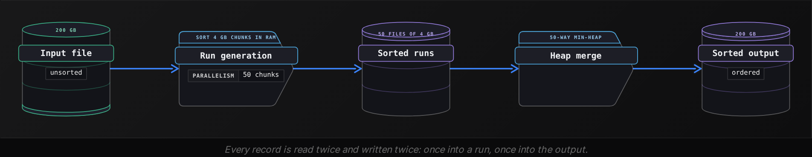
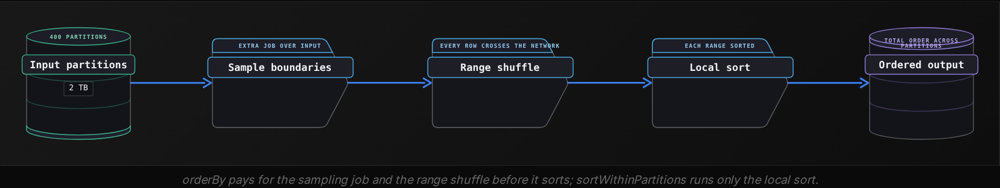
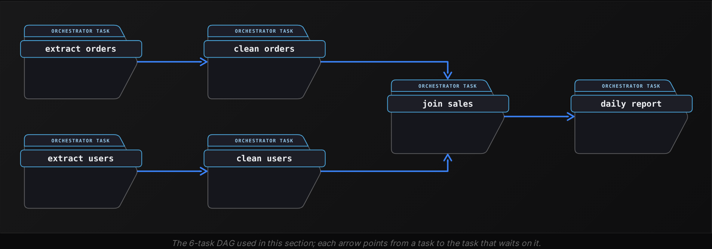

# Custom Sorting: Intermediate

Ines is 40 minutes into a data engineering onsite at Airbnb when the interviewer turns the laptop around. "A nightly job has to order 2 TB of booking events by listing, on workers with 64 GB of memory each. Walk me through it." She knows `sorted()` will not survive the first gigabyte past RAM, so she starts with chunked runs and a heap. The follow-ups keep coming: tie-breaking 2 keys when one of them is a date string, why the job's global sort spends most of its time shuffling, the order in which 40 dependent tasks should run and what happens when 2 of them depend on each other, and how the output files should be laid out so tomorrow's queries read less. Every one of them is a sorting question, and each turns on a cost she has to put a number on.


<br>

### What you will be able to do

Implement external merge sort with a k-way heap merge, and size its fan-in, buffers and merge passes from a memory budget

Write a 2-criteria comparator with functools.cmp_to_key and predict what a broken comparator returns

Choose between orderBy and sortWithinPartitions, and explain when AQE removes a sort from a plan

Implement Kahn's algorithm with cycle detection, parallel waves and a repeatable order

Design a partition, sort key and Z-order layout, and quantify the files it lets a query skip


<br>

---

## External Merge Sort

Interviewers phrase this one many ways: sort a log larger than the machine's memory, merge 300 daily dumps into a single ordered file, deduplicate 5 TB of events on a worker with 32 GB. Each version rules out loading every record into a list and calling `sorted()`, because Timsort needs all of its input resident at once. External merge sort answers every version in 2 phases. Run generation reads a memory-sized chunk, sorts it in RAM and writes it back to disk as a sorted file called a run. The merge then streams all the runs at once through a min-heap and writes a single ordered output.

Put numbers on it. The input is 200 GB of clickstream records keyed by `user_id`, and the worker can spend 4 GB on sort buffers. Run generation produces 50 runs of 4 GB each. The merge opens all 50, keeps a read buffer for each, and holds exactly 1 entry per run in the heap: the smallest record that run has not emitted yet.




<br>

### One heap entry per run

Each heap entry is a tuple of 3 fields: the record's sort key, the index of the run it came from, and its position in that run. Popping the heap yields the smallest record not yet emitted from any run, because every run is sorted and the heap holds each run's front. After emitting it, the merge pushes the next record from the same run. The heap never holds more than k entries, so the merge needs k entries plus k buffers of memory however large the input grows, and each record costs a pop and a push at O(log k), or O(N log k) for the whole merge.

https://github.com/user-attachments/assets/02302d8e-9a67-4d8c-8f6f-dc026194a732

*Lists stand in for run files; the run index settles the tie between the 9s.*

Before playing it, predict which 9 prints first. The entries (9, 0, 1) and (9, 1, 1) tie on the key, so the heap compares the run index and run 0 wins. Runs are cut from the input in order, so that tie-break also makes the merge **stable**: equal keys leave in input order, the guarantee Timsort gives inside a single run.


<br>

### Dropping the run index crashes the merge

A common first draft pushes `(value, iterator)` and pulls each run's next record with `next()`. It works until 2 runs hold the same key. Predict what this program prints:

```sql
import heapq

a = iter([9, 12])
b = iter([9, 15])
heap = []
heapq.heappush(heap, (9, a))
heapq.heappush(heap, (9, b))
print(heap)
```

Nothing prints, because the second push compares `(9, b)` with `(9, a)` to place it, the first fields tie, and Python moves on to the iterators, which define no ordering. The program stops with `TypeError: '<' not supported between instances of 'list_iterator' and 'list_iterator'`. A unique integer in the second slot means no comparison ever reaches the third field, and with comparable payloads it still fixes the order of ties.

> **TIP**
>
> The standard library ships this merge as `heapq.merge(*runs, key=None, reverse=False)`, a lazy generator that adds its own tie-breaking counter. Write the heap version when asked to implement the merge, then name `heapq.merge` as the production choice.


<br>

### Fan-in, buffer size and merge passes

The merge fan-in k, the number of runs merged at once, decides this question. The memory budget M is split across k read buffers and 1 write buffer, so each buffer gets `M / (k + 1)`. A large k finishes in fewer passes but shrinks every buffer, and small buffers turn the merge into many short reads scattered across files. When the run count exceeds the fan-in, the merge runs in passes: a 50-way merge reduces 500 runs to 10, and a 10-way merge then produces the output. The pass count is `ceil(log_k(runs))`, and each pass reads and writes the full data again.

| Input | Runs at 4 GB | Fan-in | Buffer each | Merge passes | Disk traffic |
| --- | --- | --- | --- | --- | --- |
| 200 GB | 50 | 50 | ~80 MB | 1 | 800 GB |
| 2 TB | 500 | 50 | ~80 MB | 2 | 12 TB |
| 2 TB | 500 | 500 | ~8 MB | 1 | 8 TB |

- **27 min** — disk time for 800 GB at 500 MB/s

Row 3's cost hides in seeks: its 8 MB buffers read 2 TB as about 250,000 short reads. At 10 ms per spinning-disk seek that is around 2,500 s, against 8,000 s for row 2's extra 4 TB at 500 MB/s, so row 3 wins, by more on SSD. Seeks overtake traffic once buffers fall below about 2.5 MB, which caps the fan-in on spinning disks at about 1,600.

> Checklist for a complete answer
>
> - Run size, taken from the memory budget, and the run count it implies.
> - The heap entry: key, run index as tie-breaker, position in the run.
> - Fan-in k, the buffer size it leaves, and the number of merge passes.
> - Total disk traffic, so the estimate is a time and not only a complexity class.


<br>

---

## functools.cmp_to_key Comparators

### Where a tuple key stops working

A tuple key covers mixed directions as long as every descending field can be negated: `key=lambda r: (-r.score, r.name)`. The question that breaks it looks routine: sort activity rows newest date first, and within a date by `user_id` ascending, where the date is an ISO string such as `'2024-03-05'`. Strings have no unary minus, so `-r[0]` raises `TypeError: bad operand type for unary -: 'str'`, and the negation trick is gone.

Input rows

| event_date | user_id |
| --- | --- |
| 2024-03-02 | u17 |
| 2024-03-05 | u04 |
| 2024-03-02 | u03 |
| 2024-03-05 | u11 |

Required order

| event_date | user_id |
| --- | --- |
| 2024-03-05 | u04 |
| 2024-03-05 | u11 |
| 2024-03-02 | u03 |
| 2024-03-02 | u17 |

`functools.cmp_to_key` turns a 2-argument comparator into a key. The comparator receives 2 rows and answers a single question: does `a` belong before `b`? It returns a negative number for before, a positive number for after and 0 for a tie. With 2 criteria it decides on the first field when the fields differ, falls through to the second only on a tie, and flips the comparison for whichever field sorts descending.

https://github.com/user-attachments/assets/68bae78a-2fd5-4af4-ad76-545ac6c3ad35

*Dates sort newest first; within a date, ids sort ascending.*

The date check returns -1 when a[0] > b[0], so later dates sort first; the user_id check returns -1 when a[1] < b[1], so smaller ids sort first. Swapping a single < for > reverses that field and nothing else, which is the main reason to reach for a comparator: each criterion's direction sits in a single visible operator.


<br>

### The contract every comparator must keep

Timsort relies on all 4 and checks none

- **Sign carries the answer.** Only negative, zero or positive matters, so -1 and -500 mean the same thing.
- **Antisymmetry.** cmp(a, b) and cmp(b, a) have opposite signs, or are both 0.
- **Transitivity.** If a sorts before b and b before c, then a sorts before c.
- **Consistency.** The same pair gets the same answer on every call: no randomness, clock reads or mutable state inside.

Break the contract and the sort still returns, with some permutation of the input, and the bug surfaces downstream. Predict what this prints:

```sql
from functools import cmp_to_key

print(sorted([3, 1, 2], key=cmp_to_key(lambda a, b: a > b)))
```

It prints `[3, 1, 2]`, the input untouched. `cmp_to_key` wraps each item in an object whose `__lt__` returns `cmp(a, b) < 0`, and sorting asks only `<`. A bool is 0 or 1, never below 0, so no item ever compares as less than another. Timsort reads the list as a single non-descending run and stops there. The fix keeps the sign: `return (a > b) - (a < b)` gives 1, 0 or -1.


<br>

### A comparator runs once per comparison

A key function runs once per element, and Timsort then compares the cached keys in C. A comparator runs once per comparison as a Python call, and sorting n unordered items takes about n log2 n comparisons. The ratio between them grows with log2 n, so the gap widens as the input does.

- **1M** — key function calls, 1M rows
- **~19M** — comparator calls, 1M shuffled rows

That cost is why the answer names the alternatives before writing a comparator. For the date-and-user question, 2 stable sorts do the work in C: sort by `user_id`, then by date with `reverse=True`. Python's `reverse=True` keeps equal elements in their existing order, so the `user_id` order survives inside each date.

```sql
from operator import itemgetter

rows = [
    ("2024-03-02", "u17"),
    ("2024-03-05", "u04"),
    ("2024-03-02", "u03"),
    ("2024-03-05", "u11"),
]
rows.sort(key=itemgetter(1))
rows.sort(key=itemgetter(0), reverse=True)
print(rows)
```


<br>

### Where only a comparator fits

The comparator stays the right tool when the order belongs to a pair of items and no per-item key expresses it. The classic case asks for the largest number formed by concatenating `['3', '30', '34', '5', '9']`. Whether `'3'` goes before `'30'` depends on comparing `'330'` with `'303'`, a property of the pair, so the comparator weighs `a + b` against `b + a`:

```sql
from functools import cmp_to_key

def concat_order(a, b):
    if a + b > b + a:
        return -1
    if a + b < b + a:
        return 1
    return 0

nums = ["3", "30", "34", "5", "9"]
print("".join(sorted(nums, key=cmp_to_key(concat_order))))
```

| ✓ Do | ✗ Don't |
| --- | --- |
| • Return a negative, zero or positive int, never a bool<br><br>• Decide on the first field and fall through only on a tie<br><br>• Try a tuple key or 2 stable sorts before a comparator<br><br>• Use a comparator when the order is a property of the pair | • Return a > b and trust the result<br><br>• Read clocks, random values or mutable state inside it<br><br>• Wrap a rule in cmp_to_key that a key function can express<br><br>• Expect a broken comparator to raise an error |


<br>

---

## orderBy vs sortWithinPartitions

### Two calls, two different guarantees

Distributed DataFrame APIs offer 2 ways to sort, and the question is which one a job needs. `orderBy` produces a total order: every row in partition 0 sorts before every row in partition 1, and so on, so reading the partitions in sequence gives a single ordered dataset. `sortWithinPartitions` sorts each partition where it already sits and moves no rows between partitions, so order holds inside a partition and nowhere else.

```sql
globally_ordered = events.orderBy("event_ts")
locally_ordered = events.sortWithinPartitions("event_ts")
```

Start from 2 partitions holding `event_ts` values 7, 2, 9 in P0 and 4, 1, 8 in P1. The local sort reorders each partition in place. The global sort first moves rows so that P0 owns the low range and P1 the high range, then sorts each.

After sortWithinPartitions

| partition | event_ts |
| --- | --- |
| P0 | 2, 7, 9 |
| P1 | 1, 4, 8 |

After orderBy

| partition | event_ts |
| --- | --- |
| P0 | 1, 2, 4 |
| P1 | 7, 8, 9 |


<br>

### The total order costs a sampling job and a full shuffle

The global sort runs in 3 steps. The engine samples the sort column to choose range boundaries, which is an extra job over the input unless it is cached. It then shuffles every row to the partition that owns its range, so the full dataset crosses the network. Each partition is then sorted locally. On a 2 TB event table, that shuffle moves all 2 TB. A skewed key adds a cost of its own: equal values always land in the same range, so if 30% of rows share a single `event_ts` second, a single partition receives at least 30% of the data and its task sets the stage's runtime.



- **0 bytes** — shuffled by sortWithinPartitions alone


<br>

### When order inside each partition is enough

Most sorts in production pipelines serve a file writer. The goal there is files whose rows are clustered by a column so their min/max statistics are tight, and each file is written from a single partition. Order inside each partition is all that requires, and a consumer that reads the whole result in sequence is the rarer case. The usual shape partitions by the write key and sorts locally by the column readers filter on:

```sql
clustered = (
    events
    .repartition(200, "event_date")
    .sortWithinPartitions("event_date", "user_id")
)
```

The `repartition` still shuffles, by hash, with no sampling job. Hashing on `event_date` alone puts each day in a single task, so the writer's per-file record limit, or a second hash key, sets the files per day. When the input is already date-partitioned, drop the `repartition` and the local sort is the only cost. A query whose `ORDER BY` ends in `LIMIT` is planned as a top-N that keeps 100 rows per worker:

```sql
SELECT
  user_id,
  event_ts
FROM events
ORDER BY event_ts DESC
LIMIT 100
```

A frequent form of this question: a job calls orderBy right before writing files, and its slowest stage is a shuffle. If no consumer reads the files in global sequence, replacing it with sortWithinPartitions after the partitioning the writer needs removes the sampling job and the range shuffle, and every file still has sorted contents.


<br>

### When the engine drops the sort for you

The planner removes a sort in 3 situations, and a question about adaptive query execution (AQE) is asking for the third.

- **Unobservable sort.** A sort that feeds an aggregation such as `SUM`, or sits beneath another sort, cannot change any result, so the optimizer deletes it at plan time.
- **Order already satisfied.** When both join inputs are bucketed and sorted by the join key with matching bucket counts, a sort-merge join reads them without a sort step.
- **AQE switches the join.** After a shuffle stage finishes, the engine re-plans with measured sizes, and a sort-merge join whose small side came in under the broadcast threshold becomes a broadcast hash join, which needs no sort.

Work the third case through with numbers. A query joins 500 GB of orders to promotions filtered on `active`. With no statistics on how selective that filter is, the planner estimates 3 GB for the promotions side and picks a sort-merge join, which sorts both inputs on `promo_id`. At runtime the promotions shuffle stage writes 6 MB. That falls under a 10 MB broadcast threshold, a common default, so AQE replaces the join: the promotions rows go to every worker as a hash table, and the 500 GB sort never runs. The orders shuffle may already have written its files, and the new plan reads them locally instead of fetching them across the network.

```sql
SELECT
  o.order_id,
  o.amount,
  p.discount_pct
FROM orders AS o
JOIN promotions AS p
  ON o.promo_id = p.promo_id
WHERE p.active = TRUE
```

| ✓ Planned: sort-merge join | ✗ After AQE: broadcast hash join |
| --- | --- |
| • Shuffle both sides by promo_id<br><br>• Sort 500 GB of orders<br><br>• Sort the promotions side<br><br>• Merge the 2 sorted streams | • Build a hash table from 6 MB of promotions<br><br>• Send it to every worker<br><br>• Probe it while scanning orders<br><br>• No sort on either side |

> **TIP**
>
> AQE acts only at a stage boundary, on sizes it has measured. A join whose inputs are read and joined inside a single stage, with no shuffle between, gets no runtime re-plan, and the planner's estimate stands.


<br>

---

## Topological Sort for Pipeline DAGs

### The question in its disguises

The question arrives in pipeline language: order these tasks so each runs after its upstreams; given table lineage, decide which tables refresh first after a backfill; find out why this config makes the scheduler hang. All 3 share a structure, a directed graph where an edge from A to B means B needs A, and the answer is an order in which every edge points forward. A comparison sort cannot produce it, because 2 tasks with no path between them have no order relative to each other. Many orders are valid, and the algorithm only has to find one or prove that none exists.




<br>

### Kahn's algorithm

Kahn's algorithm tracks each task's in-degree, the count of upstream tasks that have not finished. Tasks at in-degree 0 are ready and go into a queue. The loop pops a ready task, appends it to the output and decrements every downstream task's count, and a task whose count reaches 0 joins the queue. Each task enters the queue once and each edge is decremented once, so the run costs O(V + E).

https://github.com/user-attachments/assets/04276d04-1715-4216-ac25-ce0a5e5820ec

*In-degrees fall as upstream tasks finish; a task at 0 joins the queue.*

Predict the output before playing it. Both extract tasks start at in-degree 0. join_sales starts at 2 and joins the queue only after clean_users, its second upstream, finishes. The printed order is extract_orders, extract_users, clean_orders, clean_users, join_sales, daily_report.


<br>

### Cycle detection comes from a single count

Tasks on a cycle never reach in-degree 0, because each waits on another member of the same loop. The queue drains early and the output comes up shorter than the task list, and that length check is the entire test. Add an edge so `daily_report` feeds `clean_orders`, and predict what the same function does:

```sql
graph["daily_report"] = ["clean_orders"]
print(kahn(graph))
```

Only 3 tasks finish: both extracts, then `clean_users`. `clean_orders` now has 2 upstreams and loses only 1, `join_sales` stays at 1 because `clean_orders` never ran, and the queue is empty. The function raises `ValueError: cycle among ['clean_orders', 'daily_report', 'join_sales']` and never reaches `print`.

The stuck list holds the cycle plus everything downstream of it: a `publish_dashboard` task fed by `daily_report` would be stuck too while sitting outside the loop. To name the cycle exactly, start at any stuck task and keep stepping to a stuck upstream task. Every stuck task has one, since otherwise its count would have reached 0. The first task you revisit closes the loop, and the tasks between the 2 visits are the cycle.


<br>

### Follow-ups: parallel waves and a repeatable order

Schedulers also need to know which tasks can run at the same time. Process the queue a level at a time: every task ready at the start of a level forms a wave, the wave runs concurrently, and its completions fill the next wave. The wave count equals the number of tasks on the longest dependency chain, and it bounds the pipeline's wall-clock time however many workers it gets.

| Wave | Tasks that run together | Unblocked by |
| --- | --- | --- |
| 1 | extract_orders, extract_users | nothing |
| 2 | clean_orders, clean_users | wave 1 |
| 3 | join_sales | both clean tasks |
| 4 | daily_report | join_sales |

The other follow-up is determinism. With a deque, ties among ready tasks resolve by the order the graph was built, so 2 builds of the same DAG can log different orders. Replacing the deque with a heap of task names always releases the alphabetically smallest ready task, at O(V log V + E): each task enters the heap once, and each edge is still a constant-time decrement.

> **TIP**
>
> Python 3.9 added `graphlib.TopologicalSorter`. Its `prepare()`, `get_ready()` and `done()` methods hand out ready tasks wave by wave, and `prepare()` raises `graphlib.CycleError` on a cycle. Implement Kahn's when asked, then name it as the production choice.

> Kahn's versus depth-first search
>
> A depth-first search with 3 colors also detects cycles and yields a valid order as reverse postorder, reporting the cycle at the back edge it hits. Kahn's is the usual interview choice for 2 reasons: it is iterative, so a 10,000-task chain cannot hit Python's default recursion limit of 1,000, and its queue matches how a scheduler releases work.


<br>

---

## Sorting for Storage Optimization

### File statistics turn a sort into skipped reads

Columnar files record the minimum and maximum of every column, per file and per row group inside it. A reader evaluating `WHERE user_id = 'u_48213'` compares the literal against each range and opens only files whose range could contain it. On unsorted data every file's range spans nearly the whole id space, so the statistics rule out nothing. Sorting by `user_id` before writing gives each file a narrow, non-overlapping slice, and most files drop out before a byte of their data is read. Take a day of transactions written as 200 files of 1 GB each.

| Layout of a 200-file day | Files read: user_id = X | Files read: merchant_id = Y |
| --- | --- | --- |
| Unsorted | 200 | 200 |
| Sorted by user_id | 1 | 200 |
| Sorted by merchant_id | 200 | 1 |
| Z-order on (user_id, merchant_id) | about 14 | about 14 |

A linear sort serves its leading column and does almost nothing for the next, because each value of the second column repeats across every slice of the first. When queries filter on either of 2 columns, Z-order interleaves them: it takes the bits of both values, alternates them into a single number and sorts by that number. For `x = 1` and `y = 2`, the bits `01` and `10` interleave as y1 x1 y0 x0 into `1001`, a z-value of 9. Points close in both columns get close z-values, so each file covers a small box of values instead of a full-height strip. In the run below, x and y stand for `user_id` and `merchant_id` on a 4-by-4 grid: 16 rows written as 4 files of 4.

https://github.com/user-attachments/assets/da7713ad-5c15-4b01-8666-7486044ffa4c

*Sixteen rows in 4 files, sorted linearly and then by z-value.*

Sorted linearly, the 4 files are vertical strips: `x == 1` touches 1 file and `y == 1` touches all 4. Z-ordered, the files are 2-by-2 boxes and each filter touches 2. Z-order gives up the best case on the leading column to keep the second column from reading every file.

| Columns in the Z-order | Files read by a 1-column filter, of 100 |
| --- | --- |
| 1 (linear sort) | 1 |
| 2 | about 10 |
| 3 | about 22 |
| 4 | about 32 |

*Idealized model: with values spread evenly, d columns in the Z-order and N files, a filter on 1 column reads about N^(1-1/d) files. Skewed data departs from these figures.*

The table is the case against Z-ordering every column someone might filter on: each added column weakens pruning for all of them, and by 4 columns a single-column filter reads about a third of the files.


<br>

### Partition, sort, file size, row group

From coarsest to finest

- **Partitioning** *event_date*\
  Low-cardinality column filtered by almost every query. Pruning happens on directory names before any file opens.
- **Sort key or Z-order** *user_id, merchant_id*\
  1 to 3 high-cardinality filter columns inside each partition, so file min/max ranges stay narrow.
- **File size** *hundreds of MB to about 1 GB*\
  Large enough that metadata stays small, small enough that each range covers a thin slice of values.
- **Row-group statistics** *inside each file*\
  The same min/max check repeated per row group, skipping parts of the files that survive.

```sql
SELECT
  user_id,
  merchant_id,
  amount
FROM transactions
WHERE event_date = DATE '2024-03-05'
  AND user_id = 'u_48213'
```

This query exercises every layer. The date predicate prunes to 1 partition by directory name. Inside it, the 200 files of 1 GB each have narrow `user_id` ranges, so 1 file survives, and within that file row-group statistics skip most rows. Without the sort key the same query reads the whole day.

- **200x** — less data read for a single user's day


<br>

### Sorting at write time, compacting after appends

The sort is paid at write time: each partition is fully sorted before its files are written, and a Z-order adds bit interleaving on top. Appends then erode it. New files are written in arrival order with wide ranges, and pruning degrades until a compaction job rewrites the partition in sorted order, a recurring cost to schedule. Sorting pays a second dividend in compression: a sorted `country` column with 50 distinct values across 1 million rows becomes 50 runs, which run-length and dictionary encoding store in a small fraction of the space that 1 million values changing on most rows need.

| ✓ Do | ✗ Don't |
| --- | --- |
| • Partition on a low-cardinality column that nearly every query filters<br><br>• Sort by the high-cardinality column used in equality or range filters<br><br>• Z-order only columns that queries filter on independently<br><br>• Schedule compaction to restore sorted order after appends | • Partition on a high-cardinality id and create many tiny files<br><br>• Sort by a column that no query filters on<br><br>• Z-order 5 columns and expect each to prune well<br><br>• Assume a one-time sort survives months of appends |

> The interview answer, in order
>
> - Name the filter columns and their cardinality before picking a layout.
> - Partition on the coarse column; sort or Z-order on 1 to 3 fine ones.
> - Quantify pruning as files read before and after the change.
> - State the write cost and the compaction schedule that keeps statistics tight.


<br>

---

## Putting It All Together

A payments company rebuilds its transaction history table every night. 2 TB of new and corrected transactions land from 3 regional systems, a 12-task pipeline cleans them and joins them with merchant and user dimensions, and analysts query the result by user and by merchant all day.

- The pipeline's task order comes from Kahn's algorithm, and a new task that reads its own output is caught as a cycle before the run starts.
- Merging the 3 regional feeds, each already sorted by transaction time, is a 3-way heap merge with the region index as the tie-breaker.
- Ordering corrections newest date first and by transaction id within a date takes 2 stable sorts or a cmp_to_key comparator.
- The join to the small merchant table is where AQE can switch a sort-merge join to a broadcast and skip the sort.
- Writing each date partition sorted by a z-value of user and merchant gives every file tight statistics, so both query shapes prune.


<br>

---

## Key Takeaways

- External merge sort runs in 2 phases. The fan-in k sets the buffer size and the pass count, and total disk traffic is the number to state.
- Put a unique run index in every heap entry, or tied keys make Python compare the payloads.
- A comparator must return a signed int and stay antisymmetric and transitive; a bool leaves the data unsorted without an error.
- orderBy buys a total order with a sampling job and a full shuffle; sortWithinPartitions sorts each partition in place.
- AQE drops a sort when measured sizes let it turn a sort-merge join into a broadcast hash join.
- Kahn's algorithm detects a cycle when its output is shorter than the task list.
- Sorted files make min/max statistics prune; Z-order balances 2 or 3 filter columns at the cost of the leading one.
