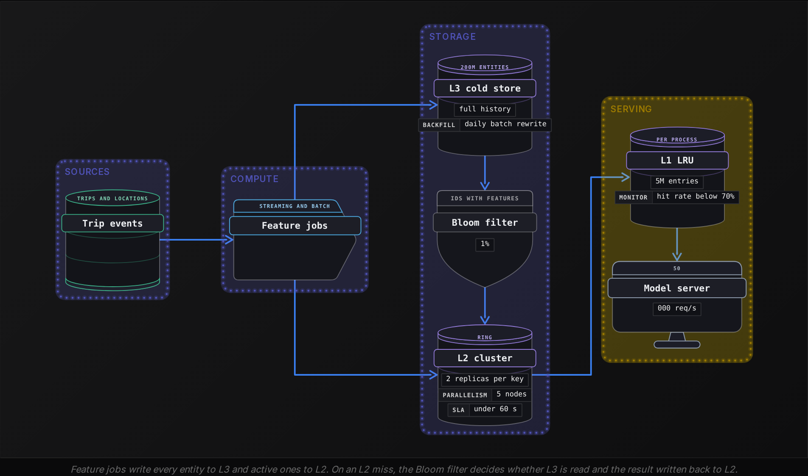

# Dict Manipulation: Advanced

Dunya is in the final system design round for a data engineering role at Uber, which has written publicly about Michelangelo, its machine learning platform, and the feature store inside it. The interviewer opens small: a Python service keeps 10 million rider IDs mapped to risk scores in a dict, so how much RAM does that take, and why does an insert sometimes stall? Her first answer is a guess, and the follow-ups keep widening. Shard the scores across cache nodes without reshuffling them whenever a node joins. Skip lookups for riders who have no features yet. Fit 100 million entries on a single worker. The last prompt joins them: serve features for 50,000 matching requests per second. Every answer needs a number she can derive on the whiteboard, and deriving those numbers is what this lesson trains.


<br>

### What you will be able to do

Estimate a CPython dict's memory by adding per-object costs to the table size, which follows from the slot count and the index width, and explain amortized O(1) inserts alongside the O(n) rebuild.

Implement a consistent hash ring with virtual nodes and show why a joining node moves about K/n keys.

Size a Bloom filter's bit array and hash count for a target false-positive rate, and say when an exact set is the better tool.

Choose among a dict, sorted parallel arrays, an in-memory SQL table and a Bloom filter by entry count and memory budget.

Design an L1/L2/L3 feature store and derive its node count from memory and throughput.


<br>

---

## Hash Table Internals

In interviews this pattern arrives as a sizing problem: a service holds 10 million user IDs as dict keys with float scores as values, so how much memory does it use, and why does an occasional insert take far longer than the rest? The answer comes from what CPython 3.9 allocates per entry, when it rebuilds the table, and what happens when many keys share a hash.


<br>

### Two arrays behind every dict

Since 3.6 a CPython dict is 2 arrays. The **index array** has a slot per bucket, a power of two in count, and each slot stores a small integer: 1 byte wide up to 128 slots, 2 bytes up to 32,768 slots, 4 bytes beyond. The **entries array** holds the data in insertion order, 24 bytes per entry on a 64-bit build: the cached hash, a pointer to the key and a pointer to the value. Only two thirds of the slots can be filled, usable = 2 \* slots // 3, which keeps probe chains short. Keys and values are separate objects the table points to, and sys.getsizeof counts none of them. The table below prices each size from those rules; the last row is where 10 million keys end up.

| Slots | Usable entries | Index bytes per slot | getsizeof on 64-bit 3.9 |
| --- | --- | --- | --- |
| 8 | 5 | 1 | 232 bytes |
| 16 | 10 | 1 | 360 bytes |
| 32 | 21 | 1 | 640 bytes |
| 64 | 42 | 1 | 1,176 bytes |
| 16,777,216 | 11,184,810 | 4 | about 335.5 MB |

A rebuild happens when the usable entries run out. CPython 3.9 sizes the new table from 3 times the live count, rounded up to a power of two, which doubles it. Before playing the run, predict on which inserts the table is rebuilt as 22 keys go in, and how many entries those rebuilds copy in total.

https://github.com/user-attachments/assets/71f66844-4745-4f1a-820c-b534c2cb02e4

*Every rebuild copies the live entries into a table twice the size.*

After the first allocation, the first rebuild lands on insert 6 and copies 5 entries; the next copies 10 at insert 11, then 21 at insert 22, for 36 copies across 22 inserts. Each rebuild doubles the slots, so the copies form a geometric series whose total stays under 2 per insert at any size, and that bound is what amortized O(1) means here. The average is constant; the insert that triggers a rebuild is O(n). A dict holding 10 million keys last rebuilt at insert 5,592,406, copying 5,592,405 entries inside one call, which surfaces as a tail-latency spike when the dict is filled on the request path. Loading it at startup, before traffic arrives, takes that cost off the requests.

> **TIP**
>
> In CPython 3.9, `del` never shrinks a dict: deleted entries stay behind as dummies and the table keeps its peak size until an insert forces a rebuild. After evicting most keys from a long-lived cache, copy the survivors into a fresh dict with a comprehension to release the memory.


<br>

### Collisions: when keys share a hash, every operation is O(n)

A key's hash picks its starting slot; when that slot is taken, the dict probes other slots until it finds the key or an empty slot. CPython's probe order mixes in the hash's high bits through a value called `perturb`, so keys that share a starting slot still scatter. Keys with identical full hashes follow the same probe sequence, so each insert or lookup has to walk past every one of them. The run below uses linear probing on an 8-slot toy table so every probe is visible. Predict the probe counts under the constant hash before playing it.

https://github.com/user-attachments/assets/ef17be43-e3ca-4cc3-b0c5-ffd0a05f2d38

*Same 5 keys, same 8 slots, 2 hash functions.*

The spread hash never probes: 12 lands in slot 4, 5 in slot 5, 30 in slot 6, 17 in slot 1 and 8 in slot 0. The constant hash sends all 5 keys to slot 0, so the k-th insert probes past k - 1 occupied slots, 0 + 1 + 2 + 3 + 4 = 10 in total. For n colliding keys that sum is n(n-1)/2: building a dict from 100,000 of them costs about 5 billion comparisons, against roughly 100,000 slot checks with a good hash. SipHash with a per-process random key shields str and bytes keys from deliberate collisions too. The int hash gets no random key, and neither do the float and tuple hashes: `hash(n)` is n mod `2**61 - 1`, so attacker-chosen multiples of that number all collide at 0, as do keys under a custom `__hash__` with few distinct outputs.


> The parts of a complete sizing answer
>
> - Table cost: 24 bytes per entry plus index bytes, with at most two thirds of the slots in use.
> - Object cost on top: 28 bytes for an int below 2\*\*30, 24 for a float, 49 plus length for an ASCII str.
> - Amortized O(1) inserts from doubling, and the O(n) rebuild each power-of-two boundary costs.
> - O(n) per operation once keys share a hash, and which hash function rules that out.


<br>

---

## Consistent Hashing

This question comes dressed as a cache or a shard map: user sessions live on 3 cache nodes chosen by `h(key) % 3`, and when traffic grows a fourth node joins. What fraction of sessions are now looked up on the wrong node? The answer decides whether scaling out is a routine change or an incident, and it is the reason sharded caches and partitioned key-value stores place keys on a ring.


<br>

### What mod N does when N changes

A key stays on its node only when h % N equals h % (N + 1). With uniformly spread hashes that holds for 1 key in N + 1, so growing from 3 nodes to 4 moves 3 of every 4 keys, and growing from 10 nodes to 11 moves 10 of every 11. Each moved key is a cache miss that falls through to the database behind the cache, so the larger the cluster, the bigger the stampede that adding a node causes.


<br>

### The ring: a key belongs to the next point clockwise

Hash nodes and keys onto the same circle of positions. A key belongs to the first node position at or after its own, wrapping from the top back to the start, which bisect_left finds on a sorted list in O(log P) for P positions. Each physical node holds several positions, its **virtual nodes**. A joining node claims only the arcs that end at its new positions, so the keys that move are the ones inside those arcs, and all of them move to the newcomer. The run places every position by hand on a ring of 100, so each owner can be checked on paper. Predict which keys D takes.

https://github.com/user-attachments/assets/01253dd4-7b6c-4908-bdd8-6f9ca7470b73

*Ring of 100 positions, 2 virtual nodes per server, then D joins.*

Before D joins, A owns 5 keys and B owns 4, leaving 3 for C. D's positions 45 and 86 split the arcs ending at A's 52 and C's 90, taking key 41 from A and keys 77 and 84 from C. That is 3 moved keys out of 12, exactly K/n for K = 12 keys and n = 4 nodes, and no key moved between the old nodes. The mod-N line moves 9 of 12, the 3 in 4 the formula predicts. The load line shows the price of too few virtual nodes: C keeps 1 key while A and B keep 4 each, because 2 positions per node leave arc lengths to chance.


<br>

### A production ring

Real rings derive positions by hashing the string `node#i` for each virtual node i, and hash each key the same way. The hash has to be stable across processes: Python's built-in `hash()` is randomized per process for strings, so 2 servers would disagree about every owner. The first 8 bytes of an MD5 digest are stable and evenly spread, and MD5's cryptographic weakness does not matter for placement. `get` walks clockwise collecting distinct physical nodes, which is how replicas are placed.

```sql
import bisect
import hashlib


def ring_hash(text):
    digest = hashlib.md5(text.encode()).digest()
    return int.from_bytes(digest[:8], "big")


class HashRing:
    def __init__(self, vnodes=150):
        self.vnodes = vnodes
        self.points = []
        self.owner = {}

    def add(self, node):
        for i in range(self.vnodes):
            point = ring_hash(f"{node}#{i}")
            bisect.insort(self.points, point)
            self.owner[point] = node

    def remove(self, node):
        for i in range(self.vnodes):
            point = ring_hash(f"{node}#{i}")
            self.points.pop(bisect.bisect_left(self.points, point))
            del self.owner[point]

    def get(self, key, replicas=1):
        start = bisect.bisect_left(self.points, ring_hash(key))
        chosen = []
        for step in range(len(self.points)):
            point = self.points[(start + step) % len(self.points)]
            if self.owner[point] not in chosen:
                chosen.append(self.owner[point])
                if len(chosen) == replicas:
                    break
        return chosen
```

Removal mirrors a join: the departed node's arcs fall to the next positions clockwise, and because its 150 positions are scattered, its keys spread over many survivors instead of doubling one neighbour's load. Capacity becomes a virtual-node count, so a node with twice the memory gets 300 positions.

| Virtual nodes per node | Ring points, 12 nodes | bisect comparisons | Spread of a node's share |
| --- | --- | --- | --- |
| 1 | 12 | 4 | about 100% |
| 10 | 120 | 7 | about 32% |
| 100 | 1,200 | 11 | about 10% |
| 200 | 2,400 | 12 | about 7% |

A node's share of the ring is the sum of its v arc lengths, and the relative standard deviation of that sum falls roughly as 1 / sqrt(v). That is why rings commonly run 100 to 200 virtual nodes: the sorted list stays small enough to search in about 12 comparisons, and node loads typically sit within about 10% of the mean.

| ✓ hash mod N | ✗ Ring with virtual nodes |
| --- | --- |
| • Placement is one modulo, O(1)<br><br>• Adding a node moves N/(N+1) of all keys<br><br>• Moved keys scatter across every node<br><br>• Uneven capacity needs a custom mapping | • Placement is a binary search over n x v points<br><br>• Adding the n-th node moves about K/n keys<br><br>• Every moved key goes to the new node<br><br>• Capacity is a virtual-node count |

> Follow-ups to expect
>
> - Removal: the departed node's keys move to the next positions clockwise, spread out by its virtual nodes.
> - Replication: walk clockwise and skip positions owned by a physical node already chosen.
> - Hot keys: a ring balances key counts, while traffic can still pile onto the node owning one popular key.
> - Stable hashing: every client must hash identically, so the hash function is part of the protocol.


<br>

---

## Bloom Filters for Membership Tests

The membership question hides inside dedup and lookup-avoidance prompts: drop duplicate event IDs from 500 million a day with 1 GB of RAM, or stop querying a slow store for users it has never seen. An exact set of 500 million IDs needs about 27 GB, and a store with no filter in front pays a round trip on every miss. A Bloom filter answers 'seen this key?' with 'certainly not' or 'probably', in 16 bits per key for the first prompt and about 10 for a 1% error rate.


<br>

### The mechanism on a 20-bit array

A filter is an array of m bits and k hash functions. Adding a key sets the k bits its hashes point at. A query reads the same k bits: a single zero proves the key was never added, and all ones means each bit was set by some key, possibly this one. The toy below uses m = 20 and k = 3 multiplicative hashes, `x * p % 20` for p in (3, 7, 11), so every position can be recomputed by hand. Work out where key 1 lands before playing it.

https://github.com/user-attachments/assets/e212b1b2-2f2c-429d-a456-025c7a15e6e7

*m = 20 bits, k = 3 hashes, 3 keys added.*

Adding key 4 and then keys 9 and 13 produces 9 positions that overlap at bits 3 and 19, so 7 of the 20 bits end up set. Query 9 finds all its bits set and is a real member, while query 2 hits a zero at bit 6 and is rejected with certainty. Query 1 is the false positive: its bits run from 3 to 11 in steps of 4, and keys 9 and 13 set all of them between them, so the filter answers maybe for a key never added. Adding keys only ever turns bits on, so the error runs in one direction: a filter never misses a key that was added.


<br>

### Sizing m and k

For n keys and a target false-positive rate p, the best sizes are `m = -n * ln(p) / ln(2)**2` bits and `k = (m / n) * ln(2)` hashes. At that optimum about half the bits are set and the false-positive rate is close to (1/2)^k. Each tenfold cut in p costs about 4.8 more bits per key, and the key's own size never enters the formula: a 40-byte string ID costs the same 9.6 bits as an integer.

| Target p | Bits per key | Hash count k | Size for 10M keys |
| --- | --- | --- | --- |
| 1% | 9.6 | 7 | 12.0 MB |
| 0.1% | 14.4 | 10 | 18.0 MB |
| 0.01% | 19.2 | 13 | 24.0 MB |
| Exact set of ints | about 440 | none | about 550 MB |

```sql
import hashlib
import math


class BloomFilter:
    def __init__(self, n, p):
        self.m = math.ceil(-n * math.log(p) / math.log(2) ** 2)
        self.k = max(1, round(self.m / n * math.log(2)))
        self.bits = bytearray((self.m + 7) // 8)

    def _positions(self, key):
        digest = hashlib.blake2b(key.encode(), digest_size=16).digest()
        h1 = int.from_bytes(digest[:8], "little")
        h2 = int.from_bytes(digest[8:], "little") | 1
        return [(h1 + i * h2) % self.m for i in range(self.k)]

    def add(self, key):
        for pos in self._positions(key):
            self.bits[pos >> 3] |= 1 << (pos & 7)

    def __contains__(self, key):
        return all(
            self.bits[pos >> 3] >> (pos & 7) & 1
            for pos in self._positions(key)
        )
```

Two hashes stand in for k: position i is `(h1 + i * h2) % m`. Kirsch and Mitzenmacher showed in 2006 that this keeps the asymptotic false-positive rate of k independent hashes, and `| 1` keeps h2 nonzero so the positions differ. Accuracy is fixed by n at construction. Insert twice the planned keys into a filter built for 1% and the rate climbs to about 16% with no error raised, so production code counts inserts and rebuilds or adds a second filter once the count passes n.

| ✓ Do | ✗ Don't |
| --- | --- |
| • Put a filter in front of a slow store when most lookups are for absent keys<br><br>• Size from the expected count plus growth, and alert when inserts pass n<br><br>• Treat 'maybe' as a cue to check the exact source when a false positive is costly<br><br>• Rebuild from the source of truth on a schedule to retire deleted keys | • Clear bits to delete a key: another key may share them, creating false negatives<br><br>• Use a filter when the caller needs the stored value<br><br>• Derive positions from built-in hash(): it changes between processes for strings<br><br>• Choose a filter over an exact set that already fits the memory budget |

> **TIP**
>
> When a false positive silently drops data, as in stream dedup, pair the filter with an exact check: a 'maybe' triggers a keyed read from durable storage, and the filter saves the reads for keys it rules out.


<br>

---

## Memory-Efficient Dict Alternatives

Here the prompt fixes a budget: score lookups for 100 million user IDs on a worker with 16 GB of RAM, or a lookup table that must fit on every executor of a broadcast join. The method is to price each structure in bytes per entry, then match it to what the caller reads back. Some callers want the value; others need ranges or several columns, and some need only membership.


<br>

### Pricing a dict entry

An int-to-float dict pays 3 costs per entry. Its share of the table runs from roughly 30 to 60 bytes in a large dict, depending on where the count sits between doublings. The key is a 28-byte `int` and the value a 24-byte `float`. String keys cost more: `'user:12345678'` is 62 bytes. A dict of dicts costs most, since every inner dict carries its own table of 232 bytes for up to 5 fields, and its keys and values come on top of that. The planner below prices a dict, sorted parallel arrays holding an 8-byte key and a 4-byte value, and a 1% Bloom filter. Estimate the dict figure for 10 million keys from the 335.5 MB table size before running it.

https://github.com/user-attachments/assets/02568315-ff3f-4cc5-b0c1-ca4b2c49c41d

*Planning figures for int keys and float values on 64-bit CPython 3.9.*

At 10 million keys the dict costs 855.5 MB: 335.5 MB of table and 520 MB of int and float objects. Sorted arrays hold the same pairs in 120.0 MB, and the filter answers membership in 12.0 MB. At 100 million the dict passes 10.5 GB, about two thirds of the 16 GB worker before the process does anything else, while the arrays take 1.2 GB.

- **7.1x** — dict memory vs sorted arrays at 10M
- **71x** — dict memory vs a 1% Bloom filter


<br>

### Sorted parallel arrays

```sql
import numpy as np

user_ids = [907, 12, 455, 3001, 78]
scores = [0.91, 0.12, 0.55, 0.30, 0.77]

order = np.argsort(user_ids)
keys = np.asarray(user_ids, dtype=np.int64)[order]
values = np.asarray(scores, dtype=np.float32)[order]


def lookup(batch):
    query = np.asarray(batch, dtype=np.int64)
    idx = np.minimum(np.searchsorted(keys, query), len(keys) - 1)
    hit = keys[idx] == query
    return np.where(hit, values[idx], np.nan)


found = lookup([455, 8, 3001])
```

Sorting the keys once lets binary search replace hashing: `searchsorted` finds where each query would sit, and comparing the key there confirms a hit. A lookup is O(log n), about 27 comparisons at 100 million keys, and NumPy runs a whole batch of them in one call with the loop outside the interpreter. The layout sets the costs: adding a key means rebuilding both arrays, so the structure suits tables loaded in batch and replaced whole, and `float32` keeps about 7 significant digits.


<br>

### An in-memory SQL table

The stdlib `sqlite3` module opens a database at `':memory:'`. A table with an integer primary key stores its rows in a B-tree, so it answers range scans, multi-column rows and secondary-index lookups, and the same code can point at a file once the data outgrows RAM. As a planning figure, an int-to-float row costs about 25 to 30 bytes with page overhead, 2 to 3 times the arrays; confirm it on real rows. Every point lookup passes through the SQL layer, which makes it one or more orders of magnitude slower than a dict lookup. Pick it when the caller needs queries rather than single-key gets.

| Structure | Bytes per entry, int to float | Lookup | Gives back | Breaks down when |
| --- | --- | --- | --- | --- |
| dict | about 86 at 10M | O(1) average | the value | the count times 86 bytes exceeds the budget |
| Sorted parallel arrays | 12 | O(log n), batchable | the value | keys change between full reloads |
| In-memory SQL table | about 25 to 30 | O(log n) plus SQL overhead | rows, ranges, joins | the hot path needs sub-microsecond gets |
| Bloom filter | 1.2 at 1% | k bit reads | no, or maybe | the caller needs values or zero false positives |

> Choosing by count and budget
>
> - A few million entries, well inside the budget: a dict, which is fast and can be updated in place.
> - Read-mostly and over budget as a dict: sorted typed arrays, refreshed by full reload.
> - Data that outgrows RAM, or callers that need ranges or several columns: an in-memory SQL table that can move to a file.
> - Membership only, at any size: a Bloom filter, with an exact store behind it when false positives cost.

> **TIP**
>
> Before changing structure, change representation: integer IDs instead of 'user:' strings, tuples instead of inner dicts, and `sys.intern` for repeated strings each cut bytes per entry without touching lookup code.


<br>

---

## Distributed Feature Store Design

The design form of this pattern: a ride-matching model scores 50,000 requests per second, each needing features for 1 rider and 10 nearby drivers, with 10 ms at p99 for the whole feature fetch. No single structure from the earlier sections meets that. The design stacks them: an LRU inside each serving process, a sharded in-memory key-value cluster placed with a consistent hash ring, and a cold store holding every entity, guarded by a Bloom filter.




<br>

### What each tier is for

- **L1: in-process LRU** *nanoseconds, per server*\
  An OrderedDict LRU with a 30 s TTL absorbs repeated driver lookups. A 2 GB budget at a planning figure of 400 bytes per entry holds 5 million entries; confirm the figure with tracemalloc.
- **L2: sharded in-memory cluster** *sub-millisecond, shared*\
  Features for the 40 million entities active in the last 30 days, placed on a ring with 150 virtual nodes per shard and 2 replicas per key, read with 1 batched call per shard touched.
- **L3: cold store** *milliseconds, complete*\
  All 200 million entities with history, rewritten by daily batch jobs. Read only after an L2 miss that the Bloom filter does not rule out.
- **Bloom filter over L3 IDs** *about 240 MB at 1%*\
  Covers the 200 million IDs with features. A new rider's lookup returns default feature values at once instead of a cold read.


<br>

### The capacity math, as a program

Interviewers expect the sizes derived on the board, with the assumptions stated. The planner writes them as constants: 70% of lookups hit L1, an L2 entry takes 256 bytes once key and store overhead are counted, each L2 node can use 9.6 GB (60% of 16 GB) and serve 50,000 operations per second, and every key has 2 replicas. Predict whether memory or throughput sets the node count.

https://github.com/user-attachments/assets/463dae14-237e-49b8-9d59-b051353f57fc

*Assumptions as constants: change one and rerun.*

Throughput wins. The 550,000 lookups per second leave 165,000 for L2, which needs 4 nodes, while 20.48 GB of replicated data fits on 3. Provisioning 5 keeps the cluster inside budget with a node down. The last line is the ring's payoff: adding a sixth node re-homes 1 key in 6, so about 27,500 lookups per second miss L2 and fall to L3 until the new node warms. Placing keys by `id % nodes` would re-home 5 in 6 and push about 137,500 per second at a cold store sized for steady-state misses.


<br>

### Judgement the design is graded on

> Tradeoffs to name before being asked
>
> - Hot keys: a busy airport zone is one key on one shard; L1 absorbs it, or its reads spread over replicas.
> - Fan-out: 11 entities can touch all 5 shards, so a request waits on its slowest shard; batch per shard.
> - Freshness: L1's 30 s TTL bounds staleness, and features that must be fresher bypass L1.
> - Train-serve skew: online and offline values must come from a single feature definition.
> - Scope: if the active set fits in every server's RAM, ship a snapshot to each server and drop L2.

| ✓ Three tiers pay off when | ✗ Fewer tiers win when |
| --- | --- |
| • The active set outgrows one server's RAM<br><br>• Lookup volume exceeds what the cold store serves<br><br>• A small hot subset repeats within seconds | • The active set fits in RAM: load a snapshot per server<br><br>• Traffic is low: read the cold store behind a filter<br><br>• Features change every second: read L2 and skip L1 |

> **TIP**
>
> State assumptions as numbers you can change. A 70% L1 hit rate invites 'and at 40%?', which the planner answers by editing one constant: L2 then needs 330,000 operations per second and 7 nodes before headroom.


<br>

---

## Putting It All Together

A fraud team at a payments company scores every card authorization in under 20 ms, using features for the card, the merchant and the device. Cards number in the hundreds of millions, merchants in the millions, and a large share of authorizations come from cards seen within the last hour.

- Merchant features, a few million rows, are priced in bytes per entry and loaded into every scoring process as sorted arrays, reloaded whole each hour.
- Card features live in a sharded in-memory cluster on a ring with virtual nodes, so adding shards for the holiday peak re-homes about 1 key in n.
- Recently seen cards stay in each process's LRU, which absorbs the burst of repeat authorizations from one card during a checkout.
- A Bloom filter over cards with history lets a never-seen card go straight to default features, skipping the cold store.
- The capacity planner sets shard count from the larger of memory and throughput, then adds a node of headroom for failures.
- Card IDs are hashed with a stable digest everywhere, since hash() on strings differs per process and would scatter routing.


<br>

---

## Key Takeaways

- A CPython 3.9 dict entry costs 24 bytes plus index bytes in a table kept at most two thirds full; the key and value objects cost extra on top.
- Doubling makes inserts amortized O(1) with under 2 copies each, while the insert that crosses a power-of-two boundary copies every entry at once.
- Keys that share a hash turn a dict into a list: n of them cost n(n-1)/2 comparisons to build.
- A ring with virtual nodes moves about K/n keys when a node joins, all of them to the newcomer; mod N moves N/(N+1).
- A Bloom filter at 1% costs 9.6 bits per key and 7 hashes, never misses an added key, and degrades past its planned n.
- Price structures in bytes per entry: about 86 for an int-to-float dict at 10M, 12 for sorted typed arrays, 1.2 for a 1% filter.
- A feature store stacks those tools, and its node count comes from whichever of memory and throughput demands more nodes.
