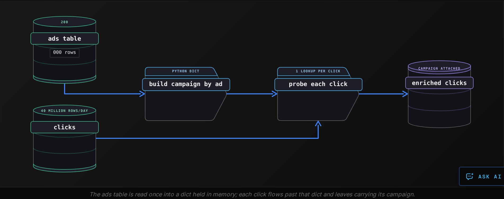

# Dict Manipulation: Beginner

A candidate opens the Python round of their data engineering loop at Meta. The interviewer pastes 2 lists into the shared editor: 6 ad clicks and 3 ads with their campaign names. Each click is a dict keyed by `click_id` and `ad_id`, plus `country`. "Give me clicks per campaign per country, and count a click only once if the logger sent it twice." The candidate writes a nested loop that scans the ads list for every click, and it returns the right answer on 6 rows. Then the follow-up: "Production sees 40 million clicks a day across 200,000 ads. What does your loop cost, and what would you change?" The prompt hides a lookup of each click's ad and a grouping by campaign and country, with a dedupe on top, and each wants a dict with a different key. Answering well means spotting all 3 shapes, picking the right dict for each, and pricing the difference out loud.


<br>

### What you will be able to do

Name the shape behind a prompt (lookup, count, group, dedupe, complement), then the key and value it needs

Explain why finding or adding a key takes constant time on average, and what the word amortized accounts for

Decide what a missing key means in the problem, and use that to choose a plain dict or one of its 2 subclasses, defaultdict and Counter

Write a dimension lookup and a multi-key aggregation in Python and match each to its SQL join or GROUP BY

Deduplicate keeping the first or the latest record. Reshape dicts with comprehensions, and merge them with the | operator

Predict when a dict program raises KeyError or TypeError, and when changing its size mid-loop raises RuntimeError. Solve pair-sum problems in O(n)


<br>

---

## Recognizing a Dict Problem

Interview prompts rarely say "use a dict." They describe a business task, and the dict hides in a verb: attach, count, total, skip, match. Most dict questions in a Python round fit 5 problem shapes. Each has a phrasing you can learn to hear, and each is solved by deciding what goes in the key and what goes in the value.

| Shape | What the prompt says | Key | Value |
| --- | --- | --- | --- |
| Lookup | "attach the campaign name", "map each sku to its category" | the id both tables share | the attribute you attach |
| Count | "how many times", "most frequent", "top 3" | the item being counted | an int |
| Group | "per user", "for each country", "total by day" | the group column, or a tuple of several | a running total, or a list of rows |
| Dedupe | "skip repeats", "first time we see", "latest version" | the record id | presence, or the newest record |
| Complement | "2 that sum to", "has a matching pair" | a value already seen | its position, or how often it appeared |

The last 2 columns are the answer. Once you can say "key is ad_id, value is the campaign name," the rest of the code is a single loop. Candidates who stall usually picked the right structure with the wrong key: keying clicks by user_id when the question groups by country, or storing whole rows where a count would do.


<br>

### What a dict buys over a list

A list answers "is ad 7 in here?" by comparing 7 with each element until one matches, so its cost grows with the list. A dict computes hash(7), uses the hash to pick a slot in an internal table, and compares only the key stored in that slot. The work stays roughly the same whether the dict holds 3 ads or 200,000. Put a list scan inside a loop over clicks and the 2 sizes multiply; put a dict lookup there and they add.

- **8 trillion** — comparisons per day, ads in a list
- **40 million** — lookups per day, ads in a dict

*Both figures use the daily click volume from the intro, with every click scanning up to 200,000 ads in the list version.*


<br>

### Amortized O(1), stated precisely

Lookups cost O(1) on average, and inserts do too, with a catch. A dict stores entries in a table with a fixed number of slots, and CPython keeps that table no more than about two-thirds full so collisions stay rare. When an insert would cross that line, Python allocates a larger table and reinserts every existing entry into it. That insert costs O(n).

Each resize multiplies the table's size, so resizes grow rarer as the dict grows. Take a table that doubles each time it fills: building a dict of 1,024 entries copies 1 + 2 + 4 + ... + 512 entries across all its resizes, 1,023 in total, fewer than 1 extra copy per insert. Spread the rare expensive inserts over the many cheap ones and every insert averages out to constant work. Averaging the cost over a sequence of operations, instead of quoting the worst single one, is what amortized means.

> The one-sentence answer
>
> Dict lookups and inserts are O(1) on average: hashing goes straight to a slot, and the occasional resize is paid for by the cheap inserts between resizes. The worst case is O(n) per operation, when many keys collide in the same slots, which good hashing makes rare for int and string keys and for tuples built from them.


<br>

### Keys must be hashable

Keys must be hashable, which for built-in types means immutable. str, int, float and bool always work as keys; tuple works when everything inside it is hashable. Python finds a key by its hash, so a key whose hash could change after insertion would be filed in one slot and looked for in another. That rule is why a key made of campaign and country is written ("spring", "us") and never as a list.


<br>

### Practice: name the shape

Name the shape and the key for each prompt, then check the table below.

- Return users who logged in from more than 2 distinct IP addresses today.
- A retry bug wrote some payment rows twice. Return the rows as if the job ran once.
- Given today's transfer amounts, is there a pair that sums to exactly 500?
- Replace the sku on each order line with its product category.
- Which 3 search terms appeared most often in the last hour?

| Prompt | Shape | Key and value |
| --- | --- | --- |
| Distinct IPs | Group | `user_id` to a set of IPs; count each set's size after the loop |
| Duplicate payments | Dedupe | `payment_id` in a seen set; keep the first row per id |
| Pair to 500 | Complement | each amount seen so far, checked against 500 minus the current amount |
| sku to category | Lookup | `sku` to category, built once from the product table |
| Top search terms | Count | the term to how many times it appeared |

> **TIP**
>
> Say the shape and the key before writing code: "This is a group-by keyed on `user_id`, with a set of IPs as the value." That sentence is what the interviewer grades first, and it gives them the chance to correct a misread prompt before you spend 10 minutes coding the wrong thing.


<br>

---

## dict vs defaultdict vs Counter

defaultdict and Counter both come from collections and both subclass dict, so everything a plain dict does, they do the same way. They differ at one moment: when your code reads a key the dict has never seen. Choosing among the 3 comes down to a question about the problem: when a key is absent, what does that absence mean?

| Type | d["x"] when x is absent | Adds x to the dict? | Absence means |
| --- | --- | --- | --- |
| `dict` | raises `KeyError` | no | something is wrong or unknown |
| `defaultdict(list)` | returns `[]` | yes | this group has no rows yet |
| `defaultdict(int)` | returns `0` | yes | this total has not started yet |
| `Counter` | returns `0` | no | this item was counted 0 times |


<br>

### Absence is a signal: plain dict

A lookup table built from a dimension is a plain dict, because a click whose ad_id the table lacks is a fact worth knowing, and you decide how it surfaces. campaign_by_ad[ad_id] raises KeyError and stops the job, right when every id must exist. campaign_by_ad.get(ad_id, "UNKNOWN") returns a fallback and leaves the dict unchanged. if ad_id in campaign_by_ad: branches without reading at all. Each is correct for some requirement, so name the one you chose and the reason.


<br>

### Absence means an empty group: defaultdict

defaultdict(factory) calls factory() the first time a key is read and stores the result under that key. With list as the factory, groups[k].append(row) works on the first row of every group. With int, totals[k] += amount does the same for sums. Plain dicts reach the same result with an explicit check or with setdefault, shown below.

```sql
groups = {}
for country, ad in clicks:
    if country not in groups:
        groups[country] = []
    groups[country].append(ad)

groups = {}
for country, ad in clicks:
    groups.setdefault(country, []).append(ad)
```

Both work. The defaultdict version reads best, and its convenience has a price: any read creates the key, including a read you meant only as a check.


<br>

### Absence means zero: Counter

Counter(iterable) counts every element in 1 pass. Reading a missing key returns 0 and leaves the counter unchanged, so a check has no side effect. most_common(k) returns the k highest counts as (item, count) pairs, and items with equal counts come back in the order they were first counted. c.update(more_items) adds to the existing counts, where dict.update would overwrite them.

Watch both behaviours on 4 clicks. Before playing, predict the last 2 printed lines: which of the 2 reads added a key?

https://github.com/user-attachments/assets/7a2db31d-1761-492b-89eb-81caa5a4ab96

*The defaultdict read inserts a key; the Counter read does not.*

The comparison by_country["fr"] == [] created an fr entry holding [], so the next-to-last line lists 3 countries. The read per_ad["ad9"] returned 0 and stored nothing, so the last line still lists 2 ads. In a pipeline the first behaviour is a quiet bug: a report that loops over by_country afterwards emits a row for a country with no clicks. Test with "fr" in by_country or read with by_country.get("fr", []), and the defaultdict stays clean. One more detail: most_common(1) returned ad1 because ad1 and ad2 tie at 2 clicks and ad1 was counted first.

> Pick by what a missing key means
>
> - An error or an unknown value: plain `dict`, with `d[k]` to fail loudly or `d.get(k, default)` to fall back.
> - An empty group you are about to fill: `defaultdict(list)`, or `defaultdict(set)` for distinct values.
> - A total that starts at 0: `defaultdict(int)` when you add amounts, `Counter` when you count occurrences.
> - A top-k question: `Counter.most_common(k)`, which saves a manual sort.

| ✓ Do | ✗ Don't |
| --- | --- |
| • Use .get(k, default) when absence is expected and the default is part of the spec<br><br>• Use defaultdict(list) to collect rows per key without an if branch<br><br>• Use Counter for frequencies and most_common(k) for top-k<br><br>• Return dict(groups) so callers get a plain dict that raises on bad keys | • Read a defaultdict key to test for it; use in, which never inserts<br><br>• Wrap every lookup in .get to silence a KeyError you would want to see<br><br>• Sort counter.items() by hand when most_common already does it<br><br>• Pass defaultdict([]); the factory must be callable, so write defaultdict(list) |

> **TIP**
>
> Right after a lookup, interviewers often ask what happens when the key is missing. Answer with the requirement: "Unknown ads still count, so I map them to UNKNOWN with `.get`," or "A missing ad means corrupt data, so I let `KeyError` stop the job."


<br>

---

## Dicts as Pipeline Primitives

Nearly every batch pipeline attaches attributes from a small reference table to each row of a large one, then totals the result by several columns. SQL spells these JOIN and GROUP BY. In a Python transform both are a dict, and an interviewer who asks for them in Python wants to hear what the engine does underneath.


<br>

### Enrichment: build once, probe per row

Read ads once into campaign_by_ad = {a["ad_id"]: a["campaign"] for a in ads}. That's the build phase: O(A) for A ads. Then stream clicks and resolve each ad_id with 1 lookup. That is the probe phase: O(C) for C clicks. The total is O(A + C), and only the small side sits in memory, since clicks pass through row by row and the large side can be any size.



Distributed engines run the same plan and call it a **broadcast join**. The small table is copied whole to every worker, each worker builds a hash table from its copy, and each streams its own slice of the large table through it, so the large table never has to be shuffled across the network. Your dict is the single-machine version of that hash table, with the same limit: the plan works only while the small side fits in memory.


<br>

### Which join did you write?

```sql
SELECT
  c.click_id,
  c.country,
  c.cost,
  COALESCE(a.campaign, 'UNKNOWN') AS campaign
FROM clicks AS c
LEFT JOIN ads AS a
  ON c.ad_id = a.ad_id
```

| Python probe | SQL it matches | Click with an unknown ad_id |
| --- | --- | --- |
| `campaign_by_ad.get(ad_id, "UNKNOWN")` | `LEFT JOIN` plus `COALESCE` | kept, campaign `UNKNOWN` |
| `if ad_id in campaign_by_ad:` then read | `INNER JOIN` | dropped |
| `campaign_by_ad[ad_id]` | an `INNER JOIN` that must match every row | job fails with `KeyError` |

One behaviour has no SQL twin. If ads holds 2 rows for the same ad_id, the comprehension keeps the later one and the probe still returns 1 row per click. The SQL join would return 2 rows per click and double that ad's spend in every total downstream. The dict deduplicated your dimension without telling you, so say whether that is intended, or check len(campaign_by_ad) == len(ads) right after the build.


<br>

### Multi-key GROUP BY: the key is a tuple

```sql
SELECT
  COALESCE(a.campaign, 'UNKNOWN') AS campaign,
  c.country,
  COUNT(*) AS click_count,
  SUM(c.cost) AS spend
FROM clicks AS c
LEFT JOIN ads AS a
  ON c.ad_id = a.ad_id
GROUP BY COALESCE(a.campaign, 'UNKNOWN'), c.country
```

Every distinct combination of GROUP BY columns becomes 1 dict key, written as a tuple, and every aggregate becomes a slot in the value. Below, the value is a list holding click count and cost sum. The program enriches 5 clicks and groups them by campaign and country in a single pass. Before playing, predict which group the click on ad 7 lands in.

https://github.com/user-attachments/assets/ac023f9e-d148-43eb-a114-23ab8c71a36a

*Build the lookup once. Each click probes it, then adds to the totals under a (campaign, country) key.*

Ad 7 has no row in ads, so .get routed it to ("UNKNOWN", "de"), the same row the LEFT JOIN with COALESCE returns. Sorting the keys before printing fixes the output order, and tuples sort by their first element, then their second, which is why UNKNOWN prints first: capital letters sort before lowercase ones. For an inner join, make if c["ad_id"] not in campaign_by_ad: continue the loop's first line, and the output drops to 3 groups.

**Try it:** change the program so clicks on unknown ads go to a separate Counter named unmatched, keyed by ad_id, instead of an UNKNOWN group. Then sketch the 2 SQL queries that return the same 2 results.

*One answer: the INNER JOIN version for the matched totals, and a LEFT JOIN that keeps only rows where the ads side is NULL, grouped by the click's ad id, for the unmatched counts.*

> Averages: keep sum and count
>
> For AVG(cost) per group, store the running sum and the count in the value and divide once after the loop. Averaging averages goes wrong whenever groups differ in size: if batch A has 3 clicks averaging 10 and batch B has 1 click of 50, the true average is (30 + 50) / 4 = 20, while the average of the 2 averages is 30.

Where the dict join goes wrong

- Key types differ: ids parsed from CSV arrive as strings, ids from JSON as ints, and "7" never equals 7. Normalize both sides before the build.
- The small side grows: an int key and a short str value cost roughly 100 bytes per entry once the objects are counted, so 50 million entries take about 5 GB, more than many workers can spare.
- Keys carry stray whitespace or mixed case, so "US" and "us " land in different groups. Clean keys before using them.


<br>

---

## Deduplication and Dict Idioms

Duplicates enter pipelines when a write is retried or a message is replayed, and when 2 extract windows overlap by a few minutes. Deduplication is a dict problem with a policy question attached: when 2 records share an id, which survives? Keep the first for immutable events, where every copy is identical. Keep the newest for records that change, such as an order moving from placed to shipped.


<br>

### Keep the first: a seen set

```sql
def dedupe_first(rows, key):
    seen = set()
    out = []
    for row in rows:
        k = row[key]
        if k in seen:
            continue
        seen.add(k)
        out.append(row)
    return out
```

One pass, O(1) per row, output in arrival order. The set holds only ids, so memory grows with the number of distinct records, whatever the row width. The 2 obvious shortcuts both fail. list(set(rows)) raises TypeError: unhashable type: 'dict' because each row is a dict. Turning rows into tuples makes them hashable, but the set gives rows back in no order you can rely on, and 2 copies differing only in an ingestion timestamp survive as different rows.

When no single column identifies a record, make k a tuple of the columns that do, such as (row["user_id"], row["ad_id"], row["ts"]), and the rest of the loop stays the same.


<br>

### Keep the latest: a dict keyed by id

When records change, store the whole record under its id and replace it only when a newer version arrives. Arrival order and event order can differ, because a retry can deliver an old version after a new one, so compare timestamps instead of trusting the order rows came in. Predict the 3 printed lines, including the order the ids print in.

https://github.com/user-attachments/assets/6c2ea00b-3065-4c2b-9bd8-5ba19b9135cb

*Latest-wins dedupe: a record replaces the kept one only when its ts is newer.*

Order 102's paid event arrived last but carries ts 3, older than the cancelled event at 4, so the comparison rejected it; writing latest[oid] = e without the check would have reported 102 as paid. The ids print as 101, 102, 103 because reassigning an existing key keeps its original position, and only new keys go to the end. With >, a tie on ts keeps the record seen first; with >=, it keeps the last.


<br>

### Reshape with comprehensions

```sql
price_cents = {"sku1": 1200, "sku2": 450, "sku3": 0, "sku4": 450}

price_dollars = {sku: c / 100 for sku, c in price_cents.items()}
priced = {sku: c for sku, c in price_cents.items() if c > 0}
sku_by_price = {c: sku for sku, c in price_cents.items()}
prefixed = {f"product_{sku}": c for sku, c in price_cents.items()}
```

Each line reads price_cents once and builds a new dict, leaving the source untouched. The inversion needs care: sku2 and sku4 share the price 450, so sku_by_price ends up as {1200: 'sku1', 450: 'sku4', 0: 'sku3'}. A later key overwrites an earlier one, and inverting loses entries whenever values repeat. If the question wants every sku at each price, invert into defaultdict(list) instead.


<br>

### Merge: the right side wins

```sql
defaults = {"retries": 3, "timeout_s": 30, "region": "us"}
job = {"timeout_s": 120, "owner": "ads"}

print(defaults | job)
print(job | defaults)
print({**defaults, **job} == defaults | job)
```

| Line | Prints |
| --- | --- |
| `print(defaults \| job)` | `{'retries': 3, 'timeout_s': 120, 'region': 'us', 'owner': 'ads'}` |
| `print(job \| defaults)` | `{'timeout_s': 30, 'owner': 'ads', 'retries': 3, 'region': 'us'}` |
| `print({\*\*defaults, \*\*job} == defaults \| job)` | `True` |

Both {\*\*a, \*\*b} and a | b build a new dict: keys from a first, then new keys from b. For a key in both, the value from b replaces the value from a, and the key keeps the position it had in a. The | operator arrived in Python 3.9. a |= b and a.update(b) change a in place, and update returns None, so config = defaults.update(job) leaves config as None. Both forms merge only the top level: a nested dict under a shared key is replaced whole.

| ✓ Do | ✗ Don't |
| --- | --- |
| • Pick first-wins or latest-wins out loud before writing a dedupe<br><br>• Compare a version or timestamp when keeping the latest record<br><br>• Put the higher-priority dict on the right of \|<br><br>• Invert into defaultdict(list) when values can repeat | • Treat arrival order as event order<br><br>• Call set() on a list of dict rows<br><br>• Assign the result of .update(); it is None<br><br>• Grow a dict in a 4-line loop when a comprehension states it in 1 line |


<br>

---

## Common Junior Dict Mistakes

A correct algorithm can still fail the round when the code around it trips on dict behaviour. Each habit below produces a specific exception, a specific wrong value, or a hidden quadratic cost. Predict what each snippet does before reading the line under it.


<br>

### 5 habits worth unlearning

#### Brackets on a key that may be absent

```sql
row = {"click_id": 7, "country": "us"}
coupon = row["coupon_code"]
```

It raises KeyError: 'coupon_code'. Brackets assert that the key exists. When a field is optional in the source, read it with row.get("coupon_code"), which returns None when it is absent. Keep brackets for required fields, so a broken upstream fails at the line that names the missing field.

#### Changing a dict's size while looping over it

```sql
counts = {"us": 4, "de": 0, "fr": 0}
for country in counts:
    if counts[country] == 0:
        del counts[country]
```

It raises RuntimeError: dictionary changed size during iteration as soon as the loop asks for the key after de. The fix is to build a new dict with counts = {c: n for c, n in counts.items() if n > 0}, or to loop over a snapshot with for country in list(counts):. Reassigning the value of an existing key inside the loop is allowed, because the size stays the same.

#### A list as a key

```sql
spend = {}
spend[["spring", "us"]] = 50
```

It raises TypeError: unhashable type: 'list'. A list can change after insertion, so Python refuses to hash it. Write the key as the tuple ("spring", "us"). The same error appears whenever a multi-column key is built with square brackets out of habit.

#### One shared list from dict.fromkeys

```sql
rows_by_country = dict.fromkeys(["us", "de"], [])
rows_by_country["us"].append("click_1")
print(rows_by_country)
```

It prints {'us': ['click_1'], 'de': ['click_1']}. fromkeys stores the same list object under every key, so an append through one key shows under all of them. Build {c: [] for c in countries}, which creates a fresh list per key, or use defaultdict(list).

#### Membership tests against a list

```sql
blocked_users = ["u7", "u9", "u12"]
kept = [c for c in clicks if c["user_id"] not in blocked_users]
```

It runs and returns the right rows, at a cost of O(C \* B) for C clicks and B blocked users. With a block list of 50,000 ids, every click compares against up to 50,000 strings. Writing blocked_users = set(blocked_users) before the comprehension turns each check into 1 hash lookup. Whenever in appears inside a loop, look at what sits on its right-hand side.


<br>

### Complement problems in O(n)

The fifth shape from the first section, complement, is the classic two-sum: find 2 elements whose values combine to a target. In a data round it arrives disguised, as "find 2 refunds that together match this chargeback" or "pair each debit with a credit of the same amount." A nested loop checks every pair. The dict version walks the list once and asks a sharper question at each element: have I already seen the value that completes this one?

Predict all 3 printed lines. In the second call the target, 240, is twice the first refund, so watch whether 120 pairs with itself.

https://github.com/user-attachments/assets/534ebdcc-9962-45d4-8300-7edc4ed2f91e

*Each amount checks for its complement before it is stored.*

The check runs before the insert, and that order is what stops 120 from matching itself: when need is 120, seen is still empty. The third call shows that equal values still pair, because the first 250 is already in seen when the second one arrives. The dict maps each value to its index because the question asked for positions. If it asks how many pairs exist, map each value to a count instead, as below: count_pairs([250, 250, 250], 500) returns 3.

```sql
def count_pairs(amounts, target):
    seen = {}
    pairs = 0
    for amount in amounts:
        pairs += seen.get(target - amount, 0)
        seen[amount] = seen.get(amount, 0) + 1
    return pairs
```

| ✓ Nested loop | ✗ Dict of seen values |
| --- | --- |
| • Checks every pair: n(n-1)/2 comparisons<br><br>• 10,000 refunds: 49,995,000 comparisons<br><br>• No memory beyond the input | • 1 pass: 1 lookup and 1 insert per amount<br><br>• 10,000 refunds: at most 10,000 lookups<br><br>• Memory grows with the distinct amounts seen |

> **TIP**
>
> State the trade before coding: "A nested loop is O(n^2) time with no extra memory; a dict of seen values is O(n) time and O(n) memory." Then write the dict version. Naming the slower option first shows the interviewer you chose the faster one on purpose.


<br>

---

## Putting It All Together

An ads team needs a daily spend report by campaign and country. Raw clicks arrive with retried duplicates and with some ad ids the ad catalog does not know, finance wants the top 5 campaigns by clicks, and a reconciliation step flags any chargeback whose total matches the sum of 2 refunds.

- Dedupe runs first, with a seen set of click_id, because a duplicate that reaches the aggregation inflates spend.
- The ad catalog becomes campaign_by_ad, built once; .get(ad_id, "UNKNOWN") keeps unmatched spend visible, as a left join would.
- A defaultdict keyed on (campaign, country) holds click count and spend sum, the same groups the SQL GROUP BY returns.
- Counter with most_common(5) names the top campaigns without a manual sort, and ties come back in first-seen order.
- Chargeback reconciliation is the complement shape: 1 pass with a dict of refund amounts already seen.
- Every step costs O(1) per row on average, so the job scales with the number of clicks instead of clicks times ads.


<br>

---

## Key Takeaways

- Name the shape first (lookup, count, group, dedupe, complement). Then say what the key and the value are.
- Dict lookups and inserts are O(1) on average, and resizes are rare enough that their cost spreads to constant work per insert.
- Pick the container by what absence means: an error calls for dict, an empty group for defaultdict, a zero for Counter.
- A dict built from a small table and probed per row is a broadcast hash join, and .get with a default turns it into a left join.
- Group by several columns with a tuple key. Keep both the sum and the count in the value so averages come out right.
- Dedupe with a seen set to keep the first record or a timestamp comparison to keep the latest, and remember that a | b lets b win.
- Predict the 3 classic exceptions: KeyError on brackets, RuntimeError on a size change during iteration, TypeError on a list key.
