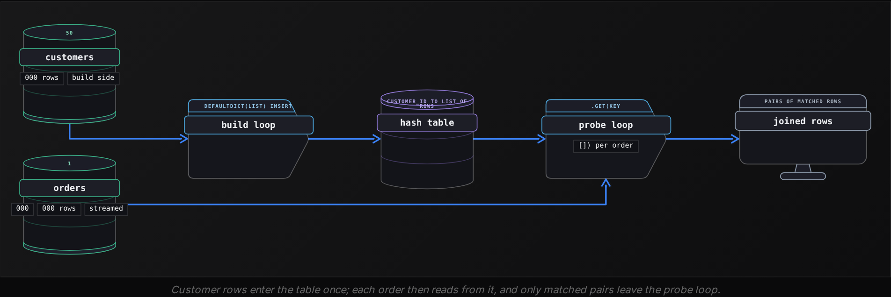

# Dict Manipulation: Intermediate

Tomasz is 20 minutes into a data engineering phone screen at Google when the interviewer pastes a prompt. A geocoding service answers in 300 ms, the pipeline asks it about the same 50,000 addresses again and again, and memory allows 10,000 cached results. Write a cache whose `get` and `put` both run in constant time and that discards the entry nobody has touched for the longest stretch. Tomasz pairs a dict with a list of keys, and the follow-up comes straight away: what does `list.remove` cost on a list of 10,000 keys? The interviewer has 2 more. What happens when the pipeline runs as 8 worker processes, and is the dict still correct when 4 threads share it? Every one of those questions is a dict question underneath: about order, about the price of a lookup, and about who else can touch the data.


<br>

### What you will be able to do

Implement an LRU cache with OrderedDict whose get and put run in O(1), and predict which key it evicts.

Build an inverted index with defaultdict(set) and order AND-query intersections by posting-list size.

Write a recursive deep merge, and explain why {\*\*a, \*\*b} loses nested keys without raising an error.

Implement a build-and-probe hash join that handles duplicate and None keys, starting as an inner join and then extending it to left and full joins.

Decide when a per-process dict cache should move to a shared cache server, and name which dict operations the GIL makes atomic.


<br>

---

## LRU Cache with OrderedDict

The prompt keeps the same skeleton every time. get(key) and put(key, value) must each finish in O(1), and once the cache reaches its fixed capacity it evicts the least recently used entry. That asks for 2 separate O(1) operations: finding a value by key, and moving a key to the most recent position. A dict covers the first. A Python list holding recency order fails the second, because marking a key as used means keys.remove(key), which scans from the front. At a capacity of 10,000, a single cache hit can compare 10,000 entries before anything moves.

| ✓ dict plus a key list | ✗ OrderedDict |
| --- | --- |
| • Lookup by key: O(1) through the dict<br><br>• Mark a key used: keys.remove(k) then keys.append(k), O(n)<br><br>• Evict the oldest: keys.pop(0) shifts every remaining key, O(n)<br><br>• 2 structures to keep in sync on every call | • Lookup by key: O(1)<br><br>• Mark a key used: move_to_end(k), O(1)<br><br>• Evict the oldest: popitem(last=False), O(1)<br><br>• Keys and their order live in one structure and cannot drift apart |

OrderedDict gets those costs from a doubly linked list of its keys kept beside the hash table. Moving a key to the tail unlinks its node and relinks it at the end, a fixed handful of pointer updates whatever the size, and the head of the list is always the key touched least recently. A plain dict also remembers insertion order, but it has no `move_to_end`, and its `popitem()` only ever removes the newest entry, which is the wrong end for this problem.


<br>

### The implementation, run step by step

https://github.com/user-attachments/assets/6114b385-cf6c-469a-badd-115cae93e755

*A capacity-2 cache: the read of u1 decides which key the third put evicts.*

Watch the read of `u1` before `u3` arrives. That hit moves `u1` to the tail, so `u2` sits at the head when the third key pushes the length to 3, and `u2` is the key removed. The last `put` refreshes a key that is already present: it moves the key first and then overwrites the value, so a refresh counts as use, and because the length stays at 2 nothing is evicted. Writing the eviction check before the insert would break this case, since a full cache receiving a refresh would throw out a key nobody asked to remove.


<br>

### Predict the output

```sql
from collections import OrderedDict

data = OrderedDict()
for key in ["a", "b", "c"]:
    data[key] = key.upper()
    if len(data) > 2:
        data.popitem()
print(list(data))
data.move_to_end("c")
```

> Answer
>
> It prints `['a', 'b']`, then the final line raises `KeyError: 'c'`. `popitem()` defaults to `last=True`, so it removed `c`, the newest key, the moment it went in. A cache written this way keeps its first 2 keys forever and drops every later one. `move_to_end` only reorders keys that exist; called with a missing key it raises instead of inserting.


<br>

### Follow-ups that come next

- Why not functools.lru_cache? It memoizes a function by its arguments. The prompt wants a cache object with an explicit put, so you build the structure it hides.
- Plain dict version: d[k] = d.pop(k) re-inserts a key at the tail, but evicting the oldest needs del d[next(iter(d))], which OrderedDict replaces with a single documented call.
- Expiry: store (value, expires_at) and treat an expired hit as a miss that deletes the key. Size eviction and age eviction stay separate rules.
- Sizing: count hits and misses inside get. The hit rate at each capacity is the number that justifies 10,000 over 1,000.
- Capacity 0: every put inserts and evicts at once. Decide whether __init__ should reject it.

LRU has a weakness worth naming before the interviewer does. A batch job that reads 10,000 cold keys once each, a backfill for example, pushes every hot key out of a 10,000-entry cache, and the hit rate collapses until the hot keys are fetched again. Guarding against that takes a policy that weighs frequency as well as recency, or a separate cache for scans.

> **TIP**
>
> State both halves before writing code: the hash table answers where a key's value lives, and the linked order answers which key is oldest. Interviewers listen for why each half is needed, and naming both up front usually ends the questions about why OrderedDict.


<br>

---

## Building an Inverted Index

An inverted index maps each term to the set of documents that contain it, the reverse of the `doc_id` to text mapping you start with. Prompts disguise it as log search (find the lines that mention both `timeout` and `payments-api`), tag lookup, or product search. The shape repeats: many records, repeated queries about their contents, and a full scan per query that the prompt's numbers make too slow. `defaultdict(set)` fits because each term collects doc ids without duplicates, and set intersection answers AND.

https://github.com/user-attachments/assets/4aa007db-7734-425f-b9d1-56761019c81d

*Build the term-to-doc-ids index, then answer AND queries shortest posting list first.*

`search_all` sorts the posting lists by length before intersecting, and the length of a term's set is its document frequency. Starting from the shortest set caps every intermediate result at that size, and the `break` stops the loop the moment nothing survives: the query for `zebra` ends after a single intersection against an empty set. The final `len(index)` prints 9 because every read inside `search_all` goes through `.get`. Subscripting `index["zebra"]` instead would have run the factory and stored a tenth key holding an empty set.


<br>

### Why the order matters at scale

Take 2,000,000 log lines where `error` appears in 900,000, `timeout` in 40,000 and `payments-api` in 300. Assume `error` co-occurs with `timeout` in 25,000 lines, while `payments-api` shares only 120 lines with `timeout`. CPython computes `a & b` by walking the smaller set and probing the larger, so each step costs the size of its smaller operand, and the `set(postings[0])` copy costs the size of whichever set comes first.

| Intersection order | Copy first set | Step 1 | Step 2 | Total |
| --- | --- | --- | --- | --- |
| error, timeout, payments-api | 900,000 | 40,000 | 300 | 940,300 |
| payments-api, timeout, error | 300 | 300 | 120 | 720 |

- **1,306x** — less work, smallest posting list first


<br>

### Predict the output

```sql
from collections import defaultdict

index = defaultdict(set)
index["timeout"].update({1, 3, 4})
index["cache"].add(3)

hits = index["zebra"] & index["timeout"]
print(hits, len(index))
print(index.get("lambda", set()), len(index))
print(sorted(index))
```

> Answer
>
> `set() 3`, then `set() 3`, then `['cache', 'timeout', 'zebra']`. Subscripting a defaultdict with a missing key runs the factory and stores the empty set before the intersection happens, so a read added `zebra` to the index. `.get` returns a fresh empty set and stores nothing. Behind a search box, every misspelled query would leave a permanent empty entry, so only the build loop should subscript the index.


<br>

### OR, NOT and phrase queries

- **OR:** union with |. Its cost grows with the sum of the set sizes, so ordering the operands buys nothing.
- **NOT:** difference with a - b. Apply it last, to the intersected result, since its cost tracks the size of the left set.
- **Phrases:** store positions with defaultdict(lambda: defaultdict(list)), term to doc id to positions, and check that the second word sits 1 position after the first.
- **Normalization:** lowercase and strip punctuation identically at build and query time, or "Timeout," never matches timeout.

Maintenance follows from the structure. Adding a document is incremental: tokenize it and add its id to each term's set. Deleting one needs its terms, so keep the forward map from doc id to its term set beside the index; without it, removal means scanning every posting set for the id.

```sql
from collections import defaultdict

index = defaultdict(set)
terms_of = {}

def add_doc(doc_id, text):
    terms = set(text.lower().split())
    terms_of[doc_id] = terms
    for term in terms:
        index[term].add(doc_id)

def remove_doc(doc_id):
    for term in terms_of.pop(doc_id, ()):
        index[term].discard(doc_id)
        if not index[term]:
            del index[term]

add_doc(1, "timeout calling payments-api")
add_doc(2, "timeout reading cache")
remove_doc(1)
print(sorted(index.items()))
```

`terms_of` is the forward map, and the program prints `[('cache', {2}), ('reading', {2}), ('timeout', {2})]`. Removing doc 1 visits only its 3 terms. Without the map, the delete would scan all 6 posting sets looking for the id. Deleting a set once it empties matters as well. Otherwise `calling` and `payments-api` stay behind as empty entries, `len(index)` overcounts the vocabulary, and a document-frequency lookup reports 0 for a term that should be absent. The map costs memory: every (term, doc id) pair is now stored twice, once in each direction, which roughly doubles the index's footprint.

> **TIP**
>
> Name the statistic when asked about selectivity: document frequency, `len(index.get(term, ()))`, divided by the document count. Intersecting the rarest term first is the same instinct as applying the most selective filter first in a query plan, and saying so links the dict answer to the SQL one.


<br>

---

## Deep Merge vs {\*\*a, \*\*b}

Layered configuration is where this question lives: defaults in code, an environment file over them, per-job overrides on top. The prompt reads "merge these 2 configs so the second one wins". `{**a, **b}` and `a | b` both merge only the top level. The in-place versions, `a.update(b)` and `a |= b`, follow the same rule. When both sides hold the same key and its value is a dict, the right-hand dict replaces the left-hand one whole, and every nested key that only the left side had disappears without an error.

```sql
defaults = {
    "db": {"host": "localhost", "port": 5432, "pool": {"size": 5, "timeout": 30}},
    "retries": 3,
}
override = {"db": {"host": "warehouse.internal"}, "retries": 5}

config = {**defaults, **override}
print(config)
print(config["db"]["port"])
```

> Answer
>
> The first line prints `{'db': {'host': 'warehouse.internal'}, 'retries': 5}`, then the second raises `KeyError: 'port'`. The merge itself succeeded quietly; `port` and the whole `pool` block were lost when `override["db"]` took the place of `defaults["db"]`. The failure appears later, at the first read of a lost key, often inside a job that starts hours after the config was built.


<br>

### A recursive merge, traced

https://github.com/user-attachments/assets/faeec9f1-df2e-46db-ae69-73f8c70f8997

*Each nested dict on both sides opens a new call frame; scalars are overwritten in place.*

The function applies 3 rules. When both sides hold a dict under the same key, it merges them recursively. Anywhere the 2 sides do not both hold dicts, the override's value wins, even if one of them is a dict. And `dict(base)` makes a new dict at each level the recursion visits, so `defaults` still shows a pool size of 5 after the merge produced 20. The recursion goes as deep as the nesting, and configs sit far below the default limit of 1,000 frames that `sys.getrecursionlimit()` reports.


<br>

### Predict the output: the branch nobody overrode

```sql
def deep_merge(base, override):
    merged = dict(base)
    for key, value in override.items():
        if isinstance(merged.get(key), dict) and isinstance(value, dict):
            merged[key] = deep_merge(merged[key], value)
        else:
            merged[key] = value
    return merged

defaults = {"db": {"pool": {"size": 5}}, "retries": 3}
job = deep_merge(defaults, {"retries": 5})
job["db"]["pool"]["size"] = 50
print(defaults["db"]["pool"]["size"], job["db"] is defaults["db"])
```

> Answer
>
> `50 True`. The recursion never visited `db`, so `dict(base)` copied only the top level and `job["db"]` is the same object as `defaults["db"]`. Writing a pool size into the job's config rewrote the defaults, and every job merged from them afterwards starts at 50. Copy both inputs once at the entry point, `deep_merge(copy.deepcopy(base), copy.deepcopy(override))`, so the result shares nothing with a caller.


<br>

### Policy questions to settle out loud

| Case | {\*\*a, \*\*b} | deep_merge | Question to raise |
| --- | --- | --- | --- |
| Dict under the same key on both sides | Right dict replaces left | Merged key by key | Handled by the recursion |
| List under the same key | Right list replaces left | Right list replaces left | Replace, append, or append and dedupe? |
| Dict on the left, scalar on the right | Scalar wins | Scalar wins | Accept it, or raise a type error? |
| Override value is None | Stores None | Stores None | Does None mean unset, or delete the key? |
| Key only on the left | Kept, same object | Kept, same object | Will callers mutate the result? |

#### Encoding the list rule as a parameter

```sql
def deep_merge(base, override, list_rule="replace"):
    merged = dict(base)
    for key, value in override.items():
        old = merged.get(key)
        if isinstance(old, dict) and isinstance(value, dict):
            merged[key] = deep_merge(old, value, list_rule)
        elif isinstance(old, list) and isinstance(value, list) and list_rule == "append":
            merged[key] = old + [v for v in value if v not in old]
        else:
            merged[key] = value
    return merged

base = {"tags": ["etl", "daily"], "hosts": ["a", "b"]}
print(deep_merge(base, {"tags": ["daily", "pii"]}, "append"))
```

With `"append"`, the call prints `{'tags': ['etl', 'daily', 'pii'], 'hosts': ['a', 'b']}`. `daily` appears once because the comprehension skips values the base list already holds, and `hosts` is untouched because the override never named it. `old + [...]` builds a new list, so `base["tags"]` still holds 2 items afterwards. The rule has 2 costs. `v not in old` scans the list, so merging lists of m and n items costs m times n comparisons: harmless for a few dozen tags, slow for 50,000 hosts, where a set of seen values brings it back to linear. And the rule applies to every key, so a later override of `hosts` would be appended too. A team that wants tags concatenated and hosts replaced passes the set of key names that append instead of a single flag.

> **TIP**
>
> Ask which rule the team wants for lists before writing the else-branch. Concatenating `tags` across 2 layers and replacing `hosts` across them are both reasonable, and an interviewer who planted a list in the example is waiting to see whether you notice it.


<br>

---

## Implementing a Hash Join

The prompt hands you `orders` and `customers` as Python lists and asks for their join on `customer_id` without a dataframe library. Comparing every order with every customer is correct and far too slow at 1,000,000 orders against 50,000 customers. A hash join reads each input once. The build phase loads the smaller input into a dict keyed by the join key; the probe phase streams the larger input and looks each key up. Time grows with both input sizes plus the output, and memory with the build side alone.

- **50,000,000,000** — comparisons in a nested loop
- **1,050,000** — dict operations in a hash join




<br>

### Build, probe, and 3 join types

https://github.com/user-attachments/assets/86947f6d-b6d1-40d8-a6db-eb3b48e7208d

*Build on customers and probe with orders; the left and full branches are where unmatched rows get added.*

The build loop skips `None` keys because SQL's `=` in a join condition never matches NULL to NULL, while Python's `None == None` is True, so a dict would pair them. The probe uses `.get` so a miss leaves the build dict unchanged. A left join adds each unmatched order with `None` in place of the customer. A full join also needs the `matched` set: once probing ends, a pass over the build input emits every customer no order found, including `Cy`, whose `None` key could never match.

```sql
SELECT
  o.order_id,
  c.name
FROM orders AS o
FULL OUTER JOIN customers AS c
  ON o.customer_id = c.customer_id
```


<br>

### Predict the output: duplicates on both sides

```sql
from collections import defaultdict

payments = [(7, "p1"), (7, "p2")]
refunds = [(7, "r1"), (7, "r2"), (7, "r3"), (8, "r4")]

build = defaultdict(list)
for cust_id, payment_id in payments:
    build[cust_id].append(payment_id)

pairs = [(p, r) for cust_id, r in refunds for p in build.get(cust_id, [])]
print(len(pairs), pairs[:2])
build_plain = {cust_id: pid for cust_id, pid in payments}
print(build_plain)
```

> Answer
>
> `6 [('p1', 'r1'), ('p2', 'r1')]`, then `{7: 'p2'}`. Each of the 3 refunds for customer 7 matches both payments, 3 times 2 rows, the count SQL returns. The comprehension keeps only the last value per key, so a join built on `build_plain` returns 3 rows and loses `p1` silently. Hot keys multiply too: 10,000 rows on each side of 1 key produce 100,000,000 pairs.


<br>

### Choosing the build side

| ✓ Do | ✗ Don't |
| --- | --- |
| • Build on the smaller input and stream the larger one through the probe loop<br><br>• Probe with .get(key, []) so misses never add keys to the build dict<br><br>• Skip None keys on both sides to match SQL NULL semantics<br><br>• Estimate rows times bytes per row before trusting the build side to fit | • Don't use a plain dict for the build side when the join key can repeat<br><br>• Don't flatten pairs with {\*\*l, \*\*r}: same-named columns overwrite silently<br><br>• Don't materialize the probe input when a generator can stream it<br><br>• Don't partition with hash() on strings across processes: its seed changes per run |

Put a number on the last Do item. Assume each customer row, a tuple of a few short strings plus its slot in the dict and its list, costs about 400 bytes in memory: 50,000 rows build a table of about 20 MB. Build on orders by mistake and the same estimate gives 1,000,000 rows and about 400 MB, while the probe streams only 50,000 customers. The joined output is identical either way, and memory differs by the 20x ratio of the input sizes. To get the per-row figure for real data, sum `sys.getsizeof` over a sample row and each of its fields, since the call alone does not count the objects a tuple points to.

When the small input is the side a left join must preserve, build on it anyway and record which build keys matched, then emit the unmatched build rows at the end, the same tail the full join runs. When neither side fits in memory, split both inputs into N buckets by a stable hash of the key, then join bucket i of one side with bucket i of the other. `zlib.crc32` is one such hash. Matching keys always land in the same bucket, so each bucket pair is a smaller hash join that fits.


<br>

---

## When to Say 'I'd Use Redis Instead'

The last follow-up on a dict cache is usually what changes in production, and the answer starts from a single fact: the dict lives in one process's memory. Threads in that process share it. Any other process gets its own copy, whether it runs on the same host or a different one, and a restarted process starts with nothing.

| Property | Dict inside the process | Shared cache server |
| --- | --- | --- |
| Who can read it | Threads of a single process | Every process on every host |
| Copies of each entry | 1 per process | 1 |
| Cost of a lookup | On the order of 50 ns | A network round trip, about 0.5 ms in a datacenter |
| After a deploy | Empty, warms from scratch | Still warm |
| Invalidating a key | Each process separately | A single delete, seen by all readers |
| New ways to fail | None beyond the process | Timeouts, outages, serialization errors |

- **10,000x** — round trip time over dict lookup time


<br>

### The arithmetic that forces the move

Take a product-attribute cache holding 2 GB of entries, read by a pipeline that runs 8 worker processes on each of 4 hosts. Kept in a dict, that is 32 copies and 64 GB across the fleet, each copy warming on its own, so the catalog service the cache protects can see up to 32 misses for every key after each deploy. On a shared server the same entries occupy 2 GB once and each key misses once. That gap is the moment to say "I'd move this cache to a shared server". The reverse holds as well: a 50 MB lookup table that a single process reads millions of times per second belongs in a dict, because a network hop on each read would become the slowest part of the pipeline.

| ✓ Keep the dict | ✗ Escalate to a shared server |
| --- | --- |
| • A single process does all the reading<br><br>• The working set fits beside the job's own memory<br><br>• A miss is cheap to recompute or reload<br><br>• Reads are hot enough that a network hop would dominate | • Several processes must see the same entries and invalidations<br><br>• Cold caches after each deploy overload the source<br><br>• The working set outgrows a single process<br><br>• Entries need expiry, or processes need to share locks and atomic counters |


<br>

### What the GIL makes atomic

Inside the process, threads share the dict, and CPython's global interpreter lock lets a single thread run bytecode at a time. A dict method implemented in C completes as a single step from every other thread's point of view, so a call such as `d[k] = v` or `d.get(k)` never leaves the table half updated, and the same holds for `d.pop(k, None)` and `d.setdefault(k, v)`. The Python FAQ entry on thread-safe mutation lists `D[x] = y` and `D1.update(D2)` as atomic and `D[x] = D[x] + 1` as unsafe. The guarantee covers a single call, and only while keys hash and compare in C: a key class with a Python `__eq__` lets other threads run mid-operation.

| Operation | Atomic in CPython | Reason |
| --- | --- | --- |
| `cache[k] = v` | Yes | A single C call |
| `cache.get(k)` | Yes | A single C call |
| `cache.setdefault(k, v)` | Yes | Get-or-insert in a single C call; `v` is computed before it runs |
| `cache[k] += 1` | No | Read, add, write: another thread can write in between |
| `if k not in cache: cache[k] = load(k)` | No | Check and write are separate steps, so 2 threads can both load |
| `for k in cache:` during inserts | No | Raises `RuntimeError: dictionary changed size during iteration` |
| LRU `get` | No | Membership test, `move_to_end` and read are 3 calls |


<br>

### Predict the output: an eviction between 2 calls

```sql
from collections import OrderedDict

data = OrderedDict([("u1", "Lisbon"), ("u2", "Osaka")])
capacity = 2

found = "u1" in data
data["u3"] = "Lima"
if len(data) > capacity:
    data.popitem(last=False)
if found:
    data.move_to_end("u1")
print(list(data))
```

> Answer
>
> `move_to_end` raises `KeyError: 'u1'`, so the `print` never runs. A's membership test saw `u1`, B's eviction removed it, and A acted on a stale answer. Each call was atomic; the sequence was not. On real threads this interleaving is rare, so it surfaces under production load and slips past unit tests.

```sql
import threading
from collections import OrderedDict

class ThreadSafeLRU:
    def __init__(self, capacity):
        self.capacity = capacity
        self.data = OrderedDict()
        self.lock = threading.Lock()

    def get(self, key):
        with self.lock:
            if key not in self.data:
                return None
            self.data.move_to_end(key)
            return self.data[key]

    def put(self, key, value):
        with self.lock:
            self.data[key] = value
            self.data.move_to_end(key)
            if len(self.data) > self.capacity:
                self.data.popitem(last=False)
```

Hold the lock only for the dict work. Loading a missing value from a slow source inside the lock would stall every reader behind a single fetch; loading outside it means 2 threads that miss together both fetch, a duplicate that usually costs less than the stall. A shared cache server carries the same race across processes: a read followed by a write from 2 processes is the same check-then-act, and the fix there is the server's atomic set-if-absent or increment command.

> **TIP**
>
> In asyncio code, a dict check followed by a write is safe as long as no `await` sits between them, because coroutines switch only at an await. Put the fetch between the check and the write and 2 coroutines can both miss and both fetch.


<br>

---

## Putting It All Together

A food-delivery company builds support tooling: agents search courier event logs for lines containing both refund and timeout, the matching events are enriched with restaurant records before display, the service's settings come from layered defaults plus per-region overrides, and the restaurant lookups behind enrichment are cached. The service started as a single process and now runs as 24 worker processes behind a load balancer.

- The log search is the inverted index: defaultdict ( set ) per term, rare terms intersected first, and query reads through . get so agents' typos never grow the index.
- Enrichment is the hash join: restaurants form the build side, events stream through the probe, and a left join keeps events whose restaurant record is missing.
- Joined rows stay as pairs, because flattening an event and a restaurant with { \*\* l , \*\* r } would let the restaurant's updated_at overwrite the event's, the same top-level replacement that breaks shallow config merges.
- Per-region settings go through the deep merge; a shallow merge would drop the default timeout block from any region that overrode a single field inside it.
- The restaurant lookups sit in an OrderedDict LRU behind a lock, since the service's request threads share it.
- At 24 processes the LRU exists 24 times and a restaurant rename stays stale in some of them, which is the signal to move those lookups to a shared cache server.


<br>

---

## Key Takeaways

- An LRU cache needs O(1) lookup and O(1) recency updates; OrderedDict's move_to_end and popitem ( last = False ) give both in a single structure.
- Read a defaultdict through . get whenever the key might be missing, because subscripting it stores the factory's value.
- Intersect posting lists from shortest to longest, since each & costs the size of its smaller operand.
- { \*\* a , \*\* b } replaces nested dicts whole; a recursive merge recurses only where both sides hold dicts, and copying the inputs keeps the result from sharing branches with them.
- A hash join builds defaultdict ( list ) on the smaller side and probes with the larger. It skips None keys, and a full join also tracks which keys matched.
- A dict cache serves a single process; when many processes need the same entries or the same invalidation, a shared server is worth the network round trip on each read.
- Single dict calls are atomic under the GIL; check-then-act and read-modify-write sequences need a lock.
