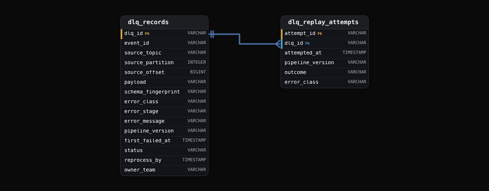
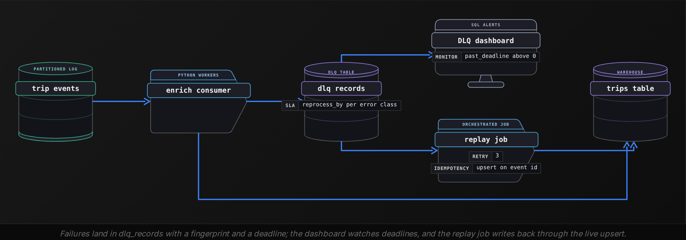
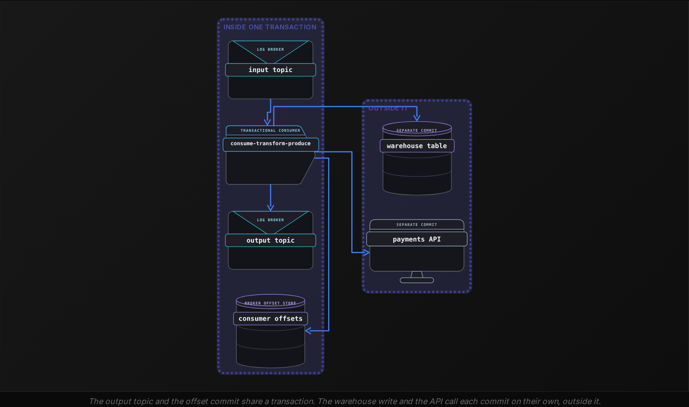
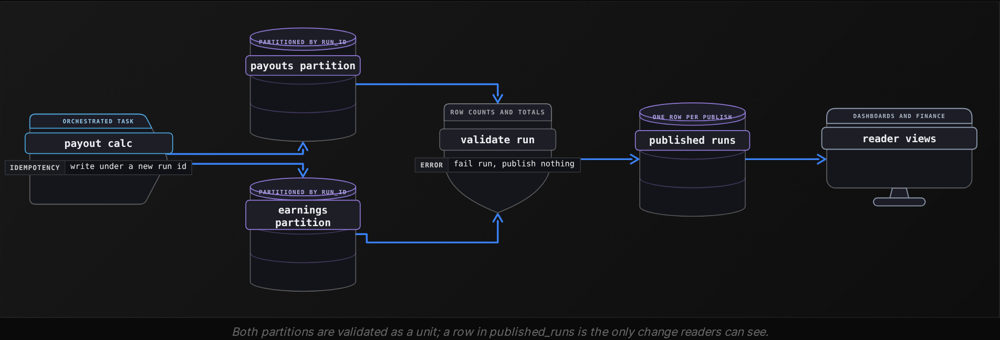

# Error Handling for Data Engineers: Advanced

Ines is 40 minutes into a final-round loop at Uber, a company that has written publicly about the retry topics and dead letter queues behind its event pipelines. The interviewer draws a consumer that reads trip events, enriches each one with a call to a fare service, and writes the result to the warehouse. Then comes the twist: the fare service starts timing out. "Walk me through the next hour. What does your pipeline do, what did you promise the analytics team, and how do you find out you broke that promise before they do?" Ines has built retries and DLQs before. The interviewer is asking for more: how much loss the pipeline is allowed, a way to stop calling the fare service while it keeps timing out, a DLQ someone can query, what exactly-once means once the warehouse sits outside the broker, and how to unwind a half-committed job.


<br>

### What you will be able to do

Convert a completeness SLO into a daily error budget and alert on burn rate computed from tagged DLQ writes

Build a CLOSED, OPEN and HALF_OPEN circuit breaker whose locking holds up under concurrent worker threads

Design a DLQ table with schema fingerprints, per-class reprocessing deadlines and monitoring queries

Explain where a broker transaction's exactly-once guarantee ends and pair at-least-once delivery with idempotent dedup

Recover multi-step pipeline failures with staged outputs, a single publish pointer and saga compensations


<br>

---

## Error Budgets and SLOs

An SLO for a pipeline is a ratio over a window. For the trip events pipeline: of the events the source produced on a given day, at least 99.95% are in the warehouse table by 06:00 the next morning. The complement of that ratio is the error budget, and multiplying it by daily volume turns a percentage into a count of records the pipeline is allowed to lose.

- **40M** — trip events the source emits per day
- **20,000** — events the day's budget lets you lose

Records spend the budget when they miss the deadline for any reason: rows parked in the DLQ at 06:00, rows a filter bug dropped, rows that land at 07:10. A record that failed twice and succeeded on its third attempt spends nothing, because the SLO counts where each record is at the deadline.

| Completeness SLO | Daily budget (events) | Average per hour | Burn rate of a 1% failure spike |
| --- | --- | --- | --- |
| 99% | 400,000 | 16,667 | 1 |
| 99.9% | 40,000 | 1,667 | 10 |
| 99.95% | 20,000 | 833 | 20 |
| 99.99% | 4,000 | 167 | 100 |

Read the last column before choosing an SLO. The same incident, 1% of records failing, takes a full day to empty a 99% budget and under 15 minutes to empty a 99.99% one. Pick the ratio from what the table's readers need, then state the budget it implies.

The window is a choice too. A daily budget resets each morning, which suits a table read day by day: a clean Monday does not excuse a broken Tuesday. A 28-day window spreads a bad night across the month, which smooths a dashboard and hides the day a finance close depended on.


<br>

### Alert on burn rate

Burn rate is the observed failure fraction divided by the budgeted fraction. At a burn rate of 1 the budget lasts exactly the day; at 6 it lasts 4 hours. A fixed hourly count gets both ends wrong. With an alert at 1,000 DLQ writes an hour, 900 failures out of 300,000 events at 03:00 is a burn rate of 6 and stays silent, while 1,200 out of 2,400,000 at the evening peak is a burn rate of 1 and pages someone.

> **TIP**
>
> The denominator comes from the source: producer-side counts or offset ranges per partition. A consumer that divides by the records it received cannot see the records it never received, and those are the losses a completeness SLO exists to catch.

The program below charges 4 hours of DLQ writes against the day's budget. It pages at a burn rate of 6 or more and opens a ticket at 2 or more. Before you play it, predict which hour pages first and roughly what share of the budget is gone by then.

https://github.com/user-attachments/assets/d582f245-f3ea-4101-8e39-97a9c6b8abd9

*Hourly burn rate against a 99.95% completeness SLO on 40M events a day.*

Hour 2 pages at a burn rate of 6.7 with 47% of the budget gone. Hour 1 only opened a ticket, yet it spent 15% of the day's budget by itself, and a burn rate of 3.5 held for 7 hours empties the budget. The ticket tier exists for that slow leak, which never looks dramatic in any single hour.


<br>

### Instrument the DLQ write itself

```sql
import logging

log = logging.getLogger("trips.enrich")


def send_to_dlq(record, exc, stage, dlq_writer, metrics):
    error_class = type(exc).__name__
    dlq_writer.write(record, error_class=error_class, stage=stage)
    metrics.increment(
        "pipeline_dlq_records_total",
        tags={"pipeline": "trips_enrich", "stage": stage, "error_class": error_class},
    )
    log.warning(
        "event %s sent to DLQ at stage %s",
        record["event_id"],
        stage,
        exc_info=exc,
    )
```

The counter increments after the DLQ write returns, so a DLQ write that raises surfaces as a failure instead of being counted as safely parked. The `stage` and `error_class` tags let a single alert tell a schema change from a sick dependency. `exc_info=exc` keeps the traceback in the log line, so the DLQ row's message and the log share a cause.

| ✓ Charge at the DLQ write | ✗ Charge at the deadline |
| --- | --- |
| • Alerts while a replay can still rescue the day<br><br>• Overstates loss when most parked records replay in time<br><br>• Needs a credit back when a replay lands | • Reports exactly what readers of the table experienced<br><br>• Alerts only after the budget is already gone<br><br>• Needs a job that reconciles source counts with target counts |

Run both. The alert reads write-time burn so it fires while there is room to act; the SLO report uses the deadline-time reconciliation, the number the table's readers lived through.

> **TIP**
>
> Agree in advance on what an empty budget triggers: deploys to the pipeline freeze, the on-call moves to DLQ replay, and the team checks whether the SLO still matches what readers need.


<br>

---

## A Thread-Safe Circuit Breaker

Retries help when a dependency drops 1 request in 50. When it is down, they multiply the damage. A consumer with 32 worker threads, each making 4 attempts with a 2-second timeout, sends 128 calls into a fare service that answers none of them, and every thread spends 8 seconds per record learning nothing new. A circuit breaker replaces those 32 separate guesses with 1 shared decision: stop calling for a cooldown, then check whether the service is back.

| State | What a call does | Leaves when |
| --- | --- | --- |
| CLOSED | Goes to the dependency; consecutive failures are counted | Failures reach the threshold: moves to OPEN |
| OPEN | Rejected at once with `CircuitOpenError`, no network call | Cooldown elapses: the next call moves it to HALF_OPEN |
| HALF_OPEN | A single probe goes through; every other call is rejected | Probe succeeds: CLOSED. Probe fails: OPEN, cooldown restarts |

The model below drops threads and locks to show the transitions alone. It replays 8 calls at fixed timestamps, and each call is tagged with whether the fare service would have answered. Predict the state printed at t=12, t=40 and t=50.

https://github.com/user-attachments/assets/e621150a-70e2-4689-b691-5eedf8bd7d85

*Threshold 3, cooldown 30 seconds, a single probe per cooldown.*

At t=12 the fare service would have answered, and the breaker rejected the call anyway: a service with no proof of recovery gets no load. At t=40 the cooldown has passed, so the call goes through as a probe, fails, and reopens the circuit with a fresh timer. That timer is why t=50 is rejected although the service is healthy again. The probe at t=75 confirms recovery.


<br>

### The race between worker threads

Every worker thread reads and writes the same breaker, and 2 of its transitions break when they interleave. The first is the probe: without a guard, 2 threads can both see HALF_OPEN and both send a probe, and whichever finishes last decides the state.

| Step | Thread A | Thread B | Breaker state |
| --- | --- | --- | --- |
| 1 | Reads HALF_OPEN |  | HALF_OPEN |
| 2 |  | Reads HALF_OPEN | HALF_OPEN |
| 3 | Sends probe | Sends probe | 2 probes in flight |
| 4 | Probe times out, sets OPEN |  | OPEN |
| 5 |  | Probe succeeds, sets CLOSED | CLOSED; all 32 threads resume |

Thread B's lucky answer erases thread A's evidence, and 32 threads pile onto a service that has failed a probe. The second break is the failure counter. `self._failures += 1` is a load, an add and a store, and the interpreter can switch threads between them. If 2 threads both load 2, both store 3, so a threshold of 3 can take 4 or more failures to trip.

```sql
import threading
import time


class CircuitOpenError(Exception):
    pass


class CircuitBreaker:
    def __init__(self, threshold=3, cooldown=30.0, clock=time.monotonic,
                 trips_on=(TimeoutError, ConnectionError)):
        self.threshold = threshold
        self.cooldown = cooldown
        self.clock = clock
        self.trips_on = trips_on
        self._lock = threading.Lock()
        self._state = "CLOSED"
        self._failures = 0
        self._opened_at = 0.0
        self._probe_in_flight = False

    def _before_call(self):
        with self._lock:
            if self._state == "OPEN":
                if self.clock() - self._opened_at < self.cooldown:
                    raise CircuitOpenError("fare service marked unhealthy")
                self._state = "HALF_OPEN"
            if self._state == "CLOSED":
                return False
            if self._probe_in_flight:
                raise CircuitOpenError("probe already in flight")
            self._probe_in_flight = True
            return True

    def _record(self, outcome, is_probe):
        with self._lock:
            if is_probe:
                self._probe_in_flight = False
            elif self._state != "CLOSED":
                return
            if outcome == "success":
                self._state, self._failures = "CLOSED", 0
            elif outcome == "failure":
                self._failures += 1
                if is_probe or self._failures >= self.threshold:
                    self._state, self._opened_at = "OPEN", self.clock()

    def call(self, fn, *args):
        is_probe = self._before_call()
        outcome = "neutral"
        try:
            result = fn(*args)
        except self.trips_on:
            outcome = "failure"
            raise
        else:
            outcome = "success"
            return result
        finally:
            self._record(outcome, is_probe)
```

Read the implementation for what it keeps outside the lock. `fn(*args)` runs with the lock released. Holding the lock across a 2-second call would let 1 thread at a time reach the fare service. `_before_call` returns whether this call took the probe slot, which closes the double-probe race. `_record` ignores non-probe results unless the circuit is CLOSED, so a slow timeout launched before the trip cannot restart a cooldown or close a recovering circuit.

`clock` defaults to `time.monotonic`, which never moves backwards when a clock sync adjusts wall time. A test can pass a fake clock to drive the cooldown without sleeping. `trips_on` limits which exceptions count: a `ValueError` from a malformed record says nothing about the fare service, so 3 bad rows must not open the circuit. The `finally` clause records an outcome on every exit, so the probe slot is always released.


<br>

### What the caller does with an open circuit

| ✓ Pause consumption | ✗ Divert to a retry path |
| --- | --- |
| • Stop polling; records wait in the log, in order<br><br>• No DLQ volume and no replay work afterwards<br><br>• Lag grows, so the freshness SLO burns instead | • Tag records circuit_open and keep the consumer moving<br><br>• Records that skip the fare call stay fresh<br><br>• Completeness budget burns until the replay lands |

Let the SLOs choose. When per-trip ordering matters or nearly every record needs the fare call, pause: lag recovers by itself once the circuit closes, and nothing needs replaying. When only a minority of records need the dependency, divert those and keep the rest of the table fresh.

Each process keeps its own breaker, and a breaker trips only as failures return. Take 40 processes of 32 threads. Every thread's call is in flight before its process's third timeout lands, so the fare service absorbs about 1,280 failed calls, then 40 probes per cooldown. A breaker shared through an external store cuts that, but it makes every call depend on the store. Offer it as a tradeoff and name that cost.


<br>

---

## DLQ as a Full Data Product

A DLQ written as raw bytes in a bucket answers a single question: did something fail? The engineer on call at 06:00 asks harder ones. Which producer change caused these 4,000 failures, and are they a single problem or several? Which rows will miss the completeness deadline? Can they be replayed with fixed code without writing anything twice? A DLQ that answers those is a table with an owner, a schema, deadlines and a replay path.



Columns grouped by the question they answer

- Where it came from: source_topic, source_partition, source_offset and event_id, the keys that replay and dedup use.
- What arrived: payload exactly as received, plus the schema_fingerprint of its shape.
- Why it failed: error_class, error_stage, error_message and the pipeline_version that rejected it.
- What happens next: status, reprocess_by and owner_team, with every replay logged in dlq_replay_attempts.

`payload` stays raw text even when parsing succeeded. A DLQ that keeps only parsed fields loses precisely the records whose shape broke the parser, which are the ones you most need to read.


<br>

### Fingerprint the shape

A batch of 4,000 failures with 4,000 distinct error messages can share a single cause: a producer renamed a field, or started sending `fare` as a string. A schema fingerprint hashes the payload's shape, its field names and value types with the values discarded, so every record with the broken shape lands in the same bucket, and a fix plus a bulk replay clears it.

The program computes the shape and fingerprint of 3 trip payloads. `a` and `b` differ in every value and in key order; `c` matches `a` except that `fare` arrives as a string. Predict the 3 lines it prints.

https://github.com/user-attachments/assets/9cb070fc-cbf9-4c90-8827-6e9e2ddb3799

*Same shape, same fingerprint, whatever the values and key order.*

Sorting in `type_shape` and `sort_keys=True` make key order irrelevant, so `a` and `b` match. `c` gets its own fingerprint because a field changed type. Now take a payload the program never saw: a producer sends a whole fare as `"fare": 30`, which `json.loads` decodes as an `int`. That record fingerprints apart from `a` too, which splits 1 healthy schema into 2 fingerprints. Mapping `int` and `float` to a shared `number` label before hashing removes the split.


<br>

### Reprocessing SLAs per error class

Each row gets its `reprocess_by` at write time, from its error class, and the deadlines must land inside the completeness window. A record parked at 23:30 with a 4-hour deadline is replayed by 03:30, before the 06:00 check charges it to the day's budget.

| error_class | Typical cause | Replay path | reprocess_by |
| --- | --- | --- | --- |
| `CircuitOpenError` | Fare service unhealthy | Automatic once the breaker closes | 1 hour |
| `MissingDimensionKey` | Driver or city row arrives late | Automatic sweep every 15 minutes | 2 hours |
| `SchemaDrift` | New fingerprint after a producer change | Code or contract fix, then bulk replay by fingerprint | 4 hours |
| `InvalidValue` | Negative fare, impossible timestamp | Owner review: fix upstream or discard with a reason | 24 hours, past the window on purpose |

A negative fare is a real loss whether or not anyone replays it, so it is already charged to the budget, and the 24 hours buy a careful decision instead of a rushed discard.

The query behind the DLQ dashboard groups open rows by fingerprint and error class, worst first:

```sql
SELECT
  schema_fingerprint,
  error_class,
  COUNT(*) AS open_rows,
  MIN(first_failed_at) AS oldest_failure,
  COUNT_IF(reprocess_by < CURRENT_TIMESTAMP) AS past_deadline
FROM dlq_records
WHERE status = 'NEW'
GROUP BY schema_fingerprint, error_class
ORDER BY past_deadline DESC, open_rows DESC
LIMIT 20
```

This query drives the deadline alert, which fires on any group with `past_deadline` above 0. A new-fingerprint alert needs a query of its own over all statuses: it compares `min(first_failed_at)` per `schema_fingerprint` with today's date. That alert fires within minutes of a producer's first bad record, long before the volume of failures would stand out.



Replay runs the production code at the current `pipeline_version`, never a one-off script, and writes through the same idempotent upsert as live traffic; a replayed record is a redelivery, so dedup on the sink has to absorb it. Each attempt is a row in `dlq_replay_attempts`. After 3 failed replays the row moves to `ESCALATED` and its owner team is paged, which stops a poison record from cycling through replay forever.

| ✓ Do | ✗ Don't |
| --- | --- |
| • Store the payload exactly as received, before parsing<br><br>• Set reprocess_by at write time from the error class<br><br>• Apply the source's access policy to the DLQ, PII included<br><br>• Expire DLQ rows on the source's retention schedule | • Keep only the exception message and drop the payload<br><br>• Replay with a script that bypasses the pipeline code<br><br>• Delete rows on replay; set a status and keep the history<br><br>• Leave a row without an owner team |


<br>

---

## At-Least-Once vs. Exactly-Once

Delivery semantics count how many times a record's effect lands in the output after crashes and retries have played out. At-most-once can lose records, at-least-once can duplicate them, and exactly-once applies each effect once. Whether a given pipeline is exactly-once depends on where the effect lands.


<br>

### What the broker's transaction covers

A log broker with transactions can make consume, transform and produce atomic. The consumer writes its results to an output topic and adds its own input offsets to the same transaction; consumers that read only committed data never see a result whose offsets were rolled back. A crash before the commit aborts both, and the restarted consumer produces the result once. The guarantee covers exactly the participants in that transaction: the broker's topics and its offset store.



Once the effect goes to a warehouse table or an HTTP API, the consumer performs 2 commits in 2 systems, and each ordering leaves a crash window between them.

| Order | Crash between the steps leaves | Outcome |
| --- | --- | --- |
| Write the sink, then commit the offset | Row in the sink, offset uncommitted | Redelivered and written again: at-least-once |
| Commit the offset, then write the sink | Offset committed, sink never written | Record skipped: at-most-once |
| Both in a single transaction | Impossible unless both systems take part in a shared commit protocol | Requires two-phase commit, which most sinks do not offer |

The end-to-end design is therefore at-least-once delivery plus a sink that absorbs duplicates, often called effectively-once. Naming the crash window and the sink's role is the answer the question is fishing for.

The program replays a 4-record log through 2 sinks, crashing once after writing offset 1 and before committing it. The log also carries a duplicate the producer made on its own: after a lost acknowledgement, its retry re-sent `e2`, which landed at offset 2. Predict each sink's contents and total fare.

https://github.com/user-attachments/assets/5e2ff83a-b3e2-4060-a5a8-1a8a233c4eed

*A crash replay and a producer retry, absorbed only by the keyed sink.*

The append sink holds `e2` 3 times and totals 140 where riders paid 70. The keyed sink lands on 70 whatever the crash timing, because writing `e2` again overwrites the same key. Now a case the program did not run: key the dict by offset instead of `event_id`. The dict then keeps 2 `e2` entries, offsets 1 and 2, because offset dedup absorbs the consumer's replay and misses the producer's retry, which arrived at a new offset.


<br>

### Choosing the dedup key

| Dedup key | Absorbs | Misses |
| --- | --- | --- |
| Source offset | Consumer replay after a crash | Producer retries and DLQ replays, which arrive at new offsets |
| Payload hash | Byte-identical resends | Resends that carry a fresh send timestamp; 2 real events with identical content merge into 1 |
| Producer `event_id` | Consumer replay, producer retry, DLQ replay | Nothing, provided the producer assigns it once, before its first send attempt |
| Business key such as `trip_id` | Any resend of the same business fact | Corrections, unless the write is an upsert where the newest version wins |

The dedup store needs a retention window, and the slowest redelivery path sets it. Consumer replays arrive within minutes; DLQ replays under a 24-hour `reprocess_by` arrive up to a day later. Keys kept for 6 hours turn every late replay into a duplicate, so retain them past the longest replay deadline plus a margin, or make the sink itself keyed so the check never expires.

#### 3 ways to make the sink absorb duplicates

- Database sink: insert event_id into a processed-keys table in the same transaction as the row. A key conflict means the record already landed, and the transaction rolls back.
- Offsets in the sink: store each partition's last offset in the same warehouse transaction as the rows, and on restart seek to the offset the sink holds. The sink has a single commit, so the crash window closes; it costs a sink with multi-row transactions and a consumer that manages its own offsets.
- HTTP sink: send event_id as the request's idempotency key, so the service returns its stored response for a repeat instead of charging twice.

If the payments service accepts no idempotency key, no code on the pipeline's side can make the call safe. Keep a ledger of sent keys and call only for keys not yet sent. Run a daily reconciliation against the provider's records to catch the crash between sending and recording. Name that limit in the interview.


<br>

---

## Partial Commits and Sagas

The weekly driver payout job does 4 things: it writes a payouts partition, refreshes a per-driver earnings table, posts debits to the finance ledger and calls the bank to move the money. If the bank call fails, the first 3 effects are already committed. Drivers see earnings they will not receive this week, finance sees debits with no transfer behind them, and rerunning the job posts the debits twice unless every step is idempotent.


<br>

### Inside one store: stage, validate, publish

When every output lives in a single storage system, write each to a location no reader queries, validate them together, then publish with a single metadata change. A table rename or a view replacement is atomic for a single object. Flipping 2 outputs with 2 statements leaves a gap in which a reader joins new payouts to old earnings.

The fix is one pointer for the whole run. Each output table is partitioned by `run_id`. A validated run inserts a row into `published_runs`, and every reader view resolves the current run through that table:

```sql
CREATE OR REPLACE VIEW driver_earnings_current AS
SELECT
    e.driver_id,
    e.gross_fare,
    e.trips
FROM driver_earnings AS e
WHERE e.run_id = (
    SELECT
        run_id
    FROM published_runs
    WHERE dataset = 'driver_payouts'
    ORDER BY published_at DESC
    LIMIT 1
)
```

A single-row insert moves every view at once. A run that fails validation never inserts its row, so its partitions sit unread until cleanup, and a retry writes under a new `run_id`. Rolling back a bad publish is another insert naming the previous run, which is why the views order by `published_at` instead of taking the largest `run_id`.




<br>

### Across services: sagas

The ledger and the bank are separate services with no shared transaction, so there is no pointer to flip. A saga runs each step as its own local commit and pairs it with a compensating action. When a step fails, the saga runs the compensations of the steps already done, newest first. A compensation is a new business fact, such as a reversing ledger entry or a cancellation, because other systems may already have read the original.

The program runs the cross-service half of the job as a 3-step saga: mark the payout batch pending, post the ledger debit, then call the bank, which fails. Predict the batch status, the ledger contents and the order of the 5 saga log lines.

https://github.com/user-attachments/assets/fcf0294d-4a9b-4c39-83e6-1b880875cfc5

*Compensations run newest first and append new facts.*

The compensations ran newest first, and the ledger kept both entries: an auditor sees a debit and its reversal netting to 0. Now suppose `call_bank` succeeds and a fourth step, `notify_driver`, raises `RuntimeError`. The loop walks `reversed(done)` and first calls the compensation stored for `call_bank`, which is `None`. Predict the output.

Python prints only a traceback. It shows the `RuntimeError` from `notify_driver`, then 'During handling of the above exception, another exception occurred', then `TypeError: 'NoneType' object is not callable`. No compensation ran. The bug points at a design fact: once the bank has moved money, the pipeline cannot recall it, so `call_bank` is the saga's pivot. Steps before it must be compensable. Steps after it are retried forward until they succeed, and putting the irreversible step last keeps that tail short.

The animation keeps `saga_log` in memory. In production it is a table written before each step and each compensation, so a worker that dies mid-compensation resumes from the last entry, which can repeat a compensation; each one therefore carries its own idempotency key. Sagas also give no isolation: between the debit and its reversal, a finance report can read the debit. Writing saga-owned rows as `pending` and letting reports read only `settled` rows keeps that state out of the numbers.

| ✓ Stage and publish | ✗ Saga |
| --- | --- |
| • All outputs live in a single storage system<br><br>• Readers see the old run or the new run<br><br>• A failure leaves unpublished partitions to clean up<br><br>• Retry by rerunning under a new run_id | • Steps span services with separate commits<br><br>• Readers can see intermediate state unless filtered<br><br>• A failure triggers compensations, newest first<br><br>• Needs a durable saga log and idempotent compensations |

Real payout pipelines use both. The staged warehouse publish is one saga step ahead of the ledger and the bank. Its compensation is another `published_runs` insert naming the previous run, which is a new fact like any other undo.


<br>

---

## Putting It All Together

A ride-hailing marketplace runs a weekly driver payout pipeline. It consumes completed-trip events from a partitioned log, looks up each fare from a fare service, writes trip and earnings tables, posts ledger debits and asks the bank to transfer the money, all before drivers open the app on Monday morning.

- The completeness SLO on trip events sets a 20,000-event daily budget, and every DLQ write is charged against it the moment it happens.
- When the fare service times out, the circuit breaker opens and the consumer pauses, trading freshness burn for an ordered recovery with nothing to replay.
- Records that fail on shape land in dlq_records under a shared fingerprint, with reprocess_by deadlines inside the window so a fix and a bulk replay save the budget.
- Replays and crash recoveries are redeliveries, so the trip-level table is keyed on event_id , and the bank transfer carries the payout run's run_id as its idempotency key.
- The earnings and payouts partitions publish through a published_runs row, and that publish is a saga step ahead of the bank transfer, the pivot that only retries forward.


<br>

---

## Key Takeaways

- An SLO becomes actionable as a budget in records: 99.95% of 40M events a day allows 20,000 losses, and burn rate says how fast they are going.
- Alert on burn rate computed from tagged DLQ writes, with the denominator counted at the source.
- A circuit breaker holds its lock only around state changes, admits a single probe, and counts only dependency failures.
- A DLQ someone can work from is a table: raw payload, schema fingerprint, error class, deadline, owner and replay history.
- Exactly-once ends at the edge of the broker's transaction; past it, use at-least-once delivery with a sink keyed on a producer-assigned event_id .
- Publish multi-table outputs through a single pointer row, and run cross-service steps as a saga with the irreversible step last.
