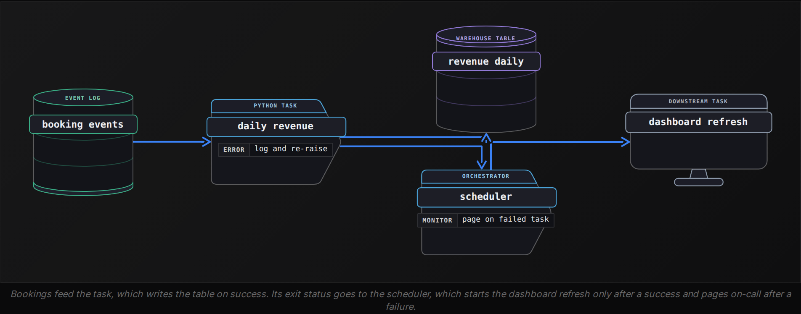

# Error Handling for Data Engineers: Beginner

Dalia is 20 minutes into a coding screen at Airbnb, whose data team open-sourced the workflow scheduler much of the industry runs its pipelines on. The interviewer pastes a 14-line function that reads booking events and sums each price, then writes the total to a warehouse table. It works on the sample data. Then comes the question: "Row 40,000 has a price of 'n/a'. What does the scheduler show, what lands in the table, and what do the logs say tomorrow morning?" The loop sits inside `except Exception: pass`. Dalia sees the answer: a green task, a total missing that row and every row after it, and an empty log. The next 10 minutes decide the round: naming each flaw, then rewriting the function so the failure reaches someone who can fix it.


<br>

### What you will be able to do

Name the 4 error-handling anti-patterns in a code sample and state what each one costs in production

Rewrite a broad handler to catch specific exceptions, log the traceback with exc_info=True and re-raise

Predict which clauses of try/except/else/finally run when the code succeeds, and which run when it raises an exception that is handled or one that is not

Translate a low-level exception into a pipeline error with raise ... from and read the chained traceback it produces

Decide when contextlib.suppress is the right call and write it so the intent is visible to a reviewer


<br>

---

## Anti-Patterns Interviewers Test For

Error-handling questions in data engineering screens rarely ask you to write a handler from a blank file. They hand you a working function with a flaw planted in it and watch whether you find the flaw before you start tidying variable names. The flaws come from a short list, because they are the ones behind real incidents: a job that reports success after loading partial data, or a failure whose cause nobody can reconstruct the next day.


<br>

### The 4 patterns to name on sight

The function below computes a day's booking revenue. It passes its unit test, which feeds it 3 clean bookings and a working rate service, and it contains all 4 patterns.

```sql
import logging

logger = logging.getLogger(__name__)


def fetch_rates(day):
    try:
        return request_rates(day)
    except:
        return {}


def daily_revenue(bookings, day):
    rates = fetch_rates(day)
    total = 0.0
    try:
        for b in bookings:
            total += float(b["price"]) * rates[b["currency"]]
    except Exception as e:
        logger.error(f"revenue calc failed: {e}")
    try:
        write_total(day, total)
    except Exception:
        pass
```

| Anti-pattern | Where it sits | What the scheduler records | What you find the next morning |
| --- | --- | --- | --- |
| Bare `except:` | `fetch_rates` | Nothing yet; the function returns `{}` | The first booking raises `KeyError` on `rates[...]`, the loop stops, and the real cause, a rate service outage, left no trace |
| Log without the traceback | `logger.error(f"... {e}")` | Success | One line reading `revenue calc failed: 'EUR'`, with no type, file or line number |
| Fake success value | `return {}` and the partial `total` | Success | A revenue figure, often `0.0` or partial, stored as if it were the day's total |
| Swallow with `pass` | Around `write_total` | Success | No row for the day in the table and no log line explaining why |


<br>

### Why bare except is worse than it looks

A bare except: catches BaseException, the root of every exception class. That includes KeyboardInterrupt, raised when someone presses Ctrl+C during a manual backfill, and SystemExit, raised by sys.exit(). It also catches NameError, so a typo such as reqest_rates returns {} on every run instead of failing on the first one. except Exception: is less dangerous because KeyboardInterrupt and SystemExit get past it, as does GeneratorExit, yet it still catches the typo. In fetch_rates, either form hides that the rate service never answered: the failure resurfaces in daily_revenue as a KeyError on a currency code, pointing at a line that did nothing wrong.


<br>

### The log line that tells you nothing

`str()` of a `KeyError` is the missing key in quotes, so the f-string in `daily_revenue` writes `revenue calc failed: 'EUR'`. On-call has to guess that `'EUR'` was a dictionary key, then work out whether it came from `b` or `rates`, because the line indexes both. The traceback would have given the exception type along with the function and line where it was raised. The f-string kept none of them, and because the handler does not re-raise, nothing else records them either.


<br>

### Exit status is the contract

A scheduler cannot read your intentions. It starts the task, waits for the process to end and reads a single integer. When an exception escapes the top of a Python program, the interpreter prints the traceback and exits with a failure status; the scheduler marks the task failed, holds every downstream task and alerts. When every exception was swallowed, the script reaches its last line, the interpreter reports success, and the dashboards refresh on wrong numbers.

- **1** — exit status when an exception escapes
- **0** — exit status after a swallowed error

The program below runs 2 versions of a loader over the same 3 rows, through a tiny stand-in for the scheduler. Before you play it, predict both printed lines, including the total the first version reports.

https://github.com/user-attachments/assets/dce5bee2-7d58-45d3-87d5-0afadf53932c

*scheduler() plays the orchestrator: it only learns what escapes the task.*

The swallowing loader reports 12.5, while the 2 readable prices add up to 19.75. The loop stopped at the bad row, so the good row after it was never added. Silent failures damage more than the record that triggered them, and the number they leave behind still looks like a revenue figure, which is why nobody questions it until finance does.

> What a complete answer names
>
> - The anti-pattern by name, pointing at the exact line
> - What the scheduler records: success, with downstream tasks released
> - What the data looks like: plausible, even when the table is empty or holds a partial or stale load
> - What on-call has to work with the next morning
> - The rewrite, which the rest of this lesson builds piece by piece

> **TIP**
>
> In a code-review question, read the `except` lines before anything else and ask 2 things of each: which exception types can reach this line, and where does control go after it. All 4 patterns surface in those answers.


<br>

---

## Catch Specific, Log, Re-raise

Every fix for those 4 patterns has the same 3 parts. Catch only the exception types you can name and explain. Log with the traceback attached, adding the context the traceback cannot know, such as the booking id or the partition date. Then re-raise, so the process still fails and the orchestrator still hears about it.

```sql
import logging

logger = logging.getLogger(__name__)


def daily_revenue(bookings, rates, day):
    total = 0.0
    for b in bookings:
        try:
            total += float(b["price"]) * rates[b["currency"]]
        except (KeyError, ValueError):
            logger.error(
                "Revenue calc failed for booking %s on %s",
                b.get("id"),
                day,
                exc_info=True,
            )
            raise
    return total
```


<br>

### Choosing which exceptions to name

Name a type when you can point at the line that raises it and say why. In this loop, `KeyError` means a booking without `price` or `currency`, or a currency missing from `rates`. `ValueError` means a price string `float()` can't parse, such as `"n/a"`. Anything else is a bug in the code: `float(None)` raises `TypeError`, a misspelled name raises `NameError`, and both should crash with their own traceback, untouched by a handler written for data problems.

| Exception | Typical cause in a pipeline | Parent class |
| --- | --- | --- |
| `KeyError` | A record or config dict missing a field | `LookupError` |
| `IndexError` | A CSV line with fewer columns than expected | `LookupError` |
| `ValueError` | `float("n/a")`, `int("12a")`, a malformed date string | `Exception` |
| `json.JSONDecodeError` | A truncated or malformed JSON payload | `ValueError` |
| `UnicodeDecodeError` | Bytes in a different encoding than the one assumed | `UnicodeError`, itself a `ValueError` |
| `ConnectionError` | A remote service refused or reset the connection | `OSError` |
| `TimeoutError` | A network call ran past its deadline | `OSError` |
| `FileNotFoundError` | An input or temp file is absent | `OSError` |

#### Order except clauses from narrow to broad

Python tests `except` clauses from top to bottom and runs the first whose type matches, and a match includes every subclass of the named type. `json.JSONDecodeError` is a subclass of `ValueError`, so a `ValueError` clause placed above it catches every malformed payload, and the `JSONDecodeError` clause below it is dead code. Some linters flag the inversion; in a coding screen, you are the one expected to flag it.

The parser below gets 3 payloads. Only the first is valid; the second is truncated and the third has no `user_id`. Predict the 4 lines it prints, including the exception type the outer loop reports for the truncated payload.

https://github.com/user-attachments/assets/12786ed3-c9a8-4dc4-a0a9-7af476c90400

*log_lines stands in for the log; the outer loop plays the scheduler, treating each payload as a separate task.*

The outer loop reports `JSONDecodeError`, the exact type raised inside `json.loads`, even though its clause only names `ValueError`. A bare `raise` re-raises the exception being handled exactly as it was, traceback included, so recording the error on the way out costs the caller nothing. Writing `raise ValueError("bad payload")` in that spot would have handed the caller a vaguer type, with its own traceback starting in the handler instead of in the parser.


<br>

### What exc_info=True puts in the log

| Call | What the log receives |
| --- | --- |
| `logger.error(f"failed: {e}")` | `failed: 'user_id'` and nothing else |
| `logger.error("failed", exc_info=True)` | `failed`, then `Traceback (most recent call last):`, each frame's file, line and function, and `KeyError: 'user_id'` |
| `logger.exception("failed")` | The same as the row above: ERROR level, with `exc_info=True` set for you |
| `logger.warning("skipped", exc_info=True)` | The full traceback at WARNING level, for an error you deliberately handle and move past |

`logger.exception` belongs inside an `except` block, because it reads the exception currently being handled. Called anywhere else, there is no such exception, and the log shows `NoneType: None` where the traceback should be.


<br>

### Log once, where you hold context

If 4 functions in a call chain each log and re-raise, a single bad booking writes 4 copies of the same traceback, and the reader has to work out that they describe 1 failure. Log at the layer that holds facts the traceback lacks: the booking id, the partition date, the source file. Layers with nothing to add need no `try` at all; the exception passes through them on its own, traceback intact.



| ✓ Do | ✗ Don't |
| --- | --- |
| • Catch the types you can name and point to a line for<br><br>• Pass exc_info=True, or call logger.exception<br><br>• Put the booking id or partition date in the message<br><br>• End the handler with a bare raise | • Catch Exception because it feels safer<br><br>• Make an f-string of the exception the whole log record<br><br>• Log and re-raise the same error at every layer<br><br>• Place a ValueError clause above JSONDecodeError |


<br>

---

## try, except, else, finally

A load step has 3 outcomes to plan for. If the write succeeds it must be committed, and if it fails it must be rolled back. Either way, the connection must be closed. Python gives each outcome its own clause. Putting a statement in the wrong clause is a favourite interview probe, because the program still runs and usually passes its test.

| Clause | Runs when | Put here in a load step |
| --- | --- | --- |
| `try` | Always, first | Only the statements whose failure this handler plans for |
| `except T` | A statement in `try` raised `T` or a subclass of it | Rollback, a log line with context, then `raise` |
| `else` | The `try` block finished without raising | The commit, and anything that must follow success only |
| `finally` | Always, last, including after `return` or an exception no clause caught | Closing connections, releasing locks, removing temp files |

The same `load` function gets 2 batches, the second carrying a `None`. Predict `conn.events` for each batch, and whether the `print` in `finally` runs before or after the caller's `failed:` line.

https://github.com/user-attachments/assets/bcaa9014-eafe-46f0-a268-a6a6a41386b3

*Conn records each call so you can see which clauses ran, in order.*

In the second batch, the `except` clause rolls back and re-raises, yet the `print` inside `finally` still runs before the exception leaves `load`, so the events list appears above `failed: null row`. That ordering is the guarantee: `finally` runs on the way out however the block exits, so the connection is closed before the caller ever sees the error. Notice too that `commit` appears only in the first list; `else` never ran for the failing batch.


<br>

### Why the commit belongs in else

Keeping `try` narrow matters when an unrelated failure can raise the same type as the one you planned for. Consider a step that extracts amounts from records and then publishes them:

```sql
def publish_batch(records, config):
    try:
        amounts = [r["amount"] for r in records]
    except KeyError:
        logger.exception("Batch has a record without amount")
        raise
    else:
        target = config["target_table"]
        write(target, amounts)
```

If `target_table` is missing from `config`, that `KeyError` comes from a deployment mistake. With the lookup inside `try`, the handler would log `Batch has a record without amount` and send on-call to inspect records that are fine. In `else`, the config error surfaces with its own traceback pointing at the config line. A narrow `try` keeps the handler's message true every time it fires. The commit in `load` sits in `else` for the same reason. Inside `try`, a commit failure of the type the handler names would reach the `except` clause written for the write: the handler would roll back, log a failed write and send on-call to check rows that were written correctly. In `else`, a commit error escapes with its own traceback, pointing at the commit line, and `finally` still closes the connection.


<br>

### A finally that swallows the error

`finally` runs after an exception is raised and before it propagates. If `finally` ends in `return`, or leaves a loop with `break` or `continue`, that statement replaces the pending exception and the caller never sees it. Predict what this prints:

```sql
def load_partition():
    try:
        raise ConnectionError("warehouse unreachable")
    finally:
        return "done"


print(load_partition())
```

> What it prints
>
> `done`. The `ConnectionError` vanishes without a traceback or a log line, the scheduler never receives a failure status, and the task is recorded as successful. A `return` the function needs goes after the whole `try` statement, never inside `finally`.


Cleanup code can fail too. If `conn.close()` raises inside `finally` while a `ValueError` is propagating, the close error replaces the `ValueError` as the exception the caller sees, with the original kept in its `__context__` attribute, which the next section examines. Keep `finally` to calls that rarely fail, and give a fragile cleanup its own `try` that logs the cleanup failure, so it cannot mask the error that caused the rollback.

> **TIP**
>
> When the resource has a context manager, `with` does the `finally` work: a file opened with `with open(...)` is closed however the block exits. Write `try`/`finally` by hand when the cleanup has no context manager, such as removing a staging directory or releasing a lock row your job inserted.

#### The same question, asked other ways

- "Where would you put the commit, and why there?"
- "If the write fails halfway, what state is the table in?"
- "Does this function leak a connection when it fails?"
- "Why not put the whole function inside the try?"
- "What happens if close() raises during a rollback?"


<br>

---

## Exception Chaining with raise from

Pipelines translate exceptions at module boundaries. A config loader that leaks `KeyError: 'region'` forces every caller to know the loader stores settings in a dict, while a `ConfigError` naming the missing setting describes the failure in the caller's terms and lets the caller catch a single type for every way loading can fail. The cost of translating is the risk of losing the original exception, and with it the line that actually broke.

```sql
class ConfigError(Exception):
    pass


def get_setting(config, key):
    try:
        return config[key]
    except KeyError as e:
        raise ConfigError(f"Missing setting: {key}") from e
```


<br>

### 3 ways to raise inside except

| Form | __cause__ | __context__ | Line joining the 2 tracebacks |
| --- | --- | --- | --- |
| `raise ConfigError(...)` | `None` | The `KeyError` | `During handling of the above exception, another exception occurred:` |
| `raise ConfigError(...) from e` | The `KeyError` | The `KeyError` | `The above exception was the direct cause of the following exception:` |
| `raise ConfigError(...) from None` | `None` | The `KeyError`, hidden | None; only the `ConfigError` traceback prints |

The first 2 forms both print the `KeyError` traceback above the `ConfigError` traceback; what changes is the sentence joining them. "During handling" says a second error broke out while the first was being handled, which is what an accidental bug inside an `except` block produces. "Direct cause" says the translation was written on purpose. On-call reads that sentence to decide whether to debug the handler or the input.

Each function below translates the same `KeyError`. Predict the 3 values printed after each function name before you play it.

https://github.com/user-attachments/assets/69af47a1-7ff0-4de9-bb16-8ee204124f39

*The same KeyError, 3 translations, 3 different chains.*

The last value on each line is `__suppress_context__`, and the 3 lines print False, True, True. Any `raise ... from X` sets that flag to True, `from e` included, because writing `from` names the link explicitly and overrides the implicit one. The traceback printer then checks in order: when `__cause__` is set, it prints the cause under "direct cause"; when `__cause__` is None and the flag is True, as after `from None`, it prints nothing extra; otherwise it prints `__context__` under "during handling". So `from None` still records the `KeyError` in `__context__`, and only the flag with an empty `__cause__` keeps it off the screen. Reach for it when the original is noise the caller can't act on, such as a `StopIteration` from an internal `next()` call, and never to hide a cause on-call would need. In a pipeline, `from e` is the default.

| Function | __cause__ | __context__ | __suppress_context__ | What the printer shows |
| --- | --- | --- | --- | --- |
| `implicit` | `None` | `KeyError('region')` | `False` | Both tracebacks, joined by "During handling" |
| `explicit` | `KeyError('region')` | `KeyError('region')` | `True` | Both tracebacks, joined by "direct cause" |
| `hidden` | `None` | `KeyError('region')` | `True` | Only the `ConfigError` traceback |


<br>

### Translations that destroy evidence

```sql
def get_setting_badly(config, key):
    error = None
    try:
        return config[key]
    except KeyError as e:
        error = str(e)
    raise ConfigError(error)
```

Here the `raise` sits after the `except` block has finished, so no exception is being handled when `ConfigError` is created. Its `__context__` is `None`, the `KeyError` traceback is gone, and the only surviving clue is the string `'region'` as the message. The second evidence-destroyer is breadth: `except Exception` followed by a translation turns a `NameError` typo into `ConfigError: Missing setting`, sending on-call to check a config file that is fine.

> Reading a chained traceback
>
> - The last traceback printed is the exception that ended the program
> - The first one printed is the original failure, with the line that broke
> - The sentence between them says whether the link was deliberate or accidental
> - Read from the bottom for what failed, from the top for why

> **TIP**
>
> Translate at boundaries a caller depends on: the config loader, the source client, the record parser. Inside a module, let the original type travel. Every translation adds another traceback to the printout, and a chain several layers deep buries the original failure under frames that add nothing.


<br>

---

## contextlib.suppress on Purpose

Some operations are optional by design. Deleting a temp directory that an earlier failed run already removed, dropping a cache entry that was never written, clearing a lock marker that has expired: in each case a specific exception type means the goal of the step is already met. Swallowing that exception is correct, and the engineering question becomes how to make the decision visible to the next person who reads the code.

```sql
import contextlib
import os

try:
    os.rmdir("/tmp/stage/2024-06-01")
except FileNotFoundError:
    pass

with contextlib.suppress(FileNotFoundError):
    os.rmdir("/tmp/stage/2024-06-01")
```

Both versions swallow the same single type. What differs is what a reviewer sees. An `except` clause ending in `pass` is also how the silent-swallow anti-pattern looks, so a careful reviewer stops to check the type every time. `suppress` states the intent in its first word, and a search for `suppress(` lists every deliberate swallow in the codebase.


<br>

### How suppress decides

`suppress` is a context manager. Its `__enter__` method runs as the `with` block starts, and its `__exit__` method runs as the block ends. That second method receives the exception along with its type and traceback if the block raised, or 3 `None` values if it did not. When `__exit__` returns `True`, Python discards the exception and carries on after the `with` statement. The class in the program below decides the way the standard library's version does for ordinary exceptions, so you can watch all 3 cases.

Predict both printed lines. The first `with` block holds 2 statements: decide whether the second of them runs.

https://github.com/user-attachments/assets/45fa29c6-0007-4bb3-83bc-b9c4dea7ab4f

*A minimal suppress that decides the way the standard library's version does.*

`after del` never appears in `done`. When `del cache["2024-06-02"]` raises, control leaves the block at that line. `__exit__` returns `True`, so execution resumes after the `with` statement and the `append` that followed inside the block is skipped. The second block raises nothing and runs in full. The third shows the boundary: `suppress(KeyError)` has no say over `ValueError`, which reaches the outer `except` unchanged.


<br>

### The rule: a single statement, a single named type

Skipping the rest of the block is why a `suppress` block should hold only the statement that may fail. Put 2 file deletes in one block, and a missing first file silently skips the second delete, leaving a stale file for the next run to load as fresh input. With 2 blocks, each around a single delete, the failures stay independent.


<br>

### Prefer an API that does not raise

| Step | Raising form | No-raise form |
| --- | --- | --- |
| Delete a file that may be gone | `os.remove(p)` raises `FileNotFoundError` | `Path(p).unlink(missing_ok=True)`, Python 3.8+ |
| Create a directory that may exist | `os.makedirs(d)` raises `FileExistsError` | `os.makedirs(d, exist_ok=True)` |
| Drop a key that may be absent | `del d[k]` raises `KeyError` | `d.pop(k, None)` |
| Read an optional field | `d[k]` raises `KeyError` | `d.get(k)` |

When the standard library offers a flag or a default for the case you want to ignore, use it: the intent sits in the call and there is no block to misuse. Keep `suppress` for calls that have no such option. `os.rmdir` below is one, and a client library whose delete raises its own not-found error is another.

```sql
import contextlib
import os


def remove_staging_dirs(stage_root, days):
    for day in days:
        # A rerun after a crash may find this directory already removed.
        with contextlib.suppress(FileNotFoundError):
            os.rmdir(os.path.join(stage_root, day))
```

`os.rmdir` has no flag for a missing directory, so `suppress` is the right tool here. It also raises `OSError` when the directory still holds files, and `OSError` is the parent of `FileNotFoundError`, so `suppress` does not cover it: a staging directory with leftover files is a real problem, and this block lets it fail the task.


<br>

### When suppress is the wrong tool

| ✓ Do | ✗ Don't |
| --- | --- |
| • Suppress a named type whose meaning you can state<br><br>• Keep a single statement inside the block<br><br>• Add a comment saying why the failure is harmless<br><br>• Prefer missing_ok=True, exist_ok=True or .pop(k, None) | • Write suppress(Exception); it's except Exception: pass<br><br>• Suppress around a write or a commit, or around a row count<br><br>• Place a statement that must run after the one that may fail<br><br>• Use it to quiet a flaky step instead of fixing it |

> **TIP**
>
> In an interview, say aloud what the comment says: if the directory is already gone, cleanup has met its goal, so `FileNotFoundError` is safe to ignore, and any other error still fails the task. A deliberate swallow differs from the anti-pattern because you name the type and the reason, then say which errors still fail.


<br>

---

## Putting It All Together

A short-term rental marketplace runs a nightly payout job. It reads the day's completed stays, converts each host's earnings into the host's currency with a rates feed, writes payout rows to the payouts table inside a transaction, and removes its staging directory. One night the rates feed omits a newly supported currency, so 300 of 90,000 payouts cannot be priced, and the payout transfer task is scheduled to run an hour later.

- Wrapped in except Exception : pass , the job would exit with success, the transfer task would send partial payouts, and 300 hosts would be paid nothing with no log line explaining why.
- The rate lookup catches KeyError only, logs the stay id and currency code with exc_info = True , and re-raises, so the scheduler marks the job failed and holds the transfer task.
- The rates module translates the lookup error into RateMissingError ( . . . ) from e , so the page names the business failure while the traceback still shows the exact lookup line.
- The load puts the commit in else and closing the connection in finally , so the failed night leaves no half-written payouts and no leaked connection.
- Cleanup removes the staging directory under suppress ( FileNotFoundError ) , because the rerun after the feed is fixed may find it already gone, while a directory with leftover files still fails the task.


<br>

---

## Key Takeaways

- A swallowed exception turns a failure into a successful task with wrong data, because the scheduler only knows what the exit status tells it.
- Catch the types you can explain, log with exc_info = True plus the record id or partition, and end the handler with a bare raise .
- else holds the commit so it runs only after success; finally holds cleanup and must never return .
- raise New ( . . . ) from e marks a translation as deliberate and keeps the original traceback at the top of the chain.
- contextlib . suppress is for a single named exception around a single optional statement, and every statement after the failing line in its block is skipped.
