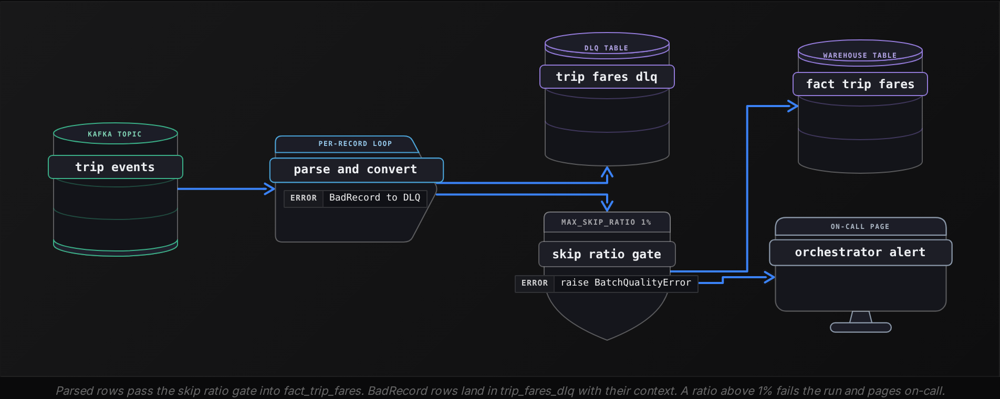

# Error Handling for Data Engineers: Intermediate

Dalia is 40 minutes into an onsite loop at Uber when the interviewer sketches a pipeline: a consumer reads trip-completed events from Kafka, converts each fare to USD through an internal currency service, and loads a daily driver-earnings table. 'Last night the currency service throttled us for 10 minutes, a trip arrived with a fare we couldn't parse, and the load task ran 3 times. What does the table look like this morning?' Dalia opens with 'I'd wrap the call in a retry,' and the follow-ups come quickly. Which exceptions deserve a retry? Where does the unparseable fare go? What stops a single corrupt event from freezing every trip behind it? Why didn't 3 runs triple the earnings? Underneath, each follow-up asks the same 2 things: does this failure deserve another attempt, and is another attempt safe?


<br>

### What you will be able to do

Sort any failure into transient or permanent and encode that split as a custom exception hierarchy

Send bad records to a DLQ while a skip ratio threshold fails the run on a schema break

Configure tenacity with full-jitter exponential backoff that retries only transient exception types

Cap retries of a poison message with attempt counts that survive restarts and rebalances

Make a rerun leave the table unchanged by choosing delete-write or upsert, or by building the result in staging and swapping it in


<br>

---

## Transient vs. Permanent Failures

Every retry decision answers a single question: if the identical call ran again in 30 seconds with the same input, could it succeed? A transient failure says yes, because the cause sits outside the data: a throttled API, a dropped TCP connection, a database deadlock, a replica in the middle of failover. A permanent failure says no, because the cause travels with the input or the configuration: a fare string of `18,40`, a missing required field, a revoked credential, a table that doesn't exist. Retrying a transient failure is how a pipeline heals itself overnight. Retrying a permanent one spends the whole retry budget on a call that cannot work, delays the alert by the full backoff schedule, and in a streaming consumer holds up every record queued behind it.

| Failure | Python exception | Class | Pipeline response |
| --- | --- | --- | --- |
| HTTP 429 Too Many Requests | custom, from the status code | Transient | Back off, honor Retry-After if sent |
| HTTP 503 or 504 | custom, from the status code | Transient | Back off and retry |
| Client-side timeout or refused connection | TimeoutError, ConnectionError | Transient | Back off and retry |
| Connection reset mid-request | ConnectionResetError | Transient | Retry |
| Chosen as a deadlock victim | the driver's own error class | Transient | Retry the whole transaction |
| Fare is "18,40" or "n/a" | ValueError | Permanent (record) | Send the record to the DLQ |
| Required field missing | KeyError | Permanent (record) | Send the record to the DLQ |
| HTTP 400 or 422 | custom, from the status code | Permanent (record) | Send the record to the DLQ |
| HTTP 401 or 403 | custom, from the status code | Permanent (job) | Fail the run and page |
| Credentials file missing | FileNotFoundError | Permanent (job) | Fail the run and page |


<br>

### Two kinds of permanent

Permanent failures split again by blast radius. A record-level failure belongs to 1 row: the next row carries its own fare and will probably parse. A job-level failure belongs to every row: when the credentials file is missing, row 2 fails exactly like row 1, and routing each one to the DLQ would fill it with 2,000,000 copies of the same error, one for every row of the nightly trip batch. Record-level failures are quarantined while processing continues. Job-level failures stop the run at once, so the orchestrator marks it failed and a person fixes the configuration.


<br>

### Put the classification in the type

A classification only helps if the code that acts on it can read it. Matching on the error message breaks the day a library rewords it. A custom hierarchy carries the decision in the exception's class, so each handler routes with an `except` clause, and a new failure type joins a branch by subclassing it.

```sql
class PipelineError(Exception):
    pass


class TransientError(PipelineError):
    pass


class RateLimited(TransientError):
    def __init__(self, message, retry_after=None):
        super().__init__(message)
        self.retry_after = retry_after


class PermanentError(PipelineError):
    pass


class BadRecord(PermanentError):
    pass


class JobConfigError(PermanentError):
    pass
```

The hierarchy matters most at the boundary where library and built-in exceptions enter the pipeline. A translation layer catches the raw types it recognizes, re-raises each as a pipeline type with `raise ... from` so the original traceback survives, and lets anything unrecognized propagate untouched. An exception nobody classified is one nobody has judged safe to skip or retry, so unknown types count as job-level by default.

Predict the verdict for each of the 4 raw exceptions in the routing program, then play it. Watch RateLimited: no inner except clause names it, yet it still reaches a branch.

https://github.com/user-attachments/assets/4c9a69ea-1ac2-437f-8082-1a75a28af5a1

*Raw exceptions are translated at the boundary, then routed by class.*

`RateLimited` lands in the retry branch through inheritance, which is the point of the hierarchy: handlers catch `TransientError`, and every subclass added later follows without anyone editing them. `FileNotFoundError` falls through to the fail branch because the translation names `ConnectionError` and `TimeoutError` explicitly. Widen that tuple to `OSError`, a tempting shortcut since both inherit from it, and the missing credentials file turns transient: the retry layer backs off and retries it until its attempts run out, and the alert sits behind the whole backoff schedule with a misleading retry history attached. `PermissionError` and `IsADirectoryError` are `OSError` subclasses too.

> The gray zone
>
> - HTTP 500: a bug or an overloaded host, and the response can't say which. Retry with a small cap, then treat it as permanent.
> - HTTP 401 from an expired token: refresh the token and retry once. A second 401 is a job-level configuration failure.
> - Deadlocks: transient, but retry the whole transaction, never the single statement that lost.
> - Unknown exception types: job-level until someone classifies them on purpose.

> **TIP**
>
> Say the classification question out loud before writing any retry code: would the identical call succeed in 30 seconds? The DLQ design follows from that answer, and so do the backoff schedule and the write pattern. The interviewer hears a policy derived from the failure instead of a reflex.


<br>

---

## Bad Records in a Good Batch

With `BadRecord` defined, the per-record loop takes a fixed shape. The `try` wraps the work for exactly 1 record. The `except` names `BadRecord` and nothing wider, so a `TransientError` escapes to the retry layer and a `JobConfigError` escapes to the orchestrator. The caught record goes to a dead letter queue (DLQ), a table or topic that stores rejected records with enough context to replay them, and the loop moves on.




<br>

### The contents of a DLQ row

| Field | Example | Why it is there |
| --- | --- | --- |
| raw_payload | {"trip_id": "t-3", "fare": "n/a"} | Replaying after a fix needs the original record, before any parsing |
| error_class | ValueError | Groups a night's failures by cause |
| error_message | could not convert string to float: 'n/a' | Shows which value broke the parser |
| source_position | trips topic, partition 3, offset 1193 | Locates the record in the source again |
| run_id | fares_2026-10-25_attempt1 | Ties the row to the run and its logical date |
| failed_at | 2026-10-26 02:14:09 UTC | Separates tonight's failures from last week's |

That loop has a failure mode that only shows up on a bad night. Suppose the upstream team renames `fare` to `fare_usd`. Every record now raises `KeyError`, every one is translated to `BadRecord`, and the handler does what it was written to do:

- **2,000,000** — rows routed to the DLQ
- **0** — rows loaded into fact_trip_fares
- **SUCCESS** — run status the orchestrator recorded

Per-record isolation disguised a job-level failure as a pile of record-level ones. The earnings dashboard shows no revenue for the day, and the first person to notice is a finance analyst the next morning. The fix is a skip ratio: after the loop, divide the DLQ count by the records read and raise if the ratio crosses a threshold. With a 1% threshold, the nightly batch absorbs up to 20,000 malformed fares, which is normal noise, while a rename that breaks every row fails the run in the same execution that caused it.

In the batch runner, Monday carries 1 unparseable fare in 4 rows and max_skip_ratio is 0.25. Tuesday arrives after the rename. Predict both printed lines before playing it.

https://github.com/user-attachments/assets/6bc0163c-2663-4dda-b843-ea26499975cd

*Bad rows go to the DLQ, and a ratio above the threshold fails the batch.*

Monday passes at a ratio of exactly 0.25 because the check uses `>`, which makes the threshold the largest ratio the run accepts. Choose the comparison on purpose and let the name say it: `max_skip_ratio` reads as inclusive. Tuesday raises `BatchQualityError` once the loop finishes. In a production loop the DLQ writes happen inside the loop, so the 3 broken rows are already stored for diagnosis when the run is marked failed.


<br>

### Tuning the threshold

- Derive it from history: if the worst normal night in the last 90 days skipped 0.3% of rows, 1% leaves headroom without hiding a break.
- Give small batches a floor: 1 bad row in 4 is 25%, so below 1,000 rows compare a raw count instead of a ratio.
- Check early on large batches: a ratio above 50% after the first 10,000 rows already proves a schema break, so abort there.
- Put the numbers in the error, such as 20113/2000000 rows skipped, so the page explains itself.

| ✓ Do | ✗ Don't |
| --- | --- |
| • Wrap exactly 1 record per try block so 1 bad row costs 1 row<br><br>• Catch BadRecord by name and let transient and job errors escape the loop<br><br>• Keep the raw payload in every DLQ row, next to its error class and source position<br><br>• Fail the run when the skip ratio crosses its threshold | • Catch Exception in the record loop: a revoked credential becomes 2M DLQ rows<br><br>• Mark a run successful because the loop reached the end<br><br>• Log a bad record and drop it, leaving nothing to replay<br><br>• Use 1 fixed threshold for 50-row and 50M-row batches |

> **TIP**
>
> When an interviewer asks what happens if some records are bad, the natural follow-up is what happens if all of them are. Answer both together: a DLQ quarantines the few, and the skip ratio turns the many into a failed run that someone sees that night.


<br>

---

## Backoff Retries with tenacity

The retry layer owns the other branch of the hierarchy, `TransientError`. Its job is to give a struggling dependency time to recover without adding to its load. The tenacity library builds that policy into a decorator from 3 decisions: which exceptions to retry, how long to sleep between attempts, and when to give up.


<br>

### What a bare @retry does

A bare `@retry` with no arguments is valid code, and each of its 3 defaults is the wrong choice for a pipeline:

- **stop_never** — default stop condition
- **wait_none** — default sleep between attempts
- **Exception** — default exception type it retries

Put together, a `KeyError` from a bad record is retried in a tight loop until someone kills the process, and a throttled currency service receives a flood of calls from a client it has already asked to slow down.


<br>

### The configured policy

```sql
import logging

from tenacity import (
    before_sleep_log,
    retry,
    retry_if_exception_type,
    stop_after_attempt,
    stop_after_delay,
    wait_random_exponential,
)

log = logging.getLogger("fares")


@retry(
    retry=retry_if_exception_type(TransientError),
    wait=wait_random_exponential(multiplier=1, max=30),
    stop=stop_after_attempt(5) | stop_after_delay(120),
    before_sleep=before_sleep_log(log, logging.WARNING),
    reraise=True,
)
def fetch_usd_rate(currency, day):
    return fx_client.get_rate(currency, day)
```

Here `fx_client` stands for the translation layer, so a throttle reaches the decorator as `RateLimited` and a malformed currency code as `BadRecord`. Each argument answers one of the 3 decisions:

- retry_if_exception_type(TransientError): retries TransientError and every subclass, such as RateLimited. A BadRecord leaves on the first attempt.
- wait_random_exponential(multiplier=1, max=30): after failed attempt n, sleeps a random time between 0 and min(30, 2 \*\* (n - 1)) seconds.
- stop_after_attempt(5) | stop_after_delay(120): stops at 5 attempts in total, which means 4 sleeps, or 120 seconds after the first attempt began, whichever comes first.
- before_sleep_log(log, logging.WARNING): logs a warning before each sleep, so a run that only succeeded on attempt 4 still shows up in the logs.
- reraise=True: when the attempts run out, raises the last original exception instead of tenacity's own RetryError.

That last flag decides whether the hierarchy still works above the decorator. Without it, exhausting the attempts raises `tenacity.RetryError`, which is no `PipelineError`. Every `except TransientError` handler higher up stops matching, and the failure falls through to whatever catches generic exceptions, usually the job-level fail branch with a traceback that hides the original 429.


<br>

### Random waits break the lockstep

| Failed attempt | Plain exponential sleep | Full-jitter sleep |
| --- | --- | --- |
| 1 | 1s | 0 to 1s |
| 2 | 2s | 0 to 2s |
| 3 | 4s | 0 to 4s |
| 4 | 8s | 0 to 8s |
| 5 | re-raise | re-raise |

Plain exponential backoff spaces out the attempts of 1 client but keeps many clients in lockstep. When the currency service throttles, all 200 parallel tasks of the nightly run fail in the same second, then all 200 retry at the 1-second mark, the 3-second mark and the 7-second mark, recreating the spike that caused the throttle. Full jitter draws each sleep uniformly from 0 up to the exponential ceiling, so retries that would land in a single instant spread across the whole window, and the average sleep halves. When the service sends a `Retry-After` header with its 429, that value beats any formula, and a custom `wait` callable can read it from `RateLimited.retry_after`.

The backoff program swaps tenacity for a small loop that applies the same rules without jitter, so every sleep can be predicted. Write down what each of the 3 calls prints: one that fails 3 times and then works, one that never recovers, and one that raises PermanentError.

https://github.com/user-attachments/assets/261d009c-7af1-4e9c-afd4-ec848ef775b6

*Sleeps double up to the cap, and only TransientError is retried.*

The first call returns after 3 sleeps that double from 1 second to 4. The second spends all 4 sleeps, the last one landing on the cap of 8, prints its 'gave up' line on attempt 5, and re-raises the original `TransientError` with its message intact, the behaviour `reraise=True` buys. The third prints no 'gave up' line: `PermanentError` never matches `except TransientError`, so it exits on attempt 1 without a single sleep.

> **TIP**
>
> Retries multiply. If the function makes 5 attempts and the orchestrator also runs the task 3 times, a dead dependency is called 15 times per task before anyone hears about it. Decide which layer owns transient retries, usually the call site, and keep task-level retries for crashes.


<br>

---

## The Poison Pill Problem

A batch loop can skip a bad row and keep going. A Kafka consumer has less freedom. Within a partition, records are processed in offset order, and the consumer's progress is a single committed offset: the position of the next record to read. Committing only after a record is handled means no record is ever lost, and it also creates a hazard. A record that crashes the consumer never gets committed, so the restarted consumer reads it first and crashes again. Every later record in that partition waits behind it.

| Offset | Event | Status |
| --- | --- | --- |
| 4810 | trip t-9001 completed | handled and committed |
| 4811 | trip t-9002 completed | handled and committed |
| 4812 | trip t-9003 with a 40 MB fare breakdown | kills the consumer on every read |
| 4813 | trip t-9004 completed | waiting |
| 4814 | trip t-9005 completed | waiting |

Offset 4812 is a poison pill: it defeats the handler so completely that no `except` clause runs. Classification catches the failures someone anticipated, and a poison pill is usually one nobody did: an out-of-memory kill while decoding an oversized payload, a crash inside a native parsing library, an exception type the translation layer let through. Other partitions keep flowing, so a topic-wide dashboard looks mostly healthy while 1 partition stops dead. This partition carries 400 events per second, and the crash loop runs for 30 minutes before anyone is paged.

- **720,000** — events stuck behind offset 4812


<br>

### Why an in-memory counter fails

The instinct is a dict of attempts per offset and a rule: after 3 attempts, write the record to the DLQ and commit past it. That dict lives inside the process that keeps dying. Each crash resets it to empty, and a rebalance hands the partition to another consumer whose dict never saw offset 4812. The attempt count has to survive both events, so it lives outside the consumer, in a shared database table or key-value store keyed by the topic-partition pair plus the offset.


Order matters as much as location: the consumer increments the count before it handles the record. An out-of-memory kill never reaches an `except` block or a `finally`, so a count written after the failure is a count that never moves.

In the consumer program, attempts_store stands in for the durable table because it outlives each call to run_consumer, and each call plays 1 consumer process. Predict how many restarts drain the partition with max_attempts=3. Then predict the output if attempts_store = {} moved inside run_consumer.

https://github.com/user-attachments/assets/0e3e62f7-4061-45de-afa9-c627cf99abbf

*The attempt count outlives each consumer process, so the 4th start skips the poison record.*

Restarts 1 to 3 each raise the count for offset 2 and crash. Restart 4 reads a count of 4, which exceeds the cap, so it writes the record to the DLQ and commits past it. The rest of the partition then drains. With the store inside the function, every restart begins from a count of 1, the cap is never reached, and all 5 restarts print 'crashed at offset 2'.


<br>

### The cost of a durable counter

Writing to the shared store for every message adds a network round trip per record, 400 extra writes per second on this partition alone. When the consumer commits after each record, a cheaper rule keeps the same guarantee: only the record at the committed offset can have killed the previous owner of the partition, so the consumer bumps the count for that 1 offset each time it starts or is assigned the partition, and skips the write for everything after it. Restarts are rare, so the store sees a handful of writes a day. With commits batched every few hundred records, the crash could sit anywhere in the uncommitted range, so after a restart the consumer replays that range 1 record at a time, committing each, until it passes the crash point.

| ✓ Blocking retry in place | ✗ Retry topic, then DLQ |
| --- | --- |
| • Retries the record at its own offset before moving on<br><br>• Keeps per-key order: later events for trip t-9003 wait for it<br><br>• Stalls the partition for the whole retry window<br><br>• Needs the durable attempt cap to escape a poison pill | • Commits past the failure and republishes it to a retry topic<br><br>• Keeps the partition moving at full speed<br><br>• Breaks per-key order: a later event for the same trip can land first<br><br>• Needs a consumer per retry topic and a DLQ at the end of the chain |

The decision an interviewer is listening for is ordering. If downstream logic assumes a trip's events arrive in order, such as a fare adjustment that must apply after the original fare, blocking retries with a durable cap are the safe default. If every event stands alone, retry topics keep the partition moving through an outage of the enrichment service, at the price of more topics to run and watch.


<br>

---

## Idempotent Writes for Safe Retries

Every retry so far assumed that a failed attempt leaves nothing behind. Writes break that assumption. A load task that inserts 5 chunks into `fact_trip_fares`, loses its connection after chunk 3, and is retried by the orchestrator inserts all 5 again, leaving chunks 1 to 3 in the table twice. With equal chunks, the day's revenue reads 60% high, yet the retried run finished successfully and no alert fired. A write is retry-safe when running it twice leaves the table in the same state as running it once, which is what idempotent means for a load.

The write program loads 4 trips with 2 writers. Each crashes after 2 rows and is called again from the top, the way an orchestrator retry would. Predict the 2 row counts it prints.

https://github.com/user-attachments/assets/ca078453-3bd4-447b-b804-46a254a2d353

*The same crash and retry, written as an append and as an upsert by trip_id.*

The append writer ends with 6 rows, 2 of them duplicates. The upsert writer ends with 4 because each row is addressed by `trip_id`, so the second run overwrites the 2 rows the first run left behind.


<br>

### Write patterns that survive a rerun

#### Delete-write: replace the whole partition

Delete-write treats the run's partition as the unit of work. The task deletes everything for its logical date, then inserts the full result, so a retry removes its own partial output first.

```sql
DELETE FROM fact_trip_fares
WHERE trip_date = DATE '2026-10-25'
```

```sql
INSERT INTO fact_trip_fares
SELECT
  trip_id,
  trip_date,
  fare_usd
FROM parsed_trip_fares
WHERE trip_date = DATE '2026-10-25'
```

It needs no key and handles rows that vanished upstream, since nothing old survives the delete. Run as 2 statements that each commit on their own, it opens a window between them: a dashboard querying during it sees an empty day, and a crash inside it leaves the day empty until the retry runs. Wrapping both in a single transaction, `START TRANSACTION` before the delete and `COMMIT` after the insert, closes that window: readers keep seeing the old day until the commit, and a crash mid-load rolls the delete back. The cost that remains is rewriting the full partition when 3 rows changed. Some storage layers cannot run a multi-statement transaction at all, and that is where the third pattern comes in.

#### Upsert: replace rows by key

Upsert, usually a `MERGE` on the natural key, updates rows that exist and inserts the rest, so a retry overwrites its own earlier output row by row. It fits incremental loads where late corrections arrive for old trips. It depends on a key that comes out the same on every run: a surrogate generated with `uuid4()` at load time hands each retry fresh keys, and the upsert quietly turns back into an append. It also never removes a row that disappeared from the source.

#### Staging and atomic swap

The third pattern writes the full result to a staging table no reader queries, validates it there (row count against the source, the skip ratio from the DLQ step, null checks on `fare_usd`), and only then replaces the live table or partition in a single metadata operation. A crash at any point before the swap leaves the live table untouched, and the retry rebuilds staging from scratch. The swap has to be atomic in your storage layer. Renaming live to old and then staging to live takes 2 steps, and for a short window between them the table name points at nothing.

| Pattern | Unit a retry replaces | Readers see partial data? | Main cost | Fits |
| --- | --- | --- | --- | --- |
| Delete-write | Partition (logical date) | Yes if DELETE and INSERT commit separately, no inside a single transaction | Rewrites the full partition | Daily batches with a clean partition column |
| Upsert | Row, by natural key | No for a single MERGE, yes when the load commits in chunks | A key lookup per row, and source deletes survive | Incremental loads with late corrections |
| Staging and atomic swap | Whole table or partition | No, even when the load cannot run as a single transaction | 2x storage during the load, and the swap must be atomic | Tables with readers during the load |

> Idempotency starts with the inputs
>
> - Derive the partition from the run's logical date, never from `datetime.now()`: a retry after midnight writes to tomorrow.
> - Read a fixed source range: the offsets or date window recorded when the run started.
> - Build keys from source fields such as `trip_id`, never from load-time UUIDs or row numbers.
> - Validate in staging and swap last, so a retry rebuilds everything that came before the swap.

> **TIP**
>
> Asked 'what happens if this task runs twice?', name the unit your write replaces, whether a key or a partition or the whole table, and the window in which readers can see a partial result. Those 2 facts are the tradeoff between the 3 patterns, and naming them shows the write was designed with the retry in mind.


<br>

---

## Putting It All Together

The driver-earnings pipeline from the interview reads trip-completed events, converts each fare to USD through a currency service, and loads a daily table that payout and finance reports read in the morning. On a single night the currency service throttles for 10 minutes, a trip arrives with a 40 MB fare breakdown that kills its consumer, an upstream rename breaks every row of another region's feed, and the orchestrator retries the load 2 times.

- The 429s reach tenacity as RateLimited because the translation layer classified them, so full-jitter backoff absorbs the throttle and the 200 tasks don't retry in lockstep.
- The renamed field turns every row of that feed into a BadRecord, the DLQ keeps their raw payloads, and the skip ratio turns a silent empty day into a failed run.
- The 40 MB event kills its consumer before any except clause runs. The durable attempt count moves it to the DLQ on the 4th start and unblocks the partition.
- The orchestrator's 2 retries rebuild the day in staging and swap it in atomically, so payout reports read a single copy of each trip.
- Each layer owns a single failure class: the hierarchy decides, tenacity waits, the DLQ isolates, the attempt cap escapes, and idempotent writes make every rerun safe.


<br>

---

## Key Takeaways

- Classify every failure by whether the identical call can succeed later, and encode the answer as TransientError or PermanentError subclasses.
- Split permanent failures by blast radius: a bad record goes to the DLQ, a broken configuration stops the run.
- Route record-level failures to a DLQ with the raw payload, and fail the run when the skip ratio crosses its threshold.
- Configure tenacity explicitly so it retries only TransientError, with full-jitter exponential backoff. Stop on both attempts and elapsed time, and reraise the original.
- Cap poison-pill retries with an attempt count stored outside the consumer and incremented before the record is handled.
- Make every write idempotent with delete-write, upsert on a stable key, or staging plus an atomic swap, all driven by the run's logical date.
