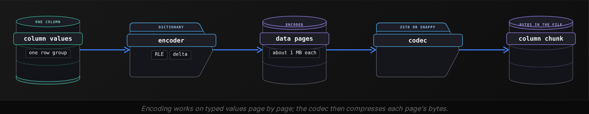
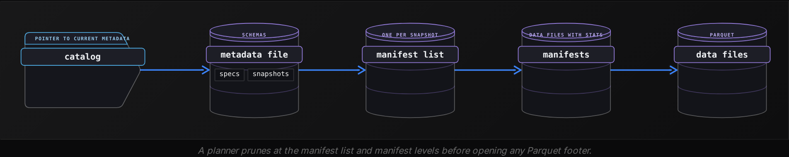
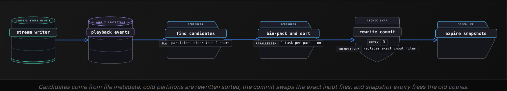
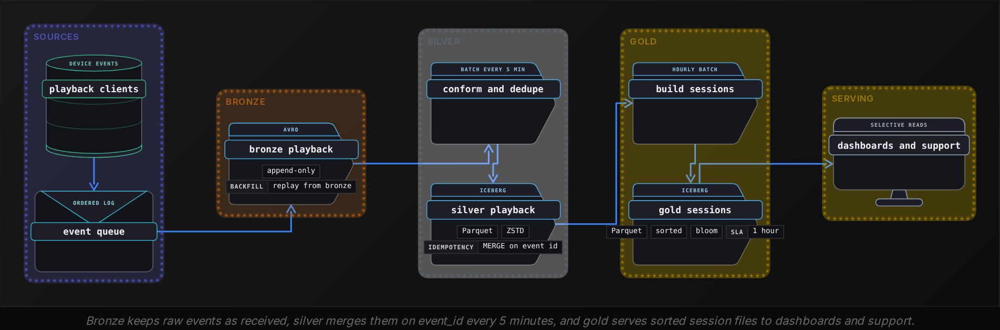

# File Parsing for Data Engineers: Advanced

Wendell is in the final loop for a data platform role at Netflix, the company where Apache Iceberg began. The interviewer describes a 40 TB playback-events table that answered lookups by `session_id` in 8 seconds last quarter and now takes 3 minutes. Since then, a streaming job started writing to it every minute, and a new `device_fingerprint` column went in. "Walk me through where the time went," he says, "and what you would change." Wendell knows Parquet has row groups and a footer. The answer sits one level lower: which encoding each column chunk ended up with, whether any statistic can rule a file out, how many objects the planner must open, and which table format can change the layout without rewriting 40 TB. This lesson builds that layer until the scenario reads as a list of measurable causes.


<br>

### What you will be able to do

Explain how dictionary encoding with RLE, and delta binary packing for integers, shrink a column before the codec runs; read a footer to catch dictionary fallback

Predict when a bloom filter skips a row group that min/max statistics cannot, and what late materialization saves inside the survivors

Choose between Delta Lake and Apache Iceberg by checking whether a workload needs partition evolution and which engines and catalog it has to work with

Diagnose the small file problem from its symptoms and design a compaction job with stated targets and commit rules

Defend a file format strategy for each medallion tier from the operation that dominates it


<br>

---

## Parquet Column Encodings

### Encoding first, codec second

A Parquet writer shrinks each column chunk in 2 passes. **Encoding** rewrites values using their type and repetition and emits pages of encoded values. The **compression codec** (ZSTD, Snappy) then squeezes each page's bytes without knowing what they mean. A codec cannot tell that a 64-bit timestamp rises by about 3 per row. The encoder can, and replaces 8 bytes per row with a few bits. A column that encodes badly hands the codec raw values, and the codec has to rediscover patterns the type already made explicit.




<br>

### Dictionary encoding and its RLE indices

With dictionary encoding, the writer collects each distinct value in the column chunk once, writes them as a dictionary page, and stores every row as an integer index into it. The indices use `RLE_DICTIONARY`, a hybrid that writes a repeated index as a pair of value and run length and packs other stretches at a fixed bit width: the bits needed for the largest index. A dictionary of 200 country codes therefore needs 8 bits per index. Sorting by the column turns the indices into long runs, and 50,000 consecutive rows of `US` collapse to a single pair costing a few bytes.

- **6 MB** — 1M country codes written PLAIN
- **1 MB** — the same rows as 8-bit indices

PLAIN stores each string as a 4-byte length followed by its bytes, so a 2-letter code costs 6 bytes. Indices cost 1 byte each before RLE collapses the runs, and the dictionary page adds 200 short entries.


<br>

### Delta binary packing for ordered integers

Integer and timestamp columns often use `DELTA_BINARY_PACKED`. The writer stores the first value, then each value's difference from the one before. Within a block it subtracts the smallest difference, so every remaining number is zero or positive, and packs each mini-block of 32 values at the bit width of its largest remaining number. Five event timestamps in epoch seconds:

| event_ts | delta | delta minus min (1) | packed at 3 bits |
| --- | --- | --- | --- |
| 1700000000 | first value | in the header | in the header |
| 1700000003 | 3 | 2 | 010 |
| 1700000004 | 1 | 0 | 000 |
| 1700000009 | 5 | 4 | 100 |
| 1700000010 | 1 | 0 | 000 |

Written PLAIN as INT64, the 4 later timestamps cost 32 bytes. Packed, they cost 12 bits plus a header. The header holds the first value; the minimum delta is kept per block of 128 values, and the bit width per mini-block of 32. A lasting jump of 1,000,000 seconds is one large delta, so only its own mini-block widens to 20 bits. A single row that is out of place jumps ahead and then back. The return delta of about -1,000,000 lowers the minimum for the whole block. After subtraction, every normal delta becomes about 1,000,000, so all 128 values pack at 20 or 21 bits. Sorting before the write therefore helps twice: RLE gets long runs and delta packing gets narrow widths.


<br>

### When the dictionary gives up

Writers cap the dictionary page of each column chunk, and common writers default the cap to 1 MB. When a new distinct value would push the dictionary past the cap, the writer stops dictionary encoding for the rest of that chunk and writes its remaining data pages as PLAIN, including values the dictionary already holds. No error is raised, and nothing is logged by default. The next row group starts a fresh dictionary, so the damage appears chunk by chunk. A device_fingerprint column of 64-character hex strings costs 68 bytes per dictionary entry with its length prefix, so the cap is reached after roughly 15,400 distinct values, far fewer than the distinct devices in a row group of 1 million playback rows.

The program models a writer whose cap is 3 dictionary entries instead of 1 MB, so the fallback happens at row 11. Predict the 4 printed lines before stepping through it, and decide which list the final `US` lands in.

https://github.com/user-attachments/assets/8a88ae46-803f-4a3a-9ff4-0b8468a28a8d

*A dictionary capped at 3 entries: once it falls back, every later value is written PLAIN.*

`IN` arrives when the dictionary already holds 3 entries, so the writer switches to PLAIN and every later value goes to `plain`. The closing `US` has index 0 waiting for it and still lands there. Real writers switch per page and measure the dictionary in bytes, but the shape holds: a chunk that falls back stays PLAIN until the next column chunk begins, and every page after the switch carries full strings.

#### Reading the fallback in the footer

```sql
{
  "row_group": 3,
  "column": "device_fingerprint",
  "encodings": [
    "PLAIN",
    "RLE",
    "RLE_DICTIONARY"
  ],
  "encoding_stats": [
    {
      "page_type": "DICTIONARY_PAGE",
      "encoding": "PLAIN",
      "count": 1
    },
    {
      "page_type": "DATA_PAGE",
      "encoding": "RLE_DICTIONARY",
      "count": 2
    },
    {
      "page_type": "DATA_PAGE",
      "encoding": "PLAIN",
      "count": 61
    }
  ],
  "total_uncompressed_size": 70254112,
  "total_compressed_size": 41866530
}
```

The signal is a single column chunk whose data pages use both `RLE_DICTIONARY` and `PLAIN`, which `encoding_stats` shows directly: 2 dictionary-encoded pages, then 61 PLAIN ones. To size the damage, divide `total_compressed_size` by row count for row groups written before and after the column changed. A jump from 3 bytes to 42 bytes per row on a single column points at the encoder, and changing the codec won't recover it.

> Match the fix to the cause
>
> - Values unique per row, such as request IDs: disable dictionary encoding for that column.
> - Cardinality slightly above the cap, such as 40,000 product names of 30 bytes: raise that column's limit.
> - Cardinality spread across time: sort or cluster before writing, or shrink row groups.


<br>

---

## Bloom Filter and Late Materialization

### Why min/max cannot rule out a session ID

Row group statistics prune by range. A random identifier such as a UUID v4 `session_id` spreads each row group's values across the whole keyspace, so every minimum starts near `000` and every maximum near `fff`. An equality lookup falls inside every range, and the reader opens every row group. Sorting the table by `session_id` would narrow the ranges, but it would scatter each hour of events across all files and break the time filters most other queries rely on.

```sql
SELECT
  title_id,
  device_type,
  playback_ms,
  error_log
FROM playback_events
WHERE session_id = '7c1e4b2a-90d3-4f6e-b8a1-2d5c3e9f0a17'
```


<br>

### A bloom filter for each column chunk

A Parquet bloom filter is a bitset built for a single column chunk and stored outside the footer, with its offset recorded in the column's metadata. Inserting a value sets the bits at positions derived from its hash. A lookup hashes the probe and checks the same positions: if any bit is 0, the value was never inserted and the row group is skipped; if all are 1, the value might be present and the row group is read. Parquet specifies the split block variant, where each value maps to a single 256-bit block and sets 1 bit in each of its 8 words of 32 bits, so a probe touches a single cache line.

The program uses 16-bit filters and takes one position from `key % 16` and the other from `(key  16) % 16`, both computed from the key itself, so every bit can be checked by hand. The row groups hold unsorted IDs, so their min/max ranges overlap. Predict which of the 6 printed lines say `bloom: True`.

https://github.com/user-attachments/assets/4a8cdc9a-29c7-407a-a71c-f980cc5398c0

*Min/max ranges overlap for unsorted IDs; the bloom filters rule out row groups the ranges cannot.*

For 509, the statistics keep all 3 row groups and the bloom filters keep only `rg2`, which holds it. For 362, the statistics keep `rg0` and `rg1`, and the bloom filters keep `rg0`, which does not contain 362: a false positive, paid for with a wasted row group read. False positives come from bit collisions, and `rg0` has 5 of its 16 bits set after only 3 keys. A real filter avoids that by spending enough bits per distinct value.

#### Sizing the filter

A classic bloom filter needs -ln(p) / (ln 2)^2 bits per distinct value for a false positive rate p, about 9.6 bits at 1%. The writer allocates the bitset before it sees the data, so filters are configured per column with an expected distinct count. A low guess pushes the false positive rate up; a high one leaves dead bytes in every file. Split block filters need slightly more bits than the classic figure for the same rate.

- **1.2 MB** — filter for 1M keys at 1%
- **14.4** — bits per key at 0.1% false positives

| ✓ A bloom filter pays off | ✗ A bloom filter is dead weight |
| --- | --- |
| • Equality or IN predicates on the column<br><br>• Millions of distinct values per file<br><br>• Unsorted values, so min/max ranges overlap<br><br>• Lookups that match a few rows out of billions | • Range predicates such as > or BETWEEN<br><br>• Low cardinality: the dictionary page already answers membership<br><br>• Sorted columns, where min/max already prunes<br><br>• Columns never filtered by equality |


<br>

### Late materialization inside surviving row groups

Pruning decides which row groups to open; late materialization decides how much of each survivor to read. The reader decodes the predicate column first and builds a row selection, the list of matching row numbers. It then consults the page index, which has 2 parts: the column index holds min/max per page, and the offset index holds each page's byte location and first row number. With the offset index, the reader fetches only the pages of the other projected columns that contain selected rows. An eager reader instead fetches every projected column chunk in full and filters after decoding.

| Column | Pages in the row group | Eager read | Late read |
| --- | --- | --- | --- |
| session_id | 12 | 12 | 12 |
| title_id | 4 | 4 | 1 |
| device_type | 2 | 2 | 1 |
| playback_ms | 8 | 8 | 1 |
| error_log | 40 | 40 | 1 |
| Total | 66 | 66 | 16 |

The matching session sits in a single page of each column, so 66 page reads become 16, and 12 of those 16 belong to the predicate column. The saving depends on selectivity and on how wide the projected columns are. A filter matching 30% of rows spread evenly hits nearly every page of every column, so late materialization reads almost everything anyway and adds a second round of requests; eager reading wins there.

> **TIP**
>
> Name the levels of skipping in the order a reader applies them: row group by statistics and bloom filter, page by column index, row by selection. Then say where each stops working: overlapping ranges, pages that span the whole range, and low selectivity.


<br>

---

## Delta Lake vs Apache Iceberg

### Same Parquet files, different commit points

Delta Lake and Apache Iceberg both keep table data in Parquet files and add a metadata layer recording which files make up the table at each version. That layer gives writers atomic commits and readers consistent snapshots, and it is also what makes time travel and schema evolution possible. The formats differ in where the current version is recorded and how a writer claims the next one. Those 2 decisions shape how each handles partition evolution, and they also decide which engines can reach a table and whether it needs a catalog.

#### Delta Lake: an ordered log beside the data

A Delta table directory holds its data files and a _delta_log/ directory of numbered JSON commits, starting at 00000000000000000000.json and 00000000000000000001.json. Each commit lists its actions, which include add and remove as well as metaData and protocol. A reader starts from the latest checkpoint, a Parquet summary of the log written every 10 commits by default, and replays later commits to compute the live file set. A writer commits version N by creating file N, which must fail if another writer created it first, so the storage layer has to offer put-if-absent writes. The table is located by its path, with no catalog required.

```sql
[
  {
    "add": {
      "path": "event_date=2026-03-03/part-00017.parquet",
      "size": 134217728,
      "dataChange": true
    }
  },
  {
    "remove": {
      "path": "event_date=2026-03-03/part-00004.parquet",
      "deletionTimestamp": 1772496000000,
      "dataChange": true
    }
  },
  {
    "commitInfo": {
      "operation": "MERGE",
      "timestamp": 1772496000000
    }
  }
]
```

#### Iceberg: a metadata tree behind a catalog pointer

An Iceberg catalog stores a single pointer per table: the location of its current metadata file. That JSON file lists the table's snapshots and also stores its schemas and partition specs. Each snapshot points to a manifest list. Its entries point to manifests and carry each manifest's partition ranges, and each manifest lists data files with partition values and per-column statistics. A commit writes new files bottom up. It then asks the catalog to swap the pointer from the metadata file it started from to the new one. The swap fails if another writer moved the pointer first, and the writer then retries on the new state. The catalog's swap is what makes the commit atomic, which is why Iceberg needs a catalog.




<br>

### Partition evolution

Delta partition columns are ordinary columns chosen at table creation, and the directory layout follows them. Generated columns let a filter on `event_ts` prune `event_date` partitions, but moving from daily to hourly partitions, or adding a bucket on `session_id`, means rewriting every file. Recent Delta releases add liquid clustering, whose keys can be changed for future writes in place of fixed partitions.

Iceberg derives partition values from source columns through transforms such as `day(event_ts)` and `bucket(16, session_id)`, called hidden partitioning because queries filter on `event_ts` and never name a partition column. The spec can change: files written earlier keep spec 0, later files use spec 1, and the planner tests the predicate against each file through that file's own spec, so no data is rewritten.

Iceberg after a spec change

| file | spec | partition values |
| --- | --- | --- |
| f-0101.parquet | 0: day(event_ts) | 2026-03-01 |
| f-0102.parquet | 0: day(event_ts) | 2026-03-02 |
| f-0207.parquet | 1: day + bucket(16) | 2026-03-03, 7 |

Delta changing its partition column

| step | files touched |
| --- | --- |
| read every partition | all of them |
| write the new layout | all of them, again |
| commit a version | replaces every file |


<br>

### Engine reach and catalog requirements

Iceberg is defined by a written specification with numbered format versions: v2 added row-level deletes, and v3 adds deletion vectors and new types. Engines implement it independently, and the REST catalog specification lets any engine reach any compliant catalog over HTTP, so 3 engines writing the same table share a single source of truth. Delta's protocol is published too, and engine builders get connectors and a kernel library. Its capabilities are gated by table features declared in the `protocol` action, so enabling a feature can lock out an engine whose connector doesn't support it yet.

| ✓ Delta Lake | ✗ Apache Iceberg |
| --- | --- |
| • Commit: put-if-absent on the next log file<br><br>• Locating the table: its storage path<br><br>• Partitioning: fixed columns; changing them takes a rewrite or liquid clustering<br><br>• Row-level changes: deletion vectors<br><br>• Metadata growth: log files plus checkpoints every 10 commits | • Commit: compare-and-swap on the catalog pointer<br><br>• Locating the table: a catalog lookup<br><br>• Partitioning: transforms, evolved without rewriting data<br><br>• Row-level changes: position and equality delete files, deletion vectors in v3<br><br>• Metadata growth: a manifest list per snapshot, manifests rewritten when they multiply |

#### Justifying a choice for a workload

A defensible answer names the constraint that dominates the workload and the cost it accepts. The 40 TB playback table is read by several engines and its layout will keep moving as query patterns shift, so Iceberg's in-place partition evolution avoids a full rewrite at each change, at the price of running a catalog service. A team with a single engine, path-based tables and no catalog to operate gets fewer moving parts from Delta, and accepts that a layout change means a rewrite.


<br>

---

## The Small File Problem

### How a streaming writer multiplies files

File count is a product: commits per day, times writer tasks, times the partitions each task touches. The playback stream commits every minute, 1,440 commits a day, and each commit runs 200 tasks that each write 1 file into the current hour's partition. The table takes in 1 TB a day.

- **288,000** — files written per day
- **3.5 MB** — average file size

The job runs without a single error. Every file is valid Parquet and has a footer with statistics, along with a dictionary page; the damage shows up on the read side and in the table's metadata.


<br>

### Symptoms and the mechanism behind each

| Symptom | Mechanism | How to confirm |
| --- | --- | --- |
| Planning runs for minutes before the first task | The planner lists objects and reads a footer per file, and manifests or log entries grow with file count | Planning time against live file count |
| GET requests explode and the store throttles | Each file costs a footer read plus 1 read per projected column chunk, and request latency outweighs transfer | Requests per query in storage metrics |
| Row group statistics prune but save nothing | Each file holds 1 small row group, and skipping it still costs the footer read that revealed its range | Footers read against row groups skipped |
| The same rows take more bytes | Each file repeats its own dictionary pages and restarts its RLE runs, and the codec sees less data | Bytes per row against a compacted partition |
| Commits and snapshot expiry slow down | Every file adds a log action or manifest entry that later commits and cleanup must process | Metadata bytes added per day |

Put a number on the request side. A query reading 3 columns from a single day issues at least 1 footer read and 3 column chunk reads per file, 1,152,000 requests in all. At 20 ms per request across 64 parallel readers, that is 360 seconds of request latency before transfer time counts. The same terabyte in 128 MB files is 7,813 files and 31,252 requests, under 10 seconds on the same readers.


<br>

### Measuring file health from table metadata

```sql
SELECT
  "partition",
  COUNT(*) AS file_count,
  COUNT_IF(file_size_in_bytes < 33554432) AS files_under_32mb,
  AVG(file_size_in_bytes) / 1048576 AS avg_mb
FROM "playback_events$files"
GROUP BY "partition"
ORDER BY file_count DESC
LIMIT 20
```

Iceberg lists every live data file in the `$files` metadata table, including each file's partition and size. In Delta the same facts sit in the log's `add` actions. Per partition, file health comes down to file count and average size, plus how many files fall under a small-file threshold.


<br>

### Designing the compaction job

A compaction job rewrites a partition's small files into a few large sorted ones, then commits the swap as a single transaction. Planning it is bin packing: choose candidate files, then group them so each output lands near the target size. The program plans a partition with a 128 MB target, treats files under 32 MB as candidates, and places each candidate, largest first, into the first group with room. Predict how many outputs it plans and the size of the last.

https://github.com/user-attachments/assets/494a3003-f059-494c-9f87-707c10a7826b

*First-fit decreasing over a partition's small files, 128 MB target.*

It plans 2 outputs: 128 MB from 6 files and 21 MB from 5, so 13 files become 4. The 21 MB output is itself a small file. Planners handle such a remainder in 1 of 3 ways: rewrite it anyway when it gathers enough inputs (Iceberg's `min-input-files` option defaults to 5, and this group has 5), leave it for the next run when more small files will have landed, or fold a mid-size file into it, since the 60 MB file plus the remainder makes 81 MB.



> Decisions the job design states
>
> - Scope: only partitions whose small-file count crossed a threshold since the last run.
> - Hot data: skip the partition the stream is writing and compact behind a watermark, such as 2 hours.
> - Commit: a single transaction per group, so readers see the old file set or the new one.
> - Conflicts: a rewrite conflicts with deletes touching the same files, so keep groups small enough to retry.
> - Layout: sort by `title_id` within each hour while rewriting, and write bloom filters for `session_id`.
> - Cleanup: expire old snapshots and remove orphan files, or storage holds both copies.

The writer can prevent most of this. Repartitioning by the partition key before the write sends each partition's rows to 1 task, which turns 200 files per commit into 1 per active partition: 1,440 files a day averaging roughly 700 MB. A 5-minute trigger instead cuts commits by a factor of 5. Each trades write parallelism or freshness for read speed, and the answer should say which of the 2 the consumers can afford.


<br>

---

## Designing a File Format Strategy

### Each tier is shaped by its dominant operation

Bronze is written once and read only for the occasional replay or audit. Silver is rewritten constantly, because merges deduplicate events and absorb late arrivals. Gold is read thousands of times for every write. A file format strategy gives each tier the format and layout that make its dominant operation cheap, without making the hand-off to the next tier expensive.



| Tier | Dominant operation | Format | Layout | File size |
| --- | --- | --- | --- | --- |
| Bronze | Append; occasional full replay | Avro, or source files as received | Partition by ingest date only | As large as each batch allows |
| Silver | MERGE, dedupe, late updates | Table format over Parquet, ZSTD | Partition by event date; merge-on-read | 128 to 512 MB after compaction |
| Gold | Selective reads and scans | Table format over Parquet, ZSTD | Sorted on filter columns; bloom filters on lookup keys | 256 MB to 1 GB |

#### Bronze: write-optimized and faithful

Bronze exists so that any downstream bug can be fixed by replaying it, which means keeping the source's bytes and arrival order. Avro fits: records are appended individually, the writer's schema travels in the file header, and readers resolve older schemas against newer ones. A malformed record must never fail the write, so parsing into a strict typed schema waits for silver.

#### Silver: transactional because it is rewritten

Silver absorbs deduplication on `event_id`, change-data upserts and late events. A MERGE that rewrites 400 files and dies after file 230 would leave a plain directory of Parquet half old and half new; a table format commit makes the whole rewrite appear at once or not at all. The second decision is how updates are written. Copy-on-write rewrites every file an update touches: slow writes, fast reads. Merge-on-read writes delete files or deletion vectors plus the new rows: fast writes, and reads that slow down until compaction folds the deletes in. A table merged every 5 minutes wants merge-on-read with scheduled compaction.

#### Gold: laid out for the reader

Gold is where the earlier techniques pay off, because it is rebuilt from silver and its layout can change freely. Sort by the columns its readers filter on, so min/max prunes and RLE runs lengthen. Add bloom filters on high-cardinality lookup columns such as `session_id`. Disable dictionary encoding on columns like `device_fingerprint` that would fall back anyway, and compact to large files so footers and requests stay few.

```sql
tiers:
  bronze:
    file_format: avro
    codec: zstd
    partition_by: [ingest_date]
    retention_days: 90
  silver:
    table_format: iceberg
    file_format: parquet
    codec: zstd
    partition_spec: ["day(event_ts)"]
    write_mode: merge-on-read
    target_file_mb: 256
  gold:
    table_format: iceberg
    file_format: parquet
    codec: zstd
    sort_by: [event_date, title_id]
    bloom_filter_columns: [session_id]
    dictionary_disabled: [device_fingerprint]
    target_file_mb: 512
```


<br>

### Defending the strategy under follow-ups

Follow-ups and the core of each answer

- **Why not Parquet in bronze?** *Write path*\
  Columnar files want large batches and a fixed schema, and bronze receives small, messy batches it must accept whole.
- **Why not skip silver?** *Replays*\
  Every gold table would repeat the dedupe and merge logic, and a single fix would mean rerunning every gold job from bronze.
- **How would you move the 40 TB table?** *Migration*\
  Register the existing Parquet files in the table format's metadata without rewriting them, then let compaction re-sort partitions over time.

| ✓ Do | ✗ Don't |
| --- | --- |
| • Choose each tier's format from its dominant operation<br><br>• Keep bronze replayable: raw bytes, arrival order, long retention<br><br>• Run compaction and snapshot expiry as scheduled jobs per tier | • Parse into a strict schema at bronze and drop bad records<br><br>• Use merge-on-read where reads outnumber writes by thousands<br><br>• Leave dictionary encoding on for columns that always fall back |


<br>

---

## Putting It All Together

A video streaming service ingests 1 TB of playback events a day from a stream that commits every minute with 200 writer tasks. Support agents look up single sessions by session_id, analysts filter by title and date, and lookups slowed from 8 seconds to 3 minutes after a device_fingerprint column was added and the stream went live on the 40 TB table.

- The stream produces 288,000 files a day, so every lookup pays a footer read per file before any statistic can help.
- Once compaction builds large files, device_fingerprint passes 15,400 distinct values per row group and falls back to PLAIN, so the rewrite disables its dictionary.
- Compaction sorts by title within each hour for analysts, while bloom filters on session_id serve the lookups that min/max cannot prune.
- Inside the row group that survives, late materialization reads the predicate column and a single page per projected column.
- Iceberg lets the table add bucket ( 16 , session_id ) to its spec without rewriting 40 TB, because the catalog commit swaps metadata only.
- The fixed layout lands in gold, rebuilt from a merge-on-read silver table, while bronze keeps the raw events for replay.


<br>

---

## Key Takeaways

- Encoding shrinks typed values before the codec sees bytes: dictionary with RLE indices for repeats, delta binary packing for ordered integers.
- A dictionary that outgrows its cap falls back to PLAIN for the rest of the column chunk; encoding_stats in the footer shows it, and the cap divided by entry size predicts it.
- Min/max cannot prune random IDs, while a bloom filter answers 'definitely absent' for equality lookups at about 9.6 bits per distinct value for 1% false positives.
- Late materialization reads the predicate column first and fetches only the pages holding selected rows, which pays off for selective filters.
- Delta commits by creating the next log file and needs no catalog; Iceberg commits by swapping a catalog pointer and evolves partitions without rewriting data.
- The small-file count is commits multiplied by tasks per commit and partitions per task; compaction bin-packs cold partitions to a target size and sorts the output, then commits atomically before expiring old snapshots.
- Bronze is chosen for appends, silver for transactional rewrites and gold for selective reads, and the read-to-write ratio of each tier justifies the choice.
