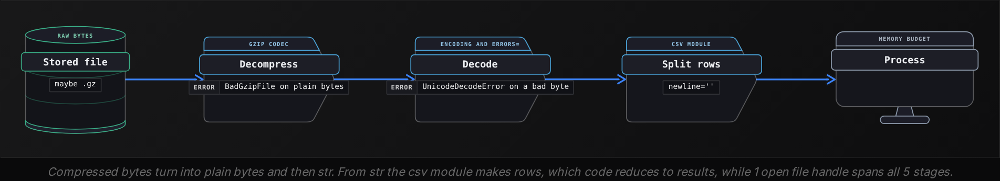

# File Parsing for Data Engineers: Beginner

Noor is 40 minutes into a data engineering interview at Shopify, where merchants move product catalogs in and out as CSV files. The interviewer describes a nightly job. Partners drop catalog files, some saved from spreadsheets and some gzipped. The largest is 9 GB, and the worker that loads them has 4 GB of memory. Last week it failed with `KeyError: 'sku'` on a file whose header visibly starts with sku. Noor holds off on typing `pd.read_csv`. She asks where the files come from, how big they get, and which exact error appeared, because each answer points to a different layer of the read, whether that's memory or compression, text decoding or handle cleanup. Then she streams rows through `csv.reader`, opens the file with `gzip.open` in text mode with `utf-8-sig`, and wraps it all in a `with` block. This lesson builds the reasoning behind each of those choices.


<br>

### What you will be able to do

Trace a detail in an interview prompt, like the file size or the error it raised, to the stage of file reading it points at

Choose between a csv.reader generator and chunked pd.read_csv from the memory budget and the kind of work

Read a file with an explicit encoding and errors= policy, and repair a header corrupted by a byte order mark

Read gzip files with gzip.open in text mode or with pandas' compression parameter, and name a codec for a pipeline

Guarantee every handle closes on exception with with and ExitStack, and open CSV handles with newline=''


<br>

---

## Recognizing File Parsing Signals

Every file parsing prompt hides a few details that decide the answer: a file size, the system that produced the file, an error message. Each detail points at a single stage of reading a file, and the stages run in a fixed order. Bytes come off storage, get decompressed if the producer compressed them, get decoded into text with an encoding, get split into rows and fields, and land in code that keeps some number of them in memory.



The rest of this lesson takes those stages in order: memory in the next section, then decoding, then decompression, then the file handle that spans the whole path and the newline setting the row splitter needs. The habit to build first is mapping each prompt detail to its stage, because the fix belongs in that stage. A patch in the wrong stage can hide the real bug: adding errors="ignore" to silence a decode error that gzip bytes caused makes the load finish with garbage rows.


<br>

### 3 kinds of signal

| Signal | What it sounds like | Stage it points to | First question to ask |
| --- | --- | --- | --- |
| Scale | "The file is 40 GB and the container has 2 GB" | Process | Does the job need every row at once, or 1 row at a time? |
| Source | "Finance exports it from a spreadsheet", "a partner sends .gz files", "it comes from a 1990s billing system" | Decode or Decompress | What encoding and compression does the producer write? |
| Error | A traceback, a crash after a few thousand files, blank rows when the output is opened | The stage that raised | Which stage raised, and on which bytes? |

Scale and source signals tell you what to ask. Error signals are sharper: the exception type and the byte value in the message usually name the stage without any follow-up. Interviewers often paste a real traceback and ask what went wrong, so the mapping below repays memorizing.


<br>

### Reading an error message for its stage

| Error text | Stage | Most likely cause |
| --- | --- | --- |
| `UnicodeDecodeError: 'utf-8' codec can't decode byte 0xe9 in position 3: invalid continuation byte` | Decode | The producer wrote cp1252 or latin-1 and the reader assumed UTF-8 |
| `UnicodeDecodeError: 'utf-8' codec can't decode byte 0x8b in position 1: invalid start byte` | Decompress | gzip bytes reached the decoder without being decompressed |
| `KeyError: 'sku'` while the printed header shows sku | Decode | A UTF-8 byte order mark is attached to the first column name |
| `gzip.BadGzipFile: Not a gzipped file (b'or')` | Decompress | A plain CSV was read as gzip; b'or' is the start of order_id |
| `_csv.Error: iterator should return strings, not bytes` | Decompress or Decode | The handle is in binary mode, which is what gzip.open gives by default |
| `OSError: [Errno 24] Too many open files` | Handle | A loop opens files and never closes them |
| `MemoryError`, or the worker killed by the operating system | Process | The whole file was loaded where a stream would do |
| A blank row between every record when the output is opened | Split rows | A CSV was written on Windows without newline='' |


<br>

### Decoding a prompt

Take this prompt: "A vendor's nightly 30 GB gzipped transaction export started failing after the vendor switched export tools. Fix the load." It carries 3 signals. The figure 30 GB is scale, so the worker's memory decides the reader. "Gzipped" is source at the Decompress stage: the reader has to pass through gzip in text mode. "Switched export tools" is source at the Decode stage, because a new export tool most often changes the encoding or starts writing a byte order mark. The strongest opening move is asking for the traceback, which narrows 5 stages to 1 before any code exists.


<br>

### When the prompt gives no signal

Some prompts say only "parse this CSV." These 5 questions cover every stage and show the interviewer where you expect trouble.

- How large is the largest file, and how much memory does the worker get?
- Which system or person produces the file, and has that changed recently?
- Is the file compressed, and does its name match its contents?
- How many files arrive per run, and are they processed together or separately?
- Can I see the traceback, or the first 4 bytes of the file in binary?

> Classify these before reading on
>
> - A ledger saved from a spreadsheet loads, but every lookup of its first column raises `KeyError: 'txn_date'`.
> - A job reads 20,000 small files per hour and dies near file 1,000 on every run.
> - A 25 GB clickstream file, a 4 GB container, and the task is counting events per country.

Answers

- **Decode** *KeyError on a column you can see*\
  A byte order mark sits in front of txn_date. Read with encoding="utf-8-sig".
- **Handle** *Dies near file 1,000*\
  That is close to the 1,024 open-file limit common on Linux, so handles are leaking. Open each file in a with block.
- **Process** *Streaming 25 GB through 4 GB*\
  Stream rows with csv.reader and keep a dict of counts per country. Memory holds the dict and 1 row.

> **TIP**
>
> Say the stage out loud before the fix: "a KeyError on a column I can see is a decoding problem, most likely a byte order mark." Naming the stage shows a method the interviewer can follow, and it stops you from patching the wrong stage.


<br>

---

## csv.reader vs pandas.read_csv

Both tools parse CSV correctly. The choice between them turns on 2 numbers and 1 question. The numbers are the file size and the memory the worker gets. The question is whether each row can be handled on its own (filter it, reformat it, count it) or the work needs arithmetic across many rows at once (group, join, derive columns).


<br>

### A generator holds 1 row at a time

`csv.reader` accepts any iterable of strings and returns an iterator, so it parses a line only when the loop asks for the next row. Wrapping it in a generator function with `yield` keeps that laziness while handing each row to the caller as a dict keyed by the header. Every field arrives as `str`: `"40.00"` stays text until the code calls `float` on it. The animation runs the pattern over an order file of 4 rows.

https://github.com/user-attachments/assets/133097a2-3b1c-47c1-844b-20e64dbf22f4

*Rows stream through the generator 1 at a time while totals accumulates.*

Watch `row` on the stage: 1 dict exists at a time, replaced on every pass. Peak memory is the size of `totals`, which grows with the number of distinct regions and stays flat as the row count climbs. The last print shows EU at 52.25 and US at 33.5, and a file of 400 million rows covering those same 2 regions would finish with a `totals` exactly this size, after a longer run.

#### Validating rows inside the generator

Row-wise checking suits the generator, because each row can be tested and rejected without touching the rest. Real exports contain an empty amount or a repeated header line, and `float("")` raises `ValueError`. Catching it per row and recording `reader.line_num` keeps the run going while building a list someone can inspect.

```sql
import csv


def valid_rows(source, rejects):
    reader = csv.DictReader(source)
    for row in reader:
        try:
            row["amount"] = float(row["amount"])
        except ValueError:
            rejects.append(reader.line_num)
            continue
        yield row
```

`reader.line_num` counts physical lines read, so it stays correct when a quoted field spans 2 lines, where a counter from `enumerate` would drift. A run that ends with 3 entries in `rejects` out of 10 million rows is a pass. A run with 4 million entries is a broken file, and the job should fail before loading the remainder.


<br>

### Chunked read_csv holds 1 block at a time

`pd.read_csv(source, chunksize=N)` returns an iterator of DataFrames, each holding N rows, in place of a single DataFrame. Inside a chunk pandas runs vectorized operations: 1 `groupby` call sums a column across the whole block in compiled code, far faster than a Python loop adding field by field. Memory scales with N times the row width, so N is the dial. At N = 100,000, a chunk of 20 `float64` columns takes 20 times 8 bytes times 100,000, or 16 MB. A short string stored as a Python object costs roughly 55 bytes, so if 10 of those columns are strings, the chunk grows to around 63 MB: 8 MB of floats plus 55 MB of strings. Scale N from that per-chunk figure against the worker's limit: a 1 GB allowance per chunk fits about 1.5 million such rows. Pass `dtype` explicitly, because pandas infers types chunk by chunk, and a column with 1 empty cell in chunk 7 becomes `float64` there after being `int64` in chunk 1.

```sql
import io

import pandas as pd

raw = io.StringIO(
    "order_id,region,amount\n"
    "1001,EU,40.00\n"
    "1002,US,25.50\n"
    "1003,EU,12.25\n"
    "1004,US,8.00\n"
)
types = {"order_id": "int64", "region": "string", "amount": "float64"}

totals = pd.Series(dtype="float64")
for chunk in pd.read_csv(raw, chunksize=2, dtype=types):
    partial = chunk.groupby("region")["amount"].sum()
    totals = totals.add(partial, fill_value=0)

print(totals)
```

With `chunksize=2`, the first chunk holds orders 1001 and 1002 and the second holds 1003 and 1004. Each chunk's `groupby` yields partial sums, and `add(partial, fill_value=0)` merges them, so `totals` ends with EU 52.25 and US 33.5, matching the generator. Sums merge by addition. Means do not: averaging per-chunk means gives a final chunk of 3 rows the same weight as a chunk of 100,000. Carry a running sum and count per key and divide once at the end.

- **5 to 10x** — RAM to data size, pandas' rule of thumb

Wes McKinney, who created pandas, gave that ratio in his 2017 post on the library's design limits, and it explains why a whole-file `pd.read_csv` of a 3 GB CSV can take down a 16 GB worker. Strings stored as Python objects, inferred types wider than needed, and copies made during operations all multiply the footprint of the raw text.

| ✓ csv.reader generator | ✗ pd.read_csv with chunksize |
| --- | --- |
| • Memory: 1 parsed row plus your accumulators<br><br>• Every value is str, and you cast each field<br><br>• Standard library only, nothing to install<br><br>• Best for filtering, validating, reformatting, counting<br><br>• Python-speed loop, slower per row on numeric work | • Memory: 1 chunk of N rows plus accumulators<br><br>• Typed columns, controlled with dtype=<br><br>• Needs pandas installed on the worker<br><br>• Best for per-chunk groupby, math across columns, joins to small lookups<br><br>• Partial results per chunk must be merged correctly |


<br>

### Deciding from the numbers

| Workload | Fits in memory whole? | Row-wise or vectorized? | Choice |
| --- | --- | --- | --- |
| 300 MB file, 8 GB worker, monthly revenue pivot | Yes, with room to spare | Vectorized | A single `pd.read_csv` call |
| 12 GB file, 4 GB worker, drop malformed rows and rewrite | No | Row-wise | `csv.reader` generator feeding a `csv.writer` |
| 12 GB file, 4 GB worker, revenue by store after tax math | No | Vectorized | `chunksize` reads with partial sums merged |
| 12 GB file, 4 GB worker, exact median amount per store | No | Needs every value per store together | Neither alone: split the file by store first, then read each part |

> **TIP**
>
> Do the memory arithmetic out loud: file size times the rule of thumb, compared with the worker's limit. A product near the limit means chunks. Interviewers grade that reasoning as much as the reader you end up choosing.


<br>

---

## Specifying File Encoding Explicitly

A file on disk is bytes, and the `csv` module and pandas work with `str`. An encoding is the rule that maps one to the other, and a CSV file stores no record of which rule its producer used. Through Python 3.14, `open()` without `encoding=` uses the locale's encoding: UTF-8 in most Linux containers, cp1252 on many Windows machines set to English, so the same script can read a file correctly on one machine and corrupt it on the other. Python 3.15 turns on UTF-8 mode by default (PEP 686), which makes UTF-8 the fallback everywhere. The argument stays necessary: jobs run on mixed interpreter versions, and the producer's encoding decides the correct value, whatever the interpreter assumes.

| Character | UTF-8 bytes | cp1252 bytes |
| --- | --- | --- |
| e | 65 | 65 |
| é | C3 A9 | E9 |
| € | E2 82 AC | 80 |
| Byte order mark (U+FEFF) | EF BB BF | None, cp1252 cannot encode it |

The table predicts both failure directions. Read cp1252 bytes as UTF-8 and the decoder meets E9, which announces a sequence of 3 bytes, then finds a comma where a continuation byte belongs and raises `UnicodeDecodeError`. Read UTF-8 bytes as cp1252 and the decoder usually succeeds, turning C3 A9 into é. That second direction does more damage in a pipeline, because the corrupted text loads without an error and surfaces weeks later in a report.

pandas ignores the locale: `pd.read_csv` decodes as UTF-8 unless told otherwise. On a Windows machine with a cp1252 locale, the same file can load cleanly through `open()` and raise in `pd.read_csv`, or the other way round. Passing `encoding=` to both removes the mismatch.


<br>

### errors= decides what happens at a bad byte

The `errors=` argument applies once the encoding is chosen and controls the decoder at a byte the encoding cannot map. The table applies the 4 values worth knowing to the bytes `b"Caf\xe9,3"` read as UTF-8.

| errors= | Result | When it fits |
| --- | --- | --- |
| `strict` (default) | Raises UnicodeDecodeError | Pipelines: fail at the first bad byte, then fix the encoding |
| `replace` | Caf�,3 | Display-only free text where a lost character is acceptable |
| `backslashreplace` | Caf\xe9,3 | Keep the job running while preserving the original byte for diagnosis |
| `ignore` | Caf,3 | Rarely: the value changes and nothing records it |

`errors=` handles stray bytes after the right encoding is chosen; choosing the encoding is a separate decision it can't make for you. A key column passed through `replace` or `ignore` stops matching its counterpart in other tables, since 'Café' from one system and 'Caf' from another will not join. The defensible interview answer is a known encoding with `strict`, plus a quarantine path that stores failing files so someone can identify their real encoding.


<br>

### The BOM that breaks the first column

Many spreadsheet programs that save as UTF-8 CSV write 3 bytes, EF BB BF, before the first header. That's the byte order mark. Decoded with `utf-8`, those bytes become U+FEFF, a character that prints as nothing, so the header looks like `sku,qty` while the first dict key is `'\ufeffsku'`. The codec `utf-8-sig` strips the mark when it is present and reads normal UTF-8 when it's absent, which makes it the safe default for any CSV a person might have exported by hand.


https://github.com/user-attachments/assets/359dbb86-94a9-4d1a-b58f-934acf7b131b

*The same bytes decoded as utf-8 and utf-8-sig, then a cp1252 byte under each errors= policy.*

The first print shows the mark as `\ufeff` because printing a list uses each string's repr, which escapes invisible characters; a plain `print` of the header would hide it. `"sku" in first` is False, which is exactly the condition that raises `KeyError: 'sku'`. Decoding with `utf-8-sig` gives clean keys. The loop then shows the 3 lenient policies on the cp1252 byte, and the final line is the exact message `strict` raises.

#### Diagnose from the first bytes

When a header misbehaves, read the first few bytes in binary before changing any code. EF BB BF is a UTF-8 BOM. Either FF FE or FE FF means UTF-16. If the file starts with 1F 8B it is gzip, and the problem belongs to the next section.

```sql
import csv
import io

raw = io.BytesIO(b"\xef\xbb\xbfsku,qty\nA-100,3\n")
print(raw.read(4))
raw.seek(0)

text = io.TextIOWrapper(raw, encoding="utf-8-sig", errors="strict", newline="")
for row in csv.DictReader(text):
    print(row["sku"], row["qty"])
```

It prints `b'\xef\xbb\xbfs'`, then `A-100 3`. `io.TextIOWrapper` accepts `encoding` and `errors` just as `open()` does, along with `newline`, so `open(path, encoding="utf-8-sig", errors="strict", newline="")` behaves identically on a real file. In pandas the equivalent call is `pd.read_csv(source, encoding="utf-8-sig", encoding_errors="strict")`.

#### When nobody knows the encoding

Ask the producer first, and write the answer into the pipeline's documentation. Failing that, try `utf-8-sig` with `strict`. UTF-8 has rigid byte patterns, so a large file that decodes cleanly as UTF-8 almost certainly is UTF-8. cp1252 is the opposite case: all but 5 of its 256 byte values map to a character, so a successful cp1252 decode proves almost nothing, and any fallback to it should be a decision someone records and reviews.

> **TIP**
>
> Write `encoding=` on every `open()` call, even when the file is ASCII today. The argument documents the producer's contract, and it makes the script behave the same on a laptop and on a server with a different locale.


<br>

---

## Reading gzip Files Transparently

gzip compresses a byte stream, and decompression runs incrementally: the reader inflates a block, hands over the bytes, and moves on. A gzipped CSV therefore streams in the same constant memory as a plain one. In the stage order from the first section, Decompress sits before Decode, so `gzip.open` has to hand decoded text to the csv module, which means opening it in text mode.

```sql
import csv
import gzip
import io

payload = gzip.compress(b"order_id,region,amount\n1001,EU,40.00\n1002,US,25.50\n")
print(payload[:2])

with gzip.open(io.BytesIO(payload), "rt", encoding="utf-8", newline="") as handle:
    for row in csv.DictReader(handle):
        print(row["order_id"], row["amount"])
```

It prints `b'\x1f\x8b'` first. Those are the 2 magic bytes every gzip stream starts with, and `1001 40.00` and `1002 25.50` follow. Mode `"rt"` stacks a text decoder on top of the decompressor. `encoding` and `newline` mean what they mean for `open()`. On a real file the call is `gzip.open("orders.csv.gz", "rt", encoding="utf-8", newline="")`, and the loop body stays the same.


<br>

### The default mode is bytes

| Call | The loop receives | Result with csv.DictReader |
| --- | --- | --- |
| `gzip.open(f)` | bytes | `_csv.Error: iterator should return strings, not bytes` |
| `gzip.open(f, "rt")` | str in the locale's encoding | Works until a non-ASCII byte meets a locale that disagrees with the producer |
| `gzip.open(f, "rt", encoding="utf-8", newline="")` | str in UTF-8 | Correct rows on every machine |


<br>

### pandas infers compression from the name

`pd.read_csv` defaults to `compression="infer"`, which reads the path's extension and maps it to a codec. It recognizes `.gz` and `.bz2`, and the same lookup covers `.zip` and `.xz` as well as `.zst`. Inference fails in 2 common cases. An in-memory buffer has no name, and a file named `orders.csv` that holds gzip bytes has a misleading one. Both need `compression="gzip"`. Without it the compressed bytes go straight to the decoder, which accepts 1F as a control character and rejects 8B, producing the `byte 0x8b in position 1` error from the error table in the first section.

```sql
import gzip
import io

import pandas as pd

payload = gzip.compress(b"order_id,region,amount\n1001,EU,40.00\n1002,US,25.50\n")

frame = pd.read_csv(io.BytesIO(payload), compression="gzip", encoding="utf-8")
print(frame["amount"].sum())

for chunk in pd.read_csv(io.BytesIO(payload), compression="gzip", chunksize=1):
    print(len(chunk))
```

The sum prints `65.5`, and the chunked loop prints `1` twice. `compression` and `chunksize` combine, so a 50 GB gzipped file can be decompressed and aggregated chunk by chunk without ever existing uncompressed on disk or in memory. The reverse mistake, a plain CSV given a `.gz` name, fails at the Decompress stage with `BadGzipFile`.

#### Writing gzip output

Writing mirrors reading. Open with mode `"wt"` and an explicit encoding, and pass `newline=""` so the csv writer's line endings pass through untouched. `gzip.open` defaults to `compresslevel=9`, the slowest setting. The gzip command line tool defaults to 6, which usually produces a file only slightly larger in noticeably less time.

```sql
import csv
import gzip
import io

buffer = io.BytesIO()
with gzip.open(buffer, "wt", encoding="utf-8", newline="", compresslevel=6) as out:
    writer = csv.writer(out)
    writer.writerow(["order_id", "amount"])
    writer.writerow([1001, "40.00"])

print(gzip.decompress(buffer.getvalue()))
```

It prints `b'order_id,amount\r\n1001,40.00\r\n'`. The `\r\n` row endings are the csv writer's default terminator, kept intact by `newline=""`.


<br>

### Picking a codec for a pipeline

| Codec | Extension | Ratio | Speed | Can a reader split 1 file? | Fits when |
| --- | --- | --- | --- | --- | --- |
| gzip | .gz | Good | Moderate, decompression uses 1 core | No | Sending files to consumers you do not control |
| bz2 | .bz2 | Higher than gzip | Slow to write and read | Yes, in engines with a splitting reader | Archives that are read rarely |
| zstd | .zst | Similar to or better than gzip | Fast at both ends | No | You control both producer and consumer |
| Snappy, LZ4 | Used inside columnar formats | Lower | Very fast | Through the container format | Columnar storage, covered in a later lesson |

Splittability decides parallelism. A single 20 GB `.gz` file must be inflated from its first byte, so 1 worker reads it end to end however many workers the cluster has. The same data written as 200 files of 100 MB each is read by 200 workers at once. The zstd project's published benchmarks show it decompressing several times faster than zlib, the algorithm inside gzip, at a comparable ratio. That makes zstd the better pick when both ends of the pipeline are yours, and gzip the safe pick when files leave your team, because Python and Java read it with no extra installs, as do most command-line environments.

> **TIP**
>
> When a prompt says files arrive gzipped, ask about file sizes. Many moderate files parallelize. One huge `.gz` file serializes the read, and the fix belongs with the producer: ask it to split its output.


<br>

---

## Context Managers for File Handles

An open file holds an operating system file descriptor and, for writes, a buffer of bytes not yet on disk. Both are released by `close()`. Skip it and descriptors pile up until the process hits its limit, commonly 1,024 per process on Linux, and the next open raises `OSError: [Errno 24] Too many open files`. Unclosed writers can also lose the tail of their output, because buffered bytes reach disk only on flush or close.

```sql
import csv
import io

handle = io.StringIO("sku,qty\nA-100,3\nB-200,five\n", newline="")
reader = csv.DictReader(handle)
total = sum(int(row["qty"]) for row in reader)
handle.close()
```

The `int("five")` call raises inside `sum`, and execution leaves before `handle.close()` is reached. A `with` statement moves the cleanup into `__exit__`, which Python calls whether the block finishes normally or by an exception. The exception still propagates unless `__exit__` returns True, so `with` guarantees cleanup without swallowing errors. The animation uses a small class with `__enter__` and `__exit__` to make each call visible.

https://github.com/user-attachments/assets/bffbe349-cff9-468d-b12c-a450de23e98b

*__exit__ runs on success and on ValueError alike, and the error still reaches except.*

Both runs print `open` then `close`. The second close reports `ValueError` because Python passes the exception type to `__exit__`, and the error then reaches the `except` clause intact, carrying its message about `'five'`. Real file objects implement the same 2 methods, and so do `gzip.open` handles and `io.StringIO`.


<br>

### ExitStack for a count known at runtime

Nested `with` statements work when the number of files is fixed in the code. When the list comes from a directory listing or a config, `contextlib.ExitStack` takes over: each `enter_context` call opens a resource and registers its cleanup, and leaving the block closes them in reverse order. If opening the third file fails, the first 2 are already registered and get closed before the error propagates.

```sql
import contextlib
import csv
import io

sources = {
    "day1": "order_id,amount\n1001,40.00\n",
    "day2": "order_id,amount\n1002,25.50\n",
    "day3": "order_id,amount\n1003,12.25\n",
}

total = 0.0
with contextlib.ExitStack() as stack:
    handles = [stack.enter_context(io.StringIO(text, newline="")) for text in sources.values()]
    for handle in handles:
        for row in csv.DictReader(handle):
            total += float(row["amount"])

print(total)
print(all(handle.closed for handle in handles))
```

It prints `77.75` and `True`. ExitStack is for files that must be open together, such as merging 3 daily files or writing a separate output file per region from a single pass. For 5,000 independent files, a loop that handles 1 file per iteration and closes it before the next keeps 1 descriptor open at a time, far under the limit.


<br>

### Handles you do not open yourself

`pd.read_csv(path)` opens and closes its own handle. Pass it a handle instead and the caller owns closing it. A chunked reader keeps its file open until iteration finishes, and since pandas 1.2 it works as a context manager: `with pd.read_csv(path, chunksize=50_000) as reader:` closes the file even when a chunk raises. Generators carry the same risk. A generator that opens a file inside a `with` keeps the handle open between yields, and if the consumer stops early with `break`, the file closes only when the generator is closed or garbage collected. Calling `.close()` on the generator, or wrapping it in `contextlib.closing`, makes that moment explicit.


<br>

### newline='' for every CSV handle

The csv module parses line endings itself, including line breaks inside quoted fields. A text handle with default newline handling translates `\r\n` to `\n` before csv sees it, which rewrites the contents of any quoted field that held a Windows line break. On the write side, csv ends each row with `\r\n`, and a Windows text handle without `newline=""` converts that `\n` into `\r\n` again, so each record ends in `\r\r\n` and is followed by a blank row. The program below reads the same text with both settings.

```sql
import csv
import io

text = 'id,note\r\n1,"first line\r\nsecond line"\r\n'
for setting in [None, ""]:
    handle = io.StringIO(text, newline=setting)
    row = list(csv.reader(handle))[1]
    print(repr(setting), repr(row[1]))
```

With `newline=None` it prints `None 'first line\nsecond line'`: the field lost its `\r`. With `newline=""` it prints `'' 'first line\r\nsecond line'`, exactly the characters the producer wrote. `None` is the default for `open()`, which is why the csv documentation says to pass `newline=""` on every file given to `csv.reader` or `csv.writer`.

| ✓ Do | ✗ Don't |
| --- | --- |
| • Open every file in a with block, or register it on an ExitStack<br><br>• Pass encoding= and newline='' on every CSV handle you open<br><br>• Process many independent files one per loop iteration, each in its own with<br><br>• Let exceptions propagate after cleanup so failures stay visible | • Call open() and rely on a close() line placed after the parsing code<br><br>• Hold thousands of handles open when each file is processed alone<br><br>• Return True from __exit__ to hide parsing errors<br><br>• Hand csv.reader a handle opened with default newline handling |


<br>

---

## Putting It All Together

A catalog ingestion job like the one in Maya's interview: partners drop product CSV files every night, some saved from spreadsheets and some gzipped, the largest 9 GB, and the worker that loads them has 4 GB of memory.

- The 9 GB file against a 4 GB worker rules out a whole-file pd . read_csv , so rows stream through a csv . reader generator that validates each SKU and records rejects by reader . line_num .
- Spreadsheet exports carry a byte order mark, so every handle uses encoding = 'utf-8-sig' with errors = 'strict' , and files that still fail to decode go to quarantine instead of loading with replaced characters.
- Gzipped drops open with gzip . open in "rt" mode, and the job checks the first 2 bytes for 1F 8B so a misnamed plain file is routed to the plain reader instead of raising BadGzipFile .
- Each partner file opens in its own with block with newline = '' , so the job holds 1 descriptor at a time however many files arrive, and a malformed row can't leak a handle.
- If a partner starts sending one 9 GB . gz file, the read serializes on a single worker, so the durable fix is asking that partner to split its output into many moderate files.


<br>

---

## Key Takeaways

- Map every prompt detail to a stage first. Size belongs to Process and the producer to Decode or Decompress, while a traceback points at whichever stage raised.
- A csv . reader generator holds 1 row, while chunked pd . read_csv holds 1 block and buys vectorized math at the cost of merging partial results correctly.
- Name the encoding on every handle, keep errors = 'strict' in pipelines, and use utf - 8 - sig for anything a person exported.
- Open gzip in text mode with an explicit encoding, pass compression = 'gzip' when pandas can't see a . gz name, and remember that a single . gz file is read by 1 worker.
- Put every handle in a with block or an ExitStack , and give every CSV handle newline = '' .
