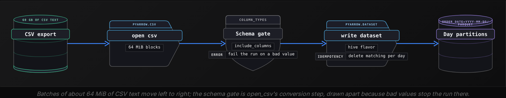

# File Parsing for Data Engineers: Intermediate

Ines is 40 minutes into a data engineering loop at Netflix when the interviewer shares a scenario. A partner drops a 60 GB CSV of playback events into S3 every night, and analysts query it for one region and a handful of columns. Today each query reads the whole file. 'Walk me through how you would store this so those queries touch a small fraction of the bytes. What format and partition column would you pick, and why that codec?' Ines knows Parquet is columnar. What the interviewer is probing is the next layer down: how a reader decides to skip a row group, why partitioning on device ID would bury the bucket in tiny files, what a streaming conversion holds in memory, and what ZSTD costs in CPU against Snappy. This lesson builds each of those answers with numbers she can defend.


<br>

### What you will be able to do

Predict which Parquet row groups a filter skips from footer statistics, and explain why unsorted data defeats skipping.

Stream a CSV into Hive-partitioned Parquet with pyarrow under a fixed memory bound and a declared schema.

In one pyarrow.dataset read, prune by partition and by row group statistics while reading only the columns you need, and size partitions so a high-cardinality column does not split the output into tiny files.

Pick between row-oriented Avro and columnar Parquet or ORC from a workload's write pattern and read pattern.

Choose a compression codec and level by weighing bytes stored and fetched against CPU on write and on read.


<br>

---

## What Columnar Means in Parquet

This question arrives in several forms: why a Parquet query beat the same query on CSV, why a filter on `amount_cents` still read the whole file, or how large a row group should be. All of them are answered from one picture of where the bytes sit and what metadata a reader consults before fetching any.


<br>

### Row groups, column chunks, pages, footer

A Parquet file cuts its rows horizontally into row groups. Inside each row group, every column's values sit together in a contiguous column chunk, made of pages that are encoded and compressed one at a time (pyarrow targets 1 MB per page). That nesting is columnar storage on disk: to read `country`, a reader seeks to its chunk and never touches the `notes` bytes beside it. The footer holds the schema and the byte offset of every chunk. It also stores statistics for each chunk: the min and max, plus a count of nulls.

| Region | Size | Holds | Read |
| --- | --- | --- | --- |
| Magic PAR1 | 4 bytes | File signature | At open |
| Row groups | Nearly all bytes | A chunk per column, each a run of pages | Only groups and columns the plan keeps |
| Footer | Grows with groups x columns | Schema, chunk offsets, min, max, null count | Before any data |
| Footer length, PAR1 | 8 bytes | Where the footer starts | First, from the end |

A reader works backwards: the last 8 bytes, then the footer, then a plan of byte ranges to fetch. The writer benefits from the same order, streaming row groups out and writing the footer once every offset is known. The price is that a Parquet file has no footer until its writer closes it, and cannot be read before then.


<br>

### Pushdown is a proof made from the footer

Predicate pushdown means the reader tests the filter against each row group's statistics and skips a group only when they prove no row inside can match. For `amount_cents > 45000`, a group whose max is 30000 is skipped unread. A group whose max is 49990 is read in full even if a single row matches. The rule to predict with: skip when the filter's range and the group's [min, max] cannot overlap, and read otherwise.

| Row group | Rows | order_date min | order_date max | amount_cents min | amount_cents max |
| --- | --- | --- | --- | --- | --- |
| 0 | 1,000,000 | 2024-03-01 | 2024-03-01 | 100 | 49,990 |
| 1 | 1,000,000 | 2024-03-01 | 2024-03-02 | 100 | 49,995 |
| 2 | 1,000,000 | 2024-03-02 | 2024-03-02 | 101 | 50,000 |
| 3 | 1,000,000 | 2024-03-02 | 2024-03-03 | 100 | 49,998 |

| Filter | Groups read | Why |
| --- | --- | --- |
| order_date = DATE '2024-03-03' | 1 of 4 | Only group 3 reaches March 3 |
| order_date = DATE '2024-03-02' | 3 of 4 | March 2 spans groups 1 through 3 |
| amount_cents > 45000 | 4 of 4 | Every max sits near 50,000 |
| amount_cents < 50 | 0 of 4 | Every min is at least 100 |

Dates skip well because the file was written in arrival order, so each group covers a narrow slice of time. Amounts skip badly because orders of every size arrive all day, so each group spans the full spread. The reader and the format are identical in both cases; only the order in which the writer laid the values down differs.

The animation shrinks this to 24 order amounts in 4 row groups of 6 and plans a read for `amount >= 90`. Predict how many groups each pass reads before playing it: arrival order first, then sorted.

https://github.com/user-attachments/assets/3a6138a3-b936-4cef-a5ee-b503c3b63a5b

*Each tuple is one row group's (min, max), as the footer would store it.*

In arrival order, the plan reads groups 0 through 2 to return 3 rows, one from each. Sorted, the same 3 rows land in group 3, and the plan fetches 1 group of 4. Hence the standard remedy: sort or cluster on the column people filter by before writing. A file sorted on one column skips well on that column and on columns correlated with it, and nowhere else.

Null counts give readers a second proof. A filter of `notes IS NULL` can skip every group whose null count is 0, and `notes IS NOT NULL` can skip groups that hold only nulls. Strings behave like numbers: min and max compare in byte order, so a file sorted by `country` skips on `country = 'DE'` the same way it skips on dates.

> When the footer cannot help
>
> - Unsorted data: every group's [min, max] spans nearly the whole domain.
> - A function on the column, such as lower(country) = 'us': pyarrow compares statistics only against the bare column.
> - A value inside [min, max] that is absent: min and max can rule a value out of range, never prove it missing.
> - No statistics written for the column, as with pyarrow's write_statistics=False.


<br>

### How large a row group should be

Row group size sets the grain of skipping. Smaller groups give tighter ranges and finer skips, but they add footer entries and seeks. Larger groups cost writer memory, because a writer holds a whole group's encoded pages before laying the chunks out contiguously. The Parquet documentation recommends 512 MB to 1 GB, a figure aimed at large sequential scans and sized so a group fits one HDFS block. pyarrow limits groups by row count instead. The pipeline in the next section writes 500,000 to 1,000,000 rows per group, about 20 to 40 MB at 40 bytes per row. For filtered reads, defend tens to hundreds of megabytes per group, and make those groups skippable with sort order. The animation shows why order matters more than size. Halving its groups to 3 rows on unsorted data still reads 3 of 8 groups, 9 of 24 rows. Sorting reads 6.

> **TIP**
>
> Say the skip rule as a proof: a row group is skipped only when its min and max make a match impossible. Then say that the proof needs data sorted or clustered on the filtered column, and that unsorted data or a function wrapped around the column breaks it.


<br>

---

## CSV to Parquet with pyarrow

The interview version: a 60 GB CSV, a worker with 8 GB of memory, and a request for Parquet partitioned by day. The answer usually sinks on 2 mistakes. Loading the file with `pyarrow.csv.read_csv` or pandas materializes every row at once, so the decoded table has to fit in memory. Letting the reader guess types produces a job that crashes, or silently rewrites values, hours into the run.



```sql
import io

import pyarrow as pa
import pyarrow.csv as pv
import pyarrow.dataset as ds

CSV_BYTES = (
    b"order_id,order_date,country,zip,amount_cents\n"
    b"1001,2024-03-01,US,02139,4599\n"
    b"1002,2024-03-01,DE,10115,1250\n"
    b"1003,2024-03-02,US,94105,799\n"
)

SCHEMA = pa.schema([
    ("order_id", pa.int64()),
    ("order_date", pa.date32()),
    ("country", pa.string()),
    ("zip", pa.string()),
    ("amount_cents", pa.int64()),
])

reader = pv.open_csv(
    io.BytesIO(CSV_BYTES),
    read_options=pv.ReadOptions(block_size=64 << 20),
    convert_options=pv.ConvertOptions(
        column_types=SCHEMA,
        include_columns=SCHEMA.names,
    ),
)

ds.write_dataset(
    reader,
    base_dir="orders_parquet",
    format="parquet",
    partitioning=ds.partitioning(
        pa.schema([("order_date", pa.date32())]), flavor="hive"
    ),
    min_rows_per_group=500_000,
    max_rows_per_group=1_000_000,
    existing_data_behavior="delete_matching",
)
```


<br>

### Why the schema is written down

The streaming reader infers each column's type from the first block only and then holds it fixed, as pyarrow's documentation for `open_csv` notes. With a 64 MiB first block, 3 failures follow. A `zip` column of digit-only values becomes int64, and 02139 is stored as 2139. An `order_id` that turns alphanumeric 40 GB in raises a conversion error after most of the work is done. A column empty throughout the first block is typed null, and its first real value fails. Declaring `column_types` settles every type before parsing starts, and `include_columns` keeps an extra column in tomorrow's export from changing the output schema.

Parsing and conversion fail differently. A row with the wrong number of fields is a parse error, and `ParseOptions(invalid_row_handler=...)` can count and skip it. A value that cannot convert to its declared type has no skip option and fails the batch. When a column is known to be dirty, declare it as string and write it as is; the next step casts and validates it, where bad values can be quarantined row by row.


<br>

### Bounding memory

Memory has 2 holders. The reader keeps a few blocks of CSV text and their decoded batches, sized by `block_size`. The writer keeps a buffer per open partition and flushes a row group once that buffer reaches `min_rows_per_group`. Input sorted by date keeps 1 or 2 partitions open; dates scattered across a month keep all 31 buffering at once. At about 40 bytes per decoded row:

| Input order | Open partitions | Buffered rows | Writer memory |
| --- | --- | --- | --- |
| Sorted by date | 2 | 2 x 500,000 | 40 MB |
| Dates scattered over a month | 31 | 31 x 500,000 | 620 MB |

Both cases fit the 8 GB worker with room for the reader's blocks. The minimum exists because each incoming batch holds one block's rows: a 64 MiB block split 31 ways leaves roughly 2 MB per day, and with the default `min_rows_per_group` of 0 the writer can emit every sliver as its own row group, leaving footers full of tiny, useless ranges.


<br>

### What lands on disk

| Path | Columns in the file | Rows |
| --- | --- | --- |
| orders_parquet/order_date=2024-03-01/part-0.parquet | order_id, country, zip, amount_cents | 2 |
| orders_parquet/order_date=2024-03-02/part-0.parquet | order_id, country, zip, amount_cents | 1 |

The partition column moves into the directory name and out of the files. Open one file on its own and `order_date` is gone; a reader recovers it only when told the partitioning scheme.

`existing_data_behavior` decides what a rerun does. The default, `error`, refuses to write into a non-empty directory. `overwrite_or_ignore` replaces files with matching names and leaves the rest: if the first run wrote `part-0` and `part-1` and the rerun writes only `part-0`, the stale `part-1` stays and its rows count twice. `delete_matching` deletes each partition directory the job writes into before writing, so rerunning a day is idempotent and other days are untouched.


<br>

### Reconciling before publishing

A conversion is done when its output reconciles with its input. Take the source's row count from its manifest or a line count. Compare it partition by partition against `count_rows()` on the written dataset, and fail the run on any mismatch. Without a filter, `count_rows()` takes row counts from the footers instead of scanning data, so the check costs a few small reads per file.

| ✓ Do | ✗ Don't |
| --- | --- |
| • Declare every column's type in column_types before parsing starts<br><br>• Set min_rows_per_group when rows spread across many partitions<br><br>• Use delete_matching when a job rewrites whole partitions<br><br>• Sort input by the partition key when you can, to cap open partitions | • Call read_csv on a file larger than the worker's memory<br><br>• Trust types inferred from the first 64 MiB of a 60 GB file<br><br>• Rerun with overwrite_or_ignore when a run can produce fewer files<br><br>• Leave the partitioning scheme off when reading the output back |

> **TIP**
>
> When asked how much memory the job needs, answer with the formula first: open partitions times min_rows_per_group times bytes per row, plus a few reader blocks. Then plug in the numbers. The formula shows which knob moves which term.


<br>

---

## Reading Partitioned Parquet on S3

A read against a partitioned dataset can cut work at 3 points, and a complete answer names them in the order they fire. Partition pruning drops whole directories by matching the filter against path names, before any file is opened. Row group pruning drops groups inside the surviving files using footer statistics. Column pruning fetches only the chunks of the selected columns. Each layer works on what the one before it left.

| Layer | Decides from | S3 work it removes | Defeated by |
| --- | --- | --- | --- |
| Partition pruning | Path segments like order_date=2024-03-02 | Every request for files in pruned directories | Filtering on non-partition columns; no partitioning declared on read |
| Row group pruning | Footer min and max | Range reads of skipped groups | Unsorted data; functions on the column |
| Column pruning | Chunk offsets in the footer | Bytes of unselected columns | Selecting every column |

```sql
import datetime as dt

import pyarrow as pa
import pyarrow.dataset as ds

orders = pa.table({
    "order_id": [1001, 1002, 1003, 1004],
    "order_date": [dt.date(2024, 3, 1), dt.date(2024, 3, 1),
                   dt.date(2024, 3, 2), dt.date(2024, 3, 2)],
    "amount_cents": [4599, 1250, 799, 8800],
    "notes": ["", "gift", "", "rush"],
})
hive = ds.partitioning(pa.schema([("order_date", pa.date32())]), flavor="hive")
ds.write_dataset(orders, "orders_parquet", format="parquet",
                 partitioning=hive, existing_data_behavior="delete_matching")

dataset = ds.dataset("orders_parquet", format="parquet", partitioning=hive)
result = dataset.to_table(
    columns=["order_id", "amount_cents"],
    filter=(ds.field("order_date") == dt.date(2024, 3, 2))
    & (ds.field("amount_cents") > 5000),
)
print(result.to_pylist())
```

The program writes 4 orders into 2 day directories, reads them back the way a job reads S3, and prints `[{'order_id': 1004, 'amount_cents': 8800}]`. Against S3 only the location changes: an `s3:bucket/orders_parquet` URI or a `filesystem=` argument. Passing `hive` on the read does 2 jobs. It tells the planner which path segments are partition values, so the date filter prunes directories, and it fixes their type, since discovery from directory names alone is a guess. `columns=` is column pruning, and the `amount_cents` comparison is checked against row group statistics.

`to_table` gathers the whole result in memory. For results larger than the worker, `dataset.to_batches(columns=..., filter=...)` applies the same pruning and yields record batches one at a time, which pairs with the streaming writer from the previous section.

In SQL, the same 3 layers come from the clauses: the `order_date` predicate prunes directories, the `amount_cents` predicate goes to row group statistics, and the select list fixes which column chunks are read.

```sql
SELECT
  order_id,
  amount_cents
FROM orders
WHERE order_date = DATE '2024-03-02'
  AND amount_cents > 5000
```

The animation runs the planner over 3 day directories, each a file of 2 row groups with 5 columns, for `dt >= '2024-03-02' AND amount > 60` selecting 2 columns. Predict 3 counts before playing: footers read, row groups fetched, column chunks fetched.

https://github.com/user-attachments/assets/82c2cdfc-75f9-4ad5-a27c-d7c808767c66

*Path check first, footer statistics second, selected columns last.*

The March 1 file never had its footer read; its path ruled it out. Of the 4 groups left, the 2 whose max sits at or below 60 fall to statistics. In the 2 that remain, 2 of 5 columns are fetched: 4 chunks of 30, about 13% of the column data.


<br>

### The high-cardinality partition trap

Partition pruning works so well that the tempting move is to partition on every filtered column. Take an orders table filtered by `customer_id` as often as by date, with 50,000 active customers. Partitioning on both makes a directory per customer per day, most holding a handful of rows, and every file carries fixed costs: a listing entry to discover it, a request for its footer, and row groups too small for their statistics to mean anything.

- **18.25M** — directories a year, at most
- **18,250** — LIST calls to plan one scan, at most
- **1,024** — default max_partitions per write call

S3 returns at most 1,000 keys per list request, so discovery becomes a long crawl before any data moves. The writer fails sooner: `write_dataset` raises an error when a single call would create more partitions than `max_partitions`, and once more than `max_open_files` files are open it closes the least recently used, splitting partitions into still smaller files.

| ✓ Partition by order_date | ✗ Partition by order_date and customer_id |
| --- | --- |
| • 365 directories a year<br><br>• Files hold a full day, row groups near target size<br><br>• Date filters prune paths; customer filters use statistics<br><br>• Sort by customer_id within each day so those statistics skip | • Up to 50,000 directories a day<br><br>• Files of a few KB, one tiny row group each<br><br>• Planning lists millions of paths<br><br>• Footer requests outnumber data requests |

The rule: partition on a low-cardinality column that nearly every query filters on, sized so files land in the hundreds of megabytes, and move high-cardinality filters into sort order inside the files, where row group statistics handle them without a single extra listing.

> **TIP**
>
> Before choosing a partition column, estimate bytes per partition: daily volume divided by the column's distinct values per day. Reject any column that leaves files well under about 100 MB. At 50,000 customers, even 50 GB a day leaves 1 MB per customer directory.


<br>

---

## Avro vs Parquet vs ORC

Format questions come disguised: 'Our app emits events every few seconds; should the landing zone be Parquet?' or 'Why would anyone still choose Avro?' A defensible answer starts from how the data is written and how it is read, then names the format whose physical layout serves both.

Avro: one record after another

| Position | Bytes on disk |
| --- | --- |
| record 1 | 1001, US, 4599 |
| record 2 | 1002, DE, 1250 |
| record 3 | 1003, US, 799 |

Parquet: one chunk per column

| Column chunk | Bytes on disk |
| --- | --- |
| order_id | 1001, 1002, 1003 |
| country | US, DE, US |
| amount_cents | 4599, 1250, 799 |

Reading `amount_cents` from the left layout means stepping through every record, because each value is interleaved with its neighbours. From the right layout it is a single contiguous range. Appending order 1004 on the left means writing bytes at the end; on the right it means extending all 3 chunks, which a closed Parquet file cannot do.


<br>

### The write pattern decides as often as the read

Parquet stays unreadable until its footer is written, as the footer layout showed earlier. Avro writes its JSON schema once in the header, then appends records in blocks separated by a 16-byte sync marker. A reader that opens a file still being written gets the schema from the header and every block that is complete. It stops at the partial block and can reopen the file later to pick up new blocks. A crashed writer loses only the block it was filling. A reader that hits a corrupt block can scan forward to the next sync marker and resume there.

Put numbers on the landing zone. Events arrive at 2,000 per second and must be queryable within a minute. Flushing Parquet every minute gives files of 120,000 rows, 1,440 of them per writer per day, each a single small row group. Appending to Avro and rolling files hourly keeps every write cheap, and an hourly job compacts each finished file into large, sorted Parquet for analysts.


<br>

### Columnar wins when queries read few columns

For an orders table of 40 columns where dashboards read 3, a columnar reader fetches around 3/40 of the column data, 7.5%, before any row group is skipped. A row format reads all 40 for every row. Columnar files also compress better, since each chunk holds one type with one distribution. The case that flips it is a consumer that needs whole records one at a time, such as applying change events to another store; Avro hands over each record without reassembly.


<br>

### Parquet or ORC

Both are columnar, with per-column statistics and compression, and for a scan of a few columns they land close. ORC groups rows into stripes, 64 MB by default, and keeps a lightweight index entry every 10,000 rows inside each stripe, so its default skipping grain is finer than one min and max per row group. The decider is usually the reading side: ORC when the engines reading the table already write it and use those indexes, Parquet when the table also has to serve pyarrow and pandas scripts.

| Workload | Writes | Reads | Format |
| --- | --- | --- | --- |
| Event landing zone | Small appends every few seconds | Whole records, replayed in order | Avro |
| Change-data-capture feed | A row at a time, schema evolves | Each change applied to a target | Avro |
| Analyst fact table | Daily batch | 3 of 40 columns, filtered by date | Parquet |
| Warehouse whose engines write ORC | Batch | Selective filters, few columns | ORC |
| Every column exported for a model | Batch | All columns, all rows | Parquet, for compression |

> Schema evolution, per format
>
> - Avro resolves the writer's schema against the reader's: a new field with a default stays readable by old and new code.
> - Parquet stores a schema in each file's footer; a column added later is absent from old files and reads back as null.
> - A rename breaks both unless the reader maps the old name, so treat it as an add followed by a drop.

- Name the write pattern: batch or continuous, and how small each write is.
- Name the read pattern: which columns, how many rows, records or aggregates.
- Give a number: columns read over columns stored, or files per day at the write cadence.
- Say what the rejected format would cost on this workload.

> **TIP**
>
> When the interviewer asks why not Parquet everywhere, answer from the write side: Parquet needs a full row group buffered and a footer at close, which continuous small writes cannot supply without producing thousands of tiny files.


<br>

---

## Compression Codec Trade-offs

The codec question trades stored bytes against CPU seconds, and it is asked as 'Snappy or ZSTD for this table?' or 'Our nightly job is CPU-bound; what would you change?' Answering well takes 2 facts about where compression runs and one table of costs.


<br>

### Where the codec runs

Parquet compresses each page separately, after the column has been encoded. So codec choice never affects splitting, since a reader can start at any row group, and each column can carry its own codec. Compare a 60 GB `.csv.gz`, a single gzip stream that must be decompressed from its first byte, so 1 worker reads it end to end however many are available. pyarrow's Parquet writer uses Snappy unless told otherwise.

| Codec | Ratio | Compress MB/s per core | Decompress MB/s per core |
| --- | --- | --- | --- |
| ZSTD level 1 | 2.9 | 500 | 1,600 |
| Snappy | 2.1 | 550 | 1,700 |
| LZ4 | 2.1 | 700 | 4,000 |
| zlib level 1 (gzip) | 2.7 | 100 | 400 |

*Rounded from the lzbench table in the Zstandard project's README, measured on the Silesia corpus. Absolute speeds move with CPU and version; the ratios between rows are what carry over.*


<br>

### Worked example: 1 TB a day

Suppose a pipeline writes 1 TB of encoded column data a day and analysts scan it in full a few times a day. Dividing 1,000,000 MB by each rate in the table gives the daily bill per codec:

| Codec | Stored per day | Write CPU | Read CPU per full scan |
| --- | --- | --- | --- |
| ZSTD level 1 | 345 GB | 33 core-min | 10 core-min |
| Snappy | 476 GB | 30 core-min | 10 core-min |
| LZ4 | 476 GB | 24 core-min | 4 core-min |
| gzip level 1 | 370 GB | 167 core-min | 42 core-min |

- **3.9 TB** — less stored per month than Snappy
- **28%** — fewer bytes per scan than Snappy
- **5x** — gzip write CPU over ZSTD level 1

Read the rows against each other. ZSTD at level 1 costs about Snappy's CPU on both sides and stores far less, and every byte not stored is a byte not pulled from S3 on every scan, so it is the better choice for any table read many times. LZ4 is worth picking only when CPU is the bottleneck and storage is not, as with intermediate files that live for minutes. gzip pays several times the CPU on both sides for a ratio ZSTD beats.


<br>

### Matching codec and level to the pipeline

| Pipeline | Choice | Reason |
| --- | --- | --- |
| Fact table written daily, scanned all day | ZSTD level 1 to 3 | Smaller scans at Snappy-like decode cost |
| Archive written once, rarely read | ZSTD at a high level, 9 or above | Write CPU is paid once; storage is paid every month |
| Intermediate files that live minutes | LZ4 or Snappy | Fastest encode and decode; the bytes are short-lived |
| A reader that only supports Snappy | Snappy | A file nobody can read saves nothing |
| Raw text handed to an outside party | gzip | Every consumer reads it; accept 1 reader per file |

For the CPU-bound nightly job, check the write codec first. A table still on gzip moves to ZSTD level 1 and stores fewer bytes for a fraction of the encode time. A table already on Snappy or ZSTD level 1 has little left to give; the time more likely goes to parsing and type conversion, or to the sort, and a profile shows which.

Measure on your own data before committing, because Parquet pages compress differently from a text corpus: a column of unique IDs and a column of repeated country codes respond very differently to the same codec. The harness below writes one in-memory table under each codec and level and reports size and timing.

```sql
import random
import time

import pyarrow as pa
import pyarrow.parquet as pq

random.seed(1)
ROWS = 1_000_000
sample = pa.table({
    "order_id": pa.array(range(ROWS), pa.int64()),
    "country": [random.choice(["US", "DE", "BR", "IN"]) for _ in range(ROWS)],
    "amount_cents": [random.randint(100, 50_000) for _ in range(ROWS)],
})

for codec, level in [("snappy", None), ("lz4", None), ("zstd", 1),
                     ("zstd", 9), ("gzip", 6)]:
    sink = pa.BufferOutputStream()
    start = time.perf_counter()
    pq.write_table(sample, sink, compression=codec, compression_level=level)
    write_s = time.perf_counter() - start
    data = sink.getvalue()
    start = time.perf_counter()
    pq.read_table(pa.BufferReader(data))
    read_s = time.perf_counter() - start
    print(f"{codec} {level}: {data.size / 1e6:.1f} MB, "
          f"write {write_s:.2f}s, read {read_s:.2f}s")
```

Codecs can also differ per column: `compression={'notes': 'zstd', 'order_id': 'lz4'}`, with a matching `compression_level` dict, puts the heavier codec where the bytes are. In `write_dataset`, the same settings travel through `ds.ParquetFileFormat().make_write_options(compression='zstd')` passed as `file_options`.

> LZ4 codec ids and high ZSTD levels
>
> - Parquet has 2 LZ4 codec ids: the original is deprecated because implementations disagreed on its framing; confirm every reader handles LZ4_RAW.
> - Higher ZSTD levels slow writes far more than reads, since decode speed stays roughly flat across levels; raise the level for write-once, read-rarely data.

> **TIP**
>
> A complete codec answer weighs bytes stored and fetched against CPU, counting write CPU and read CPU separately, and then asks how many times the data is read per write. That read count tells you whether spending CPU to save bytes pays off.


<br>

---

## Putting It All Together

A food-delivery marketplace receives order events from its apps at 2,000 per second and a nightly 60 GB CSV of restaurant payouts from its payments partner. Finance analysts query the last 30 days by city across 4 of the order table's 40 columns, support staff pull a single restaurant's order history, and compliance must keep 7 years of orders.

- Order events are appended continuously to Avro files that roll every hour, because the write pattern is small and constant; an hourly job compacts each file into Parquet.
- The payouts CSV streams through open_csv with a declared schema into Hive partitions by payout_date, with delete_matching so a rerun replaces one night cleanly.
- The order table is partitioned by order_date only and sorted by restaurant_id within each day, so a restaurant's history skips row groups instead of listing a directory per restaurant per day.
- Finance queries filter on date and select 4 of 40 columns, so the date filter prunes partitions and row groups, the narrow select prunes columns, and each step cuts the bytes read.
- Hot order tables use ZSTD at level 1, while the 7-year compliance copy is rewritten once at a high ZSTD level, because it's written once and almost never read.


<br>

---

## Key Takeaways

- A row group is skipped only when its footer min and max make a match impossible, so data sorted on the filtered column skips and unsorted data does not.
- Stream large CSVs through open_csv with declared column_types , because the streaming reader fixes types from its first block.
- min_rows_per_group keeps partitioned writes from emitting sliver row groups, and delete_matching makes a partition rerun idempotent.
- Partition pruning fires first, so a read that omits the partitioning scheme loses it; row group pruning and then column pruning follow.
- Partition on a low-cardinality column most queries filter on, and handle high-cardinality filters with sort order inside the files.
- Choose Avro for small continuous writes and whole-record reads. Batch writes scanned a few columns at a time belong in a columnar format, Parquet or ORC.
- ZSTD at a low level costs about Snappy's CPU and stores fewer bytes; reserve high levels for data written once and read rarely.
